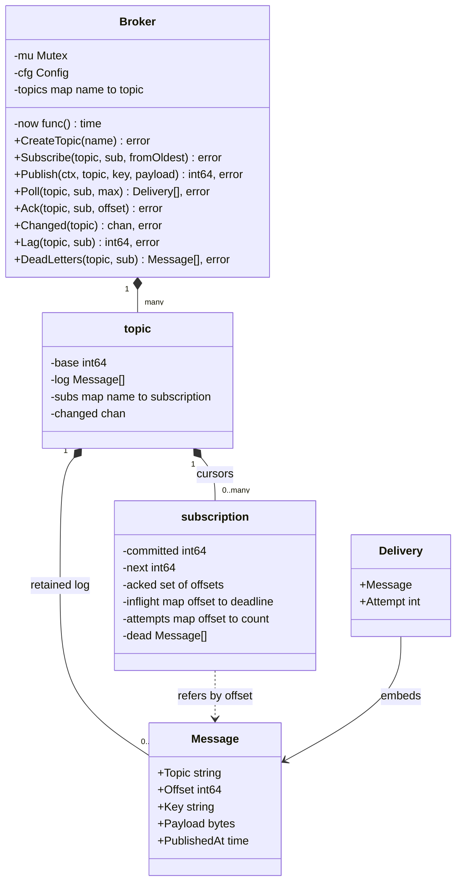
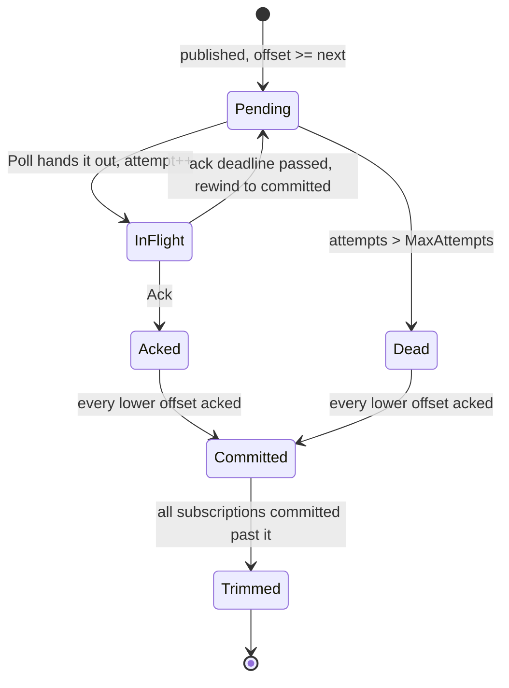
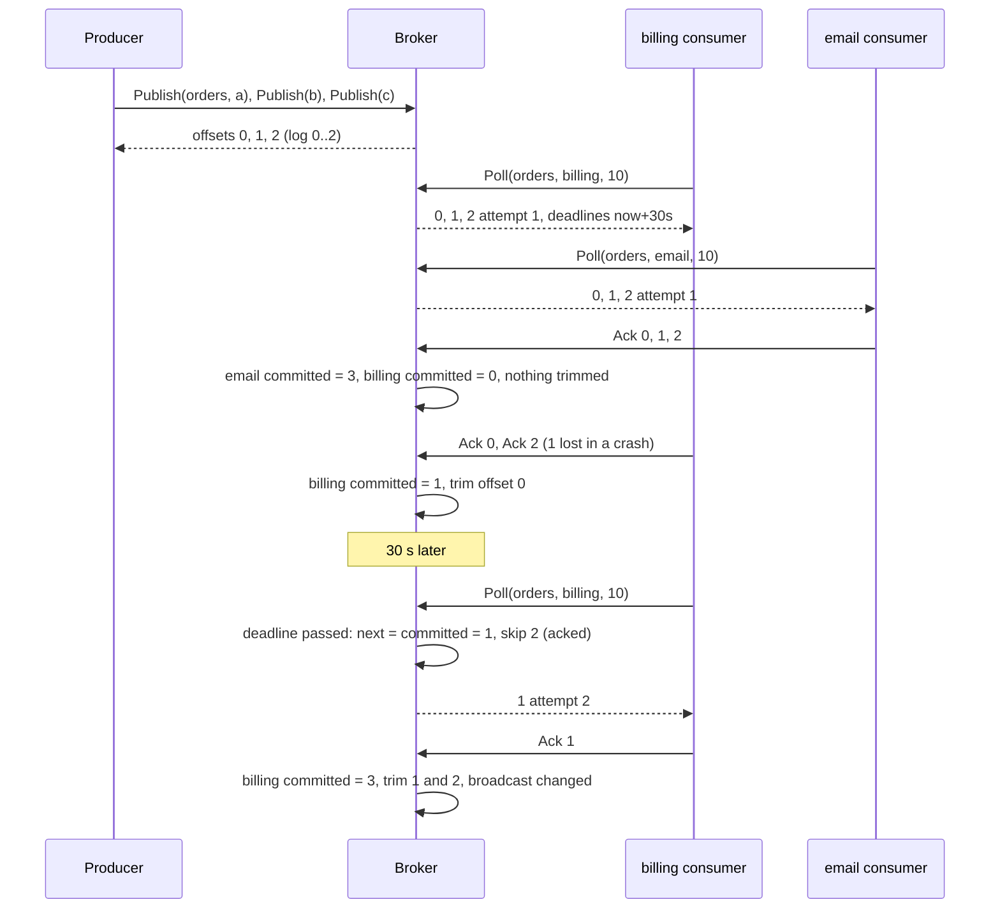

# Pub-Sub Message Queue

> [!summary] TL;DR
> An in-memory pub-sub broker stores each topic as an append-only log in which every message gets an increasing offset. Every subscription keeps its own committed offset, so many independent consumers read the same log. A consumer must ack each message; un-acked messages are redelivered after a timeout, which gives at-least-once delivery. A bounded buffer makes publishers wait when the slowest subscription falls too far behind.

> [!abstract] Core idea
> - **Topic = log**, **subscription = cursor**: publishing appends once, and fan-out is free because each subscription only moves its own offsets (`committed` and `next`).
> - **At-least-once**: a delivery is in flight until acked; after `AckTimeout` the subscription rewinds to its oldest un-acked offset and redelivers. Consumers must be idempotent.
> - **Per-topic order**: offsets are assigned under one lock, and each subscription reads in offset order, including after a rewind.
> - **Bounded buffers**: a topic retains only what some subscription has not committed, capped at `BufferSize`; when full, `Publish` blocks until an ack frees space or its `ctx` ends. `MaxInFlight` bounds each consumer.
> - **Poison messages** go to a dead-letter list after `MaxAttempts` deliveries so they cannot block the subscription forever.
> - Classic mistakes: one Go channel per subscriber with no ack (a crash loses messages), unbounded slices (one slow consumer grows memory without limit), and deleting a message when the *first* subscriber acks it.

## Problem statement

```text
Design an in-memory publish-subscribe message queue. Producers publish messages to
named topics. Each topic can have many subscriptions; every subscription receives
every message published after it was created. Consumers pull messages, process them
and acknowledge them. Unacknowledged messages must be redelivered. Messages within a
topic are delivered in publish order. Memory must stay bounded when a consumer is slow.
```

- It tests separating storage (the log) from consumption state (offsets), delivery semantics, flow control and correct concurrency with blocking waits. Time box: 10 minutes for Steps 1-4, 10 for Steps 5-7, 30-35 for the code, 10 for edge cases and the partitioned version.

### Solving path

1. Clarify: push or pull, delivery guarantee, ordering scope, what happens to a message nobody subscribes to, how slow consumers are handled.
2. Name the entities: `Message` (with offset), `topic` (log + base offset), `subscription` (committed, next, acked, in-flight, attempts), `Broker`.
3. Write `Publish` (append under the lock) and `Poll` (hand out from `next` in order).
4. Add `Ack` with out-of-order acks and the committed offset that advances only over a contiguous prefix.
5. Add redelivery on ack timeout (rewind to committed), the dead-letter list, `MaxInFlight`, and the bounded buffer with a blocking `Publish`.
6. Test fan-out, redelivery order, poison messages, both bounds, and 4 publishers with 2 consumers under `-race`.

## Step 1: Clarify requirements

### Questions to ask (with assumed answers)

- Push or pull? *Assume: pull (`Poll`), plus a `Changed` channel so a consumer can wait without busy-looping. Pull makes flow control the consumer's choice.*
- Delivery guarantee? *Assume: at-least-once. A message is redelivered until acked; exactly-once is out of scope and needs idempotent consumers ([[Delivery Semantics and Exactly-Once]]).*
- Ordering? *Assume: in publish order per topic, per subscription. No ordering across topics.*
- Does a new subscription see old messages? *Assume: by default it starts at the end; `fromOldest` starts at the oldest message still retained.*
- What if a topic has no subscriptions? *Assume: the message gets an offset and is dropped, as in classic pub-sub. Retention for replay is an extension.*
- Slow consumer? *Assume: bounded. The topic retains at most `BufferSize` uncommitted messages; publishers block (with a context) when it is full.*
- A message that always crashes the consumer? *Assume: after `MaxAttempts` deliveries it moves to a per-subscription dead-letter list.*

### Functional

- `CreateTopic(name)`, `Subscribe(topic, sub, fromOldest)`.
- `Publish(ctx, topic, key, payload)` returns the offset; blocks while the buffer is full.
- `Poll(topic, sub, max)` returns up to `max` deliveries in offset order, each with an attempt number.
- `Ack(topic, sub, offset)`; duplicate acks are no-ops.
- Redeliver after `AckTimeout`; dead-letter after `MaxAttempts`.
- `Lag(topic, sub)` and `DeadLetters(topic, sub)` for operators.

### Non-functional

- Safe for many publishers and consumers at once.
- Memory bounded by `BufferSize` per topic and `MaxInFlight` per subscription.
- No message is lost once `Publish` returned while a subscription exists; each is delivered at least once or dead-lettered.
- Time is injected, so redelivery tests do not sleep.

### Out of scope

- Durability to disk, replication and a network protocol (the system version is [[Case Study - Distributed Message Queue]]).
- Partitions and consumer groups with several members (Step 10).
- Message filtering and priorities.

## Step 2: Actors and use cases

| Actor | Use case |
|---|---|
| Producer (order service) | Publish `order.created` to topic `orders` |
| Consumer of subscription `billing` | Poll, charge the card, ack |
| Consumer of subscription `email` | Poll, send the confirmation email, ack (independently of billing) |
| Crashed or slow consumer | Never acks; its messages come back after the timeout |
| Operator | Create topics and subscriptions, watch lag, inspect dead letters |

The hardest use case is **ack with redelivery while keeping order**: acks arrive out of order, some deliveries time out, and the subscription must still redeliver in offset order and never skip a message.

## Step 3: Entities

| Entity | Key fields | Why it exists |
|---|---|---|
| `Message` | Topic, Offset, Key, Payload, PublishedAt | Immutable once published; the offset is its identity within the topic |
| `Delivery` | Message, Attempt | One hand-out to one subscription; the attempt number lets consumers spot redeliveries |
| `topic` | base, log, subs, changed | The retained log (offsets `base` to `end-1`) and its subscriptions |
| `subscription` | committed, next, acked, inflight, attempts, dead | One consumer group's cursor and bookkeeping |
| `Broker` | mu, cfg, now, topics | The facade; owns the lock and the clock |
| `Config` | BufferSize, MaxInFlight, AckTimeout, MaxAttempts | The bounds and timeouts |

Modelling insight: **the message is stored once; consumption is just numbers**. A subscription is `committed` (everything below is done), `next` (the next offset to hand out), and the sets for the offsets in between. Fan-out to 10 subscriptions costs 10 cursors, not 10 copies. The topic can drop a message only when **every** subscription has committed past it.

## Step 4: Relationships





This lifecycle is **per subscription**: the same message can be `Acked` for `email` and `InFlight` for `billing`. Only `Trimmed` is per topic.

## Step 5: APIs and public methods

```text
POST /topics                                body: {name}                    -> 201, 409 exists
POST /topics/{t}/subscriptions              body: {name, fromOldest}        -> 201, 409 exists
POST /topics/{t}/messages                   body: {key, payload}            -> 201 {offset}
                                            503 + Retry-After when the buffer stays full past the request timeout
GET  /topics/{t}/subscriptions/{s}/messages?max=10&waitMs=20000             -> 200 [{offset, attempt, key, payload}]
POST /topics/{t}/subscriptions/{s}/acks     body: {offsets: [3, 4, 7]}      -> 204, 400 unknown offset
GET  /topics/{t}/subscriptions/{s}          -> 200 {committed, lag, inFlight, deadLetters}
```

`waitMs` is long polling: the handler polls, and if nothing came back it waits on `Changed(topic)` or the timeout. The Go surface:

```go
type MessageQueue interface {
	Publish(ctx context.Context, topic, key string, payload []byte) (int64, error)
	Poll(topic, sub string, max int) ([]Delivery, error)
	Ack(topic, sub string, offset int64) error
	Changed(topic string) (<-chan struct{}, error)
}

var _ MessageQueue = (*Broker)(nil) // compile-time check
```

## Step 6: Storage and repositories

In memory the log is a slice with a `base` offset, so trimming the front never renumbers anything. A durable single-node version maps directly onto two tables:

```sql
CREATE TABLE messages (
    topic        TEXT        NOT NULL,
    "offset"     BIGINT      NOT NULL,          -- OFFSET is a reserved word
    key          TEXT,
    payload      BYTEA       NOT NULL,
    published_at TIMESTAMPTZ NOT NULL DEFAULT now(),
    PRIMARY KEY (topic, "offset")
);

CREATE TABLE topic_heads (
    topic       TEXT   PRIMARY KEY,
    next_offset BIGINT NOT NULL DEFAULT 0
);

CREATE TABLE subscriptions (
    topic      TEXT   NOT NULL,
    name       TEXT   NOT NULL,
    committed  BIGINT NOT NULL,                 -- every offset below is done
    PRIMARY KEY (topic, name)
);

CREATE TABLE deliveries (                       -- only the in-flight window
    topic        TEXT        NOT NULL,
    sub          TEXT        NOT NULL,
    "offset"     BIGINT      NOT NULL,
    attempt      INT         NOT NULL,
    ack_deadline TIMESTAMPTZ NOT NULL,
    acked        BOOLEAN     NOT NULL DEFAULT false,
    PRIMARY KEY (topic, sub, "offset")
);

-- offsets per topic must be gap-free and ordered: assign them under a per-topic row lock
-- (a sequence would leave gaps on rollback and does not order concurrent commits)
UPDATE topic_heads SET next_offset = next_offset + 1
WHERE topic = $1
RETURNING next_offset - 1 AS "offset";

-- trim what every subscription has committed
DELETE FROM messages m
WHERE m.topic = $1
  AND m."offset" < (SELECT min(committed) FROM subscriptions WHERE topic = $1);
```

```go
type LogRepo interface {
	Append(ctx context.Context, m Message) (int64, error) // per-topic lock assigns the offset
	Read(ctx context.Context, topic string, from int64, max int) ([]Message, error)
	TrimBelow(ctx context.Context, topic string, offset int64) error
}

type CursorRepo interface {
	Load(ctx context.Context, topic, sub string) (committed int64, err error)
	Commit(ctx context.Context, topic, sub string, committed int64) error // only moves forward
}
```

Publish runs the `UPDATE topic_heads` and the `INSERT INTO messages` in one transaction. The per-topic row lock serialises publishers to one topic, which is the same trade the in-memory lock makes; partitions in Step 10 are how real systems lift it. The row-lock trade-offs are in [[Locking - Optimistic vs Pessimistic]].

## Step 7: Patterns

| Pattern | Where | Why here |
|---|---|---|
| [[Observer and Event Bus]] | topic and subscriptions | Producers do not know consumers; the in-process event bus without acks is the simpler cousin |
| [[Facade (vs Mediator)]] | `Broker` | One entry point hides topics, cursors, the lock and the clock |
| [[Iterator and range-over-func]] | `Poll` from a cursor | A subscription is a resumable iterator over the log |
| [[Repository and Unit of Work]] | `LogRepo`, `CursorRepo` | Swap slices for tables without changing delivery logic |
| Broadcast channel | `topic.changed`, closed and replaced | Wakes every waiting publisher and consumer at once, with `select` and `ctx` |
| Bounded buffer / backpressure | `BufferSize`, `MaxInFlight` | The producer slows down instead of the broker running out of memory ([[Backpressure and Flow Control]]) |

Why not `sync.Cond` for the waits: `Cond.Wait` cannot be combined with `ctx.Done()` in a `select`, so a blocked `Publish` could not honour a deadline. A channel that is closed on every change and then replaced gives the same broadcast and works in `select`.

Patterns not used, and why:

- No goroutine per subscription pushing into a Go channel: a channel has no ack, no redelivery and no offset, and a crash loses whatever was buffered.
- No copy of the message per subscription: offsets make fan-out free.

## Folder structure

```text
pubsub/
  message.go     -> Message, Delivery, Config, Err* errors
  topic.go       -> topic, end, broadcast
  subscription.go-> subscription
  broker.go      -> Broker: NewBroker, CreateTopic, Subscribe, Publish, Poll, Ack, Changed, Lag, DeadLetters, advance
  broker_test.go -> fan-out, start position, redelivery, acks, poison, bounds, no subscribers, concurrency
cmd/demo/main.go -> two consumers with Changed-based waiting, SIGTERM stops them
```

## Step 8: Core code

> [!tip] What to code in a 60-minute round
> Aim for about 180 lines in the room.
> - **Write:** `Message`, `Delivery`, `topic` with `base` and `log`, `subscription` with `committed`, `next`, `acked`, `inflight`, and `Broker` with `CreateTopic`, `Subscribe`, `Publish` (non-blocking first), `Poll`, `Ack` and `advance`.
> - **Add if time remains:** the ack timeout rewind, the attempt count with dead letters, `MaxInFlight`, and the blocking `Publish` with the `changed` channel.
> - **Talk only:** partitions and consumer groups with several members, durability, long polling over HTTP, exactly-once with idempotent consumers.

### Walkthrough

`Publish(ctx, topic, key, payload)`:

1. Lock. If the retained log (everything some subscription has not committed) is shorter than `BufferSize`, assign `offset = end()`, copy the payload, append, `broadcast()`, unlock, return.
2. With no subscriptions the message gets an offset and is dropped (`base++`): nobody could read it.
3. Otherwise remember the current `changed` channel, unlock, and `select` on it or `ctx.Done()`. An ack that trims the log closes the channel; loop and try again.

`Poll(topic, sub, max)`:

1. If any in-flight delivery is past its deadline, set `next = committed` and clear the in-flight set: **go-back-N**. Everything from the oldest un-acked offset is handed out again, in order.
2. From `next`, skip offsets already acked out of order, increment the attempt; above `MaxAttempts` the message goes to `dead` and counts as acked. Otherwise record a deadline and add a `Delivery`. Stop at `max`, at the end of the log, or at `MaxInFlight`.
3. `advance` the committed offset over any dead letters just added.

`Ack(topic, sub, offset)`:

1. Below `committed` or already acked: no-op (a consumer may retry its ack).
2. No delivery attempt recorded: `ErrUnknownOffset`, it was never delivered. The check uses the attempt count, not `offset >= next`, because a rewind moves `next` back below offsets that were already delivered, and a late ack for one of them must still count.
3. Mark acked, remove from in-flight, `advance`: move `committed` over the contiguous acked prefix, then trim the log below the minimum committed offset of all subscriptions and broadcast.

```go
package pubsub

import (
	"context"
	"errors"
	"sync"
	"time"
)

var (
	ErrNoTopic        = errors.New("topic not found")
	ErrTopicExists    = errors.New("topic already exists")
	ErrNoSubscription = errors.New("subscription not found")
	ErrSubExists      = errors.New("subscription already exists")
	ErrUnknownOffset  = errors.New("offset was never delivered to this subscription")
)

// MessageQueue is the surface producers and consumers depend on.
type MessageQueue interface {
	Publish(ctx context.Context, topic, key string, payload []byte) (int64, error)
	Poll(topic, sub string, max int) ([]Delivery, error)
	Ack(topic, sub string, offset int64) error
	Changed(topic string) (<-chan struct{}, error)
}

var _ MessageQueue = (*Broker)(nil) // compile-time check

// Message is immutable once published. Offset is its position in the topic log.
type Message struct {
	Topic       string
	Offset      int64
	Key         string
	Payload     []byte
	PublishedAt time.Time
}

// Delivery is one hand-out of a message to one subscription.
type Delivery struct {
	Message
	Attempt int // 1 on first delivery, 2+ on redelivery
}

type Config struct {
	BufferSize  int           // max messages a topic retains that some subscription has not committed
	MaxInFlight int           // max un-acked deliveries per subscription
	AckTimeout  time.Duration // un-acked for this long: redeliver
	MaxAttempts int           // after this many deliveries the message goes to the dead-letter list
}

type subscription struct {
	committed int64               // every offset below this is acked or dead-lettered
	next      int64               // next offset to hand out
	acked     map[int64]bool      // acked offsets at or above committed (out-of-order acks)
	inflight  map[int64]time.Time // offset -> ack deadline
	attempts  map[int64]int
	dead      []Message
}

type topic struct {
	base    int64     // offset of log[0]; older messages were trimmed
	log     []Message // retained messages, offsets base .. base+len-1
	subs    map[string]*subscription
	changed chan struct{} // closed and replaced on every publish, ack or trim
}

func (t *topic) end() int64 { return t.base + int64(len(t.log)) }

// broadcast must be called with the broker lock held.
func (t *topic) broadcast() {
	close(t.changed)
	t.changed = make(chan struct{})
}

type Broker struct {
	mu     sync.Mutex
	cfg    Config
	now    func() time.Time
	topics map[string]*topic
}

func NewBroker(cfg Config, now func() time.Time) *Broker {
	if cfg.BufferSize < 1 {
		cfg.BufferSize = 1024
	}
	if cfg.MaxInFlight < 1 {
		cfg.MaxInFlight = 100
	}
	if cfg.MaxAttempts < 1 {
		cfg.MaxAttempts = 5
	}
	return &Broker{cfg: cfg, now: now, topics: map[string]*topic{}}
}

func (b *Broker) CreateTopic(name string) error {
	b.mu.Lock()
	defer b.mu.Unlock()
	if _, ok := b.topics[name]; ok {
		return ErrTopicExists
	}
	b.topics[name] = &topic{subs: map[string]*subscription{}, changed: make(chan struct{})}
	return nil
}

// Subscribe creates a durable subscription (a consumer group). fromOldest
// starts at the oldest retained message, otherwise at the end of the log.
func (b *Broker) Subscribe(topicName, sub string, fromOldest bool) error {
	b.mu.Lock()
	defer b.mu.Unlock()
	t, ok := b.topics[topicName]
	if !ok {
		return ErrNoTopic
	}
	if _, ok := t.subs[sub]; ok {
		return ErrSubExists
	}
	start := t.end()
	if fromOldest {
		start = t.base
	}
	t.subs[sub] = &subscription{
		committed: start, next: start,
		acked: map[int64]bool{}, inflight: map[int64]time.Time{}, attempts: map[int64]int{},
	}
	return nil
}

// Publish appends to the topic log. When the slowest subscription is
// BufferSize messages behind, Publish blocks until it acks or ctx ends.
func (b *Broker) Publish(ctx context.Context, topicName, key string, payload []byte) (int64, error) {
	for {
		b.mu.Lock()
		t, ok := b.topics[topicName]
		if !ok {
			b.mu.Unlock()
			return 0, ErrNoTopic
		}
		if len(t.log) < b.cfg.BufferSize {
			m := Message{Topic: topicName, Offset: t.end(), Key: key,
				Payload: append([]byte(nil), payload...), PublishedAt: b.now()}
			if len(t.subs) > 0 { // no subscribers: nobody can read it, keep nothing
				t.log = append(t.log, m)
			} else {
				t.base++
			}
			t.broadcast()
			b.mu.Unlock()
			return m.Offset, nil
		}
		wait := t.changed
		b.mu.Unlock()
		select {
		case <-wait: // something was acked or trimmed: try again
		case <-ctx.Done():
			return 0, ctx.Err()
		}
	}
}

// Poll hands out up to max messages in offset order. It never blocks; use
// Changed to wait. Expired deliveries rewind the subscription to its oldest
// unacked offset (go-back-N), which keeps per-topic order on redelivery.
func (b *Broker) Poll(topicName, sub string, max int) ([]Delivery, error) {
	b.mu.Lock()
	defer b.mu.Unlock()
	t, s, err := b.lookup(topicName, sub)
	if err != nil {
		return nil, err
	}
	now := b.now()
	for _, deadline := range s.inflight {
		if !now.Before(deadline) {
			s.next = s.committed
			clear(s.inflight) // all of them will be handed out again
			break
		}
	}
	var out []Delivery
	off := s.next
	for ; off < t.end() && len(out) < max && len(s.inflight) < b.cfg.MaxInFlight; off++ {
		if s.acked[off] {
			continue // acked out of order: never redeliver
		}
		m := t.log[off-t.base]
		s.attempts[off]++
		if s.attempts[off] > b.cfg.MaxAttempts {
			s.dead = append(s.dead, m) // poison message: park it, move on
			s.acked[off] = true
			continue
		}
		s.inflight[off] = now.Add(b.cfg.AckTimeout)
		out = append(out, Delivery{Message: m, Attempt: s.attempts[off]})
	}
	s.next = off
	b.advance(t, s)
	return out, nil
}

// Ack confirms one offset. Acking twice is a no-op, so consumers can retry it.
func (b *Broker) Ack(topicName, sub string, offset int64) error {
	b.mu.Lock()
	defer b.mu.Unlock()
	t, s, err := b.lookup(topicName, sub)
	if err != nil {
		return err
	}
	if offset < s.committed || s.acked[offset] {
		return nil // duplicate ack
	}
	if s.attempts[offset] == 0 {
		// Never handed out. Not `offset >= s.next`: after a rewind, next is
		// lower than offsets that were delivered and may still be acked late.
		return ErrUnknownOffset
	}
	delete(s.inflight, offset)
	s.acked[offset] = true
	b.advance(t, s)
	return nil
}

// Changed returns a channel that is closed on the next publish, ack or trim.
// Take it before Poll so a publish between the two is not missed.
func (b *Broker) Changed(topicName string) (<-chan struct{}, error) {
	b.mu.Lock()
	defer b.mu.Unlock()
	t, ok := b.topics[topicName]
	if !ok {
		return nil, ErrNoTopic
	}
	return t.changed, nil
}

// DeadLetters returns the messages this subscription gave up on.
func (b *Broker) DeadLetters(topicName, sub string) ([]Message, error) {
	b.mu.Lock()
	defer b.mu.Unlock()
	_, s, err := b.lookup(topicName, sub)
	if err != nil {
		return nil, err
	}
	return append([]Message(nil), s.dead...), nil
}

// Lag is how many messages the subscription has not committed yet.
func (b *Broker) Lag(topicName, sub string) (int64, error) {
	b.mu.Lock()
	defer b.mu.Unlock()
	t, s, err := b.lookup(topicName, sub)
	if err != nil {
		return 0, err
	}
	return t.end() - s.committed, nil
}

func (b *Broker) lookup(topicName, sub string) (*topic, *subscription, error) {
	t, ok := b.topics[topicName]
	if !ok {
		return nil, nil, ErrNoTopic
	}
	s, ok := t.subs[sub]
	if !ok {
		return nil, nil, ErrNoSubscription
	}
	return t, s, nil
}

// advance must be called with b.mu held. It moves the committed offset over
// contiguous acks, then trims what every subscription has committed.
func (b *Broker) advance(t *topic, s *subscription) {
	moved := false
	for s.acked[s.committed] {
		delete(s.acked, s.committed)
		delete(s.attempts, s.committed)
		s.committed++
		moved = true
	}
	if !moved {
		return
	}
	// A late ack after a rewind can move committed past next; those offsets
	// are done and may be trimmed below, so never hand them out again.
	s.next = max(s.next, s.committed)
	low := t.end()
	for _, other := range t.subs {
		low = min(low, other.committed)
	}
	if drop := low - t.base; drop > 0 {
		clear(t.log[:drop]) // let the payloads be collected
		t.log = t.log[drop:]
		t.base = low
	}
	t.broadcast()
}
```

## Test cases

| Test | Proves |
|---|---|
| `TestFanOutInOffsetOrder` | Two subscriptions each get offsets 0, 1, 2 in order with attempt 1; unknown subscription errors |
| `TestSubscribeStartPosition` | `fromOldest` replays retained messages 0-2; a live subscription sees only offset 2 |
| `TestAckTimeoutRedeliversInOrder` | Acks for 0 and 2 only; nothing comes back before 30 s; after it, 1 and 3 come back in order with attempt 2 and 2 is skipped; lag ends at 0 |
| `TestAckRules` | Duplicate ack is a no-op; acking an offset never delivered gives `ErrUnknownOffset` |
| `TestLateAckAfterRewind` | An ack that arrives after the rewind moved `next` below its offset is accepted, and the offset is not redelivered |
| `TestPoisonMessageGoesToDeadLetters` | Three timed-out attempts on offset 0, then it is dead-lettered and offset 1 flows |
| `TestMaxInFlightBoundsTheConsumer` | With `MaxInFlight` 2 a poll for 10 gets 2; one ack lets one more through |
| `TestBoundedBufferBlocksPublisher` | With `BufferSize` 2 the slow subscription holds the buffer: `Publish` times out, then unblocks when the slow one acks, getting offset 2 |
| `TestNoSubscribersRetainsNothing` | Three publishes with no subscription do not fill a buffer of 1; a late `fromOldest` subscriber sees only new messages |
| `TestConcurrentPublishersAndConsumers` | 4 publishers x 250 messages through a buffer of 16 to 2 subscriptions with their own consumer goroutines: each sees offsets 0 to 999 exactly once, in order |

All tests pass under `go test -race -count=30` (Go 1.24.4).

```go
package pubsub

import (
	"context"
	"errors"
	"fmt"
	"sync"
	"testing"
	"time"
)

type clock struct {
	mu sync.Mutex
	t  time.Time
}

func (c *clock) Now() time.Time { c.mu.Lock(); defer c.mu.Unlock(); return c.t }
func (c *clock) Advance(d time.Duration) {
	c.mu.Lock()
	defer c.mu.Unlock()
	c.t = c.t.Add(d)
}

func newBroker(t *testing.T, cfg Config, subs ...string) (*Broker, *clock) {
	t.Helper()
	c := &clock{t: time.Unix(1_700_000_000, 0)}
	b := NewBroker(cfg, c.Now)
	if err := b.CreateTopic("orders"); err != nil {
		t.Fatal(err)
	}
	for _, s := range subs {
		if err := b.Subscribe("orders", s, false); err != nil {
			t.Fatal(err)
		}
	}
	return b, c
}

func publish(t *testing.T, b *Broker, payloads ...string) {
	t.Helper()
	for _, p := range payloads {
		if _, err := b.Publish(context.Background(), "orders", "k", []byte(p)); err != nil {
			t.Fatal(err)
		}
	}
}

func offsets(ds []Delivery) []int64 {
	var out []int64
	for _, d := range ds {
		out = append(out, d.Offset)
	}
	return out
}

func eq(a, b []int64) bool { return fmt.Sprint(a) == fmt.Sprint(b) }

var cfg = Config{BufferSize: 100, MaxInFlight: 10, AckTimeout: 30 * time.Second, MaxAttempts: 3}

func TestFanOutInOffsetOrder(t *testing.T) {
	b, _ := newBroker(t, cfg, "billing", "email")
	publish(t, b, "a", "b", "c")
	for _, sub := range []string{"billing", "email"} {
		ds, err := b.Poll("orders", sub, 10)
		if err != nil {
			t.Fatal(err)
		}
		if !eq(offsets(ds), []int64{0, 1, 2}) || string(ds[2].Payload) != "c" || ds[0].Attempt != 1 {
			t.Fatalf("%s got %+v", sub, ds)
		}
	}
	if _, err := b.Poll("orders", "nobody", 1); !errors.Is(err, ErrNoSubscription) {
		t.Fatalf("unknown sub: %v", err)
	}
}

func TestSubscribeStartPosition(t *testing.T) {
	b, _ := newBroker(t, cfg, "billing") // keeps messages retained
	publish(t, b, "a", "b")
	if err := b.Subscribe("orders", "replay", true); err != nil {
		t.Fatal(err)
	}
	if err := b.Subscribe("orders", "live", false); err != nil {
		t.Fatal(err)
	}
	publish(t, b, "c")
	replay, _ := b.Poll("orders", "replay", 10)
	live, _ := b.Poll("orders", "live", 10)
	if !eq(offsets(replay), []int64{0, 1, 2}) || !eq(offsets(live), []int64{2}) {
		t.Fatalf("replay %v live %v", offsets(replay), offsets(live))
	}
}

func TestAckTimeoutRedeliversInOrder(t *testing.T) {
	b, c := newBroker(t, cfg, "billing")
	publish(t, b, "a", "b", "c", "d")
	ds, _ := b.Poll("orders", "billing", 10)
	if len(ds) != 4 {
		t.Fatalf("got %v", offsets(ds))
	}
	for _, off := range []int64{0, 2} { // 1 and 3 are lost by the consumer
		if err := b.Ack("orders", "billing", off); err != nil {
			t.Fatal(err)
		}
	}
	if again, _ := b.Poll("orders", "billing", 10); len(again) != 0 {
		t.Fatalf("redelivered before the timeout: %v", offsets(again))
	}
	c.Advance(30 * time.Second)
	again, _ := b.Poll("orders", "billing", 10)
	if !eq(offsets(again), []int64{1, 3}) || again[0].Attempt != 2 {
		t.Fatalf("redelivery %+v", again) // 2 was acked: skipped
	}
	_ = b.Ack("orders", "billing", 1)
	_ = b.Ack("orders", "billing", 3)
	if lag, _ := b.Lag("orders", "billing"); lag != 0 {
		t.Fatalf("lag %d", lag)
	}
}

func TestAckRules(t *testing.T) {
	b, _ := newBroker(t, cfg, "billing")
	publish(t, b, "a")
	_, _ = b.Poll("orders", "billing", 10)
	if err := b.Ack("orders", "billing", 0); err != nil {
		t.Fatal(err)
	}
	if err := b.Ack("orders", "billing", 0); err != nil {
		t.Fatalf("duplicate ack must be a no-op: %v", err)
	}
	if err := b.Ack("orders", "billing", 7); !errors.Is(err, ErrUnknownOffset) {
		t.Fatalf("never delivered: %v", err)
	}
}

// A consumer finishes offset 1 just after the deadline. The rewind moved next
// back to 0, but the late ack is real work and must be accepted.
func TestLateAckAfterRewind(t *testing.T) {
	small := cfg
	small.MaxInFlight = 2
	b, c := newBroker(t, small, "billing")
	publish(t, b, "a", "b", "c")
	_, _ = b.Poll("orders", "billing", 10) // 0 and 1 in flight
	c.Advance(30 * time.Second)
	ds, _ := b.Poll("orders", "billing", 1) // rewind: 0 again, next = 1
	if !eq(offsets(ds), []int64{0}) {
		t.Fatalf("rewind %v", offsets(ds))
	}
	if err := b.Ack("orders", "billing", 1); err != nil {
		t.Fatalf("late ack: %v", err)
	}
	_ = b.Ack("orders", "billing", 0)
	ds, _ = b.Poll("orders", "billing", 10)
	if !eq(offsets(ds), []int64{2}) {
		t.Fatalf("after late ack: %v", offsets(ds))
	}
}

func TestPoisonMessageGoesToDeadLetters(t *testing.T) {
	b, c := newBroker(t, cfg, "billing")
	publish(t, b, "poison", "fine")
	for attempt := 1; attempt <= 3; attempt++ {
		ds, _ := b.Poll("orders", "billing", 1)
		if len(ds) != 1 || ds[0].Offset != 0 || ds[0].Attempt != attempt {
			t.Fatalf("attempt %d: %+v", attempt, ds)
		}
		c.Advance(30 * time.Second) // consumer crashes every time
	}
	ds, _ := b.Poll("orders", "billing", 1)
	if !eq(offsets(ds), []int64{1}) {
		t.Fatalf("after 3 attempts the next message flows: %v", offsets(ds))
	}
	dead, _ := b.DeadLetters("orders", "billing")
	if len(dead) != 1 || string(dead[0].Payload) != "poison" {
		t.Fatalf("dead %+v", dead)
	}
}

func TestMaxInFlightBoundsTheConsumer(t *testing.T) {
	small := cfg
	small.MaxInFlight = 2
	b, _ := newBroker(t, small, "billing")
	publish(t, b, "a", "b", "c")
	ds, _ := b.Poll("orders", "billing", 10)
	more, _ := b.Poll("orders", "billing", 10)
	if len(ds) != 2 || len(more) != 0 {
		t.Fatalf("got %v then %v", offsets(ds), offsets(more))
	}
	_ = b.Ack("orders", "billing", 0)
	more, _ = b.Poll("orders", "billing", 10)
	if !eq(offsets(more), []int64{2}) {
		t.Fatalf("after one ack: %v", offsets(more))
	}
}

func TestBoundedBufferBlocksPublisher(t *testing.T) {
	small := cfg
	small.BufferSize = 2
	b, _ := newBroker(t, small, "fast", "slow")
	publish(t, b, "a", "b")
	for _, s := range []string{"fast"} { // only the fast subscription acks
		ds, _ := b.Poll("orders", s, 10)
		for _, d := range ds {
			_ = b.Ack("orders", s, d.Offset)
		}
	}
	ctx, cancel := context.WithTimeout(context.Background(), 20*time.Millisecond)
	defer cancel()
	if _, err := b.Publish(ctx, "orders", "k", []byte("c")); !errors.Is(err, context.DeadlineExceeded) {
		t.Fatalf("the slowest subscription holds the buffer: %v", err)
	}
	done := make(chan int64, 1)
	go func() {
		off, err := b.Publish(context.Background(), "orders", "k", []byte("c"))
		if err != nil {
			t.Error(err)
		}
		done <- off
	}()
	ds, _ := b.Poll("orders", "slow", 1)
	_ = b.Ack("orders", "slow", ds[0].Offset) // frees one slot
	if off := <-done; off != 2 {
		t.Fatalf("offset %d", off)
	}
}

func TestNoSubscribersRetainsNothing(t *testing.T) {
	b, _ := newBroker(t, Config{BufferSize: 1})
	publish(t, b, "a", "b", "c") // would block if retained
	if err := b.Subscribe("orders", "late", true); err != nil {
		t.Fatal(err)
	}
	publish(t, b, "d")
	ds, _ := b.Poll("orders", "late", 10)
	if !eq(offsets(ds), []int64{3}) {
		t.Fatalf("got %v", offsets(ds))
	}
}

// 4 publishers x 250 messages, buffer of 16, 2 subscriptions with their own
// consumer goroutine. Each subscription must see 0..999 once, in order.
func TestConcurrentPublishersAndConsumers(t *testing.T) {
	small := cfg
	small.BufferSize = 16
	b, _ := newBroker(t, small, "billing", "email")
	const total = 1000
	ctx, cancel := context.WithTimeout(context.Background(), 10*time.Second)
	defer cancel()

	var consumers sync.WaitGroup
	got := map[string][]int64{}
	var gotMu sync.Mutex
	for _, sub := range []string{"billing", "email"} {
		consumers.Add(1)
		go func(sub string) {
			defer consumers.Done()
			var seen []int64
			for len(seen) < total {
				changed, _ := b.Changed("orders") // take it before Poll: no lost wake-up
				ds, err := b.Poll("orders", sub, 8)
				if err != nil {
					t.Error(err)
					return
				}
				for _, d := range ds {
					seen = append(seen, d.Offset)
					if err := b.Ack("orders", sub, d.Offset); err != nil {
						t.Error(err)
						return
					}
				}
				if len(ds) == 0 {
					select {
					case <-changed:
					case <-ctx.Done():
						t.Error("consumer timed out")
						return
					}
				}
			}
			gotMu.Lock()
			got[sub] = seen
			gotMu.Unlock()
		}(sub)
	}

	var publishers sync.WaitGroup
	for p := 0; p < 4; p++ {
		publishers.Add(1)
		go func(p int) {
			defer publishers.Done()
			for i := 0; i < total/4; i++ {
				if _, err := b.Publish(ctx, "orders", fmt.Sprint(p), []byte("x")); err != nil {
					t.Error(err)
					return
				}
			}
		}(p)
	}
	publishers.Wait()
	consumers.Wait()
	for sub, seen := range got {
		if len(seen) != total {
			t.Fatalf("%s saw %d", sub, len(seen))
		}
		for i, off := range seen {
			if off != int64(i) {
				t.Fatalf("%s: position %d has offset %d", sub, i, off)
			}
		}
	}
}
```

## Step 9: Edge cases

| Edge case | What happens | How the design handles it |
|---|---|---|
| Consumer crashes after processing, before acking | The message comes back | At-least-once by design; the consumer dedupes by `(topic, offset)` or a business key |
| Acks arrive out of order (3 before 1) | `committed` must not jump past 1 | `acked` set above `committed`; `advance` moves only over a contiguous prefix |
| One delivery times out while later ones are healthy | Later ones are redelivered too | Go-back-N keeps order; the cost is duplicates and extra attempts (see Step 10) |
| Poison message | Redelivered forever, blocks everything behind it | `MaxAttempts`, then the dead-letter list ([[Dead Letter Queues and Poison Messages]]) |
| Slow subscription | Log grows without limit | `BufferSize` caps retained messages; `Publish` blocks with a context; `Lag` shows who is slow |
| Consumer grabs thousands of messages and stalls | All time out together, a redelivery storm | `MaxInFlight` per subscription |
| Duplicate ack (network retry) | Must not fail | No-op below `committed` or when already acked |
| Ack for an offset never delivered | Would corrupt `committed` | `ErrUnknownOffset` |
| Late ack after a rewind (the consumer finished just after the deadline) | The offset is now above `next`, so a check against `next` would reject real work | `Ack` checks the attempt count instead; the acked offset is skipped on the next `Poll` |
| Publisher's payload slice reused after `Publish` | Stored message would change | `Publish` copies the payload |
| Publisher blocked on a full buffer while the request is cancelled | Goroutine stuck | `select` on `ctx.Done()` returns `ctx.Err()` |
| New publish while a consumer is between `Changed` and `Poll` | Lost wake-up | Take `Changed` before `Poll`; the channel is closed by any later publish |
| A topic with no subscriptions | Would retain messages nobody can read | Dropped on publish; offsets still advance |

### Common mistakes

- Deleting a message when the first subscription acks it, so other subscriptions lose it.
- Advancing `committed` to the highest acked offset, which skips un-acked messages below it.
- Using `sync.Cond` for a blocking publish and then being unable to honour a context deadline.
- Holding the broker lock while calling consumer code (push model): one slow handler stops every topic.
- Unbounded slices "for now": the first slow consumer is an out-of-memory crash.

## Step 10: Tradeoffs and extensions

| Follow-up | Design change |
|---|---|
| Higher publish throughput | Partitions: N logs per topic, `hash(key) % N` picks one; order is per key, not per topic ([[Message Ordering and Partition Keys]]) |
| Several consumers sharing one subscription | Consumer group: assign partitions to members, one member per partition, rebalance on join or leave |
| Selective redelivery | Redeliver only the expired offsets (as Google Pub/Sub does without ordering keys); faster, but order is lost |
| Replay | Time-based retention independent of acks; a subscription can seek to an offset or a time |
| Durability | Append to a segment file with fsync policy, or the tables in Step 6; replicate for availability |
| Push delivery | A goroutine per subscription that polls and calls a handler with a bounded worker pool, still acking |
| Exactly-once processing | Not in the broker: idempotent consumers, or commit the offset in the same transaction as the side effect ([[Transactional Outbox and CDC]]) |

Tradeoffs chosen:

- **Go-back-N over selective redelivery.** Keeps per-topic order and makes `committed` a single number; costs duplicate deliveries of healthy messages after the expired one, and those duplicates also use up attempts. A message can therefore be dead-lettered because an earlier message kept timing out, which is acceptable for a sketch and should be stated.
- **One mutex for the whole broker.** Simple and correct; every topic shares it, so busy topics slow each other down once the lock shows up in a profile. The next step is a lock per topic, since nothing crosses topics.
- **Pull with a `Changed` channel.** The consumer controls its rate; no goroutine per subscription inside the broker.
- **Retention bound by the slowest subscription.** Correct for at-least-once, but one abandoned subscription stops all publishers; production systems add retention limits that drop old messages and move the abandoned cursor (and alert on lag).
- **Ordering per topic.** Strong and simple; it limits a topic to one publisher lock, which is what partitions relax.

The system-level design (replication, partition leaders, storage segments, consumer rebalancing) is [[Case Study - Distributed Message Queue]].

## Drawing



Redraw it from memory:

- [ ] One log with `base` and `end`, and two cursors at different positions
- [ ] A subscription's `committed`, `next`, the acked set and the in-flight deadlines
- [ ] The rewind on timeout, skipping acked offsets
- [ ] Trim below the minimum `committed`, and the publisher blocked on a full buffer

## Interview questions

> [!question]- Why store one log per topic with a cursor per subscription instead of a queue per subscriber?
> Fan-out then costs one append plus N small cursors, not N copies. Replay and new subscriptions become "start at offset X". Each subscription's progress is just numbers, so it is cheap to persist. A message is deleted only when every cursor has passed it.

> [!question]- How do acks that arrive out of order move the committed offset?
> Acked offsets above `committed` go into a set. `committed` advances only while `acked[committed]` is true, so it moves over a contiguous prefix and never skips a message that is still in flight. In the test, acks for 0 and 2 move `committed` to 1, and after 1 is redelivered and acked it jumps to 3.

> [!question]- Trap: the consumer acks a message, the broker records it, and the consumer crashes before its database write commits. Is that at-least-once?
> No, that message is lost: acking before the side effect is at-most-once. For at-least-once the consumer must ack after the side effect commits. Then a crash between the two causes a redelivery, so the consumer must be idempotent, for example a unique constraint on the message ID.

> [!question]- How does redelivery keep per-topic order, and what does it cost?
> On timeout the subscription rewinds `next` to `committed` (go-back-N) and hands out again in offset order, skipping offsets already acked. Order holds, but healthy messages after the expired one are delivered again and use up attempts. Selective redelivery avoids the duplicates but breaks order, which is why brokers usually keep order only per key or partition.

> [!question]- What bounds memory, and what happens when a bound is hit?
> `BufferSize` caps what a topic retains for its slowest subscription: `Publish` blocks until an ack trims the log, or until its context ends. `MaxInFlight` caps un-acked deliveries per subscription, so a stalled consumer cannot hold the whole log. The cost is that one abandoned subscription blocks publishers; production systems add a retention limit and lag alerts.

> [!question]- Why a closed-and-replaced channel instead of `sync.Cond` for waiting?
> A blocked publisher must honour `ctx.Done()`, and `Cond.Wait` cannot sit in a `select`. Closing a channel wakes every waiter at once (a broadcast), and replacing it under the lock arms the next round. Waiters take the channel before they release the lock or before `Poll`, so no wake-up is lost.

> [!question]- How would you scale this to many consumers in one group and higher throughput?
> Split each topic into partitions by `hash(key) % N`, each with its own log and lock. A consumer group assigns each partition to exactly one member and rebalances when members join or leave. Order then holds per key, throughput grows with partitions, and committed offsets become per (group, partition), as in Kafka.

## Cheat sheet

- Topic = append-only log with `base`; subscription = `committed` + `next` + acked set + in-flight deadlines.
- Offsets assigned under one lock give per-topic order; fan-out is free.
- Ack out of order, commit only over the contiguous prefix; duplicate ack is a no-op.
- Ack timeout: rewind to `committed`, redeliver in order, skip acked; attempts > max go to dead letters.
- Ack after the side effect: at-least-once, consumers idempotent.
- Bounds: `BufferSize` per topic (slowest subscription), `MaxInFlight` per subscription; blocking `Publish` with `ctx`.
- Wait with a closed-and-replaced `changed` channel, taken before `Poll`.
- Scale with partitions by key and consumer groups; order becomes per key.

## Links

- **Before this:** [[LLD Interview Method]], [[Observer and Event Bus]], [[Concurrency for LLD]], [[17 LLD/Practice/Task Scheduler (delayed and recurring jobs)|Task Scheduler (delayed and recurring jobs)]]
- **Next:** [[Ride Sharing]]
- **Compare with:** [[Case Study - Distributed Message Queue]] (the system-level design), [[Kafka and Event Streaming]], [[Delivery Semantics and Exactly-Once]], [[Queues vs Streams and Broker Comparison]], [[Notification Service]] (a consumer of such a queue)
