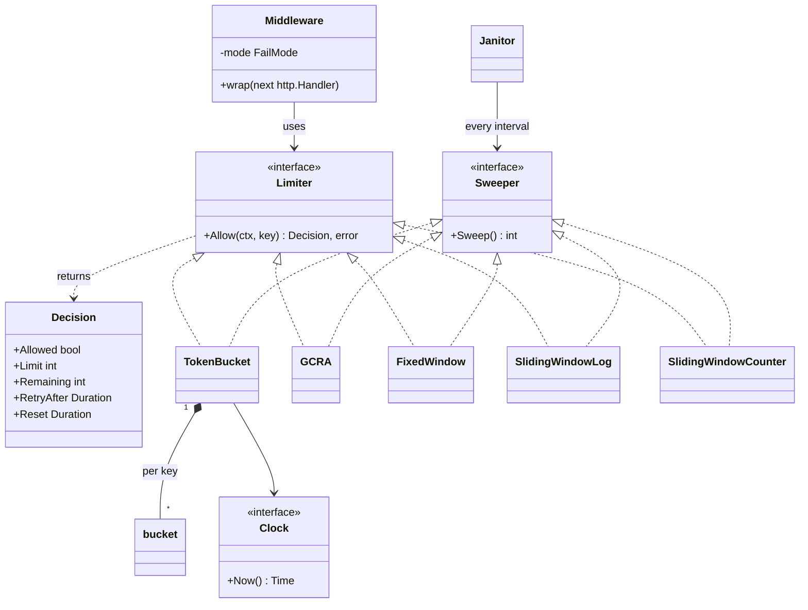
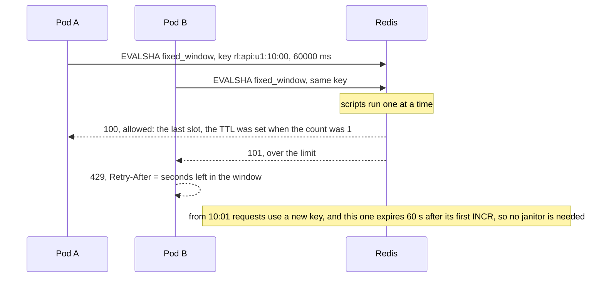
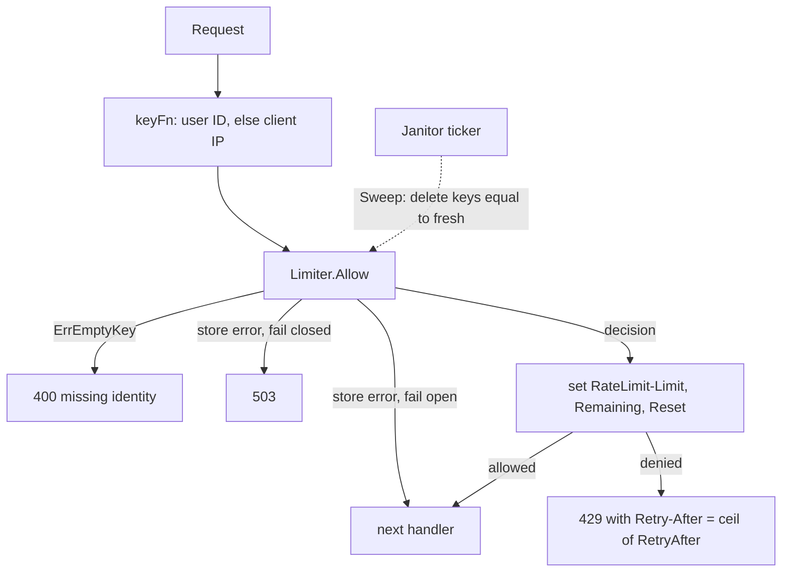

# Rate Limiter

> [!summary] TL;DR
> A rate limiter allows at most N requests per key (user, IP or API key) per unit of time and answers the rest with HTTP 429. Each algorithm (token bucket, GCRA, fixed window, sliding log, sliding counter) is a strategy behind one `Allow(ctx, key)` that returns a decision: allowed or not, how many requests remain, and **when to retry**. Per-key state lives in a map under a mutex, a janitor deletes idle keys so the map cannot grow forever, and with many app instances the state moves to Redis behind one atomic Lua script.

## Problem statement

```text
Design a rate limiter. It allows at most N requests per key (user, IP or API key)
per time unit and rejects the rest with HTTP 429 and a correct Retry-After. Support
more than one algorithm, keep memory bounded when millions of IPs pass through, and
explain how it works across many app instances and what happens when Redis is down.
```

What it really tests: algorithm choice, the Strategy pattern, an atomic read-refill-check-decrement under a lock, testable time through an injected clock, and production judgment: headers, memory, multi-instance limits and fail-open versus fail-closed. The old version of this solution described a janitor but never coded it (so per-IP keys leaked memory), hard-coded `Retry-After: 1`, and claimed a per-bucket mutex while the code used one mutex per limiter; all three are fixed here.

## Step 1: Clarify requirements

Questions to ask, with the assumptions this design makes:

- Limit by what? *One key string per request from a key function: the user ID when logged in, else the client IP.*
- Bursts allowed? *Yes for normal APIs (token bucket or GCRA); strict limits use a sliding window.*
- One instance or many pods? *Code in memory first, then Redis for a global limit.*
- Limiter store down? *Fail open by default; fail closed for login, OTP and payment endpoints.*
- Headers? *`Retry-After` on every 429, computed from the algorithm; quota headers on every response, using the `RateLimit-*` names of the IETF draft up to -06.*
- How many distinct keys? *Millions of IPs per day (an estimate for a public API), so idle state must be deleted.*

**Functional:** `Allow(ctx, key)` returns a `Decision`; five swappable algorithms; HTTP middleware returns 429 with a computed `Retry-After`; fail mode per route; a janitor removes idle keys.

**Non-functional:** O(1) or close per check, no SQL on the hot path; concurrent requests for one key never exceed the limit; tests without `time.Sleep`; bounded memory; a shared store for multi-instance limits.

**Out of scope:** concurrency limits (max in-flight requests: a semaphore), DDoS at the network edge (CDN or WAF), monthly quotas and billing (metering).

## Step 2: Actors and use cases

| Actor | Use case |
| --- | --- |
| API client (user, IP, API key) | Sends a request; served, or 429 with `Retry-After` |
| HTTP middleware | Builds the key, calls `Allow`, writes headers, 429, 503 or 400 |
| Limiter (strategy) | Decides for one key at the current time |
| Janitor | Deletes per-key state that is equivalent to a fresh key |
| Admin or config service | Changes a policy: algorithm, limit, window, refill rate, fail mode |

The use case to code: `Allow(ctx, key)` under concurrency, where refill or window reset, check and decrement are one atomic step.

## Step 3: Entities

| Entity | Key fields | Why it exists |
| --- | --- | --- |
| `Limiter` (interface) | `Allow(ctx, key) (Decision, error)` | The Strategy contract; the middleware depends only on it |
| `Decision` | Allowed, Limit, Remaining, RetryAfter, Reset | Everything the HTTP layer needs for status and headers |
| `Sweeper` (interface) | `Sweep() int` | What the janitor calls on in-memory limiters |
| `TokenBucket` + `bucket` | capacity, rate; tokens, last | Bursts up to capacity, average = rate |
| `GCRA` | burst, interval, tolerance; TAT per key | Same traffic as a token bucket with one timestamp per key |
| `FixedWindow` + `window` | limit, size; start, count | One counter per window; maps to Redis `INCR` |
| `SlidingWindowLog` | limit, window; timestamps per key | Exact, O(limit) memory per key |
| `SlidingWindowCounter` | limit, size; prev, curr per key | Two counters, weighted estimate, no edge burst |
| `Clock` (interface) | `Now()` | Tests move time by hand |

Modelling insight: the **rule** (limit, window, fail mode) and the **state** (per-key bucket or counter) are different things. One policy has millions of per-key states, so the rule lives in SQL and the state in memory or Redis, never counters in SQL. The second insight: state is **deletable when it equals a fresh key** (a full bucket, a past window), and that is exactly the janitor's rule.

## Step 4: Relationships



- **Realization:** the five algorithms implement both `Limiter` and `Sweeper`. A Redis limiter implements only `Limiter`, because Redis expires its own keys.
- **Composition:** each limiter owns its per-key map; the state has no life outside it. One mutex per limiter guards the whole map (not one per bucket); sharding by `hash(key)` is the fix if that lock becomes hot.
- **Association:** limiters use an injected `Clock`; the middleware uses a `Limiter` and never knows which algorithm.

## Step 5: APIs and public methods

The limiter is middleware, so clients see it only in responses:

```text
200 OK                         RateLimit-Limit: 10, RateLimit-Remaining: 7, RateLimit-Reset: 1
429 Too Many Requests          Retry-After: 4 (computed), RateLimit-Remaining: 0
503 Service Unavailable        only on FailClosed routes when the limiter store is down
400 Bad Request                the key function produced no key (a bug, never a bypass)

GET /rate-limits/{policy}      admin
PUT /rate-limits/{policy}      {"algorithm": "gcra", "burst": 10, "per_sec": 5, "fail_mode": "closed"}
```

`429` comes from RFC 6585 and `Retry-After` (whole seconds here) from RFC 9110. The quota headers come from an IETF draft whose field names changed between versions. The code below sends the three fields of the IETF draft `draft-ietf-httpapi-ratelimit-headers` up to version -06: `RateLimit-Limit`, `RateLimit-Remaining` and `RateLimit-Reset`, where `Reset` is seconds from now. From -07 the draft replaces those three with a single structured `RateLimit` field next to `RateLimit-Policy`, so a server that follows -07 or a later version sends different names. Many public APIs use their own `X-RateLimit-*` set instead; GitHub, for example, sends `x-ratelimit-reset` as a Unix timestamp, not as seconds from now. Write down which form you send, because clients parse names and units literally.

| Function | Contract |
| --- | --- |
| `Limiter.Allow(ctx, key) (Decision, error)` | `ErrEmptyKey` for `""`; a Redis implementation can also return a store error |
| `NewTokenBucket(capacity, ratePerSec, clock)` | Bursts up to `capacity`, refills `ratePerSec` |
| `NewGCRA(burst, ratePerSec, clock)` | The same traffic as the token bucket, one timestamp per key |
| `NewFixedWindow(limit, size, clock)` | `limit` per aligned window |
| `NewSlidingWindowLog(limit, window, clock)` | Exact `limit` per rolling window |
| `NewSlidingWindowCounter(limit, size, clock)` | Weighted estimate over two windows |
| `RunJanitor(ctx, sweeper, every)` | Calls `Sweep` on a ticker until `ctx` ends |
| `Middleware(limiter, keyFn, mode)` | Headers, 429, 503 (fail closed) or 400 (no key) |

Every constructor returns `ErrInvalidConfig` for a zero limit, rate or window, or a nil clock.

## Step 6: Storage and repositories

Only configuration goes in SQL; a SQL write per request would be far too slow.

```sql
CREATE TABLE rate_limit_policies (
    id             BIGINT GENERATED ALWAYS AS IDENTITY PRIMARY KEY,
    name           TEXT NOT NULL UNIQUE,     -- e.g. 'login_per_ip'
    algorithm      TEXT NOT NULL CHECK (algorithm IN
                       ('token_bucket', 'gcra', 'fixed_window', 'sliding_log', 'sliding_counter')),
    limit_count    INT NOT NULL CHECK (limit_count > 0),   -- capacity, burst or limit
    per_sec        NUMERIC CHECK (per_sec > 0),            -- token bucket and GCRA
    window_seconds INT CHECK (window_seconds > 0),         -- the window algorithms
    fail_mode      TEXT NOT NULL DEFAULT 'open' CHECK (fail_mode IN ('open', 'closed')),
    updated_at     TIMESTAMPTZ NOT NULL DEFAULT now()
);
```

State for many instances lives in Redis, and every check is **one Lua script**, because Redis runs a script atomically. The classic mistake is two separate calls, `INCR` and then `EXPIRE`: if the process dies between them, the key has no TTL, the counter never resets, and that user is limited forever.

```lua
-- fixed window: KEYS[1] = rl:{policy}:{key}:{windowStart}, ARGV[1] = window in ms
local c = redis.call('INCR', KEYS[1])
if c == 1 then
  redis.call('PEXPIRE', KEYS[1], ARGV[1])
end
return c
```

Two pods sharing one limit of 100 per minute for user u1, with 99 requests already counted in this window. Each script runs whole, so the two calls queue inside Redis instead of interleaving:



The other algorithms map the same way: a token bucket is a hash `{tokens, last}` updated by one script (`HMGET`, refill by elapsed time, check, decrement, `HSET`, `PEXPIRE`); a sliding log is a sorted set (`ZREMRANGEBYSCORE`, `ZCARD`, `ZADD`, `PEXPIRE`); GCRA is one string holding the TAT, and it is the algorithm `go-redis/redis_rate` implements. Every Redis key gets a TTL, so Redis needs no janitor. The Go side of this (go-redis setup, `redis.Nil`, scripts) is in [[Redis in Go]].

A `PolicyRepository` reads the policy rows once, caches them in memory and refreshes them on change, so the hot path never touches SQL. The ports, compiled with the package below:

```go
// RateLimitPolicy mirrors one rate_limit_policies row.
type RateLimitPolicy struct {
	Name      string
	Algorithm string // token_bucket | gcra | fixed_window | sliding_log | sliding_counter
	Limit     int    // capacity, burst or limit
	PerSec    float64
	Window    time.Duration
	FailMode  FailMode
}

// PolicyRepository is the config lookup, cached in memory and refreshed on change.
type PolicyRepository interface {
	Get(ctx context.Context, name string) (RateLimitPolicy, error)
}

// CounterStore is the atomic counter behind a Redis fixed window: one Lua script per call.
type CounterStore interface {
	// IncrWindow increments the counter for key in the current window and
	// returns the new count. The key expires with the window.
	IncrWindow(ctx context.Context, key string, window time.Duration) (int64, error)
}
```

Folder layout for the practice package:

```text
ratelimiter/
  limiter.go          -> Limiter, Sweeper, Clock, Decision, errors, RealClock, RunJanitor
  token_bucket.go     -> TokenBucket
  gcra.go             -> GCRA
  fixed_window.go     -> FixedWindow
  sliding_window.go   -> SlidingWindowLog, SlidingWindowCounter
  middleware.go       -> Middleware, FailMode, ceilSeconds
  factory.go          -> NewFromPolicy(RateLimitPolicy) Limiter (production extension)
  redis.go            -> Redis-backed limiter, one Lua script per check (production extension)
  ratelimiter_test.go -> tests with a fake clock
cmd/demo/main.go      -> wiring: build limiters, start one janitor per limiter, wrap routes, serve
```

- `limiter.go` holds the contracts every other file depends on.
- Each algorithm file owns its per-key state and its mutex.
- `middleware.go` holds the HTTP concerns only: the key, status codes and headers.

## Step 7: Patterns

| Pattern | Where | Why here |
| --- | --- | --- |
| [[Strategy and Template Method]] | `Limiter` with five algorithms | Algorithms change per endpoint; the middleware does not care |
| [[Decorator and Middleware]] | `Middleware` wraps any `http.Handler` | Adds limiting to a route without touching the handler |
| [[Factory and Abstract Factory]] | build a limiter from a policy row's `algorithm` | One place maps config to a strategy |
| [[Repository and Unit of Work]] | `PolicyRepository`; memory or Redis state | Swap storage without touching callers |
| Dependency injection, see [[Testing LLD Code]] | `Clock` | Tests move time without `time.Sleep` |

Not used: a Singleton limiter (created in `main` and injected, so tests do not share state), and a refill goroutine per key (lazy refill on `Allow` gives the same numbers with zero goroutines).

## Step 8: Core code

> [!warning] What this version fixes
> - **The janitor was described but not coded,** so every IP ever seen kept an entry. Now each limiter has `Sweep`, which deletes state that is equivalent to a fresh key, and `RunJanitor` calls it on a ticker. A deleted key behaves exactly as if it had been kept.
> - **`Retry-After` was hard-coded to 1.** Now each algorithm computes it: token bucket `(1 − tokens) / rate`; GCRA `TAT − tolerance − now`; fixed window the time to the window end; sliding log the time until the oldest entry leaves; sliding counter by solving the weighted estimate. The middleware rounds up to whole seconds.
> - **The text claimed a per-bucket mutex,** but the code used one limiter-wide mutex. The text now says what the code does.

Complete package, Go 1.24, standard library only:

```go
package ratelimiter

import (
	"context"
	"errors"
	"math"
	"net/http"
	"strconv"
	"sync"
	"time"
)

var (
	ErrInvalidConfig = errors.New("ratelimiter: invalid config")
	ErrEmptyKey      = errors.New("ratelimiter: empty key")
)

// Clock is injected so tests move time instead of sleeping.
type Clock interface{ Now() time.Time }

type RealClock struct{}

func (RealClock) Now() time.Time { return time.Now() }

// Decision is what the middleware turns into status codes and headers.
type Decision struct {
	Allowed    bool
	Limit      int
	Remaining  int
	RetryAfter time.Duration // > 0 only when denied: when one more request would fit
	Reset      time.Duration // until the full quota is back
}

// Limiter is the Strategy interface. ctx and error exist because a Redis
// implementation does network I/O and can fail.
type Limiter interface {
	Allow(ctx context.Context, key string) (Decision, error)
}

// Sweeper is implemented by every in-memory limiter: Sweep drops per-key state
// that is equivalent to a fresh key, and returns how many keys it removed.
type Sweeper interface{ Sweep() int }

// RunJanitor sweeps every interval until ctx ends. Without it, the per-key
// maps keep one entry for every IP address ever seen.
func RunJanitor(ctx context.Context, s Sweeper, every time.Duration) {
	t := time.NewTicker(every)
	defer t.Stop()
	for {
		select {
		case <-ctx.Done():
			return
		case <-t.C:
			s.Sweep()
		}
	}
}

// Each limiter below guards its whole key map with one mutex: simple and
// correct. Sharding the map by hash(key) is the fix if that lock gets hot.

// ---------- Token bucket: bursts up to capacity, average = rate ----------

type bucket struct {
	tokens float64
	last   time.Time
}

type TokenBucket struct {
	mu       sync.Mutex
	capacity float64 // max burst
	rate     float64 // tokens added per second
	clock    Clock
	buckets  map[string]*bucket
}

func NewTokenBucket(capacity int, ratePerSec float64, clock Clock) (*TokenBucket, error) {
	if capacity <= 0 || ratePerSec <= 0 || clock == nil {
		return nil, ErrInvalidConfig
	}
	return &TokenBucket{capacity: float64(capacity), rate: ratePerSec, clock: clock, buckets: map[string]*bucket{}}, nil
}

func (l *TokenBucket) Allow(_ context.Context, key string) (Decision, error) {
	if key == "" {
		return Decision{}, ErrEmptyKey
	}
	now := l.clock.Now()
	l.mu.Lock()
	defer l.mu.Unlock()
	b, ok := l.buckets[key]
	if !ok {
		b = &bucket{tokens: l.capacity, last: now}
		l.buckets[key] = b
	}
	if elapsed := now.Sub(b.last).Seconds(); elapsed > 0 { // a clock going backwards never removes tokens
		b.tokens = min(l.capacity, b.tokens+elapsed*l.rate)
		b.last = now
	}
	d := Decision{Limit: int(l.capacity)}
	if b.tokens < 1 {
		d.RetryAfter = l.secs((1 - b.tokens) / l.rate) // time until one whole token
	} else {
		b.tokens--
		d.Allowed = true
	}
	d.Remaining = int(b.tokens)
	d.Reset = l.secs((l.capacity - b.tokens) / l.rate)
	return d, nil
}

func (l *TokenBucket) secs(s float64) time.Duration { return time.Duration(s * float64(time.Second)) }

// Sweep drops buckets that have refilled to capacity: a new bucket starts full,
// so deleting one changes no future decision.
func (l *TokenBucket) Sweep() int {
	now := l.clock.Now()
	l.mu.Lock()
	defer l.mu.Unlock()
	n := 0
	for k, b := range l.buckets {
		if b.tokens+now.Sub(b.last).Seconds()*l.rate >= l.capacity {
			delete(l.buckets, k)
			n++
		}
	}
	return n
}

// ---------- GCRA: the leaky bucket as a meter, one timestamp per key ----------

// GCRA keeps a theoretical arrival time (TAT) per key. A request at time t is
// allowed if t >= TAT - tolerance; then TAT = max(TAT, t) + interval.
// With tolerance = (burst-1) * interval it admits the same traffic as a token
// bucket of capacity burst, but stores one number instead of two.
type GCRA struct {
	mu        sync.Mutex
	burst     int
	interval  time.Duration // emission interval = 1 / rate
	tolerance time.Duration
	clock     Clock
	tat       map[string]time.Time
}

func NewGCRA(burst int, ratePerSec float64, clock Clock) (*GCRA, error) {
	if burst <= 0 || ratePerSec <= 0 || clock == nil {
		return nil, ErrInvalidConfig
	}
	iv := time.Duration(float64(time.Second) / ratePerSec)
	return &GCRA{burst: burst, interval: iv, tolerance: time.Duration(burst-1) * iv, clock: clock, tat: map[string]time.Time{}}, nil
}

func (l *GCRA) Allow(_ context.Context, key string) (Decision, error) {
	if key == "" {
		return Decision{}, ErrEmptyKey
	}
	now := l.clock.Now()
	l.mu.Lock()
	defer l.mu.Unlock()
	tat := l.tat[key]
	if tat.Before(now) {
		tat = now
	}
	d := Decision{Limit: l.burst}
	if allowAt := tat.Add(-l.tolerance); now.Before(allowAt) {
		d.RetryAfter, d.Reset = allowAt.Sub(now), tat.Sub(now)
		return d, nil
	}
	tat = tat.Add(l.interval)
	l.tat[key] = tat
	d.Allowed, d.Reset = true, tat.Sub(now)
	if spare := l.tolerance - tat.Sub(now); spare >= 0 { // room left inside the tolerance
		d.Remaining = int(spare/l.interval) + 1
	}
	return d, nil
}

// Sweep drops keys whose TAT has passed: they are back to a full burst.
func (l *GCRA) Sweep() int {
	now := l.clock.Now()
	l.mu.Lock()
	defer l.mu.Unlock()
	n := 0
	for k, t := range l.tat {
		if !t.After(now) {
			delete(l.tat, k)
			n++
		}
	}
	return n
}

// ---------- Fixed window: one counter per key per window ----------

type window struct {
	start time.Time
	count int
}

type FixedWindow struct {
	mu      sync.Mutex
	limit   int
	size    time.Duration
	clock   Clock
	windows map[string]*window
}

func NewFixedWindow(limit int, size time.Duration, clock Clock) (*FixedWindow, error) {
	if limit <= 0 || size <= 0 || clock == nil {
		return nil, ErrInvalidConfig
	}
	return &FixedWindow{limit: limit, size: size, clock: clock, windows: map[string]*window{}}, nil
}

func (l *FixedWindow) Allow(_ context.Context, key string) (Decision, error) {
	if key == "" {
		return Decision{}, ErrEmptyKey
	}
	now := l.clock.Now()
	start := now.Truncate(l.size) // 10:00:37 -> 10:00:00 for a 1 min window
	l.mu.Lock()
	defer l.mu.Unlock()
	w, ok := l.windows[key]
	if !ok || !w.start.Equal(start) {
		w = &window{start: start} // a new window resets the counter
		l.windows[key] = w
	}
	d := Decision{Limit: l.limit, Reset: start.Add(l.size).Sub(now)}
	if w.count >= l.limit {
		d.RetryAfter = d.Reset
		return d, nil
	}
	w.count++
	d.Allowed, d.Remaining = true, l.limit-w.count
	return d, nil
}

// Sweep drops counters from past windows.
func (l *FixedWindow) Sweep() int {
	start := l.clock.Now().Truncate(l.size)
	l.mu.Lock()
	defer l.mu.Unlock()
	n := 0
	for k, w := range l.windows {
		if w.start.Before(start) {
			delete(l.windows, k)
			n++
		}
	}
	return n
}

// ---------- Sliding window log: exact, O(limit) memory per key ----------

type SlidingWindowLog struct {
	mu     sync.Mutex
	limit  int
	window time.Duration
	clock  Clock
	logs   map[string][]time.Time
}

func NewSlidingWindowLog(limit int, window time.Duration, clock Clock) (*SlidingWindowLog, error) {
	if limit <= 0 || window <= 0 || clock == nil {
		return nil, ErrInvalidConfig
	}
	return &SlidingWindowLog{limit: limit, window: window, clock: clock, logs: map[string][]time.Time{}}, nil
}

func (l *SlidingWindowLog) Allow(_ context.Context, key string) (Decision, error) {
	if key == "" {
		return Decision{}, ErrEmptyKey
	}
	now := l.clock.Now()
	cutoff := now.Add(-l.window)
	l.mu.Lock()
	defer l.mu.Unlock()
	ts := l.logs[key]
	i := 0
	for i < len(ts) && !ts[i].After(cutoff) { // the slice is sorted by time
		i++
	}
	ts = ts[i:]
	d := Decision{Limit: l.limit}
	if len(ts) >= l.limit {
		l.logs[key] = ts
		d.RetryAfter = ts[0].Add(l.window).Sub(now) // when the oldest entry leaves
		d.Reset = ts[len(ts)-1].Add(l.window).Sub(now)
		return d, nil
	}
	ts = append(ts, now)
	l.logs[key] = ts
	d.Allowed, d.Remaining, d.Reset = true, l.limit-len(ts), l.window
	return d, nil
}

// Sweep drops logs whose newest entry has left the window.
func (l *SlidingWindowLog) Sweep() int {
	cutoff := l.clock.Now().Add(-l.window)
	l.mu.Lock()
	defer l.mu.Unlock()
	n := 0
	for k, ts := range l.logs {
		if len(ts) == 0 || !ts[len(ts)-1].After(cutoff) {
			delete(l.logs, k)
			n++
		}
	}
	return n
}

// ---------- Sliding window counter: two counters, weighted estimate ----------

type counterState struct {
	start      time.Time // start of the current fixed window
	prev, curr int
}

// SlidingWindowCounter estimates the rolling count as
// prev * (1 - elapsed/size) + curr: O(1) memory, small error, no edge burst.
type SlidingWindowCounter struct {
	mu     sync.Mutex
	limit  int
	size   time.Duration
	clock  Clock
	states map[string]*counterState
}

func NewSlidingWindowCounter(limit int, size time.Duration, clock Clock) (*SlidingWindowCounter, error) {
	if limit <= 0 || size <= 0 || clock == nil {
		return nil, ErrInvalidConfig
	}
	return &SlidingWindowCounter{limit: limit, size: size, clock: clock, states: map[string]*counterState{}}, nil
}

func (l *SlidingWindowCounter) Allow(_ context.Context, key string) (Decision, error) {
	if key == "" {
		return Decision{}, ErrEmptyKey
	}
	now := l.clock.Now()
	start := now.Truncate(l.size)
	l.mu.Lock()
	defer l.mu.Unlock()
	s, ok := l.states[key]
	switch {
	case !ok || start.Sub(s.start) >= 2*l.size: // both windows are old
		s = &counterState{start: start}
		l.states[key] = s
	case start.Sub(s.start) == l.size: // moved one window on
		s.start, s.prev, s.curr = start, s.curr, 0
	}
	elapsed := now.Sub(start)
	weight := 1 - float64(elapsed)/float64(l.size)
	estimate := float64(s.prev)*weight + float64(s.curr)
	d := Decision{Limit: l.limit, Reset: 2*l.size - elapsed}
	if estimate+1 > float64(l.limit)+1e-9 { // the epsilon absorbs float rounding
		d.RetryAfter = l.retryAfter(float64(s.prev), float64(s.curr), elapsed)
		return d, nil
	}
	s.curr++
	d.Allowed, d.Remaining = true, max(0, int(float64(l.limit)-estimate-1))
	return d, nil
}

// retryAfter solves prev*(1-e/size) + curr <= limit-1 for the earliest e,
// assuming no other request is counted meanwhile.
func (l *SlidingWindowCounter) retryAfter(prev, curr float64, elapsed time.Duration) time.Duration {
	need, size := float64(l.limit-1), float64(l.size)
	if curr <= need { // the previous window's weight must shrink (prev > 0 here)
		return time.Duration(math.Ceil(size*(1-(need-curr)/prev))) - elapsed
	}
	// the current window alone is full: wait for the next one, where curr becomes prev
	return l.size - elapsed + time.Duration(math.Ceil(size*(1-need/curr)))
}

// Sweep drops keys whose two windows are both in the past.
func (l *SlidingWindowCounter) Sweep() int {
	start := l.clock.Now().Truncate(l.size)
	l.mu.Lock()
	defer l.mu.Unlock()
	n := 0
	for k, s := range l.states {
		if start.Sub(s.start) >= 2*l.size {
			delete(l.states, k)
			n++
		}
	}
	return n
}

// ---------- HTTP middleware (Decorator) ----------

type KeyFunc func(r *http.Request) string

// FailMode decides what happens when the limiter itself errors (Redis down).
type FailMode int

const (
	FailOpen   FailMode = iota // serve the request: availability first
	FailClosed                 // reject: protection first (login, OTP, payments)
)

func Middleware(l Limiter, keyFn KeyFunc, mode FailMode) func(http.Handler) http.Handler {
	return func(next http.Handler) http.Handler {
		return http.HandlerFunc(func(w http.ResponseWriter, r *http.Request) {
			d, err := l.Allow(r.Context(), keyFn(r))
			switch {
			case errors.Is(err, ErrEmptyKey): // a key function bug must not bypass the limit
				http.Error(w, "missing client identity", http.StatusBadRequest)
				return
			case err != nil && mode == FailClosed:
				http.Error(w, "rate limiter unavailable", http.StatusServiceUnavailable)
				return
			case err != nil: // FailOpen: log and count in real code, then serve
			default:
				h := w.Header()
				h.Set("RateLimit-Limit", strconv.Itoa(d.Limit))
				h.Set("RateLimit-Remaining", strconv.Itoa(d.Remaining))
				h.Set("RateLimit-Reset", ceilSeconds(d.Reset))
				if !d.Allowed {
					h.Set("Retry-After", ceilSeconds(d.RetryAfter))
					http.Error(w, "too many requests", http.StatusTooManyRequests)
					return
				}
			}
			next.ServeHTTP(w, r)
		})
	}
}

// ceilSeconds rounds up to whole seconds: Retry-After takes an integer, and
// rounding down would invite a retry that is still too early.
func ceilSeconds(d time.Duration) string {
	return strconv.FormatInt(int64((d+time.Second-1)/time.Second), 10)
}
```

Walkthrough:

1. **Token bucket.** Under the lock: create a full bucket for a new key, refill `min(capacity, tokens + elapsed × rate)` (skipped if the clock went backwards), then take a token or compute the wait for the missing fraction. Capacity 2 at 1/s: two requests pass at once, the third waits 1 s, and after 0.5 s it still waits 0.5 s.
2. **GCRA.** One time per key, the theoretical arrival time (TAT). Allow if `now ≥ TAT − tolerance`, then `TAT = max(TAT, now) + interval`. With `tolerance = (burst − 1) × interval` it admits exactly the token bucket's traffic; the test runs both through the same steps.
3. **Fixed window.** `now.Truncate(size)` names the window; a new window resets the counter. Weak spot: limit 2/min allows 2 at 0:50 and 2 more at 1:00, four in ten seconds.
4. **Sliding log.** Drop timestamps at or before `now − window`, allow if fewer than `limit` remain. Exact, but it stores `limit` timestamps per key.
5. **Sliding counter.** Keep `prev` and `curr` for two fixed windows and estimate `prev × (1 − elapsed/size) + curr`. With 10/min, 10 requests last minute and 30 s into this one, the estimate is 5, so 5 more fit; the next one waits until the previous window's weight drops: `10 × (1 − e/60) + 5 ≤ 9` at `e = 36 s`, a wait of 6 s.
6. **Middleware.** An empty key is a 400 (a key function bug must not bypass the limit); a store error is 503 on fail-closed routes and a pass on fail-open ones; otherwise it sets the draft -06 `RateLimit-*` fields and, when denied, `Retry-After` and 429.



### Algorithm comparison

| Algorithm | State per key | Edge burst | Retry-After | Best for |
| --- | --- | --- | --- | --- |
| Token bucket | 2 numbers | Up to capacity, by design | `(1 − tokens)/rate` | General APIs |
| GCRA (leaky bucket as a meter) | 1 timestamp | Up to burst, by design | `TAT − tolerance − now` | The same, cheapest in Redis |
| Leaky bucket as a queue | a FIFO | None: output is smoothed | no rejection until the queue is full (NGINX then answers 503 by default; `limit_req_status 429` changes it); the delay is position × interval | Shaping traffic to a fragile backend (NGINX `limit_req` with `burst`) |
| Fixed window | 1 counter | Up to 2× at the boundary | until the window ends | Cheap quotas, Redis `INCR` |
| Sliding log | `limit` timestamps | None, exact | until the oldest leaves | Strict low limits: login, OTP |
| Sliding counter | 2 counters | Small estimation error | solve the weighted estimate | Large limits that must be fairly strict |

The two leaky buckets are different things: **as a meter** it rejects what would overflow, which is GCRA; **as a queue** it delays requests and releases them at a constant rate, which turns a burst into latency instead of 429s.

### Compared with golang.org/x/time/rate

| | This package | `x/time/rate` |
| --- | --- | --- |
| Algorithm | five strategies | one token bucket: `rate.NewLimiter(rate.Every(200*time.Millisecond), 10)` |
| Keys | per-key maps with a janitor | one limiter per object; per-key limits need your own map and janitor |
| Waiting | reject with `Retry-After` | `Allow()` rejects; `Wait(ctx)` blocks; `Reserve()` returns a `Delay()` and can be cancelled |
| Time in tests | injected `Clock` | `AllowN(t, n)` and `ReserveN(t, n)` take the time as an argument |
| Multi-instance | swap in a Redis `Limiter` | in-process only |

Use `x/time/rate` for client-side throttling (calling a vendor at 50 requests per second with `Wait`) and for a few fixed keys; use a per-key strategy package with a janitor, or Redis, for a server facing millions of IPs.

## Test cases

| Test | Proves |
| --- | --- |
| `TestLimiters` (table, 5 algorithms) | allow and deny sequences, `Remaining` and the exact computed `RetryAfter` at each step, per-key isolation, empty key |
| `TestInvalidConfig` | constructors reject zero limits, zero windows and a nil clock |
| `TestConcurrentExactlyLimit` | 100 goroutines, limit 10: exactly 10 allowed for every algorithm |
| `TestSweepDropsIdleKeys` | 1,000 one-off IPs are swept after 3 minutes; a key used just now survives (the audit bug) |
| `TestRunJanitorStopsWithContext` | the janitor sweeps on its ticker and returns when the context ends |
| `TestMiddleware` | 200 with `RateLimit-Remaining: 0`, then 429 with `Retry-After: 4` at 1 request per 4 s; fail open 200, fail closed 503; empty key 400 |
| `TestCeilSeconds` | 1 ms rounds up to 1 s, 1.5 s to 2 s |

All pass with `go vet` and `go test -race` on Go 1.24.4, also with `-count=5` (measured: 99.5% statement coverage).

```go
package ratelimiter

import (
	"context"
	"errors"
	"fmt"
	"net/http"
	"net/http/httptest"
	"sync"
	"sync/atomic"
	"testing"
	"time"
)

type fakeClock struct {
	mu sync.Mutex
	t  time.Time
}

func (f *fakeClock) Now() time.Time { f.mu.Lock(); defer f.mu.Unlock(); return f.t }

func (f *fakeClock) Add(d time.Duration) { f.mu.Lock(); defer f.mu.Unlock(); f.t = f.t.Add(d) }

// step is one Allow call: advance the clock, then expect a decision.
type step struct {
	advance   time.Duration
	key       string
	want      bool
	remaining int
	retry     time.Duration // expected RetryAfter when denied
}

func TestLimiters(t *testing.T) {
	tests := []struct {
		name  string
		build func(c Clock) Limiter
		steps []step
	}{
		{"token bucket: burst 2, refill 1/s", func(c Clock) Limiter { l, _ := NewTokenBucket(2, 1, c); return l }, []step{
			{0, "u", true, 1, 0}, {0, "u", true, 0, 0}, {0, "u", false, 0, time.Second},
			{0, "v", true, 1, 0}, // another key has its own bucket
			{500 * time.Millisecond, "u", false, 0, 500 * time.Millisecond}, // half a token: wait the other half
			{500 * time.Millisecond, "u", true, 0, 0}, {0, "u", false, 0, time.Second},
		}},
		{"GCRA: same traffic as the token bucket", func(c Clock) Limiter { l, _ := NewGCRA(2, 1, c); return l }, []step{
			{0, "u", true, 1, 0}, {0, "u", true, 0, 0}, {0, "u", false, 0, time.Second},
			{0, "v", true, 1, 0},
			{500 * time.Millisecond, "u", false, 0, 500 * time.Millisecond},
			{500 * time.Millisecond, "u", true, 0, 0}, {0, "u", false, 0, time.Second},
		}},
		{"fixed window: 2/min, edge burst", func(c Clock) Limiter { l, _ := NewFixedWindow(2, time.Minute, c); return l }, []step{
			{50 * time.Second, "u", true, 1, 0}, {0, "u", true, 0, 0}, {0, "u", false, 0, 10 * time.Second}, // at 0:50
			{10 * time.Second, "u", true, 1, 0}, {0, "u", true, 0, 0}, // at 1:00: 4 requests in 10 s
			{0, "u", false, 0, time.Minute},
		}},
		{"sliding log: 2/min, oldest leaves", func(c Clock) Limiter { l, _ := NewSlidingWindowLog(2, time.Minute, c); return l }, []step{
			{0, "u", true, 1, 0}, {30 * time.Second, "u", true, 0, 0}, {0, "u", false, 0, 30 * time.Second},
			{30 * time.Second, "u", true, 0, 0}, // the first entry left the window
			{0, "u", false, 0, 30 * time.Second},
		}},
		{"sliding counter: 10/min, weighted previous window", func(c Clock) Limiter {
			l, _ := NewSlidingWindowCounter(10, time.Minute, c)
			for range 10 { // fill the window [0:00, 1:00)
				_, _ = l.Allow(context.Background(), "u")
			}
			return l
		}, []step{
			{90 * time.Second, "u", true, 4, 0}, // at 1:30: 10*0.5 + 0 = 5, so 5 more fit
			{0, "u", true, 3, 0}, {0, "u", true, 2, 0}, {0, "u", true, 1, 0}, {0, "u", true, 0, 0},
			{0, "u", false, 0, 6 * time.Second}, // 10*(1-e/60) + 5 <= 9 at e = 36 s
			{6 * time.Second, "u", true, 0, 0},
		}},
	}
	for _, tc := range tests {
		t.Run(tc.name, func(t *testing.T) {
			clk := &fakeClock{t: time.Unix(0, 0)}
			l := tc.build(clk)
			for i, s := range tc.steps {
				clk.Add(s.advance)
				d, err := l.Allow(context.Background(), s.key)
				if err != nil || d.Allowed != s.want || d.Remaining != s.remaining || d.RetryAfter != s.retry {
					t.Fatalf("step %d: got %+v, %v; want allowed=%v remaining=%d retry=%v",
						i, d, err, s.want, s.remaining, s.retry)
				}
			}
			if _, err := l.Allow(context.Background(), ""); !errors.Is(err, ErrEmptyKey) {
				t.Fatalf("empty key: %v", err)
			}
		})
	}
}

func TestInvalidConfig(t *testing.T) {
	c := &fakeClock{}
	if _, err := NewTokenBucket(0, 1, c); !errors.Is(err, ErrInvalidConfig) {
		t.Fatal(err)
	}
	if _, err := NewGCRA(1, 0, c); !errors.Is(err, ErrInvalidConfig) {
		t.Fatal(err)
	}
	if _, err := NewFixedWindow(1, 0, c); !errors.Is(err, ErrInvalidConfig) {
		t.Fatal(err)
	}
	if _, err := NewSlidingWindowLog(1, time.Second, nil); !errors.Is(err, ErrInvalidConfig) {
		t.Fatal(err)
	}
	if _, err := NewSlidingWindowCounter(0, time.Second, c); !errors.Is(err, ErrInvalidConfig) {
		t.Fatal(err)
	}
}

// 100 goroutines hit one key with a limit of 10: exactly 10 win, for every algorithm.
func TestConcurrentExactlyLimit(t *testing.T) {
	clk := &fakeClock{t: time.Unix(0, 0)}
	tb, _ := NewTokenBucket(10, 1, clk)
	gc, _ := NewGCRA(10, 1, clk)
	fw, _ := NewFixedWindow(10, time.Minute, clk)
	sl, _ := NewSlidingWindowLog(10, time.Minute, clk)
	sc, _ := NewSlidingWindowCounter(10, time.Minute, clk)
	for _, l := range []Limiter{tb, gc, fw, sl, sc} {
		var allowed atomic.Int64
		var wg sync.WaitGroup
		for range 100 {
			wg.Add(1)
			go func() {
				defer wg.Done()
				if d, _ := l.Allow(context.Background(), "k"); d.Allowed {
					allowed.Add(1)
				}
			}()
		}
		wg.Wait()
		if allowed.Load() != 10 {
			t.Fatalf("%T: want 10 allowed, got %d", l, allowed.Load())
		}
	}
}

// The audit bug: per-key maps never shrank. 1,000 one-off IPs must be swept,
// and a key that is still limited must survive the sweep.
func TestSweepDropsIdleKeys(t *testing.T) {
	clk := &fakeClock{t: time.Unix(0, 0)}
	tb, _ := NewTokenBucket(5, 1, clk)
	gc, _ := NewGCRA(5, 1, clk)
	fw, _ := NewFixedWindow(5, time.Minute, clk)
	sl, _ := NewSlidingWindowLog(5, time.Minute, clk)
	sc, _ := NewSlidingWindowCounter(5, time.Minute, clk)
	all := []interface {
		Limiter
		Sweeper
	}{tb, gc, fw, sl, sc}
	for _, l := range all {
		for i := range 1000 {
			_, _ = l.Allow(context.Background(), fmt.Sprint("ip-", i))
		}
	}
	clk.Add(3 * time.Minute) // longer than any refill time or window pair
	for _, l := range all {
		_, _ = l.Allow(context.Background(), "busy") // fresh state, not yet idle
		if n := l.Sweep(); n != 1000 {
			t.Fatalf("%T: swept %d keys, want 1000", l, n)
		}
	}
}

type countingSweeper struct{ n atomic.Int64 }

func (c *countingSweeper) Sweep() int { c.n.Add(1); return 0 }

func TestRunJanitorStopsWithContext(t *testing.T) {
	s := &countingSweeper{}
	ctx, cancel := context.WithCancel(context.Background())
	done := make(chan struct{})
	go func() { RunJanitor(ctx, s, time.Millisecond); close(done) }()
	for deadline := time.Now().Add(2 * time.Second); s.n.Load() < 3; {
		if time.Now().After(deadline) {
			t.Fatal("janitor never swept")
		}
		time.Sleep(time.Millisecond)
	}
	cancel()
	<-done
}

// downLimiter simulates Redis being unavailable.
type downLimiter struct{}

func (downLimiter) Allow(context.Context, string) (Decision, error) {
	return Decision{}, errors.New("redis: connection refused")
}

func TestMiddleware(t *testing.T) {
	ok := http.HandlerFunc(func(http.ResponseWriter, *http.Request) {})
	ip := func(*http.Request) string { return "203.0.113.7" }
	serve := func(h http.Handler) *httptest.ResponseRecorder {
		rec := httptest.NewRecorder()
		h.ServeHTTP(rec, httptest.NewRequest("GET", "/", nil))
		return rec
	}
	tb, _ := NewTokenBucket(1, 0.25, &fakeClock{t: time.Unix(0, 0)}) // 1 request per 4 s
	h := Middleware(tb, ip, FailOpen)(ok)
	first, second := serve(h), serve(h)
	if first.Code != 200 || first.Header().Get("RateLimit-Remaining") != "0" {
		t.Fatal(first.Code, first.Header())
	}
	if second.Code != 429 || second.Header().Get("Retry-After") != "4" || second.Header().Get("RateLimit-Limit") != "1" {
		t.Fatal("Retry-After must be computed from the refill rate:", second.Code, second.Header())
	}
	if c := serve(Middleware(downLimiter{}, ip, FailOpen)(ok)).Code; c != 200 {
		t.Fatal("fail open should serve, got", c)
	}
	if c := serve(Middleware(downLimiter{}, ip, FailClosed)(ok)).Code; c != 503 {
		t.Fatal("fail closed should reject, got", c)
	}
	noKey := func(*http.Request) string { return "" }
	if c := serve(Middleware(tb, noKey, FailOpen)(ok)).Code; c != 400 {
		t.Fatal("an empty key must not pass through, got", c)
	}
}

func TestCeilSeconds(t *testing.T) {
	for d, want := range map[time.Duration]string{0: "0", time.Millisecond: "1", time.Second: "1", 1500 * time.Millisecond: "2"} {
		if got := ceilSeconds(d); got != want {
			t.Fatalf("%v: got %s want %s", d, got, want)
		}
	}
}
```

## Step 9: Edge cases

| Edge case | Risk | Handling |
| --- | --- | --- |
| 100 requests read `tokens = 1` at once | All pass | Refill, check and decrement under one mutex; the test asserts exactly 10 of 100 |
| Two pods do Redis `GET` then `SET` | Both see room | One Lua script per check |
| `INCR` then `EXPIRE` as two calls | A crash leaves a key with no TTL: limited forever | Both inside one script |
| In-memory state on 5 pods | 5× the limit | Redis for a global limit, or `limit / pods` as a rough fallback |
| Millions of one-off IPs | Memory grows without bound | Janitor deletes state equal to a fresh key; Redis keys carry a TTL |
| Redis down | `Allow` errors | Fail open for normal APIs, fail closed for login, OTP and payments; alert either way |
| Fixed-window boundary | 2× burst | Sliding counter, GCRA or token bucket where it matters |
| Clock skew between pods | Windows disagree | Use Redis `TIME` inside the script, not each pod's clock |
| Clock going backwards | Negative elapsed time | `elapsed > 0` check; GCRA uses `max(TAT, now)` |
| Spoofed `X-Forwarded-For` | Attackers rotate keys | Trust the header only from your own load balancer; prefer the user ID |
| Signed payment-provider webhooks | Legitimate events rejected | Do not limit authenticated provider traffic; limit unauthenticated traffic |
| Clients retry at once after 429 | Retry storm | Computed `Retry-After`; clients add jittered backoff |

## Step 10: Tradeoffs and extensions

| Follow-up | Design change |
| --- | --- |
| Per plan or per endpoint limits | A factory builds `map[policy]Limiter` from the policy table |
| Redis down for minutes | Fall back to a local limiter at `limit / pods` |
| Hot key at huge scale | Each pod leases a batch of tokens from Redis and spends them locally |
| One mutex is a hotspot | Shard the map into N maps, each with its own mutex, by `hash(key) % N` |
| Bounded memory without a ticker | An LRU-bounded key map: evicting the least recently used key forgets its state, which can only make the limiter more lenient |
| Concurrency, not rate | A semaphore: a buffered channel of size N around the handler |

Tradeoffs chosen:

- **In-memory map and mutex first, Redis second:** correct and testable in an interview; the Redis design is explained with one script.
- **Janitor over an LRU:** a sweep deletes only state that changes no decision, while an LRU under pressure forgets keys that are still limited.
- **Token bucket or GCRA as the default:** natural bursts with a controlled average; GCRA when the state lives in Redis.
- **Fail open by default:** a limiter outage should not take the API down; fail closed only where abuse costs more than downtime.
- **`Allow` returns `(Decision, error)`, not a bool:** a Redis implementation can fail, and the caller must choose the fail mode; the decision carries what the headers need.
- **Lazy refill instead of a ticker goroutine per key:** the same numbers with no goroutines.

See [[Rate Limiting - Algorithms and Distributed Design]] for the system-level view: where limits live (gateway, service, edge), global versus local limits, and multi-region counters.

## Drawing

![[Rate Limiter LLD Drawing.excalidraw]]

The drawing shows the `Limiter` interface with its algorithms and the `Clock`, a token bucket with capacity 10 refilling 5 tokens per second, the client → middleware → limiter → handler flow with the 429 and Redis-down branches, and the policy table (config) beside the Redis keys (state). Redraw it from memory, then add what it predates: GCRA, the sliding counter, the janitor and the computed `Retry-After`.

- [ ] The `Limiter` interface with its implementations, all using `Clock`
- [ ] The token bucket: capacity, refill rate, allowed and denied arrows
- [ ] The middleware flow with the 400, 429 and fail-open or fail-closed branches
- [ ] The policy table in SQL, the counters in Redis, and why they are split
- [ ] The janitor beside the in-memory maps, and the TTL that replaces it in Redis

## Interview questions

> [!question]- Your limiter keeps a map per key. What stops it from eating all memory?
> A janitor that deletes state equal to a fresh key: a bucket that has refilled to capacity, a counter from a past window, a GCRA key whose TAT has passed, a log whose newest entry left the window. Deleting such a key changes no future decision. In Redis the same job is done by a TTL on every key.

> [!question]- Trap: what do you put in `Retry-After`?
> Not a constant. Compute when one more request would fit: `(1 − tokens)/rate` for a token bucket, `TAT − tolerance − now` for GCRA, the window end for a fixed window, the oldest entry's exit for a sliding log, and round **up** to whole seconds, because rounding down invites a retry that fails again.

> [!question]- Token bucket or GCRA?
> They admit the same traffic when `tolerance = (burst − 1) × interval`. GCRA stores one timestamp per key instead of tokens plus a timestamp, so its Redis script reads and writes one value; it is the algorithm `go-redis/redis_rate` implements. The token bucket is easier to explain.

> [!question]- Why is "INCR, then EXPIRE" a bug in Redis?
> They are two commands. If the app dies between them, the key exists without a TTL, the counter never resets, and the user stays limited forever. Run both in one Lua script, which Redis executes atomically.

> [!question]- When would you use `golang.org/x/time/rate` instead?
> For one or a few fixed limiters, especially client-side: `Wait(ctx)` throttles calls to a vendor API. It is one token bucket per `Limiter` value, so per-IP limits still need your own map and janitor, and it cannot share state across pods.

> [!question]- Redis is down. Do you allow or reject?
> It depends on the route. Fail open for normal reads, because an outage of the limiter should not become an outage of the API. Fail closed for login, OTP and payments, where unlimited attempts cost more than a few minutes of 503s. Alert in both cases.

> [!question]- How does the sliding window counter avoid the fixed window's edge burst?
> It weights the previous window by how much of it still overlaps the rolling window: `prev × (1 − elapsed/size) + curr`. Right after a boundary the previous window still counts almost fully, so the 2× burst is gone, at the cost of a small error from assuming the previous window's requests were evenly spread.

## Cheat sheet

- `Allow(ctx, key) (Decision, error)`: allowed, limit, remaining, retry-after, reset.
- Token bucket: lazy refill `min(cap, tokens + Δt·rate)`; GCRA: one TAT, `allow if now ≥ TAT − (burst−1)·T`.
- Fixed window has a 2× edge burst; sliding counter fixes it with two counters.
- Refill, check and decrement in one critical section, or one Lua script in Redis.
- Janitor deletes keys equal to fresh state; Redis keys carry a TTL.
- `Retry-After` is computed and rounded up; quota headers on every response (draft -06 `RateLimit-Limit/-Remaining/-Reset` here; from -07 the draft uses `RateLimit` plus `RateLimit-Policy`).
- Fail open by default, fail closed for login, OTP and payments.

## Links

- **Before this:** [[Strategy and Template Method]], [[Decorator and Middleware]], [[Notification Service]]
- **Next:** [[Logging Library]], [[Circuit Breaker]]
- **Compare with:** [[Rate Limiting - Algorithms and Distributed Design]], [[Redis in Go]], [[API Gateway and BFF]]
