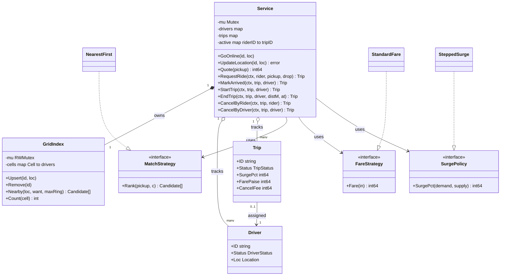
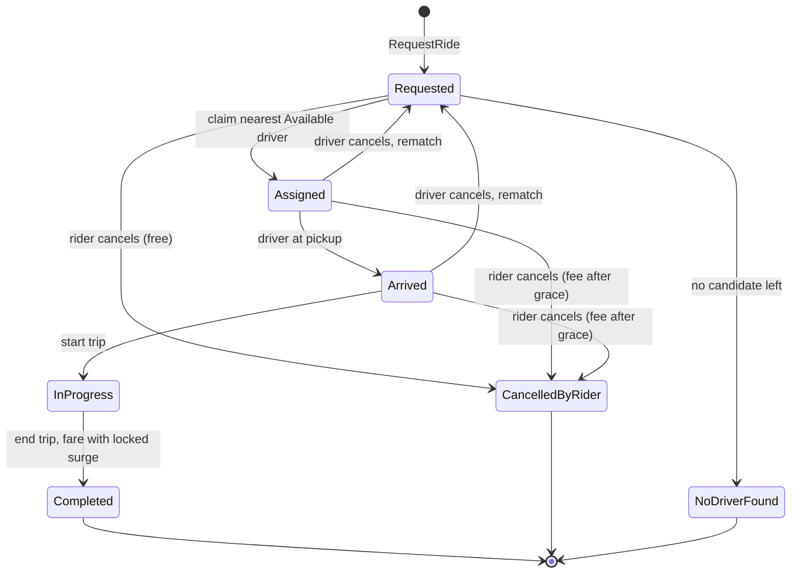
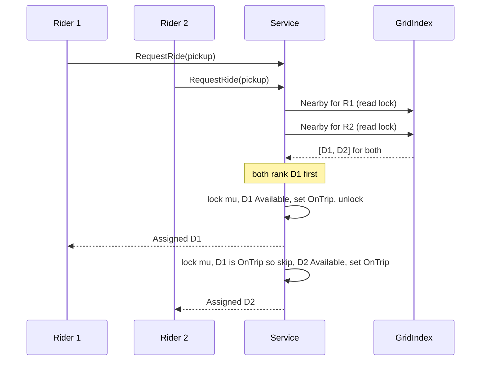

# Ride Sharing

> [!summary] TL;DR
> A ride-sharing LLD (Uber, Ola, Lyft) is three problems. First, a **trip state machine** from Requested to Completed with cancellations. Second, a **pluggable matcher** that finds nearby drivers through a **grid index** and ranks them. Third, an **atomic driver claim**, so two riders never get the same driver. The fare is a strategy with a **surge multiplier locked at request time**. Money is `int64` paise and the clock is injected.

> [!abstract] Core idea
> - Driver locations live in a grid of cells. "Nearby" means the pickup cell plus rings of neighbouring cells, not a scan of every driver.
> - Matching has three steps: find candidates (index read lock), rank them (strategy, no lock), claim the first one still `Available` (service lock). Losing a driver to another rider just moves you to the next candidate.
> - The trip is a state machine with an explicit transition table, so "start a trip that was never assigned" is impossible.
> - Surge is computed from demand and supply near the pickup, **stored on the trip** at request time, and applied at the end. The rider pays what they were quoted.
> - Classic mistakes: search and claim as two separate steps without re-checking the status, or a ring search that stops at the first ring with a hit.

## Problem statement

```text
Design the core of a ride-hailing app. Riders request a ride from a pickup to a drop.
The system finds the nearest available driver, who arrives, starts and ends the trip.
Compute the fare from distance and time, with surge pricing when demand is high.
Riders and drivers can cancel. Many riders request at the same time.
```

- It tests a state machine with real rules, a swappable matching strategy over a spatial index, a race (two riders, one driver) and money arithmetic with a multiplier. Time box: 10 minutes for Steps 1-4, 10 for Steps 5-6, 30-40 for the code, 10 for edge cases and follow-ups.

### Solving path

1. Clarify: one vehicle type or many, how "nearest" is defined, fare formula, surge, cancellation fees.
2. Draw the trip state machine first; every API is one transition.
3. Name the entities: `Driver`, `Trip`, `Location`, plus the three strategies (match, fare, surge) and the `GridIndex`.
4. Write `RequestRide` as search, rank and claim, with the claim under one lock.
5. Add the driver steps (arrive, start, end), the fare and the two cancellation paths.
6. Test the fare table, the state machine, cancellations, surge, and 50 riders racing for 3 drivers under `-race`. Then discuss sharding by city and the database version.

## Step 1: Clarify requirements

### Questions to ask (with assumed answers)

- One vehicle type or many (bike, auto, sedan)? *Assume: one type in the code; types become a filter in the matcher (Step 10).*
- What does "nearest" mean? *Assume: straight-line (haversine) distance within a maximum radius. Road ETA is a better strategy and a follow-up.*
- Does the driver accept or reject the offer? *Assume: auto-assign in the code; an offer with a timeout is a follow-up.*
- How is the fare computed? *Assume: base + per km + per started minute, times the surge multiplier, with a minimum fare. Integer paise.*
- When is surge decided? *Assume: at request time, from recent requests versus available drivers near the pickup; it is locked on the trip.*
- What do cancellations cost? *Assume: the rider cancels free before assignment and within 2 minutes after it, then pays a flat fee. A driver cancellation is free for the rider and triggers a rematch.*
- Can the rider cancel during the trip? *Assume: no; a trip in progress can only end.*

### Functional

- Drivers go online and offline and send location pings.
- A rider requests a ride; the system assigns the nearest available driver or fails with "no driver".
- The driver marks arrival, starts the trip and ends it with the metered distance.
- The fare is computed at the end with the surge locked at request time.
- The rider cancels (free or with a fee); the driver cancels (rider is rematched).

### Non-functional

- A driver is never assigned to two trips, even with many concurrent requests.
- A rider has at most one active trip.
- Location pings are the hottest path (one every few seconds per driver), so they must be cheap.
- Matching, fare and surge rules change without touching the service.
- Money is `int64` paise; the clock is injected so fares and grace windows are testable.

### Out of scope

- Maps, routing and ETA services; payments; ratings; shared rides (pooling).
- Multi-region deployment (see [[Case Study - Ride Sharing and Proximity]]).

## Step 2: Actors and use cases

| Actor | Use case |
|---|---|
| Rider | Get a quote, request a ride, cancel, see the fare |
| Driver | Go online or offline, send location, arrive, start, end, cancel |
| Matching engine | Find and claim the nearest available driver |
| Pricing | Compute surge at request time and the fare at the end |
| Ops admin | Configure fares, surge steps, radius and cancellation rules (setup, not coded) |

The hardest use case is **RequestRide** under concurrency: many riders near the same few drivers. Code that first, then the driver steps, then cancellations.

## Step 3: Entities

| Entity | Key fields | Why it exists |
|---|---|---|
| `Location` | Lat, Lng | Pickup, drop and driver position |
| `Driver` | ID, Status (Offline, Available, OnTrip), Loc | The scarce resource riders race for |
| `Trip` | ID, RiderID, DriverID, Status, SurgePct, timestamps, FarePaise, CancelFee | One ride and its lifecycle |
| `TripStatus` | Requested, Assigned, Arrived, InProgress, Completed, CancelledByRider, NoDriverFound | The state machine |
| `GridIndex` | cells map, driver to cell map, own `RWMutex` | Answers "who is near this point" without a full scan |
| `Candidate` | DriverID, Loc, DistM | What the index hands to the matcher |
| `MatchStrategy` | `Rank(pickup, candidates)` | Nearest first today, ETA or rating tomorrow |
| `FareStrategy` | `Fare(FareInput)` | The fare formula, including surge |
| `SurgePolicy` | `SurgePct(demand, supply)` | The surge curve |
| `Service` | strategies, index, drivers, trips, active riders, demand log, clock | The facade the API calls; owns the claim lock |

Modelling insights:

- The **driver status** is the lock-protected field that matters. The index is a hint for search; the status under the service lock is the truth.
- Driver cancellation does not end the trip. The trip goes back to `Requested` and is rematched, and that driver is excluded for this trip.
- The surge multiplier belongs to the **trip**, not to the fare strategy. It is a fact recorded at request time.

## Step 4: Relationships



- **Composition** (service to index): the index exists only for the service. **Aggregation** (service to drivers and trips): they outlive a single request and would live in storage.
- **Association** (trip to driver): by ID. **Dependency on interfaces** for all three strategies, injected in `NewService`.

## Step 5: APIs and public methods

```text
POST /quotes                    body: {pickup, drop}                 -> 200 {surgePct, estimatePaise, quoteId}
POST /trips                     body: {riderId, pickup, drop, quoteId}
                                header: Idempotency-Key              -> 201 trip (Assigned) | 409 no driver
POST /trips/{id}/arrive         body: {driverId}                     -> 200 trip
POST /trips/{id}/start          body: {driverId}                     -> 200 trip
POST /trips/{id}/end            body: {driverId, distanceM, at}      -> 200 trip with fare
POST /trips/{id}/cancel         body: {riderId} or {driverId}        -> 200 trip (fee or rematch)
PUT  /drivers/{id}/status       body: {online, at}                   -> 204
PUT  /drivers/{id}/location     body: {lat, lng}                     -> 204   (hot path; often UDP or a socket in practice)

Errors: 409 rider busy, 409 no driver, 409 invalid transition, 403 not your trip, 404 trip not found
```

The Go surface the handlers call:

```go
type RideService interface {
	GoOnline(id string, l Location)
	GoOffline(id string) error
	UpdateLocation(id string, l Location) error
	Quote(pickup Location) int64
	RequestRide(ctx context.Context, riderID string, pickup, drop Location) (Trip, error)
	MarkArrived(ctx context.Context, tripID, driverID string) (Trip, error)
	StartTrip(ctx context.Context, tripID, driverID string) (Trip, error)
	EndTrip(ctx context.Context, tripID, driverID string, distanceM int64, at Location) (Trip, error)
	CancelByRider(ctx context.Context, tripID, riderID string) (Trip, error)
	CancelByDriver(ctx context.Context, tripID, driverID string) (Trip, error)
}

var _ RideService = (*Service)(nil) // compile-time check
```

Every driver-side method checks that the caller is the assigned driver (`ErrNotYourTrip`), and every state change goes through the transition table (`ErrInvalidTransition`).

## Step 6: Storage and repositories

Locations do not go to the relational database: they change every few seconds and only the latest one matters. They live in memory (or Redis `GEOADD` / `GEOSEARCH`, see [[Geospatial Indexing]]). Trips and driver status are durable.

```sql
CREATE TABLE drivers (
    id      TEXT PRIMARY KEY,
    city_id TEXT NOT NULL,
    status  TEXT NOT NULL CHECK (status IN ('offline', 'available', 'on_trip'))
);

CREATE TABLE trips (
    id              TEXT PRIMARY KEY,
    rider_id        TEXT        NOT NULL,
    driver_id       TEXT        REFERENCES drivers(id),
    status          TEXT        NOT NULL,
    surge_pct       INT         NOT NULL,            -- locked at request time
    pickup_lat      DOUBLE PRECISION NOT NULL,
    pickup_lng      DOUBLE PRECISION NOT NULL,
    requested_at    TIMESTAMPTZ NOT NULL,
    assigned_at     TIMESTAMPTZ,
    started_at      TIMESTAMPTZ,
    ended_at        TIMESTAMPTZ,
    fare_paise      BIGINT,
    cancel_fee      BIGINT      NOT NULL DEFAULT 0,
    idempotency_key TEXT        UNIQUE
);
-- invariants: one active trip per rider and per driver
CREATE UNIQUE INDEX one_active_trip_per_rider ON trips (rider_id)
    WHERE status IN ('requested', 'assigned', 'arrived', 'in_progress');
CREATE UNIQUE INDEX one_active_trip_per_driver ON trips (driver_id)
    WHERE status IN ('assigned', 'arrived', 'in_progress');

-- the claim: a conditional update, one row or zero
UPDATE drivers SET status = 'on_trip'
WHERE id = $1 AND status = 'available';
-- 1 row: we own the driver, set trips.driver_id in the same transaction
-- 0 rows: another rider won, try the next candidate

-- every transition is a compare-and-set on the current status
UPDATE trips SET status = 'in_progress', started_at = now()
WHERE id = $1 AND driver_id = $2 AND status = 'arrived';
```

```go
type DriverRepo interface {
	// Claim runs UPDATE ... WHERE status = 'available'; false means someone else won.
	Claim(ctx context.Context, driverID string) (bool, error)
	Release(ctx context.Context, driverID string) error
}

type TripRepo interface {
	Create(ctx context.Context, t Trip, idempotencyKey string) error
	// Transition updates only if the current status is from; false means a lost race or a bad call.
	Transition(ctx context.Context, tripID string, from, to TripStatus) (bool, error)
	Get(ctx context.Context, tripID string) (Trip, error)
}

type LocationStore interface { // in memory or Redis GEO, never the SQL database
	Upsert(ctx context.Context, driverID string, l Location) error
	Nearby(ctx context.Context, l Location, radiusM float64, limit int) ([]Candidate, error)
}
```

The conditional `UPDATE ... WHERE status = 'available'` is an optimistic compare-and-set: no lock is held while ranking, and the loser just moves on. The general trade-off is in [[Locking - Optimistic vs Pessimistic]].

## Step 7: Patterns

| Pattern | Where | Why here |
|---|---|---|
| [[Strategy and Template Method]] | `MatchStrategy` (nearest, ETA, rating-weighted) | The ranking rule changes by city and by product |
| [[Strategy and Template Method]] | `FareStrategy`, `SurgePolicy` | Fare formulas and surge curves change often and separately |
| [[State Machines in Go]] | `TripStatus` plus the `allowed` transition table | Seven states with rules; an explicit table makes illegal moves impossible |
| [[Facade (vs Mediator)]] | `Service` | One entry point hides the index, the lock and the strategies |
| [[Repository and Unit of Work]] | `DriverRepo`, `TripRepo`, `LocationStore` | Swap maps for Postgres and Redis without touching logic |
| [[Observer and Event Bus]] | `trip.assigned`, `trip.completed` events (follow-up) | Notifications, receipts and analytics should not sit in the claim path |

Patterns not used, and why:

- No State pattern with one struct per state: the states have no different behaviour, only allowed moves. A transition table is enough.
- No Decorator for surge: the multiplier is data recorded on the trip, so it is an input to the fare, not a wrapper around it. A decorator fits a rule such as "airport fee on top", see [[Decorator and Middleware]].

## Folder structure

```text
ride/
  geo.go          -> Location, DistanceM, Cell, GridIndex
  strategy.go     -> Candidate, MatchStrategy + NearestFirst, FareStrategy + StandardFare, SurgePolicy + SteppedSurge
  model.go        -> TripStatus, allowed transitions, DriverStatus, Driver, Trip, Config, Err* errors
  service.go      -> Service: driver methods, RequestRide, assign, driver steps, EndTrip, cancellations
  repository.go   -> DriverRepo, TripRepo, LocationStore (database version)
  ride_test.go    -> fare and surge tables, ring search, lifecycle, cancellations, concurrency
cmd/demo/main.go  -> wiring: index, strategies, time.Now
```

## Step 8: Core code

> [!tip] What to code in a 60-minute round
> Aim for about 200 lines in the room.
> - **Write:** `Location` and `DistanceM`, a simple `GridIndex` (`Upsert`, `Remove`, `Nearby`), `MatchStrategy` with `NearestFirst`, `TripStatus` with the transition table, `Service` with `GoOnline`, `RequestRide` and `assign` (the claim), then `StartTrip` and `EndTrip` with `StandardFare`.
> - **Add if time remains:** `CancelByRider` with the grace window, `CancelByDriver` with rematch, and the 50-riders race test.
> - **Talk only:** surge demand tracking, the SQL claim, Redis GEO, sharding by city, driver accept or reject with a timeout.

### Walkthrough

`RequestRide(ctx, rider, pickup, drop)`:

1. Lock, reject the rider if they already have an active trip (`ErrRiderBusy`).
2. Compute the surge for the pickup from demand (requests in the last `SurgeWindow` in the 3x3 cells) and supply (available drivers in the same block). Record this request as demand.
3. Create the trip in `Requested` with `SurgePct` locked, mark the rider active, unlock.
4. Call `assign`.

`assign(tripID)`, the heart of the problem:

1. **Search without the service lock.** `GridIndex.Nearby` scans ring 0 (the pickup cell), ring 1, and so on, until it has `CandidateWant` candidates, then scans **one more ring**. It holds only the index read lock. One extra ring is a cheap heuristic, not an exact nearest search (see the trap question in the interview section).
2. **Rank without any lock.** `MatchStrategy.Rank` filters by the radius and sorts by distance.
3. **Claim under the service lock.** Re-check that the trip is still `Requested` (the rider may have cancelled during the search). Walk the ranked list; the first driver whose status is still `Available`, and who has not rejected this trip, is set to `OnTrip` and removed from the index. Check and set happen under one lock, so two riders cannot both win the same driver.
4. Nobody left: the trip becomes `NoDriverFound`, the rider is no longer active, return `ErrNoDriver`.

`EndTrip`: check the transition, compute `Fare(distance, ended - started, trip.SurgePct)`, release the driver at the drop point back into the index.

`CancelByRider`: allowed from Requested, Assigned and Arrived. The fee applies only if the trip was assigned more than `FreeCancelAfter` ago. `CancelByDriver`: release the driver, add them to the trip's rejected set, move the trip back to `Requested`, rematch.

> [!tip] Exercise: a rating-weighted matcher
> Write `ScoredMatch` that ranks by `distanceM - 200*rating` within the radius, before looking at `NearestFirst`. Nothing in `Service` changes. The test only swaps the strategy passed to `NewService`. This is the point of the interface.

Lock order is always `Service.mu` then `GridIndex.mu`; the index never calls back into the service, so there is no deadlock.

```go
package ride

import (
	"context"
	"errors"
	"fmt"
	"math"
	"sort"
	"sync"
	"time"
)

var (
	ErrNoDriver          = errors.New("no driver available near pickup")
	ErrRiderBusy         = errors.New("rider already has an active trip")
	ErrUnknownDriver     = errors.New("unknown driver")
	ErrDriverBusy        = errors.New("driver is on a trip")
	ErrTripNotFound      = errors.New("trip not found")
	ErrNotYourTrip       = errors.New("trip belongs to another rider or driver")
	ErrInvalidTransition = errors.New("invalid trip state transition")
)

// ---------- geometry and grid index ----------

type Location struct{ Lat, Lng float64 }

// DistanceM is the haversine great-circle distance in metres.
func DistanceM(a, b Location) float64 {
	const r = 6371000.0
	toRad := func(d float64) float64 { return d * math.Pi / 180 }
	dLat, dLng := toRad(b.Lat-a.Lat), toRad(b.Lng-a.Lng)
	h := math.Sin(dLat/2)*math.Sin(dLat/2) +
		math.Cos(toRad(a.Lat))*math.Cos(toRad(b.Lat))*math.Sin(dLng/2)*math.Sin(dLng/2)
	return 2 * r * math.Asin(math.Sqrt(h))
}

type Cell struct{ X, Y int }

// GridIndex buckets available drivers into square cells of cellDeg degrees.
// It has its own lock, so location pings never block matching for long.
type GridIndex struct {
	mu      sync.RWMutex
	cellDeg float64
	cells   map[Cell]map[string]Location
	where   map[string]Cell
}

func NewGridIndex(cellDeg float64) *GridIndex {
	return &GridIndex{cellDeg: cellDeg, cells: map[Cell]map[string]Location{}, where: map[string]Cell{}}
}

func (g *GridIndex) CellOf(l Location) Cell {
	return Cell{int(math.Floor(l.Lat / g.cellDeg)), int(math.Floor(l.Lng / g.cellDeg))}
}

func (g *GridIndex) Upsert(id string, l Location) {
	g.mu.Lock()
	defer g.mu.Unlock()
	g.removeLocked(id)
	c := g.CellOf(l)
	if g.cells[c] == nil {
		g.cells[c] = map[string]Location{}
	}
	g.cells[c][id] = l
	g.where[id] = c
}

func (g *GridIndex) Remove(id string) {
	g.mu.Lock()
	defer g.mu.Unlock()
	g.removeLocked(id)
}

func (g *GridIndex) removeLocked(id string) {
	c, ok := g.where[id]
	if !ok {
		return
	}
	delete(g.cells[c], id)
	if len(g.cells[c]) == 0 {
		delete(g.cells, c)
	}
	delete(g.where, id)
}

// Count returns how many indexed drivers sit in the 3x3 block around c.
func (g *GridIndex) Count(c Cell) int {
	g.mu.RLock()
	defer g.mu.RUnlock()
	n := 0
	for dx := -1; dx <= 1; dx++ {
		for dy := -1; dy <= 1; dy++ {
			n += len(g.cells[Cell{c.X + dx, c.Y + dy}])
		}
	}
	return n
}

// Nearby scans rings of cells around the pickup until it has at least want
// candidates, then scans ONE more ring: a driver in ring r+1 can be closer
// than a driver in the far corner of ring r.
func (g *GridIndex) Nearby(l Location, want, maxRing int) []Candidate {
	g.mu.RLock()
	defer g.mu.RUnlock()
	center := g.CellOf(l)
	var out []Candidate
	extra := -1
	for r := 0; r <= maxRing; r++ {
		for dx := -r; dx <= r; dx++ {
			for dy := -r; dy <= r; dy++ {
				if max(abs(dx), abs(dy)) != r { // only the ring's border
					continue
				}
				for id, dl := range g.cells[Cell{center.X + dx, center.Y + dy}] {
					out = append(out, Candidate{DriverID: id, Loc: dl, DistM: DistanceM(l, dl)})
				}
			}
		}
		if extra == -1 && len(out) >= want {
			extra = r + 1
		}
		if extra != -1 && r >= extra {
			break
		}
	}
	return out
}

func abs(x int) int {
	if x < 0 {
		return -x
	}
	return x
}

// ---------- strategies ----------

type Candidate struct {
	DriverID string
	Loc      Location
	DistM    float64
}

// MatchStrategy orders candidates; the service claims the first one still free.
type MatchStrategy interface {
	Rank(pickup Location, c []Candidate) []Candidate
}

type NearestFirst struct{ MaxRadiusM float64 }

func (n NearestFirst) Rank(_ Location, c []Candidate) []Candidate {
	out := make([]Candidate, 0, len(c))
	for _, x := range c {
		if x.DistM <= n.MaxRadiusM {
			out = append(out, x)
		}
	}
	sort.Slice(out, func(i, j int) bool {
		if out[i].DistM != out[j].DistM {
			return out[i].DistM < out[j].DistM
		}
		return out[i].DriverID < out[j].DriverID // deterministic ties
	})
	return out
}

type FareInput struct {
	DistanceM int64
	Duration  time.Duration
	SurgePct  int64 // 100 = no surge, 150 = 1.5x
}

type FareStrategy interface {
	Fare(in FareInput) int64 // paise
}

// StandardFare: base + per km + per minute, surge applied, then the minimum.
type StandardFare struct {
	BasePaise, PerKmPaise, PerMinPaise, MinPaise int64
}

func (s StandardFare) Fare(in FareInput) int64 {
	minutes := int64((in.Duration + time.Minute - 1) / time.Minute) // started minutes
	raw := s.BasePaise + in.DistanceM*s.PerKmPaise/1000 + minutes*s.PerMinPaise
	surged := (raw*in.SurgePct + 50) / 100 // round half up
	return max(surged, s.MinPaise)
}

// SurgePolicy maps demand and supply near the pickup to a multiplier in percent.
type SurgePolicy interface {
	SurgePct(demand, supply int) int64
}

type SteppedSurge struct{}

func (SteppedSurge) SurgePct(demand, supply int) int64 {
	switch {
	case demand <= supply:
		return 100
	case supply == 0 || demand >= 2*supply:
		return 200 // cap
	case 2*demand >= 3*supply: // ratio >= 1.5
		return 150
	default:
		return 125
	}
}

// ---------- entities ----------

type TripStatus int

const (
	Requested TripStatus = iota
	Assigned
	Arrived
	InProgress
	Completed
	CancelledByRider
	NoDriverFound
)

func (s TripStatus) String() string {
	return [...]string{"Requested", "Assigned", "Arrived", "InProgress", "Completed",
		"CancelledByRider", "NoDriverFound"}[s]
}

var allowed = map[TripStatus][]TripStatus{
	Requested:  {Assigned, NoDriverFound, CancelledByRider},
	Assigned:   {Arrived, Requested, CancelledByRider}, // Requested = driver cancelled, rematch
	Arrived:    {InProgress, Requested, CancelledByRider},
	InProgress: {Completed},
}

func canMove(from, to TripStatus) bool {
	for _, s := range allowed[from] {
		if s == to {
			return true
		}
	}
	return false
}

type DriverStatus int

const (
	Offline DriverStatus = iota
	Available
	OnTrip
)

type Driver struct {
	ID     string
	Status DriverStatus
	Loc    Location
}

type Trip struct {
	ID          string
	RiderID     string
	DriverID    string
	Pickup      Location
	Drop        Location
	Status      TripStatus
	SurgePct    int64 // locked at request time
	RequestedAt time.Time
	AssignedAt  time.Time
	StartedAt   time.Time
	EndedAt     time.Time
	FarePaise   int64
	CancelFee   int64
	rejected    map[string]bool // drivers who cancelled; unexported, so callers outside the package cannot read or change it through a copy
}

type Config struct {
	CandidateWant   int
	MaxRing         int
	FreeCancelAfter time.Duration // rider may cancel free within this window after assignment
	CancelFeePaise  int64
	SurgeWindow     time.Duration
}

// ---------- service ----------

type Service struct {
	mu      sync.Mutex // guards drivers, trips, activeRider, demand; lock order: mu then index
	index   *GridIndex
	match   MatchStrategy
	fare    FareStrategy
	surge   SurgePolicy
	now     func() time.Time
	cfg     Config
	drivers map[string]*Driver
	trips   map[string]*Trip
	active  map[string]string // riderID -> tripID
	demand  map[Cell][]time.Time
	seq     int
}

func NewService(idx *GridIndex, m MatchStrategy, f FareStrategy, s SurgePolicy, now func() time.Time, cfg Config) *Service {
	return &Service{index: idx, match: m, fare: f, surge: s, now: now, cfg: cfg,
		drivers: map[string]*Driver{}, trips: map[string]*Trip{},
		active: map[string]string{}, demand: map[Cell][]time.Time{}}
}

func (s *Service) GoOnline(id string, l Location) {
	s.mu.Lock()
	defer s.mu.Unlock()
	d, ok := s.drivers[id]
	if !ok {
		d = &Driver{ID: id}
		s.drivers[id] = d
	}
	d.Loc = l
	if d.Status == Offline {
		d.Status = Available
		s.index.Upsert(id, l)
	}
}

func (s *Service) GoOffline(id string) error {
	s.mu.Lock()
	defer s.mu.Unlock()
	d, ok := s.drivers[id]
	if !ok {
		return ErrUnknownDriver
	}
	if d.Status == OnTrip {
		return ErrDriverBusy
	}
	d.Status = Offline
	s.index.Remove(id)
	return nil
}

// UpdateLocation is the hot path (a ping every few seconds per driver).
func (s *Service) UpdateLocation(id string, l Location) error {
	s.mu.Lock()
	defer s.mu.Unlock()
	d, ok := s.drivers[id]
	if !ok {
		return ErrUnknownDriver
	}
	d.Loc = l
	if d.Status == Available {
		s.index.Upsert(id, l)
	}
	return nil
}

// Quote returns the surge multiplier the rider would get right now.
func (s *Service) Quote(pickup Location) int64 {
	s.mu.Lock()
	defer s.mu.Unlock()
	return s.surgeLocked(pickup)
}

// surgeLocked compares recent requests with available drivers in the 3x3 block of cells.
func (s *Service) surgeLocked(pickup Location) int64 {
	c := s.index.CellOf(pickup)
	cutoff := s.now().Add(-s.cfg.SurgeWindow)
	demand := 0
	for dx := -1; dx <= 1; dx++ {
		for dy := -1; dy <= 1; dy++ {
			k := Cell{c.X + dx, c.Y + dy}
			recent := s.demand[k][:0]
			for _, t := range s.demand[k] {
				if t.After(cutoff) {
					recent = append(recent, t)
				}
			}
			if len(recent) == 0 {
				delete(s.demand, k)
			} else {
				s.demand[k] = recent
			}
			demand += len(recent)
		}
	}
	return s.surge.SurgePct(demand, s.index.Count(c))
}

func (s *Service) RequestRide(ctx context.Context, riderID string, pickup, drop Location) (Trip, error) {
	if err := ctx.Err(); err != nil {
		return Trip{}, err
	}
	s.mu.Lock()
	if _, busy := s.active[riderID]; busy {
		s.mu.Unlock()
		return Trip{}, ErrRiderBusy
	}
	surge := s.surgeLocked(pickup)
	c := s.index.CellOf(pickup)
	s.demand[c] = append(s.demand[c], s.now())
	s.seq++
	t := &Trip{ID: fmt.Sprintf("T%d", s.seq), RiderID: riderID, Pickup: pickup, Drop: drop,
		Status: Requested, SurgePct: surge, RequestedAt: s.now(), rejected: map[string]bool{}}
	s.trips[t.ID] = t
	s.active[riderID] = t.ID
	s.mu.Unlock()

	return s.assign(t.ID)
}

// assign searches without the service lock, then claims under it.
func (s *Service) assign(tripID string) (Trip, error) {
	s.mu.Lock()
	t := s.trips[tripID]
	pickup := t.Pickup
	s.mu.Unlock()

	ranked := s.match.Rank(pickup, s.index.Nearby(pickup, s.cfg.CandidateWant, s.cfg.MaxRing))

	s.mu.Lock()
	defer s.mu.Unlock()
	if t.Status != Requested { // rider cancelled while we searched
		return *t, ErrInvalidTransition
	}
	for _, c := range ranked {
		d := s.drivers[c.DriverID]
		if d == nil || d.Status != Available || t.rejected[d.ID] {
			continue // lost the race for this driver, try the next one
		}
		d.Status = OnTrip // the claim: check and set under one lock
		s.index.Remove(d.ID)
		t.DriverID, t.Status, t.AssignedAt = d.ID, Assigned, s.now()
		return *t, nil
	}
	t.Status = NoDriverFound
	delete(s.active, t.RiderID)
	return *t, ErrNoDriver
}

func (s *Service) driverStep(tripID, driverID string, to TripStatus) (Trip, error) {
	s.mu.Lock()
	defer s.mu.Unlock()
	t, ok := s.trips[tripID]
	if !ok {
		return Trip{}, ErrTripNotFound
	}
	if t.DriverID != driverID {
		return *t, ErrNotYourTrip
	}
	if !canMove(t.Status, to) {
		return *t, fmt.Errorf("%w: %v -> %v", ErrInvalidTransition, t.Status, to)
	}
	t.Status = to
	if to == InProgress {
		t.StartedAt = s.now()
	}
	return *t, nil
}

func (s *Service) MarkArrived(_ context.Context, tripID, driverID string) (Trip, error) {
	return s.driverStep(tripID, driverID, Arrived)
}

func (s *Service) StartTrip(_ context.Context, tripID, driverID string) (Trip, error) {
	return s.driverStep(tripID, driverID, InProgress)
}

// EndTrip prices the trip from the metered distance and the clock.
func (s *Service) EndTrip(_ context.Context, tripID, driverID string, distanceM int64, at Location) (Trip, error) {
	s.mu.Lock()
	defer s.mu.Unlock()
	t, ok := s.trips[tripID]
	if !ok {
		return Trip{}, ErrTripNotFound
	}
	if t.DriverID != driverID {
		return *t, ErrNotYourTrip
	}
	if !canMove(t.Status, Completed) {
		return *t, fmt.Errorf("%w: %v -> Completed", ErrInvalidTransition, t.Status)
	}
	t.Status, t.EndedAt = Completed, s.now()
	t.FarePaise = s.fare.Fare(FareInput{DistanceM: distanceM, Duration: t.EndedAt.Sub(t.StartedAt), SurgePct: t.SurgePct})
	s.releaseDriverLocked(driverID, at)
	delete(s.active, t.RiderID)
	return *t, nil
}

func (s *Service) releaseDriverLocked(id string, at Location) {
	d := s.drivers[id]
	d.Status, d.Loc = Available, at
	s.index.Upsert(id, at)
}

// CancelByRider is free before assignment and within the grace window; later it costs a fee.
func (s *Service) CancelByRider(_ context.Context, tripID, riderID string) (Trip, error) {
	s.mu.Lock()
	defer s.mu.Unlock()
	t, ok := s.trips[tripID]
	if !ok {
		return Trip{}, ErrTripNotFound
	}
	if t.RiderID != riderID {
		return *t, ErrNotYourTrip
	}
	if !canMove(t.Status, CancelledByRider) {
		return *t, fmt.Errorf("%w: %v -> CancelledByRider", ErrInvalidTransition, t.Status)
	}
	if t.Status != Requested && s.now().Sub(t.AssignedAt) > s.cfg.FreeCancelAfter {
		t.CancelFee = s.cfg.CancelFeePaise
	}
	if t.DriverID != "" {
		s.releaseDriverLocked(t.DriverID, s.drivers[t.DriverID].Loc)
	}
	t.Status = CancelledByRider
	delete(s.active, t.RiderID)
	return *t, nil
}

// CancelByDriver frees the driver and rematches the rider, excluding this driver.
func (s *Service) CancelByDriver(_ context.Context, tripID, driverID string) (Trip, error) {
	s.mu.Lock()
	t, ok := s.trips[tripID]
	if !ok {
		s.mu.Unlock()
		return Trip{}, ErrTripNotFound
	}
	if t.DriverID != driverID {
		s.mu.Unlock()
		return *t, ErrNotYourTrip
	}
	if !canMove(t.Status, Requested) {
		s.mu.Unlock()
		return *t, fmt.Errorf("%w: %v -> Requested", ErrInvalidTransition, t.Status)
	}
	s.releaseDriverLocked(driverID, s.drivers[driverID].Loc)
	t.rejected[driverID] = true
	t.DriverID, t.Status, t.AssignedAt = "", Requested, time.Time{}
	s.mu.Unlock()
	return s.assign(tripID)
}

func (s *Service) Trip(id string) (Trip, bool) {
	s.mu.Lock()
	defer s.mu.Unlock()
	t, ok := s.trips[id]
	if !ok {
		return Trip{}, false
	}
	return *t, true
}
```

## Test cases

| Test | Proves |
|---|---|
| `TestDistanceM` | Haversine gives 1111.95 m for 0.01 degree of latitude |
| `TestNearbyScansOneExtraRing` | A driver 40 m away in the next cell beats a driver 1.2 km away in the pickup cell |
| `TestStandardFare` | Base + per km + per started minute, surge 1.5x, minimum fare |
| `TestSteppedSurge` | The surge curve steps: 1.0x, 1.25x, 1.5x, 2.0x cap, and no supply |
| `TestTripLifecycle` | Assign nearest, rider busy, start before arrive rejected, wrong driver rejected, driver busy cannot go offline, fare at end, double end rejected, driver free again |
| `TestCancellations` | Free cancel within the grace window, fee after it, no cancel during the trip |
| `TestDriverCancelRematchesThenGivesUp` | Driver cancel rematches to the next driver; the rejecting driver is excluded; no driver left gives `NoDriverFound` |
| `TestSurgeIsLockedAtRequestAndDecays` | Third rider with no supply gets 2.0x; demand older than the window is dropped |
| `TestConcurrentRequestsNeverShareADriver` | 50 riders, 3 drivers, location pings racing: exactly 3 winners on 3 different drivers, 47 `ErrNoDriver` |

All nine pass under `go test -race` (Go 1.24.4), and `go vet` is clean.

Worked fare (from `TestStandardFare`): base 5000 + 10.5 km x 1200 = 12600 + 21 started minutes x 200 = 4200, so 21800 paise (Rs 218). At 1.5x surge: (21800 x 150 + 50) / 100 = 32700 paise.

```go
package ride

import (
	"context"
	"errors"
	"fmt"
	"math"
	"sync"
	"testing"
	"time"
)

type fakeClock struct {
	mu sync.Mutex
	t  time.Time
}

func (c *fakeClock) Now() time.Time { c.mu.Lock(); defer c.mu.Unlock(); return c.t }
func (c *fakeClock) Advance(d time.Duration) {
	c.mu.Lock()
	defer c.mu.Unlock()
	c.t = c.t.Add(d)
}

var (
	pickup = Location{12.9716, 77.5946}
	drop   = Location{12.9352, 77.6245}
	fare   = StandardFare{BasePaise: 5000, PerKmPaise: 1200, PerMinPaise: 200, MinPaise: 8000}
)

func newSvc() (*Service, *fakeClock) {
	clk := &fakeClock{t: time.Date(2026, 11, 4, 9, 0, 0, 0, time.UTC)}
	cfg := Config{CandidateWant: 5, MaxRing: 3, FreeCancelAfter: 2 * time.Minute,
		CancelFeePaise: 5000, SurgeWindow: 5 * time.Minute}
	return NewService(NewGridIndex(0.01), NearestFirst{MaxRadiusM: 3000}, fare, SteppedSurge{}, clk.Now, cfg), clk
}

func TestDistanceM(t *testing.T) {
	// 0.01 degree of latitude = 6371000 * 0.01 * pi / 180 = 1111.95 m
	got := DistanceM(Location{12.97, 77.59}, Location{12.98, 77.59})
	if math.Abs(got-1111.95) > 1 {
		t.Fatalf("got %.2f m", got)
	}
}

func TestNearbyScansOneExtraRing(t *testing.T) {
	g := NewGridIndex(0.01)
	p := Location{12.9750, 77.5999}                        // east edge of its cell
	g.Upsert("far-same-cell", Location{12.9701, 77.5901})  // same cell, about 1.2 km away
	g.Upsert("near-next-cell", Location{12.9750, 77.6003}) // next cell east, about 40 m away
	ranked := NearestFirst{MaxRadiusM: 3000}.Rank(p, g.Nearby(p, 1, 3))
	if len(ranked) != 2 || ranked[0].DriverID != "near-next-cell" {
		t.Fatalf("want near-next-cell first, got %+v", ranked)
	}
}

func TestStandardFare(t *testing.T) {
	cases := []struct {
		name string
		in   FareInput
		want int64
	}{
		{"10.5 km, 20m30s, no surge", FareInput{10500, 20*time.Minute + 30*time.Second, 100}, 21800},
		{"same trip at 1.5x", FareInput{10500, 20*time.Minute + 30*time.Second, 150}, 32700},
		{"short trip hits minimum", FareInput{1000, 2 * time.Minute, 100}, 8000},
	}
	for _, c := range cases {
		if got := fare.Fare(c.in); got != c.want {
			t.Errorf("%s: got %d want %d", c.name, got, c.want)
		}
	}
}

func TestSteppedSurge(t *testing.T) {
	cases := []struct {
		d, s int
		want int64
	}{
		{0, 0, 100}, {3, 4, 100}, {5, 4, 125}, {6, 4, 150}, {8, 4, 200}, {1, 0, 200},
	}
	for _, c := range cases {
		if got := (SteppedSurge{}).SurgePct(c.d, c.s); got != c.want {
			t.Errorf("demand %d supply %d: got %d want %d", c.d, c.s, got, c.want)
		}
	}
}

func TestTripLifecycle(t *testing.T) {
	ctx := context.Background()
	s, clk := newSvc()
	s.GoOnline("D1", Location{12.9720, 77.5950})
	s.GoOnline("D2", Location{12.9800, 77.6100})

	tr, err := s.RequestRide(ctx, "R1", pickup, drop)
	if err != nil || tr.DriverID != "D1" || tr.Status != Assigned || tr.SurgePct != 100 {
		t.Fatalf("request: %+v %v", tr, err)
	}
	if _, err := s.RequestRide(ctx, "R1", pickup, drop); !errors.Is(err, ErrRiderBusy) {
		t.Fatalf("want ErrRiderBusy, got %v", err)
	}
	if _, err := s.StartTrip(ctx, tr.ID, "D1"); !errors.Is(err, ErrInvalidTransition) {
		t.Fatalf("start before arrive: want ErrInvalidTransition, got %v", err)
	}
	if _, err := s.MarkArrived(ctx, tr.ID, "D2"); !errors.Is(err, ErrNotYourTrip) {
		t.Fatalf("want ErrNotYourTrip, got %v", err)
	}
	must(t)(s.MarkArrived(ctx, tr.ID, "D1"))
	must(t)(s.StartTrip(ctx, tr.ID, "D1"))
	if err := s.GoOffline("D1"); !errors.Is(err, ErrDriverBusy) {
		t.Fatalf("want ErrDriverBusy, got %v", err)
	}
	clk.Advance(20*time.Minute + 30*time.Second)
	done, err := s.EndTrip(ctx, tr.ID, "D1", 10500, drop)
	if err != nil || done.Status != Completed || done.FarePaise != 21800 {
		t.Fatalf("end: %+v %v", done, err)
	}
	if _, err := s.EndTrip(ctx, tr.ID, "D1", 10500, drop); !errors.Is(err, ErrInvalidTransition) {
		t.Fatalf("double end: want ErrInvalidTransition, got %v", err)
	}
	// D1 is free again at the drop point, and R1 can book again.
	tr2, err := s.RequestRide(ctx, "R1", drop, pickup)
	if err != nil || tr2.DriverID != "D1" {
		t.Fatalf("rebook: %+v %v", tr2, err)
	}
}

func TestCancellations(t *testing.T) {
	ctx := context.Background()
	s, clk := newSvc()
	s.GoOnline("D1", Location{12.9720, 77.5950})
	s.GoOnline("D2", Location{12.9800, 77.6100})

	// Rider cancels inside the grace window: free, driver released.
	a, _ := s.RequestRide(ctx, "R1", pickup, drop)
	clk.Advance(time.Minute)
	c, err := s.CancelByRider(ctx, a.ID, "R1")
	if err != nil || c.Status != CancelledByRider || c.CancelFee != 0 {
		t.Fatalf("free cancel: %+v %v", c, err)
	}

	// Rider cancels after the grace window: fee charged.
	b, _ := s.RequestRide(ctx, "R1", pickup, drop)
	if b.DriverID != "D1" {
		t.Fatalf("D1 should be free again, got %q", b.DriverID)
	}
	clk.Advance(3 * time.Minute)
	c, err = s.CancelByRider(ctx, b.ID, "R1")
	if err != nil || c.CancelFee != 5000 {
		t.Fatalf("late cancel: %+v %v", c, err)
	}

	// Rider cannot cancel a trip in progress.
	d, _ := s.RequestRide(ctx, "R2", pickup, drop)
	must(t)(s.MarkArrived(ctx, d.ID, d.DriverID))
	must(t)(s.StartTrip(ctx, d.ID, d.DriverID))
	if _, err := s.CancelByRider(ctx, d.ID, "R2"); !errors.Is(err, ErrInvalidTransition) {
		t.Fatalf("want ErrInvalidTransition, got %v", err)
	}
}

func TestDriverCancelRematchesThenGivesUp(t *testing.T) {
	ctx := context.Background()
	s, _ := newSvc()
	s.GoOnline("D1", Location{12.9720, 77.5950})
	s.GoOnline("D2", Location{12.9800, 77.6100})

	tr, _ := s.RequestRide(ctx, "R1", pickup, drop)
	re, err := s.CancelByDriver(ctx, tr.ID, "D1")
	if err != nil || re.DriverID != "D2" || re.Status != Assigned {
		t.Fatalf("rematch: %+v %v", re, err)
	}
	// D2 also cancels; D1 is free but rejected this trip, so no driver is left.
	re, err = s.CancelByDriver(ctx, tr.ID, "D2")
	if !errors.Is(err, ErrNoDriver) || re.Status != NoDriverFound {
		t.Fatalf("give up: %+v %v", re, err)
	}
	// The rider is no longer active and both drivers are available.
	if _, err := s.RequestRide(ctx, "R1", pickup, drop); err != nil {
		t.Fatalf("rider should be able to retry: %v", err)
	}
}

func TestSurgeIsLockedAtRequestAndDecays(t *testing.T) {
	ctx := context.Background()
	s, clk := newSvc()
	s.GoOnline("D1", Location{12.9720, 77.5950})
	s.GoOnline("D2", Location{12.9721, 77.5951})

	r1, _ := s.RequestRide(ctx, "R1", pickup, drop)   // demand 0, supply 2
	r2, _ := s.RequestRide(ctx, "R2", pickup, drop)   // demand 1, supply 1
	r3, err := s.RequestRide(ctx, "R3", pickup, drop) // demand 2, supply 0
	if r1.SurgePct != 100 || r2.SurgePct != 100 || r3.SurgePct != 200 || !errors.Is(err, ErrNoDriver) {
		t.Fatalf("surge: %d %d %d err=%v", r1.SurgePct, r2.SurgePct, r3.SurgePct, err)
	}
	clk.Advance(6 * time.Minute) // older than the 5-minute window
	if got := s.Quote(pickup); got != 100 {
		t.Fatalf("after window: got %d want 100 (no demand)", got)
	}
}

func TestConcurrentRequestsNeverShareADriver(t *testing.T) {
	ctx := context.Background()
	s, _ := newSvc()
	for i := range 3 {
		s.GoOnline(fmt.Sprintf("D%d", i), Location{12.9716 + float64(i)*0.0005, 77.5946})
	}
	var (
		wg      sync.WaitGroup
		mu      sync.Mutex
		winners = map[string]string{}
		noDrv   int
	)
	stop := make(chan struct{})
	go func() { // location pings racing with matching
		for i := 0; ; i++ {
			select {
			case <-stop:
				return
			default:
				_ = s.UpdateLocation("D0", Location{12.9716, 77.5946 + float64(i%5)*0.0001})
			}
		}
	}()
	for i := range 50 {
		wg.Add(1)
		go func() {
			defer wg.Done()
			tr, err := s.RequestRide(ctx, fmt.Sprintf("R%d", i), pickup, drop)
			mu.Lock()
			defer mu.Unlock()
			switch {
			case err == nil:
				if prev, dup := winners[tr.DriverID]; dup {
					t.Errorf("driver %s given to %s and %s", tr.DriverID, prev, tr.RiderID)
				}
				winners[tr.DriverID] = tr.RiderID
			case errors.Is(err, ErrNoDriver):
				noDrv++
			default:
				t.Errorf("unexpected error %v", err)
			}
		}()
	}
	wg.Wait()
	close(stop)
	if len(winners) != 3 || noDrv != 47 {
		t.Fatalf("winners=%d noDriver=%d, want 3 and 47", len(winners), noDrv)
	}
}

// must lets a test pass a (Trip, error) call straight through: must(t)(s.StartTrip(...)).
func must(t *testing.T) func(Trip, error) {
	return func(_ Trip, err error) {
		t.Helper()
		if err != nil {
			t.Fatal(err)
		}
	}
}
```

## Step 9: Edge cases

| Edge case | What happens | How the design handles it |
|---|---|---|
| Two riders pick the same nearest driver | Check-then-act race | The status check and `OnTrip` set happen under `Service.mu`; the loser tries its next candidate. In SQL, `UPDATE ... WHERE status = 'available'` returns 0 rows for the loser |
| Nearest driver is in the next cell | Ring 0 has a hit, but it is not the nearest | `Nearby` scans one ring past the first ring that satisfies `want`. This catches most cases but is not exact: an exact search keeps adding rings until the nearest unscanned ring is farther than the `want`-th best distance found |
| Pickup near a cell corner, few drivers | Empty rings | Rings grow up to `MaxRing`; the radius filter then drops far drivers |
| Rider cancels while matching runs | Driver claimed for a dead trip | `assign` re-checks `Status == Requested` under the lock before claiming |
| Driver cancels | Rider stranded | Trip goes back to `Requested`, rematched excluding that driver |
| Every driver rejects | Endless rematch loop | The rejected set shrinks the pool; with none left the trip ends `NoDriverFound` |
| Rider double-taps "request" | Two trips | `active` map gives `ErrRiderBusy`; in SQL, the partial unique index per rider |
| Driver goes offline mid-trip | Trip orphaned | `GoOffline` returns `ErrDriverBusy` while `OnTrip` |
| Stale location ping for a driver on a trip | Driver reappears in the index | `UpdateLocation` writes the index only when the driver is `Available` |
| Surge changes between quote and end | Rider pays more than quoted | `SurgePct` is stored on the trip at request time |
| Trip of 0 to 1 minute | Tiny fare | `MinPaise` floor |
| Fare rounding with a multiplier | Float drift | Integer `(raw*pct + 50) / 100`, half up, in paise |
| Drivers near the antimeridian or the poles | Cells distort | Degree cells are fine for city-scale use; use geohash or S2/H3 cells globally (see [[Geospatial Indexing]]) |

### Common mistakes

- Searching and claiming in two separate steps without re-checking `Available` at claim time.
- Holding the service lock during the spatial search and ranking, so every location ping waits.
- Scanning only the first ring that has any driver.
- Computing surge at the end of the trip, or using `float64` for money.
- A boolean soup (`isStarted`, `isCancelled`) instead of one status with a transition table.

## Step 10: Tradeoffs and extensions

| Follow-up | Design change |
|---|---|
| Driver accepts or rejects an offer | New state `Offered` with an expiry; offer to one driver at a time (or a small batch); timeout means rejected, offer the next |
| Vehicle types (bike, auto, sedan) | `Driver.Type`; the index keyed by (type, cell), or the matcher filters by type |
| ETA instead of straight-line distance | `ETAMatch` strategy that calls a routing service for the top few candidates only |
| Shared rides (pool) | A trip holds several riders; matching checks detour limits; a much bigger problem |
| Many cities, many instances | Shard state by city; each city's matcher is one process, or the SQL claim runs as above |
| Location pings at scale | Keep locations in memory or Redis GEO, write to durable storage asynchronously |
| Surge per zone with smoothing | Surge computed by a background job per zone every minute, read by `RequestRide` |

Tradeoffs chosen:

- **Search outside the lock, claim inside it.** Searching under the service lock would be simpler but would block every ping and every other request. The price is that a candidate can become stale, which the claim re-check handles.
- **Fixed degree cells versus geohash or H3.** Fixed cells are a few lines and right for one city. At the equator 0.01 degree is about 1.1 km in both directions; at 60 degrees latitude it is about 0.55 km east-west, so cells stop being square away from the equator.
- **Haversine versus road distance.** Haversine is cheap and good for a shortlist; real dispatch re-ranks the shortlist by ETA.
- **Auto-assign versus offer.** Auto-assign keeps the code focused on the race; real apps offer and wait, which adds a state and a timer.
- **One mutex for the service.** Fine for a city in one process. Shard by city first, then by cell block if profiling shows contention.

## Drawing





## Interview questions

> [!question]- How do you stop two riders from getting the same driver?
> Search and rank without the service lock, then claim under it: re-read the driver's status and set `OnTrip` in the same critical section, and fall through to the next candidate if it is no longer `Available`. In a database the claim is `UPDATE drivers SET status = 'on_trip' WHERE id = $1 AND status = 'available'`, and 0 rows means you lost. The race test runs 50 riders against 3 drivers.

> [!question]- Trap: the pickup cell has a driver, so you stop the search. What is wrong?
> A driver just across the cell border can be much closer than one in the far corner of the pickup cell. After the first ring that gives enough candidates, scan one more ring and then sort by real distance. `TestNearbyScansOneExtraRing` has a 40 m driver in the next cell and a 1.2 km driver in the pickup cell. One extra ring is still a heuristic: a driver in the far corner of the pickup cell can be about 1.4 cells away, while a driver in ring 2 can be just over 1 cell away. For an exact answer, stop only when the closest edge of the next unscanned ring is farther than the `want`-th best distance so far. In practice the shortlist is re-ranked by ETA anyway.

> [!question]- Why is the surge stored on the trip?
> The rider agreed to a price at request time. If the fare read the current surge at the end, a trip requested at 1.0x could be charged at 2.0x. Storing `SurgePct` on the trip makes the fare a pure function of the trip's own data, which is also easier to audit and test.

> [!question]- What happens when a driver cancels?
> The driver goes back to `Available`, is added to the trip's rejected set, and the trip goes back to `Requested` and is rematched. The rider pays nothing. The rejected set stops the same driver from being picked again, and when no candidate is left the trip ends as `NoDriverFound`.

> [!question]- Why not hold the service lock during the whole match?
> The search and the ranking can take milliseconds, and location pings arrive every few seconds from every driver. Holding the lock would serialise all of it. Splitting search (index read lock) from claim (short service lock) keeps the critical section to a few map reads and writes. The cost is stale candidates, which the claim re-check handles.

> [!question]- How would you scale this past one process?
> Shard by city or region: a ride never crosses cities, so each shard owns its drivers and trips. Locations go to an in-memory store or Redis GEO; the claim becomes the conditional SQL update or a per-city single writer. The system view is in [[Case Study - Ride Sharing and Proximity]].

> [!question]- How is the fare kept exact with a 1.25x multiplier?
> Keep the multiplier as an integer percent and the fare in `int64` paise: `(raw*125 + 50) / 100` rounds half up with no floating point. Apply the minimum fare after the surge, and document the rounding rule so finance can reproduce it.

## Interview explanation

```text
I model a Trip as a state machine with an explicit transition table: Requested, Assigned, Arrived, InProgress, Completed, plus CancelledByRider and NoDriverFound. Driver locations live in a grid index of cells; to match, I scan rings of cells around the pickup until I have enough candidates, plus one more ring, and a MatchStrategy ranks them, nearest first by default. The claim is the critical part: under the service lock I re-check that the driver is still Available and mark it OnTrip, and if another rider won I just try the next candidate. In a database that is UPDATE drivers SET status = 'on_trip' WHERE id = $1 AND status = 'available'. Surge comes from recent requests versus available drivers near the pickup, and it is locked on the trip at request time. The fare is a strategy over distance, started minutes and that surge, in int64 paise with half-up rounding and a minimum. A rider cancel is free before assignment and within a grace window, then costs a fee; a driver cancel rematches the rider and excludes that driver.
```

## Cheat sheet

- Trip states: Requested, Assigned, Arrived, InProgress, Completed; plus CancelledByRider and NoDriverFound. Driver cancel goes back to Requested.
- Grid index: cell = floor(lat / size), floor(lng / size); scan rings until enough candidates, then one more ring; rank by haversine.
- Search outside the lock, claim inside it: re-check `Available`, set `OnTrip`, remove from the index; lost race means try the next.
- SQL claim: `UPDATE ... WHERE status = 'available'`; partial unique indexes for one active trip per rider and per driver.
- Fare = max(min, (base + km x rate + started minutes x rate) x surge%), integer paise, surge locked at request.
- Rider cancel: free before assignment or within the grace window, flat fee after; no cancel in progress.

## Links

- **Before this:** [[Strategy and Template Method]], [[State Machines in Go]], [[Concurrency for LLD]], [[Delivery Partner Assignment]]
- **Next:** [[Hotel Booking]]
- **Compare with:** [[Case Study - Ride Sharing and Proximity]] (the system-level design), [[Geospatial Indexing]] (geohash, S2, H3, Redis GEO), [[Locking - Optimistic vs Pessimistic]] (the database side of the claim), [[Parking Lot]] (the same claim-a-scarce-unit race), [[Testing LLD Code]]
