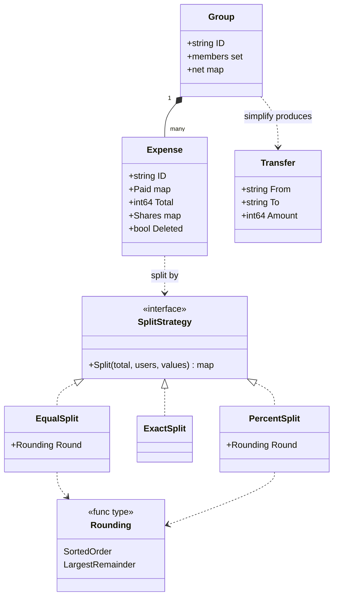
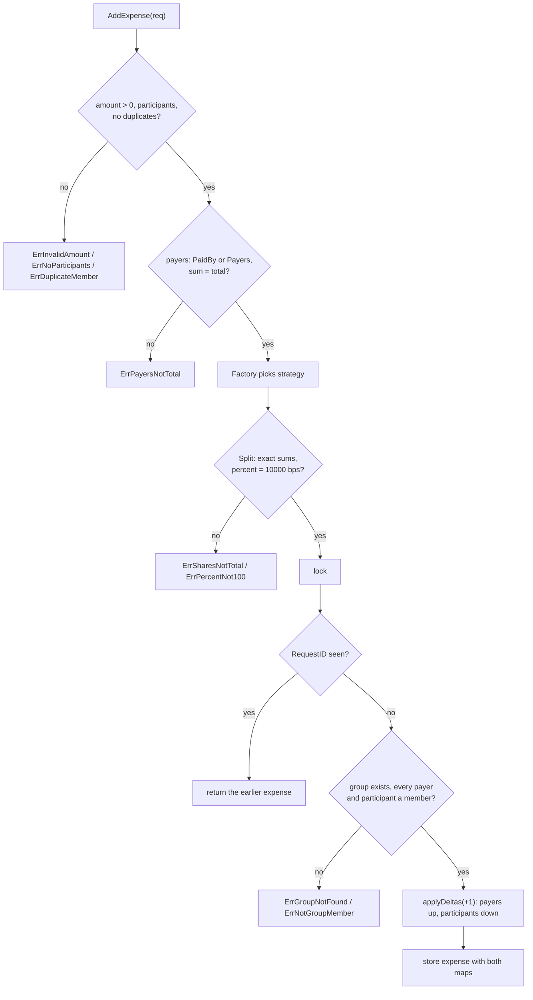
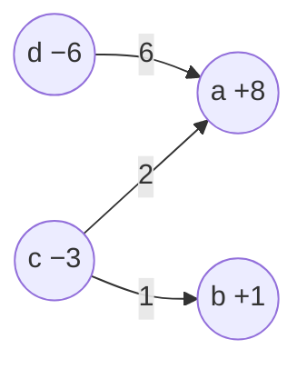

# Splitwise Expense Sharing

> [!summary] TL;DR
> Keep money as `int64` paise, make each split type a **Strategy** (equal, exact, percent) picked by a **Factory**, and keep **one net balance per user per group**: payers go up, participants go down, and the nets always sum to zero. An expense stores its computed payer and share maps, so delete applies the same deltas negated. Simplify debts greedily: the biggest debtor pays the biggest creditor until everyone is at zero, in at most n−1 transfers.

## Problem statement

```text
Design Splitwise-like expense sharing. Users create groups and add expenses.
An expense can be split equally, by exact amounts, or by percentage. Show each
user's balance, suggest a simplified set of payments to settle the group, and
support deleting an expense.
```

It tests a clean Strategy for split types, strict validation, and **exact money math with no lost paise**. It also tests the balance model (one net per user per group), reversibility (delete is an exact undo) and a small greedy algorithm. Time box: 10 minutes for requirements and entities, 10 for APIs and storage, 25 to 40 for code, 10 for edge cases.

## Step 1: Clarify requirements

| Question to ask | Assumption |
| --- | --- |
| Can the payer be outside the participants? | Yes, but the payer must be a group member |
| Several payers for one expense? | Yes: `Payers` maps user to paise and must sum to the total |
| Percent precision? | Basis points: 10000 = 100%, so 33.33% is exact |
| Several currencies in one group? | Designed in Step 10; the code keeps one currency per group, in paise |
| Who gets the leftover paisa? | Sorted user order by default; largest remainder as a pluggable alternative |
| Simplify debts: optimal or good enough? | Greedy (the true minimum is NP-hard); at most n−1 transfers |
| Edit or delete? | Delete reverses the stored deltas; edit is delete plus add |

- **Functional:** create groups; add an expense with one or many payers and an EQUAL, EXACT or PERCENT split; view net balances; suggest transfers; record a settlement; delete an expense.
- **Non-functional:** shares and payers each sum to the total exactly, so nets sum to zero; the same input always gives the same output; concurrent adds lose no update; a retried add is counted once; creating a group never destroys an existing one.
- **Out of scope:** receipts, comments, notifications, recurring expenses.

## Step 2: Actors and use cases

| Actor | Use case |
| --- | --- |
| User | Create a group, add or delete an expense, view balances, settle up |
| Group member | Sees their net and the suggested transfers |
| System | Validates splits and payers, updates balances, simplifies debts |

The hardest use case: `AddExpense` (normalise payers, pick the strategy, split exactly, validate membership, apply deltas atomically). `SimplifyDebts` is the algorithm to explain. Code both.

## Step 3: Entities

| Entity | Key fields | Why it exists |
| --- | --- | --- |
| `Group` | `members`, `net map[user]int64` | Scope for expenses and balances |
| `Expense` | `ID`, `Paid map`, `Total`, `Shares map`, `Deleted` | One bill; keeps both maps so it can be reversed exactly |
| `SplitStrategy` | `Split(total, users, values)` | Equal, exact and percent behind one interface |
| `Rounding` | `func(total, users, weights)` | Who gets the leftover paise: sorted order or largest remainder |
| `Transfer` | `From`, `To`, `Amount` | Output of simplify, or a recorded settlement |

Two modeling insights. First, **store one net per user per group, not a pairwise debt graph**: "A owes B" edges are derived by simplify, add and delete cost O(payers + participants), and the invariant is easy (nets sum to zero). Second, **an expense stores its computed maps**: delete reverses those exact numbers and never re-runs the strategy, whose rounding could change between versions.

## Step 4: Relationships



A group aggregates users (a user can be in many groups) and owns its expenses. The three split types implement `SplitStrategy`; equal and percent delegate the leftover paise to a `Rounding` function, a second, smaller strategy.

## Step 5: APIs and public methods

```text
POST   /groups                              -> {name, member_ids}; 409 if the ID exists
POST   /groups/{id}/expenses                -> {request_id, paid_by | payers{user: paise}, total_paise,
                                                split_type, participants[], values[]}; 400 bad split, 422 not a member
DELETE /groups/{id}/expenses/{expense_id}   -> reverses balances; 204, idempotent
GET    /groups/{id}/balances                -> [{user_id, net_paise}]
GET    /groups/{id}/settlements/suggested   -> [{from, to, amount_paise}]
POST   /groups/{id}/settlements             -> {from, to, amount_paise}
```

Go surface (full code in Step 8): `CreateGroup` (returns `ErrGroupExists`), `AddExpense(ctx, AddExpenseRequest) (Expense, error)`, `DeleteExpense`, `Settle`, `GetBalances`, `SimplifyDebts`, and `NewSplitStrategy(SplitType)` as the factory.

## Step 6: Storage and repositories

```sql
CREATE TABLE users  (id TEXT PRIMARY KEY, name TEXT NOT NULL);
CREATE TABLE groups (id TEXT PRIMARY KEY, name TEXT NOT NULL);  -- PK: a second create fails, never overwrites
CREATE TABLE group_members (
    group_id TEXT NOT NULL REFERENCES groups(id),
    user_id  TEXT NOT NULL REFERENCES users(id),
    PRIMARY KEY (group_id, user_id)                     -- target of the "user in group" foreign keys below
);

CREATE TABLE expenses (
    id          TEXT PRIMARY KEY,
    group_id    TEXT NOT NULL REFERENCES groups(id),
    total_paise BIGINT NOT NULL CHECK (total_paise > 0),
    split_type  TEXT NOT NULL CHECK (split_type IN ('EQUAL', 'EXACT', 'PERCENT')),
    request_id  TEXT,                                   -- client idempotency key
    deleted_at  TIMESTAMPTZ,                            -- soft delete keeps the audit trail
    created_at  TIMESTAMPTZ NOT NULL,
    UNIQUE (group_id, request_id)
);

CREATE TABLE expense_payers (                           -- one row per payer: multiple payers
    expense_id TEXT NOT NULL REFERENCES expenses(id),
    group_id   TEXT NOT NULL,
    user_id    TEXT NOT NULL,
    paid_paise BIGINT NOT NULL CHECK (paid_paise > 0),
    PRIMARY KEY (expense_id, user_id),
    FOREIGN KEY (group_id, user_id) REFERENCES group_members (group_id, user_id)
);

CREATE TABLE expense_shares (
    expense_id  TEXT NOT NULL REFERENCES expenses(id),
    group_id    TEXT NOT NULL,
    user_id     TEXT NOT NULL,
    share_paise BIGINT NOT NULL CHECK (share_paise >= 0),
    PRIMARY KEY (expense_id, user_id),                  -- no duplicate participant
    FOREIGN KEY (group_id, user_id) REFERENCES group_members (group_id, user_id)
);

CREATE TABLE group_balances (                           -- running balance, same transaction as the expense
    group_id  TEXT NOT NULL,
    user_id   TEXT NOT NULL,
    net_paise BIGINT NOT NULL DEFAULT 0,
    PRIMARY KEY (group_id, user_id)
);
-- Relative update, never read-modify-write in the app. Apply one per user in sorted
-- user_id order, so two concurrent expenses always lock balance rows in the same order:
-- UPDATE group_balances SET net_paise = net_paise + $1 WHERE group_id = $2 AND user_id = $3;
-- Delete: UPDATE expenses SET deleted_at = now() WHERE id = $1 AND deleted_at IS NULL;
--         if 1 row changed, apply the negated payer and share rows in the same transaction.
```

The repository port ([[Repository and Unit of Work]]):

```go
package splitwise

import "context"

type ExpenseRepository interface {
	// Create inserts the expense, its payers and shares, and applies the balance
	// deltas in one transaction; a repeated (group, requestID) returns the stored expense.
	Create(ctx context.Context, e Expense, requestID string) (Expense, error)
	// SoftDelete marks the expense deleted and applies the negated deltas;
	// it returns false if the expense was already deleted.
	SoftDelete(ctx context.Context, groupID, expenseID string) (bool, error)
}

type GroupRepository interface {
	IsMember(ctx context.Context, groupID, userID string) (bool, error)
	Balances(ctx context.Context, groupID string) (map[string]int64, error)
}
```

In the Step 8 code the in-memory "repository" is the maps inside `Service`, so everything compiles as one package.

## Step 7: Patterns

| Pattern | Where | Why here |
| --- | --- | --- |
| [[Strategy and Template Method]] | `EqualSplit`, `ExactSplit`, `PercentSplit`; `Rounding` | Same flow, different math. A new split type is a new struct |
| [[Factory and Abstract Factory]] | `NewSplitStrategy(splitType)` | Maps the API string to a strategy in one place |
| [[Command, Undo and Memento]] | `applyDeltas(sign)` | Delete is the exact inverse of add, built from stored data |
| [[Repository and Unit of Work]] | Expense and group repositories | Swap maps for PostgreSQL without touching split or simplify |
| [[Observer and Event Bus]] | "expense added" notifications (extension) | The expense flow never waits for notifications |

Not used: a State pattern (an expense is only active or deleted, so a flag is enough) and a global balance sheet (balances live per group inside an injected service).

## Folder structure

The code in Step 8 is printed as one file so it reads top to bottom. In the round, split it like this:

```text
splitwise/
  model.go         -> Expense, Transfer, AddExpenseRequest, SplitType, Err* errors
  split.go         -> SplitStrategy, EqualSplit, ExactSplit, PercentSplit, Rounding, factory
  repository.go    -> ExpenseRepository, GroupRepository (+ in-memory version)
  service.go       -> CreateGroup, AddExpense, DeleteExpense, Settle, GetBalances
  simplify.go      -> SimplifyDebts greedy algorithm
  service_test.go  -> split tables, validation tables, worked example, race test
cmd/demo/main.go   -> wiring: repositories, service, HTTP handlers
```

- `split.go` is pure functions with no locks, so it is unit-tested alone.
- `service.go` owns validation, membership, the lock and the balance deltas.
- `simplify.go` works on a copy of the balances and never holds the lock while computing.

## Step 8: Core code



How it works:

1. **Rounding.** `floorShares` gives each user `floor(total × weight / sumWeights)` and the remainder `total × weight mod sumWeights`. The gap to the total is below the number of users. `SortedOrder` hands it out one paisa at a time in sorted ID order. `LargestRemainder` (Hamilton's method) hands it to the users whose exact share lost the most to flooring.
2. **Where they differ.** 101 paise at 66.67% / 33.33%: exact shares are 67.3367 and 33.6633, floors are 67 and 33, one paisa is left. Sorted order gives it to `a` (68 / 33); largest remainder gives it to `b`, whose remainder 0.6633 is larger (67 / 34). For EQUAL splits every remainder ties, so both give the same answer.
3. **`AddExpense`** validates cheap things without the lock, normalises payers (`PaidBy` becomes `{PaidBy: total}`; `Payers` must be positive and sum to the total; setting both is an error), runs the pure strategy, then locks, checks the idempotency key and membership of every payer and participant. Nothing has changed yet, so a reject is clean.
4. **`applyDeltas(+1)`**: each payer's net goes up by what they paid, each participant's down by their share. Both maps sum to the total, so nets still sum to zero. Delete calls it with −1 on the stored maps.
5. **`CreateGroup` refuses an existing ID.** Assigning `s.groups[groupID]` unconditionally would let a second create with the same ID replace the group and silently wipe every balance in it. It returns `ErrGroupExists` instead, matching the primary key in SQL. The idempotency key is scoped the same way as in SQL: `(group, RequestID)`, so a reused key in another group never returns the wrong group's expense.
6. **`SimplifyDebts`** copies the nets (no lock held while computing), matches the biggest creditor with the biggest debtor (ties by user ID), moves `min(credit, debt)`, and repeats. Each step zeroes at least one person, so there are at most n−1 transfers.

```go
package splitwise

import (
	"cmp"
	"context"
	"errors"
	"fmt"
	"maps"
	"slices"
	"sort"
	"sync"
)

var (
	ErrInvalidAmount    = errors.New("amount must be positive")
	ErrNoParticipants   = errors.New("no participants")
	ErrValuesMismatch   = errors.New("values count does not match participants")
	ErrSharesNotTotal   = errors.New("exact shares do not sum to total")
	ErrPercentNot100    = errors.New("percent shares must sum to 100%")
	ErrPayersNotTotal   = errors.New("payers must be set once and sum to the total")
	ErrUnknownSplitType = errors.New("unknown split type")
	ErrGroupNotFound    = errors.New("group not found")
	ErrGroupExists      = errors.New("group already exists")
	ErrNotGroupMember   = errors.New("user not in group")
	ErrDuplicateMember  = errors.New("duplicate participant")
	ErrExpenseNotFound  = errors.New("expense not found")
)

// ---------- Split strategies (pure functions, no locks) ----------

// SplitStrategy returns paise per user. The sum must equal total.
type SplitStrategy interface {
	Split(total int64, users []string, values []int64) (map[string]int64, error)
}

// Rounding floors every weighted share and hands out the leftover paise.
type Rounding func(total int64, users []string, weights []int64) map[string]int64

type EqualSplit struct{ Round Rounding } // nil Round = SortedOrder

func (s EqualSplit) Split(total int64, users []string, _ []int64) (map[string]int64, error) {
	weights := make([]int64, len(users))
	for i := range weights {
		weights[i] = 1
	}
	return orDefault(s.Round)(total, users, weights), nil
}

type ExactSplit struct{}

func (ExactSplit) Split(total int64, users []string, values []int64) (map[string]int64, error) {
	if len(values) != len(users) {
		return nil, ErrValuesMismatch
	}
	var sum int64
	out := make(map[string]int64, len(users))
	for i, u := range users {
		if values[i] < 0 {
			return nil, ErrInvalidAmount
		}
		sum += values[i]
		out[u] = values[i]
	}
	if sum != total {
		return nil, ErrSharesNotTotal
	}
	return out, nil
}

// PercentSplit values are basis points: 10000 = 100%, 3333 = 33.33%.
type PercentSplit struct{ Round Rounding } // nil Round = SortedOrder

func (s PercentSplit) Split(total int64, users []string, values []int64) (map[string]int64, error) {
	if len(values) != len(users) {
		return nil, ErrValuesMismatch
	}
	var sum int64
	for _, v := range values {
		if v < 0 {
			return nil, ErrInvalidAmount
		}
		sum += v
	}
	if sum != 10000 {
		return nil, ErrPercentNot100
	}
	return orDefault(s.Round)(total, users, values), nil
}

func orDefault(r Rounding) Rounding {
	if r == nil {
		return SortedOrder
	}
	return r
}

// floorShares gives each user floor(total*w/wsum) and returns the paise handed out
// and each user's remainder numerator (total*w mod wsum).
func floorShares(total int64, users []string, weights []int64) (map[string]int64, int64, []int64) {
	var wsum int64
	for _, w := range weights {
		wsum += w
	}
	out := make(map[string]int64, len(users))
	rem := make([]int64, len(users))
	var given int64
	for i, u := range users {
		out[u] = total * weights[i] / wsum
		rem[i] = total * weights[i] % wsum
		given += out[u]
	}
	return out, given, rem
}

// SortedOrder hands leftover paise one by one to users in sorted ID order:
// deterministic, nothing lost, but blind to who was rounded down the most.
func SortedOrder(total int64, users []string, weights []int64) map[string]int64 {
	out, given, _ := floorShares(total, users, weights)
	order := append([]string(nil), users...)
	sort.Strings(order)
	for i := 0; given < total; i++ {
		out[order[i%len(order)]]++
		given++
	}
	return out
}

// LargestRemainder (Hamilton's method) hands leftover paise to the users whose
// exact share lost the most to flooring; ties go to the smaller user ID.
func LargestRemainder(total int64, users []string, weights []int64) map[string]int64 {
	out, given, rem := floorShares(total, users, weights)
	idx := make([]int, len(users))
	for i := range idx {
		idx[i] = i
	}
	slices.SortFunc(idx, func(a, b int) int {
		if c := cmp.Compare(rem[b], rem[a]); c != 0 {
			return c
		}
		return cmp.Compare(users[a], users[b])
	})
	for i := 0; given < total; i++ {
		out[users[idx[i%len(idx)]]]++
		given++
	}
	return out
}

type SplitType string

const (
	Equal   SplitType = "EQUAL"
	Exact   SplitType = "EXACT"
	Percent SplitType = "PERCENT"
)

// NewSplitStrategy is the Factory: API string -> strategy.
func NewSplitStrategy(t SplitType) (SplitStrategy, error) {
	switch t {
	case Equal:
		return EqualSplit{}, nil
	case Exact:
		return ExactSplit{}, nil
	case Percent:
		return PercentSplit{}, nil
	}
	return nil, fmt.Errorf("%w: %q", ErrUnknownSplitType, t)
}

// ---------- Domain ----------

type AddExpenseRequest struct {
	RequestID    string // client idempotency key; retries return the same expense
	GroupID      string
	PaidBy       string           // one payer, or ...
	Payers       map[string]int64 // ... several payers: user -> paise, summing to TotalPaise
	TotalPaise   int64
	SplitType    SplitType
	Participants []string
	Values       []int64 // exact paise or percent basis points; nil for EQUAL
}

type Expense struct {
	ID      string
	GroupID string
	Paid    map[string]int64 // who paid how much; sums to Total
	Total   int64
	Shares  map[string]int64 // who owes how much; sums to Total
	Deleted bool
}

type Transfer struct {
	From, To string
	Amount   int64
}

type group struct {
	members map[string]bool
	net     map[string]int64 // + means others owe this user
}

// requestKey scopes an idempotency key to its group, like UNIQUE (group_id, request_id).
type requestKey struct{ groupID, requestID string }

type Service struct {
	mu        sync.Mutex
	groups    map[string]*group
	expenses  map[string]*Expense
	byRequest map[requestKey]string // (group, RequestID) -> expense ID
	seq       int
}

func NewService() *Service {
	return &Service{groups: map[string]*group{}, expenses: map[string]*Expense{}, byRequest: map[requestKey]string{}}
}

// CreateGroup refuses to replace an existing group. Assigning the map entry
// unconditionally would silently wipe every balance in it.
func (s *Service) CreateGroup(ctx context.Context, groupID string, users []string) error {
	s.mu.Lock()
	defer s.mu.Unlock()
	if _, ok := s.groups[groupID]; ok {
		return fmt.Errorf("%w: %s", ErrGroupExists, groupID)
	}
	g := &group{members: map[string]bool{}, net: map[string]int64{}}
	for _, u := range users {
		g.members[u] = true
	}
	s.groups[groupID] = g
	return nil
}

// payers normalises PaidBy / Payers into one map and checks it sums to total.
func payers(req AddExpenseRequest) (map[string]int64, error) {
	if len(req.Payers) == 0 {
		if req.PaidBy == "" {
			return nil, ErrPayersNotTotal
		}
		return map[string]int64{req.PaidBy: req.TotalPaise}, nil
	}
	if req.PaidBy != "" {
		return nil, ErrPayersNotTotal
	}
	var sum int64
	for _, amt := range req.Payers {
		if amt <= 0 {
			return nil, ErrInvalidAmount
		}
		sum += amt
	}
	if sum != req.TotalPaise {
		return nil, ErrPayersNotTotal
	}
	return maps.Clone(req.Payers), nil
}

func (s *Service) AddExpense(ctx context.Context, req AddExpenseRequest) (Expense, error) {
	if err := ctx.Err(); err != nil {
		return Expense{}, err
	}
	if req.TotalPaise <= 0 {
		return Expense{}, ErrInvalidAmount
	}
	if len(req.Participants) == 0 {
		return Expense{}, ErrNoParticipants
	}
	seen := map[string]bool{}
	for _, u := range req.Participants {
		if seen[u] {
			return Expense{}, ErrDuplicateMember
		}
		seen[u] = true
	}
	paid, err := payers(req)
	if err != nil {
		return Expense{}, err
	}
	strategy, err := NewSplitStrategy(req.SplitType)
	if err != nil {
		return Expense{}, err
	}
	shares, err := strategy.Split(req.TotalPaise, req.Participants, req.Values) // pure, outside the lock
	if err != nil {
		return Expense{}, err
	}

	s.mu.Lock()
	defer s.mu.Unlock()
	key := requestKey{req.GroupID, req.RequestID}
	if id, ok := s.byRequest[key]; ok && req.RequestID != "" {
		return copyExpense(s.expenses[id]), nil
	}
	g, ok := s.groups[req.GroupID]
	if !ok {
		return Expense{}, ErrGroupNotFound
	}
	for u := range paid {
		if !g.members[u] {
			return Expense{}, fmt.Errorf("%w: payer %s", ErrNotGroupMember, u)
		}
	}
	for _, u := range req.Participants {
		if !g.members[u] {
			return Expense{}, fmt.Errorf("%w: %s", ErrNotGroupMember, u)
		}
	}
	s.seq++
	e := &Expense{ID: fmt.Sprintf("exp-%d", s.seq), GroupID: req.GroupID, Paid: paid,
		Total: req.TotalPaise, Shares: shares}
	applyDeltas(g, e, +1)
	s.expenses[e.ID] = e
	if req.RequestID != "" {
		s.byRequest[key] = e.ID
	}
	return copyExpense(e), nil
}

// DeleteExpense reverses exactly the deltas the expense applied. Idempotent.
func (s *Service) DeleteExpense(ctx context.Context, groupID, expenseID string) error {
	s.mu.Lock()
	defer s.mu.Unlock()
	e, ok := s.expenses[expenseID]
	if !ok || e.GroupID != groupID {
		return ErrExpenseNotFound
	}
	if e.Deleted {
		return nil // retry of a delete: balances already reversed
	}
	applyDeltas(s.groups[groupID], e, -1)
	e.Deleted = true
	return nil
}

// applyDeltas: each payer +paid, each participant -share. sign = -1 undoes it.
// Paid and Shares both sum to Total, so the group's nets always sum to zero.
func applyDeltas(g *group, e *Expense, sign int64) {
	for u, amt := range e.Paid {
		g.net[u] += sign * amt
	}
	for u, amt := range e.Shares {
		g.net[u] -= sign * amt
	}
}

// Settle records a real payment: from pays to, so from's debt shrinks.
func (s *Service) Settle(ctx context.Context, groupID, from, to string, amount int64) error {
	if amount <= 0 {
		return ErrInvalidAmount
	}
	s.mu.Lock()
	defer s.mu.Unlock()
	g, ok := s.groups[groupID]
	if !ok {
		return ErrGroupNotFound
	}
	if !g.members[from] || !g.members[to] {
		return ErrNotGroupMember
	}
	g.net[from] += amount
	g.net[to] -= amount
	return nil
}

func (s *Service) GetBalances(ctx context.Context, groupID string) (map[string]int64, error) {
	s.mu.Lock()
	defer s.mu.Unlock()
	g, ok := s.groups[groupID]
	if !ok {
		return nil, ErrGroupNotFound
	}
	out := make(map[string]int64, len(g.net))
	for u, v := range g.net {
		if v != 0 {
			out[u] = v
		}
	}
	return out, nil
}

// SimplifyDebts: repeatedly match the biggest debtor with the biggest creditor.
// At most n-1 transfers. Greedy, not guaranteed minimum (that is NP-hard).
func (s *Service) SimplifyDebts(ctx context.Context, groupID string) ([]Transfer, error) {
	bal, err := s.GetBalances(ctx, groupID) // copy, so no lock held while computing
	if err != nil {
		return nil, err
	}
	var transfers []Transfer
	for {
		cred, debt := "", ""
		for u, v := range bal { // ties broken by user ID for determinism
			if v > 0 && (cred == "" || v > bal[cred] || (v == bal[cred] && u < cred)) {
				cred = u
			}
			if v < 0 && (debt == "" || v < bal[debt] || (v == bal[debt] && u < debt)) {
				debt = u
			}
		}
		if cred == "" || debt == "" {
			return transfers, nil
		}
		amt := min(bal[cred], -bal[debt])
		transfers = append(transfers, Transfer{From: debt, To: cred, Amount: amt})
		bal[cred] -= amt
		bal[debt] += amt
	}
}

func copyExpense(e *Expense) Expense {
	c := *e
	c.Paid, c.Shares = maps.Clone(e.Paid), maps.Clone(e.Shares)
	return c
}
```

**Worked example** (the drawing and `TestSimplifyAndDelete`), in rupees:

| Expense | Paid by | Split | a | b | c | d |
| --- | --- | --- | --- | --- | --- | --- |
| Dinner 12 | a | equal 4 ways (3 each) | +9 | −3 | −3 | −3 |
| Movie 4 | b | exact c 2, d 2 | | +4 | −2 | −2 |
| Taxi 2 | c | 50% a, 50% d | −1 | | +2 | −1 |
| **Net** | | | **+8** | **+1** | **−3** | **−6** |

Before simplifying there are 7 raw debts (b→a 3, c→a 3, d→a 3, c→b 2, d→b 2, a→c 1, d→c 1). Greedy: d (−6) pays a (+8) 6, leaving a +2; c (−3) pays a 2, leaving c −1; c pays b 1. Three transfers: d→a 6, c→a 2, c→b 1. Deleting the taxi gives a +9, b +1, c −5, d −5.



## Test cases

| Test | Proves |
| --- | --- |
| `TestSplits` (9 rows) | Equal leftover goes to the first sorted user; largest remainder ties on EQUAL and differs on 66.67/33.33; percent and exact validation |
| `TestAddExpenseValidation` (9 rows) | Payer or participant outside the group, unknown group, zero amount, duplicate participant, unknown type, payers not summing, both payer fields set, a stranger among several payers; a rejected add changes no balance |
| `TestCreateGroupTwiceKeepsBalances` | A second create returns `ErrGroupExists` and the balances survive |
| `TestSimplifyAndDelete` | The worked example: nets, 3 transfers in order, delete reverses exactly, delete twice is a no-op |
| `TestMultiplePayers` | a pays 600 and b 400 of a 1000 dinner for four: nets +350/+150/−250/−250, 3 transfers, delete zeroes everyone |
| `TestIdempotentAdd` | The same `RequestID` twice gives one expense, counted once; the same key in another group is a new expense |
| `TestConcurrentAdd` | 50 goroutines: no lost update, exact nets, 2 transfers |

```go
package splitwise

import (
	"context"
	"errors"
	"reflect"
	"sync"
	"testing"
)

func TestSplits(t *testing.T) {
	tests := []struct {
		name    string
		s       SplitStrategy
		total   int64
		users   []string
		values  []int64
		want    map[string]int64
		wantErr error
	}{
		{"equal, leftover paisa to first sorted user", EqualSplit{}, 10000, []string{"c", "a", "b"}, nil,
			map[string]int64{"a": 3334, "b": 3333, "c": 3333}, nil},
		{"equal, largest remainder: ties, so same answer", EqualSplit{Round: LargestRemainder}, 10000, []string{"c", "a", "b"}, nil,
			map[string]int64{"a": 3334, "b": 3333, "c": 3333}, nil},
		{"percent 50/50 of odd total", PercentSplit{}, 1001, []string{"a", "b"}, []int64{5000, 5000},
			map[string]int64{"a": 501, "b": 500}, nil},
		{"percent 66.67/33.33, sorted order: a gets the paisa", PercentSplit{}, 101, []string{"a", "b"}, []int64{6667, 3333},
			map[string]int64{"a": 68, "b": 33}, nil},
		{"percent 66.67/33.33, largest remainder: b gets it", PercentSplit{Round: LargestRemainder}, 101, []string{"a", "b"}, []int64{6667, 3333},
			map[string]int64{"a": 67, "b": 34}, nil},
		{"percent not 100", PercentSplit{}, 100, []string{"a"}, []int64{9000}, nil, ErrPercentNot100},
		{"exact ok", ExactSplit{}, 100, []string{"a", "b"}, []int64{70, 30},
			map[string]int64{"a": 70, "b": 30}, nil},
		{"exact does not sum", ExactSplit{}, 100, []string{"a", "b"}, []int64{50, 40}, nil, ErrSharesNotTotal},
		{"exact values missing", ExactSplit{}, 100, []string{"a", "b"}, []int64{100}, nil, ErrValuesMismatch},
	}
	for _, tc := range tests {
		t.Run(tc.name, func(t *testing.T) {
			got, err := tc.s.Split(tc.total, tc.users, tc.values)
			if !errors.Is(err, tc.wantErr) {
				t.Fatalf("err %v want %v", err, tc.wantErr)
			}
			if tc.want != nil && !reflect.DeepEqual(got, tc.want) {
				t.Fatalf("got %v want %v", got, tc.want)
			}
		})
	}
}

func newGroup(t *testing.T) (*Service, context.Context) {
	s, ctx := NewService(), context.Background()
	if err := s.CreateGroup(ctx, "g", []string{"a", "b", "c", "d"}); err != nil {
		t.Fatal(err)
	}
	return s, ctx
}

func TestAddExpenseValidation(t *testing.T) {
	tests := []struct {
		name    string
		req     AddExpenseRequest
		wantErr error
	}{
		{"payer not in group", AddExpenseRequest{GroupID: "g", PaidBy: "z", TotalPaise: 300, SplitType: Equal, Participants: []string{"a"}}, ErrNotGroupMember},
		{"participant not in group", AddExpenseRequest{GroupID: "g", PaidBy: "a", TotalPaise: 300, SplitType: Equal, Participants: []string{"a", "z"}}, ErrNotGroupMember},
		{"unknown group", AddExpenseRequest{GroupID: "x", PaidBy: "a", TotalPaise: 300, SplitType: Equal, Participants: []string{"a"}}, ErrGroupNotFound},
		{"zero amount", AddExpenseRequest{GroupID: "g", PaidBy: "a", TotalPaise: 0, SplitType: Equal, Participants: []string{"a"}}, ErrInvalidAmount},
		{"duplicate participant", AddExpenseRequest{GroupID: "g", PaidBy: "a", TotalPaise: 300, SplitType: Equal, Participants: []string{"a", "a"}}, ErrDuplicateMember},
		{"unknown split type", AddExpenseRequest{GroupID: "g", PaidBy: "a", TotalPaise: 300, SplitType: "SHARES", Participants: []string{"a"}}, ErrUnknownSplitType},
		{"payers do not sum to total", AddExpenseRequest{GroupID: "g", Payers: map[string]int64{"a": 100, "b": 100}, TotalPaise: 300, SplitType: Equal, Participants: []string{"a"}}, ErrPayersNotTotal},
		{"PaidBy and Payers both set", AddExpenseRequest{GroupID: "g", PaidBy: "a", Payers: map[string]int64{"b": 300}, TotalPaise: 300, SplitType: Equal, Participants: []string{"a"}}, ErrPayersNotTotal},
		{"one of the payers not in group", AddExpenseRequest{GroupID: "g", Payers: map[string]int64{"a": 100, "z": 200}, TotalPaise: 300, SplitType: Equal, Participants: []string{"a"}}, ErrNotGroupMember},
	}
	for _, tc := range tests {
		t.Run(tc.name, func(t *testing.T) {
			s, ctx := newGroup(t)
			if _, err := s.AddExpense(ctx, tc.req); !errors.Is(err, tc.wantErr) {
				t.Fatalf("got %v want %v", err, tc.wantErr)
			}
			if bal, _ := s.GetBalances(ctx, "g"); len(bal) != 0 {
				t.Fatal("failed add changed balances", bal)
			}
		})
	}
}

func TestCreateGroupTwiceKeepsBalances(t *testing.T) {
	s, ctx := newGroup(t)
	req := AddExpenseRequest{GroupID: "g", PaidBy: "a", TotalPaise: 200, SplitType: Equal, Participants: []string{"a", "b"}}
	if _, err := s.AddExpense(ctx, req); err != nil {
		t.Fatal(err)
	}
	if err := s.CreateGroup(ctx, "g", []string{"x"}); !errors.Is(err, ErrGroupExists) {
		t.Fatalf("want ErrGroupExists, got %v", err)
	}
	if bal, _ := s.GetBalances(ctx, "g"); bal["a"] != 100 || bal["b"] != -100 {
		t.Fatalf("balances wiped: %v", bal)
	}
}

// Worked example from the drawing: 4 friends, 3 expenses, simplify to 3 transfers.
func TestSimplifyAndDelete(t *testing.T) {
	s, ctx := newGroup(t)
	add := func(req AddExpenseRequest) Expense {
		req.GroupID = "g"
		e, err := s.AddExpense(ctx, req)
		if err != nil {
			t.Fatal(err)
		}
		return e
	}
	add(AddExpenseRequest{PaidBy: "a", TotalPaise: 1200, SplitType: Equal, Participants: []string{"a", "b", "c", "d"}})
	add(AddExpenseRequest{PaidBy: "b", TotalPaise: 400, SplitType: Exact, Participants: []string{"c", "d"}, Values: []int64{200, 200}})
	taxi := add(AddExpenseRequest{PaidBy: "c", TotalPaise: 200, SplitType: Percent, Participants: []string{"a", "d"}, Values: []int64{5000, 5000}})

	bal, _ := s.GetBalances(ctx, "g")
	want := map[string]int64{"a": 800, "b": 100, "c": -300, "d": -600}
	if !reflect.DeepEqual(bal, want) {
		t.Fatalf("balances %v want %v", bal, want)
	}
	tr, _ := s.SimplifyDebts(ctx, "g")
	wantTr := []Transfer{{"d", "a", 600}, {"c", "a", 200}, {"c", "b", 100}}
	if !reflect.DeepEqual(tr, wantTr) {
		t.Fatalf("transfers %v want %v", tr, wantTr)
	}

	// Delete the taxi expense: its deltas are reversed exactly, twice is a no-op.
	for i := 0; i < 2; i++ {
		if err := s.DeleteExpense(ctx, "g", taxi.ID); err != nil {
			t.Fatal(err)
		}
	}
	bal, _ = s.GetBalances(ctx, "g")
	want = map[string]int64{"a": 900, "b": 100, "c": -500, "d": -500}
	if !reflect.DeepEqual(bal, want) {
		t.Fatalf("after delete %v want %v", bal, want)
	}
	if err := s.DeleteExpense(ctx, "g", "exp-99"); !errors.Is(err, ErrExpenseNotFound) {
		t.Fatal(err)
	}
}

func TestMultiplePayers(t *testing.T) {
	s, ctx := newGroup(t)
	e, err := s.AddExpense(ctx, AddExpenseRequest{GroupID: "g", Payers: map[string]int64{"a": 600, "b": 400},
		TotalPaise: 1000, SplitType: Equal, Participants: []string{"a", "b", "c", "d"}})
	if err != nil {
		t.Fatal(err)
	}
	bal, _ := s.GetBalances(ctx, "g")
	if want := map[string]int64{"a": 350, "b": 150, "c": -250, "d": -250}; !reflect.DeepEqual(bal, want) {
		t.Fatalf("balances %v want %v", bal, want)
	}
	tr, _ := s.SimplifyDebts(ctx, "g")
	if want := []Transfer{{"c", "a", 250}, {"d", "b", 150}, {"d", "a", 100}}; !reflect.DeepEqual(tr, want) {
		t.Fatalf("transfers %v want %v", tr, want)
	}
	if err := s.DeleteExpense(ctx, "g", e.ID); err != nil {
		t.Fatal(err)
	}
	if bal, _ := s.GetBalances(ctx, "g"); len(bal) != 0 {
		t.Fatalf("delete must reverse every payer too: %v", bal)
	}
}

func TestIdempotentAdd(t *testing.T) {
	s, ctx := newGroup(t)
	req := AddExpenseRequest{RequestID: "r1", GroupID: "g", PaidBy: "a", TotalPaise: 200, SplitType: Equal, Participants: []string{"a", "b"}}
	e1, _ := s.AddExpense(ctx, req)
	e2, _ := s.AddExpense(ctx, req) // client retry
	bal, _ := s.GetBalances(ctx, "g")
	if e1.ID != e2.ID || bal["a"] != 100 {
		t.Fatal(e1.ID, e2.ID, bal)
	}
	// The key is scoped to the group: "r1" in another group is a new expense.
	if err := s.CreateGroup(ctx, "h", []string{"a", "b"}); err != nil {
		t.Fatal(err)
	}
	req.GroupID = "h"
	if e3, err := s.AddExpense(ctx, req); err != nil || e3.ID == e1.ID || e3.GroupID != "h" {
		t.Fatal(e3, err)
	}
}

// 50 concurrent expenses: no lost update, nets still sum to zero.
func TestConcurrentAdd(t *testing.T) {
	s, ctx := newGroup(t)
	var wg sync.WaitGroup
	for i := 0; i < 50; i++ {
		wg.Add(1)
		go func() {
			defer wg.Done()
			req := AddExpenseRequest{GroupID: "g", PaidBy: "a", TotalPaise: 300, SplitType: Equal, Participants: []string{"a", "b", "c"}}
			if _, err := s.AddExpense(ctx, req); err != nil {
				t.Error(err)
			}
		}()
	}
	wg.Wait()
	b, _ := s.GetBalances(ctx, "g")
	if b["a"] != 10000 || b["b"] != -5000 || b["c"] != -5000 {
		t.Fatal(b)
	}
	tr, _ := s.SimplifyDebts(ctx, "g")
	if len(tr) != 2 || tr[0] != (Transfer{"b", "a", 5000}) {
		t.Fatal(tr)
	}
}
```

Run in a scratch module with Go 1.24.4: `go vet` clean and `go test -race -count=1` passes all seven tests.

## Step 9: Edge cases

| Edge case | What happens | How the design handles it |
| --- | --- | --- |
| Two expenses update one user's net at once | Lost update | Mutex in code; one transaction with relative `net = net + $1` in SQL |
| Two expenses update the same balance rows in different orders | Deadlock: PostgreSQL aborts one transaction | Apply the relative updates in sorted `user_id` order; retry the aborted transaction |
| Same participant twice in one expense | Their share counted twice | `ErrDuplicateMember`; the primary key `(expense_id, user_id)` in SQL |
| Percent not 100, exact not summing | Shares do not equal the total | Strategy returns an error before anything changes |
| Payers not summing, or both payer fields set | Nets no longer sum to zero | `ErrPayersNotTotal` before the lock |
| Payer or participant outside the group | A balance for a stranger | Membership checked under the lock; composite foreign keys in SQL |
| Rounding | 100/3 loses a paisa | Floor plus a `Rounding` that hands out the gap; shares always sum to the total |
| Delete, and delete again | Balances must return once | Stored maps reversed; the `Deleted` flag (or `WHERE deleted_at IS NULL`) makes a retry a no-op |
| Retried add | Counted twice | `RequestID` idempotency scoped to the group; `UNIQUE (group_id, request_id)` |
| Retried settlement | The payment is recorded twice | `Settle` has no key in this code; give settlements a request ID with the same `UNIQUE (group_id, request_id)` pattern |
| Creating a group that exists | An unconditional insert into the map would wipe its balances | `ErrGroupExists`; the primary key in SQL |
| A member leaves with a non-zero net | Money disappears | Block removal until their net is zero |
| Overflow | `total × weight` must fit in int64 | Weights are at most 10000, so totals up to about 9.2 × 10^14 paise are safe; say so |

## Step 10: Tradeoffs and extensions

| Follow-up | Design change |
| --- | --- |
| Several currencies in one group | See below |
| A SHARES split (2:1:1) | A new strategy that calls a `Rounding` with the weights; one more factory case |
| Edit an expense | Reverse the old maps and apply the new ones in one transaction; keep version history |
| True minimum transfers | NP-hard in general; for tiny groups, search for subsets whose nets sum to zero, since each such subset settles on its own |
| Expense outside any group | An implicit 2-person group keyed by the sorted user pair |
| Pairwise "who owes me" | Derive from simplify, or keep a `pair_balances` table if the product needs it |

**Multi-currency groups.** Two designs, and the interview answer is to name both:

- **Balances per currency** (`net[currency][user]`). Every expense keeps its own currency, simplify and settle run per currency, and nobody argues about exchange rates. The cost: a user can owe ₹500 and be owed $10 at once.
- **Convert into the group's base currency when the expense is added.** Store the original amount, currency and the rate used on the expense. Use integer math with a scaled rate, for example base minor units per foreign minor unit × 10^6 with half-up rounding: `base = (amount × rateMicros + 500_000) / 1_000_000`, after checking the product cannot overflow int64. Convert the **total once** and then split it, so shares still sum exactly; delete reverses the stored converted maps, never re-converts at today's rate. Currencies have different minor units (ISO 4217: JPY has 0 decimals, INR 2, KWD 3), so store amounts in each currency's own minor unit.

Choices made: nets over a pairwise ledger (O(participants) updates, a simple invariant); a running balance table over recomputing (fast reads, expense rows remain the source of truth); soft delete with exact reversal; greedy simplify (deterministic, at most n−1 transfers, not always the minimum); one mutex, then per-group locks if contention appears.

## Drawing

![[Splitwise LLD Drawing.excalidraw]]

The drawing shows the entities (Group, User, Expense, Share, `SplitStrategy` with three implementations, Transfer), the `AddExpense` flow with red reject branches (bad split, user not in group) and delete as negated deltas, the worked example (7 raw debts become 3 transfers), and the tables with their keys. Redraw from memory: the strategy and factory, where each validation error comes from, the nets for the three-expense example, and why delete reverses stored shares instead of re-splitting.

## Interview questions

> [!question]- Why int64 paise and not float64 rupees?
> Binary floating point cannot represent 0.1 exactly, so sums drift and two paths can disagree by a paisa. Integers in the smallest unit are exact; every split floors and then hands out the leftover explicitly, so shares sum to the total every time.

> [!question]- Who gets the leftover paisa, and what is the alternative?
> Default: one paisa at a time in sorted user order, which is deterministic and simple. Largest remainder gives it to whoever lost the most to flooring, which is fairer for uneven percents (101 paise at 66.67/33.33 gives 67/34 instead of 68/33). For equal splits the two agree.

> [!question]- Why store net balances instead of who-owes-whom pairs?
> One number per user per group keeps add and delete at O(payers + participants) and gives a checkable invariant (nets sum to zero). Pairs are derived on demand by simplify. A pairwise ledger grows as n² edges and every expense touches many of them.

> [!question]- Trap: to delete an expense, can you just run the split again with a minus sign?
> No. If the rounding rule or the strategy code changed since the expense was added, the recomputed shares differ by a paisa and balances drift forever. Store the computed payer and share maps on the expense and reverse exactly those numbers.

> [!question]- Is greedy simplify optimal?
> No. It gives at most n−1 transfers, but the true minimum can be lower when a subset of people nets to zero on its own. Finding the minimum is NP-hard in general, so greedy is the usual answer; for tiny groups you can search zero-sum subsets.

> [!question]- What goes wrong if CreateGroup overwrites an existing ID, and how does SQL prevent it?
> Assigning the map entry unconditionally replaces the group and wipes all its balances without an error. The code returns `ErrGroupExists` instead; in PostgreSQL the primary key on `groups.id` makes the second insert fail instead of overwriting.

## Interview explanation

```text
I keep money as int64 paise and make splitting a Strategy: equal, exact and percent each return a map of user to share, chosen by a small factory from the API string. Exact amounts must sum to the total and percents, in basis points, to 10000. For equal and percent I floor every share and hand out the leftover paise explicitly, in sorted user order or by largest remainder, so shares always sum to the total. Each group keeps one net balance per user: AddExpense normalises the payers, checks every payer and participant is a member, then adds what each payer paid and subtracts each share, under one lock or in one transaction with relative updates, so the nets always sum to zero. The expense stores its payer and share maps, so delete applies exactly those deltas negated, and a deleted flag makes a retry harmless. Simplify debts is a greedy loop that matches the biggest debtor with the biggest creditor, which gives at most n minus one transfers; the true minimum is NP-hard.
```

## Cheat sheet

- Money: `int64` paise; percent in basis points (10000 = 100%).
- Split = Strategy plus Factory; leftover paise via a `Rounding` (sorted order or largest remainder).
- Payers and shares both sum to the total, so nets sum to zero.
- Store computed maps on the expense; delete reverses them; a flag makes it idempotent.
- `RequestID` makes add idempotent; `CreateGroup` refuses an existing ID.
- Simplify: biggest debtor pays biggest creditor; at most n−1 transfers; minimum is NP-hard.
- Multi-currency: per-currency nets, or convert the total once with a stored integer rate.

## Links

- **Before this:** [[Strategy and Template Method]], [[Factory and Abstract Factory]], [[Movie Ticket Booking]]
- **Next:** [[Food Ordering System]], [[Digital Wallet and Ledger]] (double-entry money movement)
- **Compare with:** [[Case Study - Payment System]] (settling real money), [[Command, Undo and Memento]] (reversible operations)
