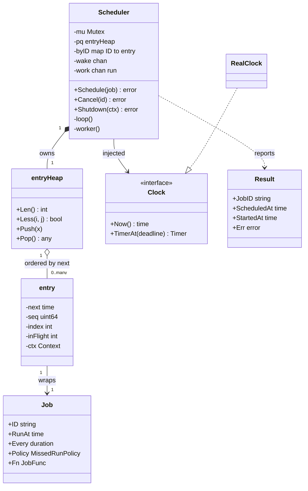
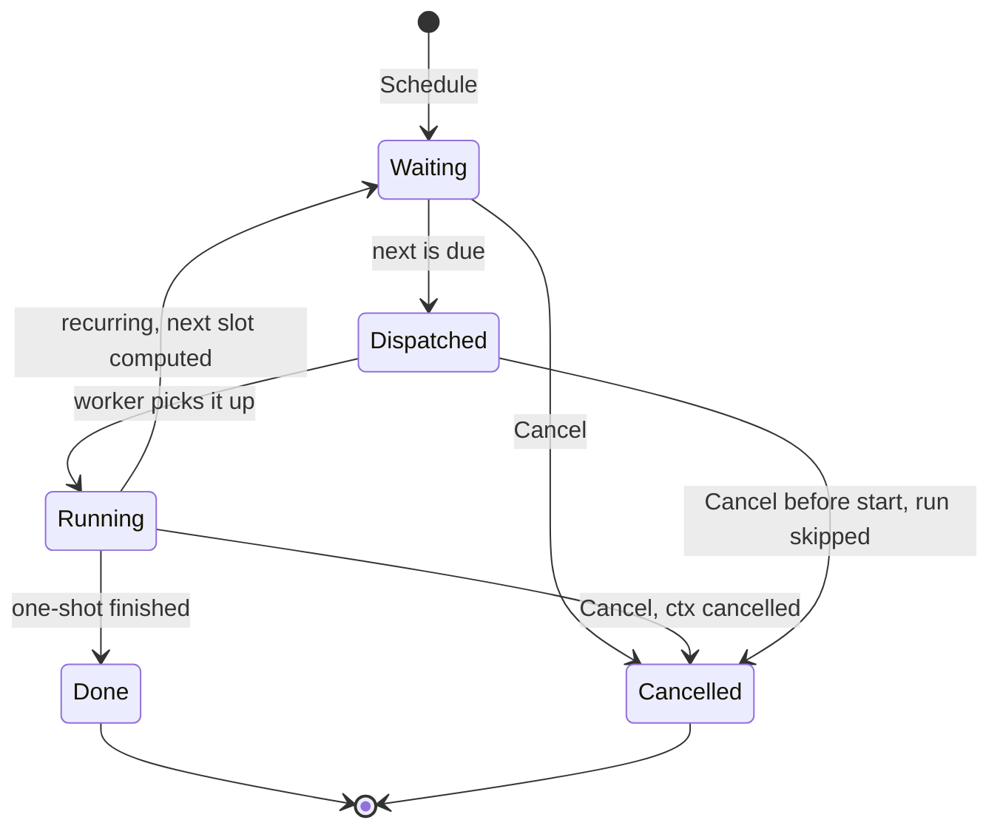
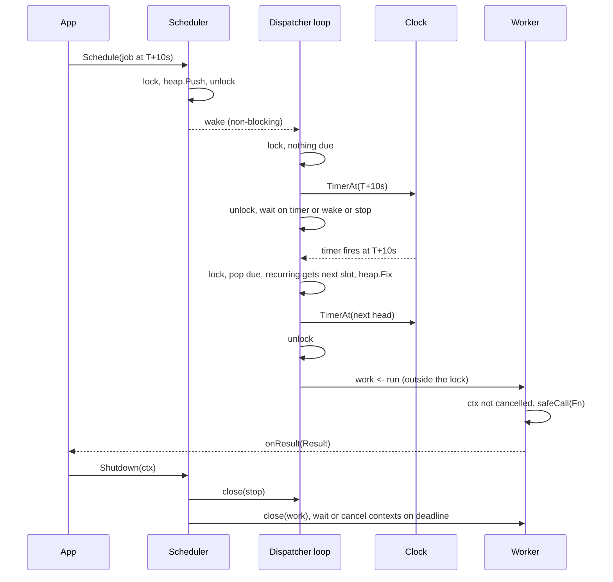

# Task Scheduler (delayed and recurring jobs)

> [!summary] TL;DR
> A task scheduler runs a function at a given time, once or on a fixed interval. One dispatcher goroutine keeps the jobs in a min-heap ordered by next run time and sleeps on one timer until the earliest job is due. It then hands the job to a bounded worker pool. The clock is injected, so tests move time by hand instead of sleeping.

> [!abstract] Core idea
> - A **min-heap by next run time** gives the earliest job in O(1) and inserts or removes in O(log n). One timer for the heap head replaces one goroutine per job.
> - The **dispatcher** only decides *when*. The **workers** run *what*. A bounded channel between them is the backpressure.
> - **Cancellation** removes the heap entry (O(log n) via its stored index) and cancels the context of a run already in flight.
> - **Missed-run policy** decides what a recurring job does after the scheduler wakes up late: run every missed slot (`CatchUp`) or run once and jump to the next future slot (`Coalesce`).
> - **Graceful shutdown**: stop dispatching, let running jobs finish, and cancel their contexts only when the shutdown deadline expires.
> - Classic mistakes: one `time.AfterFunc` goroutine per job with no way to list or cancel them, a scan of all jobs every second, and `time.Sleep` in tests.

## Problem statement

```text
Design an in-process task scheduler. Callers submit jobs that run once at a given
time (delayed) or repeatedly every N seconds (recurring). Jobs run on a fixed-size
worker pool. Support cancelling a job, a policy for runs missed while the process
was busy or paused, and a graceful shutdown that lets running jobs finish.
```

- It tests the right data structure (a heap, not a sorted slice or a scan), goroutine ownership (one dispatcher, N workers), cancellation with `context`, and whether you can test time without sleeping. Time box: 10 minutes for Steps 1-4, 10 for Steps 5-7, 25-35 for the code, 10 for edge cases and the distributed follow-up.

### Solving path

1. Clarify: one process or many, delayed and fixed-interval jobs (cron expressions are a follow-up), the missed-run policy, overlap, and shutdown.
2. Name the entities: `Job`, the heap `entry`, `Scheduler`, `Clock`, `Result`.
3. Choose the core structure: a min-heap by next run time, plus a map from ID to entry for cancellation.
4. Write the dispatcher loop: pop everything due, reschedule recurring jobs, arm one timer for the new head, wait on the timer or a wake-up signal.
5. Add the worker pool, cancellation, the missed-run policy and shutdown.
6. Test with a fake clock: ordering, both missed-run policies, cancel, no overlap, panic recovery, shutdown, and 50 concurrent schedule/cancel calls under `-race`.

## Step 1: Clarify requirements

### Questions to ask (with assumed answers)

- One process, or a cluster of instances that must not run a job twice? *Assume: one process; the cluster version is a Step 10 extension.*
- Which schedules? *Assume: one-shot at a time, and fixed interval (`Every`). Cron expressions are an extension that only changes how the next time is computed.*
- What if the scheduler wakes up late and several slots of a recurring job were missed? *Assume: a per-job policy, `CatchUp` or `Coalesce`.*
- Can two runs of the same recurring job overlap if one run is slower than the interval? *Assume: no for `Coalesce` jobs (the late slot is skipped); `CatchUp` jobs owe every slot, so they may overlap when there is more than one worker.*
- Are jobs durable across a restart? *Assume: no, in memory; the database version is in Step 6.*
- Retries on failure? *Assume: the result is reported; retry is the job's own concern or a follow-up.*
- What does shutdown do with running jobs? *Assume: wait for them until a deadline, then cancel their contexts.*

### Functional

- `Schedule(job)`: one-shot (`Every == 0`) or recurring (`Every > 0`), first run at `RunAt`.
- `Cancel(id)`: no further runs; a run in flight sees its context cancelled.
- Jobs run on N workers; each run reports a `Result` (job ID, scheduled time, start time, error).
- A panicking job is reported as an error and does not kill a worker.
- `Shutdown(ctx)`: stop dispatching, drain queued runs, wait for running ones until `ctx` expires.

### Non-functional

- Due jobs start within one timer wake-up of their time; no polling interval.
- `Schedule` and `Cancel` are O(log n) and safe from many goroutines.
- A full worker pool never blocks `Schedule` or `Cancel`.
- Time is injected, so tests are deterministic and never sleep for the scheduled duration.

### Out of scope

- Cron-expression parsing, time zones and daylight-saving rules.
- Persistence, leases and exactly-once across instances (discussed in Steps 6 and 10).
- Priorities between jobs that are due at the same time (ties run in submit order).

## Step 2: Actors and use cases

| Actor | Use case |
|---|---|
| Application code | Schedule a delayed job (send a reminder in 15 minutes) |
| Application code | Schedule a recurring job (refresh a cache every 30 seconds) |
| Application code | Cancel a job (the user cancelled the order, so drop the reminder) |
| Worker pool | Execute due runs, report results |
| Process owner (`main`) | Graceful shutdown on SIGTERM |
| Operator | Read results and metrics (late starts, failures) |

The hardest use case is the **dispatcher loop**: it must sleep exactly until the next due job, wake early when a sooner job is scheduled, and never hold the lock while it waits for a free worker.

## Step 3: Entities

| Entity | Key fields | Why it exists |
|---|---|---|
| `Job` | ID, RunAt, Every, Policy, Fn | What the caller submits; `Every == 0` means one-shot |
| `entry` | job, next, seq, index, inFlight, ctx, cancel | The scheduler's private record: next run time, heap position, cancellation |
| `entryHeap` | `[]*entry` | Min-heap by `next`, ties by `seq`; implements `heap.Interface` |
| `Scheduler` | mu, pq, byID, wake, stop, work, workers, clock | Owns the heap, the dispatcher goroutine and the pool |
| `Clock` / `Timer` | `Now()`, `TimerAt(deadline)` | Injected time: `RealClock` in production, a fake clock in tests |
| `MissedRunPolicy` | `Coalesce`, `CatchUp` | What a late recurring job does |
| `Result` | JobID, ScheduledAt, StartedAt, Err | What each run reports |

Modelling insight: the job is the caller's value, the **entry is the scheduler's state** about it. Keeping `index` on the entry is what makes `Cancel` O(log n): `heap.Remove(&pq, e.index)` instead of a linear search. The entry also carries the job's `context`, so cancelling stops a run that has already started.

## Step 4: Relationships





- **Composition** (scheduler to heap): the heap lives and dies with the scheduler.
- **Aggregation** (heap to entry): entries enter and leave the heap; a one-shot entry stays in `byID` while it runs, so `Cancel` can still reach its context.
- **Dependency on an interface** (scheduler to clock): injected, so the same code runs on real and fake time.

## Step 5: APIs and public methods

```text
POST   /jobs              body: {id, runAt, everySeconds, policy, handler}  -> 201 {id, nextRunAt}
                          409 duplicate id, 400 invalid job, 503 shutting down
DELETE /jobs/{id}                                                           -> 204, 404 not found
GET    /jobs/{id}                                                           -> 200 {id, nextRunAt, inFlight}
GET    /jobs/{id}/runs?limit=20                                             -> 200 [{scheduledAt, startedAt, error}]
```

The Go surface is a small interface; `*Scheduler` in Step 8 implements it. `Fn` is a closure, which is the usual Go form of the command pattern ([[Command, Undo and Memento]]).

```go
type JobScheduler interface {
	Schedule(j Job) error
	Cancel(id string) error
	Shutdown(ctx context.Context) error
}

var _ JobScheduler = (*Scheduler)(nil) // compile-time check
```

Typed errors map to status codes: `ErrDuplicateID` to 409, `ErrInvalidJob` to 400, `ErrNotFound` to 404, `ErrClosed` to 503.

## Step 6: Storage and repositories

In memory, the heap is the store. To survive restarts and run on several instances, the jobs move into a table and each instance claims due rows with a lease.

```sql
CREATE TABLE jobs (
    id            TEXT PRIMARY KEY,
    handler       TEXT        NOT NULL,           -- registry key, e.g. 'send_reminder'
    payload       JSONB       NOT NULL DEFAULT '{}',
    next_run_at   TIMESTAMPTZ NOT NULL,
    every_seconds INT         NOT NULL DEFAULT 0, -- 0 = one-shot
    policy        TEXT        NOT NULL DEFAULT 'coalesce',
    status        TEXT        NOT NULL DEFAULT 'scheduled', -- scheduled | running | done | cancelled
    lease_owner   TEXT,
    lease_until   TIMESTAMPTZ
);
CREATE INDEX idx_jobs_due ON jobs (next_run_at) WHERE status = 'scheduled';

-- claim up to 10 due jobs; another instance skips the rows this one holds
WITH due AS (
    SELECT id FROM jobs
    WHERE status = 'scheduled' AND next_run_at <= now()
    ORDER BY next_run_at
    LIMIT 10
    FOR UPDATE SKIP LOCKED
)
UPDATE jobs j
SET status = 'running', lease_owner = $1, lease_until = now() + interval '5 minutes'
FROM due WHERE j.id = due.id
RETURNING j.id, j.handler, j.payload, j.next_run_at, j.every_seconds;

-- finish a recurring run: compute the next slot, only if this instance still owns the lease
UPDATE jobs
SET status = 'scheduled', next_run_at = $3, lease_owner = NULL, lease_until = NULL
WHERE id = $1 AND lease_owner = $2;
```

```go
type JobRepo interface {
	Save(ctx context.Context, j Job) error                                   // unique id
	ClaimDue(ctx context.Context, owner string, limit int) ([]Job, error)    // SKIP LOCKED + lease
	Reschedule(ctx context.Context, id, owner string, next time.Time) error  // only the lease owner
	Cancel(ctx context.Context, id string) error
	ReclaimExpired(ctx context.Context) (int, error)                         // leases past lease_until
}
```

- The partial index keeps "what is due" a small index range scan, whatever the size of the history.
- `FOR UPDATE SKIP LOCKED` is the same claim pattern as in [[Parking Lot]]; the general trade-offs are in [[Locking - Optimistic vs Pessimistic]].
- An instance that crashes mid-run leaves a lease that expires; a sweeper puts the row back to `scheduled`. That makes execution **at-least-once**, so handlers must be idempotent ([[Idempotency and Idempotency Keys]]).

## Step 7: Patterns

| Pattern | Where | Why here |
|---|---|---|
| [[Command, Undo and Memento]] | `Job.Fn` (a closure), `handler` + `payload` in the table | A job is a request turned into a value that can wait in a queue |
| [[Strategy and Template Method]] | `MissedRunPolicy`, and a cron parser as another "next time" strategy | How the next slot is computed changes per job |
| [[Repository and Unit of Work]] | `JobRepo` | Swap the heap for Postgres without touching the dispatcher |
| [[Observer and Event Bus]] | the `onResult` callback | Metrics, logging and retries subscribe to results instead of living in the scheduler |
| Dependency injection | `Clock` | Tests drive time; production passes `RealClock{}` |
| Worker pool | `work` channel + N goroutines | Bounds concurrency; the channel is the backpressure ([[Background Jobs and Worker Pools]]) |

Patterns not used, and why:

- No State-pattern classes for the job lifecycle: the states carry no per-state behaviour, so `index`, `inFlight` and the context are enough ([[State Machines in Go]] is for transitions with rules).
- No goroutine per job: 100,000 delayed jobs would mean 100,000 sleeping goroutines and timers, with no single place to list, count or cancel them.

## Folder structure

```text
scheduler/
  clock.go          -> Clock, Timer, RealClock
  job.go            -> Job, JobFunc, Result, MissedRunPolicy, Err* errors
  heap.go           -> entry, entryHeap (heap.Interface)
  scheduler.go      -> Scheduler: New, Schedule, Cancel, loop, worker, execute, Shutdown, nextRun
  scheduler_test.go -> fakeClock, ordering, policies, cancel, overlap, panic, shutdown, concurrency
cmd/demo/main.go    -> New(RealClock{}, 4, logResult), signal.NotifyContext, Shutdown on SIGTERM
```

## Step 8: Core code

> [!tip] What to code in a 60-minute round
> Aim for about 180 lines in the room.
> - **Write:** `Job`, `entry`, `entryHeap`, the `Clock` interface, `Scheduler` with `New`, `Schedule`, `Cancel`, the dispatcher `loop`, `worker` and a simple `Shutdown`.
> - **Add if time remains:** the `MissedRunPolicy` with `nextRun`, the no-overlap rule, panic recovery, and one fake-clock test.
> - **Talk only:** the jobs table with leases, cron expressions, retries with backoff, and the distributed version.

### Walkthrough

`Schedule(job)`:

1. Validate (ID, function, non-negative interval) and reject a duplicate ID.
2. Create the entry with its own `context.WithCancel` and a sequence number for tie-breaking.
3. `heap.Push`, then `signal()`: a non-blocking send on `wake` (capacity 1), because the new job may be earlier than the timer the dispatcher sleeps on.

`loop()` (the dispatcher, one goroutine):

1. Lock; read `now` once.
2. While the heap head is due: collect it as a run unless a `Coalesce` job is still running; for a recurring job compute the next slot and `heap.Fix`; for a one-shot, `heap.Pop`.
3. Arm one timer for the new head with an **absolute** deadline (`TimerAt(next)`); unlock.
4. Send the due runs to the `work` channel **outside the lock**. If every worker is busy this blocks the dispatcher, which is the backpressure, but never `Schedule` or `Cancel`.
5. Wait on the timer, `wake` or `stop`; stop the timer; loop.

`Cancel(id)`: remove from `byID`, `heap.Remove(&pq, e.index)` when the entry is in the heap, and `e.cancel()`. A run already queued checks `ctx.Err()` before starting and is skipped; a running job sees `ctx.Done()`.

`Shutdown(ctx)`: mark closed, close `stop`, wait for the dispatcher to exit, close `work` so the workers drain it, then wait for the workers or for `ctx`. On expiry, cancel every job context.

> [!tip] Why `TimerAt(deadline)` and not `NewTimer(duration)`
> With a relative `NewTimer(next.Sub(now))`, a fake clock turns into a race. If the test advances the clock between the dispatcher's `Now()` and its `NewTimer` call, the fake clock adds the duration to the *new* time, so the deadline moves into the future and a test that expects the timer to fire can hang. Such a hang shows up only now and then, for example in a `go test -race -count=20` run. An absolute deadline cannot drift that way. The same race exists with real time when the process is paused between the two calls, but there it only delays the run slightly.

```go
package scheduler

import (
	"container/heap"
	"context"
	"errors"
	"fmt"
	"sync"
	"time"
)

var (
	ErrClosed      = errors.New("scheduler is shut down")
	ErrDuplicateID = errors.New("job id already scheduled")
	ErrNotFound    = errors.New("job not found")
	ErrInvalidJob  = errors.New("invalid job")
)

// Clock is injected so tests control time. TimerAt takes an absolute
// deadline, not a duration, so a fake clock that moves between Now() and
// TimerAt() cannot push the deadline later. Timer mirrors *time.Timer.
type Clock interface {
	Now() time.Time
	TimerAt(deadline time.Time) Timer
}

type Timer interface {
	C() <-chan time.Time
	Stop() bool
}

// JobScheduler is the surface callers depend on.
type JobScheduler interface {
	Schedule(j Job) error
	Cancel(id string) error
	Shutdown(ctx context.Context) error
}

var _ JobScheduler = (*Scheduler)(nil) // compile-time check

// RealClock is the production clock.
type RealClock struct{}

func (RealClock) Now() time.Time { return time.Now() }
func (RealClock) TimerAt(deadline time.Time) Timer {
	return realTimer{time.NewTimer(time.Until(deadline))}
}

type realTimer struct{ t *time.Timer }

func (r realTimer) C() <-chan time.Time { return r.t.C }
func (r realTimer) Stop() bool          { return r.t.Stop() }

// MissedRunPolicy decides what a recurring job does when the scheduler
// wakes up late (process paused, clock jumped, all workers busy).
type MissedRunPolicy int

const (
	Coalesce MissedRunPolicy = iota // run once now, then the next future slot
	CatchUp                         // run every missed slot, one after another
)

type JobFunc func(ctx context.Context) error

// Job is what callers submit. Every == 0 means a one-shot job.
type Job struct {
	ID     string
	RunAt  time.Time
	Every  time.Duration
	Policy MissedRunPolicy
	Fn     JobFunc
}

// Result is reported once per executed run.
type Result struct {
	JobID       string
	ScheduledAt time.Time
	StartedAt   time.Time
	Err         error
}

type entry struct {
	job      Job
	next     time.Time
	seq      uint64 // tie-break: same time runs in submit order
	index    int    // position in the heap, -1 when not in it
	inFlight int    // runs dispatched and not yet finished
	ctx      context.Context
	cancel   context.CancelFunc
}

// entryHeap is a min-heap ordered by next run time, then by seq.
type entryHeap []*entry

func (h entryHeap) Len() int { return len(h) }
func (h entryHeap) Less(i, j int) bool {
	if h[i].next.Equal(h[j].next) {
		return h[i].seq < h[j].seq
	}
	return h[i].next.Before(h[j].next)
}
func (h entryHeap) Swap(i, j int) {
	h[i], h[j] = h[j], h[i]
	h[i].index = i
	h[j].index = j
}
func (h *entryHeap) Push(x any) {
	e := x.(*entry)
	e.index = len(*h)
	*h = append(*h, e)
}
func (h *entryHeap) Pop() any {
	old := *h
	e := old[len(old)-1]
	old[len(old)-1] = nil
	e.index = -1
	*h = old[:len(old)-1]
	return e
}

type run struct {
	e  *entry
	at time.Time
}

type Scheduler struct {
	mu       sync.Mutex
	clock    Clock
	pq       entryHeap
	byID     map[string]*entry
	seq      uint64
	closed   bool
	wake     chan struct{} // cap 1: "the heap head may have changed"
	stop     chan struct{} // closed by Shutdown: the dispatcher exits
	loopDone chan struct{}
	work     chan run // bounded hand-off to the worker pool
	workers  sync.WaitGroup
	baseCtx  context.Context // parent of every job context
	killJobs context.CancelFunc
	onResult func(Result)
}

// New starts a dispatcher goroutine and n workers. onResult may be nil and
// is called from worker goroutines, so it must be safe for concurrent use.
func New(clock Clock, n int, onResult func(Result)) *Scheduler {
	if n < 1 {
		n = 1
	}
	if onResult == nil {
		onResult = func(Result) {}
	}
	base, kill := context.WithCancel(context.Background())
	s := &Scheduler{
		clock: clock, byID: map[string]*entry{},
		wake: make(chan struct{}, 1), stop: make(chan struct{}),
		loopDone: make(chan struct{}), work: make(chan run, n),
		baseCtx: base, killJobs: kill, onResult: onResult,
	}
	for i := 0; i < n; i++ {
		s.workers.Add(1)
		go s.worker()
	}
	go s.loop()
	return s
}

// Schedule adds a one-shot or recurring job.
func (s *Scheduler) Schedule(j Job) error {
	if j.ID == "" || j.Fn == nil || j.Every < 0 {
		return ErrInvalidJob
	}
	s.mu.Lock()
	defer s.mu.Unlock()
	if s.closed {
		return ErrClosed
	}
	if _, ok := s.byID[j.ID]; ok {
		return ErrDuplicateID
	}
	ctx, cancel := context.WithCancel(s.baseCtx)
	s.seq++
	e := &entry{job: j, next: j.RunAt, seq: s.seq, ctx: ctx, cancel: cancel}
	s.byID[j.ID] = e
	heap.Push(&s.pq, e)
	s.signal()
	return nil
}

// Cancel removes future runs and cancels the context of a run in flight.
func (s *Scheduler) Cancel(id string) error {
	s.mu.Lock()
	defer s.mu.Unlock()
	e, ok := s.byID[id]
	if !ok {
		return ErrNotFound
	}
	delete(s.byID, id)
	if e.index >= 0 {
		heap.Remove(&s.pq, e.index)
		s.signal()
	}
	e.cancel()
	return nil
}

// signal must be called with s.mu held. It never blocks.
func (s *Scheduler) signal() {
	select {
	case s.wake <- struct{}{}:
	default:
	}
}

// nextRun computes the next slot of a recurring job after the slot `sched`.
func nextRun(sched time.Time, every time.Duration, now time.Time, p MissedRunPolicy) time.Time {
	next := sched.Add(every)
	if p == Coalesce && !next.After(now) {
		missed := now.Sub(next)/every + 1
		next = next.Add(missed * every)
	}
	return next
}

func (s *Scheduler) loop() {
	defer close(s.loopDone)
	for {
		s.mu.Lock()
		now := s.clock.Now()
		var due []run
		for len(s.pq) > 0 && !s.pq[0].next.After(now) {
			e := s.pq[0]
			// Coalesce never overlaps: a slot that finds the job running is
			// skipped. CatchUp owes every slot, so it always dispatches.
			if e.job.Policy == CatchUp || e.inFlight == 0 {
				due = append(due, run{e: e, at: e.next})
				e.inFlight++
			}
			if e.job.Every > 0 {
				e.next = nextRun(e.next, e.job.Every, now, e.job.Policy)
				heap.Fix(&s.pq, 0)
			} else {
				heap.Pop(&s.pq)
			}
		}
		var timer Timer
		var timerC <-chan time.Time
		if len(s.pq) > 0 {
			timer = s.clock.TimerAt(s.pq[0].next)
			timerC = timer.C()
		}
		s.mu.Unlock()

		for _, r := range due { // send outside the lock: a full pool must not block Schedule
			select {
			case s.work <- r:
			case <-s.stop:
				if timer != nil {
					timer.Stop()
				}
				return
			}
		}
		select {
		case <-timerC:
		case <-s.wake:
		case <-s.stop:
			if timer != nil {
				timer.Stop()
			}
			return
		}
		if timer != nil {
			timer.Stop()
		}
	}
}

func (s *Scheduler) worker() {
	defer s.workers.Done()
	for r := range s.work {
		s.execute(r)
	}
}

func (s *Scheduler) execute(r run) {
	res := Result{JobID: r.e.job.ID, ScheduledAt: r.at, StartedAt: s.clock.Now()}
	if err := r.e.ctx.Err(); err == nil { // cancelled after dispatch: do not start
		res.Err = safeCall(r.e.ctx, r.e.job.Fn)
		s.onResult(res)
	}
	s.mu.Lock()
	r.e.inFlight--
	if r.e.job.Every == 0 && s.byID[r.e.job.ID] == r.e {
		delete(s.byID, r.e.job.ID) // a finished one-shot is forgotten
		r.e.cancel()
	}
	s.mu.Unlock()
}

// safeCall turns a panic in a job into an error so one bad job cannot kill a worker.
func safeCall(ctx context.Context, fn JobFunc) (err error) {
	defer func() {
		if p := recover(); p != nil {
			err = fmt.Errorf("job panicked: %v", p)
		}
	}()
	return fn(ctx)
}

// Shutdown stops dispatching, lets queued and running jobs finish, and waits
// until ctx expires. On expiry it cancels every job context and returns ctx.Err().
func (s *Scheduler) Shutdown(ctx context.Context) error {
	s.mu.Lock()
	if s.closed {
		s.mu.Unlock()
		return ErrClosed
	}
	s.closed = true
	s.mu.Unlock()

	close(s.stop)
	<-s.loopDone  // the dispatcher no longer sends
	close(s.work) // workers drain what is already queued, then exit

	done := make(chan struct{})
	go func() { s.workers.Wait(); close(done) }()
	select {
	case <-done:
		s.killJobs()
		return nil
	case <-ctx.Done():
		s.killJobs() // jobs that honour ctx return promptly
		return ctx.Err()
	}
}
```

## Test cases

| Test | Proves |
|---|---|
| `TestOneShotJobsRunInTimeOrder` | Heap order (A at +10 s before B at +20 s, although B was submitted first), duplicate ID rejected, start time from the clock, `ErrClosed` after shutdown |
| `TestMissedRunPolicy` | Woken 25 s late at +35 s: `CatchUp` runs slots 10, 20 and 30; `Coalesce` runs slot 10 once; both resume at +40 s |
| `TestNextRun` | The slot arithmetic, including "exactly on a slot moves past it" |
| `TestCancel` | No runs after cancel, second cancel gives `ErrNotFound`, a run in flight returns `context.Canceled` |
| `TestCoalesceNeverOverlaps` | A slow run makes the next slot skip, not start a second copy |
| `TestPanicIsRecovered` | A panic becomes an error result and the next job still runs |
| `TestShutdown` | Shutdown waits for the run in flight; on deadline it cancels job contexts and returns `DeadlineExceeded`; a second shutdown gives `ErrClosed` |
| `TestConcurrentScheduleAndCancel` | 50 goroutines schedule, half cancel their own job: exactly the 25 survivors run |

All tests pass under `go test -race -count=50` (Go 1.24.4). The fake clock's `WaitForTimer` waits until the dispatcher has armed a timer for a given time, so `Advance` never races the dispatcher. `recorder.waitN` waits for results before `Shutdown`, so a shutdown cannot stop the dispatcher before it dispatched what the test expects.

```go
package scheduler

import (
	"context"
	"errors"
	"fmt"
	"sync"
	"sync/atomic"
	"testing"
	"time"
)

// fakeClock moves only when the test calls Advance.
type fakeClock struct {
	mu     sync.Mutex
	now    time.Time
	timers map[*fakeTimer]struct{}
}

type fakeTimer struct {
	fc *fakeClock
	at time.Time
	c  chan time.Time
}

func newFakeClock() *fakeClock {
	return &fakeClock{now: time.Unix(1_700_000_000, 0), timers: map[*fakeTimer]struct{}{}}
}

func (f *fakeClock) Now() time.Time {
	f.mu.Lock()
	defer f.mu.Unlock()
	return f.now
}

func (f *fakeClock) TimerAt(at time.Time) Timer {
	f.mu.Lock()
	defer f.mu.Unlock()
	t := &fakeTimer{fc: f, at: at, c: make(chan time.Time, 1)}
	if !at.After(f.now) {
		t.c <- f.now
		return t
	}
	f.timers[t] = struct{}{}
	return t
}

func (t *fakeTimer) C() <-chan time.Time { return t.c }
func (t *fakeTimer) Stop() bool {
	t.fc.mu.Lock()
	defer t.fc.mu.Unlock()
	_, ok := t.fc.timers[t]
	delete(t.fc.timers, t)
	return ok
}

func (f *fakeClock) Advance(d time.Duration) {
	f.mu.Lock()
	defer f.mu.Unlock()
	f.now = f.now.Add(d)
	for t := range f.timers {
		if !t.at.After(f.now) {
			t.c <- f.now
			delete(f.timers, t)
		}
	}
}

// WaitForTimer blocks until the dispatcher has armed a timer for `at`, so an
// Advance cannot race with the dispatcher computing its next wake-up.
func (f *fakeClock) WaitForTimer(t *testing.T, at time.Time) {
	t.Helper()
	deadline := time.Now().Add(2 * time.Second)
	for time.Now().Before(deadline) {
		f.mu.Lock()
		for tm := range f.timers {
			if tm.at.Equal(at) {
				f.mu.Unlock()
				return
			}
		}
		f.mu.Unlock()
		time.Sleep(time.Millisecond)
	}
	t.Fatalf("no timer armed for %v", at)
}

type recorder struct {
	mu  sync.Mutex
	got []Result
}

func (r *recorder) add(res Result) {
	r.mu.Lock()
	defer r.mu.Unlock()
	r.got = append(r.got, res)
}

func (r *recorder) results() []Result {
	r.mu.Lock()
	defer r.mu.Unlock()
	return append([]Result(nil), r.got...)
}

// waitN blocks until n results arrived, so Shutdown cannot race the dispatch.
func (r *recorder) waitN(t *testing.T, n int) {
	t.Helper()
	deadline := time.Now().Add(2 * time.Second)
	for len(r.results()) < n {
		if time.Now().After(deadline) {
			t.Fatalf("got %d results, want %d", len(r.results()), n)
		}
		time.Sleep(time.Millisecond)
	}
}

func noop(context.Context) error { return nil }

func shutdown(t *testing.T, s *Scheduler) {
	t.Helper()
	ctx, cancel := context.WithTimeout(context.Background(), 2*time.Second)
	defer cancel()
	if err := s.Shutdown(ctx); err != nil {
		t.Fatal(err)
	}
}

func TestOneShotJobsRunInTimeOrder(t *testing.T) {
	clk := newFakeClock()
	rec := &recorder{}
	s := New(clk, 1, rec.add) // one worker: execution order = dispatch order
	t0 := clk.Now()
	if err := s.Schedule(Job{ID: "B", RunAt: t0.Add(20 * time.Second), Fn: noop}); err != nil {
		t.Fatal(err)
	}
	if err := s.Schedule(Job{ID: "A", RunAt: t0.Add(10 * time.Second), Fn: noop}); err != nil {
		t.Fatal(err)
	}
	if err := s.Schedule(Job{ID: "A", RunAt: t0, Fn: noop}); !errors.Is(err, ErrDuplicateID) {
		t.Fatalf("duplicate: %v", err)
	}
	clk.WaitForTimer(t, t0.Add(10*time.Second))
	clk.Advance(25 * time.Second) // both are due now
	rec.waitN(t, 2)
	shutdown(t, s)
	got := rec.results()
	if len(got) != 2 || got[0].JobID != "A" || got[1].JobID != "B" {
		t.Fatalf("got %+v", got)
	}
	if !got[0].ScheduledAt.Equal(t0.Add(10*time.Second)) || !got[1].StartedAt.Equal(t0.Add(25*time.Second)) {
		t.Fatalf("times %+v", got)
	}
	if err := s.Schedule(Job{ID: "C", RunAt: t0, Fn: noop}); !errors.Is(err, ErrClosed) {
		t.Fatalf("after shutdown: %v", err)
	}
}

func TestMissedRunPolicy(t *testing.T) {
	tests := []struct {
		name      string
		policy    MissedRunPolicy
		wantSlots []time.Duration // offsets from t0 of the slots that ran
	}{
		{"catch up runs every missed slot", CatchUp, []time.Duration{10, 20, 30}},
		{"coalesce runs once", Coalesce, []time.Duration{10}},
	}
	for _, tc := range tests {
		t.Run(tc.name, func(t *testing.T) {
			clk := newFakeClock()
			rec := &recorder{}
			s := New(clk, 1, rec.add)
			t0 := clk.Now()
			err := s.Schedule(Job{ID: "tick", RunAt: t0.Add(10 * time.Second),
				Every: 10 * time.Second, Policy: tc.policy, Fn: noop})
			if err != nil {
				t.Fatal(err)
			}
			clk.WaitForTimer(t, t0.Add(10*time.Second))
			clk.Advance(35 * time.Second) // woke up 25s late
			rec.waitN(t, len(tc.wantSlots))
			clk.WaitForTimer(t, t0.Add(40*time.Second)) // both resume at the next future slot
			shutdown(t, s)
			got := rec.results()
			if len(got) != len(tc.wantSlots) {
				t.Fatalf("ran %d times: %+v", len(got), got)
			}
			for i, off := range tc.wantSlots {
				if !got[i].ScheduledAt.Equal(t0.Add(off * time.Second)) {
					t.Fatalf("run %d scheduled %v", i, got[i].ScheduledAt.Sub(t0))
				}
			}
		})
	}
}

func TestNextRun(t *testing.T) {
	t0 := time.Unix(0, 0)
	sec := func(n int) time.Time { return t0.Add(time.Duration(n) * time.Second) }
	tests := []struct {
		name   string
		sched  int
		now    int
		policy MissedRunPolicy
		want   int
	}{
		{"on time", 10, 10, Coalesce, 20},
		{"coalesce skips to first future slot", 10, 35, Coalesce, 40},
		{"coalesce exactly on a slot moves past it", 10, 40, Coalesce, 50},
		{"catch up takes the very next slot", 10, 35, CatchUp, 20},
	}
	for _, tc := range tests {
		t.Run(tc.name, func(t *testing.T) {
			got := nextRun(sec(tc.sched), 10*time.Second, sec(tc.now), tc.policy)
			if !got.Equal(sec(tc.want)) {
				t.Fatalf("got %v want %ds", got.Sub(t0), tc.want)
			}
		})
	}
}

func TestCancel(t *testing.T) {
	t.Run("future runs", func(t *testing.T) {
		clk := newFakeClock()
		rec := &recorder{}
		s := New(clk, 2, rec.add)
		t0 := clk.Now()
		if err := s.Schedule(Job{ID: "r", RunAt: t0.Add(10 * time.Second), Every: 10 * time.Second, Fn: noop}); err != nil {
			t.Fatal(err)
		}
		clk.WaitForTimer(t, t0.Add(10*time.Second))
		if err := s.Cancel("r"); err != nil {
			t.Fatal(err)
		}
		if err := s.Cancel("r"); !errors.Is(err, ErrNotFound) {
			t.Fatalf("second cancel: %v", err)
		}
		clk.Advance(time.Minute)
		shutdown(t, s)
		if n := len(rec.results()); n != 0 {
			t.Fatalf("cancelled job ran %d times", n)
		}
	})
	t.Run("run in flight sees ctx cancelled", func(t *testing.T) {
		clk := newFakeClock()
		rec := &recorder{}
		s := New(clk, 1, rec.add)
		started := make(chan struct{})
		err := s.Schedule(Job{ID: "slow", RunAt: clk.Now(), Fn: func(ctx context.Context) error {
			close(started)
			<-ctx.Done()
			return ctx.Err()
		}})
		if err != nil {
			t.Fatal(err)
		}
		<-started
		if err := s.Cancel("slow"); err != nil {
			t.Fatal(err)
		}
		shutdown(t, s)
		got := rec.results()
		if len(got) != 1 || !errors.Is(got[0].Err, context.Canceled) {
			t.Fatalf("got %+v", got)
		}
	})
}

func TestCoalesceNeverOverlaps(t *testing.T) {
	clk := newFakeClock()
	s := New(clk, 2, nil)
	t0 := clk.Now()
	var starts atomic.Int32
	release := make(chan struct{})
	err := s.Schedule(Job{ID: "long", RunAt: t0.Add(10 * time.Second), Every: 10 * time.Second,
		Fn: func(context.Context) error { starts.Add(1); <-release; return nil }})
	if err != nil {
		t.Fatal(err)
	}
	clk.WaitForTimer(t, t0.Add(10*time.Second))
	clk.Advance(10 * time.Second) // slot 10 starts and blocks
	clk.WaitForTimer(t, t0.Add(20*time.Second))
	clk.Advance(10 * time.Second) // slot 20 finds it running: skipped
	clk.WaitForTimer(t, t0.Add(30*time.Second))
	close(release)
	shutdown(t, s)
	if n := starts.Load(); n != 1 {
		t.Fatalf("started %d times, want 1", n)
	}
}

func TestPanicIsRecovered(t *testing.T) {
	clk := newFakeClock()
	rec := &recorder{}
	s := New(clk, 1, rec.add)
	_ = s.Schedule(Job{ID: "bad", RunAt: clk.Now(), Fn: func(context.Context) error { panic("boom") }})
	_ = s.Schedule(Job{ID: "good", RunAt: clk.Now(), Fn: noop})
	rec.waitN(t, 2)
	shutdown(t, s)
	got := rec.results()
	if len(got) != 2 || got[0].Err == nil || got[1].Err != nil {
		t.Fatalf("got %+v", got)
	}
}

func TestShutdown(t *testing.T) {
	t.Run("waits for the run in flight", func(t *testing.T) {
		clk := newFakeClock()
		s := New(clk, 1, nil)
		started, release := make(chan struct{}), make(chan struct{})
		_ = s.Schedule(Job{ID: "j", RunAt: clk.Now(), Fn: func(context.Context) error {
			close(started)
			<-release
			return nil
		}})
		<-started
		done := make(chan error, 1)
		go func() { done <- s.Shutdown(context.Background()) }()
		select {
		case err := <-done:
			t.Fatalf("returned early: %v", err)
		case <-time.After(50 * time.Millisecond):
		}
		close(release)
		if err := <-done; err != nil {
			t.Fatal(err)
		}
	})
	t.Run("deadline cancels job contexts", func(t *testing.T) {
		clk := newFakeClock()
		s := New(clk, 1, nil)
		started, stopped := make(chan struct{}), make(chan struct{})
		_ = s.Schedule(Job{ID: "j", RunAt: clk.Now(), Fn: func(ctx context.Context) error {
			close(started)
			<-ctx.Done()
			close(stopped)
			return ctx.Err()
		}})
		<-started
		ctx, cancel := context.WithTimeout(context.Background(), 20*time.Millisecond)
		defer cancel()
		if err := s.Shutdown(ctx); !errors.Is(err, context.DeadlineExceeded) {
			t.Fatalf("got %v", err)
		}
		<-stopped
		if err := s.Shutdown(context.Background()); !errors.Is(err, ErrClosed) {
			t.Fatalf("second shutdown: %v", err)
		}
	})
}

func TestConcurrentScheduleAndCancel(t *testing.T) {
	clk := newFakeClock()
	rec := &recorder{}
	s := New(clk, 4, rec.add)
	t0 := clk.Now()
	var wg sync.WaitGroup
	for i := 0; i < 50; i++ {
		wg.Add(1)
		go func(i int) {
			defer wg.Done()
			id := fmt.Sprint("job-", i)
			if err := s.Schedule(Job{ID: id, RunAt: t0.Add(5 * time.Second), Fn: noop}); err != nil {
				t.Error(err)
				return
			}
			if i%2 == 1 {
				if err := s.Cancel(id); err != nil {
					t.Error(err)
				}
			}
		}(i)
	}
	wg.Wait()
	clk.WaitForTimer(t, t0.Add(5*time.Second))
	clk.Advance(5 * time.Second)
	rec.waitN(t, 25)
	shutdown(t, s)
	got := rec.results()
	seen := map[string]bool{}
	for _, r := range got {
		seen[r.JobID] = true
	}
	if len(got) != 25 || len(seen) != 25 {
		t.Fatalf("ran %d (%d distinct), want 25", len(got), len(seen))
	}
	for i := 1; i < 50; i += 2 {
		if seen[fmt.Sprint("job-", i)] {
			t.Fatalf("cancelled job-%d ran", i)
		}
	}
}
```

## Step 9: Edge cases

| Edge case | What happens | How the design handles it |
|---|---|---|
| A job sooner than the current timer is scheduled | Dispatcher would oversleep | `signal()` on `wake`; the loop re-reads the heap head and re-arms |
| Two jobs due at the same instant | Order would be random | `seq` tie-break: submit order |
| Process paused (GC, laptop sleep, `SIGSTOP`) for several intervals | Several slots missed at once | `MissedRunPolicy`: `CatchUp` runs each, `Coalesce` runs once |
| Run slower than its interval | Two copies of the same job run together | `Coalesce` skips a slot while `inFlight > 0`; `CatchUp` dispatches anyway (documented) |
| All workers busy | Due runs pile up | The dispatcher blocks on the bounded `work` channel; `Schedule` and `Cancel` stay fast because the lock is not held |
| Cancel after dispatch but before start | Run would start anyway | Worker checks `ctx.Err()` before calling `Fn` |
| Job ignores its context | Shutdown cannot stop it | `Shutdown` returns `ctx.Err()` on its deadline; the goroutine leaks until `Fn` returns, which is the job's bug |
| Job panics | Worker goroutine would die, pool shrinks | `safeCall` recovers and reports an error |
| Duplicate ID | Two entries, `Cancel` ambiguous | `ErrDuplicateID` |
| `Every` tiny with `CatchUp` after a long pause | Thousands of catch-up runs | Cap the catch-up count, or use `Coalesce` for anything that only needs the latest state |
| Wall clock jumps (NTP step) | A deadline could fire early or late | Times from `time.Now()` carry a monotonic reading that `Sub` uses, so `now.Add(d)` deadlines are safe. A caller-supplied `RunAt` (parsed from a request) has no monotonic reading, so a step moves it; state that wall-time jobs follow the wall clock |
| Daylight-saving change for "every day at 02:30" | The slot does not exist or repeats | Out of scope for fixed intervals; a cron strategy must pick a rule (skip or run once) |

### Common mistakes

- `time.AfterFunc` per job and a map of timers: works for 10 jobs, but cancellation races with firing, and shutdown cannot wait for them.
- Scanning every job each second: O(n) per tick and up to one second late.
- Sending to the worker channel while holding the mutex: a full pool then blocks `Schedule`, `Cancel` and `Shutdown`.
- Calling `time.Now()` directly and sleeping in tests: slow and flaky.
- Forgetting that a recurring job's next time is computed from the **scheduled** slot, not from when the run finished, which makes the schedule drift.

## Step 10: Tradeoffs and extensions

| Follow-up | Design change |
|---|---|
| Cron expressions | A `NextAfter(t time.Time) time.Time` strategy per job; the heap and loop do not change |
| Retries with backoff | The `onResult` observer re-schedules a one-shot copy at `now + backoff(attempt)` with jitter ([[Timeouts, Retries and Backoff]]) |
| Survive restarts | The `jobs` table from Step 6; the heap becomes a cache of the next few minutes |
| Several instances | Claim with `FOR UPDATE SKIP LOCKED` and a lease; at-least-once, so idempotent handlers; or a single leader ([[Leader Election]]) |
| Millions of timers | A hierarchical timing wheel gives O(1) insert and cancel at the cost of tick granularity |
| Priorities | Order the ready queue by priority after the time check, or one work channel per priority |
| Per-job concurrency limits | A semaphore per job type in the worker ([[Bulkheads and Concurrency Limits]]) |

Tradeoffs chosen:

- **One dispatcher goroutine and one mutex.** Simple and correct; the dispatcher does O(log n) work per due job, so it is not the bottleneck in one process.
- **Heap rather than timing wheel.** Exact deadlines and O(log n); the wheel wins only with very many timers and coarse precision.
- **`Coalesce` as the default.** Most recurring jobs (refresh, cleanup, report) only need the latest state; `CatchUp` is for jobs where each slot matters (hourly billing aggregation).
- **No overlap only for `Coalesce`.** `CatchUp` owes every slot, so with more than one worker its runs can overlap; a job that cannot overlap should use `Coalesce` or lock internally.
- **Results through a callback.** The scheduler stays small; retries, metrics and logs are observers.

The system-level version (durable schedules, sharding, exactly-once claims across a fleet) is [[Case Study - Distributed Job Scheduler]].

## Drawing



Redraw it from memory:

- [ ] The heap with the head's timer, and the `wake` channel that interrupts it
- [ ] The dispatcher sending to the bounded `work` channel outside the lock
- [ ] Cancel: `heap.Remove` by index plus `ctx` cancel
- [ ] Both missed-run policies on a timeline 10, 20, 30, 40 with a wake-up at 35
- [ ] Shutdown in three steps: stop, drain, wait or cancel

## Interview questions

> [!question]- Why a min-heap and one timer instead of one timer per job?
> The heap gives the earliest job in O(1) and insert or remove in O(log n), and one goroutine sleeps until the head is due. A timer per job scatters state across many callbacks: you cannot list jobs, shutdown cannot wait for them, and cancelling races with firing. With a heap there is one place that owns all the state.

> [!question]- How does `Cancel` stay O(log n), and what happens to a run that already started?
> Each entry stores its heap index, kept up to date by `Swap`, so `heap.Remove(&pq, e.index)` needs no search. The entry also owns a `context.CancelFunc`: a queued run checks `ctx.Err()` and is skipped, and a running job sees `ctx.Done()`. Cancellation in Go is cooperative, so a job that ignores its context runs to the end.

> [!question]- Trap: the process was paused for 25 seconds and a 10-second job missed two slots. What runs?
> It depends on a policy you must state. `CatchUp` runs every missed slot (10, 20, 30), which suits per-slot work like hourly billing. `Coalesce` runs once and jumps to the first future slot (40), which suits "refresh the cache". Running all missed slots by accident after a long pause causes a burst that can overload a dependency.

> [!question]- Why must the dispatcher send to the worker channel outside the lock?
> When every worker is busy the send blocks. If the lock were held, `Schedule`, `Cancel` and `Shutdown` would all block behind a slow job. Outside the lock only the dispatcher waits, which is the backpressure you want; the cost is that a job cancelled during that window is already in the channel, so the worker re-checks the context.

> [!question]- How do you test a scheduler without `time.Sleep`?
> Inject a clock with `Now` and `TimerAt`. The fake clock moves only on `Advance` and fires timers whose deadline has passed. A helper waits until the dispatcher has armed the timer you expect, so the test never advances time before the dispatcher is ready. `testing/synctest` (experimental in Go 1.24 behind `GOEXPERIMENT=synctest`, generally available in Go 1.25) offers a fake-time bubble as an alternative.

> [!question]- What does graceful shutdown mean here, exactly?
> Stop the dispatcher so nothing new is handed out, close the work channel so the workers drain what is queued, and wait for them. If the caller's deadline expires first, cancel every job context and return `ctx.Err()`. In `main` this sits behind `signal.NotifyContext` for SIGTERM, with a deadline shorter than the orchestrator's kill timeout.

> [!question]- How does this become a scheduler for a fleet of instances?
> Jobs live in a table indexed on `next_run_at`. Each instance claims due rows with `FOR UPDATE SKIP LOCKED` and a lease, runs them, and writes the next slot only if it still owns the lease. A crashed instance's lease expires and another instance picks the job up, so delivery is at-least-once and handlers must be idempotent.

## Cheat sheet

- Min-heap by `next`, ties by `seq`; `index` on the entry for O(log n) cancel.
- One dispatcher: pop due, reschedule recurring from the scheduled slot, arm one timer, send outside the lock.
- `wake` channel with capacity 1 and a non-blocking send, for "a sooner job arrived".
- Bounded `work` channel to N workers is the backpressure; `safeCall` recovers panics.
- Missed runs: `CatchUp` runs every slot, `Coalesce` runs once and skips while running.
- Cancel = heap remove + `ctx` cancel; a queued run re-checks `ctx.Err()`.
- Shutdown = stop, drain, wait, cancel contexts on deadline.
- Inject the clock with absolute-deadline timers; never sleep in tests.

## Links

- **Before this:** [[LLD Interview Method]], [[Concurrency for LLD]], [[Command, Undo and Memento]]
- **Next:** [[17 LLD/Practice/Circuit Breaker|Circuit Breaker]]
- **Compare with:** [[Scheduled Jobs - Cron to Durable Schedulers]] (cron and durable schedulers at system level), [[Background Jobs and Worker Pools]], [[Case Study - Distributed Job Scheduler]], [[Testing LLD Code]]
