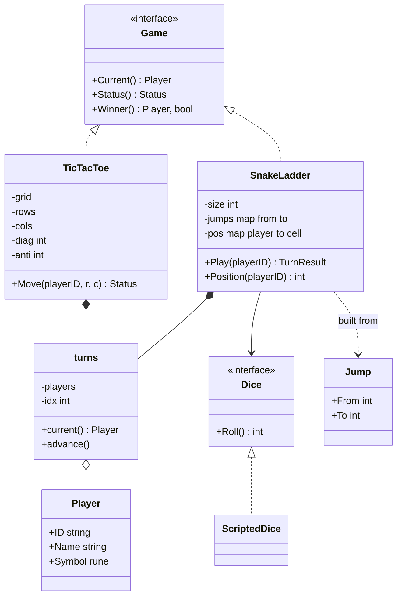
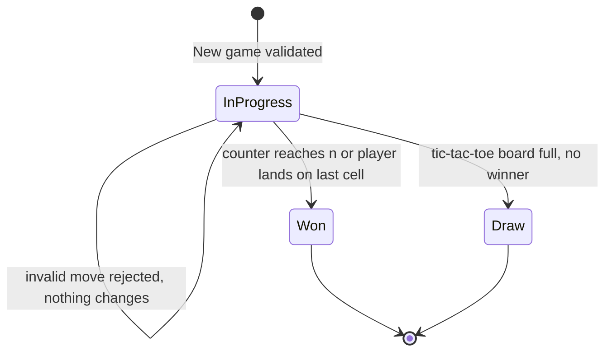
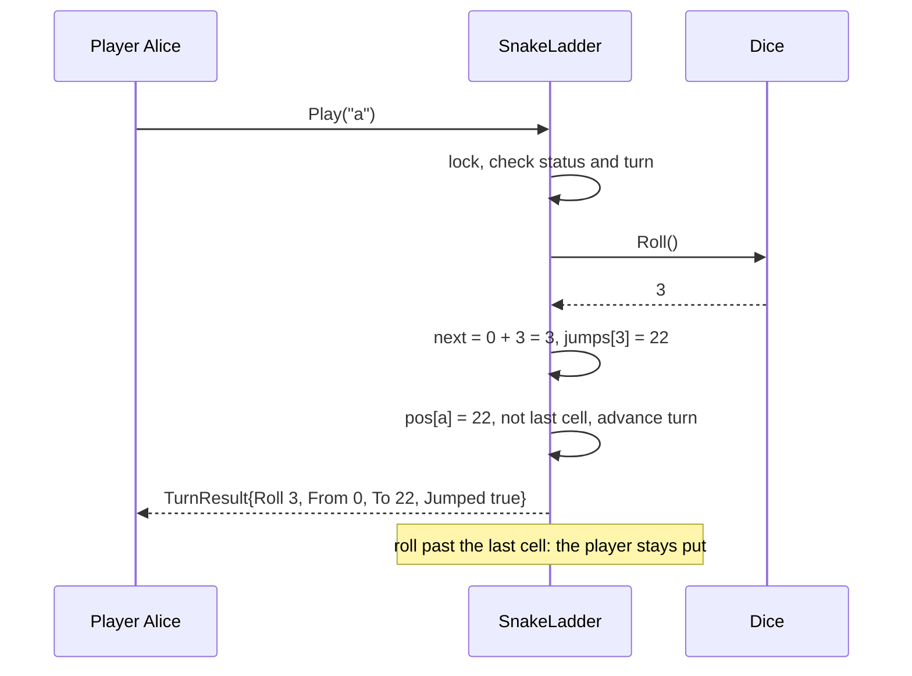

# Tic-Tac-Toe and Snake and Ladder

> [!summary] TL;DR
> These two board games are the classic machine-coding warm-up. You build one shared skeleton (a `Player`, a turn rotation and a `Game` interface with a status), then each game adds its own rule: tic-tac-toe detects a win in O(1) per move with running row, column and diagonal sums, and snake and ladder resolves every snake and ladder with one map lookup and takes its dice as an injected interface so tests can script every roll.

> [!abstract] Core idea
> - Shared skeleton: `Player`, a `turns` helper that rotates players, a `Status` (in progress, won, draw) and a `Game` interface both games satisfy.
> - Tic-tac-toe: never rescan the board. Keep a counter per row, per column and for the two diagonals; player one adds +1, player two adds -1; a counter reaching `+n` or `-n` is a win. That is O(1) per move instead of O(n²).
> - Snake and ladder: snakes and ladders are the same thing, a jump from one cell to another, stored in one `map[int]int`. Validate the jumps once at construction (no chains, no jump on the last cell).
> - The dice is an interface. Production uses a random dice; tests use a scripted dice so every game is deterministic.
> - Classic mistakes: scanning the whole board after every move, separate `Snake` and `Ladder` classes with duplicated code, calling `rand` directly inside `Play`, and forgetting turn validation.

## Problem statement

```text
Design two turn-based board games that share a common model:
1. Tic-tac-toe on an n x n board for two players. Detect a win (n in a row, column or
   diagonal) or a draw, reject invalid moves, and say whose turn it is.
2. Snake and ladder on a board of 100 cells for 2 or more players with one die.
   Snakes move a player down, ladders move a player up, and the first player to land
   exactly on the last cell wins.
Both games must be testable without randomness and safe if moves arrive concurrently.
```

- It tests clean modelling of a small domain, spotting what two problems share (players, turns, status) and what they do not (the move rule), an efficient win check, and testability through dependency injection. Time box: 10 minutes for Steps 1-4, 5 for Steps 5-6, 30 for the code, 10 for tests and edge cases.

### Solving path

1. Ask the clarifying questions: board size, number of players, what a draw is, the overshoot rule, whether snakes can chain.
2. Name the shared pieces first: `Player`, `Status`, `turns`, and a `Game` interface.
3. Tic-tac-toe: write `Move` with validation, then the O(1) counters for the win check.
4. Snake and ladder: one `jumps map[int]int`, the `Dice` interface, and `Play` with the exact-finish rule.
5. Put one mutex per game around every method so a turn is one atomic step.
6. Test wins in every direction, a draw, bad moves, scripted snakes and ladders, the overshoot, and concurrent moves; then discuss undo, replays and a networked version.

## Step 1: Clarify requirements

### Questions to ask (with assumed answers)

- Tic-tac-toe board size? *Assume: n x n with n >= 3, and n in a row wins (the classic game is n = 3).*
- What is a draw? *Assume: the board is full with no winner. Early draw detection is an extension.*
- Snake and ladder board size and players? *Assume: 100 cells by default, configurable, 2 or more players, one six-sided die.*
- Does a roll of 6 give an extra turn, and do three 6s cancel the turn? *Assume: no extra turns in the base version; it is a listed extension.*
- What if a roll goes past the last cell? *Assume: the player does not move (exact finish required). Some house rules bounce back instead; that is a strategy swap.*
- Can a snake end on a ladder's foot (a chain)? *Assume: no; the constructor rejects chains so every move does at most one jump.*
- Do players start on cell 1 or off the board? *Assume: off the board at position 0; the first roll of 3 puts them on cell 3.*
- Is this one process with a CLI, or a server? *Assume: an in-memory library; a CLI or an HTTP handler drives it.*

### Functional

- Tic-tac-toe: create a game for two players; `Move(player, row, col)`; reject a wrong turn, an out-of-bounds cell, a taken cell and any move after the game ends; report win or draw.
- Snake and ladder: create a game with a board size, a list of jumps, a dice and the players; `Play(player)` rolls, moves, applies at most one jump and reports the result; the first to land exactly on the last cell wins.
- Both: whose turn it is, the status, and the winner.

### Non-functional

- Tic-tac-toe win detection is O(1) per move and O(n) memory, not an O(n²) board scan.
- Snake and ladder jump lookup is O(1).
- Deterministic tests: the dice is injected.
- Moves are concurrency-safe: two goroutines cannot both play the same turn.

### Out of scope

- A graphical UI, network play and matchmaking.
- An AI opponent (minimax) for tic-tac-toe.
- Persisting games across restarts (discussed in Step 6).

## Step 2: Actors and use cases

| Actor | Use case |
|---|---|
| Player | Make a move (tic-tac-toe) or roll the dice (snake and ladder) |
| Game host (CLI or server) | Create a game, read whose turn it is, read status and winner |
| Dice | Produce the next roll (random in production, scripted in tests) |
| Admin or game designer | Configure board size and the snake and ladder layout |

The hardest use case is the move itself: validate, apply, check for a win, and only then pass the turn, all in one step.

## Step 3: Entities

| Entity | Key fields | Why it exists |
|---|---|---|
| `Player` | ID, Name, Symbol | Shared by both games; Symbol is only used by tic-tac-toe |
| `Status` | InProgress, Won, Draw | Shared lifecycle; snake and ladder never reaches Draw |
| `turns` | players, idx | Turn rotation, held as a field by both games instead of copied |
| `Game` | `Current`, `Status`, `Winner` | What a game loop or CLI needs from any game |
| `TicTacToe` | n, grid, rows, cols, diag, anti, moves | The board plus the O(1) win counters |
| `SnakeLadder` | size, jumps, pos, dice | The board is just a size plus a jump map |
| `Jump` | From, To | A snake (To < From) or a ladder (To > From) |
| `Dice` | `Roll() int` | Injected randomness |
| `TurnResult` | Player, Roll, From, To, Jumped, Status | What one roll did, for the UI and for tests |

Modelling insight: **a snake and a ladder are the same entity**, a jump. Separate `Snake` and `Ladder` types add nothing but duplicate code. The **snake and ladder board is not a grid**; it is a size and a map. The **tic-tac-toe board needs the grid** only to reject a taken cell; the win check never reads it.

## Step 4: Relationships



- Both games **compose** `turns`; neither inherits from a base game. In Go, a small shared helper plus a shared interface replaces the Java-style abstract `Game` class.
- `SnakeLadder` **depends on** the `Dice` interface, not on `math/rand`.
- `Jump` is only constructor input; at runtime the game holds the jumps as a map.

## Step 5: APIs and public methods

```text
POST /games                     body: {type: "tictactoe", n: 3, players: [...]}   -> 201 {gameId}
POST /games                     body: {type: "snakeladder", size: 100, jumps: [...], players: [...]}
POST /games/{id}/moves          body: {playerId, row, col}                        -> 200 {status}
POST /games/{id}/rolls          body: {playerId}                                  -> 200 {roll, from, to, jumped, status}
GET  /games/{id}                                                                   -> 200 {current, status, winner}

Errors: 409 not your turn, 409 cell taken, 409 game over, 400 out of bounds, 400 bad config
```

The Go surface is the shared `Game` interface plus one method per game:

```go
type Game interface {
	Current() Player
	Status() Status
	Winner() (Player, bool)
}

// TicTacToe: Move(playerID string, r, c int) (Status, error)
// SnakeLadder: Play(playerID string) (TurnResult, error)
```

Why `Move` and `Play` are not on the interface: their inputs differ (a cell versus nothing), and forcing one `Move(any)` signature would push type assertions into every caller. Keep the interface to what is truly shared.

## Step 6: Storage and repositories

In the interview everything lives in memory. For a game server, store games so a restart or a second instance can continue them:

```sql
CREATE TABLE games (
    id          TEXT PRIMARY KEY,
    kind        TEXT    NOT NULL CHECK (kind IN ('tictactoe', 'snakeladder')),
    config      JSONB   NOT NULL,          -- n, or size + jumps
    status      TEXT    NOT NULL DEFAULT 'in_progress',
    turn_idx    INT     NOT NULL DEFAULT 0,
    move_count  INT     NOT NULL DEFAULT 0,
    version     BIGINT  NOT NULL DEFAULT 0  -- optimistic concurrency
);

CREATE TABLE moves (
    game_id     TEXT   NOT NULL REFERENCES games(id),
    seq         INT    NOT NULL,           -- 1, 2, 3 ... per game
    player_id   TEXT   NOT NULL,
    payload     JSONB  NOT NULL,           -- {row, col} or {roll}
    PRIMARY KEY (game_id, seq)
);
```

- **The move log is the source of truth.** Replaying the moves rebuilds the counters and positions, which is why the snake and ladder log stores the roll that was used, not just the new position.
- **Two requests for the same turn:** the primary key `(game_id, seq)` lets only one insert of move number `seq` succeed; the loser gets a unique violation and maps it to 409. The `version` column gives the same guarantee on the `games` row (see [[Locking - Optimistic vs Pessimistic]]).
- Repository interface, if you are asked for one: `GameRepo.Load(id)`, `GameRepo.AppendMove(id, seq, move)` ([[Repository and Unit of Work]]).

## Step 7: Patterns

| Pattern | Where | Why here |
|---|---|---|
| Interface + composition | `Game` interface, a shared `turns` field | Shares the turn logic without an inheritance tree |
| [[Strategy and Template Method]] | `Dice` (random, scripted, loaded); overshoot rule (stay or bounce) as a follow-up | The part that varies is behind an interface |
| [[State Machines in Go]] | `Status`: InProgress to Won or Draw | Three states and one-way transitions; a field plus guards is enough |
| [[Factory and Abstract Factory]] | `NewTicTacToe`, `NewSnakeLadder` validate config and build the game | Invalid boards never exist |
| [[Command, Undo and Memento]] | A move log for undo and replay (extension) | Each move is a value that can be replayed or reversed |
| [[Observer and Event Bus]] | Notify spectators after each move (extension) | Viewers should not poll |

Patterns not used, and why:

- No abstract `BaseGame` with template methods: the two move rules share almost nothing, so a base class would be empty glue. A shared interface plus a helper is enough.
- No `Cell` or `Board` class for snake and ladder: a cell has no behaviour; a size and a map cover it (YAGNI).
- No State pattern objects: a game has three statuses with no per-state behaviour beyond "reject moves when over".

## Folder structure

```text
games/
  model.go       -> Player, Status, Game, turns, errors
  tictactoe.go   -> TicTacToe with O(1) win counters
  snakeladder.go -> Dice, ScriptedDice, Jump, TurnResult, SnakeLadder
  games_test.go  -> table-driven win tests, bad moves, scripted dice, concurrency
cmd/play/main.go -> reads moves from stdin, wires a random dice
```

## Step 8: Core code

> [!tip] What to code in a 60-minute round
> Aim for about 180 lines in the room.
> - **Write:** `Player`, `Status`, `turns`, the `Game` interface, `TicTacToe` with `Move` and the four counters, the `Dice` interface, and `SnakeLadder` with `Play` and the jump map.
> - **Add if time remains:** jump validation in `NewSnakeLadder` (chains, out of range), `ScriptedDice`, and one concurrency test.
> - **Talk only:** undo with a move log, extra turn on a 6, bounce-back overshoot, the database schema and spectators.

### Walkthrough

`TicTacToe.Move(playerID, r, c)`:

1. Lock. Reject if the game is over, if it is not this player's turn, if the cell is out of bounds or taken. All checks happen **before** any change, so a rejected move leaves no trace.
2. Write the symbol, count the move.
3. Pick `delta`: +1 for player 0, -1 for player 1. Add it to `rows[r]` and `cols[c]`; add it to `diag` only if `r == c`, and to `anti` only if `r + c == n - 1`.
4. If any of those four counters equals `delta * n`, this player filled the line: `Won`. This works because a line only reaches `+n` when all n cells are player 0's (one cell of player 1 would subtract).
5. If all n² cells are filled, it is a `Draw`. Otherwise pass the turn.

Worked example on 3 x 3. X plays (0,0), O plays (1,0), X (0,1), O (1,1), X (0,2). After the last move `rows[0] = 1 + 1 + 1 = 3 = n`, so X wins, found by reading one integer.

`SnakeLadder.Play(playerID)`:

1. Lock. Reject if over or not this player's turn.
2. `roll := dice.Roll()`; `next := from + roll`.
3. If `next > size`, the player stays (exact finish rule).
4. Otherwise look up `jumps[next]`; if present, move to the end of the jump. At most one jump, because the constructor rejected chains.
5. If the player is on the last cell, `Won`; else pass the turn.

Worked example: board of 30, ladder 3 to 22, snake 27 to 5, scripted dice 3, 5, 5, 6. Alice rolls 3 and lands on 3, climbs to 22. Bob rolls 5 and is on 5. Alice rolls 5, lands on 27, slides to 5. Bob rolls 6 and is on 11. The test `TestSnakeLadderJumps` asserts exactly this.

> [!tip] Exercise: undo the last tic-tac-toe move
> Add `Undo()` before reading ahead. Keep a slice of moves `{r, c, playerIdx}`. Undo pops one, clears the cell, subtracts `delta` from the same four counters, decrements `moves`, sets the status back to `InProgress` and the turn back to that player. The counters make undo O(1) too, which is the payoff of storing sums instead of scanning.

```go
package games

import (
	"errors"
	"fmt"
	"sync"
)

// Player is shared by both games.
type Player struct {
	ID     string
	Name   string
	Symbol rune // 'X' or 'O' in tic-tac-toe; unused in snake and ladder
}

// Status is the lifecycle of any turn-based game.
type Status int

const (
	InProgress Status = iota
	Won
	Draw
)

func (s Status) String() string {
	return [...]string{"in progress", "won", "draw"}[s]
}

// Game is the shared contract a game loop or a CLI drives.
type Game interface {
	Current() Player
	Status() Status
	Winner() (Player, bool)
}

var (
	ErrGameOver    = errors.New("game is over")
	ErrNotYourTurn = errors.New("not your turn")
	ErrOutOfBounds = errors.New("cell out of bounds")
	ErrCellTaken   = errors.New("cell already taken")
	ErrBadConfig   = errors.New("invalid game config")
)

// turns rotates players; both games hold one as a field (composition).
type turns struct {
	players []Player
	idx     int
}

func (t *turns) current() Player { return t.players[t.idx] }
func (t *turns) advance()        { t.idx = (t.idx + 1) % len(t.players) }

// ---------------- Tic-tac-toe ----------------

// TicTacToe is an n x n board where n in a row wins.
// Win detection is O(1) per move: running sums per row, column and diagonal.
type TicTacToe struct {
	mu     sync.Mutex
	n      int
	grid   [][]rune
	rows   []int // +1 for player 0, -1 for player 1
	cols   []int
	diag   int
	anti   int
	moves  int
	turns  turns
	status Status
	winner int
}

func NewTicTacToe(n int, p1, p2 Player) (*TicTacToe, error) {
	if n < 3 || p1.ID == p2.ID {
		return nil, fmt.Errorf("%w: n=%d", ErrBadConfig, n)
	}
	grid := make([][]rune, n)
	for i := range grid {
		grid[i] = make([]rune, n)
	}
	return &TicTacToe{
		n: n, grid: grid,
		rows: make([]int, n), cols: make([]int, n),
		turns: turns{players: []Player{p1, p2}}, winner: -1,
	}, nil
}

// Move places the current player's symbol. It returns the status after the move.
func (g *TicTacToe) Move(playerID string, r, c int) (Status, error) {
	g.mu.Lock()
	defer g.mu.Unlock()
	if g.status != InProgress {
		return g.status, ErrGameOver
	}
	if g.turns.current().ID != playerID {
		return g.status, ErrNotYourTurn
	}
	if r < 0 || r >= g.n || c < 0 || c >= g.n {
		return g.status, ErrOutOfBounds
	}
	if g.grid[r][c] != 0 {
		return g.status, ErrCellTaken
	}
	p := g.turns.current()
	g.grid[r][c] = p.Symbol
	g.moves++

	delta := 1
	if g.turns.idx == 1 {
		delta = -1
	}
	g.rows[r] += delta
	g.cols[c] += delta
	if r == c {
		g.diag += delta
	}
	if r+c == g.n-1 {
		g.anti += delta
	}
	target := delta * g.n
	if g.rows[r] == target || g.cols[c] == target || g.diag == target || g.anti == target {
		g.status, g.winner = Won, g.turns.idx
		return g.status, nil
	}
	if g.moves == g.n*g.n {
		g.status = Draw
		return g.status, nil
	}
	g.turns.advance()
	return g.status, nil
}

func (g *TicTacToe) Current() Player {
	g.mu.Lock()
	defer g.mu.Unlock()
	return g.turns.current()
}

func (g *TicTacToe) Status() Status {
	g.mu.Lock()
	defer g.mu.Unlock()
	return g.status
}

func (g *TicTacToe) Winner() (Player, bool) {
	g.mu.Lock()
	defer g.mu.Unlock()
	if g.winner < 0 {
		return Player{}, false
	}
	return g.turns.players[g.winner], true
}

// ---------------- Snake and ladder ----------------

// Dice is injected so tests can script every roll.
type Dice interface {
	Roll() int
}

// ScriptedDice returns fixed values in order (for tests and replays).
type ScriptedDice struct {
	mu     sync.Mutex
	values []int
	i      int
}

func NewScriptedDice(values ...int) *ScriptedDice { return &ScriptedDice{values: values} }

func (d *ScriptedDice) Roll() int {
	d.mu.Lock()
	defer d.mu.Unlock()
	v := d.values[d.i%len(d.values)]
	d.i++
	return v
}

// Jump is a snake (To < From) or a ladder (To > From).
type Jump struct{ From, To int }

// TurnResult describes one roll.
type TurnResult struct {
	Player   Player
	Roll     int
	From, To int
	Jumped   bool
	Status   Status
}

// SnakeLadder: cells 1..size, everyone starts at 0 (off the board),
// exact landing on size is required to win; an overshoot means no move.
type SnakeLadder struct {
	mu     sync.Mutex
	size   int
	jumps  map[int]int // start cell -> end cell, O(1) lookup per move
	pos    map[string]int
	dice   Dice
	turns  turns
	status Status
	winner int
}

func NewSnakeLadder(size int, jumps []Jump, dice Dice, players ...Player) (*SnakeLadder, error) {
	if size < 2 || len(players) < 2 || dice == nil {
		return nil, ErrBadConfig
	}
	m := make(map[int]int, len(jumps))
	for _, j := range jumps {
		switch {
		case j.From <= 1 || j.From >= size || j.To < 1 || j.To > size || j.From == j.To:
			return nil, fmt.Errorf("%w: jump %d->%d out of range", ErrBadConfig, j.From, j.To)
		case m[j.From] != 0:
			return nil, fmt.Errorf("%w: two jumps start at %d", ErrBadConfig, j.From)
		}
		m[j.From] = j.To
	}
	for _, j := range jumps { // no chains: a jump must not end where another starts
		if _, ok := m[j.To]; ok {
			return nil, fmt.Errorf("%w: jump %d->%d ends on a jump start", ErrBadConfig, j.From, j.To)
		}
	}
	seen := map[string]bool{}
	pos := make(map[string]int, len(players))
	for _, p := range players {
		if seen[p.ID] {
			return nil, fmt.Errorf("%w: duplicate player %s", ErrBadConfig, p.ID)
		}
		seen[p.ID] = true
		pos[p.ID] = 0
	}
	return &SnakeLadder{size: size, jumps: m, pos: pos, dice: dice,
		turns: turns{players: players}, winner: -1}, nil
}

// Play rolls for the current player and applies the move.
func (g *SnakeLadder) Play(playerID string) (TurnResult, error) {
	g.mu.Lock()
	defer g.mu.Unlock()
	if g.status != InProgress {
		return TurnResult{}, ErrGameOver
	}
	p := g.turns.current()
	if p.ID != playerID {
		return TurnResult{}, ErrNotYourTurn
	}
	roll := g.dice.Roll()
	from := g.pos[p.ID]
	res := TurnResult{Player: p, Roll: roll, From: from, To: from}
	if next := from + roll; next <= g.size {
		if end, ok := g.jumps[next]; ok {
			next, res.Jumped = end, true
		}
		res.To = next
		g.pos[p.ID] = next
	}
	if res.To == g.size {
		g.status, g.winner = Won, g.turns.idx
	} else {
		g.turns.advance()
	}
	res.Status = g.status
	return res, nil
}

func (g *SnakeLadder) Position(playerID string) int {
	g.mu.Lock()
	defer g.mu.Unlock()
	return g.pos[playerID]
}

func (g *SnakeLadder) Current() Player {
	g.mu.Lock()
	defer g.mu.Unlock()
	return g.turns.current()
}

func (g *SnakeLadder) Status() Status {
	g.mu.Lock()
	defer g.mu.Unlock()
	return g.status
}

func (g *SnakeLadder) Winner() (Player, bool) {
	g.mu.Lock()
	defer g.mu.Unlock()
	if g.winner < 0 {
		return Player{}, false
	}
	return g.turns.players[g.winner], true
}

var (
	_ Game = (*TicTacToe)(nil)
	_ Game = (*SnakeLadder)(nil)
)
```

## Test cases

The tests cover every win direction, the draw, every rejection, a 5 x 5 board, scripted snakes and ladders, the overshoot rule, bad configurations, and two concurrency cases. Run with `go test -race ./...` (Go 1.24.4, all pass).

```go
package games

import (
	"errors"
	"sync"
	"testing"
)

var (
	alice = Player{ID: "a", Name: "Alice", Symbol: 'X'}
	bob   = Player{ID: "b", Name: "Bob", Symbol: 'O'}
)

func TestTicTacToeWins(t *testing.T) {
	tests := []struct {
		name  string
		moves [][2]int // alternate alice, bob
		want  Status
		who   string
	}{
		{"row", [][2]int{{0, 0}, {1, 0}, {0, 1}, {1, 1}, {0, 2}}, Won, "a"},
		{"column", [][2]int{{0, 0}, {0, 1}, {1, 0}, {1, 1}, {2, 2}, {2, 1}}, Won, "b"},
		{"diagonal", [][2]int{{0, 0}, {0, 1}, {1, 1}, {0, 2}, {2, 2}}, Won, "a"},
		{"anti-diagonal", [][2]int{{0, 2}, {0, 0}, {1, 1}, {0, 1}, {2, 0}}, Won, "a"},
		{"draw", [][2]int{{0, 0}, {0, 1}, {0, 2}, {1, 1}, {1, 0}, {1, 2}, {2, 1}, {2, 0}, {2, 2}}, Draw, ""},
	}
	for _, tc := range tests {
		t.Run(tc.name, func(t *testing.T) {
			g, err := NewTicTacToe(3, alice, bob)
			if err != nil {
				t.Fatal(err)
			}
			var st Status
			for i, m := range tc.moves {
				id := "a"
				if i%2 == 1 {
					id = "b"
				}
				if st, err = g.Move(id, m[0], m[1]); err != nil {
					t.Fatalf("move %d: %v", i, err)
				}
			}
			if st != tc.want {
				t.Fatalf("status = %v, want %v", st, tc.want)
			}
			w, ok := g.Winner()
			if tc.who == "" && ok || tc.who != "" && w.ID != tc.who {
				t.Fatalf("winner = %v %v, want %q", w.ID, ok, tc.who)
			}
		})
	}
}

func TestTicTacToeRejectsBadMoves(t *testing.T) {
	g, _ := NewTicTacToe(3, alice, bob)
	if _, err := g.Move("b", 0, 0); !errors.Is(err, ErrNotYourTurn) {
		t.Fatalf("want ErrNotYourTurn, got %v", err)
	}
	if _, err := g.Move("a", 3, 0); !errors.Is(err, ErrOutOfBounds) {
		t.Fatalf("want ErrOutOfBounds, got %v", err)
	}
	g.Move("a", 0, 0)
	if _, err := g.Move("b", 0, 0); !errors.Is(err, ErrCellTaken) {
		t.Fatalf("want ErrCellTaken, got %v", err)
	}
	g.Move("b", 1, 0)
	g.Move("a", 0, 1)
	g.Move("b", 1, 1)
	g.Move("a", 0, 2) // alice wins
	if _, err := g.Move("b", 2, 2); !errors.Is(err, ErrGameOver) {
		t.Fatalf("want ErrGameOver, got %v", err)
	}
}

func TestTicTacToeLargeBoard(t *testing.T) {
	g, _ := NewTicTacToe(5, alice, bob)
	for c := 0; c < 4; c++ {
		g.Move("a", 0, c)
		g.Move("b", 1, c)
	}
	if st, _ := g.Move("a", 0, 4); st != Won {
		t.Fatalf("5 in a row should win, got %v", st)
	}
}

// Many goroutines race to play the same turn: exactly one wins it.
func TestTicTacToeConcurrentSameTurn(t *testing.T) {
	g, _ := NewTicTacToe(3, alice, bob)
	var wg sync.WaitGroup
	var mu sync.Mutex
	ok := 0
	for i := 0; i < 50; i++ {
		wg.Add(1)
		go func(i int) {
			defer wg.Done()
			if _, err := g.Move("a", i%3, (i/3)%3); err == nil {
				mu.Lock()
				ok++
				mu.Unlock()
			}
		}(i)
	}
	wg.Wait()
	if ok != 1 {
		t.Fatalf("successful moves = %d, want 1", ok)
	}
	if g.Current().ID != "b" {
		t.Fatal("turn should pass to bob")
	}
}

func TestSnakeLadderJumps(t *testing.T) {
	jumps := []Jump{{From: 3, To: 22}, {From: 27, To: 5}}
	// a: 0+3=3, ladder to 22. b: 5. a: 22+5=27, snake to 5. b: 5+6=11.
	dice := NewScriptedDice(3, 5, 5, 6)
	g, err := NewSnakeLadder(30, jumps, dice, alice, bob)
	if err != nil {
		t.Fatal(err)
	}
	r, _ := g.Play("a")
	if !r.Jumped || r.To != 22 {
		t.Fatalf("ladder: %+v", r)
	}
	g.Play("b")
	r, _ = g.Play("a")
	if !r.Jumped || r.To != 5 {
		t.Fatalf("snake: %+v", r)
	}
	g.Play("b") // b at 11
	if g.Position("b") != 11 {
		t.Fatalf("b at %d, want 11", g.Position("b"))
	}
}

func TestSnakeLadderOvershootAndWin(t *testing.T) {
	dice := NewScriptedDice(6, 1, 6, 1, 4, 1, 3)
	g, _ := NewSnakeLadder(15, nil, dice, alice, bob)
	g.Play("a")         // 6
	g.Play("b")         // 1
	g.Play("a")         // 12
	g.Play("b")         // 2
	r, _ := g.Play("a") // 12+4=16 > 15: stays
	if r.To != 12 {
		t.Fatalf("overshoot should not move, got %d", r.To)
	}
	g.Play("b")        // 3
	r, _ = g.Play("a") // 15: wins
	if r.Status != Won {
		t.Fatalf("want Won, got %v", r.Status)
	}
	if w, _ := g.Winner(); w.ID != "a" {
		t.Fatalf("winner %s", w.ID)
	}
	if _, err := g.Play("b"); !errors.Is(err, ErrGameOver) {
		t.Fatalf("want ErrGameOver, got %v", err)
	}
}

func TestSnakeLadderRejectsBadConfig(t *testing.T) {
	d := NewScriptedDice(1)
	bad := [][]Jump{
		{{From: 100, To: 1}},                     // starts on the last cell
		{{From: 10, To: 10}},                     // self loop
		{{From: 10, To: 20}, {From: 20, To: 5}},  // chain
		{{From: 10, To: 20}, {From: 10, To: 30}}, // two jumps from one cell
	}
	for i, j := range bad {
		if _, err := NewSnakeLadder(100, j, d, alice, bob); !errors.Is(err, ErrBadConfig) {
			t.Fatalf("case %d: want ErrBadConfig, got %v", i, err)
		}
	}
	if _, err := NewSnakeLadder(100, nil, d, alice, alice); !errors.Is(err, ErrBadConfig) {
		t.Fatal("duplicate players must be rejected")
	}
}

func TestSnakeLadderConcurrentPlayers(t *testing.T) {
	g, _ := NewSnakeLadder(100, []Jump{{From: 4, To: 40}}, NewScriptedDice(3, 4, 5, 6, 1, 2), alice, bob)
	var wg sync.WaitGroup
	for _, id := range []string{"a", "b"} {
		wg.Add(1)
		go func(id string) {
			defer wg.Done()
			for g.Status() == InProgress {
				_, _ = g.Play(id) // ErrNotYourTurn is fine: retry
			}
		}(id)
	}
	wg.Wait()
	if _, ok := g.Winner(); !ok {
		t.Fatal("someone must win")
	}
}
```

- `TestTicTacToeConcurrentSameTurn`: 50 goroutines try to make Alice's first move at the same time; exactly one succeeds and the turn passes to Bob. Without the mutex, several would see the turn as Alice's and the `-race` detector would flag the shared counters.
- `TestSnakeLadderConcurrentPlayers`: two goroutines, one per player, spin on `Play`; `ErrNotYourTurn` keeps them in order and someone always wins.

## Step 9: Edge cases

| Edge case | What happens | How the design handles it |
|---|---|---|
| Wrong player moves | Out-of-turn move | `ErrNotYourTurn`; checked before any state change |
| Cell already taken | Overwrite | `ErrCellTaken` from the grid check |
| Move after a win | Game continues | `ErrGameOver` on every method once the status is not `InProgress` |
| Last cell fills with a win | Reported as draw | The win check runs **before** the draw check |
| Win on the centre cell | Must update both diagonals | `r == c` and `r + c == n - 1` are both true at the centre of an odd board |
| Roll goes past the last cell | Player off the board | Player stays; `TurnResult.To == From` |
| Snake ends on a ladder foot | Chain, possible loop | Constructor rejects any jump ending on another jump's start |
| Jump starts on the last cell or on cell 1 | Unwinnable or odd start | Rejected (`From` must be strictly between 1 and size) |
| Two jumps from one cell | Ambiguous | Rejected at construction |
| Same player listed twice | Broken turns and positions | Rejected at construction |
| Random dice in tests | Flaky tests | `Dice` is injected; `ScriptedDice` replays fixed rolls |
| Two requests play the same turn | Double move | One mutex per game; `(game_id, seq)` primary key in the database |

### Common mistakes

- Scanning all rows, columns and diagonals after each move (O(n²)) when the interviewer asks for better.
- Using a 10 x 10 grid for snake and ladder and converting coordinates; the board is a line of cells.
- `Snake` and `Ladder` as separate classes with identical fields.
- Calling `rand.Intn(6)+1` inside `Play`, which makes the game untestable.
- Passing the turn before checking for a win, so the winner is reported as the next player.

## Step 10: Tradeoffs and extensions

| Follow-up | Design change |
|---|---|
| Undo or replay | Store a move log (Command); undo subtracts from the counters in O(1) |
| Win with k in a row on an n x n board (k < n, gomoku style) | Counters no longer work; after each move scan up to k-1 cells in each of the 4 directions from the move: O(k) per move |
| Extra turn on a 6, three 6s forfeit | Track consecutive sixes in `Play`; do not advance the turn on a 6 |
| Bounce back on overshoot | A `FinishRule` strategy: `next = size - (next - size)` |
| Several dice | `Dice` returns a sum; or inject `[]Dice` |
| More than two tic-tac-toe players | ±1 sums break; keep a counter per player per line: O(p · n) memory |
| Spectators and a networked game | Observer on each move; server holds the game and a move log with a unique sequence number |
| AI opponent | Minimax with alpha-beta over the counters (out of scope here) |

Tradeoffs chosen:

- **One mutex per game, not per board cell.** A game sees a few moves per second; correctness and simplicity win.
- **±1 counters instead of a scan.** O(1) per move and O(n) memory, but only for two players and "full line wins". The scan generalises to k in a row; say which rule you support.
- **Validation at construction.** Rejecting chains makes `Play` simpler (at most one jump) and makes infinite loops impossible.
- **Exact finish.** The most common rule; the overshoot behaviour is the first thing to make a strategy if asked.

## Drawing





Redraw it from memory:

- [ ] `Game` interface with both games implementing it, both composing `turns`
- [ ] The four tic-tac-toe counters and the ±1 rule
- [ ] The jump map and the `Dice` interface with the scripted implementation
- [ ] The status state machine with "win before draw"

## Interview questions

> [!question]- How do you detect a tic-tac-toe win in O(1) per move?
> Keep one integer per row, per column, and one for each diagonal. Player one adds +1 and player two adds -1 to the counters of the cell's row and column, and to a diagonal only if the cell is on it. A counter equal to +n or -n means one player owns that whole line. Only the four counters touched by the move can change, so the check is O(1); memory is O(n).

> [!question]- Trap: why can't you just check `rows[r] == n` without the sign trick, counting each player's marks?
> You can, with one counter per player per line, which doubles memory. The trap is a single unsigned count of marks: a full row of mixed X and O also reaches n and would be reported as a win. The ±1 sum only reaches ±n when every cell in the line belongs to the same player.

> [!question]- Why model snakes and ladders as one map instead of two classes?
> Both are "landing on cell a moves you to cell b". The direction is the only difference and it is visible from the numbers. One `map[int]int` gives an O(1) lookup per move and removes duplicate code. Separate types only make sense if they get different behaviour, for example a ladder that needs a key.

> [!question]- How do you make snake and ladder testable?
> Inject the dice as an interface. Production passes a dice backed by `math/rand/v2`; tests pass a `ScriptedDice` with fixed rolls, so a test can force a ladder, a snake or an overshoot and assert the exact positions. The same idea as injecting a clock.

> [!question]- What jump layouts would you reject, and why?
> A jump that starts on the last cell (the game becomes unwinnable) or on cell 1, a jump to itself, two jumps from the same cell, and a jump ending on another jump's start. Rejecting chains guarantees at most one jump per move and rules out loops such as a ladder from 10 to 20 and a snake from 20 to 10.

> [!question]- Two HTTP requests for the same player's move arrive together. What happens?
> In memory, the game mutex makes the move one atomic step; the second request sees that the turn has passed and gets `ErrNotYourTurn` (409). In a database, insert the move with the next sequence number under a primary key `(game_id, seq)`, or bump a version column with a compare-and-set; only one insert or update succeeds.

> [!question]- How would you support "k in a row wins" on a large board?
> The counters assume a full line. Instead, after each move walk outwards from the new mark in the four directions (horizontal, vertical, two diagonals), counting matching marks on both sides until k or a gap. That is O(k) per move and still avoids scanning the board.

## Cheat sheet

- Shared skeleton: `Player`, `Status`, a shared `turns` helper held as a field, a small `Game` interface; game-specific move methods stay off the interface.
- Tic-tac-toe: `rows[n]`, `cols[n]`, `diag`, `anti`; +1 or -1 per player; win when a counter hits ±n; check win before draw.
- Validate everything before changing anything, so a rejected move leaves no trace.
- Snake and ladder: board = size + `map[int]int` of jumps; reject chains, self-jumps and jumps on the first or last cell.
- Exact finish: overshoot means no move; bounce-back is a strategy swap.
- Inject the dice; script it in tests.
- One mutex per game makes a turn atomic; `(game_id, seq)` unique key in a database.

## Links

- **Before this:** [[LLD Interview Method]], [[OOP in Go - Structs, Interfaces, Embedding]], [[Strategy and Template Method]]
- **Next:** [[ATM]]
- **Compare with:** [[Parking Lot]] (the other basic practice problem), [[State Machines in Go]], [[Command, Undo and Memento]] (undo and replay), [[Testing LLD Code]]
