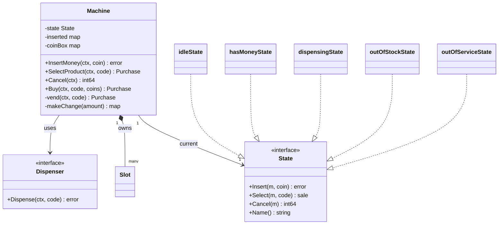
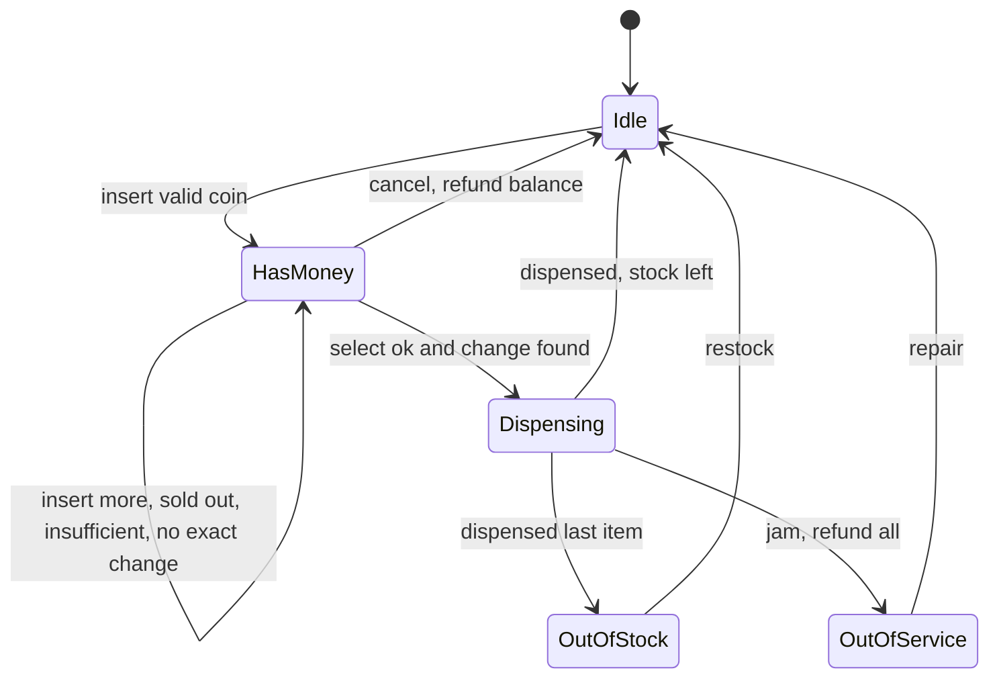
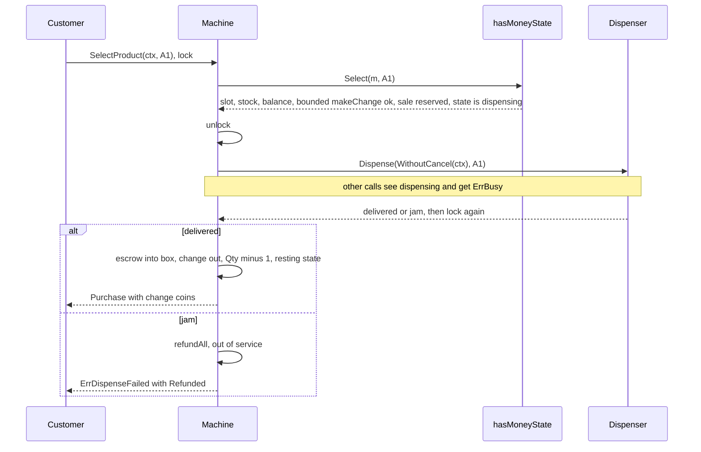

# Vending Machine

> [!summary] TL;DR
> The vending machine is the textbook State-pattern round: insert, select and cancel behave differently in idle, has-money, dispensing, out-of-stock and out-of-service. The money rules matter as much as the pattern: coins wait in escrow until the item drops, change is found with a bounded search over the real coin counts (greedy fails with a finite coin box), and a jam refunds everything.

> [!abstract] Core idea
> - The machine is in exactly one state (idle, has money, dispensing, out of stock, out of service), and each state decides what insert, select and cancel do.
> - Inserted coins sit in escrow; they move into the coin box only after the item drops.
> - The one rule: a failed sale never keeps the user's money; a jam or cancel refunds the whole escrow.
> - Change comes from the real, finite coin counts, so it needs a bounded search, not greedy.
> - Classic mistake: greedy change-making with a finite coin box, which refuses sales that are possible.

## Problem statement

```text
Design a vending machine that accepts coins and notes, lets the user choose a product,
dispenses the item, and returns change. Handle sold-out slots, cancel/refund,
exact change unavailable, and a jammed dispenser.
```

- The same button does different things per mode (the State pattern), and money must be safe: balance, coin box and stock change together, and a failed sale never keeps the user's money.

### Solving path

1. Clarify coins, notes, refund rules and what happens on a jam.
2. List the states and draw the transition table (state x action).
3. Write the `State` interface and one small type per state.
4. Write `Machine` with escrow, coin box and stock behind one mutex.
5. Write `makeChange` over the real coin counts, then `vend` with the jam refund.
6. Test each transition, change-making with a finite box, and the jam path.

## Step 1: Clarify requirements

### Questions to ask (with assumed answers)

- Which coins and notes are accepted? *Assume: INR 1, 2, 5, 10, 20, 50, 100, stored as paise.*
- Is the coin box for change limited? *Assume: yes. If change cannot be made, refuse the sale before dispensing and keep the balance so the user can cancel or pay exact.*
- One item per session? Sold-out slot? *Assume: one item, then change, back to idle; on a sold-out slot keep the balance so the user picks again or cancels.*
- What if the motor jams? *Assume: refund everything and go out of service until an operator repairs it.*
- Card or UPI, one machine or a fleet? *Assume: the app pays and selects in one call (`Buy`), a card reader is a follow-up behind an [[Adapter]]; code one machine in memory and show the fleet schema.*

### Functional

- Slots (`A1`, `B2`) each hold one product with a price and a quantity.
- Insert money: only accepted denominations; inserts add up.
- Select: if the slot is valid, in stock, the balance covers the price and change can be made, dispense and return change.
- Cancel refunds the full balance. `Buy` pays and selects in one call and refunds in the same call if the sale fails. The operator restocks, loads coins and repairs jams.

### Non-functional

- Balance, coin box and stock stay consistent under concurrent calls (keypad and app).
- The user never loses money: every failed sale keeps or refunds the balance; an invalid action returns a typed error, never a panic.
- Money is `int64` paise; a slow motor must not block the display for seconds.

### Out of scope

- Real hardware drivers (hidden behind `Dispenser`), the card or UPI gateway, receipts, loyalty, multi-item carts.

## Step 2: Actors and use cases

| Actor | Use case |
|---|---|
| Customer at the keypad | Insert money, select a product, cancel |
| Customer on the app | Buy (pay and select in one call) |
| Operator | Restock a slot, load change coins, repair a jam |
| Dispenser hardware | Drop the item or report a jam |

The hardest use case is **select in the has-money state**: validate slot, stock and balance, find change, dispense, and roll back on a jam. Code that first.

## Step 3: Entities

| Entity | Key fields | Why it exists |
|---|---|---|
| `Machine` | state, balance, inserted (escrow), coinBox, slots, dispenser | The context object; owns the lock and delegates to the state |
| `State` | `Insert`, `Select`, `Cancel`, `Name` | Behaviour per mode, no giant switch |
| `Slot` | Code, Product, Price, Qty | The inventory unit; stock is per slot, not per product |
| `sale` | slot, change, coins | What a successful select reserves before the motor turns |
| `Purchase` | Product, Change, Coins, Refunded | The result of a sale, or of a failed one (the refund) |
| `Dispenser` | `Dispense(ctx, slot) error` | The hardware boundary; tests fake a jam or a slow motor |

Modelling insight: keep **escrow separate from the coin box**. Inserted coins join the box only after a successful dispense, so cancel and jam refunds always work, and change is computed from box plus escrow.

## Step 4: Relationships




- Composition from Machine to Slot; exactly one current State, replaced on every transition; the Dispenser is injected, so tests pass a fake that succeeds, jams or blocks.

## Step 5: APIs and public methods

The machine itself is an in-memory component, so its API is the Go method set; `*Machine` in Step 8 implements it:

```go
type VendingMachine interface {
	InsertMoney(ctx context.Context, coin int64) error
	SelectProduct(ctx context.Context, code string) (Purchase, error)
	Cancel(ctx context.Context) (int64, error)
	Buy(ctx context.Context, code string, coins ...int64) (Purchase, error) // app flow
	Restock(ctx context.Context, code string, qty int) error                // operator
	Repair(ctx context.Context)                                             // operator
	StateName() string
}

var _ VendingMachine = (*Machine)(nil) // compile-time check
```

For a fleet with a backend (app purchases):

```text
POST /machines/{id}/purchases        body: {slot, paymentRef}  header: Idempotency-Key
                                     -> 200 {product, change}  | 409 sold out | 503 out of service
PUT  /machines/{id}/slots/{code}     body: {addQty}            -> 200 {qty}
PUT  /machines/{id}/coins            body: {denomination, count}
GET  /machines/{id}/slots                                      -> 200 [{code, product, price, qty}]
```

## Step 6: Storage and repositories

One machine needs no database; the state lives in the device. A fleet backend keeps inventory and sales:

```sql
CREATE TABLE slots (
    machine_id  TEXT   NOT NULL,
    code        TEXT   NOT NULL,
    product_id  TEXT   NOT NULL,
    price_paise BIGINT NOT NULL CHECK (price_paise > 0),
    qty         INT    NOT NULL CHECK (qty >= 0),
    PRIMARY KEY (machine_id, code)
);

-- mirrors the in-memory coin box (coins available for change)
CREATE TABLE coin_box (
    machine_id   TEXT   NOT NULL,
    denomination BIGINT NOT NULL,
    count        INT    NOT NULL CHECK (count >= 0),
    PRIMARY KEY (machine_id, denomination)
);

CREATE TABLE sales (
    id              TEXT PRIMARY KEY,
    machine_id      TEXT   NOT NULL,
    slot_code       TEXT   NOT NULL,
    paid_paise      BIGINT NOT NULL,
    change_paise    BIGINT NOT NULL,
    status          TEXT   NOT NULL,          -- completed | refunded_jam
    idempotency_key TEXT   NOT NULL UNIQUE,   -- an app retry never vends twice
    created_at      TIMESTAMPTZ NOT NULL DEFAULT now()
);

-- decrement only if stock remains; 0 rows updated = sold out
UPDATE slots SET qty = qty - 1
WHERE machine_id = $1 AND code = $2 AND qty > 0;
```

```go
type SlotRepo interface {
	Get(ctx context.Context, machineID, code string) (Slot, error)
	Decrement(ctx context.Context, machineID, code string) error // ErrSoldOut on 0 rows
	Add(ctx context.Context, machineID, code string, qty int) error
}

type SaleRepo interface {
	// Create fails with a duplicate error on a reused idempotency key.
	Create(ctx context.Context, machineID, slot string, p Purchase, idemKey string) error
}
```

## Step 7: Patterns

| Pattern | Where | Why here |
|---|---|---|
| [[State Machines in Go]] | five state types behind `State` | Every action behaves differently per mode; each state rejects invalid actions with a typed error |
| [[Adapter]] | `Dispenser` (later a `PaymentInput` for card or UPI) | Hides the vendor driver behind a small interface; faked in tests |
| [[Strategy and Template Method]] | change-making, once a second algorithm exists | Today one bounded DP is enough |
| [[Repository and Unit of Work]] | `SlotRepo`, `SaleRepo` for the fleet; one `Machine` per device built in `main` ([[Singleton and sync.Once]] without a global) | Swap storage without touching state logic |
| [[Observer and Event Bus]] | `slot.empty`, `machine.jammed` to the backend (follow-up) | Restock and repair alerts without polling |

Patterns not used, and why:

- No Factory for states: states are empty structs, and `hasMoneyState{}` is clearer than a factory (KISS).
- Change-making is a method, not yet an interface: there is one algorithm today; extract the interface when a second one appears (YAGNI).

## Folder structure

The code in Step 8 is printed as one file so it reads top to bottom. In the round, split it like this:

```text
vending/
  model.go        -> Slot, Purchase, sale, Err* errors
  state.go        -> State interface + idle, hasMoney, dispensing, outOfStock, outOfService
  dispenser.go    -> Dispenser interface + DispenserFunc (hardware adapter seam)
  repository.go   -> SlotRepo, SaleRepo (fleet backend only)
  service.go      -> Machine: NewMachine, InsertMoney, SelectProduct, Cancel, Buy, Restock, Repair, vend, helpers
  service_test.go -> table-driven select tests, session flow, dispensing state, jam, concurrent Buy
cmd/demo/main.go  -> builds slots and coin box, injects the real dispenser
```

- `model.go`: data and errors only.
- `state.go`: the per-mode rules. State methods make the user-driven transitions; `vend` commits a sale or a jam, and the operator actions `Restock` and `Repair` wake the machine. No other code assigns `m.state`.
- `dispenser.go`: the hardware boundary.
- `service.go`: the mutex, the public methods, `vend` and the money helpers (`addCoin`, `refundAll`, `makeChange`, `restingState`).
- `service_test.go`: fake dispensers `okMotor`, `jamMotor` and a slow motor.
- `cmd/demo/main.go`: wiring only.

## Step 8: Core code

> [!tip] What to code in a 60-minute round
> Aim for about 150 lines in the room.
> - **Write:** `Slot`, `Purchase`, the `Dispenser` interface, the `State` interface with `idleState`, `hasMoneyState` and `dispensingState`, and `Machine` with `NewMachine`, `addCoin`, `refundAll`, `makeChange`, `vend`, `InsertMoney`, `SelectProduct` and `Cancel`.
> - **Add if time remains:** `outOfStockState`, `outOfServiceState`, `Restock` and `Repair`.
> - **Talk only:** the repositories and SQL, the fleet backend with idempotent remote vends, and releasing the lock while the motor turns (say it, code it only if asked).

Two design points are worth saying out loud in the interview:

1. **Change-making is a bounded search, not greedy.** Greedy (largest coin first) is optimal for INR only when every coin is unlimited. A real box is finite: price Rs 40, paid Rs 100, box {Rs 50 x1, Rs 20 x3}. Greedy takes the 50, needs 10 more, has no 10, and refuses the sale, although 3 x Rs 20 works. `makeChange` is a DP over coin counts: `best[v]` is the fewest coins for value `v` using the denominations seen so far, each used at most `box + escrow` times, and `take[i][v]` lets it rebuild the coins. Values are counted in units of the denominations' GCD (Rs 1 = 100 paise for INR), so change of Rs 60 needs a table of only 61 cells (0 to 60).
2. **`dispensingState` is real.** `hasMoneyState.Select` only validates and reserves a `sale`, then switches to dispensing. `vend` releases the mutex while the motor turns and re-locks to commit or refund, so the display shows "dispensing" and other calls get `ErrBusy` instead of blocking for seconds. Every invariant holds at the unlock point: the money is still in escrow and stock is untouched. `context.WithoutCancel` (Go 1.21+) keeps a caller who hangs up from aborting a motor that is already turning.

### Walkthrough

`SelectProduct(ctx, code)` locks the machine and calls `vend`, which delegates to the current state. The real logic is `hasMoneyState.Select` followed by the rest of `vend`:

1. Look up the slot. Unknown code: `ErrInvalidSlot`, state unchanged.
2. `Qty == 0`: `ErrSoldOut`; the state stays has-money and the user keeps the balance.
3. `balance < price`: `ErrInsufficientFunds`; the user can insert more.
4. Compute `change = balance - price` and run `makeChange` over coin box plus escrow. If no combination exists: `ErrExactChange` **before** anything is dispensed, balance kept, so the user can cancel or pay exact.
5. Reserve the `sale` (slot, change, change coins) and move to `dispensingState`.
6. `vend` unlocks, calls the `Dispenser` with `context.WithoutCancel(ctx)`, and locks again.
7. Jam: `refundAll` gives back the escrowed coins, stock is not decremented (the item never left), the machine goes to `outOfServiceState`, and the error wraps both `ErrDispenseFailed` and the hardware cause.
8. Success: commit escrow into the coin box, remove the change coins, reset the balance, `Qty--`, and move to the resting state (`idle`, or `out_of_stock` if every slot is empty).

`Buy(ctx, code, coins...)` is the app flow: validate the denominations, lock, reject with `ErrBusy` if a keypad session or a dispense holds money, insert through the state, call `vend`, and on any failure cancel in the same call so the refund comes back with the error.

```go
package vending

import (
	"context"
	"errors"
	"fmt"
	"maps"
	"math"
	"slices"
	"sort"
	"sync"
)

var (
	ErrInvalidDenomination = errors.New("coin or note not accepted")
	ErrNoMoney             = errors.New("insert money first")
	ErrInvalidSlot         = errors.New("invalid slot")
	ErrSoldOut             = errors.New("slot sold out")
	ErrInsufficientFunds   = errors.New("insufficient balance")
	ErrExactChange         = errors.New("exact change unavailable")
	ErrOutOfStock          = errors.New("machine out of stock")
	ErrOutOfService        = errors.New("machine out of service")
	ErrBusy                = errors.New("machine is busy")
	ErrDispenseFailed      = errors.New("dispense failed, money refunded")
)

type Slot struct {
	Code, Product string
	Price         int64 // paise
	Qty           int
}

// Purchase is the result of a select. Change and Refunded are in paise.
type Purchase struct {
	Product  string
	Change   int64
	Coins    map[int64]int // denomination -> count returned as change
	Refunded int64         // set when the sale failed after money was taken
}

// Dispenser wraps the motor driver (Adapter); an error means "not delivered".
type Dispenser interface {
	Dispense(ctx context.Context, slotCode string) error
}

// DispenserFunc lets a plain function act as a Dispenser.
type DispenserFunc func(ctx context.Context, slotCode string) error

func (f DispenserFunc) Dispense(ctx context.Context, code string) error { return f(ctx, code) }

type sale struct { // what a successful Select reserves
	slot   *Slot
	change int64
	coins  map[int64]int
}

// State: how the machine reacts per mode. Select only validates and reserves.
type State interface {
	Name() string
	Insert(m *Machine, coin int64) error
	Select(m *Machine, code string) (sale, error)
	Cancel(m *Machine) (int64, error)
}

type (
	idleState         struct{}
	hasMoneyState     struct{}
	dispensingState   struct{} // motor turning, lock released
	outOfStockState   struct{}
	outOfServiceState struct{} // jammed; needs an operator
)

func (idleState) Name() string { return "idle" }
func (idleState) Insert(m *Machine, coin int64) error {
	m.addCoin(coin)
	m.state = hasMoneyState{}
	return nil
}
func (idleState) Select(*Machine, string) (sale, error) { return sale{}, ErrNoMoney }
func (idleState) Cancel(*Machine) (int64, error)        { return 0, ErrNoMoney }

func (hasMoneyState) Name() string { return "has_money" }
func (hasMoneyState) Insert(m *Machine, coin int64) error {
	m.addCoin(coin)
	return nil
}
func (hasMoneyState) Select(m *Machine, code string) (sale, error) {
	slot, ok := m.slots[code]
	if !ok {
		return sale{}, ErrInvalidSlot
	}
	if slot.Qty == 0 {
		return sale{}, ErrSoldOut // keep balance, user can pick again
	}
	if m.balance < slot.Price {
		return sale{}, ErrInsufficientFunds
	}
	change := m.balance - slot.Price
	coins, ok := m.makeChange(change)
	if !ok {
		return sale{}, ErrExactChange // refuse BEFORE dispensing
	}
	m.state = dispensingState{}
	return sale{slot: slot, change: change, coins: coins}, nil
}
func (hasMoneyState) Cancel(m *Machine) (int64, error) {
	refund := m.refundAll()
	m.state = idleState{}
	return refund, nil
}

func (dispensingState) Name() string                          { return "dispensing" }
func (dispensingState) Insert(*Machine, int64) error          { return ErrBusy }
func (dispensingState) Select(*Machine, string) (sale, error) { return sale{}, ErrBusy }
func (dispensingState) Cancel(*Machine) (int64, error)        { return 0, ErrBusy }

func (outOfStockState) Name() string                          { return "out_of_stock" }
func (outOfStockState) Insert(*Machine, int64) error          { return ErrOutOfStock }
func (outOfStockState) Select(*Machine, string) (sale, error) { return sale{}, ErrOutOfStock }
func (outOfStockState) Cancel(*Machine) (int64, error)        { return 0, ErrNoMoney }

func (outOfServiceState) Name() string                          { return "out_of_service" }
func (outOfServiceState) Insert(*Machine, int64) error          { return ErrOutOfService }
func (outOfServiceState) Select(*Machine, string) (sale, error) { return sale{}, ErrOutOfService }
func (outOfServiceState) Cancel(*Machine) (int64, error)        { return 0, ErrNoMoney }

type Machine struct {
	mu        sync.Mutex
	state     State
	balance   int64
	inserted  map[int64]int // coins held in escrow for the current session
	coinBox   map[int64]int // coins available for change
	denoms    []int64       // accepted denominations, largest first
	unit      int64         // gcd of the denominations
	accepted  map[int64]bool
	slots     map[string]*Slot
	dispenser Dispenser
}

func NewMachine(slots []Slot, accepted []int64, coinBox map[int64]int, d Dispenser) *Machine {
	m := &Machine{
		inserted: map[int64]int{}, coinBox: map[int64]int{},
		accepted: map[int64]bool{}, slots: map[string]*Slot{}, dispenser: d,
	}
	for _, s := range slots { // per-iteration s since Go 1.22
		m.slots[s.Code] = &s
	}
	for _, d := range accepted {
		m.accepted[d] = true
		m.denoms = append(m.denoms, d)
		m.unit = gcd(m.unit, d)
	}
	sort.Slice(m.denoms, func(i, j int) bool { return m.denoms[i] > m.denoms[j] })
	maps.Copy(m.coinBox, coinBox)
	m.state = m.restingState()
	return m
}

func gcd(a, b int64) int64 {
	for b != 0 {
		a, b = b, a%b
	}
	return a
}

func (m *Machine) addCoin(coin int64) {
	m.inserted[coin]++
	m.balance += coin
}

// refundAll returns the escrowed coins, so a refund is always possible.
func (m *Machine) refundAll() int64 {
	r := m.balance
	m.balance = 0
	m.inserted = map[int64]int{}
	return r
}

// makeChange returns the fewest coins summing to amount, using at most the
// coins in box + escrow: a DP over coin counts, not greedy (greedy takes the
// 50 for change 60 from {50x1, 20x3} and gets stuck; the DP finds 3x20).
func (m *Machine) makeChange(amount int64) (map[int64]int, bool) {
	if amount == 0 {
		return map[int64]int{}, true
	}
	if m.unit == 0 || amount%m.unit != 0 {
		return nil, false
	}
	target := int(amount / m.unit)
	best := make([]int, target+1) // fewest coins per value, denominations so far
	for v := 1; v <= target; v++ {
		best[v] = math.MaxInt
	}
	take := make([][]int, len(m.denoms)) // take[i][v]: coins of denoms[i] used
	for i, d := range m.denoms {
		step, have := int(d/m.unit), m.coinBox[d]+m.inserted[d]
		prev := slices.Clone(best)
		take[i] = make([]int, target+1)
		for v := 1; v <= target; v++ {
			for k := 1; k <= have && k*step <= v; k++ {
				if p := prev[v-k*step]; p != math.MaxInt && p+k < best[v] {
					best[v], take[i][v] = p+k, k
				}
			}
		}
	}
	if best[target] == math.MaxInt {
		return nil, false
	}
	out := map[int64]int{}
	for i, v := len(m.denoms)-1, target; i >= 0 && v > 0; i-- {
		if k := take[i][v]; k > 0 {
			out[m.denoms[i]] = k
			v -= k * int(m.denoms[i]/m.unit)
		}
	}
	return out, true
}

// restingState is idle if anything is left to sell, else out_of_stock.
func (m *Machine) restingState() State {
	for _, s := range m.slots {
		if s.Qty > 0 {
			return idleState{}
		}
	}
	return outOfStockState{}
}

// vend runs one sale. Called and returns with m.mu held, but releases it while
// the motor turns: other callers see "dispensing" and get ErrBusy.
func (m *Machine) vend(ctx context.Context, code string) (Purchase, error) {
	s, err := m.state.Select(m, code)
	if err != nil {
		return Purchase{}, err
	}
	m.mu.Unlock()
	// once the motor starts, a caller hanging up must not abort the sale
	derr := m.dispenser.Dispense(context.WithoutCancel(ctx), code)
	m.mu.Lock()
	if derr != nil {
		refund := m.refundAll() // item not delivered: give all money back
		m.state = outOfServiceState{}
		return Purchase{Refunded: refund}, fmt.Errorf("%w: %w", ErrDispenseFailed, derr)
	}
	// commit: inserted coins go to the box, change coins leave it
	for d, n := range m.inserted {
		m.coinBox[d] += n
	}
	for d, n := range s.coins {
		m.coinBox[d] -= n
	}
	m.inserted = map[int64]int{}
	m.balance = 0
	s.slot.Qty--
	m.state = m.restingState()
	return Purchase{Product: s.slot.Product, Change: s.change, Coins: s.coins}, nil
}

func (m *Machine) InsertMoney(ctx context.Context, coin int64) error {
	if err := ctx.Err(); err != nil {
		return err
	}
	if !m.accepted[coin] { // read-only after construction
		return ErrInvalidDenomination
	}
	m.mu.Lock()
	defer m.mu.Unlock()
	return m.state.Insert(m, coin)
}

func (m *Machine) SelectProduct(ctx context.Context, code string) (Purchase, error) {
	if err := ctx.Err(); err != nil {
		return Purchase{}, err
	}
	m.mu.Lock()
	defer m.mu.Unlock()
	return m.vend(ctx, code)
}

func (m *Machine) Cancel(ctx context.Context) (int64, error) {
	if err := ctx.Err(); err != nil {
		return 0, err
	}
	m.mu.Lock()
	defer m.mu.Unlock()
	return m.state.Cancel(m)
}

// Buy is the app flow: pay and select in one call; a refused sale refunds.
func (m *Machine) Buy(ctx context.Context, code string, coins ...int64) (Purchase, error) {
	if err := ctx.Err(); err != nil {
		return Purchase{}, err
	}
	for _, c := range coins {
		if !m.accepted[c] {
			return Purchase{}, ErrInvalidDenomination
		}
	}
	m.mu.Lock()
	defer m.mu.Unlock()
	if m.balance > 0 {
		return Purchase{}, ErrBusy // a keypad session or a dispense holds money
	}
	for _, c := range coins {
		if err := m.state.Insert(m, c); err != nil {
			return Purchase{}, err // only the first coin can fail; nothing taken
		}
	}
	p, err := m.vend(ctx, code)
	if err != nil && m.balance > 0 {
		p.Refunded, _ = m.state.Cancel(m)
	}
	return p, err
}

// Restock (operator) wakes an out-of-stock machine.
func (m *Machine) Restock(ctx context.Context, code string, qty int) error {
	m.mu.Lock()
	defer m.mu.Unlock()
	s, ok := m.slots[code]
	if !ok {
		return ErrInvalidSlot
	}
	s.Qty += qty
	if _, out := m.state.(outOfStockState); out {
		m.state = m.restingState()
	}
	return nil
}

// Repair (operator) clears a jam.
func (m *Machine) Repair(ctx context.Context) {
	m.mu.Lock()
	defer m.mu.Unlock()
	if _, broken := m.state.(outOfServiceState); broken {
		m.state = m.restingState()
	}
}

func (m *Machine) StateName() string {
	m.mu.Lock()
	defer m.mu.Unlock()
	return m.state.Name()
}
```

## Test cases

| Test | Proves |
|---|---|
| `TestSelectProduct` | No money, bad slot, insufficient, sold out keeps money, exact amount, change from the box, the greedy trap (price Rs 40, paid Rs 100, box {50x1, 20x3}: Rs 60 as 3 x Rs 20), change from escrow, no change available, jam refunds all and goes out of service |
| `TestSessionFlow` | Invalid coin, exact-change refusal then cancel refund, purchase, out of stock rejects money, restock wakes the machine |
| `TestDispensingStateIsObservable` | While a slow motor turns, the state is `dispensing` and insert and cancel return `ErrBusy`; the sale then completes |
| `TestJamThenRepair` | App `Buy` on a jammed motor refunds; the machine rejects money until `Repair` |
| `TestConcurrentBuyExactWinners` | 100 concurrent `Buy` calls (retrying on `ErrBusy`) on 5 items: exactly 5 sold, 95 `ErrOutOfStock` |

All five pass under `go test -race` (Go 1.24.4, run three times). The old greedy `makeChange` fails the greedy-trap row with `ErrExactChange`.

```go
package vending

import (
	"context"
	"errors"
	"runtime"
	"sync"
	"testing"
)

var inr = []int64{100, 200, 500, 1000, 2000, 5000, 10000} // paise

var okMotor = DispenserFunc(func(context.Context, string) error { return nil })
var jamMotor = DispenserFunc(func(context.Context, string) error { return errors.New("motor stuck") })

func TestSelectProduct(t *testing.T) {
	tests := []struct {
		name                   string
		qty                    int
		coinBox                map[int64]int
		motor                  Dispenser
		insert                 []int64
		code                   string
		wantErr                error
		wantChange, wantRefund int64
		wantState              string
	}{
		{"no money", 1, nil, okMotor, nil, "A1", ErrNoMoney, 0, 0, "idle"},
		{"bad slot", 1, nil, okMotor, []int64{5000}, "Z9", ErrInvalidSlot, 0, 0, "has_money"},
		{"insufficient", 1, nil, okMotor, []int64{2000}, "A1", ErrInsufficientFunds, 0, 0, "has_money"},
		{"sold out keeps money", 0, nil, okMotor, []int64{5000}, "A1", ErrSoldOut, 0, 0, "has_money"},
		{"exact amount", 1, nil, okMotor, []int64{2000, 2000}, "A1", nil, 0, 0, "idle"},
		{"change from box", 2, map[int64]int{1000: 1}, okMotor, []int64{5000}, "A1", nil, 1000, 0, "idle"},
		{"greedy trap: 60 as 3x20", 2, map[int64]int{5000: 1, 2000: 3}, okMotor, []int64{10000}, "A1", nil, 6000, 0, "idle"},
		{"change from escrow", 2, nil, okMotor, []int64{2000, 2000, 5000}, "A1", nil, 5000, 0, "idle"},
		{"no change in box", 2, nil, okMotor, []int64{5000}, "A1", ErrExactChange, 0, 0, "has_money"},
		{"jam refunds all", 2, nil, jamMotor, []int64{2000, 2000}, "A1", ErrDispenseFailed, 0, 4000, "out_of_service"},
	}
	for _, tc := range tests {
		t.Run(tc.name, func(t *testing.T) {
			ctx := context.Background()
			slots := []Slot{{"A1", "Coke", 4000, tc.qty}, {"B1", "Water", 2000, 5}}
			m := NewMachine(slots, inr, tc.coinBox, tc.motor)
			for _, c := range tc.insert {
				if err := m.InsertMoney(ctx, c); err != nil {
					t.Fatal(err)
				}
			}
			p, err := m.SelectProduct(ctx, tc.code)
			if !errors.Is(err, tc.wantErr) {
				t.Fatalf("err %v want %v", err, tc.wantErr)
			}
			if p.Change != tc.wantChange || p.Refunded != tc.wantRefund {
				t.Fatalf("purchase %+v", p)
			}
			if got := m.StateName(); got != tc.wantState {
				t.Fatalf("state %s want %s", got, tc.wantState)
			}
		})
	}
}

func TestSessionFlow(t *testing.T) {
	ctx := context.Background()
	must := func(err error) {
		t.Helper()
		if err != nil {
			t.Fatal(err)
		}
	}
	m := NewMachine([]Slot{{"A1", "Chips", 2000, 1}}, inr, nil, okMotor)
	if err := m.InsertMoney(ctx, 300); !errors.Is(err, ErrInvalidDenomination) {
		t.Fatal(err)
	}
	must(m.InsertMoney(ctx, 5000))
	if _, err := m.SelectProduct(ctx, "A1"); !errors.Is(err, ErrExactChange) {
		t.Fatal(err) // box is empty, cannot return 30 rupees
	}
	if r, err := m.Cancel(ctx); err != nil || r != 5000 || m.StateName() != "idle" {
		t.Fatal(r, err)
	}
	must(m.InsertMoney(ctx, 1000))
	must(m.InsertMoney(ctx, 1000))
	if p, err := m.SelectProduct(ctx, "A1"); err != nil || p.Product != "Chips" {
		t.Fatal(p, err)
	}
	if err := m.InsertMoney(ctx, 1000); !errors.Is(err, ErrOutOfStock) {
		t.Fatal(err)
	}
	must(m.Restock(ctx, "A1", 3))
	if m.StateName() != "idle" {
		t.Fatal(m.StateName())
	}
}

func TestDispensingStateIsObservable(t *testing.T) {
	ctx := context.Background()
	started, release := make(chan struct{}), make(chan struct{})
	slowMotor := DispenserFunc(func(context.Context, string) error {
		close(started)
		<-release // the motor is turning
		return nil
	})
	m := NewMachine([]Slot{{"A1", "Coke", 2000, 2}}, inr, nil, slowMotor)
	if err := m.InsertMoney(ctx, 2000); err != nil {
		t.Fatal(err)
	}
	done := make(chan error)
	go func() {
		_, err := m.SelectProduct(ctx, "A1")
		done <- err
	}()
	<-started
	if m.StateName() != "dispensing" {
		t.Fatalf("state %s, want dispensing", m.StateName())
	}
	if err := m.InsertMoney(ctx, 1000); !errors.Is(err, ErrBusy) {
		t.Fatalf("insert while dispensing: %v", err)
	}
	if _, err := m.Cancel(ctx); !errors.Is(err, ErrBusy) {
		t.Fatalf("cancel while dispensing: %v", err)
	}
	close(release)
	if err := <-done; err != nil || m.StateName() != "idle" {
		t.Fatalf("sale: %v state %s", err, m.StateName())
	}
}

func TestJamThenRepair(t *testing.T) {
	ctx := context.Background()
	m := NewMachine([]Slot{{"A1", "Coke", 2000, 2}}, inr, nil, jamMotor)
	p, err := m.Buy(ctx, "A1", 2000)
	if !errors.Is(err, ErrDispenseFailed) || p.Refunded != 2000 {
		t.Fatal(p, err)
	}
	if err := m.InsertMoney(ctx, 1000); !errors.Is(err, ErrOutOfService) {
		t.Fatal(err)
	}
	m.Repair(ctx)
	if m.StateName() != "idle" {
		t.Fatal(m.StateName())
	}
}

func TestConcurrentBuyExactWinners(t *testing.T) {
	ctx := context.Background()
	m := NewMachine([]Slot{{"A1", "Chips", 1000, 5}}, inr, nil, okMotor)
	var (
		wg             sync.WaitGroup
		mu             sync.Mutex
		sold, rejected int
	)
	for i := 0; i < 100; i++ {
		wg.Add(1)
		go func() {
			defer wg.Done()
			_, err := m.Buy(ctx, "A1", 1000)
			for errors.Is(err, ErrBusy) { // another sale is dispensing: the app retries
				runtime.Gosched()
				_, err = m.Buy(ctx, "A1", 1000)
			}
			mu.Lock()
			defer mu.Unlock()
			switch {
			case err == nil:
				sold++
			case errors.Is(err, ErrOutOfStock):
				rejected++
			default:
				t.Error(err)
			}
		}()
	}
	wg.Wait()
	if sold != 5 || rejected != 95 || m.StateName() != "out_of_stock" {
		t.Fatalf("sold %d rejected %d state %s", sold, rejected, m.StateName())
	}
}
```

## Step 9: Edge cases

| Edge case | What happens | How the design handles it |
|---|---|---|
| Race: two buyers for the last item | Both pass the stock check if it runs outside the lock | Check and reserve under one mutex, then `dispensingState` blocks everyone until the commit; the fleet uses `UPDATE ... WHERE qty > 0` |
| Race: insert and cancel at the same time | A refund could miss a coin | Both serialize on the mutex; the refund equals the balance at that moment |
| Insert, select or cancel while the motor turns | The lock is released during the dispense | `dispensingState` returns `ErrBusy` for every action |
| Keypad session and app `Buy` at once | Mixed balances | `Buy` returns `ErrBusy` while any balance is held (a keypad session or a dispense) |
| App retries a purchase | Could vend twice | Idempotency key unique in `sales`; the retry returns the first result |
| Insufficient money | Sale refused | `ErrInsufficientFunds`, balance kept, the user inserts more |
| Out of stock (slot) | Slot empty | `ErrSoldOut`, balance kept, the user picks another slot or cancels |
| Out of stock (machine) | Nothing to sell | `outOfStockState` rejects money up front |
| Change exists but greedy misses it | Box {Rs 50 x1, Rs 20 x3}, change Rs 60 | Bounded DP finds 3 x Rs 20 |
| Exact change truly unavailable | No combination of box plus escrow works | `ErrExactChange` before dispensing, balance kept; display "exact change only" |
| User cancels | Wants the money back | Escrowed coins are returned, so a refund never depends on the coin box |
| Jam or dispense failure | Item not delivered | Refund all, stock unchanged, `outOfServiceState` until `Repair`; an Observer alert in a fleet |
| Invalid coin | Fake or foreign coin | `ErrInvalidDenomination`, checked before locking (the accepted set is read-only) |

### Common mistakes

- One giant `switch state` in every method instead of State types (fine for tiny code, but interviews want the pattern).
- Losing the user's money on sold-out, insufficient, exact-change or jam errors.
- Decrementing stock before the dispenser confirms.
- Putting inserted coins straight into the change box, so a refund can fail.
- Forgetting the out-of-stock and out-of-service states and accepting money with nothing to sell.
- Trusting greedy change-making with a finite coin box.
- Using `float64` for money; checking stock and decrementing it without a lock.

## Step 10: Tradeoffs and extensions

| Follow-up | Design change |
|---|---|
| Card or UPI | An adapter per payment method behind `PaymentInput`; a new `awaitingPayment` state |
| Multiple items per session | Stay in has-money after a dispense while balance remains |
| Maintenance mode | A `maintenanceState` rejects users and allows restock and price changes |
| A second change-making rule (fewest coins versus keep small coins) | Extract `makeChange` into a change-making Strategy |
| Fleet telemetry | Observer publishes `slot.empty`, `sale.completed`, `machine.jammed` |
| Price change while a user has money | Read the price at select time; document that the shown price can change |

### Tradeoffs I chose

- **Unlock during the dispense.** It keeps the display and the app responsive, at the cost of a lock that is released in the middle of `vend`; that is safe only because the dispensing state blocks every other money action. Holding the lock through the dispense is simpler and also correct (one physical customer at a time), but nobody can ever observe the dispensing state.
- **Escrow plus coin box instead of one balance number.** A little more code, but exact change and refunds become correct.
- **DP instead of greedy.** O(denominations x value x count) with values in GCD units; for change up to Rs 500 that is tiny, and it never refuses change that exists.
- **`Buy` reuses the State methods instead of a separate code path.** One set of rules serves the keypad and the app.

## Drawing

![[Vending Machine LLD Drawing.excalidraw]]

The drawing shows:

- Section 1: the Machine (context) with Slots, the `State` interface and its five states, and the `Dispenser` interface.
- Section 2: the select flow in the has-money state, with red boxes for sold out, insufficient, exact change unavailable and jam.
- Section 3: the state machine with labelled transitions.
- Section 4: the fleet tables `slots`, `coin_box` and `sales`.

The drawing predates the unlock during the dispense: its select flow keeps the lock through `Dispense`. The sequence diagram below shows the current flow. Redraw it from memory:

- [ ] The five states and every labelled transition, including jam, out of service and repair
- [ ] The select order: slot, stock, balance, change, dispense, commit
- [ ] Where money sits: escrow versus coin box
- [ ] The Machine to State and Machine to Dispenser interface boxes
- [ ] `sales.idempotency_key UNIQUE` and the `qty > 0` conditional update



## Interview questions

> [!question]- Why the State pattern instead of a switch in every method?
> Five modes times four actions is twenty cases. State types keep each mode's rules together, make invalid actions return typed errors in one obvious place, and let you add a maintenance state without editing every method. A switch is fine for two states.

> [!question]- Trap: greedy change-making is optimal for INR, so is it safe here?
> No. Greedy is optimal for canonical coin systems like INR only with unlimited coins. With a box of {Rs 50 x1, Rs 20 x3} and Rs 60 to return, greedy takes the 50 and fails, while 3 x Rs 20 works. Use a bounded DP or backtracking over the real counts.

> [!question]- Why keep escrow separate from the coin box?
> So that a refund never depends on the box. Inserted coins stay in escrow until the dispenser confirms, which makes cancel and jam refunds always possible, and the change search can still use them.

> [!question]- How can the dispensing state be observed if one mutex guards everything?
> If the lock is held across `Dispense`, nobody sees the state. So `vend` releases the lock while the motor turns and re-locks to commit. Safety comes from the state: dispensing rejects insert, select and cancel with `ErrBusy`.

> [!question]- How does a fleet backend stop an app retry from vending twice?
> A unique idempotency key on `sales` returns the first result to the retry, and `UPDATE slots SET qty = qty - 1 WHERE ... AND qty > 0` sells the last item to exactly one request.

## Interview explanation

```text
I model the machine with the State pattern: a State interface with Insert, Select and Cancel, implemented by idle, has-money, dispensing, out-of-stock and out-of-service, and the Machine just delegates to the current state under one mutex. Has-money is the important one: it validates slot, stock and balance, then checks that change can be made from the coin box plus escrow before dispensing, so exact-change failures never take the user's money. Change-making is a bounded search over the real coin counts, because greedy fails with a finite box. Inserted coins sit in escrow until the dispenser confirms, so cancel and a jam can always refund them, and a jam moves the machine out of service until an operator repairs it. The mutex is released while the motor turns, and the dispensing state answers every other action with ErrBusy, so two buyers can never get the last item; in a fleet backend I would use a conditional UPDATE with qty greater than zero and an idempotency key on sales. Payment methods, change-making and alerts plug in as Adapter, Strategy and Observer.
```

## Cheat sheet

- `Machine` delegates every action to the current `State`; only state methods, `vend` and the operator actions (`Restock`, `Repair`) assign `m.state`.
- Validate slot, stock, balance, change, and refuse before the motor turns; escrow until the item drops.
- Change: bounded DP over box plus escrow, never greedy with a finite box.
- Release the lock during the dispense; `dispensingState` answers `ErrBusy`.
- Jam: refund all, stock unchanged, out of service until repair.
- Fleet: conditional `qty > 0` update plus an idempotency key on sales.

## Links

- **Before this:** [[State Machines in Go]], [[Parking Lot]]
- **Next:** [[Library Management]]
- **Compare with:** [[Case Study - Payment System]] (idempotent payments at system scale), [[Concurrency for LLD]], [[Testing LLD Code]]
