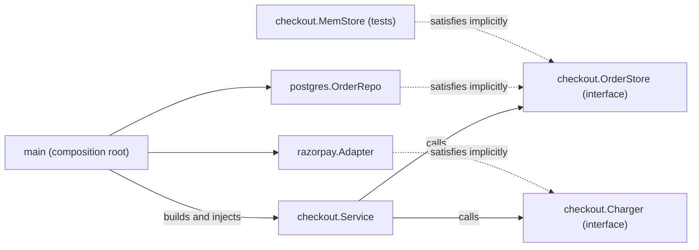
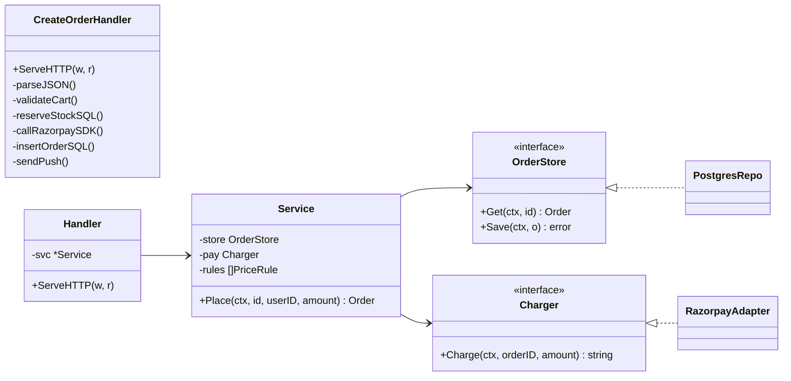

# SOLID in Go

> [!summary] TL;DR
> **SOLID** is five design rules for keeping code easy to change: Single Responsibility, Open-Closed, Liskov Substitution, Interface Segregation and Dependency Inversion. Go has no classes or inheritance, so in Go SOLID mostly means **small interfaces declared by the code that uses them** and **dependencies passed in through constructors**, plus one rule people forget: every implementation of an interface must keep the interface's promises, including its error behaviour.

> [!abstract] Core idea
> - Split code by **who asks for changes** (HTTP, business rules, storage, payment provider), not by size.
> - The service package declares the tiny interfaces it needs; concrete types (Postgres repo, Razorpay adapter) satisfy them without knowing about them.
> - Wire concrete types together once, in `main`, and pass them in through constructors.
> - Substitutability is about **behaviour**: a fake that returns `(zero, nil)` where the contract says `ErrNotFound` breaks callers even though it compiles.
> - Apply SOLID where change or testing actually happens; everywhere else it is just indirection.

## 1. Why it exists

A food-delivery team has one 400-line HTTP handler, `CreateOrderHandler`. It parses JSON, validates the cart, reserves stock with raw SQL, calls the Razorpay SDK, inserts the order and sends a push notification. Over one quarter four different people need changes:

- the mobile team renames a JSON field,
- the business team adds a 10% festival discount,
- the platform team moves orders from MySQL to PostgreSQL,
- the payments team adds Stripe for international cards.

All four edits land in the same function, so every change risks breaking the other three, every code review needs all four teams, and the function cannot be unit-tested without a database, a payment sandbox and a push service. SOLID is a set of rules for splitting such code so that each of those four changes touches one small, testable piece.

## 2. Mental model

Think of a restaurant kitchen. The waiter takes orders (HTTP), the chef decides how to cook (business rules), the storeroom keeps ingredients (storage) and the cashier takes money (payment). The chef does not care which supplier filled the storeroom, only that "give me 2 kg of rice" either returns rice or says "out of stock". That promise is the **interface**. Any storeroom that keeps the promise can replace any other (Liskov). The chef writes down the few requests they make (Interface Segregation), and the manager decides which supplier and which cashier to hire on day one (Dependency Inversion through constructor injection).

Terms used below:

- **Interface contract:** what an interface promises beyond its method signatures: preconditions (what callers must pass), postconditions (what comes back), and error semantics (which error means what).
- **Consumer-side interface:** an interface declared in the package that *calls* it, listing only the methods that package uses.
- **Constructor injection:** passing dependencies into `NewService(...)` instead of the service creating them or reading globals.
- **Composition root:** the one place, usually `main`, where concrete types are created and wired together.

## 3. How it works

| Principle | Original statement | What it means in Go |
| --- | --- | --- |
| **S**ingle Responsibility | A module should have one reason to change; later restated as "responsible to one actor" | Split by actor: handler (API team), service (business), repository (storage), adapter (provider) |
| **O**pen-Closed | Open for extension, closed for modification | New behaviour arrives as a new value: an interface implementation, a `func` strategy, or a registry entry |
| **L**iskov Substitution | Subtypes must be usable wherever the base type is expected | Every implementation honours the interface's behavioural contract: same errors for the same situations, no extra preconditions |
| **I**nterface Segregation | Clients should not depend on methods they do not use | Small interfaces (`io.Reader`, `io.Writer`) composed when needed (`io.ReadWriter`) |
| **D**ependency Inversion | High-level policy and low-level detail both depend on abstractions | The service package owns the interface; the Postgres package imports nothing from it yet satisfies it implicitly |

The principles come from Robert C. Martin's papers around 2000; Michael Feathers later suggested arranging them into the SOLID acronym (commonly dated to around 2004). OCP itself is older, from Bertrand Meyer (1988), and LSP is from Barbara Liskov (1987 keynote, formalised with Jeannette Wing in 1994).

The key Go fact behind ISP and DIP: **interfaces are satisfied implicitly**. A type never says `implements`, so the interface can live next to its consumer and the provider does not need to import it. That flips the dependency arrow without any framework.



The solid arrows are imports and calls. The dotted arrows are not imports: `postgres` never imports `checkout`, so the business package depends on nothing concrete, and storage can change without touching it.

### Before and after, as a class diagram



The left box is the god handler: one type, six reasons to change. On the right, each type has one actor, and `Service` sees only two narrow interfaces.

### Each principle, one Go move

**SRP.** The god handler becomes four pieces:

```text
handler: JSON in, JSON out, status codes. Changes when the API changes.
service: rules (discounts, idempotency, ordering of steps). Changes when the business changes.
repo:    SQL. Changes when the schema or database changes.
adapter: provider SDK calls and error mapping. Changes when the provider changes.
```

"One reason to change" does not mean "one function" or "one method". A `Service` with `Place`, `Cancel` and `Refund` is still single-responsibility if one actor (the order-business owner) drives all three.

**OCP.** Three Go ways to extend without editing the core:

1. a new type satisfying an existing interface (a `StripeAdapter` for `Charger`),
2. a function value (`PriceRule` below),
3. a registry: `map[string]Charger` filled in `main`, picked by country at runtime (see [[Factory and Abstract Factory]]).

The cost is indirection: a reader must find which implementation runs. Only add the extension point when a second variant exists or is clearly coming.

**LSP.** Covered in the worked example; it is the principle Go developers most often get wrong.

**ISP.** The fat interface:

```go
type UserRepository interface {
	CreateUser(ctx context.Context, u User) error
	DeleteUser(ctx context.Context, id string) error
	CreateOrder(ctx context.Context, o Order) error
	RefundPayment(ctx context.Context, id string) error
	SendEmail(ctx context.Context, to, body string) error
}
```

Every consumer depends on five methods, every fake implements five, and a change to `SendEmail` recompiles code that never sends email. The fix is the standard library's style: `io.Reader` and `io.Writer` have one method each and are composed into `io.ReadWriter` only where a caller needs both. In the service, declare `OrderStore` with exactly the two methods it calls.

**DIP.** The service never calls `sql.Open` or `razorpay.NewClient`. It receives interfaces:

```go
// main.go, the composition root
svc := checkout.NewService(postgres.NewOrderRepo(db), razorpay.NewAdapter(client), festivalDiscount)
```

## 4. Worked example

### Whiteboard version

```text
type OrderStore interface { // owned by package checkout
	Get(ctx context.Context, id string) (Order, error) // unknown id -> ErrNotFound, never (zero, nil)
	Save(ctx context.Context, o Order) error
}
type Charger interface {
	Charge(ctx context.Context, orderID string, amount int64) (string, error)
}
type PriceRule func(int64) int64 // OCP: add a rule, don't edit Place

func (s *Service) Place(ctx, id, user, amount) (Order, error) {
	if amount <= 0 { return ErrInvalidAmount }
	if o, err := s.store.Get(ctx, id); err == nil { return o }      // retry: already placed
	else if !errors.Is(err, ErrNotFound) { return err }            // real failure
	for _, r := range s.rules { amount = r(amount) }
	pid := s.pay.Charge(ctx, id, amount)
	s.store.Save(ctx, Order{id, user, amount, pid})
}
// LSP test: run CheckStoreContract against every OrderStore implementation.
```

### The tested code

The service below is the "after" picture. `Place` is idempotent per order id: a client retry returns the stored order instead of charging twice (see [[Idempotency and Idempotency Keys]]). That idempotency **depends on the `OrderStore` contract**: an unknown id must produce `ErrNotFound`.

```go
package checkout

import (
	"context"
	"errors"
	"fmt"
	"sync"
)

var (
	ErrNotFound      = errors.New("order not found")
	ErrInvalidAmount = errors.New("amount must be positive")
)

type Order struct {
	ID          string
	UserID      string
	AmountPaise int64
	PaymentID   string
}

// OrderStore is owned by the consumer (this package) and lists only what
// Service needs (ISP + DIP).
// Contract: Get returns an error matching ErrNotFound for an unknown id,
// never a zero Order with a nil error. Save is an upsert.
type OrderStore interface {
	Get(ctx context.Context, id string) (Order, error)
	Save(ctx context.Context, o Order) error
}

// Charger is the one payment method Service uses.
type Charger interface {
	Charge(ctx context.Context, orderID string, amountPaise int64) (paymentID string, err error)
}

// PriceRule is an extension point (OCP): a new rule is a new value,
// not an edit to Service.
type PriceRule func(amountPaise int64) int64

type Service struct {
	store OrderStore
	pay   Charger
	rules []PriceRule
}

func NewService(store OrderStore, pay Charger, rules ...PriceRule) *Service {
	return &Service{store: store, pay: pay, rules: rules}
}

// Place charges once per order id. A retry with the same id returns the
// stored order without charging again.
func (s *Service) Place(ctx context.Context, id, userID string, amountPaise int64) (Order, error) {
	if amountPaise <= 0 {
		return Order{}, ErrInvalidAmount
	}
	existing, err := s.store.Get(ctx, id)
	switch {
	case err == nil:
		return existing, nil
	case !errors.Is(err, ErrNotFound):
		return Order{}, fmt.Errorf("load order %s: %w", id, err)
	}
	for _, rule := range s.rules {
		amountPaise = rule(amountPaise)
	}
	pid, err := s.pay.Charge(ctx, id, amountPaise)
	if err != nil {
		return Order{}, fmt.Errorf("charge order %s: %w", id, err)
	}
	o := Order{ID: id, UserID: userID, AmountPaise: amountPaise, PaymentID: pid}
	if err := s.store.Save(ctx, o); err != nil {
		return Order{}, fmt.Errorf("save order %s: %w", id, err)
	}
	return o, nil
}

// MemStore honours the OrderStore contract.
type MemStore struct {
	mu     sync.Mutex
	orders map[string]Order
}

func NewMemStore() *MemStore { return &MemStore{orders: map[string]Order{}} }

func (m *MemStore) Get(_ context.Context, id string) (Order, error) {
	m.mu.Lock()
	defer m.mu.Unlock()
	o, ok := m.orders[id]
	if !ok {
		return Order{}, fmt.Errorf("get %q: %w", id, ErrNotFound)
	}
	return o, nil
}

func (m *MemStore) Save(_ context.Context, o Order) error {
	m.mu.Lock()
	defer m.mu.Unlock()
	m.orders[o.ID] = o
	return nil
}

// CheckStoreContract is a contract test helper: run it against every
// OrderStore implementation (in-memory, Postgres) so they stay substitutable.
func CheckStoreContract(ctx context.Context, s OrderStore) error {
	if _, err := s.Get(ctx, "missing"); !errors.Is(err, ErrNotFound) {
		return fmt.Errorf("Get(unknown) = %v, want ErrNotFound", err)
	}
	want := Order{ID: "o1", UserID: "u1", AmountPaise: 100}
	if err := s.Save(ctx, want); err != nil {
		return fmt.Errorf("Save: %w", err)
	}
	got, err := s.Get(ctx, "o1")
	if err != nil || got != want {
		return fmt.Errorf("Get after Save = %+v, %v", got, err)
	}
	return nil
}
```

### LSP: what a broken substitute does

Here is a store that compiles, satisfies `OrderStore`, and passes a lazy test that only checks `Save` then `Get`. It returns `(Order{}, nil)` for a missing id, which is a common shortcut in hand-written fakes and in repositories that map `sql.ErrNoRows` to "no error".

Trace `Place(ctx, "o1", "u1", 1000)` with it:

1. `amount` is 1000, so the guard passes.
2. `store.Get("o1")` returns `Order{}`, `nil`.
3. `err == nil`, so `Place` believes the order already exists and returns the empty `Order{}`.
4. **No charge, no save, no error.** The customer sees success and the restaurant never gets paid.

Nothing about the types is wrong. The substitute broke the **error semantics** of the contract, which is exactly what Liskov substitution forbids. The fix is a **contract test**: one function every implementation must pass, run in the in-memory package and in the Postgres integration tests alike (see [[Contract Testing]] and [[Testing LLD Code]]).

The standard library has the same kind of rule. `io.Writer` documents: "Write must return a non-nil error if it returns n < len(p)." `LimitedWriter` honours it. A writer that silently truncates breaks it, and `io.Copy` (and the `WriteTo` methods it may call) has to detect the short write and report `io.ErrShortWrite` on the writer's behalf.

```go
package checkout

import "io"

// LimitedWriter accepts at most Max bytes in total. It honours the io.Writer
// contract: if it writes fewer than len(p) bytes it returns a non-nil error.
type LimitedWriter struct {
	W   io.Writer
	Max int
}

var ErrLimit = io.ErrShortWrite

func (l *LimitedWriter) Write(p []byte) (int, error) {
	if len(p) <= l.Max {
		n, err := l.W.Write(p)
		l.Max -= n
		return n, err
	}
	n, err := l.W.Write(p[:l.Max])
	l.Max -= n
	if err == nil {
		err = ErrLimit
	}
	return n, err
}
```

The tests check the happy path, the guard, idempotency, the contract for both stores, the silent failure the broken store causes, and both writers:

```go
package checkout

import (
	"bytes"
	"context"
	"errors"
	"io"
	"strings"
	"sync/atomic"
	"testing"
)

type fakeCharger struct{ calls atomic.Int32 }

func (f *fakeCharger) Charge(_ context.Context, id string, _ int64) (string, error) {
	f.calls.Add(1)
	return "pay_" + id, nil
}

// lossyStore breaks the contract: not-found is (zero, nil).
type lossyStore struct{ MemStore }

func (l *lossyStore) Get(ctx context.Context, id string) (Order, error) {
	o, err := l.MemStore.Get(ctx, id)
	if errors.Is(err, ErrNotFound) {
		return Order{}, nil
	}
	return o, err
}

func TestStoreContract(t *testing.T) {
	ctx := context.Background()
	if err := CheckStoreContract(ctx, NewMemStore()); err != nil {
		t.Fatalf("MemStore: %v", err)
	}
	if err := CheckStoreContract(ctx, &lossyStore{MemStore{orders: map[string]Order{}}}); err == nil {
		t.Fatal("lossyStore should fail the contract")
	}
}

func TestPlace(t *testing.T) {
	ctx := context.Background()
	tenPercentOff := func(a int64) int64 { return a - a/10 }
	tests := []struct {
		name      string
		amount    int64
		wantErr   error
		wantPaise int64
	}{
		{"discount applied", 50000, nil, 45000},
		{"zero amount", 0, ErrInvalidAmount, 0},
		{"negative amount", -5, ErrInvalidAmount, 0},
	}
	for _, tc := range tests {
		t.Run(tc.name, func(t *testing.T) {
			svc := NewService(NewMemStore(), &fakeCharger{}, tenPercentOff)
			o, err := svc.Place(ctx, "o1", "u1", tc.amount)
			if !errors.Is(err, tc.wantErr) {
				t.Fatalf("err = %v, want %v", err, tc.wantErr)
			}
			if o.AmountPaise != tc.wantPaise {
				t.Fatalf("amount = %d, want %d", o.AmountPaise, tc.wantPaise)
			}
		})
	}
}

func TestPlaceIsIdempotent(t *testing.T) {
	ctx := context.Background()
	pay := &fakeCharger{}
	svc := NewService(NewMemStore(), pay)
	for range 3 {
		if _, err := svc.Place(ctx, "o1", "u1", 1000); err != nil {
			t.Fatal(err)
		}
	}
	if got := pay.calls.Load(); got != 1 {
		t.Fatalf("charged %d times, want 1", got)
	}
}

// With a store that breaks LSP, the retry check passes on the FIRST call:
// Place returns an empty order and never charges.
func TestLSPViolationSkipsPayment(t *testing.T) {
	pay := &fakeCharger{}
	svc := NewService(&lossyStore{MemStore{orders: map[string]Order{}}}, pay)
	o, err := svc.Place(context.Background(), "o1", "u1", 1000)
	if err != nil {
		t.Fatal(err)
	}
	if o.ID != "" || pay.calls.Load() != 0 {
		t.Fatalf("expected the silent failure: order %+v, charges %d", o, pay.calls.Load())
	}
}

type truncWriter struct{ buf bytes.Buffer }

// Write breaks the io.Writer contract: n < len(p) with a nil error.
func (t *truncWriter) Write(p []byte) (int, error) {
	if len(p) > 4 {
		p = p[:4]
	}
	return t.buf.Write(p)
}

func TestWriterContract(t *testing.T) {
	var out bytes.Buffer
	n, err := io.Copy(&LimitedWriter{W: &out, Max: 4}, strings.NewReader("hello"))
	if n != 4 || !errors.Is(err, io.ErrShortWrite) {
		t.Fatalf("LimitedWriter: n=%d err=%v", n, err)
	}
	// io.Copy notices the broken contract and reports ErrShortWrite itself.
	n, err = io.Copy(&truncWriter{}, strings.NewReader("hello"))
	if n != 4 || !errors.Is(err, io.ErrShortWrite) {
		t.Fatalf("truncWriter: n=%d err=%v", n, err)
	}
}
```

Result (measured: `go vet ./... && go test -race -count=1 ./...` with Go 1.24.4 on darwin/arm64):

```text
ok  	example.com/solid	1.568s
```

### Refactoring the god handler, step by step

1. **Write a test at the HTTP edge first** (httptest) so the refactor cannot change behaviour.
2. **Extract the service:** move everything between "parsed request" and "response struct" into `Service.Place`. The handler keeps JSON and status codes.
3. **Extract the repository:** move SQL behind the two methods `Place` calls. Declare `OrderStore` in the service package.
4. **Extract the payment adapter:** wrap the SDK in a type with a `Charge` method; translate SDK errors to domain errors (see [[Adapter]]).
5. **Inject:** `NewService(store, charger, rules...)`, built in `main`.
6. **Pin the contracts:** add `CheckStoreContract` and run it against the in-memory store and the Postgres repo.
7. **Stop.** Do not add interfaces for the handler or the service itself until something needs to vary them.

## 5. Variants and comparison

How each principle shows up in Go compared with class-based languages:

| Principle | Java/C# habit | Go idiom | Cost in Go |
| --- | --- | --- | --- |
| SRP | One class per concept, often split into many tiny classes | Packages and types split by actor (handler, service, repo, adapter) | More files; worth it once more than one team edits the code |
| OCP | Abstract base class with overridable methods | Interface implementation, `func` value, or registry map | One level of indirection per extension point |
| LSP | Subclass overrides must keep the parent's contract | Every interface implementation keeps the documented contract; enforce with contract tests | A contract test per interface that has more than one implementation |
| ISP | Many small interfaces declared up front by the provider | Tiny interfaces declared by the consumer, composed by embedding | Nearly free, because satisfaction is implicit |
| DIP | DI container (Spring, .NET DI) | Constructor injection, wiring by hand in `main`; `google/wire` generates the same code | Manual wiring code in `main` |

Three ways to supply a dependency:

| Option | How it works | Use when | Cost |
| --- | --- | --- | --- |
| Constructor injection | `NewService(store, pay)` | Default for services | Longer constructors |
| Functional options | `NewClient(WithTimeout(2*time.Second))` | Many optional settings with defaults (see [[Builder and Functional Options]]) | More code per option |
| Package global | `var DB *sql.DB` set at startup | Small scripts only | Hidden coupling; tests cannot run in parallel with different fakes |

## 6. Trade-offs and when not to use

- **Interface per struct is not DIP.** `type UserService interface` next to `type userServiceImpl struct` with exactly one implementation adds a file and a jump-to-definition step and buys nothing. Declare interfaces where they are consumed, when a second implementation (often a test fake) exists.
- **SOLID conflicts with KISS and YAGNI** (see [[Design Principles - DRY, KISS, YAGNI, Coupling and Cohesion]]). An OCP extension point for a variant nobody has asked for is speculative. In a 45-minute LLD round, add it only where the interviewer named a variation ("we will add more payment providers").
- **Too-small pieces hurt cohesion.** Splitting `Place` into `Validator`, `Pricer`, `Persister` and `Orchestrator` types for a 30-line method makes the flow harder to follow.
- **LSP is not optional.** Unlike the other four, which you can apply lightly, a broken contract is a bug, not a style choice.
- **Not for scripts and one-off tools.** A 200-line migration script gains nothing from interfaces.

## 7. In production

- **Real systems:** The Go standard library is the best SOLID example: `io.Reader`/`io.Writer` (ISP), `database/sql` depending on the `database/sql/driver` interfaces that drivers such as pgx's `stdlib` package satisfy (DIP), and `http.Handler` (one method, endlessly decorated). Ports-and-adapters layouts apply DIP at the package level (see [[Hexagonal Architecture (Ports and Adapters)]]).
- **Failure modes and fixes:**
	- *Fake and real repository disagree on not-found* (the example above): tests pass, production double-charges or skips charging. Fix: a shared contract test run against both.
	- *A wrapper returns `n < len(p)` with a nil error:* data is silently truncated. Fix: honour the `io.Writer` rule, and test with `io.Copy`.
	- *Import cycle after "inverting" a dependency:* the interface was put in the provider package, so the consumer imports the provider and the provider imports the consumer's types. Fix: move the interface to the consumer; move shared domain types to a leaf package.
	- *Interface grows to 20 methods:* every new consumer drags in all of them. Fix: split by consumer; one struct can satisfy several small interfaces.
- **What to monitor:** these are design-time properties, so the signals are in the code base: import-graph cycles (the Go compiler rejects them outright), the number of methods per interface, and how many packages a typical change touches (`git log --stat`).

## 8. Deep dive

**Package-level SOLID.** In Go the unit of design is the package, not the type.

- Keep the dependency graph acyclic; the Go toolchain refuses import cycles, which forces DIP-style layering on you.
- Put implementation packages under `internal/` so other modules cannot depend on them. The Go command enforces that only code rooted at the parent of `internal` may import it.
- Domain types (`Order`, `ErrNotFound`) live in the innermost package; storage and providers import it, never the reverse. See [[Service Project Layout and Wiring]].

**What a full LSP contract includes.** For each method write down:

- **Preconditions** callers must meet. A substitute may *weaken* them (accept more) but never *strengthen* them. A `Charger` that rejects amounts above ₹10,000 when the interface does not say so breaks callers.
- **Postconditions** the method guarantees. A substitute may *strengthen* them but never *weaken* them. `Save` then `Get` must return the saved order.
- **Error semantics:** which sentinel means what (`ErrNotFound`, `ErrConflict`), whether errors are wrapped (so callers use `errors.Is`), and whether a failed call had side effects.
- **Concurrency:** is the implementation safe for concurrent use? `*sql.DB` is documented as safe; a map-backed fake without a mutex is not, and `go test -race` catches the difference.
- **Context:** does it return promptly when `ctx` is cancelled?

Put this in the interface's doc comment, as `OrderStore` does, and encode it in the contract test.

**OCP and closed sets.** OCP assumes the set of variants is open. When the set is closed and small (order statuses, seat types), a `switch` over a typed constant is clearer than an interface per case, and the `exhaustive` linter can flag a missing case. Use an interface when variants are added by other teams or at runtime; use a switch when you own every case.

**DIP versus DI.** Dependency *Inversion* is about the direction of source-code dependencies (policy does not import detail). Dependency *Injection* is the mechanism (passing things in). You can inject concrete types without inverting anything, and in Go that is often fine: inject `*sql.DB` directly into a repository, because the repository *is* the detail.

## 9. Interview questions

> [!question]- What does SOLID look like in Go, which has no classes or inheritance?
> Mostly ISP and DIP through consumer-side interfaces: the package that uses a dependency declares a one- or two-method interface, concrete types satisfy it implicitly, and `main` injects them through constructors. SRP becomes package and type boundaries per actor, OCP becomes new implementations, function values or registries, and LSP becomes "every implementation keeps the documented contract".

> [!question]- Trap: your in-memory fake and your Postgres repo both implement `OrderStore`, and all tests pass. Can they still violate LSP?
> Yes. Compiling only proves the method signatures match. If the fake returns `(Order{}, nil)` for an unknown id while the contract says `ErrNotFound`, a service that treats `err == nil` as "already exists" skips the payment. Catch it with a contract test run against every implementation.

> [!question]- Give a standard-library example of an interface contract beyond the signature.
> `io.Writer`: Write must return a non-nil error if it returns `n < len(p)`, and must not modify or retain `p`. A writer that writes 4 of 5 bytes and returns `nil` breaks callers; `io.Copy` defends itself by reporting `io.ErrShortWrite`.

> [!question]- Where should an interface be declared in Go, and why?
> In the consuming package, listing only the methods it calls. Implicit satisfaction means the provider does not import it, so the high-level package depends on nothing concrete, fakes stay tiny, and import cycles are avoided. The exception is a widely shared abstraction like `io.Reader`, which lives in a neutral package.

> [!question]- What is the "one reason to change" in SRP?
> One actor: the group of people whose requests change the code. A handler changes for the API team, a pricing service for the business, a repository for the DBA. It does not mean one method or one line; a service with three methods driven by the same business owner is fine.

> [!question]- When would you not apply OCP?
> When the variants are a small closed set you own (a switch on a typed enum is clearer), or when only one variant exists and none is planned (YAGNI). Every extension point costs a level of indirection, so add it when the second variant appears.

> [!question]- How do you refactor a 400-line handler using SOLID?
> Pin behaviour with an HTTP-level test, extract the service (business rules), then the repository behind a consumer-side interface, then the provider adapter with error translation, inject them from `main`, and add contract tests for any interface with two implementations. Stop before adding interfaces nobody varies.

## 10. Cheat sheet

- SRP = split by actor: handler, service, repository, adapter.
- OCP = extend with a new implementation, `func` value or registry entry; only when a second variant exists.
- LSP = honour the contract: same errors for the same cases, no stronger preconditions, no weaker postconditions. Prove it with one contract test per interface.
- ISP = one- or two-method interfaces, composed like `io.ReadWriter`.
- DIP = the consumer owns the interface; `main` builds concrete types and injects them.
- Red flags: `IFoo`/`FooImpl` pairs, 20-method interfaces, globals for dependencies, fakes that return `(zero, nil)`.
- SOLID yields to KISS when nothing varies.

## Links

- **Before this:** [[OOP in Go - Structs, Interfaces, Embedding]], [[Design Principles - DRY, KISS, YAGNI, Coupling and Cohesion]], [[Interfaces]]
- **Next:** [[UML for LLD]], [[Design Patterns Overview and Chooser]]
- **Compare with:** [[Architecture Fundamentals - Coupling, Cohesion and Dependency Direction]], [[Hexagonal Architecture (Ports and Adapters)]], [[Repository and Unit of Work]], [[Testing LLD Code]]
