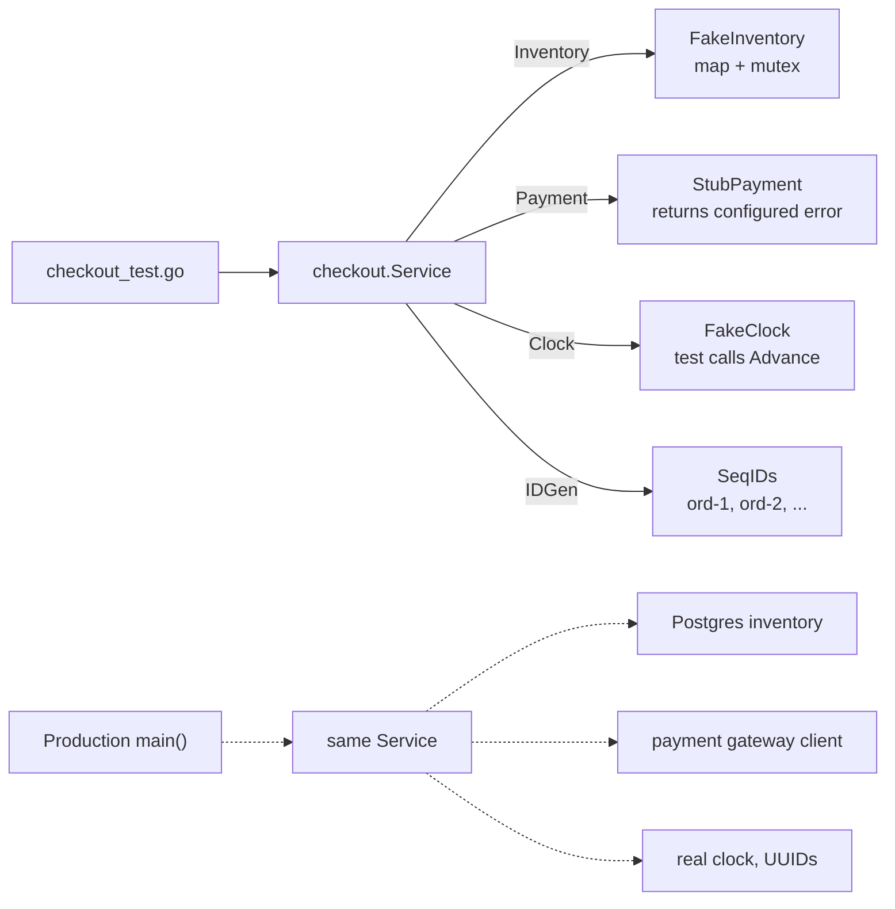
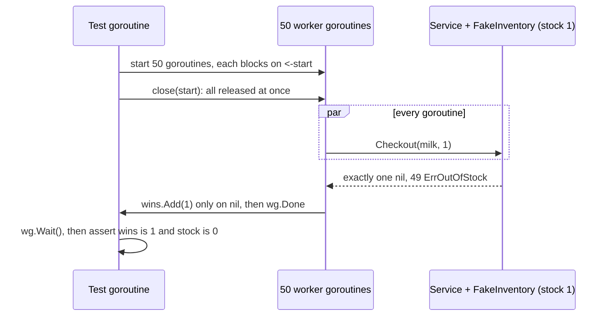

# Testing LLD Code

> [!summary] TL;DR
> A good LLD is easy to test: the service depends on small interfaces, so tests plug in tiny in-memory fakes, a controllable clock and predictable IDs. Then you write table-driven tests for the rules, a concurrent "exactly one winner" test under `-race`, and, where it pays, fuzz and golden-file tests.

> [!abstract] Core idea
> - Test the behaviour the interviewer cares about: happy path, rule failures, the race, compensation, and time rules.
> - Inject everything non-deterministic: clock, IDs, randomness, external services.
> - Prefer fakes (small real implementations) over mocks (call-expectation recorders); keep fakes thread-safe.
> - A concurrency test needs a start barrier, N goroutines, an atomic winner count and `go test -race -count=N`.
> - In a 60-minute round, about 10 minutes of tests is the difference between "it should work" and "it works".

Generic Go testing mechanics (`go test` flags, coverage, benchmarks, subtests) live in [[Testing in Go]]. The test pyramid lives in [[Unit, Integration and E2E Tests]]. This note is about testing an LLD design.

## 1. Why it exists

In a machine-coding round, the interviewer cannot read 400 lines carefully in the last five minutes. A passing test that says `TestCheckout_LastItemOnlyOneWinner` answers the question they were going to ask. In a take-home, tests often decide the result outright.

Concrete scenario: a checkout service reserves stock, charges the card, and releases the stock if the charge fails. Without tests, three bugs are typical:

1. The payment-failure branch forgets to release, so every declined card leaks one unit of stock. After 1,000 declines a store shows "out of stock" while the shelf is full.
2. Fifty shoppers race for the last unit, and two win because the check and the decrement are in separate lock sections.
3. A seat hold "expires after 10 minutes", and the only way to test it is `time.Sleep(10 * time.Minute)`, so nobody does.

Each has a 10-to-30-line test, shown below.

## 2. Mental model

Think of the service as an **engine on a test bench**. You do not test it inside the car on a motorway; you bolt it to a bench where you control the fuel (inputs), the air (fakes for inventory and payment), and the clock on the wall (an injected clock). Then you can run the engine at any "time of day" and repeat the exact same run a thousand times.

Vocabulary, from Meszaros's *xUnit Test Patterns*:

- **Stub**: returns canned answers (`StubPayment{Err: declined}`).
- **Fake**: a working, simplified implementation (a map-backed inventory).
- **Mock**: records calls and fails the test if the expected calls did not happen.
- **Spy**: records calls so the test can inspect them afterwards.

## 3. How it works

### What to test in an LLD

| Category | Example | Test shape |
| --- | --- | --- |
| Happy path | Checkout succeeds and decrements stock | Table case |
| Rule failures | Out of stock, invalid transition, limit exceeded | Table cases with `errors.Is` |
| Concurrent invariants | 50 buyers, 1 unit, exactly 1 winner | Barrier + goroutines + `-race` |
| Failure and compensation | Payment declined releases stock | Stub returns an error; assert final state |
| Time rules | Hold expires at 10 min, not at 9:59 | Fake clock, `Advance` |
| Parsers and inputs | Coupon codes, `find` expressions | Table cases + fuzz test |
| Rendered output | Receipt, bill split, parking ticket | Golden file |

### Test doubles plug into consumer-side interfaces

The service declares only the interfaces it uses (consumer-side), so each fake is a few lines.



### The concurrent winner test



Why each part is there:

- **Start barrier** (`close(start)`): without it, the first goroutines often finish before the last ones start, so they never overlap and the bug hides.
- **Atomic winner count**: a plain `int` incremented from 50 goroutines is itself a data race.
- **`-race`**: catches unsynchronised access even when the final numbers happen to look right.
- **`-count=N`**: reruns the test N times; races are probabilistic, so one green run proves little.

## 4. Worked example

### Whiteboard version

```text
Service(inv Inventory, pay Payment, clock Clock, ids IDGen)
  Checkout: Reserve -> Charge -> (fail? Release) -> Order{ids.NewID(), clock.Now()}

Fakes (in _test.go):
  FakeInventory  map + mutex         (thread-safe: used by 50 goroutines)
  StubPayment    returns Err         (declined path)
  FakeClock      mutex, Now, Advance (thread-safe)
  SeqIDs         ord-1, ord-2 ...    (atomic counter)

Tests:
  TestCheckout                 table: success / out of stock / declined releases / last units
  TestCheckout_LastItemOnly... barrier, 50 goroutines, atomic wins == 1, stock == 0
  TestHolds_ExpireWithFakeClock  9m59s still held, 10m free
  TestReceipt_Golden           testdata/receipt.golden, -update flag
  TestParseCoupon + FuzzParseCoupon  properties: no panic, 0 <= result <= total
Run: go vet ./... && go test -race -count=5 ./...
```

All code below is one package tested with Go 1.24.4: `go vet` is clean, `go test -race -count=5 ./...` passes, and a 10-second fuzz run executed 4.4 million inputs with no failure (measured on an Apple Silicon laptop).

### Code under test

```go
package checkout

import (
	"context"
	"errors"
	"fmt"
	"strings"
	"time"
)

var ErrOutOfStock = errors.New("out of stock")

// Consumer-side interfaces: only the methods the service calls.
type Inventory interface {
	Reserve(ctx context.Context, productID string, qty int) error
	Release(ctx context.Context, productID string, qty int) error
}

type Payment interface {
	Charge(ctx context.Context, userID string, amount int64) error
}

type Clock interface{ Now() time.Time }

type IDGen interface{ NewID() string }

type Order struct {
	ID        string
	UserID    string
	ProductID string
	Qty       int
	Amount    int64 // paise
	CreatedAt time.Time
}

type Service struct {
	inv   Inventory
	pay   Payment
	clock Clock
	ids   IDGen
}

func NewService(inv Inventory, pay Payment, clock Clock, ids IDGen) *Service {
	return &Service{inv: inv, pay: pay, clock: clock, ids: ids}
}

func (s *Service) Checkout(ctx context.Context, userID, productID string, qty int, amount int64) (Order, error) {
	if err := s.inv.Reserve(ctx, productID, qty); err != nil {
		return Order{}, err
	}
	if err := s.pay.Charge(ctx, userID, amount); err != nil {
		_ = s.inv.Release(ctx, productID, qty) // compensate
		return Order{}, fmt.Errorf("charge: %w", err)
	}
	return Order{
		ID: s.ids.NewID(), UserID: userID, ProductID: productID,
		Qty: qty, Amount: amount, CreatedAt: s.clock.Now(),
	}, nil
}

// Receipt renders an order as text. Tested with a golden file.
func Receipt(o Order) string {
	var b strings.Builder
	fmt.Fprintf(&b, "Order   %s\n", o.ID)
	fmt.Fprintf(&b, "Date    %s\n", o.CreatedAt.UTC().Format(time.RFC3339))
	fmt.Fprintf(&b, "Item    %s x %d\n", o.ProductID, o.Qty)
	fmt.Fprintf(&b, "Total   Rs %d.%02d\n", o.Amount/100, o.Amount%100)
	return b.String()
}
```

```go
package checkout

import (
	"errors"
	"sync"
	"time"
)

var ErrHeld = errors.New("seat already held")

// Holds keeps a seat for one user until a deadline. Time comes from Clock.
type Holds struct {
	mu    sync.Mutex
	clock Clock
	ttl   time.Duration
	until map[string]time.Time // seat -> hold expiry, guarded by mu
}

func NewHolds(clock Clock, ttl time.Duration) *Holds {
	return &Holds{clock: clock, ttl: ttl, until: map[string]time.Time{}}
}

func (h *Holds) Hold(seat string) error {
	h.mu.Lock()
	defer h.mu.Unlock()
	now := h.clock.Now()
	if exp, ok := h.until[seat]; ok && now.Before(exp) {
		return ErrHeld
	}
	h.until[seat] = now.Add(h.ttl)
	return nil
}
```

```go
package checkout

import (
	"errors"
	"strconv"
	"strings"
)

var ErrBadCoupon = errors.New("bad coupon")

// Coupon is FLAT<paise> or PCT<1..100>, for example FLAT5000 or PCT10.
type Coupon struct {
	Percent bool
	Value   int64
}

func ParseCoupon(code string) (Coupon, error) {
	var c Coupon
	var num string
	switch {
	case strings.HasPrefix(code, "FLAT"):
		num = code[len("FLAT"):]
	case strings.HasPrefix(code, "PCT"):
		c.Percent, num = true, code[len("PCT"):]
	default:
		return Coupon{}, ErrBadCoupon
	}
	v, err := strconv.ParseInt(num, 10, 64)
	if err != nil || v <= 0 || (c.Percent && v > 100) {
		return Coupon{}, ErrBadCoupon
	}
	c.Value = v
	return c, nil
}

// Apply never returns a negative total.
func (c Coupon) Apply(total int64) int64 {
	off := c.Value
	if c.Percent {
		off = total * c.Value / 100
	}
	if off > total {
		return 0
	}
	return total - off
}
```

### Fakes, stub, clock and IDs

The fake clock guards its time with a mutex. A version with a bare `time.Time` field is a data race as soon as `Advance` in the test runs while a service goroutine calls `Now`, and `-race` will report it.

```go
package checkout

import (
	"context"
	"fmt"
	"sync"
	"sync/atomic"
	"time"
)

// FakeInventory is a real, tiny, thread-safe implementation.
type FakeInventory struct {
	mu    sync.Mutex
	stock map[string]int
}

func NewFakeInventory(stock map[string]int) *FakeInventory {
	return &FakeInventory{stock: stock}
}

func (f *FakeInventory) Reserve(ctx context.Context, productID string, qty int) error {
	f.mu.Lock()
	defer f.mu.Unlock()
	if f.stock[productID] < qty {
		return ErrOutOfStock
	}
	f.stock[productID] -= qty
	return nil
}

func (f *FakeInventory) Release(ctx context.Context, productID string, qty int) error {
	f.mu.Lock()
	defer f.mu.Unlock()
	f.stock[productID] += qty
	return nil
}

func (f *FakeInventory) Stock(productID string) int {
	f.mu.Lock()
	defer f.mu.Unlock()
	return f.stock[productID]
}

// StubPayment returns a configured error: a stub, not a mock.
type StubPayment struct{ Err error }

func (s StubPayment) Charge(ctx context.Context, userID string, amount int64) error { return s.Err }

// FakeClock is safe to read from service goroutines while the test advances it.
type FakeClock struct {
	mu sync.Mutex
	t  time.Time
}

func NewFakeClock(t time.Time) *FakeClock { return &FakeClock{t: t} }

func (c *FakeClock) Now() time.Time {
	c.mu.Lock()
	defer c.mu.Unlock()
	return c.t
}

func (c *FakeClock) Advance(d time.Duration) {
	c.mu.Lock()
	defer c.mu.Unlock()
	c.t = c.t.Add(d)
}

// SeqIDs returns ord-1, ord-2, ... so expected values are predictable.
type SeqIDs struct{ n atomic.Int64 }

func (s *SeqIDs) NewID() string { return fmt.Sprintf("ord-%d", s.n.Add(1)) }
```

### The tests

```go
package checkout

import (
	"context"
	"errors"
	"flag"
	"os"
	"path/filepath"
	"sync"
	"sync/atomic"
	"testing"
	"time"
)

var t0 = time.Date(2026, 11, 4, 10, 0, 0, 0, time.UTC)

func TestCheckout(t *testing.T) {
	errDeclined := errors.New("card declined")

	tests := []struct {
		name      string
		stock     int
		qty       int
		payErr    error
		wantErr   error
		wantStock int
	}{
		{name: "success", stock: 5, qty: 2, wantStock: 3},
		{name: "out of stock", stock: 1, qty: 2, wantErr: ErrOutOfStock, wantStock: 1},
		{name: "payment fails releases stock", stock: 5, qty: 2, payErr: errDeclined, wantErr: errDeclined, wantStock: 5},
		{name: "exactly the last units", stock: 2, qty: 2, wantStock: 0},
	}

	for _, tc := range tests {
		t.Run(tc.name, func(t *testing.T) {
			t.Parallel() // safe: each case builds its own fakes
			inv := NewFakeInventory(map[string]int{"milk": tc.stock})
			svc := NewService(inv, StubPayment{Err: tc.payErr}, NewFakeClock(t0), &SeqIDs{})

			order, err := svc.Checkout(context.Background(), "u1", "milk", tc.qty, 100)

			if !errors.Is(err, tc.wantErr) {
				t.Fatalf("err = %v, want %v", err, tc.wantErr)
			}
			if got := inv.Stock("milk"); got != tc.wantStock {
				t.Fatalf("stock = %d, want %d", got, tc.wantStock)
			}
			if err == nil && (order.ID != "ord-1" || !order.CreatedAt.Equal(t0)) {
				t.Fatalf("order = %+v, want ID ord-1 at %v", order, t0)
			}
		})
	}
}

func TestCheckout_LastItemOnlyOneWinner(t *testing.T) {
	inv := NewFakeInventory(map[string]int{"milk": 1})
	svc := NewService(inv, StubPayment{}, NewFakeClock(t0), &SeqIDs{})

	const n = 50
	start := make(chan struct{}) // barrier: everyone starts together
	var wins atomic.Int32
	var wg sync.WaitGroup
	for range n {
		wg.Add(1)
		go func() {
			defer wg.Done()
			<-start
			if _, err := svc.Checkout(context.Background(), "u", "milk", 1, 100); err == nil {
				wins.Add(1)
			} else if !errors.Is(err, ErrOutOfStock) {
				t.Errorf("unexpected error: %v", err)
			}
		}()
	}
	close(start)
	wg.Wait()

	if got := wins.Load(); got != 1 {
		t.Fatalf("winners = %d, want 1", got)
	}
	if got := inv.Stock("milk"); got != 0 {
		t.Fatalf("stock = %d, want 0", got)
	}
}

func TestHolds_ExpireWithFakeClock(t *testing.T) {
	clk := NewFakeClock(t0)
	h := NewHolds(clk, 10*time.Minute)

	if err := h.Hold("A1"); err != nil {
		t.Fatal(err)
	}
	clk.Advance(9*time.Minute + 59*time.Second)
	if err := h.Hold("A1"); !errors.Is(err, ErrHeld) {
		t.Fatalf("at 9m59s: err = %v, want ErrHeld", err)
	}
	clk.Advance(time.Second) // exactly 10m: the hold has expired
	if err := h.Hold("A1"); err != nil {
		t.Fatalf("at 10m: err = %v, want nil", err)
	}
}

var update = flag.Bool("update", false, "rewrite golden files")

func TestReceipt_Golden(t *testing.T) {
	o := Order{ID: "ord-1", UserID: "u1", ProductID: "milk", Qty: 2, Amount: 12050, CreatedAt: t0}
	got := Receipt(o)

	path := filepath.Join("testdata", "receipt.golden")
	if *update {
		if err := os.WriteFile(path, []byte(got), 0o644); err != nil {
			t.Fatal(err)
		}
	}
	want, err := os.ReadFile(path)
	if err != nil {
		t.Fatal(err)
	}
	if got != string(want) {
		t.Fatalf("receipt mismatch\n--- got ---\n%s--- want ---\n%s", got, want)
	}
}

func TestParseCoupon(t *testing.T) {
	tests := []struct {
		code    string
		want    Coupon
		wantErr bool
	}{
		{"FLAT5000", Coupon{Value: 5000}, false},
		{"PCT10", Coupon{Percent: true, Value: 10}, false},
		{"PCT101", Coupon{}, true},
		{"FLAT-5", Coupon{}, true},
		{"FLAT", Coupon{}, true},
		{"BOGO", Coupon{}, true},
	}
	for _, tc := range tests {
		t.Run(tc.code, func(t *testing.T) {
			got, err := ParseCoupon(tc.code)
			if (err != nil) != tc.wantErr || got != tc.want {
				t.Fatalf("ParseCoupon(%q) = %+v, %v", tc.code, got, err)
			}
		})
	}
}

// FuzzParseCoupon checks properties, not exact outputs: no panic, and a
// parsed coupon never makes a total negative or larger.
func FuzzParseCoupon(f *testing.F) {
	for _, seed := range []string{"FLAT5000", "PCT10", "PCT100", "FLAT", "PCT0", ""} {
		f.Add(seed, int64(10000))
	}
	f.Fuzz(func(t *testing.T, code string, total int64) {
		if total < 0 || total > 1e12 {
			t.Skip()
		}
		c, err := ParseCoupon(code)
		if err != nil {
			return
		}
		if got := c.Apply(total); got < 0 || got > total {
			t.Fatalf("Apply(%d) with %+v = %d", total, c, got)
		}
	})
}
```

The golden file `testdata/receipt.golden`:

```text
Order   ord-1
Date    2026-11-04T10:00:00Z
Item    milk x 2
Total   Rs 120.50
```

```bash
go vet ./...
go test -race -count=5 ./...
go test -run='^$' -fuzz=FuzzParseCoupon -fuzztime=10s .
go test -run=TestReceipt_Golden -update .   # only after reviewing the diff
```

### Contract test and benchmark

A contract test is one test function that takes a constructor for the interface, so the same rules run against the fake now and the PostgreSQL repository later. The benchmark uses `for b.Loop()` (Go 1.24).

```go
package checkout

import (
	"context"
	"errors"
	"testing"
)

// testInventoryContract is the behaviour every Inventory must have.
// Run it against the fake here and against the PostgreSQL repository
// in an integration test (build tag or -short skip).
func testInventoryContract(t *testing.T, newInv func(stock map[string]int) Inventory) {
	ctx := context.Background()
	t.Run("reserve within stock", func(t *testing.T) {
		inv := newInv(map[string]int{"milk": 2})
		if err := inv.Reserve(ctx, "milk", 2); err != nil {
			t.Fatal(err)
		}
	})
	t.Run("reserve beyond stock fails and never goes negative", func(t *testing.T) {
		inv := newInv(map[string]int{"milk": 1})
		if err := inv.Reserve(ctx, "milk", 2); !errors.Is(err, ErrOutOfStock) {
			t.Fatalf("err = %v, want ErrOutOfStock", err)
		}
		if err := inv.Reserve(ctx, "milk", 1); err != nil {
			t.Fatalf("the failed reserve must not consume stock: %v", err)
		}
	})
	t.Run("release returns stock", func(t *testing.T) {
		inv := newInv(map[string]int{"milk": 1})
		_ = inv.Reserve(ctx, "milk", 1)
		if err := inv.Release(ctx, "milk", 1); err != nil {
			t.Fatal(err)
		}
		if err := inv.Reserve(ctx, "milk", 1); err != nil {
			t.Fatalf("stock not returned: %v", err)
		}
	})
}

func TestFakeInventory_Contract(t *testing.T) {
	testInventoryContract(t, func(stock map[string]int) Inventory { return NewFakeInventory(stock) })
}

// BenchmarkCheckout measures the hot path. With b.Loop (Go 1.24) the setup
// above the loop runs once and is not timed.
func BenchmarkCheckout(b *testing.B) {
	inv := NewFakeInventory(map[string]int{"milk": 1 << 30})
	svc := NewService(inv, StubPayment{}, NewFakeClock(t0), &SeqIDs{})
	ctx := context.Background()
	for b.Loop() {
		if _, err := svc.Checkout(ctx, "u1", "milk", 1, 100); err != nil {
			b.Fatal(err)
		}
	}
}
```

```bash
go test -run='^$' -bench=Checkout -benchmem .
```

Measured on an Apple Silicon laptop with Go 1.24.4: `BenchmarkCheckout-10  17603978  67.89 ns/op  24 B/op  2 allocs/op` (both allocations come from building the `fmt.Sprintf` order ID; your numbers will differ).

### Fake time for goroutines: testing/synctest

When the code under test calls `time.Sleep`, `time.After` or `context.WithTimeout` itself, an injected clock is not enough. `testing/synctest` runs the test in a "bubble" with a fake clock that jumps forward whenever every goroutine in the bubble is blocked. This snippet passed on Go 1.24.4 with `GOEXPERIMENT=synctest go test -race`; without the experiment flag the file is excluded by its build tag.

```go
//go:build goexperiment.synctest

package st

import (
	"testing"
	"testing/synctest"
	"time"
)

func TestSleepIsInstant(t *testing.T) {
	synctest.Run(func() {
		start := time.Now()
		time.Sleep(10 * time.Minute)
		if time.Since(start) != 10*time.Minute {
			t.Fatal("fake time did not advance exactly")
		}
	})
}
```

In Go 1.25 the package is standard: no build tag or experiment flag, and the entry point is `synctest.Test(t, func(t *testing.T) { ... })`; `synctest.Run` is deprecated.

## 5. Variants and comparison

| Double | How it works | Good for | Risk |
| --- | --- | --- | --- |
| Stub | Returns a canned value or error | Driving a branch (declined card) | None worth noting |
| Fake | Small real implementation (map + mutex) | State-based tests; most LLD tests | Drifts from the real implementation unless contract-tested |
| Mock (gomock, testify/mock) | Expects specific calls, fails otherwise | When the interaction is the behaviour ("send exactly one notification") | Brittle: breaks on harmless refactors and call-order changes |
| Spy | Records calls for later assertions | Checking an event was published | Same brittleness as mocks if overused |
| Real dependency (Testcontainers) | Runs PostgreSQL or Redis in a container | Repository and SQL tests | Slow; not available in a 60-minute round |

| Technique | When it pays in LLD | Example |
| --- | --- | --- |
| Table-driven test | Any method with several rules | `TestCheckout` |
| Concurrency winner test | Any "exactly one" invariant | `TestCheckout_LastItemOnlyOneWinner` |
| Fake clock | TTLs, fines, holds, rate limits | `TestHolds_ExpireWithFakeClock` |
| `testing/synctest` | Code that sleeps or times out internally | Retry backoff, janitor goroutines |
| Fuzz test | Parsers and arithmetic on user input | `FuzzParseCoupon`, a `find` expression parser |
| Golden file | Long text output that is tedious to assert | Receipts, bill splits, rendered boards |
| Benchmark | A hot path the interviewer asks about | `BenchmarkLRUGet` with `for b.Loop()` (Go 1.24) |
| Contract test | Keeping a fake honest | One test suite run against both fake and real repository |

## 6. Trade-offs and when not to use

- **Mocks for everything** couple tests to implementation details. If renaming an internal call breaks ten tests, the tests are checking how the code works, not what it does.
- **`t.Parallel` in table tests** is only safe when cases share nothing. Each case above builds its own fakes. Since Go 1.22 the loop variable is per iteration, so the old `tc := tc` copy is no longer needed.
- **Golden files** hide intent if overused; a reviewer approving `-update` without reading the diff accepts any regression. Use them for long output only.
- **Fuzzing** finds crashes and broken properties, not wrong business rules. It needs a property to check (here: the total never goes negative or up).
- **Coverage** is a signal, not a goal. 100% line coverage with no concurrency test still ships the oversell bug.
- **Through-HTTP tests** in an LLD round are usually wasted time. Test the service directly; one `httptest` test is enough if the handler has real logic.

## 7. In production

- **Real practice:** Go's own standard library is full of table-driven tests and golden files (`go/printer` and `gofmt` use `testdata/*.golden`). The `-update` flag convention comes from there.
- **Keeping fakes honest:** write one test function that takes the interface, for example `func testInventoryContract(t *testing.T, inv Inventory)`, and call it with both the fake and the PostgreSQL repository in an integration test. When the real one gains a rule (no negative stock), the fake must pass the same test (see [[Contract Testing]]).
- **Goroutine leaks:** add `goleak.VerifyTestMain(m)` in packages that start goroutines (worker pools, janitors); [[Concurrency for LLD]] shows it.
- **Failure modes → fixes:**
	- Flaky time-based test → it reads `time.Now()` or sleeps; inject a clock or use `synctest`.
	- Race test passes locally, fails in CI → it is probabilistic; run `-race -count=20` before merging.
	- Fake and real repo disagree → contract test both.
	- Deterministic IDs collide across parallel cases → give each case its own `SeqIDs`.
- **What to watch in CI:** race reports (the job must fail on them), flaky test rate, fuzz corpus growth (`testdata/fuzz/FuzzXxx/` holds failing inputs; commit them as regression cases).

### A test layout for a 60-minute round

| Minute | Test work |
| --- | --- |
| 0–10 | While clarifying requirements, write the invariants as test names (`TestBook_SameSeatOneWinner`). |
| 10–40 | Design and code. Keep `Clock` and `IDGen` as constructor parameters from the start. |
| 40–50 | One table test for the core method (3–5 cases including one failure and one compensation case). |
| 50–55 | One concurrency winner test; run `go test -race -count=5 ./...`. |
| 55–60 | Say what you would add: fake clock tests for TTLs, a fuzz test for the parser, contract tests against the real repo. |

## 8. Deep dive

- **Why fakes must be thread-safe.** The concurrency test exercises the fake as much as the service. An unlocked fake fails under `-race` and can show two winners even when the service is correct, which sends you debugging the wrong code.
- **Deterministic IDs and randomness.** Inject an `IDGen` and, where the design uses randomness (shuffled assignment, jitter), a `*rand.Rand` built with a fixed seed in tests, or a small interface. Then expected values such as `ord-1` are exact and failures reproduce.
- **`T.Context` (Go 1.24).** `t.Context()` returns a context cancelled just before the test's cleanup functions run, which is handy for starting goroutines that must stop when the test ends.
- **`B.Loop` (Go 1.24).** `for b.Loop() { ... }` replaces `for i := 0; i < b.N; i++`. The benchmark function itself runs only once, so setup before the loop is not repeated or timed, and it keeps the compiler from optimising away the body's results.
- **How `-count` and the race detector interact.** `-count=N` disables test caching and repeats tests; with `-race`, every repetition is instrumented. The race detector reports only races it observes, so more repetitions and the start barrier raise the odds of catching one.
- **Fuzz corpus.** `go test -fuzz` mutates seed inputs from `f.Add` and stores any failing input under `testdata/fuzz/<FuzzName>/`. A plain `go test` then reruns those inputs as regular cases, so a found bug stays fixed.
- **synctest limits.** Only goroutines started inside the bubble share its fake clock, and blocking on real I/O (a network socket) does not count as "durably blocked", so time will not advance. Waiting to lock a `sync.Mutex` does not count as durably blocked either; channel operations, `select`, `time.Sleep`, timers and `sync.Cond.Wait` do (and `sync.WaitGroup.Wait` from Go 1.25). Use it for timers, tickers and channel-based code.

## 9. Interview questions

> [!question]- How would you test this booking service?
> Table-driven tests for the rules (success, seat taken, invalid state, payment declined releases the hold), a concurrency test where 50 goroutines book the same seat and exactly one wins under `-race`, and fake-clock tests for hold expiry. All dependencies are small interfaces, so fakes are a few lines each.

> [!question]- Fake or mock: which do you use, and why?
> Fakes by default, because LLD tests check state (stock, seat status), and fakes survive refactors. I use a mock or spy only when the interaction is the behaviour, such as "the notifier is called exactly once per order".

> [!question]- Trap: your concurrency test passed once without `-race`. Is the code safe?
> No. Races are timing-dependent, and without a start barrier the goroutines may not even overlap. Run with `-race`, repeat with `-count=N`, use a barrier, and check both the winner count and the final state.

> [!question]- How do you test a 10-minute seat hold without waiting 10 minutes?
> Inject a `Clock` and use a thread-safe fake with `Advance`: hold, advance 9m59s and assert still held, advance 1s more and assert free. If the code sleeps or uses timers internally, run it inside `testing/synctest` (experimental in Go 1.24, standard in 1.25).

> [!question]- Your fake inventory allows negative stock, but the real table has a CHECK constraint. What is the risk and the fix?
> Tests pass against behaviour production does not have. Write one contract test suite against the `Inventory` interface and run it against both the fake and the real repository, so they cannot drift.

> [!question]- What would you fuzz in an LLD problem?
> Anything parsing untrusted input: coupon codes, a `find` expression language, command strings in a parking-lot CLI. The fuzz body asserts properties such as "never panics" and "a discount never makes the total negative".

> [!question]- When is a golden file the right tool?
> When the output is long and structured text (a receipt, a bill split, a rendered board) and asserting each line would bury the intent. Keep files in `testdata/`, regenerate with an `-update` flag, and review the diff.

## 10. Cheat sheet

- Test: happy path, rule failures, the race, compensation, time rules.
- Inject clock, IDs and randomness; never call `time.Now()` inside rules.
- Fakes over mocks; fakes must be thread-safe.
- Table tests with `t.Run`; `t.Parallel` only when cases share nothing.
- Winner test: barrier, N goroutines, atomic count, `-race -count=N`.
- `testing/synctest` for code that sleeps: experimental in 1.24, standard in 1.25.
- Fuzz parsers with properties; golden files for long output; contract tests keep fakes honest.

## Links

- **Before this:** [[Testing in Go]], [[Concurrency for LLD]], [[OOP in Go - Structs, Interfaces, Embedding]]
- **Next:** [[Parking Lot]] (the first practice problem), [[Cart Checkout with Coupons]], [[Movie Ticket Booking]], [[Fuzz and Property-Based Testing]]
- **Compare with:** [[Unit, Integration and E2E Tests]] (the pyramid), [[Contract Testing]] (keeping doubles honest across services)
