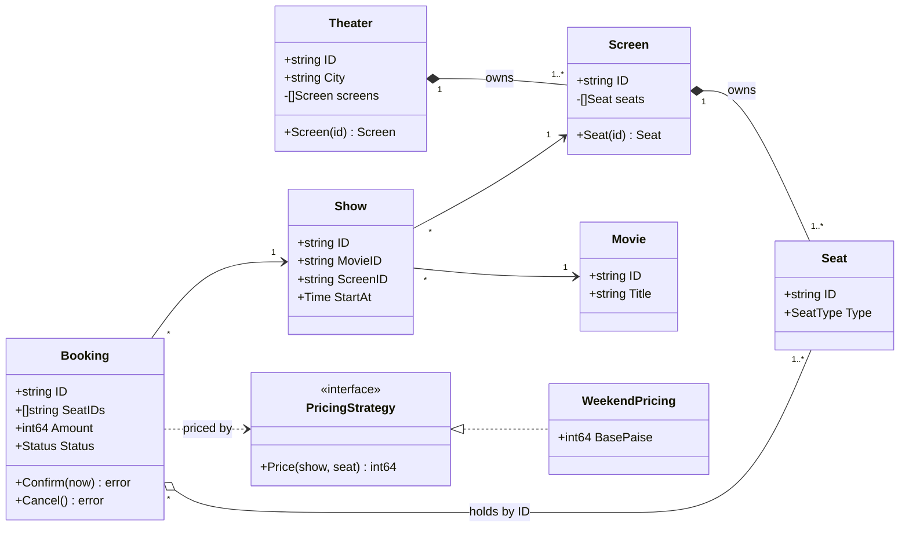
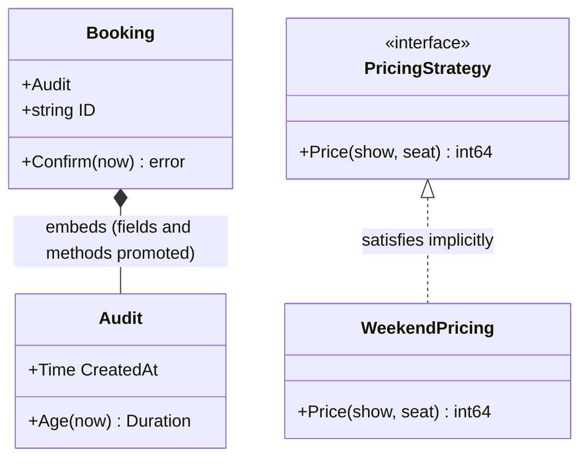
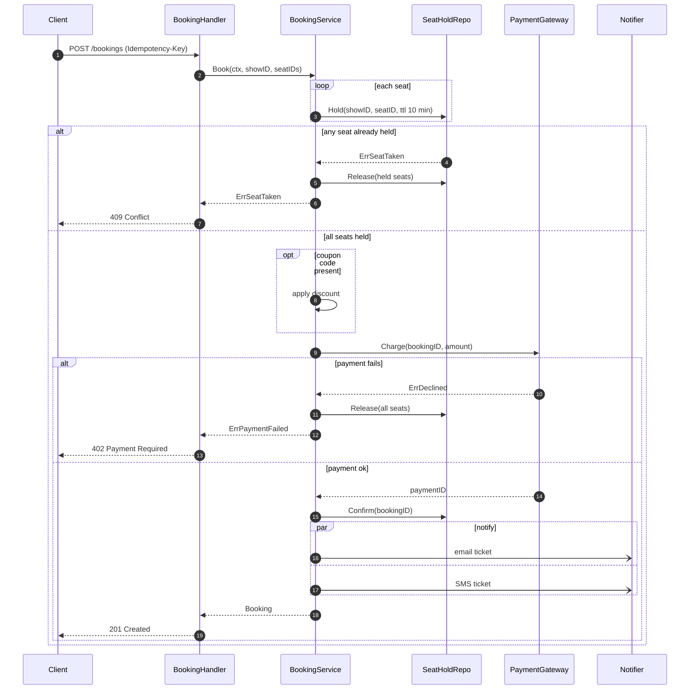
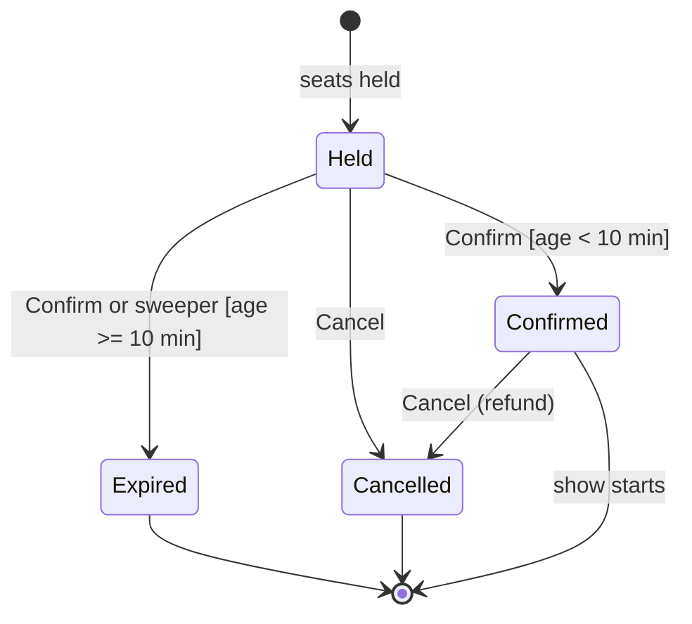

# UML for LLD

> [!summary] TL;DR
> **UML** (Unified Modeling Language) is a standard notation for drawing software designs. In an LLD interview you need only three of its diagrams: a **class diagram** (what exists and how it connects), a **sequence diagram** (who calls whom for the hardest flow, including failures) and a **state diagram** (which status changes are legal). Each maps directly to Go: structs and interfaces, method calls, and transition methods that return an error for illegal moves.

> [!abstract] Core idea
> - Draw three diagrams, in this order: class, sequence for the hardest flow, state for anything with a status field.
> - Every line in a class diagram needs a relationship type and a multiplicity ("one theater has many screens").
> - In Go, composition versus aggregation is decided by **who creates and owns the lifecycle**, not by `[]B` versus `[]*B`.
> - Go has no inheritance arrow: draw interface realization (dotted) for "implements" and a plain association labelled "embeds" for embedding.
> - Time-box it: about 5 minutes of diagrams in a 45-minute round, then code.

## 1. Why it exists

In a 45-minute LLD round on movie booking, a candidate who jumps straight into code usually discovers at minute 30 that `Seat` needs to know its `Screen`, that two users can hold the same seat, and that a `Booking` can be cancelled after it expired. Fixing that means rewriting half the structs with 15 minutes left.

Five minutes of diagrams expose those questions early and cheaply:

- the class diagram shows that seats belong to a screen, not to a show, so seat availability must be tracked per show;
- the sequence diagram shows the payment-failure path, so "release the hold" gets designed rather than forgotten;
- the state diagram shows `Expired` as a terminal state, so `Confirm` after the hold timeout must fail.

The interviewer also gets a shared picture to argue about, which is cheaper than arguing about code.

## 2. Mental model

UML is a building's floor plan, wiring diagram and lift-status panel. The floor plan (class diagram) shows rooms and doors, the wiring diagram (sequence) shows what happens when you flip one switch, and the lift panel (state) shows which floors it may go to next. An architect does not draw every brick, and you do not draw every getter.

Terms used below:

- **Multiplicity** (also called cardinality): how many objects can be on each end of a relationship, written `1`, `0..1`, `*` (zero or more), `1..*` (one or more) or `n..m`.
- **Lifeline:** a vertical line in a sequence diagram for one participant (a service, a repository).
- **Guard:** a condition in square brackets on a transition, such as `[age < 10 min]`; the transition fires only if it is true.
- **Terminal state:** a state with no outgoing transitions except to the end marker `[*]`.

## 3. How it works

### Which diagram answers which question

| Diagram | Answers | Draw when |
| --- | --- | --- |
| Class diagram | What exists and how it connects | Always, right after requirements |
| Sequence diagram | Who calls whom, in what order, and what happens on failure | For the single hardest flow (booking, checkout, payment) |
| State diagram | Which status changes are legal, and what triggers them | Any entity with a status field (order, seat hold, ride) |
| Activity diagram | A multi-step workflow with branches and parallel steps | Rarely: long approval or fulfilment pipelines; a `flowchart` works |
| Use-case diagram | Which actor does what | Almost never: a bullet list of use cases is clearer |

### Class diagram notation

A class box has three parts: name, fields, methods. Stereotypes in `<<...>>` mark special kinds such as `<<interface>>` or `<<enumeration>>`.

| Visibility symbol | UML meaning | Go equivalent |
| --- | --- | --- |
| `+` | public | Exported name (`Confirm`, `ID`) |
| `-` | private | Unexported name (`seats`, `mu`) |
| `#` | protected | No equivalent; unexported fields are package-visible, which is closest to `~` |
| `~` | package | Unexported name used across files of the same package |

| Multiplicity | Reads as | Example |
| --- | --- | --- |
| `1` | exactly one | a Show has 1 Screen |
| `0..1` | optional | a Booking has 0..1 Payment |
| `*` | zero or more | a Screen has * Shows |
| `1..*` | at least one | a Booking has 1..* seats |

### The six relationships and their Go form

| Relationship | Meaning | Mermaid | Go form |
| --- | --- | --- | --- |
| Association | Knows about, long-lived | `A --> B` | A field holding B's ID or a pointer to a B that someone else created |
| Aggregation | Has, but parts live independently | `A o-- B` | A holds references to Bs that were created elsewhere and outlive A |
| Composition | Owns, parts die with the whole | `A *-- B` | A creates its Bs, nobody else holds them, they disappear with A |
| Inheritance | Is-a | `A <\|-- B` | **Not in Go.** Use an interface (realization) or embedding (reuse) |
| Realization | Implements an interface | `I <\|.. C` | Implicit: C has I's methods; pin it with `var _ I = C{}` |
| Dependency | Uses briefly | `A ..> B` | B is a method parameter or a local variable, not a field |

**The lifecycle-ownership rule.** In Go, `[]Seat` versus `[]*Seat` does not decide composition versus aggregation. A `[]*Seat` can be composition (the screen created those seats and never hands the pointers out) and a `[]Seat` of copies can be aggregation-like (the values were copied from a catalogue that owns the originals). Ask two questions instead: *who creates the part?* and *does the part outlive the whole?* If the whole creates it and it dies with the whole, draw composition.

Examples from movie booking:

- Theater **composes** Screens: a screen does not exist without its theater.
- Show **associates** with Movie: the movie exists without the show.
- Booking **aggregates** Seats by ID: the seats belong to the screen and outlive any booking.
- `WeekendPricing` **realizes** `PricingStrategy`.



### Embedding versus realization: the Go-specific picture

Java UML habits draw `Booking --|> Auditable` (inheritance). Go has two different tools, and they draw differently:



- **Embedding** is composition with promotion: `b.Age(now)` is shorthand for `b.Audit.Age(now)`. A `*Booking` cannot be passed where an `Audit` is expected, and a method on `Audit` cannot call a `Booking` method, so there is no virtual dispatch. Promotion does put `Audit`'s methods in `Booking`'s method set, so a `Booking` satisfies any interface that `Audit` satisfies; that is interface satisfaction, not an is-a relationship between the structs. Draw it as composition labelled "embeds", never as inheritance. Mechanics are in [[Structs, Methods and Embedding]].
- **Realization** is the only "is-a" in Go: any type with the right methods satisfies the interface. See [[Interfaces]].

### Sequence diagrams: alt, opt, loop, par

Draw the hardest flow, and always draw its failure path. The four fragments you need:

- `alt` / `else`: mutually exclusive branches (payment ok / payment fails);
- `opt`: an optional step (apply a coupon if present);
- `loop`: repetition (hold each seat);
- `par`: concurrent work (send email and SMS together).



The `-)` arrows are asynchronous messages (fire and forget). The compensating `Release` calls are what interviewers look for.

### State diagrams: guards, timeouts, terminal states



- Each arrow becomes a method or an event; anything not drawn must return an error. That table of legal transitions is the heart of [[State Machines in Go]].
- Timeouts are transitions too: `Held --> Expired` fires from a guard check or a background sweeper.
- Mark terminal states explicitly so nobody writes `Cancelled --> Confirmed`.

### When an activity diagram earns its place

For a multi-step workflow with parallel branches (order fulfilment: pick, pack and invoice in parallel, then dispatch), a `flowchart` with fork and join nodes is quicker than a sequence diagram. For a single request it adds nothing.

## 4. Worked example

The movie-booking class and state diagrams above, turned into Go. Each relationship becomes a specific code shape.

### Whiteboard version

```text
Theater  *-- Screen   -> Theater.screens []Screen, built only in NewTheater
Screen   *-- Seat     -> Screen.seats []Seat, built only in NewTheater
Show     --> Movie    -> Show.MovieID string
Show     --> Screen   -> Show.ScreenID string
Booking  o-- Seat     -> Booking.SeatIDs []string (seats outlive bookings)
Booking  ..> Pricing  -> parameter of NewBooking, not a field
Pricing <|.. Weekend  -> var _ PricingStrategy = WeekendPricing{}
Booking  embeds Audit -> struct { Audit; ... }, Age() promoted
State diagram         -> Status consts + Confirm/Cancel return ErrIllegalTransition
Guard [age < 10 min]  -> if b.Age(now) >= HoldTTL { Expired }
```

### The tested code

```go
package booking

import (
	"errors"
	"fmt"
	"time"
)

type SeatType int

const (
	Regular SeatType = iota
	Premium
)

// Composition: a Theater creates its Screens, and a Screen creates its
// Seats. Nothing else holds them, so they live and die with the Theater.
type Seat struct {
	ID   string
	Type SeatType
}

type Screen struct {
	ID    string
	seats []Seat
}

type Theater struct {
	ID      string
	City    string
	screens []Screen
}

func NewTheater(id, city string, screens, rows, perRow int) *Theater {
	t := &Theater{ID: id, City: city}
	for s := range screens {
		sc := Screen{ID: fmt.Sprintf("%s-S%d", id, s+1)}
		for r := range rows {
			typ := Regular
			if r == rows-1 {
				typ = Premium // last row is premium
			}
			for c := range perRow {
				sc.seats = append(sc.seats, Seat{ID: fmt.Sprintf("%c%d", 'A'+r, c+1), Type: typ})
			}
		}
		t.screens = append(t.screens, sc)
	}
	return t
}

func (t *Theater) Screen(id string) (*Screen, bool) {
	for i := range t.screens {
		if t.screens[i].ID == id {
			return &t.screens[i], true
		}
	}
	return nil, false
}

func (s *Screen) Seat(id string) (Seat, bool) {
	for _, st := range s.seats {
		if st.ID == id {
			return st, true
		}
	}
	return Seat{}, false
}

// Association: a Show refers to a Movie and a Screen by ID.
// Both exist without the Show.
type Movie struct {
	ID    string
	Title string
}

type Show struct {
	ID       string
	MovieID  string
	ScreenID string
	StartAt  time.Time
}

// Realization: WeekendPricing satisfies PricingStrategy implicitly.
type PricingStrategy interface {
	Price(show Show, seat Seat) int64
}

type WeekendPricing struct{ BasePaise int64 }

func (w WeekendPricing) Price(show Show, seat Seat) int64 {
	p := w.BasePaise
	if seat.Type == Premium {
		p += p / 2
	}
	if d := show.StartAt.Weekday(); d == time.Saturday || d == time.Sunday {
		p += p / 5
	}
	return p
}

var _ PricingStrategy = WeekendPricing{} // compile-time check of the realization arrow

// Embedding: Booking gets CreatedAt and Age() promoted from Audit.
// This is reuse, not is-a: a Booking cannot be passed where an Audit is expected.
type Audit struct{ CreatedAt time.Time }

func (a Audit) Age(now time.Time) time.Duration { return now.Sub(a.CreatedAt) }

type Status int

const (
	Held Status = iota
	Confirmed
	Cancelled
	Expired
)

var ErrIllegalTransition = errors.New("illegal transition")

// HoldTTL is the guard on the Held -> Expired timeout edge.
const HoldTTL = 10 * time.Minute

type Booking struct {
	Audit
	ID      string
	ShowID  string   // association
	SeatIDs []string // aggregation by ID: seats belong to the Screen, not the Booking
	Amount  int64
	Status  Status
}

func NewBooking(id string, show Show, sc *Screen, seatIDs []string, p PricingStrategy, now time.Time) (*Booking, error) {
	b := &Booking{Audit: Audit{CreatedAt: now}, ID: id, ShowID: show.ID, Status: Held}
	for _, sid := range seatIDs {
		seat, ok := sc.Seat(sid)
		if !ok {
			return nil, fmt.Errorf("seat %s not on screen %s", sid, sc.ID)
		}
		b.Amount += p.Price(show, seat)
		b.SeatIDs = append(b.SeatIDs, sid)
	}
	return b, nil
}

// Confirm is the Held -> Confirmed edge with its guard [age < HoldTTL].
func (b *Booking) Confirm(now time.Time) error {
	if b.Status != Held {
		return fmt.Errorf("confirm from %d: %w", b.Status, ErrIllegalTransition)
	}
	if b.Age(now) >= HoldTTL {
		b.Status = Expired
		return fmt.Errorf("hold expired: %w", ErrIllegalTransition)
	}
	b.Status = Confirmed
	return nil
}

func (b *Booking) Cancel() error {
	if b.Status != Held && b.Status != Confirmed {
		return fmt.Errorf("cancel from %d: %w", b.Status, ErrIllegalTransition)
	}
	b.Status = Cancelled
	return nil
}
```

```go
package booking

import (
	"errors"
	"testing"
	"time"
)

func setup(t *testing.T, start time.Time) (Show, *Screen) {
	t.Helper()
	th := NewTheater("PVR1", "Pune", 2, 3, 4) // 2 screens, 3 rows of 4 seats
	sc, ok := th.Screen("PVR1-S1")
	if !ok {
		t.Fatal("screen missing")
	}
	return Show{ID: "sh1", MovieID: "m1", ScreenID: sc.ID, StartAt: start}, sc
}

func TestPricing(t *testing.T) {
	sat := time.Date(2026, 11, 7, 18, 0, 0, 0, time.UTC) // a Saturday
	mon := time.Date(2026, 11, 9, 18, 0, 0, 0, time.UTC)
	p := WeekendPricing{BasePaise: 20000}
	for _, tc := range []struct {
		name  string
		start time.Time
		seats []string
		want  int64
	}{
		{"weekday regular", mon, []string{"A1"}, 20000},
		{"weekday premium", mon, []string{"C1"}, 30000},
		{"weekend regular+premium", sat, []string{"A1", "C1"}, 24000 + 36000},
	} {
		t.Run(tc.name, func(t *testing.T) {
			show, sc := setup(t, tc.start)
			b, err := NewBooking("b1", show, sc, tc.seats, p, tc.start)
			if err != nil {
				t.Fatal(err)
			}
			if b.Amount != tc.want {
				t.Fatalf("amount = %d, want %d", b.Amount, tc.want)
			}
		})
	}
}

func TestUnknownSeat(t *testing.T) {
	now := time.Now()
	show, sc := setup(t, now)
	if _, err := NewBooking("b1", show, sc, []string{"Z9"}, WeekendPricing{BasePaise: 1}, now); err == nil {
		t.Fatal("want error for unknown seat")
	}
}

func TestLifecycle(t *testing.T) {
	t0 := time.Date(2026, 11, 9, 10, 0, 0, 0, time.UTC)
	show, sc := setup(t, t0)
	newB := func() *Booking {
		b, err := NewBooking("b1", show, sc, []string{"A1"}, WeekendPricing{BasePaise: 100}, t0)
		if err != nil {
			t.Fatal(err)
		}
		return b
	}

	b := newB()
	if err := b.Confirm(t0.Add(5 * time.Minute)); err != nil || b.Status != Confirmed {
		t.Fatalf("confirm: %v %d", err, b.Status)
	}
	if err := b.Confirm(t0); !errors.Is(err, ErrIllegalTransition) {
		t.Fatalf("double confirm: %v", err)
	}
	if err := b.Cancel(); err != nil || b.Status != Cancelled {
		t.Fatalf("cancel: %v", err)
	}
	if err := b.Cancel(); !errors.Is(err, ErrIllegalTransition) {
		t.Fatal("cancel from terminal state must fail")
	}

	late := newB()
	if err := late.Confirm(t0.Add(HoldTTL)); !errors.Is(err, ErrIllegalTransition) || late.Status != Expired {
		t.Fatalf("expired hold: %v %d", err, late.Status)
	}
}
```

Result (measured: `go vet ./... && go test -race -count=1 ./...` with Go 1.24.4 on darwin/arm64):

```text
ok  	example.com/uml	1.583s
```

The numbers in `TestPricing` follow from the code: a premium seat adds 50% (20,000 → 30,000 paise) and a weekend adds 20% on top (20,000 → 24,000; 30,000 → 36,000).

### From diagram to files

| Diagram element | Go file |
| --- | --- |
| Entities (Theater, Screen, Seat, Movie, Show, Booking) | `booking/model.go` |
| `<<interface>>` boxes | Declared in the package that calls them (`booking/pricing.go`) |
| Each realization | Its own file or package (`pricing/weekend.go`) |
| State diagram | `booking/status.go` with the transition methods |
| Sequence diagram's service lifeline | `booking/service.go` (one method per flow) |

## 5. Variants and comparison

| Option | How it works | Use when | Cost |
| --- | --- | --- | --- |
| Full UML (OMG 2.5.1) | Every field, method, visibility, all 14 diagram types | Generated documentation, regulated industries | Far too slow for an interview |
| Interview UML (this note) | 5-8 entity boxes, key fields, relationships with multiplicity, plus one sequence and one state diagram | LLD rounds, design docs | Needs discipline to leave things out |
| Mermaid | Diagrams as text in Markdown | Practising, design docs in Git, this vault | Layout is automatic, so large diagrams get messy |
| Excalidraw or whiteboard boxes-and-arrows | Freehand | Live interviews, quick sketches | Fine if every line has a relationship type and multiplicity |
| ER diagram | Tables, keys, cardinalities | When the round asks for the schema | Shows storage, not behaviour |

Java-flavoured UML translated to Go:

| UML idea | Go |
| --- | --- |
| Abstract class `Vehicle` with subclasses | `Vehicle` interface, or one struct with a `Type` field when behaviour is the same |
| `protected` fields | Unexported fields in the same package |
| `+ public` / `- private` | Exported (capital letter) / unexported (lower case) |
| Static method | Package-level function |
| Enum | Typed constant: `type SeatType int` with `iota` |
| `synchronized` method | A `sync.Mutex` field, or an atomic database update |

If subclasses differ only in data (a car spot versus a bike spot), do not draw inheritance. Draw one `Spot` with a `Type` field, as in [[Parking Lot]].

## 6. Trade-offs and when not to use

- **Diagrams cost interview time.** Budget about 5 minutes. Twenty minutes of perfect diagrams with no code fails the round.
- **Do not draw getters, setters or every field.** Show the fields that drive behaviour (status, IDs, amounts).
- **Skip the state diagram** when nothing has a status field, and skip the sequence diagram for CRUD-only flows.
- **Diagrams drift from code.** In a real code base keep only the diagrams people update: one class overview per service and state diagrams for lifecycles, stored as Mermaid next to the code.

## 7. In production

- **Real systems:** Design documents commonly embed Mermaid, which GitHub and GitLab render natively in Markdown. State diagrams double as the spec for order and payment lifecycles, and their transition tables often become a database `CHECK` or a transition table enforced in code.
- **Failure modes and fixes:**
	- *A status field with no state diagram:* illegal transitions such as refunding a cancelled order slip in. Fix: draw it, then make every transition a method that rejects undrawn edges.
	- *Happy-path-only sequence diagram:* compensation (release the hold, refund) is never designed. Fix: add one `alt` block per external call that can fail.
	- *Inheritance trees copied from Java:* they become deep embedding chains in Go that do not dispatch the way the diagram suggests. Fix: interfaces for behaviour, one struct with a type field for data-only variants.
- **What to monitor:** in production the state diagram becomes measurable: count transitions per edge and alert on the "impossible" ones (any `ErrIllegalTransition` logged).

## 8. Deep dive

**Navigability and direction.** An arrowhead on an association means "A can reach B" (A has a field for B). Two-way arrows mean both hold references, which in Go means two places to keep consistent and a possible cycle for the garbage collector to handle (it copes) and for `encoding/json`, which returns an "encountered a cycle" error instead of encoding the value. Prefer one direction plus a lookup by ID.

**Qualified associations.** "A Screen has many Seats, looked up by seat ID" is a qualified association; in Go it is `map[string]Seat`. Draw it as composition with multiplicity and mention the key.

**Sequence diagrams and concurrency.** A `par` block is a promise that the branches do not depend on each other. If one branch writes state the other reads, you need the synchronization from [[Concurrency for LLD]]. Asynchronous arrows (`-)`) imply a queue or goroutine; show where errors from them go.

**State diagram versus state pattern.** The diagram does not force a `State` interface per state. Small lifecycles are clearer as a `Status` type plus a transition table; the full State pattern pays off when each state has many behaviours. [[State Machines in Go]] compares both.

**Composite states.** UML lets a state contain sub-states (`Active` containing `Riding` and `Paused`). Mermaid supports this with `state Active { ... }`. Use it only when a transition applies to every sub-state, such as `Active --> Cancelled`.

**The 5-minute whiteboard order.**

1. Bullet the use cases (2-4 lines), not a use-case diagram.
2. Boxes for 5-8 core entities with key fields only.
3. Lines with relationship type and multiplicity.
4. One `<<interface>>` box per variation point (pricing, payment provider, repository).
5. A sequence diagram for the single hardest flow, with its failure path.
6. A state diagram for every entity with a status field.

## 9. Interview questions

> [!question]- What is the difference between aggregation and composition, and how do you decide it in Go?
> Composition means the whole owns the part's lifecycle: it creates the part and the part dies with it (Theater and Screen). Aggregation means the part exists independently (Booking and Seat). In Go decide by who creates the part and whether it outlives the whole, not by `[]B` versus `[]*B`.

> [!question]- Trap: how do you draw inheritance in Go?
> You don't, because Go has no inheritance. Draw interface realization (dotted arrow, hollow head) for "implements", and draw embedding as composition labelled "embeds", since embedding promotes fields and methods but gives no struct subtyping and no virtual dispatch (the outer type does gain the embedded type's methods, so it satisfies the same interfaces).

> [!question]- Which diagrams do you draw in a 45-minute LLD round?
> A class diagram of 5-8 entities with multiplicities and interface boxes for variation points, a sequence diagram for the hardest flow including its failure path, and a state diagram for any entity with a status. About 5 minutes in total, then code.

> [!question]- What do `alt`, `opt`, `loop` and `par` mean in a sequence diagram?
> `alt` is mutually exclusive branches (if/else), `opt` is an optional step (if without else), `loop` repeats, and `par` runs branches concurrently. Use `alt` for every external call that can fail so the compensation is visible.

> [!question]- How does a state diagram turn into Go code?
> A typed `Status` constant per state, one method per transition that checks the current state and any guard, and an `ErrIllegalTransition` for every edge not drawn. Timeouts become a guard on the transition or a sweeper that moves stale records to the timeout state.

> [!question]- When would you draw an activity diagram instead of a sequence diagram?
> For a multi-step workflow with branches and parallel steps where the order of activities matters more than which object performs them, such as fulfilment (pick, pack and invoice in parallel, then dispatch). For one request through a few services, a sequence diagram is clearer.

## 10. Cheat sheet

- Three diagrams: class (always), sequence (hardest flow plus failure), state (anything with status).
- Relationships: `-->` association, `o--` aggregation, `*--` composition, `<|..` realization, `..>` dependency; no inheritance in Go.
- Composition versus aggregation in Go = who creates the part and whether it outlives the whole.
- Multiplicity on every line: `1`, `0..1`, `*`, `1..*`.
- Visibility: `+` exported, `-` unexported; Go has no protected.
- Every undrawn state transition must return an error in code.
- Budget about 5 minutes, then code.

## Links

- **Before this:** [[OOP in Go - Structs, Interfaces, Embedding]], [[SOLID in Go]]
- **Next:** [[Design Patterns Overview and Chooser]], [[LLD Interview Method]]
- **Compare with:** [[State Machines in Go]], [[Movie Ticket Booking]], [[Parking Lot]]
