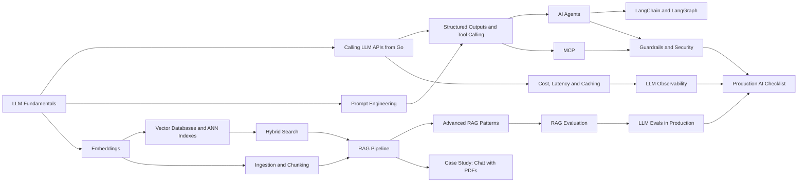

# 18 AI Engineering MOC

> [!summary] What this folder covers
> How to build LLM-powered backend features in Go: calling models, prompting, tool calling, embeddings and vector search, RAG and its evaluation, agents and MCP, and the guardrails, cost control and observability needed to run them in production.

## Before and after

- **Before this:** [[05 APIs MOC]] · [[07 Databases MOC]]
- **After this:** nothing; this is a starting point

## Learning path

1. [[LLM Fundamentals]] · basic. Tokens, context windows, sampling and why models hallucinate.
2. [[Calling LLM APIs from Go]] · basic. Streaming, retries, timeouts and token accounting in a Go client.
3. [[Prompt Engineering]] · basic. System prompts, few-shot examples and prompts treated as versioned code.
4. [[Structured Outputs and Tool Calling]] · intermediate. Getting reliable JSON back and letting the model call your functions.
5. [[Embeddings]] · intermediate. Turning text into vectors and measuring similarity.
6. [[Vector Databases and ANN Indexes]] · intermediate. HNSW, IVF and the recall-versus-latency trade-off.
7. [[Keyword, Semantic and Hybrid Search]] · intermediate. BM25 plus vectors, fused with reciprocal rank fusion.
8. [[Document Ingestion and Chunking]] · intermediate. Parsing, chunking and re-indexing documents asynchronously.
9. [[RAG Pipeline]] · intermediate. Retrieve, augment and generate grounded, cited answers.
10. [[Advanced RAG Patterns]] · advanced. Reranking, query rewriting, parent-child and agentic retrieval.
11. [[RAG Evaluation]] · advanced. Measuring retrieval and answer quality with golden sets.
12. [[Case Study - Chat with PDFs and Websites]] · intermediate. An end-to-end system design that ties RAG together.
13. [[AI Agents and Agentic Workflows]] · advanced. The agent loop, planning, and when a fixed workflow is better.
14. [[LangChain and LangGraph]] · advanced. What the frameworks give you and when plain code wins.
15. [[Model Context Protocol (MCP)]] · advanced. A standard protocol for exposing tools and context to models.
16. [[LLM Evals in Production]] · advanced. Offline gates, online sampling and LLM-as-judge.
17. [[Guardrails and LLM Security]] · advanced. Prompt injection, data leakage and constraining tool use.
18. [[LLM Cost, Latency and Caching]] · advanced. Model routing, prompt caching and semantic caching.
19. [[LLM Observability]] · advanced. Tracing every call with tokens, cost and quality signals.
20. [[Production AI Checklist]] · advanced. The launch gate that pulls the whole folder together.

## Concept map

## Interview focus

- What is a token, and why do context windows and temperature matter? See [[LLM Fundamentals]].
- How do you get reliably structured output from an LLM and let it call tools safely? See [[Structured Outputs and Tool Calling]].
- How does HNSW work, and how do you trade recall against latency? See [[Vector Databases and ANN Indexes]].
- Why use hybrid search instead of pure vector search? See [[Keyword, Semantic and Hybrid Search]].
- How would you choose a chunking strategy for a document corpus? See [[Document Ingestion and Chunking]].
- Design a "chat with your documents" system end to end. See [[Case Study - Chat with PDFs and Websites]] and [[RAG Pipeline]].
- How do you evaluate a RAG system and catch regressions before shipping? See [[RAG Evaluation]] and [[LLM Evals in Production]].
- What is prompt injection, and how do you defend against it? See [[Guardrails and LLM Security]].
- How do you cut LLM cost and latency in production? See [[LLM Cost, Latency and Caching]].
- When should you build an agent instead of a fixed workflow? See [[AI Agents and Agentic Workflows]].

## Sources worth reading

- Anthropic, "Building effective agents" (2024) and the Anthropic and OpenAI API documentation on tool use and structured outputs.
- Chip Huyen, *AI Engineering* (O'Reilly, 2025).
- Malkov and Yashunin, "Efficient and robust approximate nearest neighbor search using HNSW graphs" (2016).
- Lewis et al., "Retrieval-Augmented Generation for Knowledge-Intensive NLP Tasks" (2020).
- The Model Context Protocol specification at modelcontextprotocol.io.
- OWASP Top 10 for LLM Applications.
- OpenTelemetry semantic conventions for generative AI.
