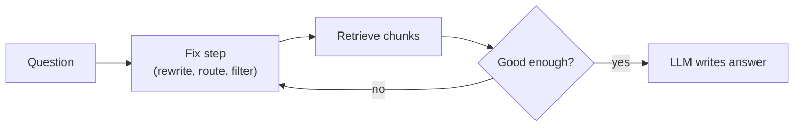
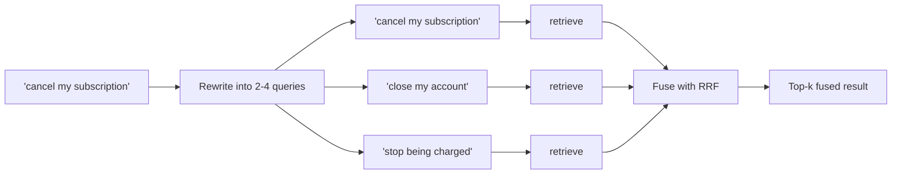
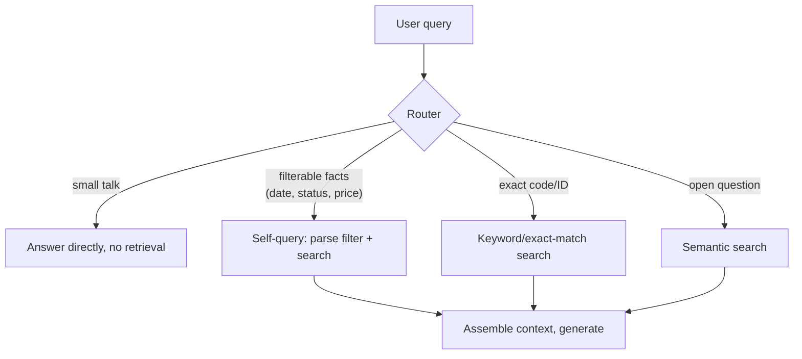
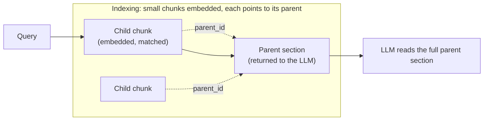

# Advanced RAG Patterns

> [!summary] TL;DR
> The single-pass pipeline in [[RAG Pipeline]] — embed the question once, retrieve once, generate once — fails in specific, predictable ways: a bad query phrasing, a question that needs two different corpora, a question that needs a filter instead of a similarity search, a question whose answer spans several documents. Each advanced pattern below fixes exactly one of those failures by adding one extra, targeted step before or during retrieval — it is not one bigger pipeline, it is a toolbox you reach into for the failure you're actually seeing.

> [!abstract] Core idea
> - Query rewriting and HyDE fix retrieval when the literal question embeds poorly, by retrieving on something else instead: a paraphrase, several paraphrases, or a hypothetical answer.
> - Routing and self-query filters fix retrieval when the question needs a different corpus or a metadata filter instead of (or in addition to) a similarity search.
> - Parent-child chunking and contextual retrieval fix retrieval when a chunk, out of context, is either too small to embed well or too small to answer from once retrieved.
> - GraphRAG and multi-hop retrieval fix questions a single retrieval pass structurally cannot answer, because the answer requires combining facts from several documents.
> - Agentic and corrective RAG fix retrieval when you can't know ahead of time that one pass will be enough — the model inspects what came back and decides whether to retry.
> - Every pattern here costs an extra LLM or embedding call (sometimes several) and adds latency; add one only once you've measured, with [[RAG Evaluation]], which specific failure you have.

## Start here: the basics

**The problem in one story.**
A company bot searches its documents before answering.
You ask "What changed in the refund policy after 2024?" and it returns an old 2022 page.
The search found similar words, not the right document.
Advanced RAG adds one small extra step to fix each kind of miss like this.

**Words you need first**

| Word | Plain meaning | Tiny example |
| --- | --- | --- |
| RAG | Search your documents, then let the LLM answer using what was found | Support bot quoting the manual |
| Chunk | A small piece of a document stored for search | One paragraph of a PDF |
| Embedding | A list of numbers that captures a text's meaning | "refund" and "money back" land close |
| Retrieval | Fetching the chunks most similar to the question | Top 5 chunks for the query |
| Metadata filter | A hard rule on stored fields, not on meaning | `year > 2024` |
| Corpus | The full set of documents you search | All HR policy docs |
| Multi-hop | An answer needing facts from two or more documents | "Who manages the author of doc X?" |

**Picture it**



**Analogy.** Plain RAG is a person who searches a library once with your exact words. Advanced RAG lets them rephrase, ask a librarian, filter by year, or search again.
Where it breaks: every extra trick costs an extra model call, so it adds latency and money a real person's second look does not.

**How the rest of this note builds up**

- First, which failures of the single-pass pipeline these patterns fix (section 1) and the library mental model (section 2).
- Then each pattern in turn: rewriting and HyDE, routing, self-query, parent-child, contextual retrieval, GraphRAG, agentic RAG (section 3).
- Then a Go worked example (section 4) and a comparison of patterns with trade-offs (sections 5-6).
- Finally production advice, the SDE-3 deep dive and interview questions (sections 7-9).

> [!tip] Remember
> Measure which retrieval failure you have first, then add the one pattern that fixes it.

## 1. Why it exists

The single-pass query pipeline in [[RAG Pipeline]] has a specific failure mode built into it: it takes the user's literal question, embeds it once, and searches once. That is fine until one of these happens:

- A user types `cancel my subscription`, but the only matching document is titled "How to Close Your Account" — the literal query embeds in a different part of the vector space than the answer. (See [[Embeddings]] for why: the model clusters by meaning, but a short, differently-worded query can still miss nearby neighbors a paraphrase would have hit.)
- A question like `what did we ship last quarter that touches billing?` needs a metadata filter (`date between X and Y`, `tags: billing`) combined with a similarity search — a plain vector search over the literal text has no idea `last quarter` means a date range.
- A support bot has three separate corpora — a product manual, a billing FAQ, and an internal runbook — and sending every query to all three wastes retrieval budget and risks cross-contaminating answers with the wrong document type.
- A 40-page onboarding guide was chunked into 500-token pieces for embedding quality, but the single chunk that best matches a question is missing the surrounding paragraph that would let the LLM actually answer in full.
- The answer to `which of our vendors are affected by both the EU and California privacy changes?` isn't stated in any one document — it requires combining facts from a vendor list, an EU-changes memo, and a California-changes memo.

Each of these is a different, specific failure, and a different pattern below is the fix for it — not a bigger single pipeline, but a bigger toolbox.

## 2. Mental model

A single-pass retriever is a person who hears a question once, searches for it once, and reads back whatever came up — brittle if the question was oddly phrased, needed a different shelf of the library, or needed two books combined.

An advanced-RAG pipeline is the same person given permission to:

- rephrase the question before searching (query rewriting/HyDE),
- ask a librarian which section to search first (routing),
- tell the librarian "only books published after 2024" (self-query filters),
- pull the whole chapter once they find the right paragraph (parent-child chunking),
- write a short note on each page's margin before filing it so a page out of context still makes sense (contextual retrieval),
- follow citations between books (GraphRAG),
- and glance at what they found before answering — going back for another search if it looks thin (agentic/corrective RAG).

## 3. How it works

### Whiteboard version

Query rewriting in its smallest form: generate several versions of the question, retrieve for each, and fuse the ranked lists with **Reciprocal Rank Fusion** so a document that shows up (even at different ranks) across multiple phrasings outranks one that only one phrasing happened to find.



### Query rewriting and HyDE

**Query rewriting** asks an LLM to produce one or more alternative phrasings of the user's question before retrieving. **Multi-query retrieval** (diagram above) runs several rewrites in parallel and fuses their ranked chunk lists with Reciprocal Rank Fusion: `score(doc) = Σ 1 / (k + rank)` over every list the document appears in, `k ≈ 60` by convention (the value from the original RRF paper, which keeps one list's top pick from dominating a fused result by a huge margin). A document that ranks modestly across three rewrites can outscore one that ranks first in only one — exactly the robustness you want when you don't know in advance which phrasing will embed closest to the right chunk.

**HyDE** (Hypothetical Document Embeddings) is a different move: instead of rewriting the question, ask the LLM to *write a plausible-looking answer* to the question — even though it might be factually wrong, it will typically be written in the *style and vocabulary* of a real matching document — then embed that hypothetical answer, not the question, and retrieve with it. A question and its answer are often far apart in embedding space (a question reads like a question; an answer reads like a statement of fact), but the hypothetical answer and the real matching document are usually written the same way, so this closes that gap. The hypothetical text is never shown to the user and never generated from retrieved context — it exists only to produce a better search vector.

### Routing

**Routing** decides, before retrieving, *where* to retrieve from or *whether* to retrieve at all. A router can be a small, cheap classifier (an LLM call with a short list of options, or a traditional text classifier) that looks at the incoming query and picks a target corpus (`product-manual`, `billing-faq`, `internal-runbook`), a retrieval strategy (`semantic`, `keyword`, `skip retrieval entirely for small talk`), or both. Routing matters for both quality (sending a billing question to the product-manual index wastes the whole retrieval budget on irrelevant chunks) and cost (skipping retrieval for `thanks!` avoids an unnecessary vector search and a padded prompt).



### Self-query filters

A **self-query** retriever asks the LLM to split a natural-language question into a semantic part and a structured metadata filter:

`"tickets about login errors from last week priced under $50"` becomes a vector search on `"login errors"` plus a filter `created_at > now() - 7d AND price < 50`.

Done correctly, this avoids two failure modes at once: a pure vector search that has no idea `last week` means a date range, and a pure metadata-filter search that can't handle `login errors` (a semantic, not exact, concept).

The parsed filter is only as good as the metadata the ingestion pipeline actually attached to each chunk — see [[Document Ingestion and Chunking]].

### Parent-child (small-to-big) retrieval and contextual retrieval

Small chunks (a paragraph or two) embed well: they're focused, so their vector is a precise summary of one idea, which is exactly what you want when the embedding is doing the matching.

But a small chunk, read alone at generation time, is often too little context for the LLM to answer from in full — it's answering from a paragraph with no idea what document, section, or surrounding argument it came from.

**Parent-child chunking** resolves this by indexing the small chunk (the "child") for retrieval, but storing a pointer to a larger surrounding unit (the "parent" — the full section or page) and handing the *parent* to the LLM once the child is matched. You get precise retrieval and generous generation context from the same chunking pass, at the cost of storing (and sometimes de-duplicating) both sizes.



**Contextual retrieval** (Anthropic, 2024) tackles the same out-of-context problem from the other direction: before embedding, prepend each chunk with a short, LLM-generated summary of where it sits in the document (`"This chunk is from the Q2 2024 10-K's revenue breakdown for the North America segment"`), so the *embedded chunk itself* — not just a parent lookup — carries enough context to be found and understood on its own. Anthropic's published evaluation reported this cut retrieval failure rates meaningfully when combined with hybrid search and reranking — **documented, not reproduced here; verify current figures and methodology against the source before quoting a number**, since published benchmarks on a specific corpus don't automatically transfer to yours.

### Multi-hop retrieval and GraphRAG

Some questions can't be answered by any single retrieved chunk, because the answer is a combination of facts that live in different documents (`which vendors are affected by both the EU and California privacy changes?`).

**Multi-hop retrieval** answers these iteratively: retrieve, extract an intermediate fact or entity from what came back, then retrieve again using that fact as part of the next query, repeating until enough has been gathered to answer.

**GraphRAG** (Microsoft Research, 2024) builds this capability into the index itself instead of improvising it per query: an indexing-time LLM pass extracts entities and relationships from the corpus into a knowledge graph, and (in the original design) clusters that graph into communities with LLM-written summaries at each level. At query time, retrieval can then walk graph edges between entities (answering "how is X connected to Y") or pull a community summary (answering a broad, corpus-wide question a single chunk could never cover, like "what are the main themes across all these documents?"). This is a meaningfully heavier indexing pipeline — extraction and summarization passes over the whole corpus, re-run as it changes — so it earns its cost mainly for a smaller, relationship-dense corpus (an investigation, a knowledge base explicitly about how things relate) rather than as a default upgrade to plain chunk-and-embed indexing.

### Agentic and corrective RAG

Every pattern so far still runs a fixed, pre-decided sequence of steps.

**Agentic RAG** instead gives the model the retrieval tool itself (see [[Structured Outputs and Tool Calling]] and [[AI Agents and Agentic Workflows]]) and lets it decide, per question, whether to retrieve at all, what to search for, and whether one search was enough — as opposed to a developer-authored RAG pipeline that always retrieves exactly once in a fixed way.

This is naturally suited to multi-hop questions, since the model can issue a second, follow-up search informed by what the first one returned.

**Corrective RAG** (CRAG) is a narrower, cheaper version of the same idea: after retrieval, a lightweight evaluator (a small classifier or an LLM judge) grades the retrieved chunks as *correct* (confidently relevant — proceed as normal), *ambiguous* (mixed relevance — keep the good parts, possibly supplement with a web search or alternate source), or *incorrect* (nothing relevant — fall back to a different retrieval strategy, a broader search, or an honest "I don't know" rather than generating from bad context). It adds one grading step rather than open-ended agent autonomy, which makes it cheaper and more predictable to operate.

### Long-context as the alternative, not a pattern

[[RAG Pipeline]] already covers the trade-off between RAG and simply pasting a small, static corpus into a long context window. None of the patterns above change that trade-off — they make retrieval smarter when you've decided retrieval is the right tool, not an argument for choosing it over a large context window in the first place.

## 4. Worked example

The code below implements the mechanism behind multi-query retrieval and routing: Reciprocal Rank Fusion over several ranked result lists, and a small rule-based router choosing a retrieval strategy.

`QueryRewriter` and `Retriever` are interfaces — in production the rewriter calls an LLM (`claude-haiku-5-5` is a reasonable, cheap choice for a rewrite call as of 2026) and the retriever embeds and searches a real vector index; here, both are fakes, so the fusion and routing logic is tested without any network call or API key.

```go
// Package ragpatterns implements the fusion math behind multi-query
// retrieval: Reciprocal Rank Fusion (RRF) over several ranked result lists,
// plus a tiny rule-based router that picks a retrieval strategy per query.
// It has no network calls, so it needs no API key: query rewriting and HyDE
// are shown as interfaces a real LLM call would implement.
package ragpatterns

import (
	"sort"
	"strings"
)

// Ranked is one retriever's ranked output: Chunks[0] is its best guess.
type Ranked struct {
	Chunks []string
}

// FuseRRF combines several ranked lists with Reciprocal Rank Fusion:
// score(doc) = sum over lists containing doc of 1 / (k + rank), 1-indexed
// rank. k=60 is the value from the original RRF paper and what most hybrid
// search stacks default to; it keeps one very confident list from
// completely dominating a fused result.
func FuseRRF(lists []Ranked, k int) []string {
	if k <= 0 {
		k = 60
	}
	scores := make(map[string]float64)
	for _, list := range lists {
		for i, doc := range list.Chunks {
			rank := i + 1 // 1-indexed, as the RRF formula expects
			scores[doc] += 1.0 / float64(k+rank)
		}
	}
	out := make([]string, 0, len(scores))
	for doc := range scores {
		out = append(out, doc)
	}
	sort.Slice(out, func(i, j int) bool {
		if scores[out[i]] != scores[out[j]] {
			return scores[out[i]] > scores[out[j]]
		}
		return out[i] < out[j] // stable tie-break for deterministic tests
	})
	return out
}

// QueryRewriter turns one user query into several retrieval queries
// (paraphrases, decomposed sub-questions, or a HyDE hypothetical answer).
// A real implementation calls an LLM; tests use a fixed-output fake.
type QueryRewriter interface {
	Rewrite(query string) []string
}

// Retriever runs one retrieval query against a store and returns a ranked
// list of chunk IDs. A real implementation embeds the query and searches a
// vector index (see Vector Databases and ANN Indexes); tests use an
// in-memory map.
type Retriever interface {
	Retrieve(query string, k int) Ranked
}

// MultiQueryRetrieve rewrites query into several queries, retrieves for
// each, and fuses the results with RRF. This is the mechanism behind
// "multi-query retrieval": a single question with one bad phrasing stops
// sinking the whole answer, because the other phrasings still find the
// right chunk.
func MultiQueryRetrieve(rw QueryRewriter, r Retriever, query string, kPerQuery, kFused int) []string {
	queries := rw.Rewrite(query)
	lists := make([]Ranked, 0, len(queries))
	for _, q := range queries {
		lists = append(lists, r.Retrieve(q, kPerQuery))
	}
	fused := FuseRRF(lists, 60)
	if kFused > 0 && kFused < len(fused) {
		fused = fused[:kFused]
	}
	return fused
}

// Route is a retrieval strategy chosen for one query.
type Route string

const (
	RouteSemantic   Route = "semantic"   // default: embed and search the vector index
	RouteStructured Route = "structured" // query carries filterable facts: self-query against metadata/SQL
	RouteKeyword    Route = "keyword"    // query is an exact code, ID or short literal term
	RouteNone       Route = "none"       // small-talk or out-of-scope: skip retrieval entirely
)

// RouteQuery is a deliberately simple, inspectable stand-in for an LLM
// routing step: in production an LLM classifies the query (or a cheap
// classifier model does), but the *shape* of the decision — pick one of a
// few fixed strategies before retrieving anything — is what this note is
// teaching, not the classifier itself.
func RouteQuery(query string) Route {
	q := strings.ToLower(strings.TrimSpace(query))
	switch {
	case q == "":
		return RouteNone
	case strings.Contains(q, "hi") && len(strings.Fields(q)) <= 2:
		return RouteNone
	case hasStructuredSignal(q):
		return RouteStructured
	case hasExactCodeSignal(q):
		return RouteKeyword
	default:
		return RouteSemantic
	}
}

// hasStructuredSignal flags queries carrying a filterable fact (a date
// range, a status, a named field) that a self-query step would turn into a
// metadata filter instead of a pure similarity search.
func hasStructuredSignal(q string) bool {
	for _, kw := range []string{"after 20", "before 20", "status:", "priced under", "priced over", "from last"} {
		if strings.Contains(q, kw) {
			return true
		}
	}
	return false
}

// hasExactCodeSignal flags queries that look like an exact lookup (an
// order/ticket ID, a SKU) better served by keyword or primary-key search
// than by semantic similarity, which blurs exact alphanumeric strings.
func hasExactCodeSignal(q string) bool {
	for _, w := range strings.Fields(q) {
		if len(w) >= 6 && hasDigit(w) && hasLetter(w) {
			return true
		}
	}
	return false
}

func hasDigit(s string) bool {
	for _, r := range s {
		if r >= '0' && r <= '9' {
			return true
		}
	}
	return false
}

func hasLetter(s string) bool {
	for _, r := range s {
		if (r >= 'a' && r <= 'z') || (r >= 'A' && r <= 'Z') {
			return true
		}
	}
	return false
}
```

Tests, using fakes for both the rewriter (fixed paraphrases, standing in for an LLM call) and the retriever (an in-memory lookup, standing in for a vector search), plus direct tests of RRF's fusion behavior and the router's rules:

```go
package ragpatterns

import (
	"reflect"
	"testing"
)

// fakeRewriter returns a fixed set of rewritten queries, standing in for an
// LLM call (HyDE or paraphrase generation) with no network dependency.
type fakeRewriter struct{ out []string }

func (f fakeRewriter) Rewrite(string) []string { return f.out }

// fakeRetriever is an in-memory lookup table from query -> ranked chunk IDs,
// standing in for a vector index search.
type fakeRetriever struct{ results map[string][]string }

func (f fakeRetriever) Retrieve(query string, k int) Ranked {
	chunks := f.results[query]
	if k > 0 && k < len(chunks) {
		chunks = chunks[:k]
	}
	return Ranked{Chunks: chunks}
}

func TestFuseRRFBoostsDocsAgreedOnByMultipleLists(t *testing.T) {
	lists := []Ranked{
		{Chunks: []string{"docA", "docB", "docC"}},
		{Chunks: []string{"docB", "docA", "docD"}},
		{Chunks: []string{"docB", "docC", "docA"}},
	}
	fused := FuseRRF(lists, 60)
	if fused[0] != "docB" {
		t.Fatalf("top result = %s, want docB (present near the top of all 3 lists)", fused[0])
	}
	if fused[len(fused)-1] != "docD" {
		t.Fatalf("last result = %s, want docD (appears in only one list, near the bottom)", fused[len(fused)-1])
	}
}

func TestFuseRRFDefaultsKWhenZeroOrNegative(t *testing.T) {
	// k=0 and k=60 must agree, since FuseRRF treats a non-positive k as "use 60".
	lists := []Ranked{{Chunks: []string{"x", "y"}}}
	a := FuseRRF(lists, 0)
	b := FuseRRF(lists, 60)
	if !reflect.DeepEqual(a, b) {
		t.Fatalf("FuseRRF(k=0) = %v, want same as FuseRRF(k=60) = %v", a, b)
	}
}

func TestMultiQueryRetrieveRecoversFromOneBadPhrasing(t *testing.T) {
	// "cancel my subscription" (the literal user query) finds nothing in the
	// store. Only its rewritten paraphrase "close my account" matches.
	rw := fakeRewriter{out: []string{"cancel my subscription", "close my account"}}
	r := fakeRetriever{results: map[string][]string{
		"cancel my subscription": {},
		"close my account":       {"howto-close-account", "billing-faq"},
	}}
	got := MultiQueryRetrieve(rw, r, "cancel my subscription", 5, 2)
	want := []string{"howto-close-account", "billing-faq"}
	if !reflect.DeepEqual(got, want) {
		t.Fatalf("got %v, want %v", got, want)
	}
}

func TestMultiQueryRetrieveRespectsKFused(t *testing.T) {
	rw := fakeRewriter{out: []string{"q1", "q2"}}
	r := fakeRetriever{results: map[string][]string{
		"q1": {"a", "b", "c"},
		"q2": {"b", "c", "d"},
	}}
	got := MultiQueryRetrieve(rw, r, "orig", 5, 2)
	if len(got) != 2 {
		t.Fatalf("len(got) = %d, want 2 (kFused truncation)", len(got))
	}
}

func TestRouteQueryPicksStructuredForFilterableFacts(t *testing.T) {
	if RouteQuery("show me tickets priced under 500 from last week") != RouteStructured {
		t.Fatalf("want RouteStructured for a query with a filterable price/date fact")
	}
}

func TestRouteQueryPicksKeywordForExactCodes(t *testing.T) {
	if RouteQuery("what is the status of order AB4521") != RouteKeyword {
		t.Fatalf("want RouteKeyword for a query containing an alphanumeric code")
	}
}

func TestRouteQueryPicksSemanticAsDefault(t *testing.T) {
	if RouteQuery("how do I reset my password") != RouteSemantic {
		t.Fatalf("want RouteSemantic as the default for an ordinary natural-language question")
	}
}

func TestRouteQueryPicksNoneForEmptyOrGreeting(t *testing.T) {
	if RouteQuery("") != RouteNone {
		t.Fatalf("want RouteNone for an empty query")
	}
	if RouteQuery("hi") != RouteNone {
		t.Fatalf("want RouteNone for a bare greeting")
	}
}
```

**Tested:** `go vet` and `go test -race` pass on Go 1.24 (scratch module, 2026-11-07).

```text
=== RUN   TestFuseRRFBoostsDocsAgreedOnByMultipleLists
--- PASS: TestFuseRRFBoostsDocsAgreedOnByMultipleLists (0.00s)
=== RUN   TestFuseRRFDefaultsKWhenZeroOrNegative
--- PASS: TestFuseRRFDefaultsKWhenZeroOrNegative (0.00s)
=== RUN   TestMultiQueryRetrieveRecoversFromOneBadPhrasing
--- PASS: TestMultiQueryRetrieveRecoversFromOneBadPhrasing (0.00s)
=== RUN   TestMultiQueryRetrieveRespectsKFused
--- PASS: TestMultiQueryRetrieveRespectsKFused (0.00s)
=== RUN   TestRouteQueryPicksStructuredForFilterableFacts
--- PASS: TestRouteQueryPicksStructuredForFilterableFacts (0.00s)
=== RUN   TestRouteQueryPicksKeywordForExactCodes
--- PASS: TestRouteQueryPicksKeywordForExactCodes (0.00s)
=== RUN   TestRouteQueryPicksSemanticAsDefault
--- PASS: TestRouteQueryPicksSemanticAsDefault (0.00s)
=== RUN   TestRouteQueryPicksNoneForEmptyOrGreeting
--- PASS: TestRouteQueryPicksNoneForEmptyOrGreeting (0.00s)
PASS
ok  	ragpatterns	1.56s
```

## 5. Variants and comparison

| Pattern | How it works | Use when | Cost |
| --- | --- | --- | --- |
| Query rewriting / multi-query | Generate 2–4 paraphrases, retrieve each, fuse with RRF | The literal query embeds poorly, or you want robustness to phrasing | One extra LLM call plus N extra retrieval round-trips |
| HyDE | Generate a hypothetical answer, embed and retrieve with *that* | Short or jargon-light queries that are far from their answer in embedding space | One extra LLM call before retrieval |
| Routing | Classify the query, pick a corpus and/or strategy before retrieving | Multiple distinct corpora, or queries that sometimes need no retrieval at all | One cheap classification call (often a small/fast model) |
| Self-query filters | Parse the query into a semantic part plus a structured metadata filter | Questions mixing a concept with a filterable fact (date, status, price) | One extra LLM call to parse the filter; depends on the ingestion metadata being there |
| Parent-child chunking | Embed small chunks, return their larger parent section on a hit | Chunks are too small, alone, for the LLM to answer from in full | More storage (two chunk sizes); a parent-lookup step after retrieval |
| Contextual retrieval | Prepend an LLM-generated context summary to each chunk before embedding | Chunks lose essential context (which document/section) when isolated | One LLM call per chunk at indexing time — a real one-off indexing cost |
| GraphRAG | Extract entities/relationships into a graph at indexing time; traverse or summarize it at query time | Relationship-heavy, smaller corpora; broad "what are the themes" questions | Much heavier indexing pipeline (extraction + summarization passes); re-run as the corpus changes |
| Agentic RAG | The model itself decides whether/what/how many times to retrieve, via tool calling | Open-ended or multi-hop questions where a fixed pipeline can't know retrieval is enough | Variable, possibly many LLM calls; needs stop conditions (see [[AI Agents and Agentic Workflows]]) |
| Corrective RAG | Grade retrieved chunks (correct/ambiguous/incorrect), fall back or supplement on a bad grade | You want a bounded, predictable upgrade over single-pass RAG without full agent autonomy | One extra grading call per query |

## 6. Trade-offs and when not to use

- Every pattern here is strictly more expensive — in latency, LLM calls, or indexing effort — than the single-pass pipeline in [[RAG Pipeline]]. Add one only to fix a failure mode you've actually measured, not by default.
- Stacking several patterns (routing *and* self-query *and* reranking *and* multi-query) compounds latency and cost; a question answered perfectly well by plain hybrid search doesn't need any of this.
- GraphRAG's indexing cost scales with corpus size and churn: a frequently-updated, large corpus makes the extraction-and-summarization indexing pass expensive to keep current, which is why it suits smaller, more static, relationship-dense corpora better than a general-purpose knowledge base.
- Agentic RAG trades predictability for flexibility: without a hard cap on retrieval rounds and a cost budget, a model can loop, re-retrieve unnecessarily, or run up cost on a question a single pass would have answered fine.
- None of these patterns fix bad ingestion. Query rewriting cannot route around chunks that were never extracted, chunked, or embedded correctly in the first place — check [[Document Ingestion and Chunking]] before reaching for a fancier query-time pattern.

## 7. In production

- **Real systems:** Anthropic's documented contextual retrieval approach (prepend chunk context before embedding, combine with hybrid search and reranking); Microsoft's GraphRAG for query-focused summarization over document collections; corrective-RAG-style grading steps in support and research assistants that can't tolerate confidently answering from irrelevant context.
- **Failure modes → fixes:**
  - Query rewriting producing near-duplicate paraphrases that all miss the same way → prompt for *diverse* rewrites (different vocabulary, different angle), not just syntactic variants.
  - HyDE's hypothetical answer being confidently wrong in a way that steers retrieval toward the wrong document family → keep HyDE as one signal fused (via RRF) with a direct-query retrieval pass, not the only retrieval path.
  - A router misclassifying a query and sending it to the wrong corpus → add a "no good match" fallback route that tries a broader, unfiltered search rather than returning empty-handed from a wrong corpus.
  - Self-query filters silently dropping all results because the metadata field the LLM guessed doesn't match the actual stored field name → validate the parsed filter's field names against the real schema before executing it, and fail back to a pure semantic search rather than returning zero results.
  - Agentic RAG looping or over-retrieving → hard cap on retrieval rounds and a token/cost budget per question (see [[AI Agents and Agentic Workflows]] for stop-condition design).
- **What to monitor:** per-pattern retrieval recall@k and latency contribution (so you can tell whether an added pattern is actually helping — see [[RAG Evaluation]]); router misclassification rate (sampled and reviewed); extra-LLM-call cost attributable to rewriting/routing/grading steps, tracked separately from the main generation call; GraphRAG index staleness relative to the last re-run of the extraction pass.

## 8. Deep dive

- **Why RRF and not score averaging.** Different retrievers (BM25, a vector search, a reranker) produce scores on incomparable scales — a BM25 score and a cosine similarity are not the same unit, and naively averaging or summing them requires careful score normalization that's easy to get wrong per corpus. RRF sidesteps this entirely by fusing on *rank* instead of raw score, so it needs no calibration between retrievers and no assumption that their score distributions are comparable.
- **Corrective RAG's grading step in detail.** The evaluator typically scores each retrieved chunk's relevance to the query (a small trained classifier, or a cheap LLM-as-judge call), then the overall retrieval set is bucketed: if the top result is confidently relevant, proceed normally; if results are mixed, keep the relevant-looking pieces and consider supplementing (a broader search, a different index, in the original CRAG paper a web search); if nothing looks relevant, skip straight to an honest "insufficient information" rather than generating from noise. The key engineering decision is calibrating the grader's threshold against your own false-positive and false-negative costs — too strict and you throw away good context, too loose and bad context still reaches the LLM.
- **GraphRAG's community summaries.** Beyond local entity-relationship traversal, the original GraphRAG design clusters the extracted graph into hierarchical communities and has an LLM write a summary of each community at indexing time. A broad question ("what are the main risks discussed across all these filings?") can then be answered by retrieving and combining a handful of community summaries — something no single chunk, however well-embedded, could ever answer, because the information genuinely doesn't live in one place.
- **Combining patterns.** These are not mutually exclusive: a production pipeline might route (pick a corpus), self-query (parse a date filter), multi-query (rewrite for robustness), retrieve with parent-child chunking (precise match, generous context), and still run a corrective grading pass before generating. Each addition is justified by a specific, measured failure — adding all of them unconditionally multiplies latency and cost for marginal gain on queries that didn't need the help.

## 9. Interview questions

> [!question]- When would you reach for HyDE instead of ordinary query rewriting?
> When the question and its answer are written very differently — a short question versus a long explanatory passage — so a paraphrase of the question still doesn't look like the answer in embedding space. HyDE sidesteps this by retrieving with a *hypothetical answer*, which is written in the same style as the real matching document, instead of with the question itself.

> [!question]- Trap: "GraphRAG is just a better version of chunk-and-embed RAG — always use it." Why is this wrong?
> GraphRAG trades a much heavier indexing pipeline (LLM extraction and summarization over the whole corpus, re-run as it changes) for the ability to answer relationship- and corpus-wide questions a single chunk can't. For a large, fast-changing corpus, or for straightforward single-document factual questions, plain chunk-and-embed retrieval is cheaper to build and keep current, and answers those questions just as well.

> [!question]- How does Reciprocal Rank Fusion combine results from retrievers with incomparable scores?
> It ignores raw scores entirely and fuses on rank: `score(doc) = Σ 1/(k + rank)` summed over every list the document appears in. Since it only needs each list's ordering, not its score scale, it works equally well fusing a BM25 list, a vector-search list, or several rewritten-query lists without any score normalization step.

> [!question]- What's the difference between agentic RAG and corrective RAG?
> Agentic RAG gives the model open-ended control over whether, what, and how many times to retrieve, via tool calling — flexible but needs explicit stop conditions to avoid looping or runaway cost. Corrective RAG is narrower: retrieve once, grade what came back as correct/ambiguous/incorrect, and take one of a few fixed actions based on that grade — cheaper and more predictable, at the cost of less flexibility for genuinely multi-hop questions.

> [!question]- A user asks a filterable question like "show me invoices over $500 from Q3." Which pattern handles this, and why doesn't plain semantic search?
> Self-query filters: an LLM parses the query into a semantic part (if any) and a structured filter (`amount > 500 AND quarter = 'Q3'`), executed as a metadata filter at the vector store. Plain semantic search has no mechanism for "over $500" or "from Q3" — it can only find text that's semantically similar to those phrases, not evaluate them as a numeric or date condition.

> [!question]- Why does contextual retrieval prepend a summary to each chunk instead of just returning a bigger parent chunk?
> They fix different problems. Contextual retrieval makes the *embedded* chunk itself carry enough context to be matched correctly at retrieval time (the chunk's vector is better). Parent-child chunking keeps retrieval precise on a small child chunk but returns a bigger parent purely for the LLM to read at generation time. A pipeline can use either alone or both together — one improves matching, the other improves what the model reads once matched.

> [!question]- Design a question-answering system over vendor contracts where answers sometimes require combining facts from two different contracts. What would you add to single-pass RAG?
> This is a multi-hop retrieval problem: plain single-pass RAG retrieves once and can't combine facts that live in separate documents. Either an agentic RAG loop (the model retrieves, notices it needs a second fact, retrieves again) or a GraphRAG-style index (if the corpus is relationship-dense enough to justify the heavier indexing cost) would let the system traverse from one contract's facts to another's rather than relying on one retrieval pass finding everything at once.

## 10. Cheat sheet

- Each pattern fixes one specific single-pass-RAG failure; add the one that matches a failure you've measured, not all of them by default.
- Multi-query + RRF: rewrite into several queries, fuse by rank (`1/(k+rank)`, `k≈60`) — robust to one bad phrasing.
- HyDE: embed a hypothetical answer, not the question, to close the question-to-answer embedding gap.
- Routing: classify before retrieving — pick a corpus, a strategy, or skip retrieval entirely.
- Self-query: split the question into a semantic part and a structured metadata filter.
- Parent-child: embed small chunks for precise matching, return the larger parent for generation.
- Contextual retrieval: prepend an LLM-written context summary to each chunk before embedding it.
- GraphRAG: extract a knowledge graph at indexing time for relationship and corpus-wide questions; heavy indexing cost.
- Agentic/corrective RAG: let the model (or a grading step) decide whether one retrieval pass was enough.
- Every pattern costs an extra call and adds latency — justify it with [[RAG Evaluation]], not intuition.

## Links

- **Before this:** [[RAG Pipeline]], [[Keyword, Semantic and Hybrid Search]]
- **Next:** [[RAG Evaluation]], [[AI Agents and Agentic Workflows]]
- **Compare with:** [[Vector Databases and ANN Indexes]] (the index these patterns retrieve against), [[Document Ingestion and Chunking]] (parent-child and contextual retrieval both start at ingestion time)

### Watch on YouTube

- [Going Meta - Ep 23: Advanced RAG patterns with Knowledge Graphs](https://www.youtube.com/watch?v=E_JO4-2D5Xs) · Neo4j · 64 min · 9,047 views
- [AWS re:Invent 2025 - Advanced RAG Architectures: From Basic Retrieval to Agentic RAG  (NTA403)](https://www.youtube.com/watch?v=ADrUp2cEdKg) · AWS Events · 52 min · 5,125 views
