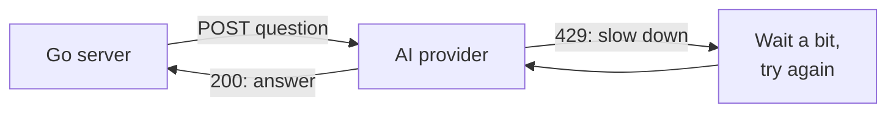
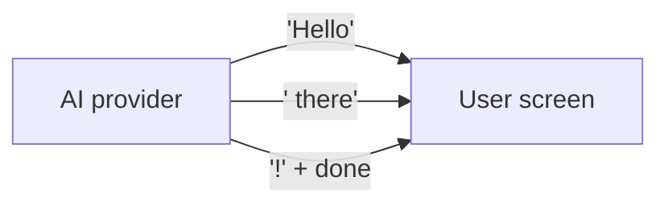
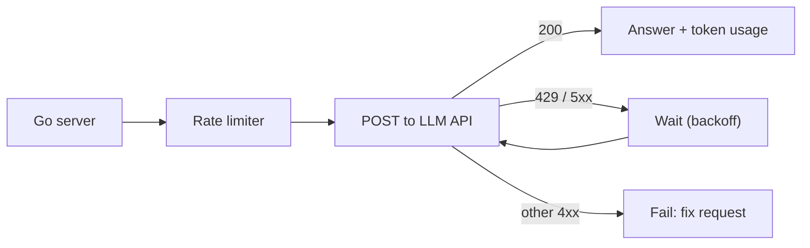
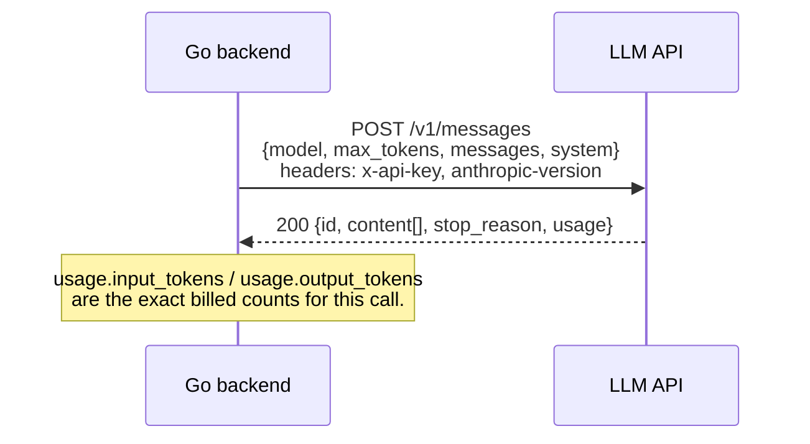
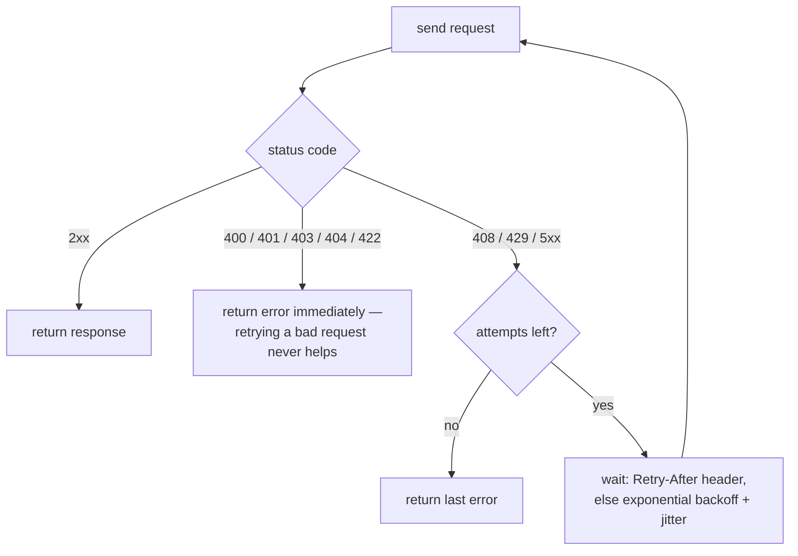
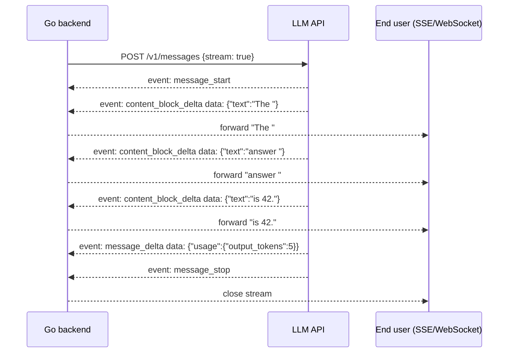
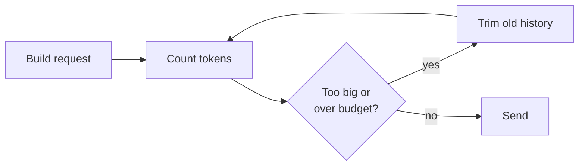
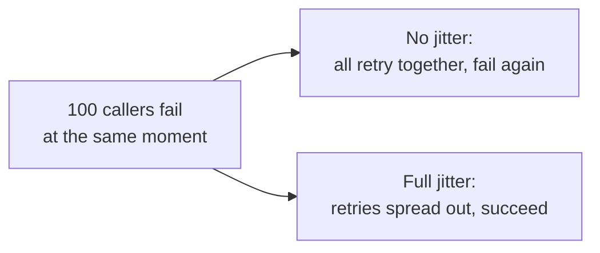

# Calling LLM APIs from Go

> [!summary] TL;DR
> Calling an LLM API from a Go backend is an HTTP call with a JSON body and, usually, Server-Sent Events for streaming — but a production caller needs retries on `429`/`5xx`, a client-side rate limiter, request timeouts, and token accounting on top of the bare call, because the provider is a third-party dependency with its own limits and failure modes.

> [!abstract] Core idea
> - A non-streaming call is one `POST` with a JSON body and an API key header; the response includes the answer and a `usage` field with exact token counts.
> - Streaming swaps the plain JSON response for a Server-Sent Events (SSE) stream of small incremental deltas, so your backend (and the end user) see the answer as it's generated instead of waiting for the whole thing.
> - `429` (rate limited) and `5xx` (transient server trouble) are worth retrying with backoff; `4xx` other than `429` means your request is wrong and retrying it will never help.
> - Client-side rate limiting keeps you under your own configured budget, which is cheaper to reason about than reacting to `429`s after the fact.
> - This note is the mechanics layer: what to put *in* the prompt is [[Prompt Engineering]]; what the provider is doing conceptually is [[LLM Fundamentals]]; Go's general HTTP client patterns (timeouts, context, connection pooling) live in [[Calling External APIs]] and apply here unchanged.

## Start here: the basics 🟢

> [!info] How to read this note (pick your level)
> - 🟢 **New to this?** Read "From zero" below, then sections 1, 2 and the cheat sheet (10). Stop there, that is a full first pass.
> - 🟡 **Know the basics?** Add section 3 (how it works), 4 (worked example), 5 and 6.
> - 🔴 **Interview / SDE-3 prep?** Add 7, 8 and 9. Headings are tagged 🟢🟡🔴 so you always know where you are.

> [!note] Before this note
> - [[LLM Fundamentals]]: you send the model a list of messages, it writes back tokens, and you pay for tokens in and out.
> - [[Calling External APIs]]: calling another company's server from Go with a timeout, and retrying only when it may help.

**From zero, in 60 seconds** 🟢

Your Go server sends a question to an AI model over the internet and waits for the reply. It is just an HTTP call, like any other outside API.

But this outside service is busy and sometimes says "slow down" (**429**) or "I'm having trouble" (**5xx**). A good client waits a bit and tries again, instead of failing.



Long answers can take seconds. **Streaming** sends the answer in small bits as it is written, so the user sees words right away.



You also pay per token, so you count and budget them before you send.

The rest of this note is just these 3 questions:
1. What does one request and reply look like?
2. Which errors do you retry, and how long do you wait?
3. How do you stream, rate-limit and count tokens in real Go code?


**The problem in one story.**
Your Go server needs an answer from an LLM to reply to a user.
That means sending an HTTP request to another company's server and waiting.
Sometimes it is slow, sometimes it says "too many requests", sometimes it just fails.
This note is about making that call safely and cheaply.

**Words you need first**

| Word | Plain meaning | Tiny example |
| --- | --- | --- |
| HTTP POST | Sending data to a server and getting a reply | `POST /v1/messages` with JSON |
| JSON | A text format for structured data | `{"model":"x","max_tokens":100}` |
| API key | A secret that proves who is calling | Sent in a request header |
| Token | A small piece of text the model counts and bills | "hello world" is about 2 tokens |
| Streaming (SSE) | The reply arrives in small pieces over one connection | Words appear one by one |
| Status code `429` | "Too many requests, slow down" | You went over your rate limit |
| Retry with backoff | Try again after waiting longer each time | Wait 1s, then 2s, then 4s |
| Timeout | Give up after a fixed time | Cancel after 30 seconds |
| Rate limit / quota | The most calls or tokens the provider lets you use per minute | 50 requests per minute |
| `5xx` error | "The server had a problem", often gone a moment later | `503 Service Unavailable` |
| Jitter | A random extra wait so many clients do not retry at the same instant | Wait 1.3s instead of exactly 1s |
| SDK | A ready-made code library from the provider | `anthropic-sdk-go` |
| `context` (Go) | A Go value that carries a deadline and a cancel signal into a call | `context.WithTimeout(ctx, 30*time.Second)` |

**Picture it**



**Analogy.** It is like ordering from a busy restaurant by phone. If the line is busy you call back later, and you do not call a hundred times a minute.
Where it breaks: a restaurant never tells you the exact cost of each word; the API returns exact token counts you must track.

**How the rest of this note builds up**

- First, why a bare HTTP call is not enough (section 1) and the mental model (section 2).
- Then request shape, streaming, retries, rate limiting and token accounting (section 3).
- Then a full Go worked example (section 4) with variants and trade-offs (sections 5-6).
- Finally production practice, the SDE-3 deep dive and interview questions (sections 7-9).

> [!tip] Remember
> An LLM call is just HTTP, but wrap it in timeouts, retries for `429`/`5xx`, a rate limiter and token counting.

## 1. Why it exists 🟢

A naive integration is `http.Post` plus `json.Unmarshal`, and it works — right up until your traffic hits the provider's rate limit, a transient (short-lived, gone in a moment) `503` arrives during a deploy on their side, or a user asks a question your service answers by streaming to a web client that should not wait 8 seconds staring at a spinner.

None of those are exotic: a backend calling a third-party LLM API at any real volume will see `429`s during bursts, will see occasional `5xx`s, and will want streaming for any user-facing chat surface.

Handling all three (and counting tokens before you ever make the call, so you can budget) is the job of this note.

Concretely: without a retry policy, a transient `429` becomes a user-visible error for no reason; without a client-side rate limiter, your service pushes past its own quota and gets more `429`s than it needs to; without streaming, a 10-second answer feels like a hang instead of a conversation.

### Real-life example 🟢

Think of a ticket app like BookMyShow adding an "ask about this movie" chat box. On a Friday release night, 10,000 people type at once.
The provider allows, say, 500 calls a minute for the team's key, so many calls get `429`.
A good Go client waits a random short time and tries again, and a local limiter keeps calls under 500 a minute in the first place.
Streaming lets each user see the first words within a second, even though the full answer takes 6 seconds.
And if the provider is fully down, the app shows "chat is busy, try again" instead of hanging forever.

### Common beginner mistakes 🟢

- **Retrying every error** → a `400` (bad request) or `401` (bad key) fails the same way every time, so retries only waste time → retry only network errors, `408`, `429` and `5xx`.
- **Retrying with a fixed wait** → if 100 calls fail together, they all retry together and fail again → wait longer each time and add random jitter.
- **No timeout on the call** → a stuck call holds a goroutine (a lightweight Go thread) forever → always pass a `context` with a deadline.
- **Ignoring `Retry-After`** → the server told you exactly when to come back → wait that long instead of your own guess.
- **Reading a streamed reply with one `json.Decode`** → it waits until the stream ends, so the user sees nothing → read the body line by line and forward each piece.

## 2. Mental model 🟢

Treat the LLM API exactly like any other rate-limited, occasionally-flaky external HTTP dependency (see [[Calling External APIs]] for the general pattern) — because that is what it is.

The LLM-specific parts are: the request/response shape (a `messages` array, not a REST resource), the token-based cost and limits (not request-count based), and the optional SSE streaming mode.

Everything else — context deadlines, retries, backoff, connection reuse — is the same discipline you'd apply to a payments API or a shipping-rates API.

## 3. How it works 🟡

> 🟢 → 🟡 **You now know** that an LLM call is just an HTTP call to a busy, sometimes-failing server that bills per token. **Next we open the box**: the exact request and reply, which errors to retry and how long to wait, how streaming arrives piece by piece, and how to count tokens before you send. Each subsection starts with a plain step-by-step walk.

### The request/response shape

**In plain words:** You send: which model, max reply length, and the messages. You get back: the reply text, why it stopped, and how many tokens it used.

**Step by step:**
1. Your Go code builds JSON: `{"model": "...", "max_tokens": 500, "messages": [{"role": "user", "content": "Hi"}]}`.
2. It sends `POST /v1/messages` with your API key in a header.
3. The provider replies `200` with the answer text in `content`.
4. `stop_reason` says why it stopped: `end_turn` (finished) or `max_tokens` (cut off).
5. `usage` gives the exact bill, say 12 input tokens and 40 output tokens.

Full detail:

A non-streaming call to the Messages API looks like this (the shape used by Anthropic's API as of 2026; other providers' documented APIs use an analogous shape with different field names — always check the provider's current docs rather than assuming field names port across providers):



### Retrying the right errors, the right way

**In plain words:** Retry only "try later" errors (429, 5xx, timeouts). Wait longer each time, with some randomness, and obey the server's Retry-After.

**Step by step:**
1. Attempt 1 gets `429`. The reply has a `Retry-After: 2` header (a server hint: "come back in 2 seconds"), so wait 2 seconds.
2. Attempt 2 gets `503`, with no hint. Use **exponential backoff** (each wait doubles: 1s, 2s, 4s) with **jitter** (pick a random wait up to that limit, say 1.4s).
3. Attempt 3 gets `200`. Return the answer.
4. If instead attempt 1 had got `400` (your JSON is wrong), stop at once: retrying cannot fix it.
5. After the last allowed attempt, return the last error to the caller.

Full detail:



The rule that matters:

**retry transport errors (the network broke before any reply came back), 408, 429 and 5xx; never retry other 4xx.** A `400` (malformed request) or `401` (bad key) will return the exact same error on retry number six as it did on attempt one — retrying it just adds latency and burns your retry budget on a request that was always going to fail.

When the server sends a `Retry-After` header (common on `429`), honour it instead of your own backoff schedule; it reflects the provider's actual rate-limit reset time.

### Streaming via Server-Sent Events

**In plain words:** Instead of one big reply at the end, you get many tiny pieces, each tagged with what it is.

**Step by step:**
1. You send the same request with `"stream": true`.
2. The connection stays open, and the server sends small named messages (**events**): first `message_start`.
3. Then many `content_block_delta` events, each with a few words, like `"The "`, `"answer "`, `"is 42."` (a **delta** is "the new bit since last time").
4. Your Go code reads line by line and forwards each piece to the user's screen at once.
5. A `message_delta` brings the token count, and `message_stop` says "done".

Full detail:

Setting `"stream": true` changes the response from one JSON body to a sequence of SSE events, each a small, named delta:



Each `data:` line is a separate JSON payload; your Go code reads the body line by line (not with `json.Decode` on the whole body, which would block until the connection closes), accumulates `content_block_delta` text events, and watches for `message_stop` to know the response is complete.

A connection that drops mid-stream should be treated like any partial response: log what you have, and either resume (if the provider supports it) or surface a clear "answer cut off" state rather than silently returning a truncated string as if it were complete.

### Token counting before you call

**In plain words:** Check the size of your request before sending it, so you don't blow the budget or the size limit.

**Step by step:**
1. Build the request: system prompt plus 40 old chat messages plus the new question.
2. Count it: ask the provider's count-tokens endpoint (a free call that only counts), or estimate about 4 characters per token.
3. Say it comes to 9,000 tokens, but this tenant's budget per call is 6,000.
4. Drop or summarise the oldest messages and count again.
5. Send only when it fits the budget and the context window.

Full detail:

Before sending a request, you often want to know roughly or exactly how many tokens it will cost — to decide whether to trim history, to budget a per-tenant quota, or to pick a cheaper model for a short task.

Providers expose a documented count-tokens endpoint that runs the real tokeniser; a local character-based estimate is faster but is, at best, an estimate (see [[LLM Fundamentals]] on tokenisation).



## 4. Worked example 🟡

### Whiteboard version

**In plain words:** The smallest working call: one POST, read the JSON, done. No retries yet.

The bare minimum: one call, no retries, no streaming, no rate limiting. It compiles and passes `go vet` (a built-in Go checker for suspicious code) and a test against `net/http/httptest` (a fake HTTP server for tests) on Go 1.24.

```go
// Package wb is the bare-minimum version of a Messages API call: no
// retries, no streaming, no rate limiting. It assumes the happy path.
package wb

import (
	"bytes"
	"encoding/json"
	"fmt"
	"io"
	"net/http"
)

type request struct {
	Model     string `json:"model"`
	MaxTokens int    `json:"max_tokens"`
	Messages  []struct {
		Role    string `json:"role"`
		Content string `json:"content"`
	} `json:"messages"`
}

type response struct {
	Content []struct {
		Text string `json:"text"`
	} `json:"content"`
}

// Ask sends one message and returns the model's text reply. baseURL is
// "https://api.anthropic.com" in production; a parameter here only so the
// example is testable against httptest.
func Ask(baseURL, apiKey, model, prompt string) (string, error) {
	reqBody := request{Model: model, MaxTokens: 1024}
	reqBody.Messages = append(reqBody.Messages, struct {
		Role    string `json:"role"`
		Content string `json:"content"`
	}{Role: "user", Content: prompt})

	body, err := json.Marshal(reqBody)
	if err != nil {
		return "", err
	}

	httpReq, err := http.NewRequest(http.MethodPost, baseURL+"/v1/messages", bytes.NewReader(body))
	if err != nil {
		return "", err
	}
	httpReq.Header.Set("content-type", "application/json")
	httpReq.Header.Set("x-api-key", apiKey)
	httpReq.Header.Set("anthropic-version", "2023-06-01")

	resp, err := http.DefaultClient.Do(httpReq)
	if err != nil {
		return "", err
	}
	defer resp.Body.Close()

	data, err := io.ReadAll(resp.Body)
	if err != nil {
		return "", err
	}
	if resp.StatusCode != http.StatusOK {
		return "", fmt.Errorf("llm api: status %d: %s", resp.StatusCode, data)
	}

	var out response
	if err := json.Unmarshal(data, &out); err != nil {
		return "", err
	}
	if len(out.Content) == 0 {
		return "", fmt.Errorf("empty response")
	}
	return out.Content[0].Text, nil
}
```

```go
func TestAskHappyPath(t *testing.T) {
	srv := httptest.NewServer(http.HandlerFunc(func(w http.ResponseWriter, r *http.Request) {
		if r.Header.Get("x-api-key") != "k" {
			t.Errorf("missing api key")
		}
		json.NewEncoder(w).Encode(map[string]any{
			"content": []map[string]string{{"type": "text", "text": "pong"}},
		})
	}))
	defer srv.Close()

	got, err := Ask(srv.URL, "k", "claude-haiku-5-5", "ping")
	if err != nil {
		t.Fatalf("Ask: %v", err)
	}
	if got != "pong" {
		t.Fatalf("got %q", got)
	}
}
```

This has no retries, no rate limiting, and blocks fully on `io.ReadAll` — fine for a script, wrong for a backend under real traffic. The full version below adds exactly those three things, plus streaming and token counting.

### Full version: retries, rate limiting, streaming, token counting

**In plain words:** The same call, made ready for real traffic: it retries, slows itself down, streams, and counts tokens.

A production-shaped client. It compiles and passes `go vet` and `go test -race` on Go 1.24.

**What this code does, in plain words:** it defines a `Client` that holds the address, key and settings. `Do` waits for the local limiter, sends the request, and if the answer is a "try later" error it waits (using `Retry-After` or a random growing wait) and tries again, up to a set number of times. Any other error is returned at once.

Only the retry/rate-limit/streaming logic is shown here in full; the package also has a `RateLimiter` (a token bucket: a counter that refills at a steady rate, and each call must take one token or wait; elided — see the cheat sheet for its one-line job) and a `tokens.go` (token counting, see [[LLM Fundamentals]] on tokenisation) that are not reproduced in this note.

```go
// Client calls the Messages API over plain net/http.
type Client struct {
	BaseURL    string // e.g. "https://api.anthropic.com"
	APIKey     string
	Version    string // "anthropic-version" header, e.g. "2023-06-01"
	HTTPClient *http.Client
	Limiter    *RateLimiter // nil disables client-side limiting
	MaxRetries int
}

// NewClient returns a Client with sane defaults for production use.
func NewClient(baseURL, apiKey string) *Client {
	return &Client{
		BaseURL:    baseURL,
		APIKey:     apiKey,
		Version:    "2023-06-01",
		HTTPClient: &http.Client{Timeout: 60 * time.Second},
		Limiter:    NewRateLimiter(5, time.Second), // 5 requests/second, adjust to your tier
		MaxRetries: 4,
	}
}

type Message struct {
	Role    string `json:"role"` // "user" or "assistant"
	Content string `json:"content"`
}

type MessageRequest struct {
	Model     string    `json:"model"`
	MaxTokens int       `json:"max_tokens"`
	Messages  []Message `json:"messages"`
	System    string    `json:"system,omitempty"`
	Stream    bool      `json:"stream,omitempty"`
}

type ContentBlock struct {
	Type string `json:"type"`
	Text string `json:"text"`
}

type Usage struct {
	InputTokens  int `json:"input_tokens"`
	OutputTokens int `json:"output_tokens"`
}

type MessageResponse struct {
	ID         string         `json:"id"`
	Model      string         `json:"model"`
	StopReason string         `json:"stop_reason"`
	Content    []ContentBlock `json:"content"`
	Usage      Usage          `json:"usage"`
}

// Text concatenates every text content block, which is all a backend
// usually wants from a non-tool-calling response.
func (r *MessageResponse) Text() string {
	var b bytes.Buffer
	for _, c := range r.Content {
		if c.Type == "text" {
			b.WriteString(c.Text)
		}
	}
	return b.String()
}

// APIError is a non-2xx response the server itself produced (its body
// parsed cleanly as an error envelope), as opposed to a transport failure.
type APIError struct {
	StatusCode int
	Type       string        `json:"type"`
	Message    string        `json:"message"`
	RetryAfter time.Duration // zero when the server sent no Retry-After header
}

func (e *APIError) Error() string {
	return fmt.Sprintf("llm api: %d %s: %s", e.StatusCode, e.Type, e.Message)
}

// retryable reports whether a status code is worth retrying: rate limits
// and transient server errors, never a client-side mistake like a bad
// request or a bad API key.
func retryable(status int) bool {
	return status == http.StatusTooManyRequests || status == http.StatusRequestTimeout || status >= 500
}

// CreateMessage sends one non-streaming request, retrying on 429/5xx with
// exponential backoff and jitter, honouring a server-sent Retry-After header
// when present.
func (c *Client) CreateMessage(ctx context.Context, req MessageRequest) (*MessageResponse, error) {
	req.Stream = false
	body, err := json.Marshal(req)
	if err != nil {
		return nil, fmt.Errorf("encode request: %w", err)
	}

	var lastErr error
	for attempt := 0; attempt <= c.MaxRetries; attempt++ {
		if attempt > 0 {
			if err := sleepBackoff(ctx, attempt, lastErr); err != nil {
				return nil, err
			}
		}
		if c.Limiter != nil {
			if err := c.Limiter.Wait(ctx); err != nil {
				return nil, err
			}
		}

		resp, err := c.doOnce(ctx, body)
		if err != nil {
			lastErr = err
			continue // transport error: dial/timeout/context deadline on this attempt
		}
		if resp.err == nil {
			return resp.msg, nil
		}
		apiErr := resp.err
		if !retryable(apiErr.StatusCode) {
			return nil, apiErr
		}
		lastErr = apiErr
	}
	return nil, fmt.Errorf("giving up after %d attempts: %w", c.MaxRetries+1, lastErr)
}

type rawResult struct {
	msg *MessageResponse
	err *APIError
}

func (c *Client) doOnce(ctx context.Context, body []byte) (*rawResult, error) {
	httpReq, err := http.NewRequestWithContext(ctx, http.MethodPost, c.BaseURL+"/v1/messages", bytes.NewReader(body))
	if err != nil {
		return nil, err
	}
	httpReq.Header.Set("content-type", "application/json")
	httpReq.Header.Set("x-api-key", c.APIKey)
	httpReq.Header.Set("anthropic-version", c.Version)

	httpResp, err := c.HTTPClient.Do(httpReq)
	if err != nil {
		return nil, err // network error: caller's attempt loop decides whether to retry
	}
	defer httpResp.Body.Close()

	data, err := io.ReadAll(httpResp.Body)
	if err != nil {
		return nil, err
	}

	if httpResp.StatusCode >= 200 && httpResp.StatusCode < 300 {
		var msg MessageResponse
		if err := json.Unmarshal(data, &msg); err != nil {
			return nil, fmt.Errorf("decode response: %w", err)
		}
		return &rawResult{msg: &msg}, nil
	}

	apiErr := &APIError{StatusCode: httpResp.StatusCode}
	var envelope struct {
		Error struct {
			Type    string `json:"type"`
			Message string `json:"message"`
		} `json:"error"`
	}
	if json.Unmarshal(data, &envelope) == nil && envelope.Error.Message != "" {
		apiErr.Type, apiErr.Message = envelope.Error.Type, envelope.Error.Message
	} else {
		apiErr.Message = string(data)
	}
	// Retry-After, when the server sends it, overrides our own backoff schedule.
	if ra := httpResp.Header.Get("Retry-After"); ra != "" {
		if secs, err := strconv.Atoi(ra); err == nil {
			apiErr.RetryAfter = time.Duration(secs) * time.Second
		}
	}
	return &rawResult{err: apiErr}, nil
}

// sleepBackoff waits before a retry: exponential (200ms * 2^attempt) capped
// at 8s, plus full jitter, unless the previous error carried a Retry-After
// value, in which case that value wins.
func sleepBackoff(ctx context.Context, attempt int, lastErr error) error {
	wait := backoffDelay(attempt)
	var apiErr *APIError
	if errors.As(lastErr, &apiErr) && apiErr.RetryAfter > 0 {
		wait = apiErr.RetryAfter
	}
	t := time.NewTimer(wait)
	defer t.Stop()
	select {
	case <-ctx.Done():
		return ctx.Err()
	case <-t.C:
		return nil
	}
}

func backoffDelay(attempt int) time.Duration {
	base := 200 * time.Millisecond
	max := 8 * time.Second
	d := base * time.Duration(1<<uint(attempt-1))
	if d > max {
		d = max
	}
	return time.Duration(rand.Int63n(int64(d) + 1)) // full jitter: [0, d]
}
```

Streaming adds an SSE decoder that turns the response body into a channel of incremental events:

```go
type StreamEvent struct {
	Text  string
	Done  bool
	Usage Usage
	Err   error
}

// StreamMessage sends a streaming request and returns a channel of
// incremental events. The channel is closed after the final event or a
// fatal error. The caller must drain it (or cancel ctx) to release the
// underlying HTTP response body.
func (c *Client) StreamMessage(ctx context.Context, req MessageRequest) (<-chan StreamEvent, error) {
	req.Stream = true
	body, err := json.Marshal(req)
	if err != nil {
		return nil, fmt.Errorf("encode request: %w", err)
	}
	if c.Limiter != nil {
		if err := c.Limiter.Wait(ctx); err != nil {
			return nil, err
		}
	}

	httpReq, err := http.NewRequestWithContext(ctx, http.MethodPost, c.BaseURL+"/v1/messages", bytes.NewReader(body))
	if err != nil {
		return nil, err
	}
	httpReq.Header.Set("content-type", "application/json")
	httpReq.Header.Set("x-api-key", c.APIKey)
	httpReq.Header.Set("anthropic-version", c.Version)
	httpReq.Header.Set("accept", "text/event-stream")

	resp, err := c.HTTPClient.Do(httpReq)
	if err != nil {
		return nil, err
	}
	if resp.StatusCode != http.StatusOK {
		defer resp.Body.Close()
		data, _ := io.ReadAll(resp.Body)
		return nil, &APIError{StatusCode: resp.StatusCode, Message: string(data)}
	}

	out := make(chan StreamEvent)
	go decodeSSE(ctx, resp.Body, out)
	return out, nil
}

// decodeSSE reads one SSE event per "event:"/"data:" line pair, separated
// by a blank line, and emits a StreamEvent per content_block_delta plus a
// final Done event on message_stop.
func decodeSSE(ctx context.Context, body io.ReadCloser, out chan<- StreamEvent) {
	defer close(out)
	defer body.Close()

	scanner := bufio.NewScanner(body)
	scanner.Buffer(make([]byte, 0, 64*1024), 1024*1024)

	var event, data string
	emit := func() bool {
		defer func() { event, data = "", "" }()
		if data == "" {
			return true
		}
		switch event {
		case "content_block_delta":
			var payload struct {
				Delta struct {
					Type string `json:"type"`
					Text string `json:"text"`
				} `json:"delta"`
			}
			if err := json.Unmarshal([]byte(data), &payload); err != nil {
				return send(ctx, out, StreamEvent{Err: fmt.Errorf("decode delta: %w", err)})
			}
			if payload.Delta.Type == "text_delta" && payload.Delta.Text != "" {
				return send(ctx, out, StreamEvent{Text: payload.Delta.Text})
			}
		case "message_delta":
			var payload struct {
				Usage Usage `json:"usage"`
			}
			json.Unmarshal([]byte(data), &payload) //nolint:errcheck // best-effort usage capture
			return send(ctx, out, StreamEvent{Usage: payload.Usage})
		case "message_stop":
			return send(ctx, out, StreamEvent{Done: true})
		case "error":
			return send(ctx, out, StreamEvent{Err: fmt.Errorf("stream error: %s", data)})
		}
		return true
	}

	for scanner.Scan() {
		line := scanner.Text()
		switch {
		case line == "":
			if !emit() {
				return
			}
		case strings.HasPrefix(line, "event:"):
			event = strings.TrimSpace(strings.TrimPrefix(line, "event:"))
		case strings.HasPrefix(line, "data:"):
			data = strings.TrimSpace(strings.TrimPrefix(line, "data:"))
		}
	}
	if err := scanner.Err(); err != nil {
		send(ctx, out, StreamEvent{Err: fmt.Errorf("read stream: %w", err)})
	}
}

func send(ctx context.Context, out chan<- StreamEvent, ev StreamEvent) bool {
	select {
	case out <- ev:
		return true
	case <-ctx.Done():
		return false
	}
}
```

Two of the tests that exercise the behaviour that matters — retrying a transient failure and refusing to retry a client error:

```go
// TestRetriesOn429ThenSucceeds proves the client retries a rate-limited
// request and succeeds once the server recovers, without the caller
// seeing the transient error.
func TestRetriesOn429ThenSucceeds(t *testing.T) {
	var calls int32
	srv := httptest.NewServer(http.HandlerFunc(func(w http.ResponseWriter, r *http.Request) {
		n := atomic.AddInt32(&calls, 1)
		if n < 3 {
			w.Header().Set("Retry-After", "0") // keep the test fast
			w.WriteHeader(http.StatusTooManyRequests)
			json.NewEncoder(w).Encode(map[string]any{
				"error": map[string]string{"type": "rate_limit_error", "message": "slow down"},
			})
			return
		}
		json.NewEncoder(w).Encode(MessageResponse{ID: "msg_ok"})
	}))
	defer srv.Close()

	c := testClient(srv)
	resp, err := c.CreateMessage(context.Background(), MessageRequest{Model: "claude-haiku-5-5"})
	if err != nil {
		t.Fatalf("expected eventual success, got %v", err)
	}
	if resp.ID != "msg_ok" {
		t.Fatalf("unexpected response: %+v", resp)
	}
	if got := atomic.LoadInt32(&calls); got != 3 {
		t.Fatalf("want 3 calls (2 failures + 1 success), got %d", got)
	}
}

// TestNoRetryOn400 proves a client error is never retried: it would waste
// the retry budget on a request that will never succeed.
func TestNoRetryOn400(t *testing.T) {
	var calls int32
	srv := httptest.NewServer(http.HandlerFunc(func(w http.ResponseWriter, r *http.Request) {
		atomic.AddInt32(&calls, 1)
		w.WriteHeader(http.StatusBadRequest)
		json.NewEncoder(w).Encode(map[string]any{
			"error": map[string]string{"type": "invalid_request_error", "message": "max_tokens required"},
		})
	}))
	defer srv.Close()

	c := testClient(srv)
	_, err := c.CreateMessage(context.Background(), MessageRequest{Model: "claude-sonnet-5-5"})
	if err == nil {
		t.Fatal("expected an error")
	}
	apiErr, ok := err.(*APIError)
	if !ok {
		t.Fatalf("expected *APIError, got %T: %v", err, err)
	}
	if apiErr.StatusCode != 400 {
		t.Fatalf("got status %d", apiErr.StatusCode)
	}
	if got := atomic.LoadInt32(&calls); got != 1 {
		t.Fatalf("want exactly 1 call, got %d", got)
	}
}
```

**Measured (representative, this package, Go 1.24, 2026-11-07):** `go test -race ./...` — 8 tests, all pass, package total 2.4s (two tests deliberately sleep through a short backoff/limiter window). `go vet ./...` reports no issues.

## 5. Variants and comparison 🟡

**In plain words:** Your choices: the official SDK, your own net/http client, or a gateway in between.

| Approach | How it works | Use when | Cost |
|---|---|---|---|
| Official provider Go SDK (e.g. `github.com/anthropics/anthropic-sdk-go`) | Typed client generated/maintained by the provider, with built-in retries and streaming helpers | Default choice for a single-provider backend | Dependency on the provider's release cadence; least code to maintain yourself |
| Plain `net/http` against the documented REST API | You write the request/response structs and the HTTP plumbing yourself (as above) | You need multiple providers behind one interface, or want zero SDK dependencies | More code and tests to own; full control over retry/timeout behaviour |
| A provider-agnostic Go library (e.g. community multi-provider clients; verify current options and maturity) | One interface, multiple backends swappable by config | You expect to switch or multiplex providers | Lowest-common-denominator feature set across providers; another dependency to track |
| LangChain-style framework port (e.g. langchaingo, Genkit Go, Eino; verify current maturity) | Adds prompt templates, chains/graphs, memory abstractions on top of a client | You're already building multi-step chains/agents and want the framework's other pieces too | Heavier dependency and a framework's opinions, often more than a single API call needs (see [[LangChain and LangGraph]]) |

> [!warning] Interview trap
> "Just use the SDK, it handles retries for you" is true until your team needs a single retry/timeout/rate-limit policy shared across several different providers or internal APIs — at that point, wrapping the SDK behind your own small interface (as `Client` does above) usually pays off, because it keeps the policy in one place instead of duplicated per-SDK.

## 6. Trade-offs and when not to use 🟡

- Writing your own `net/http` client (as above) means you own keeping up with API changes the official SDK would track for you — reasonable for a single well-understood endpoint, questionable if you're reimplementing a large surface area the SDK already covers well.
- A client-side rate limiter adds a small amount of latency to every call (the time spent waiting for a token) even when the provider isn't actually close to throttling you — tune its rate to your actual approved quota, not an arbitrary guess.
- Full-jitter exponential backoff trades a slightly longer worst-case latency for much better behaviour under load (it spreads retries out instead of causing a thundering herd, many clients rushing back at the same instant, onto a recovering provider) — don't replace it with fixed-delay retries "to keep latency predictable"; that's the pattern that causes synchronized retry storms.
- Streaming adds code complexity (a line-based decoder, partial-failure handling) that a background batch job gains nothing from — reserve it for user-facing, interactive calls.

## 7. In production 🔴

> 🟡 → 🔴 **You now know** the request shape, which errors to retry and how, how streaming arrives, and why you count tokens first. **Next comes the senior view**: retry storms during outages, leaks from abandoned streams, what to put on dashboards, and when to use the official SDK versus your own wrapper.

- **Real systems:** chat UIs and coding assistants stream almost universally, for perceived latency; backend extraction/classification pipelines almost always use non-streaming calls since nothing is watching live; most production backends sit behind a small internal wrapper client (exactly the shape above) so that retry/timeout/observability policy lives in one place regardless of which team calls the LLM.
- **Failure modes → fixes:**
  - Retry storm after a provider-wide outage → full jitter backoff (above) plus a circuit breaker (a switch that stops all calls for a short while once too many fail) that stops calling out entirely once the error rate crosses a threshold, instead of every caller hammering a down dependency (see [[Circuit Breaker]]).
  - A context without a deadline hangs a goroutine on a slow or stuck call indefinitely → always derive `ctx` from a request-scoped timeout, never call with `context.Background()` in a server handler.
  - Streaming connection drops mid-response → detect via the scanner's error or a context cancellation, and surface a clear partial/cut-off state rather than returning a truncated string as a complete answer.
  - Silent cost blow-up from retrying a request that was never going to succeed (a 400) → the retryable/non-retryable split above, tested explicitly.
- **What to monitor:** retries per request (a rising average signals provider trouble or too-aggressive a local rate limit); 429 rate and whether your limiter is actually keeping you under the provider's; TTFT for streaming calls; total call latency p50/p99; input/output token counts per call, aggregated into cost.

## 8. Deep dive 🔴

- **Why full jitter, specifically.** Plain exponential backoff (no jitter) synchronizes retries from many concurrent callers that all failed at the same moment (e.g. because the provider returned a wave of `429`s during a burst) — they all wait the same delay and all retry at once, recreating the burst. Full jitter (`random(0, min(cap, base*2^attempt))`) spreads those retries across the whole window, which empirically clears a backlog faster than fixed or even "equal jitter" backoff.
- **Why Retry-After overrides your own schedule.** The server's `Retry-After` reflects its actual rate-limit reset window; your own backoff is a guess tuned for the general case. When the server tells you the real answer, use it — it is both more correct and typically shorter than guessing conservatively.
- **Why streaming is a channel of small structs, not a `io.Reader` of raw text.** Returning each parsed event (text delta, usage, done, error) lets the caller distinguish "more text is coming" from "the response finished" from "something broke mid-stream" — a raw byte stream would force every caller to re-parse SSE framing themselves. The one discipline this requires: every caller must drain the channel (or cancel the context) so the decoder goroutine can exit and the underlying response body gets closed; an abandoned channel leaks the goroutine and the connection.
- **Token counting's role before the call, not just after.** `usage` on a response tells you the true cost after the fact; a documented count-tokens endpoint (or, for a cheap rough check, the character-based estimate from [[LLM Fundamentals]]) lets you decide *before* sending — trim history, switch to a smaller model, or reject the request — which matters for per-tenant budgets and for avoiding a context-window overflow error on a call you're about to pay the input-token cost for regardless of whether it succeeds.
- **The official SDK vs. hand-rolled client, revisited.** `github.com/anthropics/anthropic-sdk-go` (and equivalents from other providers) already implements retries, backoff, and streaming helpers, typically more thoroughly than a first pass at hand-rolling it; reach for the SDK by default for a single-provider backend, and treat a hand-rolled client like the one above as the right call specifically when you need one retry/rate-limit/observability policy shared across multiple different provider APIs, or want zero SDK dependency surface.



## 9. Interview questions 🔴

> [!question]- Which HTTP status codes should a retry loop retry, and which must it never retry?
> Retry transport-level errors, `408` (request timeout), `429` (rate limited), and `5xx` (server-side trouble) — these are plausibly transient. Never retry other `4xx` codes like `400` or `401`: the request itself is wrong or the credentials are bad, and it will fail identically on every attempt, so retrying only adds latency and wastes the retry budget.

> [!question]- Why use full jitter instead of plain exponential backoff?
> Plain exponential backoff is deterministic given the attempt number, so many callers that failed at the same moment (e.g. during a provider-side burst of `429`s) will all retry at exactly the same future instant, recreating the burst. Full jitter picks a random wait up to the exponential cap, spreading retries across the window so they don't all land together — this clears a backlog faster in practice.

> [!question]- How does streaming change what your backend has to handle that a non-streaming call doesn't?
> It replaces one JSON response with a sequence of SSE events your backend must decode line by line and forward incrementally (often over its own SSE or WebSocket connection, a two-way connection that stays open, to the end user), it introduces a new partial-failure mode (the connection drops after some but not all text has arrived, which must be surfaced rather than treated as a complete answer), and it means the caller must fully drain the event channel or cancel its context, or the decoder goroutine and the HTTP connection leak.

> [!question]- Trap: "We have an official SDK with built-in retries, so our code never needs its own retry logic." What's the catch?
> The SDK's retry policy applies to its calls to one provider; if your backend also calls other providers or internal services and wants one consistent retry/timeout/rate-limit policy (for operational consistency and easier debugging), you still want your own thin wrapper, with the SDK (or a hand-rolled client) underneath it. Relying purely on the SDK is fine for a simple single-provider integration, but it's a design choice to name explicitly, not an assumption to make silently.

> [!question]- Your service's p99 latency for a chat endpoint is dominated by the LLM call. Streaming doesn't appear in your latency dashboard as an improvement — why might that be, and is that a bug?
> Streaming reduces *perceived* latency (time until the user sees the first token) but not *total* latency (time until the full response, including all output tokens, is generated) — if your dashboard measures total request duration rather than time-to-first-token, streaming legitimately won't move that number. It's not a bug; it means you're measuring the wrong metric for what streaming is meant to improve, and you should add a TTFT metric alongside total duration.

> [!question]- Why does a client-side rate limiter help even though the provider already enforces its own limit and returns 429?
> Letting every request go straight to the provider and reacting to `429`s after the fact means your service regularly eats avoidable retries and latency spikes right at your own configured ceiling. A client-side limiter tuned to (slightly under) your approved quota smooths request timing proactively, so you rarely hit `429` at all, and the ones you do hit are provider-side surprises worth alerting on, not routine noise from your own normal traffic.

## 10. Cheat sheet 🟢

- One call = `POST` + JSON body + API key header; response includes `content`, `stop_reason`, and exact `usage` token counts.
- Retry `408`/`429`/`5xx` with full-jitter exponential backoff, honouring `Retry-After` when present; never retry other `4xx`.
- Always derive the request context from a deadline — no `context.Background()` in a live handler path.
- Streaming = SSE, decoded line by line into small typed events (`text delta`, `usage`, `done`, `error`); every caller must drain the channel or cancel the context.
- A client-side rate limiter (token bucket) keeps you proactively under your quota instead of reactively absorbing `429`s.
- Count tokens before you call (documented endpoint, or a rough local estimate) to catch budget and context-window problems before you pay for them.
- Default to the official SDK for a single provider; hand-roll a thin `net/http` client when you need one shared policy across multiple providers or zero SDK dependencies.
- Streaming cuts perceived latency (time-to-first-token), not total latency — measure both.

## Self-check 🟢🟡

> [!question]- Easy: What does a `429` mean?
> You sent too many requests; slow down and try again later.

> [!question]- Easy: Should you retry a `401`?
> No. The key is bad, so every retry fails the same way.

> [!question]- Easy: What does streaming improve for the user?
> They see the first words quickly instead of waiting for the whole answer.

> [!question]- Medium: Why add jitter to backoff?
> Without it, many clients that failed together retry together and cause the same overload again.

> [!question]- Medium: The server sends `Retry-After: 5`. Your backoff says 1 second. Which wins?
> `Retry-After`; it is the server's real reset time.

> [!question]- Medium: A user closes the tab mid-stream. What must your Go code do?
> Cancel the context or drain the event channel, so the reader goroutine exits and the connection closes.

## Links 🟢

- **Before this:** [[LLM Fundamentals]], [[Calling External APIs]]
- **Next:** [[Prompt Engineering]], [[Structured Outputs and Tool Calling]]
- **Compare with:** [[LLM Cost, Latency and Caching]] (what to do with the token counts this note gives you), [[LLM Observability]] (what to log about every call)

### Watch on YouTube

- [AI Tool Calling via Natural Language: LLMs, APIs & Docker in Action](https://www.youtube.com/watch?v=gosZ_vqXkMI) · IBM Technology · 4 min · 17,071 views
- [What is Tool Calling? Connecting LLMs to Your Data](https://www.youtube.com/watch?v=h8gMhXYAv1k) · IBM Technology · 4 min · 66,153 views
