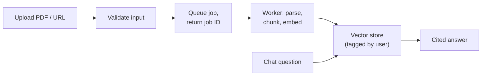
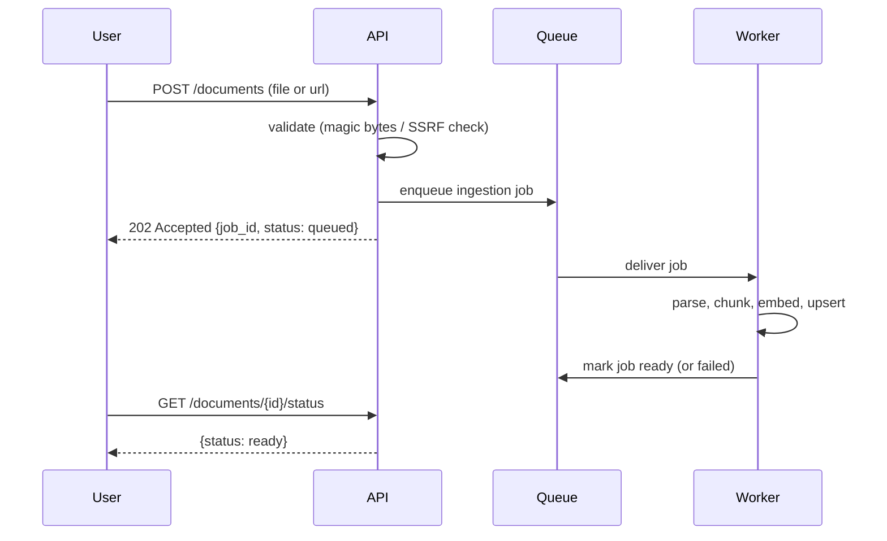
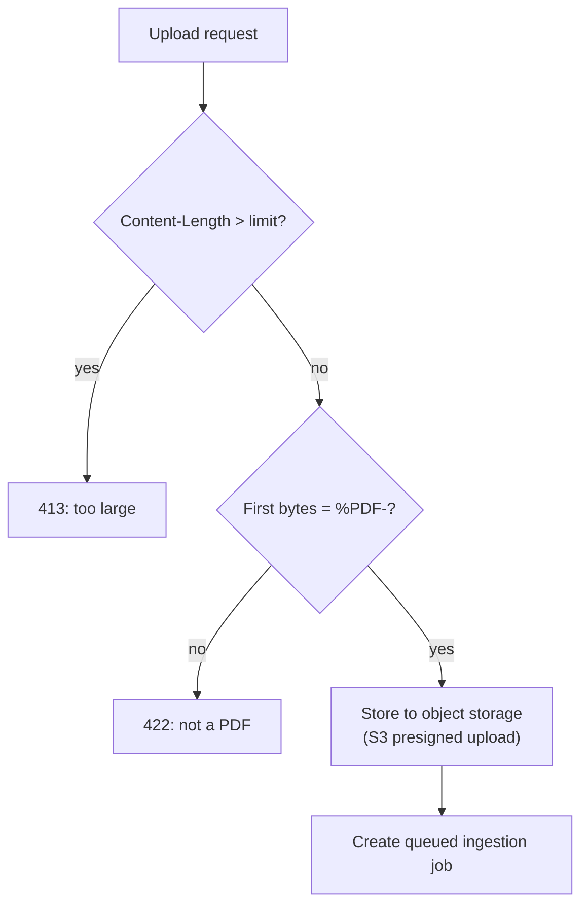
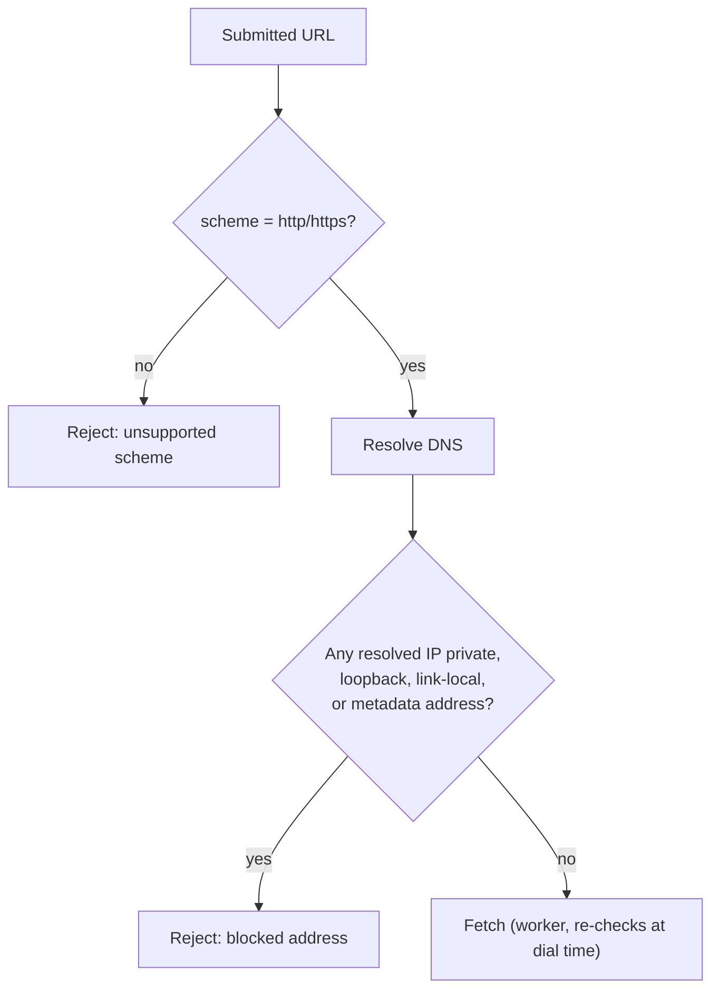

# Case Study - Chat with PDFs and Websites

> [!summary] TL;DR
> "Chat with your documents" is a RAG application (see [[RAG Pipeline]]) where the source documents are user-supplied PDFs or user-submitted website URLs instead of a pre-curated internal corpus — which adds two backend problems a generic RAG pipeline doesn't have: ingestion has to happen asynchronously because parsing can be slow, and the ingestion inputs themselves (an uploaded file, a URL you're asked to fetch) are untrusted and need to be validated before anything touches them.

> [!abstract] Core idea
> - Upload and ingestion are two different requests: the upload call returns a job ID immediately, and a background worker does the slow parsing/chunking/embedding off the request path.
> - An uploaded file is validated by its content (magic bytes), never by its filename or client-supplied Content-Type, both of which an attacker fully controls.
> - A user-submitted URL is a Server-Side Request Forgery (SSRF) vector: your ingestion worker runs inside your network, and a URL that resolves to an internal address makes it fetch internal services on the user's behalf.
> - Every chunk is tagged with the uploading user's (or tenant's) ID, and every retrieval at chat time is filtered by that same ID — not checked after the LLM has already read the content.
> - Chat answers stream (SSE) and cite the source document and page, the same production-quality bar as any other RAG system, built on the ingestion-specific pieces above.

## Start here: the basics

**The problem in one story.**
A user uploads a 200-page PDF and asks "What is the warranty period?"
Reading and indexing that PDF takes a minute, so the app cannot make the user wait on one request.
Another user pastes a URL that secretly points inside your own network.
This case study builds the chat app while handling slow work and untrusted input.

**Words you need first**

| Word | Plain meaning | Tiny example |
| --- | --- | --- |
| RAG | Search your documents, then let the LLM answer from them | Bot quoting page 12 of the PDF |
| Ingestion | Turning a file into searchable chunks | Parse, split, embed, store |
| Background job | Slow work done later by a worker, not in the request | Upload returns job ID `j-123` |
| Queue | A waiting line of jobs for workers | Redis or SQS list of jobs |
| Magic bytes | The first bytes that reveal a file's real type | PDFs start with `%PDF` |
| SSRF | Tricking your server into fetching an internal URL | `http://169.254.169.254/` |
| Tenant | One customer whose data must stay separate | User 42 sees only their PDFs |
| SSE | Server sends the reply in pieces as it is made | Answer appears word by word |

**Picture it**



**Analogy.** The system is a mail room in front of a library. Packages are checked before anything goes on the shelves, and each person may read only their own shelf.
Where it breaks: a mail room checks the outside of a box; here you must check the actual contents (magic bytes), not the label.

**How the rest of this note builds up**

- First, why this product shape is different (section 1) and the mail-room mental model (section 2).
- Then upload validation, async ingestion, safe URL fetching and tenant-filtered chat (section 3).
- Then a Go worked example (section 4) with variants and trade-offs (sections 5-6).
- Finally production concerns, the SDE-3 deep dive and interview questions (sections 7-9).

> [!tip] Remember
> Accept fast, ingest in the background, distrust every file and URL, and filter every search by owner.

## 1. Why it exists

A generic internal-knowledge RAG system (see [[RAG Pipeline]]) ingests a corpus the team controls and curates ahead of time. "Chat with your PDFs and websites" is a different product shape: any user can upload any PDF, or paste any URL, at any time, and expects to start asking questions about it within seconds to minutes.

That shape creates two problems a curated internal corpus doesn't:

- **Ingestion is slow and must not block the request.** Parsing a 200-page PDF (text extraction, OCR fallback for scanned pages, chunking, embedding every chunk) can take tens of seconds to minutes. A user hitting "upload" and staring at a spinner for two minutes, on a request that can also time out at a load balancer or API gateway, is a bad product and a fragile backend.
- **The inputs are untrusted, by definition.** An internal corpus was written and reviewed by your own team. A user-uploaded "PDF" could be a renamed executable; a user-submitted "website URL" could point at `http://169.254.169.254/` (a cloud metadata endpoint) or `http://localhost:6379/` (your own Redis instance) instead of a real public website — and if your ingestion worker blindly fetches whatever URL it's given, it becomes an attacker's proxy into your own network.

Concretely: a user uploads a 40 MB file named `report.pdf` that is actually a shell script, and a second user submits the URL `http://169.254.169.254/latest/meta-data/iam/security-credentials/` hoping the ingestion worker's response leaks cloud credentials back to them.

Both of these are the backend problems this case study exists to solve — the RAG pipeline that answers questions about the *legitimate* uploads is otherwise the same system already covered in [[RAG Pipeline]].

## 2. Mental model

Think of this system as a mail room attached to an ordinary RAG pipeline.

Anyone can drop off a package (upload a PDF) or hand over an address to go fetch something from (submit a URL) — the mail room's whole job is to inspect what comes in, reject anything suspicious, and only then hand a verified, safe document into the same indexing pipeline every other RAG system uses.

The chat step, once a document is verified and indexed, is ordinary RAG: embed the question, retrieve the user's own chunks, generate a cited answer.

## 3. How it works

### Whiteboard version

The request/response shape: upload returns a job ID immediately; a worker processes in the background; status is polled (or streamed) until the document is ready to chat with.



### The API

One route list, covering both upload paths and chat:

| Route | Purpose |
| --- | --- |
| `POST /documents/upload` | Upload a PDF (multipart body); returns `{id, status: "queued"}` |
| `POST /documents/url` | Submit a website URL to crawl and ingest; same response shape |
| `GET /documents/{id}/status` | Poll ingestion status: `queued`, `processing`, `ready`, `failed` |
| `POST /chat` | Ask a question, scoped to the caller's documents (or one `document_id`) |
| `DELETE /documents/{id}` | Delete a document and its chunks (also the GDPR-deletion path) |

### Upload validation

The upload handler never trusts the client-supplied filename or `Content-Type` header — both are attacker-controlled strings, not evidence of what the bytes actually are. It instead checks the file's **magic bytes** (a real PDF starts with the literal bytes `%PDF-`) and enforces a size cap before anything is handed to a worker:



For large files, the upload itself typically goes through an **S3 presigned URL** rather than proxying the whole file through the API server (see [[File Upload Architecture]]):

1. The API issues a short-lived, scoped-to-one-object presigned PUT URL.
2. The client uploads directly to object storage.
3. Only then does it call the API with the resulting object key to register the ingestion job.

The API server never buffers the whole file in memory.

### SSRF defense for URL ingestion

Submitting a URL instead of a file is structurally a request asking *your own infrastructure* to fetch an address the user chose — this is a textbook **Server-Side Request Forgery (SSRF)** setup, not merely an input-validation nuisance. Three defenses, applied together:

1. **Scheme allowlist.** Accept only `http` and `https`; reject `file://`, `ftp://`, `gopher://`, and anything else outright.
2. **Resolve and block private ranges.** Resolve the hostname's DNS and reject it if any resolved address is loopback, private (RFC 1918), link-local, or the cloud metadata address `169.254.169.254` — before ever opening a connection to it.
3. **Re-check at fetch time, not only at submit time.** A hostname can legitimately resolve to a public IP when the user submits the URL and to an internal one by the time the worker actually fetches it (DNS rebinding) — most HTTP clients re-resolve DNS themselves on `Dial`, so the validation needs to run again (or be enforced via a custom dialer) at the moment of the real fetch, not only once up front.



### Crawling

A submitted URL may be a single page or a whole site.

The crawler:

- respects `robots.txt` and any sitemap,
- applies a per-domain rate limit (politeness — hammering a third-party site is both rude and a good way to get the ingestion worker's IP blocked),
- renders JavaScript-heavy pages when a plain HTML fetch returns an empty shell,
- deduplicates pages by content hash,
- and caps total pages per job so one submitted URL can't trigger an unbounded crawl.

### Parsing and OCR fallback

A digital PDF's text layer extracts directly; a **scanned** PDF (an image of a page, no text layer) needs OCR before chunking has anything to work with.

The parsing step should detect this case (a page that extracts to near-empty text despite having visible content) and fall back to OCR automatically rather than silently indexing an empty chunk.

Tables deserve explicit handling too — naive text extraction often flattens a table into unreadable run-on text; a layout-aware parser or a documented table-extraction step (see [[Document Ingestion and Chunking]]) preserves enough structure for the LLM to actually answer questions about it.

### Tenant isolation

Every chunk stored from a user's document is tagged with that user's (or tenant's) ID at ingestion time.

Every retrieval at chat time filters by that same ID as a query-time parameter on the vector search itself — not as a check applied to results afterward, which would already have let the wrong user's content reach the LLM's context.

This is the same principle [[RAG Pipeline]] covers for permission filtering generally, applied here to "which user uploaded this document" as the permission boundary.

### Chat: streamed answers with citations

A chat request runs the ordinary RAG query pipeline — condense, retrieve (filtered to the caller's documents), assemble, generate.

It is streamed back over Server-Sent Events so the user sees the answer appear incrementally instead of waiting for the full response, and labeled with the source document and page for every claim, exactly as [[RAG Pipeline]] already specifies for a good answer.

## 4. Worked example

### Whiteboard version

The two riskiest checks in this system, as plain functions: does this look like a real PDF, and is this URL safe to fetch?

```go
func looksLikePDF(head []byte) bool {
    return bytes.HasPrefix(head, []byte("%PDF-"))
}

func isSafeToFetch(resolvedIPs []net.IP) bool {
    for _, ip := range resolvedIPs {
        if ip.IsPrivate() || ip.IsLoopback() {
            return false
        }
    }
    return true
}
```

The full version below implements upload validation (size and magic bytes), an SSRF-safe URL check with dependency-injected DNS resolution (so it's testable without real network access), and a minimal job-tracking store with the two HTTP handlers (`upload`, `status`) wired to it.

It compiles and passes `go vet` and `go test -race` on Go 1.24, tested entirely with `httptest` and fakes — no live upload, crawl, or model call was made.

```go
// Package chatpdf implements the two riskiest pieces of a "chat with your
// documents" backend: upload validation (type, size, magic bytes) for PDF
// ingestion, and an SSRF-safe check for a user-submitted website URL before
// anything fetches it. Both are plain logic with no network calls, so they
// run and test with no API key and no real HTTP server.
package chatpdf

import (
	"bytes"
	"errors"
	"fmt"
	"net"
	"net/http"
	"net/url"
	"strings"
	"sync"
)

const maxUploadBytes = 25 << 20 // 25 MiB: a deliberately generous but bounded limit

// pdfMagic is the standard PDF file signature ("%PDF-"), checked instead of
// trusting a client-supplied Content-Type or file extension, both of which
// an attacker fully controls.
var pdfMagic = []byte("%PDF-")

// ValidateUpload checks a claimed upload's declared size and first bytes
// before it is handed to a worker for parsing. It never trusts the
// filename or the client's Content-Type header.
func ValidateUpload(declaredSize int64, head []byte) error {
	if declaredSize <= 0 {
		return errors.New("empty upload")
	}
	if declaredSize > maxUploadBytes {
		return fmt.Errorf("upload too large: %d bytes, max %d", declaredSize, maxUploadBytes)
	}
	if !bytes.HasPrefix(head, pdfMagic) {
		return errors.New("not a PDF: missing %PDF- magic bytes")
	}
	return nil
}

// ValidateIngestURL resolves host and rejects anything that resolves to a
// private, loopback or link-local address, which is the core SSRF defense
// for "fetch this URL the user gave us": without it, a user can submit
// http://169.254.169.254/ or http://localhost:6379/ and make your ingestion
// worker — which runs inside your network — fetch internal services on
// their behalf. resolve is injected so tests don't depend on real DNS.
func ValidateIngestURL(raw string, resolve func(host string) ([]net.IP, error)) error {
	u, err := url.Parse(raw)
	if err != nil {
		return fmt.Errorf("parse url: %w", err)
	}
	if u.Scheme != "http" && u.Scheme != "https" {
		return fmt.Errorf("unsupported scheme %q, want http or https", u.Scheme)
	}
	host := u.Hostname()
	if host == "" {
		return errors.New("missing host")
	}
	ips, err := resolve(host)
	if err != nil {
		return fmt.Errorf("resolve host: %w", err)
	}
	if len(ips) == 0 {
		return errors.New("host resolved to no addresses")
	}
	for _, ip := range ips {
		if isBlockedIP(ip) {
			return fmt.Errorf("refusing to fetch %s: resolves to blocked address %s", host, ip)
		}
	}
	return nil
}

// isBlockedIP reports whether ip is private, loopback, link-local, or
// otherwise not a route a document-ingestion worker should ever fetch.
// Re-resolving and re-checking at fetch time (not just at submit time)
// closes the DNS-rebinding gap: a hostname can legitimately resolve
// differently between the two calls.
func isBlockedIP(ip net.IP) bool {
	switch {
	case ip.IsLoopback(), ip.IsPrivate(), ip.IsLinkLocalUnicast(), ip.IsLinkLocalMulticast(), ip.IsUnspecified():
		return true
	case ip.Equal(net.IPv4(169, 254, 169, 254)): // cloud metadata endpoint
		return true
	}
	return false
}

// JobStatus is the lifecycle of one ingestion job, driving what the status
// endpoint reports and whether chat is enabled yet for a document.
type JobStatus string

const (
	StatusQueued     JobStatus = "queued"
	StatusProcessing JobStatus = "processing"
	StatusReady      JobStatus = "ready"
	StatusFailed     JobStatus = "failed"
)

// Job is one tracked ingestion job: an uploaded PDF or a submitted URL,
// moving through the states above as a background worker processes it.
type Job struct {
	ID     string
	Status JobStatus
	Err    string // set only when Status == StatusFailed
}

// JobStore is a minimal, concurrency-safe in-memory job tracker standing in
// for a real jobs table (Postgres row, or an asynq/River task record) behind
// the same shape of interface: create, advance, and read by ID.
type JobStore struct {
	mu   sync.Mutex
	jobs map[string]*Job
}

func NewJobStore() *JobStore {
	return &JobStore{jobs: make(map[string]*Job)}
}

// Create registers a new job in StatusQueued and returns it. The handler
// calls this synchronously on the upload request and returns the job ID
// immediately — the actual parsing/embedding happens later, off the request
// path, which is what keeps a large-PDF upload from blocking the HTTP call.
func (s *JobStore) Create(id string) *Job {
	s.mu.Lock()
	defer s.mu.Unlock()
	j := &Job{ID: id, Status: StatusQueued}
	s.jobs[id] = j
	return j
}

// Advance moves a job to a new status; the worker calls this as it
// progresses (queued -> processing -> ready, or -> failed with a reason).
func (s *JobStore) Advance(id string, status JobStatus, errMsg string) error {
	s.mu.Lock()
	defer s.mu.Unlock()
	j, ok := s.jobs[id]
	if !ok {
		return fmt.Errorf("job %s not found", id)
	}
	j.Status = status
	j.Err = errMsg
	return nil
}

// Get returns a copy of the job's current state, for the status endpoint or
// an SSE stream to report.
func (s *JobStore) Get(id string) (Job, bool) {
	s.mu.Lock()
	defer s.mu.Unlock()
	j, ok := s.jobs[id]
	if !ok {
		return Job{}, false
	}
	return *j, ok
}

// UploadHandler validates an uploaded PDF and, if it passes, registers a
// queued ingestion job and returns its ID — the request/response half of
// "upload returns job id, worker processes in the background".
func UploadHandler(store *JobStore, newID func() string) http.HandlerFunc {
	return func(w http.ResponseWriter, r *http.Request) {
		if r.Method != http.MethodPost {
			http.Error(w, "method not allowed", http.StatusMethodNotAllowed)
			return
		}
		if r.ContentLength > maxUploadBytes {
			http.Error(w, "upload too large", http.StatusRequestEntityTooLarge)
			return
		}
		body := http.MaxBytesReader(w, r.Body, maxUploadBytes+1)
		head := make([]byte, 5)
		n, _ := body.Read(head)
		rest, err := readAllLimited(body, maxUploadBytes)
		if err != nil {
			http.Error(w, "upload too large or unreadable", http.StatusRequestEntityTooLarge)
			return
		}
		full := append(head[:n], rest...)
		if err := ValidateUpload(int64(len(full)), full); err != nil {
			http.Error(w, err.Error(), http.StatusUnprocessableEntity)
			return
		}
		id := newID()
		store.Create(id)
		w.Header().Set("Content-Type", "application/json")
		w.WriteHeader(http.StatusAccepted)
		fmt.Fprintf(w, `{"id":%q,"status":%q}`, id, StatusQueued)
	}
}

func readAllLimited(r interface{ Read([]byte) (int, error) }, limit int64) ([]byte, error) {
	buf := make([]byte, 0, 4096)
	chunk := make([]byte, 4096)
	for {
		n, err := r.Read(chunk)
		if n > 0 {
			buf = append(buf, chunk[:n]...)
			if int64(len(buf)) > limit {
				return nil, fmt.Errorf("exceeded limit of %d bytes", limit)
			}
		}
		if err != nil {
			break
		}
	}
	return buf, nil
}

// StatusHandler reports a job's current status by ID, the polling
// counterpart to UploadHandler's "chat enabled after indexing" promise.
func StatusHandler(store *JobStore) http.HandlerFunc {
	return func(w http.ResponseWriter, r *http.Request) {
		id := strings.TrimPrefix(r.URL.Path, "/documents/")
		id = strings.TrimSuffix(id, "/status")
		job, ok := store.Get(id)
		if !ok {
			http.Error(w, "not found", http.StatusNotFound)
			return
		}
		w.Header().Set("Content-Type", "application/json")
		if job.Status == StatusFailed {
			fmt.Fprintf(w, `{"id":%q,"status":%q,"error":%q}`, job.ID, job.Status, job.Err)
			return
		}
		fmt.Fprintf(w, `{"id":%q,"status":%q}`, job.ID, job.Status)
	}
}
```

Tests, covering valid and invalid uploads, the full SSRF blocklist (including the cloud metadata address), DNS-resolution failure, and the job store's lifecycle end to end via the HTTP handlers:

```go
package chatpdf

import (
	"bytes"
	"errors"
	"net"
	"net/http"
	"net/http/httptest"
	"strings"
	"testing"
)

func TestValidateUploadRejectsOversizedFile(t *testing.T) {
	err := ValidateUpload(30<<20, []byte("%PDF-1.7"))
	if err == nil {
		t.Fatal("want error for an upload over the size limit")
	}
}

func TestValidateUploadRejectsMissingMagicBytes(t *testing.T) {
	// A renamed .exe or .html with a ".pdf" filename still fails here,
	// because the check never looks at the filename or Content-Type header.
	err := ValidateUpload(1024, []byte("<html>not a pdf</html>"))
	if err == nil {
		t.Fatal("want error when the file doesn't start with the PDF magic bytes")
	}
}

func TestValidateUploadAcceptsRealPDFHeader(t *testing.T) {
	if err := ValidateUpload(1024, []byte("%PDF-1.7\n%...")); err != nil {
		t.Fatalf("ValidateUpload = %v, want nil for a valid PDF header", err)
	}
}

func fakeResolve(ips ...string) func(string) ([]net.IP, error) {
	return func(string) ([]net.IP, error) {
		var out []net.IP
		for _, s := range ips {
			out = append(out, net.ParseIP(s))
		}
		return out, nil
	}
}

func TestValidateIngestURLBlocksPrivateAndLoopbackTargets(t *testing.T) {
	cases := []struct {
		name string
		ip   string
	}{
		{"loopback", "127.0.0.1"},
		{"private 10/8", "10.1.2.3"},
		{"private 192.168/16", "192.168.1.5"},
		{"link-local", "169.254.1.1"},
		{"cloud metadata", "169.254.169.254"},
	}
	for _, c := range cases {
		t.Run(c.name, func(t *testing.T) {
			err := ValidateIngestURL("http://internal.example/", fakeResolve(c.ip))
			if err == nil {
				t.Fatalf("want ValidateIngestURL to block resolution to %s (%s)", c.ip, c.name)
			}
		})
	}
}

func TestValidateIngestURLAllowsPublicAddress(t *testing.T) {
	err := ValidateIngestURL("https://example.com/report", fakeResolve("93.184.216.34"))
	if err != nil {
		t.Fatalf("ValidateIngestURL = %v, want nil for a public address", err)
	}
}

func TestValidateIngestURLRejectsNonHTTPScheme(t *testing.T) {
	err := ValidateIngestURL("file:///etc/passwd", fakeResolve("127.0.0.1"))
	if err == nil {
		t.Fatal("want error for a non-http(s) scheme")
	}
}

func TestValidateIngestURLSurfacesResolveFailure(t *testing.T) {
	resolve := func(string) ([]net.IP, error) { return nil, errors.New("NXDOMAIN") }
	if err := ValidateIngestURL("https://nowhere.invalid/", resolve); err == nil {
		t.Fatal("want error when DNS resolution fails")
	}
}

func TestJobStoreLifecycle(t *testing.T) {
	store := NewJobStore()
	store.Create("job-1")

	job, ok := store.Get("job-1")
	if !ok || job.Status != StatusQueued {
		t.Fatalf("got %+v, ok=%v, want StatusQueued", job, ok)
	}

	if err := store.Advance("job-1", StatusProcessing, ""); err != nil {
		t.Fatalf("Advance: %v", err)
	}
	job, _ = store.Get("job-1")
	if job.Status != StatusProcessing {
		t.Fatalf("status = %v, want processing", job.Status)
	}

	if err := store.Advance("job-1", StatusFailed, "ocr timeout"); err != nil {
		t.Fatalf("Advance: %v", err)
	}
	job, _ = store.Get("job-1")
	if job.Status != StatusFailed || job.Err != "ocr timeout" {
		t.Fatalf("got %+v, want failed with reason", job)
	}
}

func TestJobStoreAdvanceUnknownJobErrors(t *testing.T) {
	store := NewJobStore()
	if err := store.Advance("missing", StatusReady, ""); err == nil {
		t.Fatal("want error advancing a job ID that was never created")
	}
}

func TestUploadHandlerAcceptsValidPDFAndReturnsJobID(t *testing.T) {
	store := NewJobStore()
	ids := []string{"job-abc"}
	handler := UploadHandler(store, func() string { id := ids[0]; ids = ids[1:]; return id })

	body := bytes.NewBufferString("%PDF-1.7\nrest of a small fake pdf")
	req := httptest.NewRequest(http.MethodPost, "/documents/upload", body)
	req.ContentLength = int64(body.Len())
	rec := httptest.NewRecorder()

	handler(rec, req)

	if rec.Code != http.StatusAccepted {
		t.Fatalf("status = %d, body = %s, want 202", rec.Code, rec.Body.String())
	}
	if !strings.Contains(rec.Body.String(), `"job-abc"`) {
		t.Fatalf("body = %s, want it to contain the new job id", rec.Body.String())
	}
	job, ok := store.Get("job-abc")
	if !ok || job.Status != StatusQueued {
		t.Fatalf("job store = %+v, ok=%v, want a queued job-abc", job, ok)
	}
}

func TestUploadHandlerRejectsNonPDFBody(t *testing.T) {
	store := NewJobStore()
	handler := UploadHandler(store, func() string { return "unused" })

	body := bytes.NewBufferString("this is not a pdf at all")
	req := httptest.NewRequest(http.MethodPost, "/documents/upload", body)
	req.ContentLength = int64(body.Len())
	rec := httptest.NewRecorder()

	handler(rec, req)

	if rec.Code != http.StatusUnprocessableEntity {
		t.Fatalf("status = %d, want 422 for a non-PDF upload", rec.Code)
	}
}

func TestUploadHandlerRejectsOversizedContentLength(t *testing.T) {
	store := NewJobStore()
	handler := UploadHandler(store, func() string { return "unused" })

	req := httptest.NewRequest(http.MethodPost, "/documents/upload", bytes.NewReader(nil))
	req.ContentLength = 30 << 20 // declared size alone exceeds the limit
	rec := httptest.NewRecorder()

	handler(rec, req)

	if rec.Code != http.StatusRequestEntityTooLarge {
		t.Fatalf("status = %d, want 413 for a declared size over the limit", rec.Code)
	}
}

func TestStatusHandlerReportsJobState(t *testing.T) {
	store := NewJobStore()
	store.Create("job-7")
	store.Advance("job-7", StatusReady, "")
	handler := StatusHandler(store)

	req := httptest.NewRequest(http.MethodGet, "/documents/job-7/status", nil)
	rec := httptest.NewRecorder()
	handler(rec, req)

	if rec.Code != http.StatusOK {
		t.Fatalf("status = %d, want 200", rec.Code)
	}
	if !strings.Contains(rec.Body.String(), `"ready"`) {
		t.Fatalf("body = %s, want status ready", rec.Body.String())
	}
}

func TestStatusHandlerReturns404ForUnknownJob(t *testing.T) {
	store := NewJobStore()
	handler := StatusHandler(store)
	req := httptest.NewRequest(http.MethodGet, "/documents/nope/status", nil)
	rec := httptest.NewRecorder()
	handler(rec, req)
	if rec.Code != http.StatusNotFound {
		t.Fatalf("status = %d, want 404", rec.Code)
	}
}
```

**Tested:** `go vet` and `go test -race` pass on Go 1.24 (scratch module, 2026-11-07).

```text
=== RUN   TestValidateUploadRejectsOversizedFile
--- PASS: TestValidateUploadRejectsOversizedFile (0.00s)
=== RUN   TestValidateUploadRejectsMissingMagicBytes
--- PASS: TestValidateUploadRejectsMissingMagicBytes (0.00s)
=== RUN   TestValidateUploadAcceptsRealPDFHeader
--- PASS: TestValidateUploadAcceptsRealPDFHeader (0.00s)
=== RUN   TestValidateIngestURLBlocksPrivateAndLoopbackTargets
--- PASS: TestValidateIngestURLBlocksPrivateAndLoopbackTargets (0.00s)
=== RUN   TestValidateIngestURLAllowsPublicAddress
--- PASS: TestValidateIngestURLAllowsPublicAddress (0.00s)
=== RUN   TestValidateIngestURLRejectsNonHTTPScheme
--- PASS: TestValidateIngestURLRejectsNonHTTPScheme (0.00s)
=== RUN   TestValidateIngestURLSurfacesResolveFailure
--- PASS: TestValidateIngestURLSurfacesResolveFailure (0.00s)
=== RUN   TestJobStoreLifecycle
--- PASS: TestJobStoreLifecycle (0.00s)
=== RUN   TestJobStoreAdvanceUnknownJobErrors
--- PASS: TestJobStoreAdvanceUnknownJobErrors (0.00s)
=== RUN   TestUploadHandlerAcceptsValidPDFAndReturnsJobID
--- PASS: TestUploadHandlerAcceptsValidPDFAndReturnsJobID (0.00s)
=== RUN   TestUploadHandlerRejectsNonPDFBody
--- PASS: TestUploadHandlerRejectsNonPDFBody (0.00s)
=== RUN   TestUploadHandlerRejectsOversizedContentLength
--- PASS: TestUploadHandlerRejectsOversizedContentLength (0.00s)
=== RUN   TestStatusHandlerReportsJobState
--- PASS: TestStatusHandlerReportsJobState (0.00s)
=== RUN   TestStatusHandlerReturns404ForUnknownJob
--- PASS: TestStatusHandlerReturns404ForUnknownJob (0.00s)
PASS
ok  	chatpdf	1.48s
```

## 5. Variants and comparison

| Decision | Options | Use when | Cost |
| --- | --- | --- | --- |
| Ingestion queue | asynq / River (Postgres-backed) / SQS | asynq: simple, Redis-backed. River: transactional enqueue alongside your Postgres writes. SQS: already on AWS, managed | River avoids the dual-write problem (job enqueued but DB write failed, or vice versa); asynq and SQS need an outbox pattern for the same guarantee |
| Status delivery | Polling `GET .../status` vs SSE push | Polling: simpler, works everywhere. SSE: instant updates, fewer wasted requests for a slow ingestion | SSE needs a long-lived connection per in-progress job |
| Scanned PDF handling | Skip OCR vs automatic OCR fallback | Skip: faster, fine if users only upload digital PDFs. OCR fallback: handles scanned documents, photos of pages | OCR adds latency and cost per page, and errors compound into chunking |
| Website ingestion scope | Single page vs full-site crawl | Single page: simpler, predictable cost. Crawl: more complete, needed for multi-page docs/sites | Crawl needs robots.txt/politeness/dedup/page caps to stay bounded |
| Multi-tenancy | Tenant ID as a metadata filter vs a separate index per tenant | Shared index + filter: simpler ops, most common. Separate index: stronger isolation, more ops overhead | Shared index + filter relies on the filter being applied correctly at every single retrieval call — get this wrong once and it leaks |

## 6. Trade-offs and when not to use

- The ingestion pipeline is real infrastructure (queue, worker pool, object storage, OCR, crawler) — for a tool with a handful of static, pre-approved documents, a simpler synchronous "load these files at startup" approach may not need any of it.
- Crawling arbitrary user-submitted websites is open-ended scope creep risk: without page caps, depth limits, and a clear policy on what counts as "the site," one submitted URL can balloon into an unbounded, slow, expensive ingestion job.
- OCR fallback adds real latency and cost on every scanned page; if your users realistically only ever upload born-digital PDFs, skipping it is a reasonable, cheaper default until evidence says otherwise.
- SSRF defense has an ongoing cost: it must be re-verified any time the ingestion worker's network egress rules, DNS setup, or hosting environment changes, not configured once and forgotten.

## 7. In production

- **Real systems:** consumer "chat with your PDF" products; internal tools letting employees upload a contract, report, or spec and ask questions about it; browser-extension-style "summarize and chat with this webpage" tools, which hit the exact same URL-ingestion SSRF surface.
- **Failure modes → fixes:**
  - A renamed non-PDF file crashes the parser → magic-byte validation (above) rejects it before it ever reaches the parser.
  - SSRF via a submitted URL reaching an internal service → scheme allowlist, resolve-and-block private ranges, and re-check at fetch time (DNS rebinding) as covered above.
  - A document update isn't reflected in chat answers → re-ingest on explicit update, and support `DELETE /documents/{id}` cascading to the stored chunks (also the mechanism for a GDPR deletion request).
  - A crawl with no page cap or depth limit runs for hours and burns through API cost → hard caps on pages, depth, and total ingestion time per job, enforced by the worker, not just documented as a convention.
  - One tenant's documents appear in another tenant's chat answers → the tenant filter was applied after retrieval instead of as a query-time parameter on the vector search; fix is the same as [[RAG Pipeline]]'s general permission-filtering rule.
- **What to monitor:** ingestion job queue depth and age (a growing backlog means workers can't keep up); ingestion failure rate, broken down by cause (OCR timeout, SSRF block, oversized file, crawl error); chat latency broken into retrieval vs. generation; cost per document ingested (embedding tokens, OCR calls) and per chat question; a small eval set of real documents and expected answers (see [[RAG Evaluation]]) re-run whenever the parsing or chunking logic changes.
- **Scaling:** embedding throughput becomes the bottleneck first at high ingestion volume — batch chunks into fewer, larger embedding API calls rather than one call per chunk. Index size and provider rate limits are the next constraints as the number of ingested documents grows; a multi-tenant deployment should plan for both from the start rather than retrofitting batching and rate-limit handling after an outage.

## 8. Deep dive

- **Why magic bytes beat both filename and Content-Type.** A filename extension is just a string the client chose; an attacker names a file `report.pdf` regardless of its actual content. A client-supplied `Content-Type` header is equally attacker-controlled — the browser or script sending the upload decides what value to send, and nothing on the server side enforces it matches the bytes. Magic bytes are a property of the file's actual content, which is the only thing worth trusting before you hand the file to a parser that will execute complex logic over its bytes.
- **DNS rebinding in depth.** An attacker controls a domain and its DNS records. They submit `http://attacker-domain.example/` for ingestion; at submission time, that domain resolves to a harmless public IP, passing validation. Before (or during) the worker's actual fetch, the attacker changes the domain's DNS record to resolve to an internal address instead. If the validation ran only once, at submission, the fetch proceeds against the now-malicious resolution. The fix is architectural: the HTTP client performing the real fetch must itself re-resolve and re-check at dial time (a custom `net.Dialer.Control` or an equivalent hook), not rely on a check that happened earlier and is now stale.
- **Conversation history and condensation.** A multi-turn chat about one document needs the same "condense with history into a standalone query" step [[RAG Pipeline]] describes generally — here it matters especially because a follow-up like "what about the next section?" is meaningless without knowing which document and which prior answer it's building on; conversation state (which document, prior turns) must be tracked per chat session, not assumed from the question text alone.
- **Cost controls specific to this shape of product.** Because any user can upload any document at any time, cost here scales with user behavior in a way an internally curated corpus doesn't — a per-user or per-tenant quota on ingested pages and chat requests per period, plus model tiering (a smaller/cheaper model for simple factual questions, escalating to a larger one only when needed), keeps a single user's usage from dominating infrastructure cost.

## 9. Interview questions

> [!question]- Why validate an uploaded PDF by its magic bytes instead of its file extension or declared Content-Type?
> Both the filename and the Content-Type header are strings the client controls and can set to anything regardless of the file's actual content. The magic bytes (`%PDF-` at the start of the file) are a property of the content itself, so checking them is the only one of the three checks an attacker can't simply lie about.

> [!question]- Trap: "We validated the submitted URL's DNS resolution before enqueuing the job, so SSRF is handled." Why isn't this enough?
> DNS rebinding: the domain can resolve to a safe public address at submission time and a malicious internal address by the time the worker actually fetches it, since the attacker controls the domain's DNS records. The check needs to run again — or be enforced via a custom dialer — at the moment of the real fetch, not only once at submission.

> [!question]- Why does the upload endpoint return a job ID immediately instead of waiting for ingestion to finish?
> Parsing, chunking and embedding a large document can take tens of seconds to minutes — long enough to hit client, load-balancer, or API-gateway timeouts, and long enough to leave the user staring at a blocked request. Returning a job ID immediately and processing asynchronously keeps the HTTP request fast and lets a background worker take as long as it needs.

> [!question]- How would you handle a scanned (image-only) PDF that the normal text extractor returns empty results for?
> Detect the case — a page that extracts to near-empty text despite having visible content — and fall back to OCR automatically rather than silently indexing an empty or near-empty chunk, which would otherwise make that page invisible to every future question about it.

> [!question]- A user reports seeing a sentence from another user's uploaded document in their own chat answer. Where's the bug, and how do you fix it?
> The tenant/user filter on retrieval was applied after the vector search (or not at all) instead of as a query-time parameter on the search itself — by the time a post-hoc filter runs, the wrong content has already reached the LLM's context. Fix it by passing the filter into the vector store's search call directly, the same rule [[RAG Pipeline]] gives for permission filtering generally.

> [!question]- What specifically bounds a website-crawling ingestion job from running forever?
> Explicit, enforced caps on total pages crawled, crawl depth, and total ingestion time per job, plus respecting `robots.txt` and a per-domain rate limit — none of which the crawler can infer on its own from "the user submitted this URL," so they have to be deliberate limits the worker enforces.

> [!question]- Design the deletion flow for a user who wants their uploaded document (and any associated data) fully removed.
> `DELETE /documents/{id}` marks the document deleted, deletes its chunks from the vector store by `document_id` (and deletes the source file from object storage), and the deletion must actually remove the data — not just hide it from the UI — to satisfy a real data-deletion request (e.g., GDPR); verify no retrieval against the user's documents can still surface a chunk from the deleted document afterward.

## 10. Cheat sheet

- Upload returns a job ID immediately; a background worker parses, chunks, and embeds off the request path.
- Validate uploads by magic bytes, not filename or client-supplied Content-Type.
- URL ingestion is an SSRF vector: allowlist scheme, resolve and block private/loopback/link-local/metadata addresses, and re-check at fetch time against DNS rebinding.
- Tag every chunk with the uploading user/tenant ID; filter by it at the vector store, at query time, never after.
- Crawling needs robots.txt respect, per-domain rate limits, dedup, and hard caps on pages/depth/time.
- Detect empty-text extraction on a scanned PDF and fall back to OCR automatically.
- Chat is ordinary RAG once ingestion is trusted: stream the answer, cite source and page.
- `DELETE` must actually remove stored chunks and the source file, not just hide the document from the UI.

## Links

- **Before this:** [[RAG Pipeline]], [[Document Ingestion and Chunking]]
- **Next:** [[Advanced RAG Patterns]]
- **Compare with:** [[File Upload Architecture]] (the general upload/presigned-URL pattern this reuses), [[Background Workers and Job Queues]] (the async ingestion mechanism), [[OWASP API Security Top 10]] (SSRF as a named risk category)
