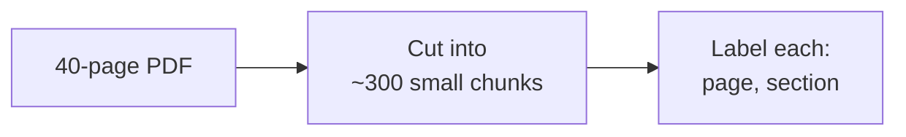
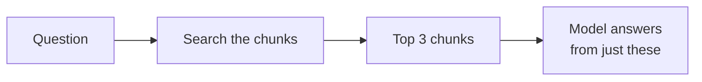
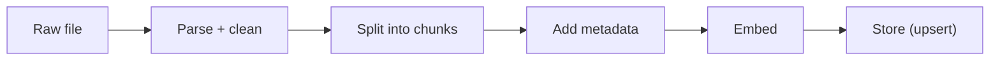
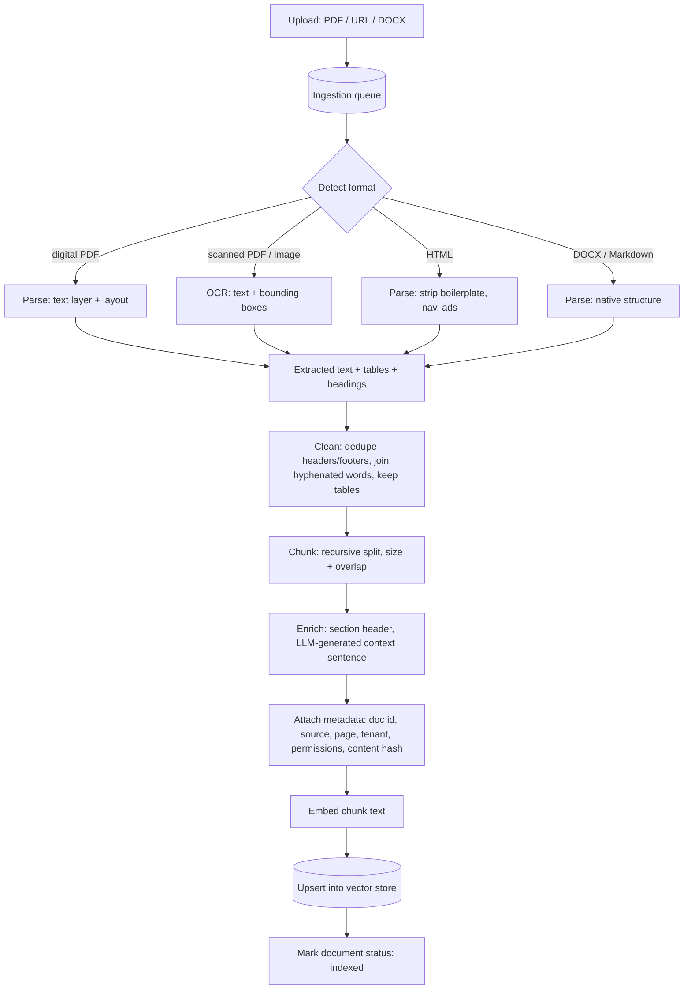
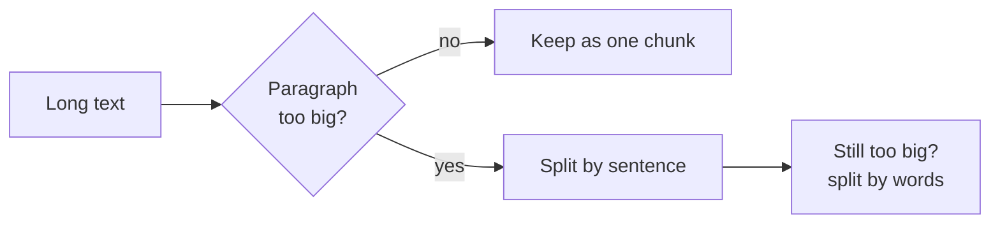
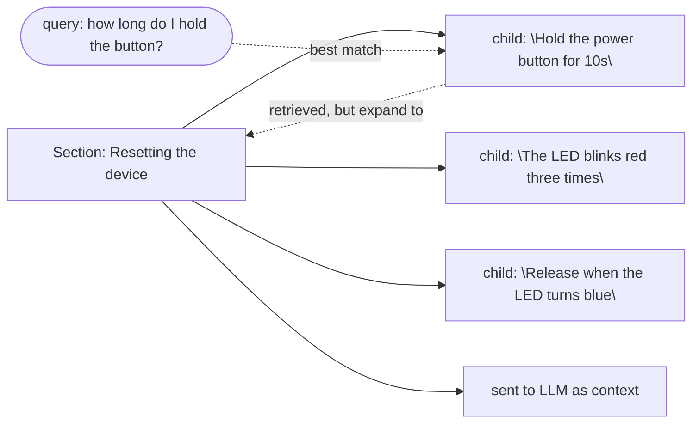
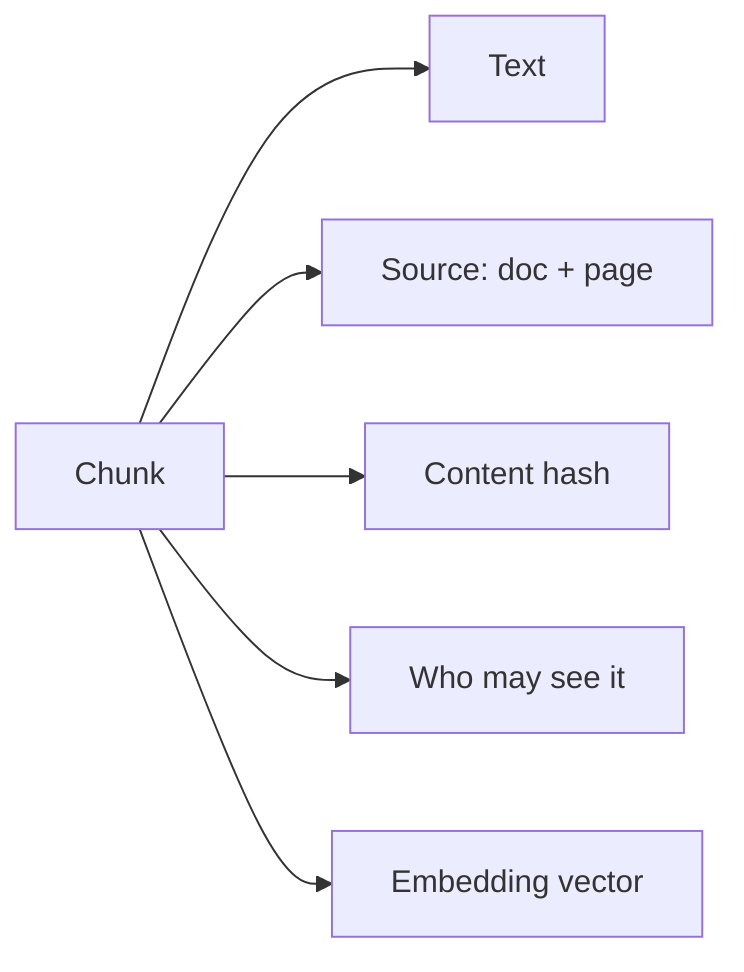
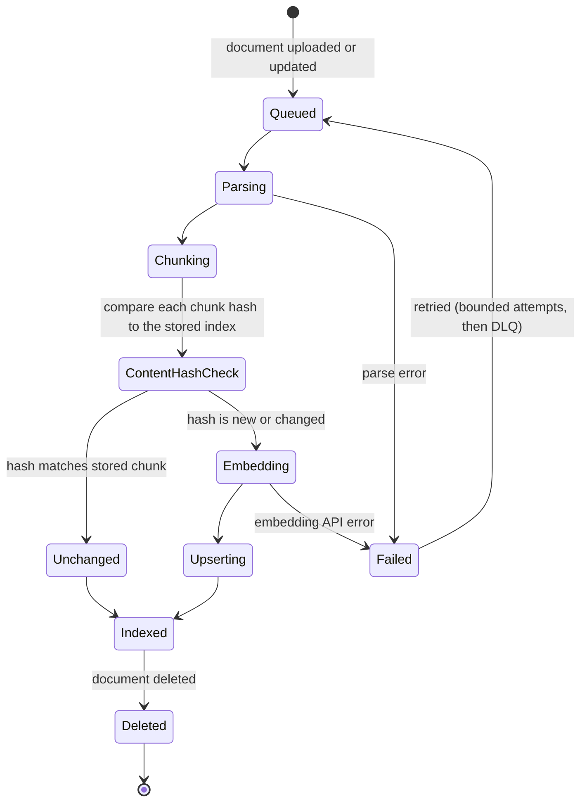
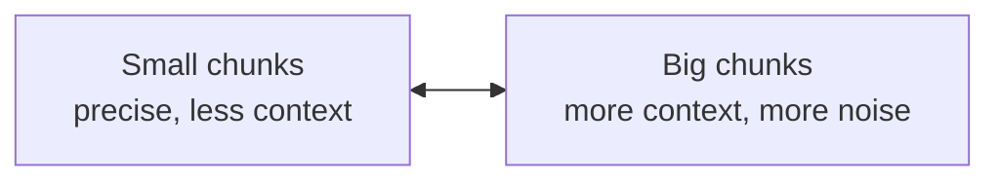

# Document Ingestion and Chunking

> [!summary] TL;DR
> Document ingestion turns raw files (PDFs, web pages, Word docs) into small, labelled pieces of text called **chunks** that an embedding model and a vector store can use. Good chunking keeps one idea together, fits the retriever's size limit, and carries enough metadata that an answer can later cite it or delete it.

> [!abstract] Core idea
> - Ingestion is a pipeline: load the raw file, parse it into text, clean it, split it into chunks, enrich each chunk, embed it, and upsert it into a store.
> - Chunk size and overlap are tuning knobs, not fixed rules: typically 200–1,000 tokens per chunk with 10–20% overlap, picked by evaluating retrieval quality on your own queries.
> - A chunk without metadata (source, page, permissions, a content hash) cannot be cited, re-indexed, or deleted later.
> - Tables, scanned pages, and multi-column layouts break naive "extract all text" parsers and need format-specific handling.
> - The pipeline runs asynchronously, behind a queue, because parsing and embedding are slow and must survive retries.

## Start here: the basics 🟢

> [!info] How to read this note (pick your level)
> - 🟢 **New to this?** Read "From zero" below, then sections 1, 2 and the cheat sheet (10). Stop there, that is a full first pass.
> - 🟡 **Know the basics?** Add section 3 (how it works), 4 (worked example), 5 and 6.
> - 🔴 **Interview / SDE-3 prep?** Add 7, 8 and 9. Headings are tagged 🟢🟡🔴 so you always know where you are.

**From zero, in 60 seconds** 🟢

You have a 40-page manual and want a bot to answer questions from it. You cannot paste all 40 pages into every question. It costs too much, and the answer gets lost in the pile.

So you prepare the manual once, ahead of time. You cut it into small pieces called **chunks**, and label each piece with where it came from.



Then you turn each chunk into numbers (an **embedding**) and store it, so you can search it later.

When a question comes in, you fetch only the 3 or 4 chunks that matter, not the whole book.



Cut well (along paragraphs and sections) and answers are good. Cut badly (mid-sentence) and answers break.

The rest of this note is just these 3 questions:
1. What are the steps from a raw file to stored chunks?
2. How big should a chunk be, and where should you cut?
3. How do you keep the index fresh and safe in production?


**The problem in one story.**
Your team has a 40-page PDF manual and wants a bot to answer questions from it.
You cannot paste all 40 pages into every question; it is costly and the answer gets lost.
So you cut the manual into small labelled pieces and fetch only the right ones.
This note is about cutting well and labelling well.

**Words you need first**

| Word | Plain meaning | Tiny example |
| --- | --- | --- |
| Token | A small piece of text a model counts | About 4 characters of English |
| Context window | The most text a model can read at once | 128k tokens |
| Parse | Pull plain text out of a file format | PDF to text |
| Chunk | One small piece of a document | 500 tokens from page 3 |
| Overlap | Text repeated at the edge of neighbour chunks | Last 50 tokens repeated |
| Metadata | Labels stored with a chunk | `source=manual.pdf, page=3` |
| Embedding | Numbers that capture a chunk's meaning | A 1,536-number vector |
| Upsert | Insert, or update if it already exists | Re-index a changed page |

**Picture it**



**Analogy.** It is like turning a textbook into index cards: one idea per card, with the book and page written on the corner.
Where it breaks: cards are cut by a human who understands the text; a chunker cuts by size and rules, so it can split an idea in half.

**How the rest of this note builds up**

- First, why ingestion is needed (section 1) and the pipeline mental model (section 2).
- Then each stage: loading, parsing, cleaning, chunking strategies, metadata, embedding and upsert (section 3).
- Then a Go worked example (section 4) and a comparison of chunking strategies (sections 5-6).
- Finally production concerns like queues and re-indexing, the SDE-3 deep dive and interview questions (sections 7-9).

> [!tip] Remember
> One idea per chunk, a size the retriever likes, and enough metadata to cite or delete it later.

## 1. Why it exists 🟢

A support team uploads a 40-page PDF manual and expects a chatbot to answer "how do I reset the device?"

An [[LLM Fundamentals|LLM]] can only read what fits in its context window, and feeding it the whole PDF on every question wastes tokens and often buries the one relevant paragraph in the middle, where models pay less attention to it ("lost in the middle", see [[LLM Fundamentals]]).

Ingestion solves this by doing the expensive work once, offline: turn the PDF into a few hundred small, searchable pieces, each tagged with where it came from. A question then only needs the handful of pieces that are actually relevant — the retrieval step covered in [[RAG Pipeline]].

Get chunking wrong and the symptoms show up downstream, not in this pipeline: retrieval returns the wrong paragraph, answers cite the wrong page, or a table of pricing data gets flattened into unreadable text and the model invents numbers instead.

## 2. Mental model 🟢

Think of a cookbook.

You would not photocopy the whole book and hand it to someone asking "how long do I boil an egg?" You would tear out the one relevant paragraph, but you would tear along the recipe boundaries (soft-boiled vs. hard-boiled), not mid-sentence, and you would staple a sticky note to it saying which book and page it came from.

Document ingestion is that tearing-and-labelling process, done automatically: split along natural boundaries (paragraphs, sections) first, fall back to harder cuts only when a piece is still too big, and always attach a label (metadata) before filing it away.

## 3. How it works 🟡

**In plain words:** A file goes through an assembly line: read it, clean it, cut it, label it, turn it into numbers, store it.



Each stage, in order:

1. **Load.** A format-specific loader fetches the raw bytes: an S3 object, an uploaded file, or a crawled URL.
2. **Parse.** Extract text by format. A digital PDF has a text layer; a scanned PDF or photographed page does not and needs OCR (Tesseract, a cloud document AI service, or a layout-aware vision-language model — verify current options, since this area moves fast). HTML needs boilerplate stripped (navigation, cookie banners); DOCX and Markdown already carry structure (headings, lists) that a parser should keep rather than flatten.
3. **Clean.** Remove running headers/footers and page numbers, join words split by line-wrapped hyphens, de-duplicate repeated boilerplate, and keep tables in a readable form (Markdown table or row-per-line text) instead of mashing cells into one unreadable line.
4. **Chunk.** Split into pieces sized for the embedding model and the LLM's context budget. See the strategies below.
5. **Enrich.** Optionally prepend context a chunk would otherwise lose by being cut out of its document: the section heading it falls under, or a one-sentence LLM-generated summary of what the chunk is about and where it sits ("contextual retrieval"). This measurably improves retrieval because the chunk's embedding now reflects context it didn't literally contain.
6. **Attach metadata.** Document id, chunk id, source name, page/section, tenant id, permissions, and a content hash. Attach permissions at ingestion time, once, rather than re-deriving them at every query.
7. **Embed and upsert.** Send the (enriched) chunk text to an embedding model (see [[Embeddings]]) and write the vector plus metadata into the store (see [[Vector Databases and ANN Indexes]]).

### Chunking strategies

**In plain words:** Different ways to cut the text, from "every 500 characters" (simple) to "wherever the topic changes" (smart).

| Strategy | How it works | Use when |
| --- | --- | --- |
| Fixed size | Split by a fixed token or character count, ignoring structure | Quick prototypes; uniform, structure-free text |
| Recursive | Try paragraph breaks first, then sentences, then words, only falling to a smaller separator when a piece is still too big | The general default for prose documents |
| Semantic | Embed consecutive sentences and cut where their similarity drops | When topic boundaries matter more than size and the extra embedding calls are affordable |
| Parent-child (small-to-big) | Retrieve a small, precise chunk, but return its larger parent section to the LLM | Precise retrieval with enough surrounding context for a full answer |

The old assumption that semantic chunking is simply "higher quality" does not hold up: it costs an embedding call per sentence boundary it considers, and on most prose corpora it does not reliably beat recursive chunking on recall — evaluate both on your own documents and queries rather than assuming one wins.



### Parent-child chunking

**In plain words:** Search with small precise pieces, but hand the model the bigger section they came from.



The vector search matches on the small, specific child chunk (precise embeddings), but the pipeline hands the LLM the whole parent section, so the answer has enough surrounding context ("release when the LED turns blue") that a bare 50-token child chunk would have cut off.

### What to store per chunk

**In plain words:** Each chunk needs a label card: what it says, where it came from, and who may see it.

- Chunk id and chunk text
- Source document name and page or section
- Document id and a content hash of the chunk text
- Tenant id and permission/ACL fields
- Optional: embedding model name and version it was embedded with

A chunk without a source and page cannot be cited in an answer. A chunk without a content hash cannot tell whether its source document changed and needs re-embedding. A chunk without permission metadata cannot be safely filtered out of another tenant's search results.



## 4. Worked example 🟡

### Whiteboard version

**In plain words:** Cut on paragraphs first. Only cut smaller (sentences, then words) if a paragraph is still too long.

The idea in five lines: split on paragraph breaks, and only drop to sentences or words if a paragraph is still too big for the token budget.

```go
func naiveChunks(text string, maxChars int) []string {
    paras := strings.Split(text, "\n\n")
    var out []string
    for _, p := range paras {
        if len(p) <= maxChars {
            out = append(out, p)
        }
        // else: would need to split p further — see the full version below.
    }
    return out
}
```

The full version below adds token-budget packing, overlap between chunks, and content-hash dedup, with a test that passes `go test -race` on Go 1.24.

```go
// Package chunking is a teaching-sized recursive chunker: split on the
// largest separator first (paragraphs, then sentences, then words), pack
// the pieces into chunks under a token budget, and carry a word-overlap
// between consecutive chunks so a fact split across a boundary still shows
// up whole in at least one chunk.
package chunking

import (
    "crypto/sha256"
    "encoding/hex"
    "strings"
)

// Chunk is one unit of text ready for embedding and storage.
type Chunk struct {
    Text  string
    Hash  string // sha256 of Text, hex-encoded: used for dedup and incremental re-indexing
    Index int    // position of this chunk within its document, from 0
}

// estimateTokens approximates BPE token count at ~4 characters per token for
// English text (see "LLM Fundamentals"). It is an estimate, not a real
// tokenizer call, and undercounts for other scripts.
func estimateTokens(s string) int {
    return (len(s) + 3) / 4
}

var separators = []string{"\n\n", ". ", " "}

// split breaks text on the first separator in seps that yields at least two
// non-empty pieces, recursing into any piece still over maxTokens.
func split(text string, seps []string, maxTokens int) []string {
    if estimateTokens(text) <= maxTokens || len(seps) == 0 {
        return []string{text}
    }
    sep, rest := seps[0], seps[1:]
    parts := strings.Split(text, sep)
    if len(parts) < 2 {
        return split(text, rest, maxTokens)
    }
    var out []string
    for i, p := range parts {
        if i < len(parts)-1 {
            p += sep
        }
        if strings.TrimSpace(p) == "" {
            continue
        }
        if estimateTokens(p) > maxTokens {
            out = append(out, split(p, rest, maxTokens)...)
        } else {
            out = append(out, p)
        }
    }
    return out
}

// RecursiveSplit chunks text under maxTokens per chunk, with roughly
// overlapTokens of trailing words repeated at the start of the next chunk.
// Typical values are 200-1,000 tokens per chunk with 10-20% overlap; tune
// both by evaluating retrieval quality on your own queries, not by theory.
func RecursiveSplit(text string, maxTokens, overlapTokens int) []Chunk {
    if maxTokens <= 0 {
        return nil
    }
    pieces := split(text, separators, maxTokens)
    return pack(pieces, maxTokens, overlapTokens)
}

// pack greedily merges pieces into chunks up to maxTokens, then seeds the
// next chunk with the trailing overlapTokens worth of words from the
// previous one so neighbouring chunks share context at the boundary.
func pack(pieces []string, maxTokens, overlapTokens int) []Chunk {
    var chunks []Chunk
    var cur strings.Builder
    curTokens := 0

    finish := func() {
        text := strings.TrimSpace(cur.String())
        if text == "" {
            return
        }
        sum := sha256.Sum256([]byte(text))
        chunks = append(chunks, Chunk{
            Text:  text,
            Hash:  hex.EncodeToString(sum[:]),
            Index: len(chunks),
        })
    }

    for _, p := range pieces {
        pt := estimateTokens(p)
        if curTokens > 0 && curTokens+pt > maxTokens {
            finish()
            overlap := trailingWords(cur.String(), overlapTokens)
            cur.Reset()
            cur.WriteString(overlap)
            curTokens = estimateTokens(overlap)
        }
        cur.WriteString(p)
        curTokens += pt
    }
    finish()
    return chunks
}

// trailingWords returns roughly the last overlapTokens worth of words from
// s. One token is treated as one word, which overestimates for English
// (~0.75 words/token) and so errs toward more overlap, not less.
func trailingWords(s string, overlapTokens int) string {
    if overlapTokens <= 0 {
        return ""
    }
    words := strings.Fields(s)
    if overlapTokens >= len(words) {
        return s
    }
    return strings.Join(words[len(words)-overlapTokens:], " ") + " "
}

// Dedup drops chunks whose content hash has already been seen (e.g. a
// boilerplate footer repeated on every page) and returns the survivors in
// their original order.
func Dedup(chunks []Chunk) []Chunk {
    seen := make(map[string]bool, len(chunks))
    out := make([]Chunk, 0, len(chunks))
    for _, c := range chunks {
        if seen[c.Hash] {
            continue
        }
        seen[c.Hash] = true
        out = append(out, c)
    }
    return out
}
```

The test that proves the two properties that matter: chunks stay near budget, and consecutive chunks overlap.

```go
func TestRecursiveSplit_ConsecutiveChunksOverlap(t *testing.T) {
    doc := "Alpha bravo charlie delta echo foxtrot golf hotel india juliet kilo " +
        "lima mike november oscar papa quebec romeo sierra tango."
    chunks := RecursiveSplit(doc, 10, 4)
    if len(chunks) < 2 {
        t.Fatalf("expected at least 2 chunks, got %d", len(chunks))
    }
    prevWords := strings.Fields(chunks[0].Text)
    nextWords := strings.Fields(chunks[1].Text)
    firstOfNext := nextWords[0]
    found := false
    for _, w := range prevWords[max(0, len(prevWords)-6):] {
        if w == firstOfNext {
            found = true
        }
    }
    if !found {
        t.Errorf("expected overlap: %q not found in tail of chunk 0 %v", firstOfNext, prevWords)
    }
}

func TestDedup_DropsRepeatedFooter(t *testing.T) {
    footer := Chunk{Text: "Page footer - Confidential", Hash: "same"}
    body1 := Chunk{Text: "unique body 1", Hash: "h1"}
    footerAgain := Chunk{Text: "Page footer - Confidential", Hash: "same"}
    out := Dedup([]Chunk{footer, body1, footerAgain})
    if len(out) != 2 {
        t.Fatalf("got %d chunks, want 2 after dedup", len(out))
    }
}
```

**Tested:** `go vet` and `go test -race` both pass on Go 1.24 (scratch module, 2026-11-07). The full test suite also checks that no chunk exceeds the token budget by more than the overlap seed.

### Incremental re-indexing

**In plain words:** When a document changes, redo only the changed chunks, not the whole library.



Re-running ingestion on an updated document should not re-embed every chunk: hash each new chunk and skip embedding (and the API cost) for any hash already in the store. A deleted document removes all chunks carrying its document id — this is why that id belongs in every chunk's metadata, not just the parent record.

## 5. Variants and comparison 🟡

**In plain words:** Cheap cutting methods are fast but clumsy. Smart ones give better answers but cost more to run.

| Approach | How it works | Use when | Cost |
| --- | --- | --- | --- |
| Fixed-size chunking | Cut every N characters/tokens | Prototyping, structure-free text | Cheapest; cuts mid-idea often |
| Recursive chunking | Paragraph → sentence → word, only as needed | Default for prose | Cheap; respects natural breaks |
| Semantic chunking | Embed sentences, cut on similarity drop | Topic shifts matter more than size | One embedding call per boundary candidate |
| Parent-child chunking | Small chunk indexed, larger parent returned | Need precision and context together | Extra storage for parent text; one extra lookup |
| Contextual enrichment | Prepend LLM-written context to each chunk | Chunks that lose meaning out of context | One LLM call per chunk at ingestion time |

## 6. Trade-offs and when not to use 🟡

- Smaller chunks retrieve more precisely but lose surrounding context; larger chunks keep context but dilute the embedding and waste context-window budget on irrelevant text. There is no universally "correct" size — tune it against your own eval set.
- Contextual enrichment and semantic chunking both trade ingestion-time cost (LLM or embedding calls per chunk) for retrieval quality. For a small, static corpus the extra cost may not pay for itself; measure before adding it.
- If your documents are short enough to fit whole in the LLM's context window and you query the corpus rarely, skipping chunking entirely (long-context, no retrieval) can be simpler — see the long-context trade-off in [[RAG Pipeline]].
- Overlap is not free: 20% overlap means roughly 20% more chunks to embed and store for the same source text.



## 7. In production 🔴

- **Real systems:** document loaders and chunkers in LangChain and LlamaIndex; Unstructured.io for layout-aware parsing (tables, multi-column PDFs); cloud document-AI services (verify current offerings, since this market moves fast) for OCR and form extraction.
- **Failure modes → fixes:**
  - A scanned PDF with no text layer silently returns empty chunks → detect this (near-zero extracted characters per page) and route to OCR.
  - A table flattened into one run-on line → parse tables separately and keep them as a Markdown table or row-per-line text block.
  - Re-ingesting a document re-embeds everything, burning API budget → content-hash each chunk and skip unchanged ones.
  - A worker crashes mid-batch and half a document's chunks are indexed → make ingestion idempotent (upsert by chunk id) and make workers retry safely; route documents that fail repeatedly to a dead-letter queue instead of retrying forever (see [[Dead Letter Queues and Poison Messages]]).
- **What to monitor:** ingestion latency per document (and per stage), parse failure rate by format, OCR fallback rate, chunks produced per document, embedding API cost per document, and the age of the oldest un-indexed document in the queue.

## 8. Deep dive 🔴

- **Async pipeline design.** Ingestion is naturally a job queue problem: uploading a document enqueues a job, a pool of workers parses/chunks/embeds, and the document's status (queued → parsing → chunking → embedding → indexed, or failed) is polled or pushed to the uploader. Workers must be idempotent (safe to re-run a job that half-completed) and retries must be bounded, with a dead-letter queue for documents that keep failing — see [[Background Jobs and Worker Pools]] and [[Dead Letter Queues and Poison Messages]] for the general pattern; this note only covers what is specific to document pipelines.
- **PII and dedup before embedding.** Running a PII detector (regex plus a lightweight model) before the embed step, and redacting or dropping chunks that fail it, is cheaper than catching the leak after it is sitting in a vector store that every retrieval query can reach.
- **Language detection.** A multilingual corpus needs per-chunk language tags, both so you can route to a multilingual embedding model and so retrieval can be filtered or boosted by the query's language.
- **Cost.** OCR and embedding are the two line items that scale with corpus size: OCR is usually priced per page, embeddings per token. A 500-page scanned manual can cost noticeably more to ingest than an equivalent-length born-digital PDF purely from the OCR step — budget for it separately when estimating ingestion cost.

## 9. Interview questions 🔴

> [!question]- A user says "the bot can't find the pricing table even though I uploaded the PDF." Where do you look first?
> Check whether the PDF's table survived parsing as readable text (tables flattened into one line are common) and whether the pricing section ended up as one oversized chunk that got truncated. Fix the parser's table handling before touching the LLM or the prompt.

> [!question]- Why not always use the largest chunk size the embedding model allows?
> A bigger chunk packs in more unrelated text, which dilutes the embedding (it becomes a blurry average of several topics) and wastes LLM context-window budget on irrelevant text once retrieved. Smaller, focused chunks retrieve more precisely; parent-child chunking gets precision and context together.

> [!question]- Is semantic chunking always better than recursive chunking?
> No. It costs an embedding call per candidate sentence boundary, and on most prose it does not reliably beat recursive chunking on retrieval recall. Evaluate both on your own documents before paying the extra cost.

> [!question]- How do you avoid re-embedding an entire corpus every time one document changes?
> Content-hash every chunk at ingestion. On re-ingestion, recompute hashes and only embed and upsert chunks whose hash changed; skip the rest.

> [!question]- Why does overlap between chunks matter?
> A fact that lands exactly on a chunk boundary would otherwise be split across two incomplete chunks, and neither one alone may score high enough to be retrieved. A roughly 10–20% overlap repeats the boundary text in both neighbouring chunks.

> [!question]- Trap: "Just ask the model to summarize the PDF instead of chunking it." Why doesn't that replace ingestion?
> Summarizing loses the specific facts (exact numbers, a particular clause) that a user's question may need verbatim, and it still requires parsing and handling the document's structure first. Chunking preserves retrievable, citable detail; summarization is a separate, lossy transformation you might apply on top, not instead.

> [!question]- A tenant complains they can see another tenant's document in answers. What's the ingestion-side root cause to check?
> Missing or wrong tenant/permission metadata on the chunk, or a vector-store filter that isn't applied at query time. Permissions must be attached per chunk at ingestion and enforced in every retrieval query, never filtered after the LLM has already read the chunk.

## 10. Cheat sheet 🟢

- Pipeline: load → parse → clean → chunk → enrich → embed → upsert, as an async job per document.
- Chunk size 200–1,000 tokens, 10–20% overlap: start there, then tune against your own retrieval evals.
- Recursive chunking (paragraph → sentence → word) is the default; semantic and parent-child are upgrades you measure, not defaults.
- Every chunk needs: id, text, source, page/section, document id, content hash, tenant/permission fields.
- Content-hash chunks so re-ingestion only re-embeds what changed.
- Handle scanned PDFs (OCR), tables, and HTML boilerplate as separate parser paths, not one generic text extractor.
- Attach permissions at ingestion time; enforce the filter at every retrieval query.
- Make ingestion workers idempotent with bounded retries and a dead-letter queue.

## Links 🟢

- **Before this:** [[LLM Fundamentals]], [[Embeddings]]
- **Next:** [[RAG Pipeline]]
- **Compare with:** [[Vector Databases and ANN Indexes]] (what the chunks are stored and searched in), [[Background Jobs and Worker Pools]] (the general async-pipeline pattern this ingestion pipeline builds on)

### Watch on YouTube

- [Document Ingestion and Chunking Explained / RAG for ML #03](https://www.youtube.com/watch?v=nWCArEOtIPQ) · Debug with Asish · 4 min · 50 views
- [RAG Mastery Playbook / Section 3: Document Ingestion, Chunking, Embeddings & Semantic Search](https://www.youtube.com/watch?v=Xu48sjpWxdM) · EdgeTalks · 17 min · 103 views
