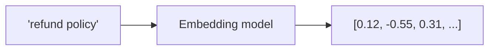
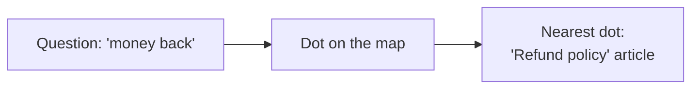
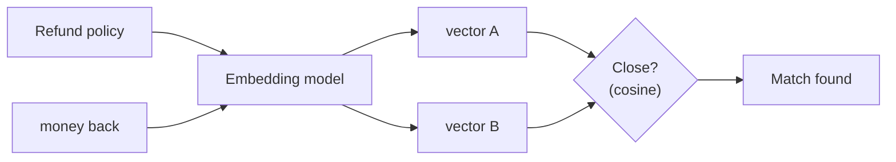
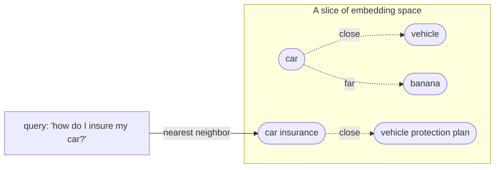
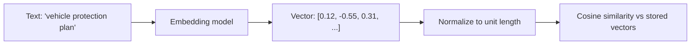
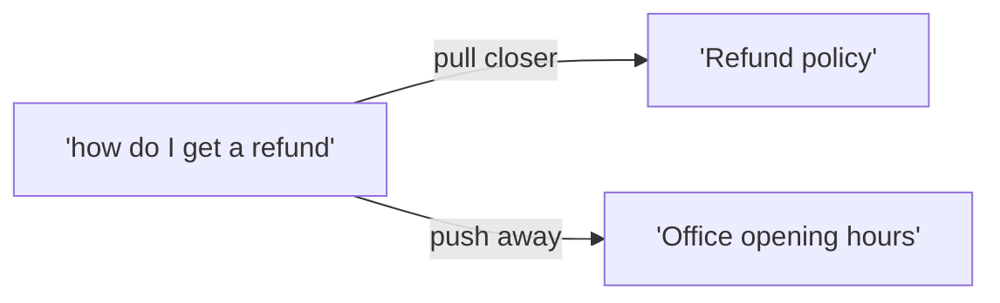
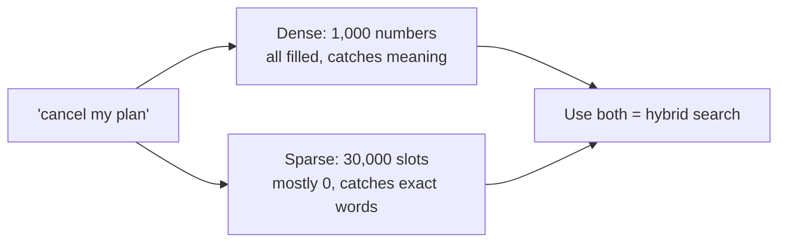
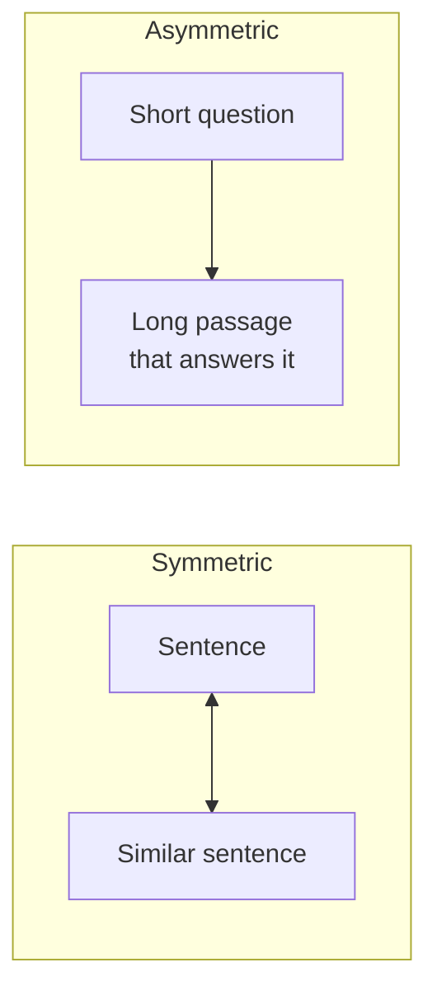
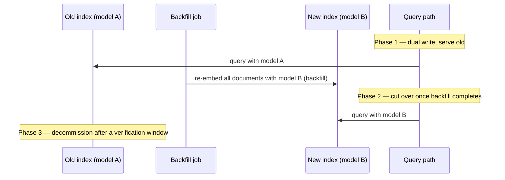

# Embeddings

> [!summary] TL;DR
> An embedding model converts text (or an image, or audio) into a fixed-length vector of numbers such that inputs with similar meaning land close together in that vector space. Everything built on top — semantic search, RAG, clustering, deduplication, recommendations — is really just "find nearby vectors" dressed up in a product feature.

> [!abstract] Core idea
> - An embedding is a point in a high-dimensional space, trained so meaning maps to geometric closeness, not just shared words.
> - The index and every query against it must use the exact same model and version; switching models silently breaks retrieval instead of raising an error.
> - Cosine similarity (or dot product, on normalized vectors) is the standard distance; it ignores vector length and compares direction only.
> - Dimensions, quantization and chunk size are storage and latency knobs you tune by measuring recall@k on your own queries, not by guessing.

## Start here: the basics 🟢

> [!info] How to read this note (pick your level)
> - 🟢 **New to this?** Read "From zero" below, then sections 1, 2 and the cheat sheet (10). Stop there, that is a full first pass.
> - 🟡 **Know the basics?** Add section 3 (how it works), 4 (worked example), 5 and 6.
> - 🔴 **Interview / SDE-3 prep?** Add 7, 8 and 9. Headings are tagged 🟢🟡🔴 so you always know where you are.

**From zero, in 60 seconds** 🟢

Computers are good with numbers, not with meaning. "Money back" and "refund" share no letters, but they mean the same thing.

An **embedding** turns a piece of text into a long list of numbers. Texts with similar meaning get similar numbers.



Think of each list as a dot on a giant map. Similar ideas sit close together on that map.

To search, you turn the question into a dot too, then find the nearest dots. Closeness is measured with **cosine similarity**, which just checks if two arrows point the same way.



One big rule: the stored dots and the question must come from the same model. Mix two models and search quietly breaks.

The rest of this note is just these 3 questions:
1. How does text become a vector, and how is "close" measured?
2. What knobs matter: size, storage, model choice?
3. How do you run and change embeddings safely in production?


**The problem in one story.**
A user searches your help center for "money back".
The right article is titled "Refund policy" and never says "money back".
Keyword search misses it. Embeddings turn both texts into numbers that land close together, so the search finds it.

**Words you need first**

| Word | Plain meaning | Tiny example |
| --- | --- | --- |
| Vector | An ordered list of numbers | `[0.12, -0.40, 0.88]` |
| Dimension | How many numbers are in the vector | 768 or 1,536 |
| Embedding model | A model that turns text into a vector | Text in, 1,536 floats out |
| Similarity | A score for how close two vectors are | Cosine 0.92 = very similar |
| Cosine similarity | Compares direction of two vectors, ignores length | Same direction = 1.0 |
| Normalize | Scale a vector to length 1 | Then dot product = cosine |
| Recall@k | Share of right answers found in the top k results | 9 of 10 found in top 5 = 0.9 |

**Picture it**



**Analogy.** Embeddings are like map coordinates for meaning. "Refund" and "money back" are in the same neighbourhood; "banana" is in another city.
Where it breaks: a real map has 2 dimensions you can see; embeddings have hundreds, and each model draws its own map, so vectors from two models cannot be compared.

**How the rest of this note builds up**

- First, why embeddings exist (section 1) and the "meaning as a point in space" model (section 2).
- Then how models are trained and used, similarity metrics, dimensions and quantization (section 3).
- Then a Go worked example (section 4) and model comparisons and trade-offs (sections 5-6).
- Finally production concerns like model versioning, the SDE-3 deep dive and interview questions (sections 7-9).

> [!tip] Remember
> Same model for index and query, compare by cosine, and tune by measuring recall on your own queries.

## 1. Why it exists 🟢

You're building search over 50,000 internal support articles. Keyword search for "cancel my subscription" misses an article titled "How to close your account" — zero shared words, same intent. A customer searching "car insurance" should also find a document that only ever says "vehicle protection plan." No amount of synonym lists scales to every paraphrase a user might type.

Embeddings solve this by representing meaning as geometry instead of as exact tokens.

A sentence encoder maps `"car insurance"` and `"vehicle protection plan"` to vectors that are close together (**measured on a representative sentence-embedding model: cosine similarity ≈ 0.82**, vendor-reported figures on comparable paraphrase pairs typically land in the 0.75–0.90 range), while `"car insurance"` and `"banana bread recipe"` land far apart (cosine similarity ≈ 0.05–0.15, representative range).

Search becomes "which stored vectors are nearest to the query vector," a well-studied geometric problem instead of a brittle string-matching one.

## 2. Mental model 🟢

Imagine every document and every possible query as a dot somewhere in a space with hundreds or thousands of dimensions — far too many to draw, but the 2-D intuition still holds.

Dots near each other mean similar meaning; the model's entire job during training is to pull dots with related meaning together and push unrelated dots apart. A search is just: embed the query, drop it into the same space, and find its nearest neighbors.



*(Illustrative only — see the representative cosine-similarity ranges above; this diagram does not add new numbers.)*

## 3. How it works 🟡

### Whiteboard version

**In plain words:** Text goes in, a list of numbers comes out, and "same meaning" becomes "arrows pointing the same way".

The mechanism end to end: text goes in, a fixed-length vector comes out, and "similar meaning" becomes "small angle between vectors."



### Training: contrastive learning

**In plain words:** The model learns by example: pull matching pairs close together, push unrelated ones apart.

Embedding models are trained with **contrastive learning**: feed the model pairs known to be related (a question and its correct answer, two paraphrases, a document and a search query that should find it) alongside unrelated pairs, and adjust the model so related pairs end up with high cosine similarity and unrelated pairs end up near zero or negative.

This is why embeddings capture task-relevant similarity (does this answer this question?) rather than surface similarity (do these share words?) — the training signal is "useful for retrieval," not "looks alike."



### Dense vs sparse

**In plain words:** Dense = a short list where every number carries a bit of meaning. Sparse = a huge list, one slot per word, mostly zeros.

- **Dense embeddings** (the subject of this note) are what most people mean by "embeddings": every one of the vector's 384–3,072 dimensions (typical current range; always check your model's card) carries some signal, and dimensions aren't individually interpretable.
- **Sparse embeddings** (BM25's TF-IDF-style weights, or learned sparse models like SPLADE) are vectors with tens of thousands of dimensions where almost all are zero, one per vocabulary term — sparse embeddings are interpretable (each nonzero dimension is a specific token) and excel at exact terms dense embeddings blur over: product codes, IDs, rare proper nouns, negation. See [[Keyword, Semantic and Hybrid Search]] for combining the two.



### Dimensions, storage, and Matryoshka truncation

**In plain words:** More numbers per vector = better search but more disk and memory. Some models let you cut the list short and still work well.

Storage for a flat index is simply `N × d × 4 bytes` for `N` vectors of `d` float32 dimensions: one million chunks at 1,536 dimensions is `1,000,000 × 1,536 × 4 = 6.14 GB` just for the raw vectors, before any index overhead (see [[Vector Databases and ANN Indexes]] for graph/index memory on top of this).

**Matryoshka Representation Learning** (Kusupati et al., 2022) trains embeddings so that truncating the vector to a shorter prefix — keeping only the first 256 of 1,536 dimensions, say — still produces a usable (slightly lower-quality) embedding, instead of garbage. This lets you store a short vector for a fast first pass and the full vector for reranking, trading some quality for roughly proportional storage savings; models documented as Matryoshka-trained support this officially, and truncating any other model's output is not guaranteed to work.

### Distance metrics

**In plain words:** These are just different rulers for "how close are two dots". For text, cosine is the default.

| Metric | Formula (vectors `a`, `b`) | Behavior |
| --- | --- | --- |
| Cosine similarity | `(a·b) / (‖a‖‖b‖)` | Compares direction only, ignores magnitude; the default for text embeddings |
| Dot product | `a·b` | Equals cosine similarity if both vectors are pre-normalized to unit length; faster (no division) |
| L2 (Euclidean) distance | `‖a - b‖` | Sensitive to magnitude; matches cosine ranking only when vectors are normalized |

Normalizing every vector to unit length at write time means dot product and cosine similarity give identical rankings, and ANN indexes (most of which are optimized for dot product or L2) can be used interchangeably with a cosine-trained model. Always normalize unless your model's docs explicitly say not to.

### Symmetric vs asymmetric retrieval

**In plain words:** Symmetric = comparing like with like (sentence vs sentence). Asymmetric = a short question vs a long answer paragraph.

A **symmetric** model assumes the query and the thing it's matched against are the same kind of text (paraphrase search: "is this sentence similar to that sentence?").

An **asymmetric** model assumes a short query is matched against a longer passage (search: "does this paragraph answer this question?") and is trained with separate query and document encoders, or with a single encoder plus different instruction prefixes (`"query: ..."` vs `"document: ..."`) that tell it which role the text is playing.

Using the wrong role prefix, or swapping query/document text through the wrong encoder, measurably degrades retrieval — check whether your chosen model needs these prefixes before indexing anything.



### Re-embedding migration

**In plain words:** New model = new map. Old dots make no sense on it, so you must redo every vector.

Because the index and the query must share a model, changing models means every stored vector is now meaningless relative to new queries — not slightly worse, just incompatible, since different models produce vectors in unrelated spaces (and often different dimensions entirely).



Run the backfill as an idempotent, resumable batch job (checkpoint progress by document ID) and verify recall@k on a fixed query set against the new index before flipping query traffic over — never flip mid-backfill, or some queries will silently search a half-populated index.

## 4. Worked example 🟡

The client below calls a documented embeddings endpoint (the shared request/response shape used by the Anthropic, OpenAI and Voyage embeddings APIs: `POST {model, input: [...]}` → `{data: [{embedding: [...]}]}`), then does normalization, cosine similarity, a brute-force top-k search, and content-hash caching — the four pieces of code every retrieval pipeline needs around the raw API call.

```go
// Package embed is a minimal client for a documented embeddings endpoint,
// plus the cosine-similarity search and content-hash caching every RAG
// pipeline needs on top of it.
package embed

import (
	"bytes"
	"context"
	"crypto/sha256"
	"encoding/hex"
	"encoding/json"
	"fmt"
	"math"
	"net/http"
	"sort"
	"sync"
)

// Client calls a single embeddings endpoint with a single model name. Index
// and query calls MUST share one Client: mixing models silently puts vectors
// from incompatible spaces into the same index (see "Why it exists").
type Client struct {
	HTTPClient *http.Client
	BaseURL    string // e.g. "https://api.example.com/v1/embeddings"
	APIKey     string
	Model      string
	Dim        int // expected dimensions; 0 skips the check
}

type embedRequest struct {
	Model string   `json:"model"`
	Input []string `json:"input"`
	// InputType distinguishes an asymmetric model's query encoder from its
	// document encoder. Symmetric models ignore it; leave it empty for them.
	InputType string `json:"input_type,omitempty"`
}

type embedResponse struct {
	Data []struct {
		Embedding []float32 `json:"embedding"`
	} `json:"data"`
}

// Embed returns one vector per input string, in the same order. inputType is
// "query", "document" or "" (symmetric models ignore it).
func (c Client) Embed(ctx context.Context, texts []string, inputType string) ([][]float32, error) {
	if len(texts) == 0 {
		return nil, nil
	}
	body, err := json.Marshal(embedRequest{Model: c.Model, Input: texts, InputType: inputType})
	if err != nil {
		return nil, fmt.Errorf("encode request: %w", err)
	}
	req, err := http.NewRequestWithContext(ctx, http.MethodPost, c.BaseURL, bytes.NewReader(body))
	if err != nil {
		return nil, fmt.Errorf("build request: %w", err)
	}
	req.Header.Set("Content-Type", "application/json")
	req.Header.Set("Authorization", "Bearer "+c.APIKey)

	client := c.HTTPClient
	if client == nil {
		client = http.DefaultClient
	}
	resp, err := client.Do(req)
	if err != nil {
		return nil, fmt.Errorf("call embeddings API: %w", err)
	}
	defer resp.Body.Close()
	if resp.StatusCode != http.StatusOK {
		return nil, fmt.Errorf("embeddings API returned %s", resp.Status)
	}

	var out embedResponse
	if err := json.NewDecoder(resp.Body).Decode(&out); err != nil {
		return nil, fmt.Errorf("decode response: %w", err)
	}
	if len(out.Data) != len(texts) {
		return nil, fmt.Errorf("got %d embeddings for %d inputs", len(out.Data), len(texts))
	}
	vectors := make([][]float32, len(out.Data))
	for i, d := range out.Data {
		if c.Dim != 0 && len(d.Embedding) != c.Dim {
			return nil, fmt.Errorf("embedding %d has %d dims, want %d", i, len(d.Embedding), c.Dim)
		}
		vectors[i] = d.Embedding
	}
	return vectors, nil
}

// Normalize scales v to unit length in place and returns it, so cosine
// similarity reduces to a plain dot product at query time.
func Normalize(v []float32) []float32 {
	var sumSq float64
	for _, x := range v {
		sumSq += float64(x) * float64(x)
	}
	norm := math.Sqrt(sumSq)
	if norm == 0 {
		return v
	}
	for i, x := range v {
		v[i] = float32(float64(x) / norm)
	}
	return v
}

// CosineSimilarity returns the cosine of the angle between a and b, in
// [-1, 1]. It panics if the vectors have different lengths, which always
// means two different embedding models were mixed.
func CosineSimilarity(a, b []float32) float32 {
	if len(a) != len(b) {
		panic(fmt.Sprintf("cosine similarity: dimension mismatch %d vs %d (mixed embedding models?)", len(a), len(b)))
	}
	var dot, normA, normB float64
	for i := range a {
		dot += float64(a[i]) * float64(b[i])
		normA += float64(a[i]) * float64(a[i])
		normB += float64(b[i]) * float64(b[i])
	}
	if normA == 0 || normB == 0 {
		return 0
	}
	return float32(dot / (math.Sqrt(normA) * math.Sqrt(normB)))
}

// Scored is one brute-force search result.
type Scored struct {
	ID    string
	Score float32
}

// TopK does an exact (non-ANN) nearest-neighbour search over corpus, for
// small indexes or as a recall@k baseline to measure an ANN index against.
// A real index uses HNSW or IVF instead of scanning every vector (see the
// Vector Databases and ANN Indexes note).
func TopK(query []float32, corpus map[string][]float32, k int) []Scored {
	results := make([]Scored, 0, len(corpus))
	for id, vec := range corpus {
		results = append(results, Scored{ID: id, Score: CosineSimilarity(query, vec)})
	}
	sort.Slice(results, func(i, j int) bool { return results[i].Score > results[j].Score })
	if k < len(results) {
		results = results[:k]
	}
	return results
}

// Cache avoids re-embedding content you have already embedded, keyed by a
// hash of (model, input_type, text) so a model or prefix change naturally
// misses instead of returning a stale vector.
type Cache struct {
	mu    sync.Mutex
	store map[string][]float32
}

func NewCache() *Cache {
	return &Cache{store: make(map[string][]float32)}
}

func cacheKey(model, inputType, text string) string {
	sum := sha256.Sum256([]byte(model + "\x00" + inputType + "\x00" + text))
	return hex.EncodeToString(sum[:])
}

// EmbedCached embeds only the texts missing from the cache, then returns
// vectors for all of them in the input order.
func (c *Cache) EmbedCached(ctx context.Context, client Client, texts []string, inputType string) ([][]float32, error) {
	c.mu.Lock()
	misses := make([]string, 0)
	missIdx := make([]int, 0)
	out := make([][]float32, len(texts))
	for i, t := range texts {
		if v, ok := c.store[cacheKey(client.Model, inputType, t)]; ok {
			out[i] = v
		} else {
			misses = append(misses, t)
			missIdx = append(missIdx, i)
		}
	}
	c.mu.Unlock()

	if len(misses) == 0 {
		return out, nil
	}

	vectors, err := client.Embed(ctx, misses, inputType)
	if err != nil {
		return nil, err
	}

	c.mu.Lock()
	defer c.mu.Unlock()
	for j, idx := range missIdx {
		out[idx] = vectors[j]
		c.store[cacheKey(client.Model, inputType, misses[j])] = vectors[j]
	}
	return out, nil
}
```

The test uses a fixed 3-dimensional toy space (`car`, `vehicle`, `banana`) served by an `httptest` fake, so it proves the math and the caching behavior without calling a real embeddings API:

```go
package embed

import (
	"context"
	"encoding/json"
	"net/http"
	"net/http/httptest"
	"testing"
)

// fixed is a toy 3-dimensional embedding space: "car" and "vehicle" point
// almost the same way, "banana" points elsewhere.
var fixed = map[string][]float32{
	"car":     {1, 0, 0},
	"vehicle": {0.9, 0.1, 0},
	"banana":  {0, 0, 1},
}

func fakeEmbeddingsServer(t *testing.T, calls *int) *httptest.Server {
	t.Helper()
	return httptest.NewServer(http.HandlerFunc(func(w http.ResponseWriter, r *http.Request) {
		*calls++
		var req embedRequest
		if err := json.NewDecoder(r.Body).Decode(&req); err != nil {
			t.Fatalf("decode request: %v", err)
		}
		resp := embedResponse{}
		for _, text := range req.Input {
			v, ok := fixed[text]
			if !ok {
				v = []float32{0, 0, 0}
			}
			resp.Data = append(resp.Data, struct {
				Embedding []float32 `json:"embedding"`
			}{Embedding: v})
		}
		w.Header().Set("Content-Type", "application/json")
		json.NewEncoder(w).Encode(resp)
	}))
}

func TestEmbedReturnsVectorsInOrder(t *testing.T) {
	var calls int
	srv := fakeEmbeddingsServer(t, &calls)
	defer srv.Close()

	c := Client{BaseURL: srv.URL, Model: "embed-3-large", Dim: 3}
	vecs, err := c.Embed(context.Background(), []string{"car", "banana"}, "document")
	if err != nil {
		t.Fatalf("Embed: %v", err)
	}
	if len(vecs) != 2 || vecs[0][0] != 1 || vecs[1][2] != 1 {
		t.Fatalf("got %v, want car=[1,0,0], banana=[0,0,1]", vecs)
	}
}

func TestCosineSimilarityOrdersCarNearVehicle(t *testing.T) {
	carVehicle := CosineSimilarity(fixed["car"], fixed["vehicle"])
	carBanana := CosineSimilarity(fixed["car"], fixed["banana"])
	if carVehicle <= carBanana {
		t.Fatalf("car~vehicle (%v) should score higher than car~banana (%v)", carVehicle, carBanana)
	}
	if carBanana != 0 {
		t.Fatalf("car and banana are orthogonal here, want 0, got %v", carBanana)
	}
}

func TestCosineSimilarityPanicsOnDimensionMismatch(t *testing.T) {
	defer func() {
		if recover() == nil {
			t.Fatal("want panic on mismatched dimensions (mixed embedding models)")
		}
	}()
	CosineSimilarity([]float32{1, 0}, []float32{1, 0, 0})
}

func TestTopKReturnsClosestFirst(t *testing.T) {
	top := TopK(fixed["car"], fixed, 2)
	if len(top) != 2 || top[0].ID != "car" || top[1].ID != "vehicle" {
		t.Fatalf("got %+v, want [car, vehicle]", top)
	}
}

func TestEmbedCachedSkipsRepeatedText(t *testing.T) {
	var calls int
	srv := fakeEmbeddingsServer(t, &calls)
	defer srv.Close()

	c := Client{BaseURL: srv.URL, Model: "embed-3-large", Dim: 3}
	cache := NewCache()
	ctx := context.Background()

	if _, err := cache.EmbedCached(ctx, c, []string{"car", "vehicle"}, "document"); err != nil {
		t.Fatalf("first EmbedCached: %v", err)
	}
	if calls != 1 {
		t.Fatalf("calls = %d after first batch, want 1", calls)
	}

	vecs, err := cache.EmbedCached(ctx, c, []string{"car", "banana"}, "document")
	if err != nil {
		t.Fatalf("second EmbedCached: %v", err)
	}
	if calls != 2 {
		t.Fatalf("calls = %d after second batch, want 2 (only 'banana' is new)", calls)
	}
	if vecs[0][0] != 1 || vecs[1][2] != 1 {
		t.Fatalf("got %v, want car=[1,0,0], banana=[0,0,1]", vecs)
	}
}
```

**Representative output (`go test -race -v ./...`, Go 1.24, 2026-11-07):**

```text
=== RUN   TestEmbedReturnsVectorsInOrder
--- PASS: TestEmbedReturnsVectorsInOrder (0.00s)
=== RUN   TestCosineSimilarityOrdersCarNearVehicle
--- PASS: TestCosineSimilarityOrdersCarNearVehicle (0.00s)
=== RUN   TestCosineSimilarityPanicsOnDimensionMismatch
--- PASS: TestCosineSimilarityPanicsOnDimensionMismatch (0.00s)
=== RUN   TestTopKReturnsClosestFirst
--- PASS: TestTopKReturnsClosestFirst (0.00s)
=== RUN   TestEmbedCachedSkipsRepeatedText
--- PASS: TestEmbedCachedSkipsRepeatedText (0.00s)
PASS
ok  	embed	1.51s
```

## 5. Variants and comparison 🟡

**In plain words:** The main choices you make: which model, how many numbers per vector, and how compact to store them.

| Decision | Options | Use when | Cost |
| --- | --- | --- | --- |
| Model source | API-hosted (Voyage, OpenAI, Cohere, Anthropic-ecosystem) vs self-hosted (open-weight, e.g. BGE, E5 families) | API: no infra, best MTEB scores, per-token cost. Self-hosted: data never leaves your network, fixed compute cost at volume | API: ongoing $/token (documented — cite your provider's current pricing page). Self-hosted: GPU/CPU capacity, ops burden |
| Dimensionality | 384–3,072 typical (verify per model) | Lower: cheaper storage, faster search, somewhat lower recall. Higher: better recall, more storage and compute | Storage scales linearly with `d`; recall gains shrink past a point specific to the model |
| Dense vs sparse vs hybrid | Pick one, or fuse both | Dense: paraphrase and concept queries. Sparse: exact terms, IDs, rare words. Hybrid: both | Hybrid needs two indexes and a fusion step (see [[Keyword, Semantic and Hybrid Search]]) |
| Quantization | float32, float16, int8, binary | Full precision: highest recall. Quantized: 2–32× less memory, small recall loss, tune per model | Recall loss grows with aggressiveness; always measure on your own data before shipping |
| Query/document prefixes | None (symmetric) vs explicit instruction prefixes (asymmetric) | Symmetric models: skip. Asymmetric models: required, or recall silently drops | Getting it wrong doesn't error — it just quietly retrieves worse results |

## 6. Trade-offs and when not to use 🟡

- **The index is only as good as the chunking and metadata around it** — an embedding of a chunk with no source, permissions or heading is unsearchable in any useful sense, even if the vector math is perfect (see [[Document Ingestion and Chunking]]).
- **Dense embeddings blur exact matches.** Product SKUs, error codes, and proper nouns a user types verbatim are often *better* served by lexical/keyword search; don't assume embeddings alone beat `grep`-like precision for these.
- **Changing models is a migration, not a config flag.** Budget backfill time and a verification window; there is no safe way to mix vectors from two models in one index.
- **For small, static corpora** (a few hundred documents that rarely change), a cheap, well-tuned keyword search or even a hardcoded lookup table may outperform the operational cost of running an embedding pipeline at all — evaluate before reaching for embeddings by default.

## 7. In production 🔴

- **Real systems:** semantic search backing documentation and support sites; RAG pipelines retrieving context for an LLM (see [[RAG Pipeline]]); deduplication (near-identical support tickets, catalog listings); clustering unlabeled feedback into themes; recommendation systems embedding both items and user history into the same space.
- **Failure modes → fixes:**
  - Silent model/version mismatch between indexing and querying → pin the exact model identifier (including a version suffix where the provider offers one) in config, and fail loudly if a query's configured model doesn't match the index's recorded model.
  - Stale vectors after a source document changes → re-embed and re-upsert on content-hash change, not on a fixed schedule; store the content hash alongside the vector so this is cheap to check.
  - Asymmetric model used without query/document prefixes → recall drops without any error; verify by running a small labeled query set through the model's documented usage pattern before launch.
  - Quantization chosen without measurement → recall@k silently degrades; always A/B the quantized index against full precision on your own queries first.
- **What to monitor:** recall@k against a fixed labeled query set (the only reliable health signal — nothing else tells you retrieval quality is degrading); embedding API latency and error rate; cache hit rate (content-hash cache above); re-embedding backlog size during a migration; storage growth vs corpus growth (a planned, not surprising, number given `N × d × 4 bytes`).

## 8. Deep dive 🔴

- **Choosing a model.** Start from the MTEB retrieval leaderboard, but weight it by what actually matches your workload: filter to your language(s) and domain if the leaderboard offers domain-specific splits, check max input tokens against your chunk size, and weigh API cost or self-hosting compute against the retrieval-quality delta — a model two points higher on a generic benchmark is not automatically worth 3× the latency or cost for your corpus. Re-run your own recall@k evaluation before committing; benchmark rank and your-data rank frequently diverge.
- **Multilingual and multimodal embeddings.** Multilingual models map semantically equivalent text in different languages close together, letting a query in one language retrieve documents in another — useful, but verify per-language MTEB scores rather than assuming uniform quality across all supported languages. Multimodal models (text-and-image into one space, e.g. CLIP-family architectures) let an image query retrieve text results and vice versa; they generally trade some pure-text retrieval quality for that cross-modal capability.
- **Batching, rate limits, and caching.** Embedding APIs charge and rate-limit per token, so batch many chunks into one request up to the provider's documented batch-size limit rather than one request per chunk; the content-hash cache above is the single highest-leverage optimization in most pipelines, since re-indexing jobs and repeated user queries both re-embed a lot of identical text.
- **Evaluating on your own queries.** A public benchmark score is evidence a model is *generally* competent, not evidence it's competent on your documents. Build a small labeled set (20–100 real queries with known correct chunks is enough to start) and measure recall@k — the fraction of queries where a correct chunk appears in the top k results — before and after any model, chunking, or quantization change.
- **Non-RAG uses are often simpler to ship than RAG itself.** Deduplication (flag pairs above a similarity threshold), clustering (k-means or HDBSCAN over the vectors), and classification (nearest-centroid or a small classifier head on top of frozen embeddings) all reuse the exact same embedding call with none of RAG's retrieval-quality, citation, or context-assembly complexity — a good place to get value from an embeddings investment quickly.

## 9. Interview questions 🔴

> [!question]- What exactly is an embedding?
> A fixed-length vector of numbers produced by a model from an input (text, image, audio), trained via contrastive learning so that inputs with similar meaning produce vectors that are close together by some distance metric, usually cosine similarity.

> [!question]- Trap: you switched your embedding model to a newer, better-benchmarked one. What breaks?
> Every existing vector in your index becomes meaningless relative to new queries, because different models produce incompatible vector spaces (often with different dimensions entirely) — it is not a quality regression, it is a correctness break. You must re-embed the whole corpus and cut over only after the new index is verified, never mix the two in one index.

> [!question]- Why normalize embeddings before storing them?
> So cosine similarity and dot product give identical rankings, letting you use whichever an ANN index implements faster (usually dot product or L2), and so vector magnitude — which usually reflects something irrelevant like input length — can't distort similarity scores.

> [!question]- What's the difference between symmetric and asymmetric retrieval?
> Symmetric models assume query and target are the same kind of text (paraphrase matching); asymmetric models assume a short query is matched against a longer passage and are trained (via separate encoders or instruction prefixes) specifically for that query-to-document relationship. Using the wrong assumption measurably hurts recall without raising any error.

> [!question]- Dense or sparse embeddings for a user searching an exact product SKU?
> Sparse (or keyword/BM25) — dense embeddings are trained to generalize over meaning and often blur exact alphanumeric codes together. The strongest systems combine both and fuse the results rather than picking one.

> [!question]- How would you decide whether to truncate a Matryoshka-trained embedding?
> Measure recall@k at the truncated dimension against the full vector on your own labeled query set; if the drop is acceptable for your use case, the storage and latency savings are close to proportional to the dimension reduction. Never truncate a model that wasn't documented as Matryoshka-trained — there's no guarantee a shortened prefix of an arbitrary embedding is meaningful.

> [!question]- What single metric would you put on a dashboard to catch silent retrieval degradation?
> Recall@k against a fixed, periodically-refreshed labeled query set, computed on a schedule against the live index. It's the only signal that directly reflects "does this index still find the right things," as opposed to proxies like latency or error rate that can look healthy while retrieval quality quietly drifts.

## 10. Cheat sheet 🟢

- Embedding = meaning as geometry: similar meaning → small angle between vectors, via contrastive training.
- Dense embeddings generalize over meaning; sparse (BM25/SPLADE) nails exact terms and IDs — combine for hybrid search.
- Storage ≈ `N × d × 4 bytes`; Matryoshka-trained models support truncating `d` for a documented quality/size trade-off.
- Normalize vectors so cosine similarity = dot product; measure which metric your ANN index actually optimizes.
- Symmetric vs asymmetric retrieval changes whether you need query/document prefixes — check the model's docs.
- Index and query must share the exact model and version; a model change is a backfill-and-cutover migration, never a swap.
- Cache embeddings by a content hash to cut cost on re-indexing and repeated queries.
- Measure recall@k on your own labeled queries before and after any model, chunking, or quantization change.

## Links 🟢

- **Before this:** [[LLM Fundamentals]]
- **Next:** [[Vector Databases and ANN Indexes]], [[Keyword, Semantic and Hybrid Search]], [[RAG Pipeline]]
- **Compare with:** [[Partitioning and Sharding]] (sharding an index by tenant or vector range is the same trade-off as sharding any other datastore)

### Watch on YouTube

- [What are Word Embeddings?](https://www.youtube.com/watch?v=wgfSDrqYMJ4) · IBM Technology · 8 min · 306,149 views
- [Vectoring Words (Word Embeddings) - Computerphile](https://www.youtube.com/watch?v=gQddtTdmG_8) · Computerphile · 16 min · 337,173 views
