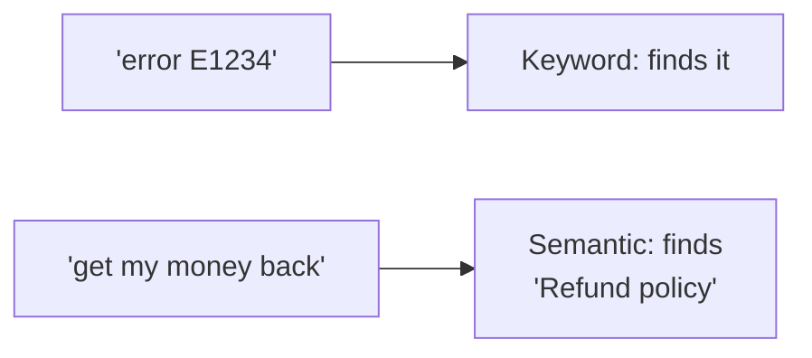
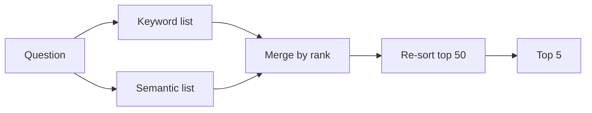
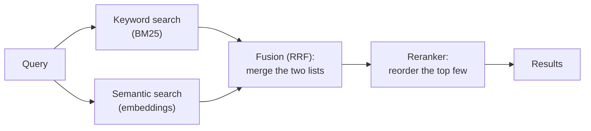
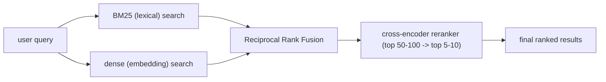
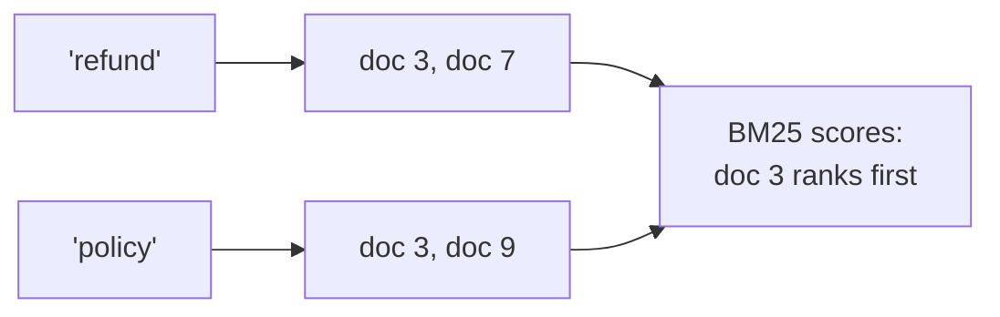
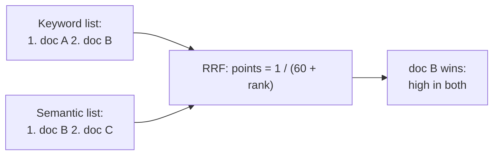
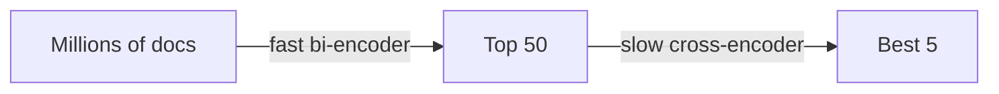
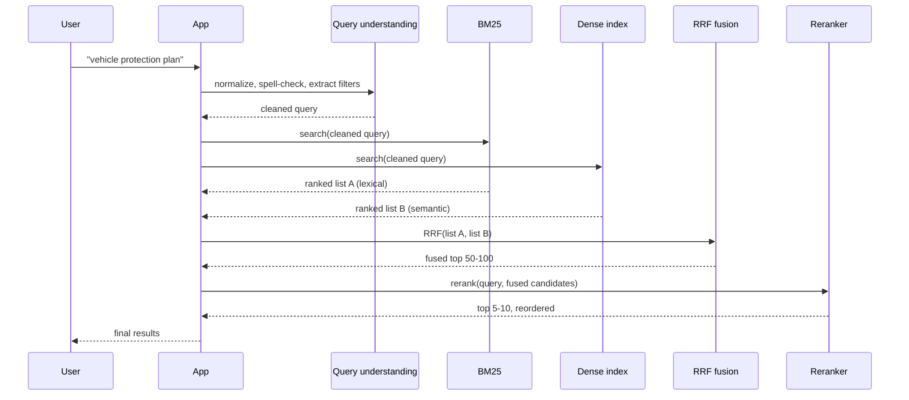

# Keyword, Semantic and Hybrid Search

> [!summary] TL;DR
> Keyword (lexical) search matches analyzed tokens and ranks them with BM25; semantic (dense) search matches meaning using embeddings (see [[Embeddings]]). Each one misses cases the other catches, so production search usually runs both and fuses the results, then reranks the fused top candidates with a model that reads the query and each document together.

> [!abstract] Core idea
> - Keyword search is exact-token matching scored by BM25: great at IDs, codes and rare terms; blind to paraphrase and synonyms.
> - Semantic search embeds query and document into the same vector space and ranks by similarity: great at paraphrase; weak on exact identifiers and negation.
> - Hybrid search runs both retrievers in parallel and fuses their rankings with Reciprocal Rank Fusion (RRF) — no score rescaling needed.
> - Reranking takes the fused top 50–100 candidates and reorders them with a cross-encoder, which reads query and document jointly instead of comparing two independent vectors.
> - The question "is hybrid search worth it?" is answered with precision@k / recall@k / MRR / nDCG on your own queries, not intuition.

## Start here: the basics 🟢

> [!info] How to read this note (pick your level)
> - 🟢 **New to this?** Read "From zero" below, then sections 1, 2 and the cheat sheet (10). Stop there, that is a full first pass.
> - 🟡 **Know the basics?** Add section 3 (how it works), 4 (worked example), 5 and 6.
> - 🔴 **Interview / SDE-3 prep?** Add 7, 8 and 9. Headings are tagged 🟢🟡🔴 so you always know where you are.

> [!note] Before this note
> - [[Embeddings]]: text becomes a list of numbers, and texts with similar meaning get nearby numbers.
> - [[Search Engines and Inverted Indexes]]: a search engine keeps a word → documents list so it can find every page with a word without reading them all.

**From zero, in 60 seconds** 🟢

There are two main ways to search text. One matches exact words. The other matches meaning.

**Keyword search** finds documents that contain your exact words. It is great for codes like "E1234" or an order ID. It fails when you use different words, like "money back" vs "refund".

**Semantic search** turns text into numbers that capture meaning (embeddings). It finds "refund" for "money back". But it can miss exact codes and IDs.



**Hybrid search** runs both and merges the two result lists. Then a careful second model can re-sort the top few.



The rest of this note is just these 3 questions:
1. How does each kind of search work, and where does it fail?
2. How do you merge two lists that use different scores?
3. How do you run it fast and measure it in production?


**The problem in one story.**
A user types "error E1234 when paying" into your help search.
A word-matching search finds the page with the exact code "E1234".
A meaning-based search finds the page titled "payment failures" even though it never says "paying".
Each one misses what the other finds, so good systems run both and merge the results.

**Words you need first**

| Word | Plain meaning | Tiny example |
| --- | --- | --- |
| Query | The text the user searches with | "reset my password" |
| Document | One item you can return (a page or a chunk) | One help-center article |
| Token / term | One word-like piece of text | "reset", "password" |
| Inverted index | A map from each word to the documents containing it | "password" → docs 3, 8, 41 |
| Embedding | A list of numbers that captures a text's meaning | "car" and "automobile" get nearby vectors |
| Similarity | A score for how close two vectors are | Cosine similarity of 0.92 = very close |
| Ranking | Ordering results best first | Top 10 results on a page |
| Recall / precision | Did we find the right items / how many results were right | Found 8 of 10 relevant; 8 of 20 shown were relevant |
| BM25 | The standard formula that scores a document by matching words | Rare words and short pages score higher |
| Stemming | Cutting words to their root so forms match | "running" → "run" |
| RRF (Reciprocal Rank Fusion) | Merging lists by position, not by score | Rank 1 gets 1/61 points |
| Reranker | A slower model that re-reads the top results with the question | Re-orders the top 50 into the best 5 |
| Bi-encoder / cross-encoder | Encode question and document separately / read them together | Fast first search / careful second look |

**Picture it**



**Analogy.**
Keyword search is a book's index at the back (exact words, page numbers); semantic search is asking a librarian who understands what you mean.
Where it breaks: a librarian can explain why they chose a book, while an embedding gives only a similarity number and can confuse "refund allowed" with "refund not allowed".

**How the rest of this note builds up**

- First "Why it exists" and the "Mental model": why one retriever alone fails on real queries.
- Then "How it works": the inverted index and BM25, dense retrieval, Reciprocal Rank Fusion, reranking, and query understanding.
- Then a worked Go example of hybrid retrieval with fusion, and how to measure it with precision@k, recall@k, MRR and nDCG.
- Finally the SDE-3 deep dive: why RRF beats score averaging, why reranking still matters after fusion, trade-offs and interview questions.

> [!tip] Remember
> Keyword search finds exact words, semantic search finds meaning; hybrid runs both, merges by rank, and lets measurements on your own queries decide.

## 1. Why it exists 🟢

A user searching a support knowledge base types `INV-20451 refund status`. Semantic search alone can fail here: an embedding model was trained to cluster meaning, and an invoice code is meaningless to it — it may retrieve documents about "refund policy" in general and miss the one document that literally contains `INV-20451`.

Now the same system gets the query `how do I get my money back`. Pure keyword (BM25) search can fail *there*: if no stored document contains those literal words, scored results are zero, even though a document titled "Refund Policy and Process" is exactly what the user wants.

Neither retriever is strictly better — they fail on different, overlapping query shapes. Running both and combining the rankings catches both cases, which is why almost every production search system (web search, e-commerce, enterprise knowledge bases, RAG) is hybrid by default rather than picking one.

### Real-life example 🟢

Think of the search bar in a shopping app like Flipkart or Amazon. Someone types "iPhone 15 128GB blue". Keyword search nails this: the exact model, size and colour words all match.
Someone else types "phone for my mom, simple and big screen". No product says that; meaning-based search finds large, easy-to-use phones.
The app runs both searches, merges the two lists, and a reranker reads the top 50 with the query to pick the best 10 for the first screen.

### Common beginner mistakes 🟢

- **Going "AI only" and dropping keyword search** → order IDs, error codes and model numbers stop being found → keep BM25 and merge it with semantic results.
- **Adding the two raw scores together** → a BM25 score of 12 and a cosine of 0.8 are on different scales, so one list swamps the other → merge by rank with RRF.
- **Running the reranker on everything** → it reads each pair one at a time and is too slow for millions → rerank only the top 50-100.
- **Judging search by eye** → a few good-looking queries hide many bad ones → measure precision@k and recall@k on a labelled set of real queries.
- **Letting the analyzer change codes** → stemming or lowercasing can break "SKU-88A" → test that exact IDs survive indexing.

## 2. Mental model 🟢

- **Keyword search** is a librarian who only recognizes the exact words you say. Say "car insurance" and they find every book with those words. Say "vehicle protection plan" and, unless that exact phrase is in a book, they shrug.
- **Semantic search** is a librarian who understands what you mean but sometimes mishears specific names and numbers. Say "vehicle protection plan" and they correctly bring you the car insurance book. Say "invoice INV-20451" and they might bring you ten unrelated invoices, because the specific code didn't register as meaningfully different from any other.
- **Hybrid search** asks both librarians, then a third person (fusion) merges their two lists into one, favoring anything both librarians agreed was relevant.
- **Reranking** is a final expert who actually reads the top candidates against the question, rather than skimming by title — slower, so only run it on the shortlist, not the whole library.

## 3. How it works 🟡

> 🟢 → 🟡 **You now know** that keyword search matches words, semantic search matches meaning, and hybrid runs both. **Next we open the box**: how BM25 scores pages, how dense search finds near meanings fast, how RRF merges two lists, how a reranker picks the final order, and how the question gets cleaned first. Each subsection starts with a plain step-by-step walk.

**In plain words:** Both searches run side by side, their lists get merged, and a slower but smarter model picks the final order.



### Keyword search: inverted index + BM25

**In plain words:** Like the index at the back of a book: each word points to the pages it appears on. BM25 decides which page ranks first.

**Step by step:**
1. At write time, clean each document: lowercase it, split it into words, cut words to their root ("refunds" → "refund").
2. Add each word to the inverted index: "refund" → docs 3 and 7; "policy" → docs 3 and 9.
3. At query time, clean "Refund Policy" the same way and look up both words.
4. Score each document: a rare word counts more than a common one, a short page counts more than a long one, and the 10th repeat of a word adds little.
5. Doc 3 has both words, so it ranks first.

Full detail:

Documents are **analyzed** (cleaned and split into searchable words) before indexing: lowercased, tokenized, usually stemmed (`running` → `run`) and sometimes expanded with synonyms. The analyzed tokens populate an **inverted index** (term → list of documents containing it) — see [[Search Engines and Inverted Indexes]] for the index structure itself.

Early lexical (word-based) ranking used **TF-IDF** (term frequency × inverse document frequency: "how often the word is in this page" times "how rare the word is across all pages"); modern systems use **BM25**, which adds two corrections TF-IDF lacks:

- **Term frequency saturation** (`k1`, typically 1.2–2.0): the 10th occurrence of a word barely matters more than the 5th, instead of scoring linearly.
- **Length normalization** (`b`, typically 0.75): a term match in a short document counts for more than the same match diluted across a long one.

```text
BM25(D, q) = Σ over query terms t:  idf(t) · f(t,D)·(k1+1) / (f(t,D) + k1·(1 - b + b·|D|/avgdl))
```

where `f(t,D)` is how many times term `t` appears in document `D`, and `avgdl` is the average document length in the corpus.



### Dense (semantic) retrieval

**In plain words:** Turn the question and every document into points on a meaning map, then grab the nearest points.

**Step by step:**
1. Ahead of time, embed every document once and store the vectors.
2. When a query arrives, embed only the query: "vehicle protection plan".
3. Ask the ANN index for the nearest stored vectors.
4. The "Car insurance" page comes back, though it shares no words with the query.
5. This is fast because the documents were embedded before anyone searched.

Full detail:

The query and every document are embedded into the same vector space (same model and version — see [[Embeddings]] for why mixing models breaks this), and ranked by cosine similarity.

This is a **bi-encoder**: query and document are embedded independently, which is what makes it fast enough to search millions of documents (the document vectors are precomputed; only the query is embedded at search time), via an ANN index (see [[Vector Databases and ANN Indexes]]).

There is also a middle ground worth knowing by name: **learned sparse retrieval** (SPLADE and similar models) produces a sparse, term-weighted vector — like BM25's term list, but with weights learned by a model that also does synonym-style expansion.

It keeps the exact-match strength of lexical search while picking up some of dense retrieval's paraphrase handling, and it plugs into the same inverted-index infrastructure as BM25 instead of needing an ANN index.

### Fusion: Reciprocal Rank Fusion (RRF)

**In plain words:** The two scores can't be compared, so ignore scores and use positions. Being near the top of both lists wins.

**Step by step:**
1. Keyword list: 1. doc A, 2. doc B. Semantic list: 1. doc B, 2. doc C.
2. Each place earns `1 / (60 + rank)` points: rank 1 = 1/61 ≈ 0.0164, rank 2 = 1/62 ≈ 0.0161.
3. Doc B: 0.0161 + 0.0164 ≈ 0.0325 (in both lists).
4. Doc A: 0.0164 (keyword only). Doc C: 0.0161 (semantic only).
5. Final order: B, A, C. Being good in both lists beats being top in one.

Full detail:

BM25 scores and cosine similarities live on different, incomparable scales (BM25 is unbounded and corpus-dependent; cosine is bounded `[-1, 1]`), so you cannot just add them together. RRF sidesteps the problem by fusing **ranks**, not scores:

```text
RRF_score(doc) = Σ over each ranked list:  1 / (k + rank(doc))
```

`k` is a damping constant (a fixed number that softens the gap between ranks; 60 is the value the original paper measured and that most systems still use) that keeps the gap between rank 1 and rank 2 from dominating the sum.

A document ranked 1st in one list and 3rd in another beats one ranked 2nd in both only if the specific numbers work out — RRF rewards consistently-good ranking across retrievers, not an extreme result in just one.



### Reranking: bi-encoder recall, cross-encoder precision

**In plain words:** A fast search finds 50 maybe-good results. A slow, careful model reads each one with the question and picks the best.

**Step by step:**
1. Hybrid search returns 50 candidates for "is water damage covered?".
2. The reranker reads the question and candidate 1 together and gives a score, then candidate 2, and so on: 50 separate model runs.
3. It notices that candidate 4 says "water damage is **not** covered", which the earlier vector search blurred.
4. Sort the 50 by the new scores.
5. Keep the top 5 for the user or the LLM prompt.

Full detail:

A **cross-encoder** reranker takes the query and one candidate document **together** as input to a single model, and outputs a relevance score directly — it can notice that a candidate contains the exact phrase, or a negation, or a subtle mismatch, because it reads both texts jointly instead of comparing two independently-computed vectors.

This makes it more accurate than a bi-encoder, but too slow to run over a whole corpus (every query-document pair needs its own forward pass, one full run of the model), so the standard pipeline is: **retrieve** 50–100 candidates cheaply with BM25/dense/fusion, then **rerank** only those with a cross-encoder, then keep the top 5–10 for the LLM prompt or the results page.

**Late interaction** (ColBERT and successors) is a third design point between bi-encoders and cross-encoders: it embeds each token of the query and document separately (like a bi-encoder, so document vectors are still precomputable), but scores a pair by matching individual token vectors against each other (closer to what a cross-encoder does), trading some speed for better accuracy than a plain bi-encoder without paying the full cross-encoder cost.



### Query understanding

**In plain words:** Clean up the question first: fix spelling, add synonyms, pull out filters like dates or brands.

**Step by step:**
1. The user types "nkie shoes under 3000".
2. Spelling fix: "nike shoes under 3000".
3. Filter pull-out: `brand = Nike`, `price < 3000` become real filters, not search words.
4. Synonym add: "shoes" may also match "sneakers".
5. Both the keyword and the semantic search now run on "shoes" with those filters.

Full detail:

Before retrieval even runs, real systems apply spelling correction, synonym expansion, and filter extraction (pulling a date range, category or brand out of free text into a structured filter) — these live in a query-understanding layer upstream of both retrievers and reduce the burden on BM25 and the embedding model alike.



## 4. Worked example 🟡

### Whiteboard version

**In plain words:** The merge formula in a few lines: each document gets points for how high it sits in each list.

Fusing two already-ranked lists with RRF is the one formula worth knowing cold:

```go
package wb

func rrf(k int, lists ...[]string) map[string]float64 {
    scores := map[string]float64{}
    for _, list := range lists {
        for i, id := range list {
            scores[id] += 1.0 / float64(k+i+1) // rank is 1-based
        }
    }
    return scores
}
```

The full version below builds real BM25 and dense retrievers over a tiny document set, fuses them, and reranks the result — the whole pipeline from the diagram above, tested end to end.

A Go implementation that compiles and passes `go vet` and `go test -race` on Go 1.24. The "dense" retriever below is a hand-built synonym-bucket embedder, not a trained model — it exists only to demonstrate the mechanism without needing model weights or a network call; swap it for a real embedding model's output in production (see [[Embeddings]]).

```go
// Package hybrid is a small, from-scratch illustration of BM25 lexical
// search, a toy dense retriever, Reciprocal Rank Fusion and reranking,
// written for a study note. The "dense" embedder below is a hand-built
// synonym map, not a real embedding model: it exists only to show how a
// semantic signal combines with BM25, without needing model weights or a
// network call.
package hybrid

import (
	"math"
	"sort"
	"strings"
)

// Doc is one indexed document.
type Doc struct {
	ID   string
	Text string
}

var stopwords = map[string]bool{
	"a": true, "an": true, "the": true, "is": true, "are": true, "for": true,
	"of": true, "to": true, "and": true, "my": true, "your": true,
}

func tokenize(s string) []string {
	fields := strings.FieldsFunc(strings.ToLower(s), func(r rune) bool {
		return !(r >= 'a' && r <= 'z') && !(r >= '0' && r <= '9')
	})
	out := make([]string, 0, len(fields))
	for _, f := range fields {
		if !stopwords[f] {
			out = append(out, f)
		}
	}
	return out
}

// BM25Index is Okapi BM25 over a fixed corpus (k1=1.5, b=0.75, the common
// defaults). It is pure lexical search: a term must appear, in some token
// form, to contribute any score.
type BM25Index struct {
	k1, b   float64
	docs    []Doc
	tokens  map[string][]string // docID -> tokens
	df      map[string]int      // term -> number of docs containing it
	avgdlen float64
}

func NewBM25Index(docs []Doc) *BM25Index {
	idx := &BM25Index{k1: 1.5, b: 0.75, docs: docs,
		tokens: map[string][]string{}, df: map[string]int{}}
	var totalLen int
	for _, d := range docs {
		toks := tokenize(d.Text)
		idx.tokens[d.ID] = toks
		totalLen += len(toks)
		seen := map[string]bool{}
		for _, t := range toks {
			if !seen[t] {
				idx.df[t]++
				seen[t] = true
			}
		}
	}
	idx.avgdlen = float64(totalLen) / float64(len(docs))
	return idx
}

// idf uses the standard BM25 (Robertson-Sparck Jones) formula, floored at 0
// so a term appearing in every document never scores negative.
func (idx *BM25Index) idf(term string) float64 {
	n := float64(len(idx.docs))
	df := float64(idx.df[term])
	v := math.Log(1 + (n-df+0.5)/(df+0.5))
	if v < 0 {
		return 0
	}
	return v
}

func (idx *BM25Index) score(docID string, queryTerms []string) float64 {
	toks := idx.tokens[docID]
	tf := map[string]int{}
	for _, t := range toks {
		tf[t]++
	}
	dlen := float64(len(toks))
	var s float64
	for _, term := range queryTerms {
		f := float64(tf[term])
		if f == 0 {
			continue
		}
		num := f * (idx.k1 + 1)
		den := f + idx.k1*(1-idx.b+idx.b*dlen/idx.avgdlen)
		s += idx.idf(term) * num / den
	}
	return s
}

// Ranked is one scored, ordered hit.
type Ranked struct {
	ID    string
	Score float64
}

// Search returns the top-k documents by BM25 score. A document that shares
// no token with the query scores exactly 0 and is dropped.
func (idx *BM25Index) Search(query string, k int) []Ranked {
	terms := tokenize(query)
	out := make([]Ranked, 0, len(idx.docs))
	for _, d := range idx.docs {
		if sc := idx.score(d.ID, terms); sc > 0 {
			out = append(out, Ranked{d.ID, sc})
		}
	}
	sort.Slice(out, func(i, j int) bool { return out[i].Score > out[j].Score })
	if len(out) > k {
		out = out[:k]
	}
	return out
}

// DenseIndex is a toy "semantic" retriever: it embeds text as a bag of
// concept buckets, where a hand-built synonym table maps different words
// ("car", "vehicle", "auto") onto the same bucket. A real system uses a
// trained embedding model instead (see Embeddings); the bucket trick is
// only here so the note's tests do not depend on model weights.
type DenseIndex struct {
	docs     []Doc
	synonyms map[string]string // word -> concept bucket
	buckets  int
	vectors  map[string][]float64
}

func NewDenseIndex(docs []Doc, synonyms map[string]string, buckets int) *DenseIndex {
	idx := &DenseIndex{docs: docs, synonyms: synonyms, buckets: buckets, vectors: map[string][]float64{}}
	for _, d := range docs {
		idx.vectors[d.ID] = idx.embed(d.Text)
	}
	return idx
}

func (idx *DenseIndex) embed(text string) []float64 {
	v := make([]float64, idx.buckets)
	for _, t := range tokenize(text) {
		bucket := t
		if b, ok := idx.synonyms[t]; ok {
			bucket = b
		}
		h := 2166136261
		for _, c := range bucket {
			h = (h ^ int(c)) * 16777619
		}
		if h < 0 {
			h = -h
		}
		v[h%idx.buckets]++
	}
	return v
}

func cosine(a, b []float64) float64 {
	var dot, na, nb float64
	for i := range a {
		dot += a[i] * b[i]
		na += a[i] * a[i]
		nb += b[i] * b[i]
	}
	if na == 0 || nb == 0 {
		return 0
	}
	return dot / (math.Sqrt(na) * math.Sqrt(nb))
}

func (idx *DenseIndex) Search(query string, k int) []Ranked {
	q := idx.embed(query)
	out := make([]Ranked, 0, len(idx.docs))
	for _, d := range idx.docs {
		if sc := cosine(q, idx.vectors[d.ID]); sc > 0 {
			out = append(out, Ranked{d.ID, sc})
		}
	}
	sort.Slice(out, func(i, j int) bool { return out[i].Score > out[j].Score })
	if len(out) > k {
		out = out[:k]
	}
	return out
}

// ReciprocalRankFusion merges several rank lists into one, using RRF:
// score(doc) = sum over lists of 1 / (k + rank), rank starting at 1. A
// typical k is 60: it damps the advantage of being rank 1 vs rank 2 in any
// single list, so no retriever needs its scores rescaled to match another's.
func ReciprocalRankFusion(k int, lists ...[]Ranked) []Ranked {
	scores := map[string]float64{}
	for _, list := range lists {
		for i, r := range list {
			rank := i + 1
			scores[r.ID] += 1.0 / float64(k+rank)
		}
	}
	out := make([]Ranked, 0, len(scores))
	for id, sc := range scores {
		out = append(out, Ranked{id, sc})
	}
	sort.Slice(out, func(i, j int) bool {
		if out[i].Score != out[j].Score {
			return out[i].Score > out[j].Score
		}
		return out[i].ID < out[j].ID // stable tie-break for deterministic tests
	})
	return out
}

// CrossEncoderScore stands in for a real cross-encoder reranker (a model
// that reads the query and one document together and outputs a relevance
// score, as opposed to the bi-encoders above that embed query and document
// separately). Here it just rewards exact phrase overlap, which is enough
// to show why rerankers catch cases fusion alone misses: they read query
// and document jointly instead of comparing two independent vectors.
func CrossEncoderScore(query, text string) float64 {
	q := strings.ToLower(query)
	t := strings.ToLower(text)
	score := 0.0
	qTerms := tokenize(query)
	tSet := map[string]bool{}
	for _, tok := range tokenize(text) {
		tSet[tok] = true
	}
	for _, term := range qTerms {
		if tSet[term] {
			score++
		}
	}
	if strings.Contains(t, q) {
		score += 5 // exact phrase match: strong relevance signal
	}
	return score
}

// Rerank re-scores the top of a fused list with a cross-encoder-style
// scorer and returns it sorted by that score. Only the candidates already
// retrieved are reranked: a reranker narrows and reorders, it does not
// search the whole corpus (that would cost O(N) expensive scorer calls).
func Rerank(query string, candidates []Ranked, docs map[string]string) []Ranked {
	out := make([]Ranked, len(candidates))
	for i, c := range candidates {
		out[i] = Ranked{c.ID, CrossEncoderScore(query, docs[c.ID])}
	}
	sort.Slice(out, func(i, j int) bool {
		if out[i].Score != out[j].Score {
			return out[i].Score > out[j].Score
		}
		return out[i].ID < out[j].ID
	})
	return out
}
```

Tests covering the lexical-blind-spot, semantic-blind-spot, RRF formula and reranking behaviour:

```go
func corpus() []Doc {
	return []Doc{
		{"d1", "Car insurance covers theft and accidental damage."},
		{"d2", "Invoice overdue: INV-20451 is overdue by 30 days, please pay now."},
		{"d3", "Home insurance protects your house against fire and flood damage."},
		{"d4", "Our mobile app tracks monthly payment history and account settings."},
	}
}

func synonymTable() map[string]string {
	return map[string]string{
		"car": "vehicle_concept", "vehicle": "vehicle_concept", "auto": "vehicle_concept",
		"insurance": "protection_concept", "protection": "protection_concept",
	}
}

// TestBM25FindsExactTermMatch: a query made of the exact words in d2 ranks
// d2 first and scores unrelated documents at 0 (dropped).
func TestBM25FindsExactTermMatch(t *testing.T) {
	idx := NewBM25Index(corpus())
	got := idx.Search("invoice overdue", 10)
	if len(got) == 0 || got[0].ID != "d2" {
		t.Fatalf("BM25 top hit = %v, want d2 first", got)
	}
	for _, r := range got {
		if r.ID == "d4" {
			t.Fatalf("d4 shares no term with the query; BM25 must not return it, got %v", got)
		}
	}
}

// TestBM25MissesTheSynonymCase is the lexical failure the hybrid design
// fixes: a query with none of a document's exact words finds nothing.
func TestBM25MissesTheSynonymCase(t *testing.T) {
	idx := NewBM25Index(corpus())
	got := idx.Search("vehicle protection plan", 10)
	for _, r := range got {
		if r.ID == "d1" {
			t.Fatalf("d1 ('car insurance') shares no literal token with the query; BM25 should miss it, got %v", got)
		}
	}
}

// TestDenseRetrievalFindsTheSynonymCase shows the complementary strength:
// the toy concept-bucket embedder maps car/vehicle and insurance/protection
// to the same buckets, so it finds d1 for a query using none of its words.
func TestDenseRetrievalFindsTheSynonymCase(t *testing.T) {
	idx := NewDenseIndex(corpus(), synonymTable(), 64)
	got := idx.Search("vehicle protection plan", 10)
	if len(got) == 0 || got[0].ID != "d1" {
		t.Fatalf("dense top hit = %v, want d1 ('car insurance') via the synonym buckets", got)
	}
}

// TestReciprocalRankFusionMatchesHandComputedScore nails down the formula
// against a manual calculation, so a reader can check it on paper.
func TestReciprocalRankFusionMatchesHandComputedScore(t *testing.T) {
	bm25Ranks := []Ranked{{"d2", 9}, {"d1", 3}, {"d3", 1}} // rank 1,2,3
	denseRanks := []Ranked{{"d1", 0.9}, {"d3", 0.4}, {"d2", 0.1}}

	fused := ReciprocalRankFusion(60, bm25Ranks, denseRanks)

	// d1: rank 2 in list A (1/62), rank 1 in list B (1/61)
	// d2: rank 1 in list A (1/61), rank 3 in list B (1/63)
	// d3: rank 3 in list A (1/63), rank 2 in list B (1/62)
	want := map[string]float64{
		"d1": 1.0/62 + 1.0/61,
		"d2": 1.0/61 + 1.0/63,
		"d3": 1.0/63 + 1.0/62,
	}
	for _, r := range fused {
		if diff := r.Score - want[r.ID]; diff > 1e-9 || diff < -1e-9 {
			t.Fatalf("RRF score for %s = %v, want %v", r.ID, r.Score, want[r.ID])
		}
	}
	if fused[0].ID != "d1" {
		t.Fatalf("fused top hit = %s, want d1 (best average rank across both lists), got order %v",
			fused[0].ID, fused)
	}
}

// TestRerankPromotesExactPhraseMatch: fusion alone can leave a strong exact
// match outside the top spot; the cross-encoder-style reranker, which reads
// the query and the candidate text together, fixes the order.
func TestRerankPromotesExactPhraseMatch(t *testing.T) {
	docs := map[string]string{}
	for _, d := range corpus() {
		docs[d.ID] = d.Text
	}
	// A contrived fused order that does not already have the phrase match on top.
	fusedOrder := []Ranked{{"d1", 0.05}, {"d3", 0.04}, {"d2", 0.03}}

	reranked := Rerank("invoice overdue", fusedOrder, docs)
	if reranked[0].ID != "d2" {
		t.Fatalf("after rerank top hit = %s, want d2 (exact phrase match), got %v", reranked[0].ID, reranked)
	}
}

// TestEndToEndHybridPipeline runs BM25 + dense + RRF + rerank together, the
// shape a real retriever uses: fuse first, rerank only the fused top-N.
func TestEndToEndHybridPipeline(t *testing.T) {
	docs := corpus()
	docText := map[string]string{}
	for _, d := range docs {
		docText[d.ID] = d.Text
	}
	bm25 := NewBM25Index(docs)
	dense := NewDenseIndex(docs, synonymTable(), 64)

	query := "vehicle protection plan"
	fused := ReciprocalRankFusion(60, bm25.Search(query, 10), dense.Search(query, 10))
	if len(fused) == 0 {
		t.Fatal("fused result is empty")
	}
	final := Rerank(query, fused, docText)
	if final[0].ID != "d1" {
		t.Fatalf("end-to-end top hit = %s, want d1, got %v", final[0].ID, final)
	}
}
```

**Measured** (`go test -race -v`, Go 1.24, 2026-11-07; all six tests in this module, including `TestBM25FindsExactTermMatch`, which checks the plain lexical hit case):

```text
=== RUN   TestBM25FindsExactTermMatch
--- PASS: TestBM25FindsExactTermMatch (0.00s)
=== RUN   TestBM25MissesTheSynonymCase
--- PASS: TestBM25MissesTheSynonymCase (0.00s)
=== RUN   TestDenseRetrievalFindsTheSynonymCase
--- PASS: TestDenseRetrievalFindsTheSynonymCase (0.00s)
=== RUN   TestReciprocalRankFusionMatchesHandComputedScore
--- PASS: TestReciprocalRankFusionMatchesHandComputedScore (0.00s)
=== RUN   TestRerankPromotesExactPhraseMatch
--- PASS: TestRerankPromotesExactPhraseMatch (0.00s)
=== RUN   TestEndToEndHybridPipeline
--- PASS: TestEndToEndHybridPipeline (0.00s)
PASS
```

## 5. Variants and comparison 🟡

**In plain words:** Keyword only, semantic only, or both. Plus whether to add a reranker.

| Option | How it works | Use when | Cost |
| --- | --- | --- | --- |
| Keyword (BM25) | Analyzed tokens in an inverted index, scored by term frequency + IDF with saturation and length normalization | Exact identifiers, codes, rare terms, precise legal/technical language | Misses paraphrase, synonyms; needs good analyzers (stemming, synonym lists) |
| Dense (semantic) | Query and document embedded into one vector space, ranked by cosine/dot similarity | Natural-language queries, paraphrase, cross-lingual or conceptual matches | Misses exact identifiers and negation; needs an ANN index at scale |
| Learned sparse (SPLADE) | A model outputs a sparse, weighted term vector (term-expansion-aware) | Want lexical infrastructure (inverted index) with some semantic generalization | Needs the model inference step at index and query time |
| Hybrid (BM25 + dense, RRF-fused) | Both retrievers run in parallel; ranks fused with RRF | The default for production search and RAG retrieval | Two retrieval paths to operate and keep in sync |
| + Reranking (cross-encoder) | Fused top 50–100 candidates rescored by a model reading query+doc jointly | Final-stage precision matters (top 5–10 shown to a user or an LLM) | Latency cost per candidate; only run on a shortlist |
| + Late interaction (ColBERT) | Per-token embeddings, matched token-to-token at query time | Want cross-encoder-like precision with bi-encoder-like precomputability | More storage (per-token vectors) and a specialized scoring step |

## 6. Trade-offs and when not to use 🟡

- Running two retrievers doubles the infrastructure to build, monitor and keep in sync (reindex both on every document change).
- Reranking adds real latency — budget it like any other stage (a cross-encoder pass over 100 candidates is not free), and only rerank the shortlist, never the whole corpus.
- If your queries are reliably structured (an invoice ID, a SKU, a ticket number) and never phrased in natural language, BM25 alone may be enough — don't add a vector index you don't need.
- If your corpus is small and purely natural-language (a handful of FAQ entries), semantic search alone can be enough, and skipping fusion avoids its added complexity.
- RRF's damping constant `k=60` is a reasonable default, not a universal law — validate it (or a weighted-score alternative) against your own relevance judgments before assuming it transfers.

## 7. In production 🔴

> 🟡 → 🔴 **You now know** how BM25, dense search, RRF and reranking each work and when to add them. **Next comes the senior view**: which real stacks teams run, how hybrid search fails, which ranking metrics to watch, and why rank fusion beats score averaging.

- **Real systems:**
	- PostgreSQL 17's full-text search (`tsvector`, Postgres's stored list of searchable words, and `ts_rank`, its scoring function) combined with `pgvector` is a common single-database hybrid setup for teams already on Postgres.
	- OpenSearch and Elasticsearch ship native BM25 and k-NN search in one engine, often with a built-in hybrid query type that applies RRF-style fusion.
	- Managed search/retrieval platforms (for example Pinecone's integrated hybrid search, or a dedicated reranking API) offer the fused pipeline as a single call, trading control for operational simplicity.
- **Failure modes → fixes:**
	- Identifier queries ("order #884213") return nothing relevant → verify BM25 is actually in the mix and its analyzer isn't stemming/stripping the identifier; semantic-only retrieval is the usual root cause.
	- Fused results look "averaged down" (nothing is clearly best) → check whether both retrievers are well-tuned individually first; fusion cannot fix a broken retriever, only combine two working ones.
	- Reranker becomes the latency bottleneck → shrink the candidate list before reranking, cache reranker scores for repeated queries, or move to a smaller/faster cross-encoder.
	- Query-time synonym or spelling layer silently changes user intent → log the rewritten query next to the original for debugging.
- **What to monitor:**
	- precision@k and recall@k against a labeled or sampled query set, per retriever and after fusion/reranking.
	- MRR (mean reciprocal rank) and nDCG (normalized discounted cumulative gain) for ranking quality, not just whether a relevant result appeared somewhere in the list.
	- Per-stage latency (BM25, dense, fusion, rerank) so you know which stage to optimize first.
	- Empty-result rate, separately for each retriever, to catch analyzer or embedding regressions early.

## 8. Deep dive 🔴

- **Why RRF instead of weighted score averaging.** BM25 scores are corpus-dependent and unbounded; cosine similarities are bounded but compressed near 1.0 for related text. Weighted averaging requires calibrating weights per corpus and re-tuning as data changes.

  RRF only needs each list's *order*, so it is robust to re-scaling and works the same whether the second retriever is dense, sparse, or a third signal like recency — the formula does not change.
- **Why reranking exists even after fusion.** Fusion still only orders by how each retriever scored full documents independently. A cross-encoder reads the query and candidate together in one pass, so it can catch a negation ("not covered by insurance" vs "covered by insurance") or a precise phrase match that neither retriever's independent scoring could represent.

  This is the fundamental difference between a bi-encoder (encode once, compare vectors) and a cross-encoder (encode the pair together, every time) — the latter is strictly more expressive and strictly more expensive, which is why it only runs on a shortlist.
- **Metrics, precisely:**
	- **Precision@k** = relevant results in the top k ÷ k.
	- **Recall@k** = relevant results in the top k ÷ total relevant results that exist.
	- **MRR** (mean reciprocal rank) = average of `1/rank of the first relevant result`, across queries — rewards getting *something* relevant near the top quickly.
	- **nDCG** (normalized discounted cumulative gain) = a graded, position-discounted score that rewards relevant results at higher ranks more than the same results lower down, normalized against the ideal ordering.
- **Query understanding is a separate layer.** Spelling correction, synonym expansion and structured-filter extraction (pulling `price < 50` or `brand: Nike` out of free text) happen before either retriever runs, and both BM25 and dense retrieval benefit from the cleaned-up query — this logic is often underrated compared to the retrieval algorithms themselves.
- **Hybrid search is not free at index time either**: every document needs both an inverted-index entry and an embedding, kept in sync on every write, update and delete — a consistency problem in its own right, not just a query-time one.

## 9. Interview questions 🔴

> [!question]- A user searches for an invoice number and gets no results from your "AI search." What's the likely cause and fix?
> The system is probably pure semantic (dense) search: embedding models generalize over meaning and don't treat a specific alphanumeric code as distinctively important, so it dilutes into "something about invoices." Add BM25 (lexical) retrieval alongside it — exact tokens are BM25's strength — and fuse the two with RRF.

> [!question]- Why fuse by rank (RRF) instead of combining BM25 and cosine scores directly?
> BM25 scores are unbounded and corpus-dependent; cosine similarity is bounded to roughly `[-1, 1]` and often compressed near 1.0. Averaging incomparable scales requires per-corpus calibration that breaks as data changes. RRF only uses each list's rank order, so no rescaling is needed and the formula is stable across retrievers and over time.

> [!question]- What does a reranker do that fusion doesn't?
> Fusion combines two independently-computed rankings; neither underlying retriever ever reads the query and a specific document together. A cross-encoder reranker does read them jointly, so it can catch negation, precise phrasing, and subtle mismatches that two separately-computed scores cannot represent.
>
> It is more accurate and much slower, so it only runs on the fused shortlist (50–100 candidates), not the whole corpus.

> [!question]- Trap: "Semantic search is strictly better than keyword search, so why keep BM25 around?"
> It is not strictly better — it is a different blind spot. Dense retrieval misses exact identifiers, codes, rare terms and negation, all of which BM25 handles natively. The reason almost every production system is hybrid is that the two retrievers' failure cases barely overlap.

> [!question]- How would you evaluate whether adding hybrid search (vs. keyword-only) actually helped?
> Build or sample a labeled query set with known relevant documents, then measure precision@k, recall@k, MRR and nDCG for keyword-only, semantic-only, and hybrid, on the same queries. Ship hybrid only if it measurably improves the metrics that matter for your use case (e.g., MRR for a single "best answer" surface, nDCG for a ranked results page) — not on the assumption that "semantic" sounds better.

> [!question]- What is SPLADE, and where does it sit between BM25 and dense retrieval?
> SPLADE is a learned sparse retrieval model: it outputs a sparse, weighted term vector like BM25 (so it plugs into the same inverted-index infrastructure), but the weights and term expansions are learned by a model, giving it some of dense retrieval's paraphrase handling without needing a separate ANN index.

> [!question]- Why does reranking only operate on a shortlist, and how big should that shortlist be?
> A cross-encoder needs one forward pass per query-document pair, so scoring the whole corpus per query is too slow. Retrieve cheaply with BM25/dense/fusion down to 50–100 candidates first, then rerank just those down to the 5–10 that actually reach the user or the LLM prompt.

## 10. Cheat sheet 🟢

- BM25: exact tokens, term-frequency saturation (`k1`) + length normalization (`b`); strong on IDs/codes, blind to paraphrase.
- Dense retrieval: same-model embeddings + cosine/dot similarity; strong on paraphrase, weak on exact identifiers and negation.
- SPLADE (learned sparse): BM25-style infrastructure, some of dense retrieval's generalization.
- RRF fuses by **rank**, not score: `Σ 1/(k + rank)`, `k ≈ 60`; no rescaling needed across retrievers.
- Reranking (cross-encoder): reads query+doc jointly; more accurate, much slower; shortlist only (50–100 → 5–10).
- Late interaction (ColBERT): per-token matching, between bi-encoder speed and cross-encoder accuracy.
- Evaluate with precision@k, recall@k, MRR, nDCG on real or sampled relevance judgments — not by eye.
- Hybrid is the production default because keyword and semantic search fail on different query shapes.

## Self-check 🟢🟡

> [!question]- Easy: Which search finds "error E1234" more reliably?
> Keyword (BM25) search, because it matches the exact code.

> [!question]- Easy: Which search finds "Refund policy" for "money back"?
> Semantic (embedding) search, because it matches meaning.

> [!question]- Easy: What is hybrid search?
> Running keyword and semantic search together and merging the two result lists.

> [!question]- Medium: Why not just add the BM25 score and the cosine score?
> They are on different scales; RRF merges by rank so neither list swamps the other.

> [!question]- Medium: With k = 60, a doc is rank 1 in one list only. Another is rank 2 in both. Which wins?
> Rank 2 in both: 2 × 1/62 ≈ 0.032 beats 1/61 ≈ 0.016.

> [!question]- Medium: Why rerank only the top 50-100 and not all documents?
> A cross-encoder runs once per query-document pair, which is far too slow for a whole corpus.

## Links 🟢

- **Before this:** [[Embeddings]], [[Search Engines and Inverted Indexes]], [[Vector Databases and ANN Indexes]]
- **Next:** [[RAG Pipeline]]
- **Compare with:** [[Advanced RAG Patterns]] (reranking and query rewriting on top of hybrid retrieval)

### Watch on YouTube

- [RAG Explained for Beginners: Keyword vs Semantic vs Hybrid Search](https://www.youtube.com/watch?v=wr0SwuPDT0g) · TechTrapture · 21 min · 1,965 views
- [Elasticsearch BM25 vs Vector Search / Hybrid Search Explained / Keyword vs Semantic Search](https://www.youtube.com/watch?v=A4Ekj4O_r3c) · 8Bit System Tech · 14 min · 81 views
