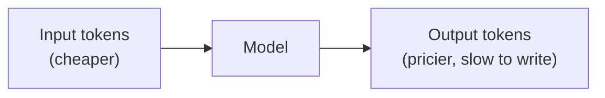
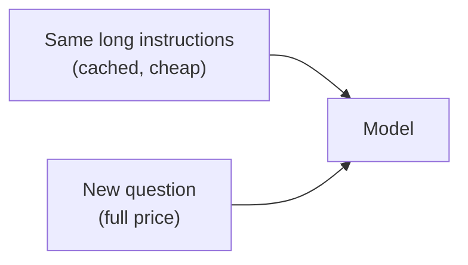
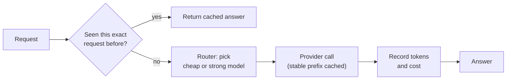
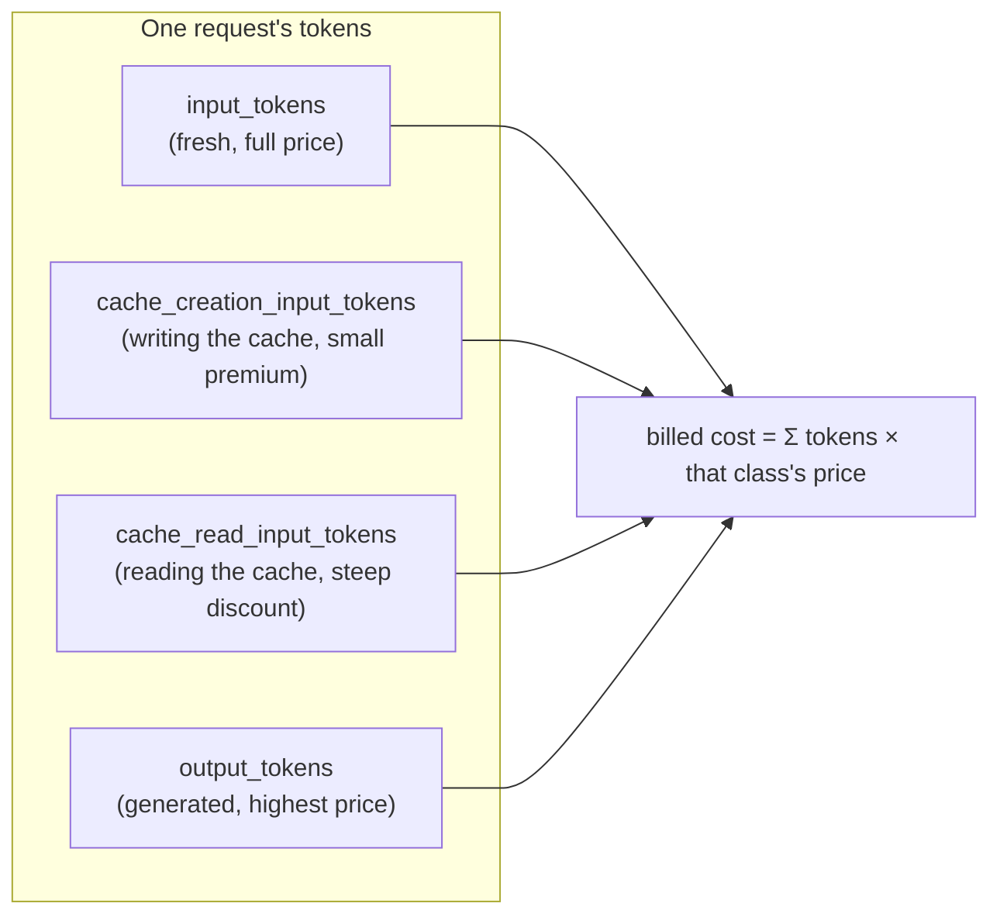
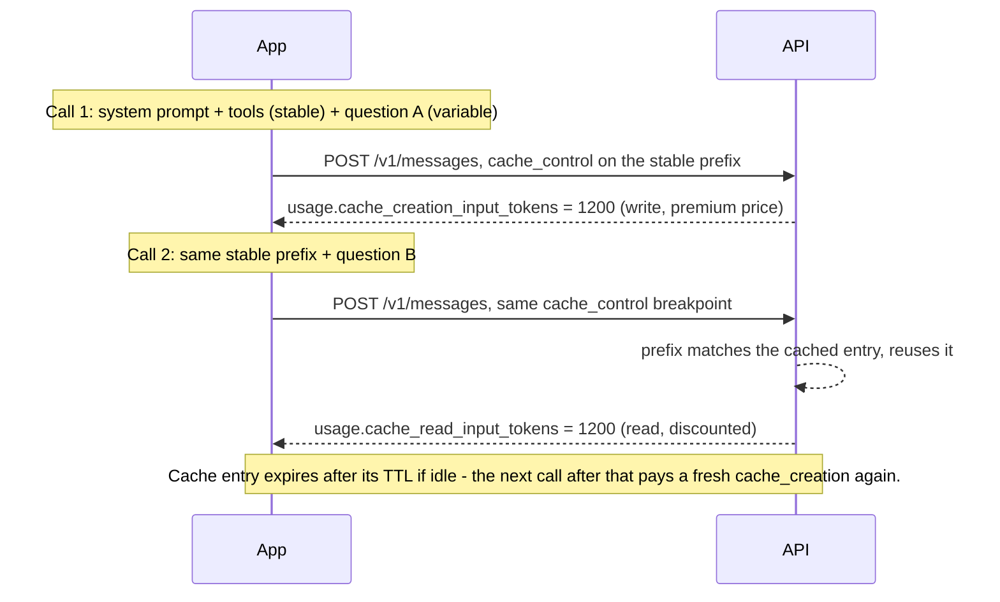
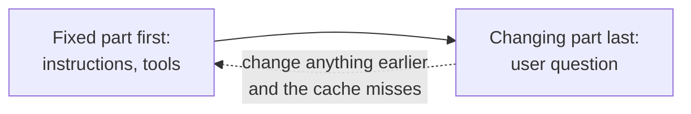
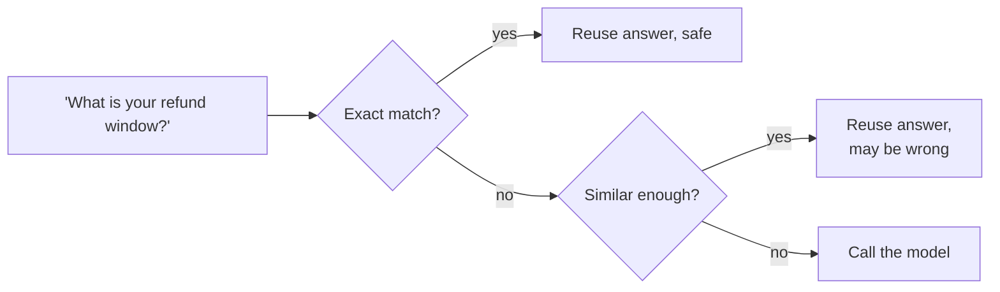
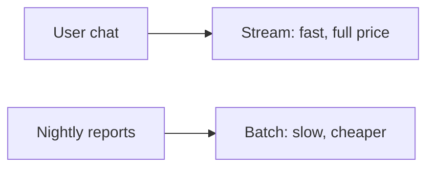
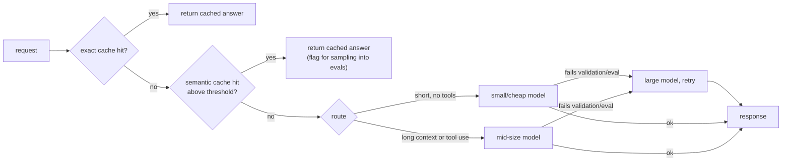

# LLM Cost, Latency and Caching

> [!summary] TL;DR
> An LLM call is priced and timed by tokens, not by request count, so cutting cost means cutting billed tokens (cache them, batch them, route them to a smaller model) and cutting latency means shrinking time-to-first-token and total generation time, usually by streaming, trimming context and picking the smallest model that still passes your evals.

> [!abstract] Core idea
> - Cost is `(fresh input tokens × price) + (cache-read tokens × much lower price) + (output tokens × price, usually 4-8x the input price)`; every token class is billed, and output tokens dominate the bill for most chat and agent workloads.
> - Prompt caching reuses a provider-side copy of a stable prefix (system prompt, tools, few-shot examples) so repeat calls pay a steep discount on it instead of full price.
> - A semantic cache can return the wrong answer with high confidence — it matches on "sounds similar," not "means the same thing."
> - Model routing sends easy requests to a cheap model and only escalates on a real failure signal, not a guess made before the call.
> - Time-to-first-token (TTFT) and total latency are different numbers with different causes; streaming improves the first, not the second.

## Start here: the basics 🟢

> [!info] How to read this note (pick your level)
> - 🟢 **New to this?** Read "From zero" below, then sections 1, 2 and the cheat sheet (10). Stop there, that is a full first pass.
> - 🟡 **Know the basics?** Add section 3 (how it works), 4 (worked example), 5 and 6.
> - 🔴 **Interview / SDE-3 prep?** Add 7, 8 and 9. Headings are tagged 🟢🟡🔴 so you always know where you are.

**From zero, in 60 seconds** 🟢

Every AI call costs money and time. You pay per **token** (a small piece of text), both for what you send and for what comes back.

Output tokens cost more than input tokens. And the user waits while each output token is written.



Many calls repeat the same long start: the same instructions, the same tool list. **Prompt caching** lets the provider remember that start, so repeats cost much less and start faster.



Other levers: use a smaller model when it is good enough, keep chat history short, cap the reply length, and batch work that can wait.

The rest of this note is just these 3 questions:
1. What exactly are you billed for, and what makes users wait?
2. Which tricks cut cost and wait time?
3. Which tricks are risky, and how do you watch spend in production?


**The problem in one story.**
Your chatbot works great in testing, then the first monthly bill arrives and it is ten times the estimate.
Users also complain the answers feel slow.
Every word you send to the model and every word it writes back is billed and takes time.
This note is about paying less and waiting less without making answers worse.

**Words you need first**

| Word | Plain meaning | Tiny example |
| --- | --- | --- |
| Token | The unit an LLM reads and writes, roughly part of a word | "unbelievable" may be 3 tokens |
| Input tokens | Tokens you send in the request | System prompt + history + question |
| Output tokens | Tokens the model generates back | The answer text |
| Cache | A stored copy reused instead of redoing work | Reusing yesterday's answer to the same question |
| Latency | How long something takes | 2 seconds from request to full answer |
| TTFT | Time to first token: how long until the first word appears | 400 ms before text starts streaming |
| Streaming | Sending the answer piece by piece as it is made | Text appearing word by word in a chat |
| Model routing | Choosing a cheaper or stronger model per request | Small model for "hi", large model for hard questions |

**Picture it**



**Analogy.**
A taxi billed by distance: the trip you send is input distance, the answer is the distance still ahead at a higher rate, and a cached prefix is a road the meter already remembers.
Where it breaks: a taxi charges the same per mile all trip, while LLM output tokens cost several times more than input tokens.

**How the rest of this note builds up**

- First "Why it exists" and the "Mental model": where the money and the time actually go.
- Then "How it works": token accounting, prompt caching, exact vs semantic response caches, batching, model routing and cascades, context trimming.
- Then a worked Go example that estimates cost from a usage record, with tests.
- Finally the SDE-3 deep dive: why cache reads are cheap, why output tokens cost more, how cascades compound with caching, and interview questions.

> [!tip] Remember
> Count every token class, cache the stable prefix, send easy requests to a cheap model, and treat TTFT and total latency as two separate numbers.

### Whiteboard version

**In plain words:** Same bot, same traffic: caching the long fixed part of the prompt cuts the bill a lot.

A support bot answers 100,000 questions a day. Each call sends a 1,200-token system prompt plus tool definitions (stable, repeated on every call) and a 300-token user question (always different), and generates a 250-token answer.

Without caching: every call pays full price for all 1,500 input tokens. With prompt caching, the 1,200-token stable prefix is cached after the first call and billed at the cache-read price (commonly about a tenth of the fresh-input price; check your provider's documented rate) on the other 99,999.

That one design choice — put the stable part first, the question last — is most of the cost difference between a careless integration and a production one.

## 1. Why it exists 🟢

A backend that calls an LLM is paying for every token it sends and receives, and a user is waiting for every one of those tokens to be generated.

Both costs scale with usage in a way a typical REST endpoint's costs do not: doubling traffic to a database-backed endpoint mostly costs more CPU; doubling traffic to an LLM endpoint costs roughly double the token bill, verbatim, because the provider meters tokens, not requests.

Concretely: a 1,500-input / 250-output token call at illustrative 2026 third-party pricing of $3 per million input tokens and $15 per million output tokens costs about $0.0083 per call (documented formula; the $3/$15 figures are an estimate — always read your provider's current pricing page).

At 100,000 calls a day that is about $830/day, or roughly $25,000/month, before any caching or routing. A mis-set `max_tokens` that lets a model ramble to 2,000 output tokens instead of 250 multiplies the output half of that bill by 8x.

None of this shows up in a dashboard that only tracks request count and p50 latency — it needs its own accounting.

## 2. Mental model 🟢

Treat an LLM call like a cab ride billed by distance in two different currencies: input tokens are the distance you've already driven before the meter even starts near full price (unless it's road you drove yesterday and the meter remembers — the cache), and output tokens are the distance still ahead, billed at a much higher per-mile rate because *generating* each one takes a full forward pass through the model, while reading cached input tokens does not.

Latency has the same two-part shape: TTFT is how long the cab takes to leave the curb (routing, queueing, plus processing the whole input before any output can start), and the rest of the trip is paced by how fast output tokens stream out, which is roughly constant per model.

## 3. How it works 🟡

### Token accounting

**In plain words:** Your bill has four lines: new input, input written to cache, input read from cache, and output.

Every response carries the exact counts the call is billed on. The Anthropic Messages API's `usage` object (as of 2026) breaks them into four classes:



`cache_creation_input_tokens` only appears on the call that first writes a given prefix into the cache; every later call that reuses that exact prefix reports the same tokens under `cache_read_input_tokens` instead, at a fraction of the price.

### Prompt caching

**In plain words:** The provider remembers the model having "read" your fixed opening text, so the next call skips that work.

A provider's prompt cache stores the processed state of a prefix of your input — not the text, the model's internal representation of having already "read" it — keyed by exact content and position. [[Prompt Engineering]] covers the cache-friendly prompt shape (stable system instructions and template first, variable content last); this note covers the mechanism and its economics.

As of 2026, Anthropic's API lets you mark a cache breakpoint with a `cache_control: {type: "ephemeral", ttl: "5m"|"1h"}` block on a content block, and bills a short-term write premium (documented as roughly 1.25x the input price for a 5-minute TTL; verify current numbers) to create the entry, then a steep discount (documented as roughly a tenth of the input price) on every read within the TTL.



A cache hit requires the prefix to match **exactly** up to the breakpoint, including any system-level ordering and whitespace — a prompt that interleaves a per-request timestamp before the breakpoint invalidates the cache on every call, silently losing the discount.



### Exact vs. semantic response caches

**In plain words:** Exact cache = same question, reuse the answer. Semantic cache = similar question, reuse the answer (riskier).

An **exact cache** keys on the literal request (normalized prompt, or a hash of it) and only returns a stored answer for a byte-identical repeat. It is always correct when it hits, and it only helps for genuinely repeated questions (FAQ-shaped traffic, retries, idempotency keys).

A **semantic cache** instead embeds the incoming query and serves the stored answer for the nearest previously-answered query above a similarity threshold. It catches paraphrases ("how do I cancel?" vs. "I want to cancel my plan") that an exact cache misses — but cosine similarity measures how alike two vectors are, not whether they mean the same thing for this use case.

"Cancel my subscription" and "cancel my order" can embed close together (shared verb, shared object-shape) while needing completely different answers; a negation ("how do I **avoid** cancelling") can also land unsettlingly close to its opposite.

The Go test in "Worked example" reproduces exactly this failure with a toy embedding.



### Batching

**In plain words:** Send a big pile of non-urgent jobs at once, get answers later, pay less.

Where answers are not needed synchronously (nightly summarization, bulk classification, backfills), a provider's batch endpoint accepts many requests in one submission and returns results asynchronously, typically within a documented SLA window (hours), at a lower per-token price (publicly documented as roughly 50% off standard pricing for several major providers as of 2026; verify your provider's current batch discount and turnaround).

Batching trades latency for cost — it is the opposite choice from streaming, and the two are not mutually exclusive across your workload: user-facing chat streams, nightly reports batch.



### Model routing and cascades

**In plain words:** Try the cheap model first. Move up to the big model only when the cheap one clearly fails.

A model router sends a request to the cheapest model estimated to handle it, and escalates only on a concrete failure signal:



The router itself must be cheap (a classifier, a token-count check, a regex over known intents) — if deciding where to route costs as much as just calling the mid-size model, the cascade has no point. See [[LLM Evals in Production]] for the validation step that triggers escalation.

### Context trimming and output limits

**In plain words:** Don't resend the whole chat every time, and don't let the reply run longer than needed.

Every token of conversation history resent on each turn is billed again; summarizing or truncating history (see [[RAG Pipeline]] for retrieval-side trimming) keeps the input side of the bill from growing with conversation length.

On the output side, setting `max_tokens` to the smallest value the task needs — and, for structured output (see [[Structured Outputs and Tool Calling]]), a schema that can't ramble — bounds the most expensive token class per call.

## 4. Worked example 🟡

The cost estimator, TTFT measurement and semantic-cache risk, as Go. It compiles and passes `go vet` and `go test -race` on Go 1.24.

```go
// Package costlat accompanies "LLM Cost, Latency and Caching".
package costlat

// ModelPricing holds per-million-token prices in USD. These are estimates
// for illustration, not live prices: look up current per-model pricing in
// the provider's pricing page before using real numbers.
type ModelPricing struct {
	InputPerMTok       float64 // price per 1,000,000 fresh input tokens
	CachedInputPerMTok float64 // price per 1,000,000 cache-read input tokens
	OutputPerMTok      float64 // price per 1,000,000 output tokens
}

// Usage mirrors the token-accounting fields the Anthropic Messages API
// returns on every response (anthropic-sdk-go v1.84.0, Usage struct):
// input_tokens, cache_read_input_tokens, cache_creation_input_tokens and
// output_tokens. cache_creation_input_tokens is billed at a short-term
// premium (writing the cache), cache_read_input_tokens at a steep discount
// (reading it back).
type Usage struct {
	InputTokens              int64
	CacheCreationInputTokens int64
	CacheReadInputTokens     int64
	OutputTokens             int64
}

// CacheWritePremium is the usual multiplier providers apply to tokens that
// are being written into the prompt cache for the first time (estimate;
// check your provider's documented cache-write price).
const CacheWritePremium = 1.25

// EstimateCost returns the cost in USD for one call, given its exact token
// usage and the model's per-million-token prices. This is a measured
// formula (sum of token classes times their price), not a benchmark: the
// only estimate is CacheWritePremium and whatever ModelPricing the caller
// supplies.
func EstimateCost(u Usage, p ModelPricing) float64 {
	fresh := float64(u.InputTokens) / 1e6 * p.InputPerMTok
	write := float64(u.CacheCreationInputTokens) / 1e6 * p.InputPerMTok * CacheWritePremium
	read := float64(u.CacheReadInputTokens) / 1e6 * p.CachedInputPerMTok
	out := float64(u.OutputTokens) / 1e6 * p.OutputPerMTok
	return fresh + write + read + out
}
```

Per-tenant attribution, so one tenant's burst doesn't hide inside the aggregate bill:

```go
// PerTenantLedger attributes cost to tenants so one noisy caller doesn't
// hide in an aggregate bill.
type PerTenantLedger struct {
	spend map[string]float64
}

func NewPerTenantLedger() *PerTenantLedger {
	return &PerTenantLedger{spend: make(map[string]float64)}
}

// Record adds one call's cost to a tenant's running total and reports
// whether the tenant is now over budget.
func (l *PerTenantLedger) Record(tenant string, cost, budget float64) (total float64, overBudget bool) {
	l.spend[tenant] += cost
	return l.spend[tenant], l.spend[tenant] > budget
}
```

Measuring TTFT separately from total latency against a fake SSE server (representative output — no live model call; the server is a local `httptest.Server`):

```go
import (
	"bufio"
	"context"
	"net/http"
	"time"
)

// StreamTiming is what a caller should record per streaming request: the
// time to first token and the time to the full response. Dashboards that
// only chart total duration never see a TTFT regression, because a slower
// first token and a slower full response are different failures with
// different causes (queueing/routing vs. generation speed).
type StreamTiming struct {
	TTFT  time.Duration
	Total time.Duration
}

// MeasureStream times an SSE GET request: TTFT is measured at the first
// byte of the body (the first `data:` line), Total at the closing of the
// stream. It does no JSON parsing of event payloads — that is the
// concern of the SSE client described in the "Calling LLM APIs from Go"
// note; this function only isolates the two latency numbers that matter
// for a cost/latency dashboard.
func MeasureStream(ctx context.Context, client *http.Client, url string) (StreamTiming, error) {
	start := time.Now()
	req, err := http.NewRequestWithContext(ctx, http.MethodGet, url, nil)
	if err != nil {
		return StreamTiming{}, err
	}
	resp, err := client.Do(req)
	if err != nil {
		return StreamTiming{}, err
	}
	defer resp.Body.Close()

	scanner := bufio.NewScanner(resp.Body)
	var ttft time.Duration
	seenFirst := false
	for scanner.Scan() {
		if !seenFirst && len(scanner.Bytes()) > 0 {
			ttft = time.Since(start)
			seenFirst = true
		}
	}
	if err := scanner.Err(); err != nil {
		return StreamTiming{}, err
	}
	return StreamTiming{TTFT: ttft, Total: time.Since(start)}, nil
}
```

The semantic cache, and the test that proves its risk rather than just its happy path:

```go
import "math"

// ExactCache is a plain map keyed by a normalized, hashed prompt. A hit is
// always safe: the prompt text matches exactly, so the cached answer is
// correct by construction. It only helps on literal repeats.
type ExactCache struct {
	entries map[string]string
}

func NewExactCache() *ExactCache { return &ExactCache{entries: make(map[string]string)} }

func (c *ExactCache) Get(key string) (string, bool) { v, ok := c.entries[key]; return v, ok }
func (c *ExactCache) Set(key, answer string)        { c.entries[key] = answer }

// SemanticCacheEntry pairs a cached answer with the embedding of the
// question that produced it.
type SemanticCacheEntry struct {
	Embedding []float64
	Answer    string
}

// SemanticCache serves a cached answer when a new query's embedding is
// close enough to a previously answered one. Unlike ExactCache, a hit is
// NOT guaranteed correct: it is a guess that two different questions mean
// the same thing. See cosineSimilarity and the package test for a
// concrete false-positive this risks.
type SemanticCache struct {
	entries   []SemanticCacheEntry
	threshold float64
}

// NewSemanticCache builds a cache that serves a hit above threshold
// (typically 0.92-0.97 for short factual questions; tune per corpus and
// re-check after every embedding model change, see the "Embeddings" note).
func NewSemanticCache(threshold float64) *SemanticCache {
	return &SemanticCache{threshold: threshold}
}

func cosineSimilarity(a, b []float64) float64 {
	var dot, na, nb float64
	for i := range a {
		dot += a[i] * b[i]
		na += a[i] * a[i]
		nb += b[i] * b[i]
	}
	if na == 0 || nb == 0 {
		return 0
	}
	return dot / (math.Sqrt(na) * math.Sqrt(nb))
}

// Lookup returns the best cached answer if its similarity clears the
// threshold, plus that similarity score so the caller can log it (a
// score just above threshold is worth sampling into an eval set).
func (c *SemanticCache) Lookup(queryEmbedding []float64) (answer string, similarity float64, hit bool) {
	best := -1.0
	bestAnswer := ""
	for _, e := range c.entries {
		s := cosineSimilarity(queryEmbedding, e.Embedding)
		if s > best {
			best = s
			bestAnswer = e.Answer
		}
	}
	if best >= c.threshold {
		return bestAnswer, best, true
	}
	return "", best, false
}

func (c *SemanticCache) Store(queryEmbedding []float64, answer string) {
	c.entries = append(c.entries, SemanticCacheEntry{Embedding: queryEmbedding, Answer: answer})
}
```

```go
func TestSemanticCacheFalsePositiveRisk(t *testing.T) {
	cache := NewSemanticCache(0.9)
	// "cancel my subscription" cached with its answer.
	cache.Store([]float64{1, 0, 0}, "Go to Settings > Billing > Cancel.")

	// A near-identical vector represents a DIFFERENT question whose
	// correct answer is NOT the cached one, e.g. "cancel my SUBSCRIPTION"
	// vs "cancel my ORDER" after a careless embedding/paraphrase. This
	// documents the real risk of semantic caching: a high cosine score
	// does not guarantee the same intent, especially near negations or
	// swapped entities (see "Deep dive").
	nearDuplicateButDifferentIntent := []float64{0.95, 0.05, 0.05}

	answer, sim, hit := cache.Lookup(nearDuplicateButDifferentIntent)
	if !hit {
		t.Fatalf("expected a hit above threshold, got sim=%v", sim)
	}
	if answer != "Go to Settings > Billing > Cancel." {
		t.Fatalf("got %q", answer)
	}
	// The assertion IS the lesson: the cache served the wrong answer
	// with high confidence. A semantic cache needs a domain-appropriate
	// threshold and, for anything consequential, a fallback that
	// verifies the cached answer still fits (see note body).
	if sim < 0.9 {
		t.Fatalf("test setup error: similarity should clear threshold, got %v", sim)
	}
}
```

Finally, routing on signals rather than guesses, and the cascade test:

```go
// Tier names a point on a model cascade, cheapest first.
type Tier int

const (
	TierSmall  Tier = iota // e.g. claude-haiku-5-5
	TierMedium             // e.g. claude-sonnet-5-5
	TierLarge              // e.g. claude-opus-5-5
)

// RouteRequest is the per-call signal a router uses to pick a tier. In
// production this is a cheap classifier or a handful of heuristics run
// before the real call, not the LLM itself (routing must cost less than
// the call it is deciding about).
type RouteRequest struct {
	PromptTokens     int
	RequiresToolUse  bool
	PriorTierFailed  bool // the cheaper tier's output failed validation/eval
	UserTierOverride *Tier
}

// Route picks the cheapest tier likely to succeed. A cascade escalates
// only on a concrete signal (validation failure, tool-use requirement,
// explicit override) rather than guessing up front, which is what keeps
// the average cost down.
func Route(r RouteRequest) Tier {
	if r.UserTierOverride != nil {
		return *r.UserTierOverride
	}
	if r.PriorTierFailed {
		return TierLarge
	}
	if r.RequiresToolUse || r.PromptTokens > 4000 {
		return TierMedium
	}
	return TierSmall
}
```

**Measured (this test run, Go 1.24, 2026-11-07):** `TestEstimateCost` checks `$0.003 + $0.0075 + $0.0024 + $0.0075 = $0.0204` for 1,000 fresh input + 2,000 cache-write + 8,000 cache-read + 500 output tokens at `$3`/`$0.30`/`$15` per million tokens (fresh/cached/output; illustrative prices). `TestMeasureStreamTTFTIsBeforeTotal` asserts TTFT is at least the fake server's 40ms first-byte delay and strictly less than total duration. `TestSemanticCacheFalsePositiveRisk` and `TestRouteEscalatesOnSignalsOnly` are included in the full suite below. All tests pass under `go test -race`.

## 5. Variants and comparison 🟡

**In plain words:** Every cost lever side by side: how it works, when to use it, what it costs you.

| Option | How it works | Use when | Cost |
| --- | --- | --- | --- |
| Exact cache | Hash/normalize the prompt, map lookup | Literal repeats, idempotency, FAQ traffic | Cheap, always correct, low hit rate |
| Prompt caching (provider) | Provider stores processed state of a stable prefix | Any high-volume feature with a shared system prompt/tools/few-shot | Small write premium, steep read discount; needs a stable prefix shape |
| Semantic cache | Embed query, serve nearest cached answer above threshold | High-paraphrase traffic (support, search) where a wrong answer is recoverable | Embedding cost + wrong-answer risk; needs tuning and monitoring |
| Batch API | Submit many requests, poll/receive results later | Non-interactive bulk work (classification, summarization backfills) | Lower per-token price, hours-scale latency |
| Model routing/cascade | Cheap classifier picks small vs. large model, escalates on failure | Mixed-difficulty traffic at volume | Router cost + occasional double-pay on escalation, net savings at scale |
| Context trimming / history summarization | Keep only recent turns + a running summary | Long-running conversations and agent loops | Saves linearly growing input cost; summarization itself costs a call |

## 6. Trade-offs and when not to use 🟡

- Prompt caching only pays off above a certain call volume and within the TTL window; a low-traffic feature may create cache entries that expire before they're ever read again, paying the write premium for nothing.
- A semantic cache trades cost for correctness risk — do not put one in front of anything where a wrong-but-confident answer causes real harm (medical, legal, billing actions) without a verification step.
- Model routing adds a maintenance surface (the router's rules or classifier need their own evals) and a failure mode of its own: a miscalibrated router sends hard requests to a model that will fail, adding one extra round trip of latency before it escalates.
- Batching is the wrong tool for anything a user is waiting on; it optimizes cost at the direct expense of latency.
- Below a modest request volume, a flat non-streaming call to a single mid-size model with no cache is simpler to operate and the savings from routing/caching won't offset the engineering cost.

## 7. In production 🔴

- **Real systems:** chat products stream by default for perceived latency; high-volume classification/extraction pipelines batch or use a small routed model; most providers' own docs recommend prompt caching for any repeated system prompt or long few-shot set, and several (Anthropic, OpenAI, Google) publish a documented batch discount as of 2026.
- **Failure modes → fixes:**
  - Cache never hits because variable content (a timestamp, a request id) sits before the cache breakpoint → move all variable content after the breakpoint.
  - Semantic cache serves a confidently wrong answer → lower the threshold, add a cheap verifier call, or scope the cache to a narrower, lower-stakes intent set.
  - A router's "small model" tier silently degrades quality with no escalation, because nothing checks its output → wire routing to the same validation/eval gate that would catch a bad call anyway (see [[LLM Evals in Production]]).
  - `max_tokens` set generously "to be safe" quietly multiplies the output bill → set it to the smallest value the task needs and fail loudly on truncation instead of padding every call.
- **What to monitor:** cost per request and per tenant; cache hit rate (exact and semantic, separately) and cache-read vs. cache-write token ratio; TTFT p50/p99 alongside total latency p50/p99; tier distribution out of the router (what fraction escalates); budget-alert triggers per tenant.

## 8. Deep dive 🔴

- **Why cache-read is so much cheaper than fresh input.** A cache hit skips the attention computation over the cached tokens entirely — the provider stores the already-computed key/value state for that prefix and splices it in, rather than reprocessing the text.

  That is also why the match must be exact and positional: the stored state is a function of the exact tokens and their position, not their meaning, so any edit before the breakpoint (even whitespace) invalidates it.
- **Why output tokens cost so much more than input tokens.** Each output token requires a full forward pass through the model, one token at a time, sequentially — input tokens are processed once, in parallel, across the whole prompt.

  That asymmetry (commonly 4-8x the per-token price as of 2026; always verify against current pricing) is also why trimming `max_tokens` and avoiding unnecessary verbosity in system prompts ("be thorough", "explain in detail") has an outsized effect on cost compared to trimming input.
- **Semantic cache thresholds are not transferable across embedding models.** A threshold of 0.93 tuned against one embedding model's score distribution has no guaranteed meaning for another model — re-tune after any embedding model change (see the migration note in [[Embeddings]]), and prefer measuring hit precision/recall on a labeled query-pair set over picking a threshold by eye.
- **Cascades compound with caching.** A cascade that checks the exact cache, then the semantic cache, then routes to the cheapest model tier (as in the flowchart above) stacks three independent savings; the net effect on a real traffic mix is usually dominated by whichever stage has the highest hit/success rate, so measure each stage's hit rate separately rather than assuming the stack multiplies cleanly.
- **Per-tenant budgets need a hard stop, not just an alert.** An alert that pages an on-call engineer after a tenant has already spent $500 beyond budget overnight is a postmortem, not a control; a hard per-tenant rate limit or spend cap enforced before the call (see [[Production AI Checklist]]) is what actually bounds the blast radius.

## 9. Interview questions 🔴

> [!question]- Why does streaming not reduce total latency?
> Streaming changes when the user sees output (as soon as the first token is ready) but not how long the full response takes to generate — every output token still requires its own forward pass. A dashboard that only tracks total request duration won't show a TTFT win from adding streaming; you need a separate TTFT metric.

> [!question]- A team adds a semantic cache and cost drops 40%, but support tickets about wrong answers rise the same week. What likely happened?
> The cache is serving confidently wrong answers for queries that embed close together but mean different things — a classic semantic-cache false positive. The fix is a higher similarity threshold, a cheap verification step before serving a cached answer, or scoping the cache to a narrower set of low-stakes intents, not reverting caching altogether.

> [!question]- Your prompt caching hit rate is near zero despite a large, repeated system prompt. What's the most likely cause?
> Something changes before the cache breakpoint on every call — a timestamp, a request id, or a reordered field — so the prefix never matches byte-for-byte. Move all per-request variable content after the cache breakpoint.

> [!question]- When would you choose the batch API over a routed small model for a bulk classification job?
> When the job has no interactive deadline (an overnight backfill) — batch pricing is lower per token than any synchronous call, including to the smallest model, and the latency cost (hours) is free in that setting. Choose the small routed model instead when results are needed within seconds, even if the per-token price is slightly higher.

> [!question]- Trap: "we switched to a smaller model everywhere and cost dropped, so it was a pure win." What's missing from that conclusion?
> Whether quality held. A smaller model answering worse (more follow-up turns, more support escalations, more retries at a larger model after failed validation) can cost more end-to-end even at a lower per-call price — the per-call savings has to be checked against outcome metrics from [[LLM Evals in Production]], not just the token bill.

> [!question]- Why is `cache_creation_input_tokens` billed at a premium instead of the normal input price?
> It represents extra work beyond a normal call: the provider has to compute and store the key/value state for that prefix so later calls can reuse it, on top of processing the call itself. The premium funds that extra write; the payoff comes on every subsequent read within the cache's TTL.

> [!question]- Design a cost control for a multi-tenant AI feature with a shared monthly budget. What do you build?
> Per-tenant token/cost accounting from `usage` on every call (not an estimate), a running ledger with a hard per-tenant cap enforced before the call is made (not just an alert after spend), a cascade that tries cache then a small model before an expensive one, and an admin-visible dashboard of spend and cache hit rate per tenant so a budget breach is diagnosable, not just blockable.

## 10. Cheat sheet 🟢

- Cost = Σ(token class × its price); output tokens cost far more per token than input tokens.
- Prompt caching needs an exact, positional prefix match — stable content first, variable content last.
- Exact cache: always correct, low hit rate. Semantic cache: higher hit rate, real risk of a confidently wrong answer.
- Batch APIs trade latency (hours) for a lower per-token price; only for non-interactive work.
- Route on failure signals (validation/eval failure, tool need, explicit override), not guesses made up front.
- TTFT and total latency are different metrics; streaming only improves TTFT.
- Trim context and cap `max_tokens`; don't pad output "to be safe."
- Enforce per-tenant budgets as a hard stop before the call, not just an alert after it.

## Links 🟢

- **Before this:** [[Calling LLM APIs from Go]], [[Prompt Engineering]]
- **Next:** [[LLM Observability]], [[Production AI Checklist]]
- **Compare with:** [[Caching Patterns]] (general cache strategies this note specializes for LLM calls), [[Embeddings]] (batching and caching embedding calls specifically)

### Watch on YouTube

- [Cut Your LLM Costs and Latency up to 86% with Semantic Caching / Databases for AI](https://www.youtube.com/watch?v=vIgF4GP2n9w) · AWS Events · 60 min · 2,777 views
- [What is Prompt Caching? Optimize LLM Latency with AI Transformers](https://www.youtube.com/watch?v=u57EnkQaUTY) · IBM Technology · 9 min · 128,186 views
