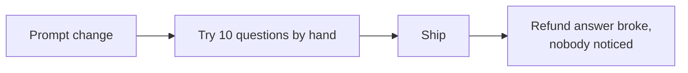
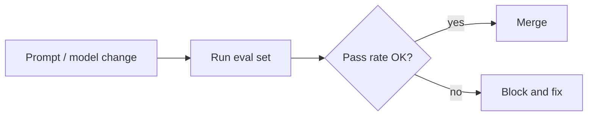
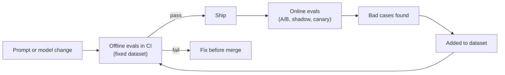
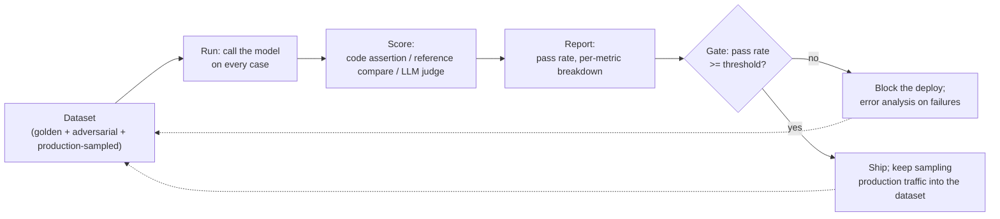
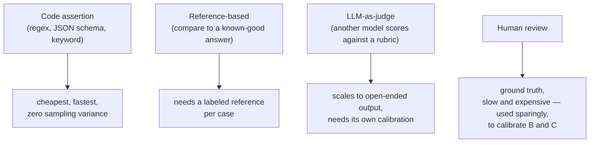
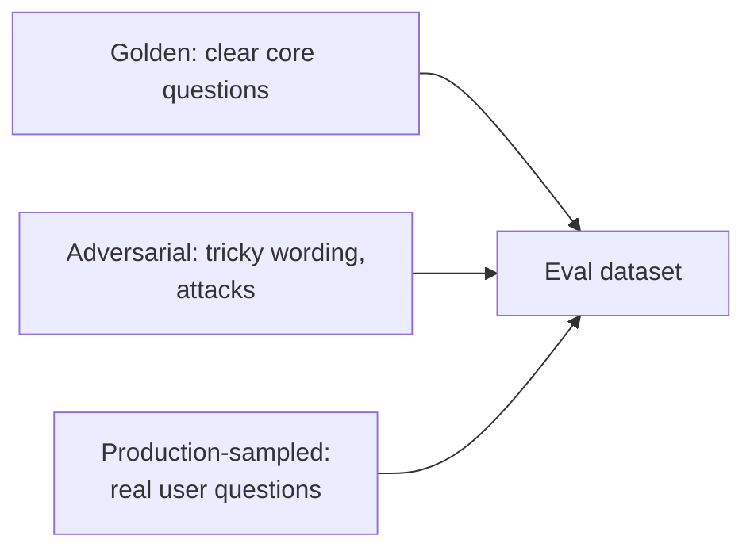
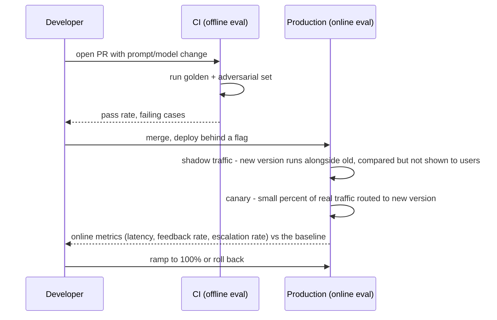
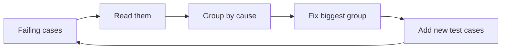

# LLM Evals in Production

> [!summary] TL;DR
> An **eval** is an automated, repeatable check of whether an LLM-powered feature's output is good, run the same way a unit test suite runs: against a fixed dataset of cases, on every change, with a pass/fail (or scored) verdict you can gate a deploy on.
>
> Evals exist because "I read ten outputs and they looked fine" does not scale, does not repeat, and does not catch a regression three model-version upgrades from now.

> [!abstract] Core idea
> - Evals are tests for non-deterministic, open-ended output: they trade the unit test's exact-match assertion for assertions suited to natural language (keyword/regex checks, reference comparison, or another model as judge).
> - Four eval kinds, cheapest first: **code assertions** (deterministic), **reference-based** (compare to a known-good answer), **LLM-as-judge** (another model scores against a rubric), **human review** (ground truth, but slow and expensive — used to calibrate the other three).
> - A dataset has three parts: a **golden set** (hand-picked known-good cases), an **adversarial set** (deliberately hard or malicious cases), and a **production-sampled set** (real traffic, so the eval reflects what users actually ask).
> - **Offline evals gate a deploy** (CI, before anything ships); **online evals watch a deploy** (A/B tests, shadow traffic, canaries, after it ships) — they answer different questions and you need both.
> - An eval suite is only as trustworthy as its correlation with human judgment: calibrate your judge against human labels before trusting its score.

## Start here: the basics 🟢

> [!info] How to read this note (pick your level)
> - 🟢 **New to this?** Read "From zero" below, then sections 1, 2 and the cheat sheet (10). Stop there, that is a full first pass.
> - 🟡 **Know the basics?** Add section 3 (how it works), 4 (worked example), 5 and 6.
> - 🔴 **Interview / SDE-3 prep?** Add 7, 8 and 9. Headings are tagged 🟢🟡🔴 so you always know where you are.

**From zero, in 60 seconds** 🟢

Normal tests check `output == "30 days"`. AI answers can be right in many different wordings, so that check fails.

An **eval** is a test made for AI answers. It checks for meaning, like "does the answer mention 30 days and not invent a fee?".



You keep a fixed list of questions (a **dataset**) and run it on every prompt or model change. If the pass rate drops, the change is blocked, like a failing unit test.



Some checks are simple code. Some use another AI as the grader. A few need a human.

The rest of this note is just these 3 questions:
1. What kinds of checks exist, from cheap to costly?
2. What goes in the dataset, and when do you run it?
3. How do you trust the grader and keep the set fresh?


**The problem in one story.**
You tweak the prompt of your support bot so it sounds friendlier.
You try five questions by hand and they look fine, so you ship.
A week later you learn it stopped mentioning the refund policy on a whole class of questions.
An eval suite is a set of saved test questions you rerun on every change, so this is caught before users see it.

**Words you need first**

| Word | Plain meaning | Tiny example |
| --- | --- | --- |
| Eval | A test that scores model output instead of checking an exact value | "Does the answer mention the 30-day policy?" |
| Non-deterministic | Same input can give different output | Two runs, two wordings |
| Dataset | The saved list of test inputs (and maybe expected answers) | 200 real support questions |
| Golden set | Hand-picked cases with known-good answers | "How do I reset my password?" + correct reply |
| Rubric | Written scoring rules | "1 point if it cites a source" |
| LLM-as-judge | Using another model to grade an answer | A model scoring answers 1-5 for faithfulness |
| Regression | Something that used to work and now does not | Refund answers broke after a prompt edit |
| CI | Automatic checks that run on every code change | Tests run on every pull request |

**Picture it**



**Analogy.**
Like grading essays: some checks are mechanical (word count, required facts), some need a teacher's judgment, and you keep old exam questions to test every new class.
Where it breaks: a teacher grades consistently with experience, while an LLM judge must itself be checked against human grades before you trust its scores.

**How the rest of this note builds up**

- First "Why it exists" and the "Mental model": why manual spot checks miss regressions.
- Then "How it works": the eval loop, the four eval kinds (cheapest first), dataset composition, offline vs online gates, and the error-analysis loop.
- Then a worked Go example of an eval runner that gates a change.
- Finally the SDE-3 deep dive: judge calibration, trade-offs and interview questions.

> [!tip] Remember
> Evals are unit tests for fuzzy output: run cheap checks first, gate merges offline, watch real traffic online, and feed every failure back into the dataset.

## 1. Why it exists 🟢

Say you ship a support-bot feature backed by an LLM, and you manually try ten questions before every deploy: they look fine, you ship. Three weeks later a prompt tweak meant to fix formatting quietly breaks the bot's refund-policy answer for a class of question your ten manual tries never covered — a customer gets told the wrong refund window, and nobody notices until support tickets spike.

An eval suite is the fix: a fixed set of representative and adversarial questions, with the refund-policy answer in particular, run automatically on every prompt or model change.

"Does my new prompt still get the 30-day refund window right" becomes a single assertion that runs in CI, the same way a regression test catches a broken function before it reaches production — except the assertion has to work on free-form text, not `want == got`.

## 2. Mental model 🟢

Treat an LLM feature's correctness the way you'd treat any other software behavior under test, but swap the assertion style: instead of `assert output == "30 days"`, you assert "output contains 30 days" (code assertion), or "output's meaning matches this reference answer" (reference-based / LLM-as-judge), because the model will phrase a correct answer differently every time.

The dataset of cases plays the same role a table-driven test's cases play; the eval *harness* plays the role of `go test`; a CI gate plays the role of "don't merge red."

The twist unit tests don't have: your "assertion function" is sometimes itself a model call (an LLM judge), which means the test can be wrong in its own right — so part of running evals seriously is testing the judge against human labels, the way you'd validate any measurement instrument before trusting its readings.

## 3. How it works 🟡

### The eval loop

**In plain words:** Run the questions, score the answers, compare to last time, then read the failures to learn why.



The loop closes on itself: failures found in production (user complaints, flagged outputs, low feedback scores) become new dataset cases, so the eval set grows to cover exactly the mistakes that actually happened, not just the ones you guessed at upfront.

### Four eval kinds

**In plain words:** Four ways to grade, from cheapest to costliest: code check, compare to a model answer, AI grader, human.



- **Code assertions** check something mechanically verifiable: "is this valid JSON", "does the output contain the word 'refund'", "is the cited URL one of the retrieved sources". Cheap, deterministic, zero false positives from model variance — use these for everything that can be checked this way before reaching for a judge.
- **Reference-based** scoring compares the model's output to a known-good reference answer, either with a simple similarity measure or by having a judge compare the two. This needs a labeled dataset (a human or a strong model wrote the reference once), but then scoring is repeatable.
- **LLM-as-judge** has a (often more capable, or differently-prompted) model score an output against a rubric, with no single reference answer required — good for open-ended quality ("is this response helpful and on-topic") where there's no one right phrasing.

  The judge itself needs a clear rubric, ideally a few-shot example per rubric score, and — critically — periodic comparison against human labels (**judge calibration**) so you know it isn't systematically too lenient or too harsh, or biased toward longer answers (a documented failure mode of naive LLM judges).
- **Human review** is ground truth. It doesn't scale to run on every CI build, but a small, regularly-refreshed sample of human-labeled cases is what calibrates the other three and catches what no automated check anticipated.
- **Pairwise comparison** (judge picks "A is better than B" between two outputs for the same input) is often more reliable than asking a judge to produce an absolute score, because relative judgments are easier for a model (and a human) to make consistently than calibrated absolute numbers.

### Dataset composition

**In plain words:** Your question list needs a mix: clear core questions, tricky ones and attacks, and real questions from users.

| Set | What's in it | Why it exists |
| --- | --- | --- |
| Golden | Hand-picked cases with a clearly correct answer, covering your feature's core use cases | Catches obvious regressions fast; the floor every change must clear |
| Adversarial | Deliberately hard, ambiguous, or malicious cases (edge-case phrasing, prompt-injection attempts, out-of-scope questions) | Catches the failures that matter most and are easiest to miss by only sampling "normal" traffic |
| Production-sampled | Real user queries (and their outcomes: thumbs up/down, follow-up questions, support escalations) pulled from logs | Keeps the eval set honest about what your users actually ask, which drifts over time |



### Offline vs online: two different gates

**In plain words:** Offline = test before you ship. Online = keep watching real traffic after you ship.



**Offline** evals run before anything reaches a user: they're deterministic enough to gate a merge, fast enough to run on every PR, and they answer "did this change break something we already knew to check."

**Online** evaluation — A/B tests, shadow traffic (the new version runs on real traffic but its output is never shown to the user, just logged and compared), and canary releases (a small percentage of real users see the new version) — answers "does this change actually help, on traffic we didn't anticipate in our dataset," and it's the only way to catch a regression your dataset genuinely has no case for.

### The error-analysis loop

**In plain words:** Don't just look at the score. Read the failures and group them by cause.

Every eval failure is a lead, not just a number. Reading failing cases, grouping them by root cause ("it's always the ambiguous-pronoun questions", "it's always when the retrieved context has more than 3 chunks") and turning the pattern into either a prompt fix or a new dataset case is what keeps an eval suite from becoming a stale, un-trusted ritual.

Treat a dropping pass rate the way you'd treat a dropping test-coverage number: as the start of an investigation, not the end of one.



## 4. Worked example 🟡

### Whiteboard version

**In plain words:** The simplest eval: run the model over each question, check with plain code, count the passes.

The bare idea: run a model function over cases, check each with a plain assertion, compute a pass rate:

```go
type Case struct {
    Prompt string
    Want   string
}

func Run(cases []Case, model func(string) string) float64 {
    pass := 0
    for _, c := range cases {
        if strings.Contains(model(c.Prompt), c.Want) {
            pass++
        }
    }
    return float64(pass) / float64(len(cases))
}
```

This has no CI gate, no per-case reason when something fails, and no judge for open-ended cases that have no single `Want` substring. The full version below adds all three, tested against a fake model server so the whole suite runs with no API key and no network.

A Go eval harness: a golden set of `Case`s, a code-assertion harness, a `Judge` interface standing in for an LLM-as-judge call, and a CI `Gate`. It compiles and passes `go vet` and `go test -race` on Go 1.24.

```go
// Package evals is a minimal eval harness: a golden set of Cases, a model
// function to call, an Assertion (code-based) and an optional Judge
// (LLM-as-judge), rolled up into a Report an offline CI gate can check.
package evals

import (
	"fmt"
)

// ModelFunc calls the system under test: prompt in, completion out.
type ModelFunc func(prompt string) (string, error)

// Assertion is a code-based, deterministic check (the cheapest and most
// reliable eval kind: no sampling variance, runs in milliseconds).
type Assertion func(got string) (pass bool, reason string)

// Judge scores a completion against its case on a 0..1 scale with a reason,
// standing in for an LLM-as-judge call. Score it against human labels before
// trusting it (see "Deep dive").
type Judge interface {
	Score(prompt, reference, got string) (score float64, reason string)
}

// Case is one row of a golden, adversarial or production-sampled dataset.
type Case struct {
	ID        string
	Prompt    string
	Reference string // "" if there is no single right answer
	Assert    Assertion
}

// Result is one case's outcome.
type Result struct {
	CaseID     string
	Pass       bool
	Reason     string
	JudgeScore float64 // 0 if no judge was configured
}

// Report rolls Results up into the numbers a CI gate reads.
type Report struct {
	Results  []Result
	Total    int
	Passed   int
	PassRate float64
}

// Run calls model on every case, applies its Assertion, and (if judge is
// non-nil) also records a judge score for cases with a Reference. It never
// stops early: every case runs, so a regression shows every failure, not
// just the first.
func Run(cases []Case, model ModelFunc, judge Judge) Report {
	rep := Report{Total: len(cases)}
	for _, c := range cases {
		got, err := model(c.Prompt)
		if err != nil {
			rep.Results = append(rep.Results, Result{CaseID: c.ID, Pass: false, Reason: "model error: " + err.Error()})
			continue
		}
		pass, reason := true, "ok"
		if c.Assert != nil {
			pass, reason = c.Assert(got)
		}
		res := Result{CaseID: c.ID, Pass: pass, Reason: reason}
		if judge != nil && c.Reference != "" {
			res.JudgeScore, _ = judge.Score(c.Prompt, c.Reference, got)
		}
		if pass {
			rep.Passed++
		}
		rep.Results = append(rep.Results, res)
	}
	if rep.Total > 0 {
		rep.PassRate = float64(rep.Passed) / float64(rep.Total)
	}
	return rep
}

// Gate is an offline CI gate: it fails the build when the pass rate drops
// below threshold, and it names every failing case so a human can triage
// without re-running anything.
func Gate(rep Report, threshold float64) error {
	if rep.PassRate >= threshold {
		return nil
	}
	var failing []string
	for _, r := range rep.Results {
		if !r.Pass {
			failing = append(failing, fmt.Sprintf("%s (%s)", r.CaseID, r.Reason))
		}
	}
	return fmt.Errorf("eval pass rate %.2f%% below gate %.2f%%; failing: %v",
		rep.PassRate*100, threshold*100, failing)
}

// --- a simple keyword judge, standing in for an LLM-as-judge call ---

// KeywordJudge scores 1.0 if got contains the reference phrase and 0.0
// otherwise. It is here only so the harness has something concrete to test
// against; a real judge calls an LLM with a rubric prompt (see "In production").
type KeywordJudge struct{}

func (KeywordJudge) Score(prompt, reference, got string) (float64, string) {
	if reference == "" {
		return 0, "no reference"
	}
	if containsFold(got, reference) {
		return 1, "contains reference phrase"
	}
	return 0, "missing reference phrase"
}

func containsFold(haystack, needle string) bool {
	hl, nl := []rune(toLower(haystack)), []rune(toLower(needle))
	if len(nl) == 0 || len(nl) > len(hl) {
		return false
	}
	for i := 0; i+len(nl) <= len(hl); i++ {
		match := true
		for j := range nl {
			if hl[i+j] != nl[j] {
				match = false
				break
			}
		}
		if match {
			return true
		}
	}
	return false
}

func toLower(s string) string {
	out := []rune(s)
	for i, r := range out {
		if r >= 'A' && r <= 'Z' {
			out[i] = r + ('a' - 'A')
		}
	}
	return string(out)
}
```

The tests are the point of the exercise: they prove a model regression gets caught and named, and that a model-call failure counts as an eval failure rather than silently vanishing.

```go
// jsonArrayAssertion checks that got decodes as a JSON array.
func jsonArrayAssertion(got string) (bool, string) {
	var arr []any
	if err := json.Unmarshal([]byte(got), &arr); err != nil {
		return false, fmt.Sprintf("not a JSON array: %v", err)
	}
	return true, "ok"
}

// fakeModelServer returns an httptest.Server-backed ModelFunc that returns a
// canned completion per prompt, so the harness logic is tested for real
// while the model call itself is a fake (no API key, no network).
func fakeModelServer(t *testing.T, answers map[string]string) (ModelFunc, func()) {
	t.Helper()
	ts := httptest.NewServer(http.HandlerFunc(func(w http.ResponseWriter, r *http.Request) {
		var body struct {
			Prompt string `json:"prompt"`
		}
		_ = json.NewDecoder(r.Body).Decode(&body)
		w.Header().Set("Content-Type", "application/json")
		_ = json.NewEncoder(w).Encode(map[string]string{"completion": answers[body.Prompt]})
	}))
	model := func(prompt string) (string, error) {
		reqBody, _ := json.Marshal(map[string]string{"prompt": prompt})
		resp, err := http.Post(ts.URL, "application/json", strings.NewReader(string(reqBody)))
		if err != nil {
			return "", err
		}
		defer resp.Body.Close()
		var out struct {
			Completion string `json:"completion"`
		}
		if err := json.NewDecoder(resp.Body).Decode(&out); err != nil {
			return "", err
		}
		if out.Completion == "" {
			return "", errors.New("no canned answer for prompt")
		}
		return out.Completion, nil
	}
	return model, ts.Close
}

func TestGateCatchesARegression(t *testing.T) {
	cases := []Case{
		{ID: "refund-policy", Prompt: "What is our refund policy?", Reference: "30 days",
			Assert: func(got string) (bool, string) {
				if strings.Contains(got, "30 days") {
					return true, "ok"
				}
				return false, fmt.Sprintf("missing '30 days' in %q", got)
			}},
		{ID: "extract-json", Prompt: "List the fields as a JSON array", Assert: jsonArrayAssertion},
	}

	good, closeGood := fakeModelServer(t, map[string]string{
		"What is our refund policy?":      "Our refund policy is 30 days from purchase.",
		"List the fields as a JSON array": `["name","email"]`,
	})
	defer closeGood()

	rep := Run(cases, good, KeywordJudge{})
	if err := Gate(rep, 1.0); err != nil {
		t.Fatalf("expected the good model to pass the gate, got: %v", err)
	}

	// Simulate a prompt-template regression: the model now answers in prose
	// instead of JSON for the second case.
	regressed, closeRegressed := fakeModelServer(t, map[string]string{
		"What is our refund policy?":      "Our refund policy is 30 days from purchase.",
		"List the fields as a JSON array": "The fields are name and email.",
	})
	defer closeRegressed()

	rep2 := Run(cases, regressed, KeywordJudge{})
	err := Gate(rep2, 1.0)
	if err == nil {
		t.Fatalf("expected the gate to fail after the regression")
	}
	if !strings.Contains(err.Error(), "extract-json") {
		t.Fatalf("gate error should name the failing case, got: %v", err)
	}
}

func TestRunRecordsModelErrorsAsFailures(t *testing.T) {
	cases := []Case{{ID: "unanswerable", Prompt: "no canned answer for this"}}
	model, closeModel := fakeModelServer(t, map[string]string{})
	defer closeModel()

	rep := Run(cases, model, nil)
	if rep.Passed != 0 {
		t.Fatalf("expected a model error to count as a failure, got %d passed", rep.Passed)
	}
	if !strings.Contains(rep.Results[0].Reason, "model error") {
		t.Fatalf("expected the failure reason to mention the model error, got: %q", rep.Results[0].Reason)
	}
}
```

`fakeModelServer` is an `httptest.Server` that returns a canned completion per prompt — this is the "no API key, label live output as representative" rule applied to eval testing: the harness logic is tested for real, the model call is a fake.

**Representative run** (`go test -race ./...`, Go 1.24.4, 2026-11-07):

```text
=== RUN   TestGateCatchesARegression
--- PASS: TestGateCatchesARegression (0.00s)
=== RUN   TestRunRecordsModelErrorsAsFailures
--- PASS: TestRunRecordsModelErrorsAsFailures (0.00s)
PASS
ok  	evals	1.534s
```

**Representative metric report**, the kind a CI job would post as a PR comment (illustrative numbers, not measured):

| Metric | Baseline | This change | Gate |
| --- | --- | --- | --- |
| Golden set pass rate | 98.0% | 94.5% | >= 97% — **failed** |
| Adversarial set pass rate | 91.0% | 90.5% | >= 85% — passed |
| Judge-rated helpfulness (mean, 0–1) | 0.86 | 0.84 | >= 0.80 — passed |
| p99 latency | 1.8s | 1.9s | <= 2.5s — passed |

## 5. Variants and comparison 🟡

**In plain words:** Same four grading kinds, side by side with when to use each and what they cost.

| Eval kind | How it works | Use when | Cost |
| --- | --- | --- | --- |
| Code assertion | Regex, keyword, JSON-schema or exact-match check in plain code | The property is mechanically checkable (valid JSON, contains a required phrase, cites an allowed source) | Cheapest; zero false positives from sampling, but can't judge open-ended quality |
| Reference-based | Compare output to a known-good reference answer (string similarity, or a judge comparing the two) | You have (or can write) one canonical correct answer per case | Needs a labeled reference per case; brittle if many valid phrasings exist |
| LLM-as-judge | A model scores output against a rubric, no single reference required | Open-ended quality (helpfulness, tone, groundedness) where phrasing varies | Needs its own calibration against human labels; costs a model call per case |
| Pairwise (A/B) judge | A model picks the better of two outputs for the same input | Comparing two prompt/model versions directly, without needing an absolute scale | Only tells you relative quality, not an absolute bar |
| Human review | A person reads and scores output | Ground truth, judge calibration, high-stakes or ambiguous cases | Slow, expensive, doesn't scale to every CI run |

## 6. Trade-offs and when not to use 🟡

- **A judge is a model, and models have blind spots.** A naive LLM judge measurably favors longer, more confident-sounding answers over shorter correct ones — calibrate against human labels before trusting a judge's absolute score, and prefer pairwise comparisons where you can.
- **Code assertions can't check what they can't express.** "Is this answer helpful" has no regex; don't force a judge-shaped problem into a keyword check just to avoid the extra model call.
- **A stale golden set gives false confidence.** If you never add production failures back into the dataset, your pass rate can stay high while your actual users see new, uncovered failure modes.
- **For a one-off internal script with no users**, a quick manual spot-check is a reasonable call — the cost of building a full eval harness only pays off once a feature has users and will keep changing.
- **Online evaluation needs real traffic volume to be statistically meaningful**; for a low-traffic feature, lean more heavily on offline evals and manual review of a 100% sample instead of a canary that won't reach significance for weeks.

## 7. In production 🔴

- **Real systems:** LangSmith and Langfuse (tracing + dataset + eval runs, often paired with LangGraph-based agents — verify current feature sets), promptfoo (config-driven, CI-first prompt testing), Braintrust (eval + experiment tracking) — note these product names and feature sets change quickly in 2026; evaluate current docs before committing to one.
- **Failure modes → fixes:**
  - Eval suite rubber-stamps every change (pass rate always ~100%) → the dataset has gone stale or the threshold is set too low; audit against a fresh human-labeled sample.
  - Judge gives inconsistent scores for the same input on reruns → tighten the rubric, add few-shot examples per score level, lower the judge's sampling temperature, or switch to pairwise comparison.
  - A regression ships because the online canary window was too short or too small to reach significance → extend the canary window or raise the traffic percentage before the ramp decision.
  - Eval dataset and the feature's prompt drift out of sync (dataset was written for an old prompt format) → version the dataset alongside the prompt and model in the same change, not separately.
- **What to monitor:** golden/adversarial pass rate per release; judge-vs-human agreement rate (recalibrate below some set threshold, e.g. 85%); online metrics during canary (latency, user feedback/thumbs rate, escalation rate) against the baseline; dataset size and freshness (days since last production-sampled case was added).

## 8. Deep dive 🔴

- **Calibrating a judge properly** means periodically sampling judge-scored cases, having a human independently score the same cases, and computing agreement (e.g. Cohen's kappa, or simple correlation for continuous scores). A judge that disagrees with humans more than it agrees is worse than no automated check — it will actively mislead a CI gate.
- **Versioning prompts, models and datasets together** matters because an eval result is only meaningful relative to the exact combination that produced it: "prompt v12 against model X scored 94% on dataset v7" is a reproducible claim; "it scored 94%" is not. Store all three identifiers alongside every eval run.
- **Per-use-case metrics beat one blended score.** A single "quality" number hides whether a regression hit refund questions specifically or is spread evenly; break pass rate down by case category (or by the production segment that sampled case came from) so error analysis starts already pointed at the right cluster.
- **CI gates should fail loud, not silent.** A gate that logs a warning but doesn't block the merge gets ignored within a quarter; tie it to the actual merge-blocking status check, the same discipline as any other required CI check.
- **Cost of running evals at scale**: a judge call per case, per PR, adds up — many teams run the full adversarial+golden set on every PR but sample a smaller, faster subset for every commit, reserving the full set for pre-release gates.

## 9. Interview questions 🔴

> [!question]- Why can't you just unit-test an LLM feature the normal way?
> A unit test asserts exact equality; an LLM's correct answer can be phrased many ways. Evals swap the assertion for something suited to natural language — a keyword/regex check, a reference comparison, or another model scoring against a rubric — while keeping the rest of the testing discipline (a fixed dataset, CI, a pass/fail gate) the same.

> [!question]- Trap: "An LLM-as-judge score is objective because it's automated." True or false?
> False. The judge is itself a model with its own biases (e.g. favoring longer answers) and sampling variance. It's only trustworthy once calibrated against human labels, and even then it's a proxy for human judgment, not a replacement for it.

> [!question]- What's the difference between offline and online evaluation, and why do you need both?
> Offline evals run against a fixed dataset before a change ships and gate the merge; they catch known failure modes fast but can't catch what the dataset didn't anticipate.
>
> Online evaluation (A/B, shadow, canary) runs against real production traffic after a controlled partial release and catches regressions the dataset missed — at the cost of exposing some real users to the new version first (shadow traffic avoids even that, at the cost of not measuring real user reactions).

> [!question]- Your eval pass rate has been 99% for six months with zero failures. Is that good news?
> Not necessarily — it's more likely the dataset has gone stale and no longer reflects what's actually breaking in production. Check whether production-sampled failures are still being added to the dataset; a suite that never fails is a suite that isn't testing anything new.

> [!question]- How would you design an eval for a RAG feature's "groundedness" (does the answer only use the retrieved context)?
> A judge call that's given the retrieved chunks and the answer, asked specifically whether every claim in the answer traces to the provided context, scored per-claim rather than as one blended number — this is a different metric from whether the answer is merely correct, since an answer can be correct but ungrounded (right by luck, unsupported by the retrieved context). See [[RAG Evaluation]] for the full metric set (faithfulness, context precision/recall).

> [!question]- A teammate wants to skip the adversarial dataset to save CI time, keeping only the golden set. What's the risk?
> The golden set is built from cases you already expect to work; it mostly catches regressions on what you already got right. The adversarial set — ambiguous phrasing, injection attempts, out-of-scope questions — is where most real production failures actually live, so dropping it removes the part of the suite most likely to catch the next incident.

## 10. Cheat sheet 🟢

- Evals are automated tests for non-deterministic output: fixed dataset, repeatable scoring, CI gate.
- Four kinds, cheapest first: code assertion → reference-based → LLM-as-judge → human review.
- Dataset = golden (known-good) + adversarial (hard/malicious) + production-sampled (real traffic).
- Offline evals gate a deploy (CI, before shipping); online evals (A/B, shadow, canary) watch a deploy after shipping.
- Calibrate any judge against human labels; prefer pairwise comparison over absolute scoring when you can.
- Version prompt + model + dataset together; a score is only meaningful relative to that exact combination.
- Break pass rate down per use-case category; a single blended number hides where the regression actually is.
- Feed production failures back into the dataset — a suite that never grows goes stale.

## Links 🟢

- **Before this:** [[Prompt Engineering]], [[RAG Evaluation]]
- **Next:** [[Guardrails and LLM Security]], [[LLM Observability]]
- **Compare with:** [[Testing Strategy and the Test Pyramid]] (the same CI-gate discipline applied to deterministic code)

### Watch on YouTube

- [How to Systematically Setup LLM Evals (Metrics, Unit Tests, LLM-as-a-Judge)](https://www.youtube.com/watch?v=a3SMraZWNNs) · Dave Ebbelaar · 55 min · 133,758 views
- [What are LLM Evals ?](https://www.youtube.com/watch?v=FdqrP7jvZEo) · New Machina · 4 min · 13,032 views
