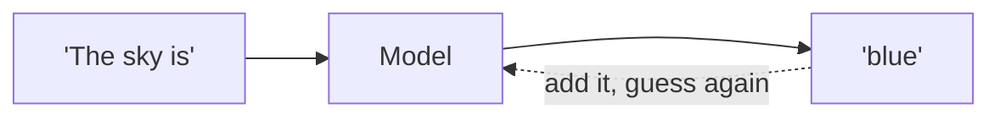
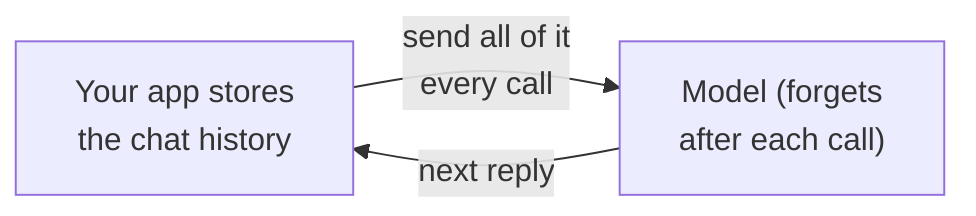
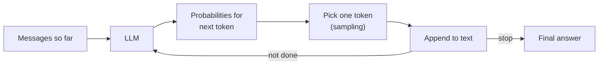
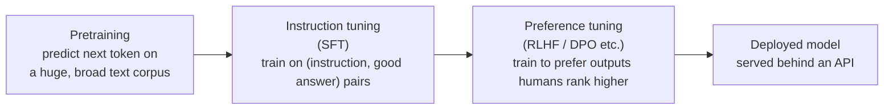
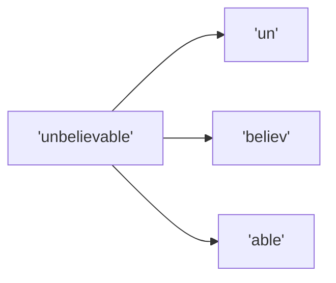
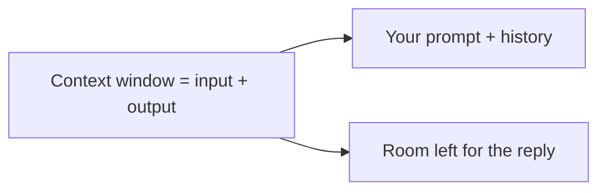
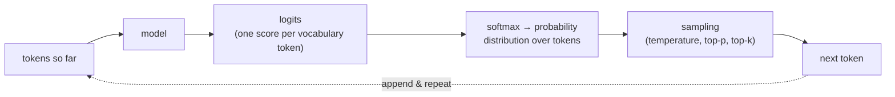
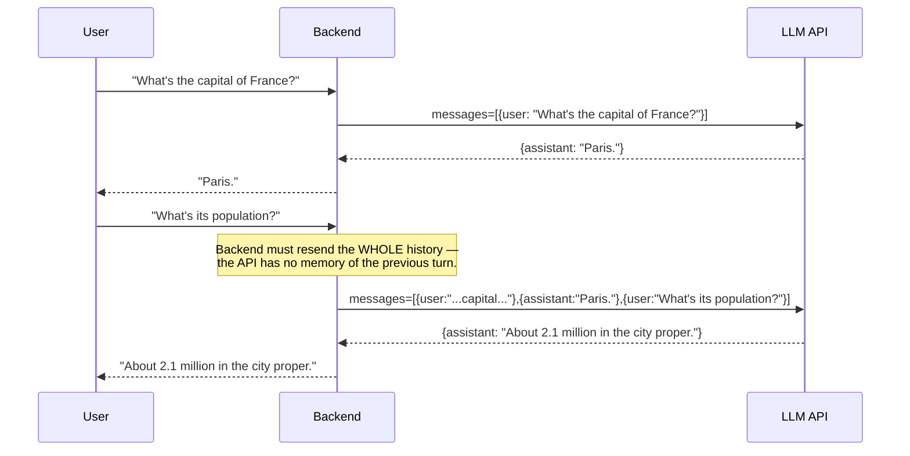
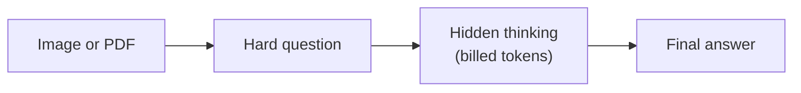
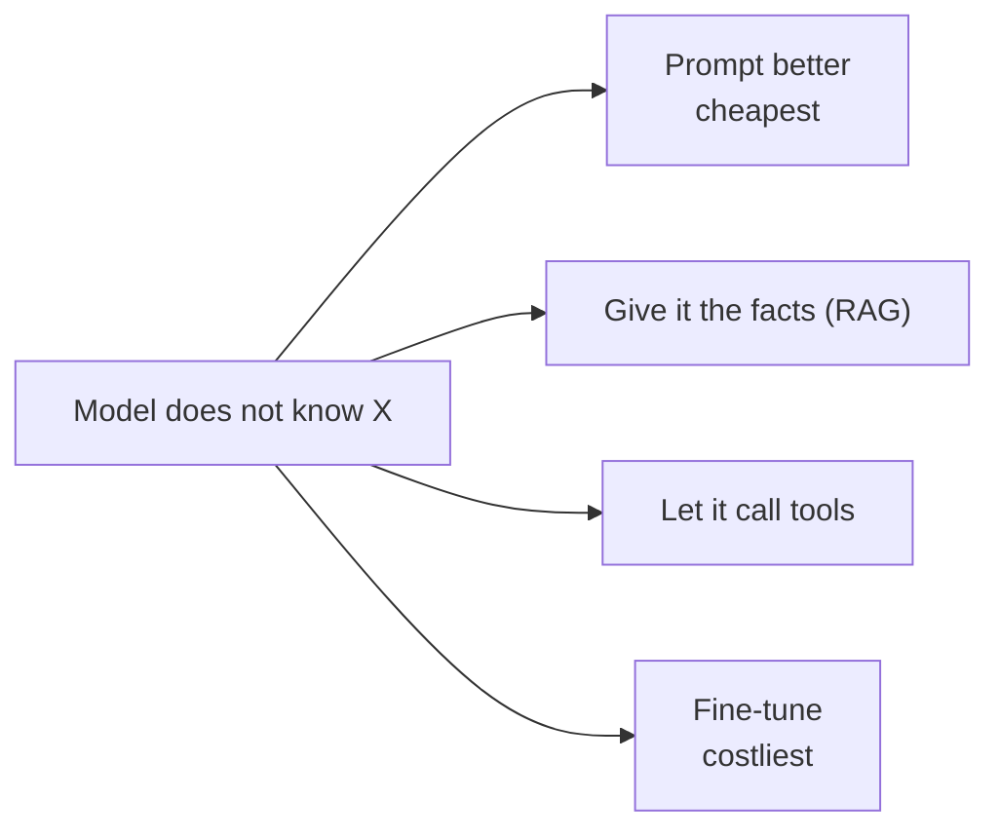

# LLM Fundamentals

> [!summary] TL;DR
> A large language model (LLM) is a neural network trained to predict the next **token** (a chunk of text) given everything before it. You call it over an API with a list of messages; it is **stateless**, so your backend resends the conversation on every call; and almost every production problem with it (cost, latency, inconsistent output) traces back to how many tokens it reads and writes.

> [!abstract] Core idea
> - An LLM repeatedly predicts "what token comes next", one token at a time, until it decides to stop.
> - The API is stateless: there is no server-side memory of your conversation. Your backend resends the message history on every call, and cost/latency grow with that history.
> - Output is sampled, not computed: the same prompt can give different answers, even at the lowest randomness setting.
> - Hallucination (confident, wrong output) is a structural property of next-token prediction, not a bug you can fully prompt away. You reduce it; you do not eliminate it.
> - Everything you build in `18 AI Engineering` — prompting, tool calling, RAG, agents — is scaffolding around this one primitive: a stateless function from (messages) to (more text).

## Start here: the basics 🟢

> [!info] How to read this note (pick your level)
> - 🟢 **New to this?** Read "From zero" below, then sections 1, 2 and the cheat sheet (10). Stop there, that is a full first pass.
> - 🟡 **Know the basics?** Add section 3 (how it works), 4 (worked example), 5 and 6.
> - 🔴 **Interview / SDE-3 prep?** Add 7, 8 and 9. Headings are tagged 🟢🟡🔴 so you always know where you are.

> [!note] Before this note
> - Nothing. This note starts from zero. If you have ever called a web API from code, that helps, but it is not required.

**From zero, in 60 seconds** 🟢

An LLM (large language model) is a very big autocomplete. It reads your text and guesses the next small piece, again and again.

Each small piece is a **token**, roughly 3/4 of an English word. You pay per token, both for what you send and for what comes back.



The model has a size limit on how much text it can read at once. That limit is the **context window**.

The model also has no memory. Every call, your app must send the whole chat again.



It sounds smart, but it only predicts likely text. So it can state wrong things with full confidence.

The rest of this note is just these 3 questions:
1. How is a model trained, and how does it pick each next word?
2. What are tokens, the context window and statelessness, and why do they cost you money?
3. When should a backend use an LLM at all, and what goes wrong in production?


**The problem in one story.**
You type a question into a chatbot and a fluent answer appears word by word.
It feels like the program knows things and remembers you.
In reality it is guessing the next word, over and over, and it forgets everything between calls.
Knowing this one fact explains its cost, its speed, its randomness and its mistakes.

**Words you need first**

| Word | Plain meaning | Tiny example |
| --- | --- | --- |
| Model | A program whose behaviour was learned from data | An LLM trained on lots of text |
| Neural network | A big math function with billions of tuned numbers | The "brain" inside the LLM |
| Token | A small piece of text the model reads and writes | "Hello world" may be 2 tokens |
| Probability | How likely something is, from 0 to 1 | "Paris" after "capital of France is" ≈ 0.95 |
| API | A way for your code to call another service | An HTTP POST to the model provider |
| Stateless | The server keeps no memory between calls | You must resend the chat history each time |
| Context window | The max tokens the model can see in one call | Input + output must fit in the limit |
| Hallucination | Confident output that is wrong | Inventing a function that does not exist |
| Training | The long, costly step where the model learns from example text | Months of reading web pages and books |
| Prompt | The text you send the model | "Summarise this email in one line" |
| Temperature | A knob for how random the word choice is | 0 = steady, 1 = more varied |
| Streaming | Getting the reply piece by piece as it is written | A chat bubble that fills up word by word |
| Fine-tuning | Training an existing model a bit more on your own examples | Teaching it your company's reply style |

**Picture it**



**Analogy.**
Phone autocomplete that has read a large part of the internet: it keeps suggesting the next word until the reply is finished.
Where it breaks: autocomplete only suggests and you choose, while the LLM picks every word itself and can state wrong things just as confidently as right ones.

**How the rest of this note builds up**

- First "Why it exists" and the "Mental model": the next-token loop.
- Then "How it works": training in three stages, tokenisation, the context window, sampling (temperature, top-p), statelessness, reasoning and multimodal models.
- Then a worked example of one raw API call and what `system`, `usage` and `stop_reason` mean.
- Finally the SDE-3 deep dive: why hallucination is structural, pricing shape, model tiers, latency anatomy and interview traps.

> [!tip] Remember
> An LLM is a stateless next-token guesser: you resend the context every call, you pay per token, and you never fully trust its output.

## 1. Why it exists 🟢

A classic autocomplete suggests the next word from a small, fixed set of patterns. An LLM does the same job — predict the next piece of text — but trained on a huge amount of text with a huge model, so the "patterns" it has learned include grammar, facts, code, reasoning chains, and conversational structure.

Concretely: you send an API request with a `model` name, a `max_tokens` budget (the most tokens you allow it to write back), and a list of `messages`. The API bills you for **input tokens** (everything you sent: history, documents, instructions) and **output tokens** (everything it generated), typically at different per-token prices, and returns the generated message plus a `usage` field reporting both counts.

A backend that ignores this — for example, resending a growing chat transcript every turn without ever trimming it — pays for the whole history on every single call and gets slower as the conversation grows, because the model must process every input token before it emits the first output token.

### Real-life example 🟢

Think of the help chat inside a food delivery app like Swiggy. You type "my order is late, where is it?".
The app's backend sends the model a short instruction ("you are a polite support helper"), your past messages and the order status it looked up, say "rider 2 km away".
The model writes a friendly reply word by word, and the app streams it into the chat bubble.
On your next message, the backend sends the whole chat again, because the model remembers nothing.
If the app forgot to include the order status, the model might simply guess a delivery time, which is a hallucination.

### Common beginner mistakes 🟢

- **Thinking the model remembers you** → the API keeps nothing between calls, so a follow-up like "and its population?" makes no sense to it → send the chat history again on every call.
- **Trusting a confident answer** → the model picks likely words, not checked facts, so it can invent a refund rule → give it the real facts (from your database or documents) and check its output.
- **Counting words or characters for cost** → you are billed per token, and Hindi or code can take 2-3 times more tokens → read the `usage` numbers the API sends back.
- **Expecting the same answer every time** → replies are picked with some randomness, and even temperature 0 can vary → if you need the same string twice, save the first answer and reuse it.
- **Using an LLM for a fixed rule** → "is this number above 100?" is one line of code, while an LLM call is slow, paid and can be wrong → keep plain rules in plain code.

## 2. Mental model 🟢

Picture the model as a function:

```text
next_token = model(all_tokens_so_far)
```

Run that function once, append the result to "all tokens so far", and run it again. Keep going until the model emits a special stop token or you hit your `max_tokens` budget.

A full response is just this loop run many times — which is also exactly why **streaming** (below) is possible: each loop iteration already produces one more piece of the answer before the whole response is done.

The analogy that holds up under interview questions: an LLM is a very well-read, very fast, slightly overconfident intern who has read nearly everything up to a cutoff date, writes fluently, and will confidently guess rather than say "I don't know" unless you explicitly tell it to.

It has no memory between tasks — every time you hand it a new task, you must re-hand it everything it needs to know.

### LLM vs the things people confuse it with 🟡

| Thing | What it really does | Key difference from an LLM |
| --- | --- | --- |
| Search engine (Google) | Finds existing pages that match your words | It returns real pages; an LLM writes new text and can make things up |
| Phone autocomplete | Suggests one next word; you choose | An LLM picks every word itself and writes whole answers |
| Chat app (ChatGPT, Claude.ai) | A product built around an LLM, with saved chats | The app stores your history; the raw model API does not |
| Database | Stores facts and returns exactly what was saved | An LLM stores no exact facts, only patterns, so it can be wrong |

## 3. How it works 🟡

> 🟢 → 🟡 **You now know** that an LLM is a stateless next-token guesser that you pay per token. **Next we open the box**: how it learns, how text becomes tokens, why the window has a size limit, how it picks each word, and why you must resend the chat. Each subsection starts with a plain step-by-step walk; the full detail follows.

### Training, in three stages

**In plain words:** First it reads the internet to learn language, then it learns to follow instructions, then people teach it which answers are better.

**Step by step:**
1. **Pretraining:** the model reads a huge pile of text (a **corpus**: web pages, books, code) and practises guessing the next token billions of times. Now it writes fluent text but does not follow orders well.
2. **Instruction tuning (SFT,** supervised fine-tuning: training on example pairs written by people**):** it sees pairs like "Summarise this" → a good summary, and learns to obey requests.
3. **Preference tuning (RLHF / DPO,** methods where people rank two answers and the model learns to prefer the better one**):** it learns to be helpful and polite, not just plausible.
4. The finished model is put behind an API. From now on it learns nothing new from your calls.
5. So it only knows what was in its training text, up to a date called the **knowledge cutoff**.

Full detail:



Pretraining gives the model broad knowledge and fluency. Instruction tuning teaches it to follow instructions and hold a conversation instead of just continuing arbitrary text. Preference tuning nudges it toward answers people actually prefer (helpful, harmless, following the system prompt) over answers that are merely plausible continuations.

None of these stages give the model a live connection to your data or today's date — that is **knowledge cutoff**: a model only knows what existed in its training data, which is why you ground it with retrieval or tools for anything current or private (see [[RAG Pipeline]]).

### Tokenisation

**In plain words:** The model chops text into small pieces before reading. Pieces, not letters or words, are what you pay for.

**Step by step:**
1. You send "unbelievable price".
2. The **tokeniser** (a small program that cuts text into known pieces) splits it into pieces such as "un", "believ", "able", " price".
3. Each piece becomes a number from the model's fixed list of known pieces (its **vocabulary**, tens of thousands of entries).
4. The model reads those numbers, not your letters.
5. The bill counts pieces: about 4 English characters per token, so 1,000 words is roughly 1,300 tokens.

Full detail:

The model does not see characters or whole words; it sees **tokens**, the units produced by its tokeniser (a byte-pair-encoding, BPE, variant in most current **frontier models**, meaning the newest and strongest models from the big providers; BPE builds its piece list by repeatedly merging the most common pairs of letters). A rough estimate for English text is **about 4 characters per token** — `"hello world"` is 2 tokens, but `"supercalifragilisticexpialidocious"` might be 8–10.

Other scripts (Hindi, Chinese, Japanese, Arabic) and code tend to tokenise less efficiently, often 2–3x more tokens for the same apparent amount of content; this is an **estimate**, not a documented constant, and it varies by tokeniser and language.

For an exact count, call the documented count-tokens endpoint or read the `usage` field on a real response — never hardcode a chars-per-token ratio for a billing or truncation decision that matters.

Every number you reason about — cost, latency, context budget — is a token count, not a character or word count. This is the single idea that explains why chat history trimming, document chunking (see [[Document Ingestion and Chunking]]) and prompt caching (see [[LLM Cost, Latency and Caching]]) all exist.



### Context window and "lost in the middle"

**In plain words:** The window is the model's desk: only so much paper fits. And it reads the top and bottom of the pile better than the middle.

**Step by step:**
1. Say the window is 200,000 tokens.
2. You set `max_tokens` to 4,000, the room you keep for the reply.
3. That leaves about 196,000 tokens for your instructions, chat history and documents.
4. If you send more than that, the call fails or gets cut, so you must shorten, summarise or pick only the useful parts.
5. Even when it fits, a fact buried in the middle of a long document is found less often than one at the start or end.

Full detail:

The **context window** is the maximum number of tokens the model can attend to in one call. A common mistake is to think of it as an input-only budget: it is actually **input tokens + output tokens combined**, as of 2026 for essentially all frontier providers — so a large `max_tokens` setting shrinks how much input history actually fits.

If your conversation or document exceeds the window, the call fails or truncates; you must summarise, chunk, or retrieve a relevant subset instead (see [[RAG Pipeline]], [[Advanced RAG Patterns]]).

A separate, well-documented effect is that a long context window does not mean uniformly good recall across it: models tend to use information near the start and end of the context more reliably than information buried in the middle (Liu et al. 2024, "lost in the middle").

Put your most important instructions and facts at the start or end of the prompt, not deep in the middle of a long document dump.



### Sampling: logits, temperature, top-p

**In plain words:** The model scores every possible next word, then picks one. Temperature is the "how adventurous" knob.

**Step by step:**
1. Text so far: "The capital of France is".
2. The model gives every token in its vocabulary a raw score, called a **logit**.
3. A formula called **softmax** turns those scores into chances that add up to 1, say "Paris" 0.95, "a" 0.03, "Lyon" 0.01.
4. **Sampling** picks one token using those chances. Low temperature almost always picks "Paris"; high temperature sometimes picks "Lyon".
5. The chosen token is added to the text, and the loop runs again for the next one.

Full detail:



The model does not output one deterministic "best" token; it outputs a probability distribution over its whole vocabulary (tens of thousands of possible tokens), and the API samples from that distribution:

- **Temperature** scales the distribution before sampling. Low temperature sharpens it toward the highest-probability tokens (more stable, more repetitive); high temperature flattens it (more varied, more surprising, more likely to go off the rails).
- **Top-p** (nucleus sampling, "only consider the top slice of likely words") restricts sampling to the smallest set of tokens whose cumulative probability exceeds `p`, cutting off the long unlikely tail.
- **Top-k** restricts sampling to the `k` most likely tokens.

**Temperature 0 is not the same as deterministic.**

Even at temperature 0 (always pick the top token), floating-point non-associativity in how GPUs batch requests (tiny rounding differences when the same numbers are added in a different order), provider-side load balancing across replicas (many copies of the model on different machines), and backend non-determinism can produce different output across two calls with an identical prompt. Reasoning models in particular may ignore or fix some sampling parameters entirely and expose a separate "reasoning effort" control instead (verify per provider and model). If your backend logic depends on getting the literal same string back for the same input, do not rely on sampling settings alone — cache the first response and reuse it, or use structured outputs with strict validation (see [[Structured Outputs and Tool Calling]]).

### Statelessness and multi-turn conversation

**In plain words:** Like talking to someone with no memory: you repeat the whole chat each time you speak.

**Step by step:**
1. Turn 1: the user asks "What's the capital of France?". The backend sends that one message and gets "Paris."
2. The backend saves both messages in its own store, for example a database table.
3. Turn 2: the user asks "What's its population?". Alone, "its" means nothing to the model.
4. So the backend sends all 3 messages: question 1, answer "Paris.", question 2.
5. Every new turn sends the whole growing list again, so each turn costs a bit more than the last.

Full detail:



There is no session on the server. "Memory" in an LLM application is an application-level concern: your backend stores the conversation (in a database, cache, or in-process struct) and resends the relevant slice of it as the `messages` array on every call.

This is also why every added turn costs more: you are re-billed for the entire visible history every time, which is exactly the problem prompt caching (see [[LLM Cost, Latency and Caching]]) addresses by letting a provider skip re-processing an unchanged prefix.

### Reasoning models and multimodal input

**In plain words:** Some models "think out loud" before answering (better but slower and pricier). Many can also read images and PDFs.

**Step by step:**
1. You ask a hard question, such as a tricky date calculation, and set an "effort" level.
2. The reasoning model first writes hidden working notes, say 2,000 tokens.
3. Then it writes the short final answer, say 100 tokens.
4. You pay for all 2,100 output tokens, and you wait for all of them.
5. A **multimodal** model (one that reads more than text) can also take a photo of a bill or a PDF page inside the same message list.



Full detail:

As of 2026, a separate family of **reasoning models** (sometimes exposed as a "thinking" or "extended reasoning" mode on general-purpose models) spend extra generated tokens working through a problem step by step before producing a final answer, controlled by an "effort" or "thinking budget" setting rather than by prompting techniques like "think step by step" (which mattered more for earlier non-reasoning models; see [[Prompt Engineering]]).

This extra reasoning is itself billed as output tokens, so it trades latency and cost for accuracy on harder problems, and is usually unnecessary for simple classification or extraction tasks.

Most frontier models as of 2026 also accept **multimodal input** — images and PDFs alongside text, encoded in the same `messages` structure as a typed content block — which matters for AI engineering because a scanned document or a screenshot can go straight into a prompt instead of through a separate OCR step, though dedicated OCR (software that turns a picture of text into real text) is still often more accurate and cheaper for high-volume document pipelines (see [[Document Ingestion and Chunking]]).

## 4. Worked example 🟡

### Whiteboard version

**In plain words:** Every LLM call has the same shape: model name, a max length, and the list of messages.

The shape of every LLM call, reduced to its essentials — this is what [[Calling LLM APIs from Go]] builds into a production client:

```text
POST /v1/messages
{
  "model": "claude-sonnet-5-5",
  "max_tokens": 1024,
  "system": "You are a helpful backend assistant. Answer in one sentence.",
  "messages": [
    {"role": "user", "content": "What's the time complexity of binary search?"}
  ]
}

→ 200 OK
{
  "id": "msg_01...",
  "content": [{"type": "text", "text": "Binary search runs in O(log n) time."}],
  "stop_reason": "end_turn",
  "usage": {"input_tokens": 24, "output_tokens": 11}
}
```

Three things worth noticing even before writing any code:

1. The `system` field is a separate slot from the conversation, not just the first message (it is handled specially by the model and is a natural place for stable, cacheable instructions).
2. `usage` is the ground truth for cost, not an estimate.
3. `stop_reason` (a field in the reply that says why the model stopped writing) tells you *why* generation stopped (`end_turn` for a natural finish, `max_tokens` for a truncated answer, `tool_use` when the model wants to call a tool — see [[Structured Outputs and Tool Calling]]).

A backend that doesn't check `stop_reason` can silently ship truncated answers as if they were complete.

### Deciding when an LLM call is even the right tool

**In plain words:** If plain code can do the job, use plain code. LLMs are slow, cost money and can be wrong.

| Question | If yes |
|---|---|
| Is the task a fixed rule you can write down? | Write the rule in Go; skip the LLM call entirely — it will be faster, cheaper, and more predictable. |
| Does it need knowledge the model doesn't have (your data, today's data)? | Ground it: retrieval ([[RAG Pipeline]]) or tool calls ([[Structured Outputs and Tool Calling]]), not the model's internal knowledge alone. |
| Does it need to take actions, not just answer? | Tool calling / an agent loop ([[AI Agents and Agentic Workflows]]), not a single completion. |
| Is "mostly right, occasionally wrong" acceptable for this use case? | An LLM call is a reasonable fit, with validation on the output. |
| Must it be exactly correct every time (billing math, auth decisions)? | Don't let the LLM make the final call; have it draft, and verify with code. |

## 5. Variants and comparison 🟡

**In plain words:** When the model does not know something, you can: prompt better, give it the facts (RAG), let it call tools, or retrain it.

| Approach to "the model doesn't know X" | How it works | Use when | Cost |
|---|---|---|---|
| Prompting only | Describe the task better, add examples | X is reasoning/formatting, not missing facts | Cheapest; limited by what's already in the model |
| RAG (retrieval-augmented generation) | Fetch relevant documents at request time, put them in the prompt | X is current, private, or large and changes often | Extra retrieval latency; infra for indexing (see [[RAG Pipeline]]) |
| Tool calling | Model requests a function call (e.g. a DB lookup), your code runs it and returns the result | X is a precise, structured fact an API/DB already has | Extra round trip per tool call |
| Long context | Stuff the whole document set directly into the prompt | The corpus is small enough to fit and doesn't change per-request | Most expensive per call; "lost in the middle" risk |
| Fine-tuning | Retrain (part of) the model on your examples | X is a *style* or *format* you need very consistently, at high volume | Training cost + ongoing maintenance of a custom model; rarely the first thing to reach for in 2026 |



## 6. Trade-offs and when not to use 🟡

- An LLM call is non-deterministic, slow (hundreds of milliseconds to seconds) and metered per token — never use one where a lookup table, a regex, or a SQL query answers the question deterministically and instantly.
- Every call is a dependency on a third-party service: it can be rate-limited, degraded, or down (see [[Calling LLM APIs from Go]] for the retry/timeout handling this requires).
- Output is a string (or structured JSON you asked for) that must still be validated — treat it as untrusted input to the rest of your system, never as trusted application logic.
- Long conversations get expensive and slower by design (full history resent every turn); real applications actively manage context size rather than letting it grow unbounded.

## 7. In production 🔴

> 🟡 → 🔴 **You now know** how training, tokens, the window, sampling and statelessness work, and how to pick between prompting, RAG, tools and fine-tuning. **Next comes the senior view**: what breaks in real systems, what to watch on dashboards, why hallucination cannot be fully removed, and how pricing and latency are shaped.

- **Real systems:** customer-support copilots that draft replies for a human to approve; code-review and code-generation assistants; semantic search and document Q&A backends (see [[Case Study - Chat with PDFs and Websites]]); structured-extraction pipelines that turn unstructured text (emails, PDFs, support tickets) into typed JSON rows for a database.
- **Failure modes → fixes:**
  - Hallucinated fact stated confidently → ground with retrieval or tools; ask the model to cite sources and validate the citation exists.
  - Output silently truncated mid-answer → check `stop_reason`, not just that the call returned `200`.
  - Cost spike from an unbounded conversation → cap and summarise history (see [[LLM Cost, Latency and Caching]]).
  - Inconsistent output breaking a downstream parser → use the API's structured-output mode, not prose parsing (see [[Structured Outputs and Tool Calling]]).
- **What to monitor:** input/output token counts and $ cost per request; p50/p99 latency (the typical wait, and the wait of the slowest 1 in 100 calls), split into time-to-first-token and total time; error rate by status code (429 vs 5xx vs 4xx); `stop_reason` distribution (a rising share of `max_tokens` truncations is a budget bug, not a model problem).

## 8. Deep dive 🔴

- **Why hallucination is structural, not incidental.** The model is trained to produce the statistically most plausible continuation of the prompt, not to consult a ground-truth fact store. When it has not seen a fact often enough (or at all) in training, the most "plausible-sounding" continuation can still be fluent and wrong — the training objective never distinguishes "confidently correct" from "confidently fluent."

  This is why the fix is architectural (RAG, tool calls, citation + verification), not purely a better prompt.
- **Pricing shape, not numbers.** As of 2026, providers typically bill input and output tokens at different rates (output usually costs several times more than input, since generation is the expensive step), offer a reduced rate for cached input tokens (an unchanged prompt prefix the provider doesn't have to reprocess), and offer a batch API at a further discount for requests that can tolerate asynchronous, non-urgent processing.

  Treat any specific per-token price you see as **documented** only if you cite the provider's current pricing page with a date, since these numbers change often; otherwise label it an estimate or leave it out.
- **Model tiers, deliberately without hardcoded names.** Providers generally ship a frontier/flagship tier (best quality, slowest, most expensive), a small/fast tier (cheaper, lower latency, weaker at hard reasoning), and increasingly an open-weight tier you can self-host (the model files are public, so you run it on your own servers).

  Pick by running your own eval set against the candidates (see [[LLM Evals in Production]]), not by assuming the newest or biggest model is best for your task — a well-prompted small model is frequently the better choice for a narrow, high-volume task.

  As of 2026, the vault's worked examples use `claude-opus-5-5`, `claude-sonnet-5-5`, and `claude-haiku-5-5` as the current Claude model line; confirm current names and capabilities against the provider's docs before relying on them, since model names and tiers are revised more often than this note is.
- **Latency anatomy.** Total latency is roughly: network round trip + queueing on the provider's side + **time-to-first-token** (TTFT, dominated by how many input tokens must be processed) + generation time (roughly proportional to output tokens, at some tokens-per-second rate for that model).

  Streaming (see [[Calling LLM APIs from Go]]) does not reduce total latency, but it reduces *perceived* latency by showing the user the first tokens as soon as TTFT elapses instead of waiting for the entire response.

## 9. Interview questions 🔴

> [!question]- What exactly does "stateless API" mean for an LLM, and what does it imply for your backend?
> The provider keeps no memory of your conversation between calls. Your backend must store the conversation and resend the relevant history (or a summary of it) as the `messages` array on every request.
>
> It implies cost and latency grow with unmanaged history length, and that "memory" features (chat history, agent long-term memory) are entirely your application's responsibility, not the model's.

> [!question]- Is temperature 0 deterministic?
> Not reliably. It makes the model pick the single highest-probability token at each step, which removes sampling randomness, but floating-point non-associativity across different hardware/batching and provider-side routing can still produce different output for an identical prompt.
>
> Some reasoning models additionally fix or ignore temperature outright. If you need a guaranteed-identical answer for the same input, cache the first response rather than relying on temperature 0.

> [!question]- What is the context window, exactly — is it input only?
> It is the maximum number of tokens the model can attend to in a single call, covering **input and output tokens combined**. A large `max_tokens` reduces how much input can actually fit, and content placed deep in the middle of a very long input is recalled less reliably than content near the start or end ("lost in the middle").

> [!question]- Why does an LLM hallucinate, and how do you reduce it in a backend?
> It is trained to produce the most plausible next token, not to consult a verified fact store, so a fluent and wrong continuation is not distinguishable to the model from a fluent and correct one when it lacks the fact.
>
> Reduce it by grounding answers in retrieved documents or tool results (RAG, tool calling), asking for citations and checking they exist, and validating output against known data before acting on it — you manage the risk, you don't eliminate it.

> [!question]- Trap: "Just increase the context window and skip RAG — put the whole knowledge base in the prompt." Why is that often wrong?
> It re-sends (and re-bills, and re-exposes to "lost in the middle" recall loss) the entire corpus on every single call, it caps out once the corpus exceeds the window, and it can't apply per-request filtering (e.g. per-tenant access control) as cheaply as a retrieval query can.
>
> RAG retrieves only the relevant slice per request, which is usually cheaper, faster, and more accurate for large or frequently changing corpora. Long context is a reasonable choice only when the whole corpus is small, stable, and shared across every request.

> [!question]- How would you decide between prompting better, adding retrieval, adding tool calling, or fine-tuning for a task that's failing?
> First check whether the failure is a missing fact (reach for retrieval or a tool call), a formatting/reasoning issue (improve the prompt or switch to structured outputs), or a need to act on the world rather than just answer (tool calling / an agent).
>
> Fine-tuning is the last resort: it's worth it mainly for a very consistent style/format at high volume, since it adds ongoing training and maintenance cost that prompting and RAG don't.

> [!question]- A teammate says "the model output is JSON 95% of the time, so let's just regex it out." What's wrong with that?
> It optimises for the common case and ignores the other 5%, which will fail unpredictably in production and is exactly the kind of inconsistency structured outputs exist to remove: the API can constrain generation to match a JSON Schema (or route through a tool call), which you then still validate, rather than hoping a regex on free-form prose holds up (see [[Structured Outputs and Tool Calling]]).

## 10. Cheat sheet 🟢

- LLM = repeatedly predict the next token; trained via pretraining → instruction tuning → preference tuning.
- Tokens, not characters or words, are the unit of cost, latency and the context window (~4 chars/token in English, worse for other scripts — an estimate, not exact).
- Context window = input + output tokens combined; content in the middle of a long prompt is recalled less reliably.
- Output is sampled (temperature/top-p/top-k); temperature 0 ≠ deterministic.
- The API is stateless: your backend resends history every call; "memory" is an app concern.
- Hallucination is structural (fluent ≠ correct); fix it by grounding, not by better wording alone.
- Pick the mechanism by the failure mode: prompting (reasoning/format), RAG (missing facts), tool calling (precise live data/actions), fine-tuning (consistent style at volume, rarely first).
- Reasoning models spend extra output tokens "thinking"; multimodal models accept images/PDFs as typed content blocks.

## Self-check 🟢🟡

> [!question]- Easy: What is a token?
> A small piece of text, about 3/4 of an English word; it is the unit you pay for.

> [!question]- Easy: Does the model remember your last message?
> No. The API is stateless, so your backend must resend the chat history on every call.

> [!question]- Easy: What is a hallucination?
> A confident answer that is wrong, because the model predicts likely words, not checked facts.

> [!question]- Medium: Your `max_tokens` is huge and long documents start failing. Why?
> The context window covers input plus output, so a big reply budget leaves less room for input.

> [!question]- Medium: Temperature is 0 but two identical calls gave different answers. Is that a bug?
> No. GPU rounding and routing across machines can still change output; cache the first answer if you need the same string.

> [!question]- Medium: The model does not know your company's refund policy. Fine-tune or RAG?
> RAG first: fetch the policy text and put it in the prompt; fine-tuning is for a steady style, not for facts that change.

## Links 🟢

- **Before this:** [[Calling External APIs]] (06, general HTTP client basics this topic builds on)
- **Next:** [[Calling LLM APIs from Go]], [[Prompt Engineering]]
- **Compare with:** [[Structured Outputs and Tool Calling]], [[RAG Pipeline]]

### Watch on YouTube

- [LLM Fundamentals Crash Course For Beginners 2026 (Tokens, Prompting, APIs & Tool Calls)](https://www.youtube.com/watch?v=YHNi88FaGug) · Harish Neel / AI · 73 min · 39,897 views
- [LLM Fundamentals Crash Course (& Why Every Dev Should Learn It!)](https://www.youtube.com/watch?v=Kaigs9LNoO0) · Philipp Lackner · 18 min · 1,154 views
