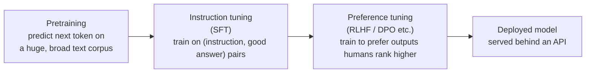
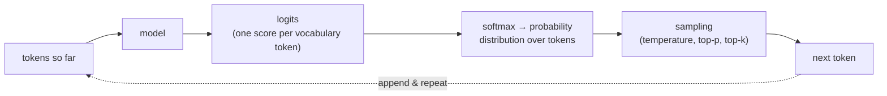
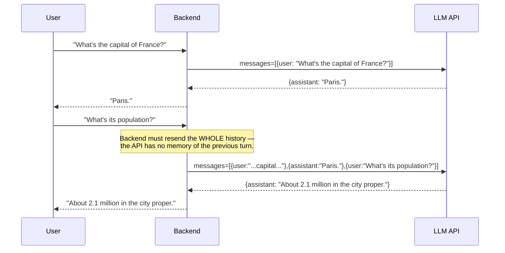

# LLM Fundamentals

> [!summary] TL;DR
> A large language model (LLM) is a neural network trained to predict the next **token** (a chunk of text) given everything before it. You call it over an API with a list of messages; it is **stateless**, so your backend resends the conversation on every call; and almost every production problem with it (cost, latency, inconsistent output) traces back to how many tokens it reads and writes.

> [!abstract] Core idea
> - An LLM repeatedly predicts "what token comes next", one token at a time, until it decides to stop.
> - The API is stateless: there is no server-side memory of your conversation. Your backend resends the message history on every call, and cost/latency grow with that history.
> - Output is sampled, not computed: the same prompt can give different answers, even at the lowest randomness setting.
> - Hallucination (confident, wrong output) is a structural property of next-token prediction, not a bug you can fully prompt away. You reduce it; you do not eliminate it.
> - Everything you build in `18 AI Engineering` — prompting, tool calling, RAG, agents — is scaffolding around this one primitive: a stateless function from (messages) to (more text).

## 1. Why it exists

A classic autocomplete suggests the next word from a small, fixed set of patterns. An LLM does the same job — predict the next piece of text — but trained on a huge amount of text with a huge model, so the "patterns" it has learned include grammar, facts, code, reasoning chains, and conversational structure.

Concretely: you send an API request with a `model` name, a `max_tokens` budget, and a list of `messages`. The API bills you for **input tokens** (everything you sent: history, documents, instructions) and **output tokens** (everything it generated), typically at different per-token prices, and returns the generated message plus a `usage` field reporting both counts. A backend that ignores this — for example, resending a growing chat transcript every turn without ever trimming it — pays for the whole history on every single call and gets slower as the conversation grows, because the model must process every input token before it emits the first output token.

## 2. Mental model

Picture the model as a function:

```text
next_token = model(all_tokens_so_far)
```

Run that function once, append the result to "all tokens so far", and run it again. Keep going until the model emits a special stop token or you hit your `max_tokens` budget. A full response is just this loop run many times — which is also exactly why **streaming** (below) is possible: each loop iteration already produces one more piece of the answer before the whole response is done.

The analogy that holds up under interview questions: an LLM is a very well-read, very fast, slightly overconfident intern who has read nearly everything up to a cutoff date, writes fluently, and will confidently guess rather than say "I don't know" unless you explicitly tell it to. It has no memory between tasks — every time you hand it a new task, you must re-hand it everything it needs to know.

## 3. How it works

### Training, in three stages



Pretraining gives the model broad knowledge and fluency. Instruction tuning teaches it to follow instructions and hold a conversation instead of just continuing arbitrary text. Preference tuning nudges it toward answers people actually prefer (helpful, harmless, following the system prompt) over answers that are merely plausible continuations. None of these stages give the model a live connection to your data or today's date — that is **knowledge cutoff**: a model only knows what existed in its training data, which is why you ground it with retrieval or tools for anything current or private (see [[RAG Pipeline]]).

### Tokenisation

The model does not see characters or whole words; it sees **tokens**, the units produced by its tokeniser (a byte-pair-encoding, BPE, variant in most current frontier models). A rough estimate for English text is **about 4 characters per token** — `"hello world"` is 2 tokens, but `"supercalifragilisticexpialidocious"` might be 8–10. Other scripts (Hindi, Chinese, Japanese, Arabic) and code tend to tokenise less efficiently, often 2–3x more tokens for the same apparent amount of content; this is an **estimate**, not a documented constant, and it varies by tokeniser and language. For an exact count, call the documented count-tokens endpoint or read the `usage` field on a real response — never hardcode a chars-per-token ratio for a billing or truncation decision that matters.

Every number you reason about — cost, latency, context budget — is a token count, not a character or word count. This is the single idea that explains why chat history trimming, document chunking (see [[Document Ingestion and Chunking]]) and prompt caching (see [[LLM Cost, Latency and Caching]]) all exist.

### Context window and "lost in the middle"

The **context window** is the maximum number of tokens the model can attend to in one call. A common mistake is to think of it as an input-only budget: it is actually **input tokens + output tokens combined**, as of 2026 for essentially all frontier providers — so a large `max_tokens` setting shrinks how much input history actually fits. If your conversation or document exceeds the window, the call fails or truncates; you must summarise, chunk, or retrieve a relevant subset instead (see [[RAG Pipeline]], [[Advanced RAG Patterns]]).

A separate, well-documented effect is that a long context window does not mean uniformly good recall across it: models tend to use information near the start and end of the context more reliably than information buried in the middle (Liu et al. 2024, "lost in the middle"). Put your most important instructions and facts at the start or end of the prompt, not deep in the middle of a long document dump.

### Sampling: logits, temperature, top-p



The model does not output one deterministic "best" token; it outputs a probability distribution over its whole vocabulary (tens of thousands of possible tokens), and the API samples from that distribution:

- **Temperature** scales the distribution before sampling. Low temperature sharpens it toward the highest-probability tokens (more stable, more repetitive); high temperature flattens it (more varied, more surprising, more likely to go off the rails).
- **Top-p** (nucleus sampling) restricts sampling to the smallest set of tokens whose cumulative probability exceeds `p`, cutting off the long unlikely tail.
- **Top-k** restricts sampling to the `k` most likely tokens.

**Temperature 0 is not the same as deterministic.** Even at temperature 0 (always pick the top token), floating-point non-associativity in how GPUs batch requests, provider-side load balancing across replicas, and backend non-determinism can produce different output across two calls with an identical prompt. Reasoning models in particular may ignore or fix some sampling parameters entirely and expose a separate "reasoning effort" control instead (verify per provider and model). If your backend logic depends on getting the literal same string back for the same input, do not rely on sampling settings alone — cache the first response and reuse it, or use structured outputs with strict validation (see [[Structured Outputs and Tool Calling]]).

### Statelessness and multi-turn conversation



There is no session on the server. "Memory" in an LLM application is an application-level concern: your backend stores the conversation (in a database, cache, or in-process struct) and resends the relevant slice of it as the `messages` array on every call. This is also why every added turn costs more: you are re-billed for the entire visible history every time, which is exactly the problem prompt caching (see [[LLM Cost, Latency and Caching]]) addresses by letting a provider skip re-processing an unchanged prefix.

### Reasoning models and multimodal input

As of 2026, a separate family of **reasoning models** (sometimes exposed as a "thinking" or "extended reasoning" mode on general-purpose models) spend extra generated tokens working through a problem step by step before producing a final answer, controlled by an "effort" or "thinking budget" setting rather than by prompting techniques like "think step by step" (which mattered more for earlier non-reasoning models; see [[Prompt Engineering]]). This extra reasoning is itself billed as output tokens, so it trades latency and cost for accuracy on harder problems, and is usually unnecessary for simple classification or extraction tasks.

Most frontier models as of 2026 also accept **multimodal input** — images and PDFs alongside text, encoded in the same `messages` structure as a typed content block — which matters for AI engineering because a scanned document or a screenshot can go straight into a prompt instead of through a separate OCR step, though dedicated OCR is still often more accurate and cheaper for high-volume document pipelines (see [[Document Ingestion and Chunking]]).

## 4. Worked example

### Whiteboard version

The shape of every LLM call, reduced to its essentials — this is what [[Calling LLM APIs from Go]] builds into a production client:

```text
POST /v1/messages
{
  "model": "claude-sonnet-5-5",
  "max_tokens": 1024,
  "system": "You are a helpful backend assistant. Answer in one sentence.",
  "messages": [
    {"role": "user", "content": "What's the time complexity of binary search?"}
  ]
}

→ 200 OK
{
  "id": "msg_01...",
  "content": [{"type": "text", "text": "Binary search runs in O(log n) time."}],
  "stop_reason": "end_turn",
  "usage": {"input_tokens": 24, "output_tokens": 11}
}
```

Three things worth noticing even before writing any code: the `system` field is a separate slot from the conversation, not just the first message (it is handled specially by the model and is a natural place for stable, cacheable instructions); `usage` is the ground truth for cost, not an estimate; and `stop_reason` tells you *why* generation stopped (`end_turn` for a natural finish, `max_tokens` for a truncated answer, `tool_use` when the model wants to call a tool — see [[Structured Outputs and Tool Calling]]). A backend that doesn't check `stop_reason` can silently ship truncated answers as if they were complete.

### Deciding when an LLM call is even the right tool

| Question | If yes |
|---|---|
| Is the task a fixed rule you can write down? | Write the rule in Go; skip the LLM call entirely — it will be faster, cheaper, and more predictable. |
| Does it need knowledge the model doesn't have (your data, today's data)? | Ground it: retrieval ([[RAG Pipeline]]) or tool calls ([[Structured Outputs and Tool Calling]]), not the model's internal knowledge alone. |
| Does it need to take actions, not just answer? | Tool calling / an agent loop ([[AI Agents and Agentic Workflows]]), not a single completion. |
| Is "mostly right, occasionally wrong" acceptable for this use case? | An LLM call is a reasonable fit, with validation on the output. |
| Must it be exactly correct every time (billing math, auth decisions)? | Don't let the LLM make the final call; have it draft, and verify with code. |

## 5. Variants and comparison

| Approach to "the model doesn't know X" | How it works | Use when | Cost |
|---|---|---|---|
| Prompting only | Describe the task better, add examples | X is reasoning/formatting, not missing facts | Cheapest; limited by what's already in the model |
| RAG (retrieval-augmented generation) | Fetch relevant documents at request time, put them in the prompt | X is current, private, or large and changes often | Extra retrieval latency; infra for indexing (see [[RAG Pipeline]]) |
| Tool calling | Model requests a function call (e.g. a DB lookup), your code runs it and returns the result | X is a precise, structured fact an API/DB already has | Extra round trip per tool call |
| Long context | Stuff the whole document set directly into the prompt | The corpus is small enough to fit and doesn't change per-request | Most expensive per call; "lost in the middle" risk |
| Fine-tuning | Retrain (part of) the model on your examples | X is a *style* or *format* you need very consistently, at high volume | Training cost + ongoing maintenance of a custom model; rarely the first thing to reach for in 2026 |

## 6. Trade-offs and when not to use

- An LLM call is non-deterministic, slow (hundreds of milliseconds to seconds) and metered per token — never use one where a lookup table, a regex, or a SQL query answers the question deterministically and instantly.
- Every call is a dependency on a third-party service: it can be rate-limited, degraded, or down (see [[Calling LLM APIs from Go]] for the retry/timeout handling this requires).
- Output is a string (or structured JSON you asked for) that must still be validated — treat it as untrusted input to the rest of your system, never as trusted application logic.
- Long conversations get expensive and slower by design (full history resent every turn); real applications actively manage context size rather than letting it grow unbounded.

## 7. In production

- **Real systems:** customer-support copilots that draft replies for a human to approve; code-review and code-generation assistants; semantic search and document Q&A backends (see [[Case Study - Chat with PDFs and Websites]]); structured-extraction pipelines that turn unstructured text (emails, PDFs, support tickets) into typed JSON rows for a database.
- **Failure modes → fixes:**
  - Hallucinated fact stated confidently → ground with retrieval or tools; ask the model to cite sources and validate the citation exists.
  - Output silently truncated mid-answer → check `stop_reason`, not just that the call returned `200`.
  - Cost spike from an unbounded conversation → cap and summarise history (see [[LLM Cost, Latency and Caching]]).
  - Inconsistent output breaking a downstream parser → use the API's structured-output mode, not prose parsing (see [[Structured Outputs and Tool Calling]]).
- **What to monitor:** input/output token counts and $ cost per request; p50/p99 latency, split into time-to-first-token and total time; error rate by status code (429 vs 5xx vs 4xx); `stop_reason` distribution (a rising share of `max_tokens` truncations is a budget bug, not a model problem).

## 8. Deep dive

- **Why hallucination is structural, not incidental.** The model is trained to produce the statistically most plausible continuation of the prompt, not to consult a ground-truth fact store. When it has not seen a fact often enough (or at all) in training, the most "plausible-sounding" continuation can still be fluent and wrong — the training objective never distinguishes "confidently correct" from "confidently fluent." This is why the fix is architectural (RAG, tool calls, citation + verification), not purely a better prompt.
- **Pricing shape, not numbers.** As of 2026, providers typically bill input and output tokens at different rates (output usually costs several times more than input, since generation is the expensive step), offer a reduced rate for cached input tokens (an unchanged prompt prefix the provider doesn't have to reprocess), and offer a batch API at a further discount for requests that can tolerate asynchronous, non-urgent processing. Treat any specific per-token price you see as **documented** only if you cite the provider's current pricing page with a date, since these numbers change often; otherwise label it an estimate or leave it out.
- **Model tiers, deliberately without hardcoded names.** Providers generally ship a frontier/flagship tier (best quality, slowest, most expensive), a small/fast tier (cheaper, lower latency, weaker at hard reasoning), and increasingly an open-weight tier you can self-host. Pick by running your own eval set against the candidates (see [[LLM Evals in Production]]), not by assuming the newest or biggest model is best for your task — a well-prompted small model is frequently the better choice for a narrow, high-volume task. As of 2026, the vault's worked examples use `claude-opus-5-5`, `claude-sonnet-5-5`, and `claude-haiku-5-5` as the current Claude model line; confirm current names and capabilities against the provider's docs before relying on them, since model names and tiers are revised more often than this note is.
- **Latency anatomy.** Total latency is roughly: network round trip + queueing on the provider's side + **time-to-first-token** (TTFT, dominated by how many input tokens must be processed) + generation time (roughly proportional to output tokens, at some tokens-per-second rate for that model). Streaming (see [[Calling LLM APIs from Go]]) does not reduce total latency, but it reduces *perceived* latency by showing the user the first tokens as soon as TTFT elapses instead of waiting for the entire response.

## 9. Interview questions

> [!question]- What exactly does "stateless API" mean for an LLM, and what does it imply for your backend?
> The provider keeps no memory of your conversation between calls. Your backend must store the conversation and resend the relevant history (or a summary of it) as the `messages` array on every request. It implies cost and latency grow with unmanaged history length, and that "memory" features (chat history, agent long-term memory) are entirely your application's responsibility, not the model's.

> [!question]- Is temperature 0 deterministic?
> Not reliably. It makes the model pick the single highest-probability token at each step, which removes sampling randomness, but floating-point non-associativity across different hardware/batching and provider-side routing can still produce different output for an identical prompt. Some reasoning models additionally fix or ignore temperature outright. If you need a guaranteed-identical answer for the same input, cache the first response rather than relying on temperature 0.

> [!question]- What is the context window, exactly — is it input only?
> It is the maximum number of tokens the model can attend to in a single call, covering **input and output tokens combined**. A large `max_tokens` reduces how much input can actually fit, and content placed deep in the middle of a very long input is recalled less reliably than content near the start or end ("lost in the middle").

> [!question]- Why does an LLM hallucinate, and how do you reduce it in a backend?
> It is trained to produce the most plausible next token, not to consult a verified fact store, so a fluent and wrong continuation is not distinguishable to the model from a fluent and correct one when it lacks the fact. Reduce it by grounding answers in retrieved documents or tool results (RAG, tool calling), asking for citations and checking they exist, and validating output against known data before acting on it — you manage the risk, you don't eliminate it.

> [!question]- Trap: "Just increase the context window and skip RAG — put the whole knowledge base in the prompt." Why is that often wrong?
> It re-sends (and re-bills, and re-exposes to "lost in the middle" recall loss) the entire corpus on every single call, it caps out once the corpus exceeds the window, and it can't apply per-request filtering (e.g. per-tenant access control) as cheaply as a retrieval query can. RAG retrieves only the relevant slice per request, which is usually cheaper, faster, and more accurate for large or frequently changing corpora. Long context is a reasonable choice only when the whole corpus is small, stable, and shared across every request.

> [!question]- How would you decide between prompting better, adding retrieval, adding tool calling, or fine-tuning for a task that's failing?
> First check whether the failure is a missing fact (reach for retrieval or a tool call), a formatting/reasoning issue (improve the prompt or switch to structured outputs), or a need to act on the world rather than just answer (tool calling / an agent). Fine-tuning is the last resort: it's worth it mainly for a very consistent style/format at high volume, since it adds ongoing training and maintenance cost that prompting and RAG don't.

> [!question]- A teammate says "the model output is JSON 95% of the time, so let's just regex it out." What's wrong with that?
> It optimises for the common case and ignores the other 5%, which will fail unpredictably in production and is exactly the kind of inconsistency structured outputs exist to remove: the API can constrain generation to match a JSON Schema (or route through a tool call), which you then still validate, rather than hoping a regex on free-form prose holds up (see [[Structured Outputs and Tool Calling]]).

## 10. Cheat sheet

- LLM = repeatedly predict the next token; trained via pretraining → instruction tuning → preference tuning.
- Tokens, not characters or words, are the unit of cost, latency and the context window (~4 chars/token in English, worse for other scripts — an estimate, not exact).
- Context window = input + output tokens combined; content in the middle of a long prompt is recalled less reliably.
- Output is sampled (temperature/top-p/top-k); temperature 0 ≠ deterministic.
- The API is stateless: your backend resends history every call; "memory" is an app concern.
- Hallucination is structural (fluent ≠ correct); fix it by grounding, not by better wording alone.
- Pick the mechanism by the failure mode: prompting (reasoning/format), RAG (missing facts), tool calling (precise live data/actions), fine-tuning (consistent style at volume, rarely first).
- Reasoning models spend extra output tokens "thinking"; multimodal models accept images/PDFs as typed content blocks.

## Links

- **Before this:** [[Calling External APIs]] (06, general HTTP client basics this topic builds on)
- **Next:** [[Calling LLM APIs from Go]], [[Prompt Engineering]]
- **Compare with:** [[Structured Outputs and Tool Calling]], [[RAG Pipeline]]
