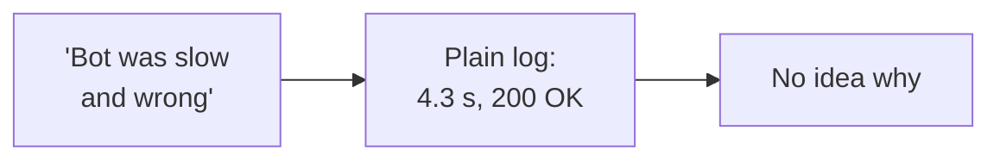
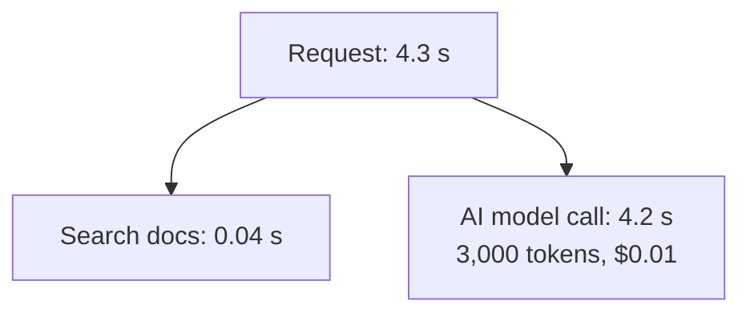
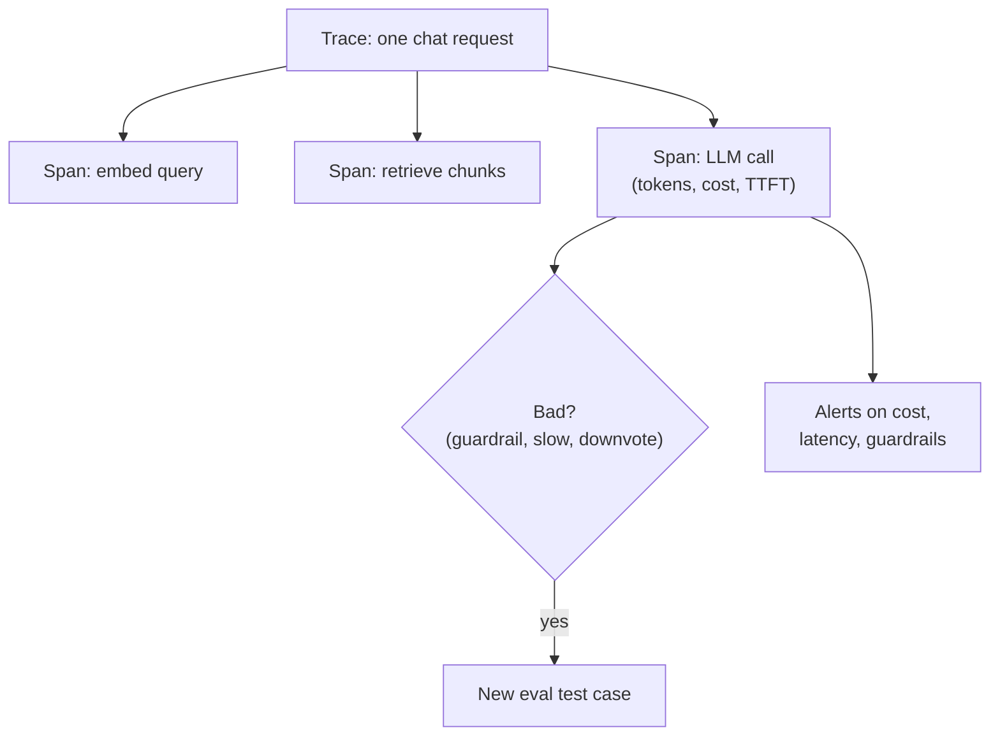
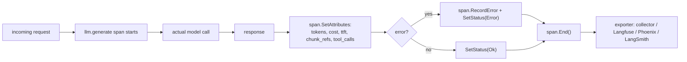
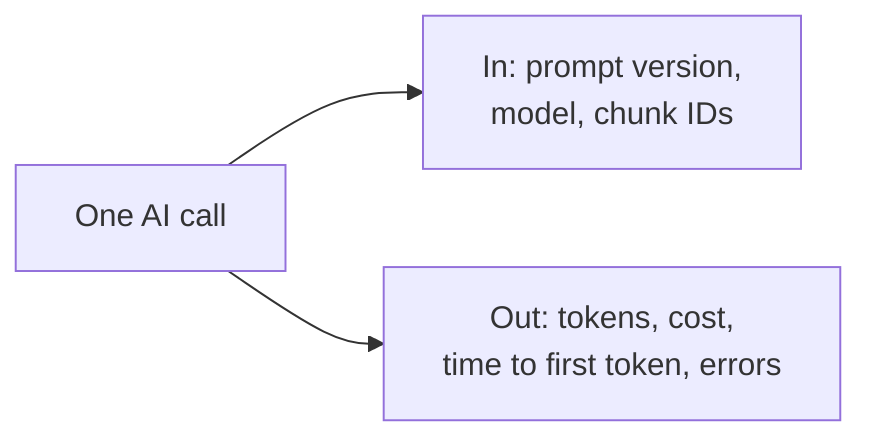
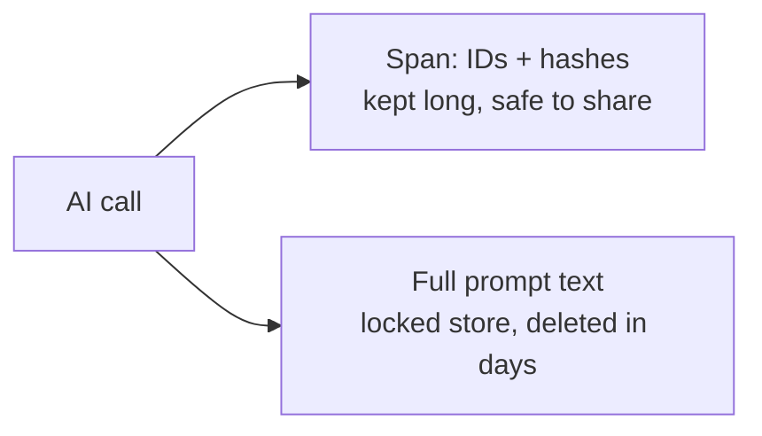
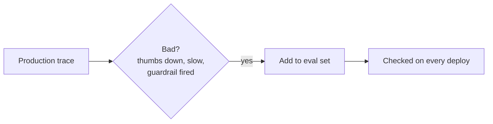

# LLM Observability

> [!summary] TL;DR
> Observing an LLM-powered feature means capturing, per call, what went in (template, model, retrieved chunks), what it cost (tokens, dollars, latency), and what came out (tool calls, errors, a feedback score) as a span — then turning the worst of those spans into new eval cases instead of letting them scroll past in a log.

> [!abstract] Core idea
> - Each LLM call is one span, with structured attributes for the request (template, model, retrieved chunk references) and the outcome (tokens, cost, TTFT, tool calls, error).
> - A chain or agent is a trace: a tree of spans, parent-to-child, exactly like a traced microservice call graph (see [[Distributed Tracing with OpenTelemetry]]) — the LLM call is just one more kind of span in it.
> - Prompt and response text, and chunk contents, are redacted to IDs/hashes in span attributes; the full text goes to a short-retention, access-controlled store if you need it at all.
> - The highest-value signal isn't a dashboard — it's a rule that promotes a bad trace (guardrail fired, TTFT spiked, user downvoted) into a new eval test case automatically.
> - Alert on cost, latency and guardrail-trigger rate as first-class SLIs for this feature, the same way you'd alert on error rate for any other service (see [[SLIs, SLOs, SLAs and Error Budgets]]).

## Start here: the basics 🟢

> [!info] How to read this note (pick your level)
> - 🟢 **New to this?** Read "From zero" below, then sections 1, 2 and the cheat sheet (10). Stop there, that is a full first pass.
> - 🟡 **Know the basics?** Add section 3 (how it works), 4 (worked example), 5 and 6.
> - 🔴 **Interview / SDE-3 prep?** Add 7, 8 and 9. Headings are tagged 🟢🟡🔴 so you always know where you are.

**From zero, in 60 seconds** 🟢

A user says "the bot was slow and wrong". A normal log line only says "request took 4 seconds". It does not say why.

**Observability** means recording enough about each AI call that you can answer "why?" later, without running it again.



The tool for this is a **trace**: a timeline of one request, split into steps. Each step is a **span**, with its own time, cost and details.



Now you can see the slow part at once. You also save which prompt version and which documents were used.

Prompts often hold private customer data, so you store IDs, not full text, in normal logs.

The rest of this note is just these 3 questions:
1. What should you record for every AI call?
2. How do steps nest into a trace, and how do you hide private data?
3. How do bad traces become tests and alerts?


**The problem in one story.**
A user reports "the bot gave me a wrong and slow answer".
Your normal logs only say "POST /chat 200, 4.3s".
You cannot tell if search found the wrong documents, if the model was slow, or if the prompt was bad.
Observability means recording each step of every LLM request so you can answer that without guessing.

**Words you need first**

| Word | Plain meaning | Tiny example |
| --- | --- | --- |
| Log | One line of text recording an event | "request took 4.3s" |
| Metric | A number tracked over time | p99 latency, cost per hour |
| Trace | The full record of one request across all steps | One chat question end to end |
| Span | One timed step inside a trace | "retrieval: 40 ms" |
| Attribute | A key-value detail stored on a span | `model=..., input_tokens=1200` |
| Redaction | Removing sensitive text before storing it | Keep a chunk ID, drop the chunk text |
| SLI / alert | A health number you watch / a page when it goes bad | Alert if cost per hour doubles |
| RAG | Retrieve documents, then let the LLM answer using them | Search help docs, then answer |

**Picture it**



**Analogy.**
A parcel tracking page: each scan (warehouse, truck, doorstep) is a span, the whole journey is a trace, and you see exactly where a delay happened.
Where it breaks: a parcel's contents are not logged, while an LLM span would naturally hold private prompt text, so you must redact it on purpose.

**How the rest of this note builds up**

- First "Why it exists" and the "Mental model": why a plain access log is not enough.
- Then "How it works": per-call capture, spans for chains and agents with GenAI semantic conventions, redaction and retention, promoting bad traces into eval cases, and alerts.
- Then a worked Go example that wraps an LLM call in a span.
- Finally the SDE-3 deep dive: spans vs log lines, sampling biased toward failures, trade-offs and interview questions.

> [!tip] Remember
> One span per LLM call with tokens, cost and chunk IDs, text redacted, and every bad trace turned into a test.

### Whiteboard version

**In plain words:** One request = one timeline with a bar per step. The longest bar is your problem.

A RAG chat feature handles one question as: embed query → retrieve 8 chunks → build prompt → call the model → return answer.

Traced as one span per step, nested under a root span for the whole request, a slow answer shows up immediately as "retrieval took 40ms, the LLM call took 4.2s" rather than one opaque "request took 4.3s" line.

And the LLM call's own span additionally carries its token counts, cost and which chunk IDs it saw, so a wrong answer can be traced back to exactly which chunks were retrieved without re-running anything.

## 1. Why it exists 🟢

A plain request log ("POST /chat 200 4.3s") tells you a call was slow or wrong, but not why: was it queued behind a rate limit, did retrieval return garbage, did the model ignore good context, did a guardrail silently rewrite the output?

Each of those needs a different fix, and without structured per-call data you're left re-running the request by hand and guessing.

At volume, that also means no way to compute aggregate numbers that matter for this feature specifically — cost per tenant, p99 TTFT, what fraction of calls tripped a guardrail — because a generic HTTP access log was never designed to carry token counts, chunk IDs or a cost figure per line.

Concretely: an agent that calls the LLM three times (plan, call a tool, summarize) and takes 8 seconds end-to-end is unreadable as a single log line. As a trace with one span per step, the 8 seconds decomposes into "planning: 1.1s, tool call: 0.3s, summarization: 6.6s" — pointing straight at which step to optimize, which a flat log line cannot.

## 2. Mental model 🟢

An LLM call is just another span in a trace, the same mental model as [[Distributed Tracing with OpenTelemetry]] applied to one more kind of remote call — except this span's attributes are GenAI-shaped (model, tokens, cost) instead of HTTP-shaped (status code, route).

An agent loop or a RAG pipeline is a small tree of these spans under one root, exactly like a fan-out of internal service calls under one incoming request.

## 3. How it works 🟡

### Per-call capture

**In plain words:** For each AI call, save a receipt: which prompt, which model, how many tokens, how much money, how long.

Every LLM call's span should carry enough to answer "what happened, what did it cost, and what did it see" without re-running anything:

- **Request side:** prompt template ID and version (see [[Prompt Engineering]]), model name, retrieved chunk IDs (not chunk text — see Redaction below), tool definitions offered.
- **Outcome side:** input/output/cached token counts, cost in USD (see [[LLM Cost, Latency and Caching]]), TTFT and total duration, which tools were actually called, and the error (if any).
- **Feedback, when available:** a thumbs up/down or a structured rating, attached after the fact to the same trace ID.





### Spans for chains and agents, and the GenAI semantic conventions

**In plain words:** Multi-step flows become a tree of steps. A shared naming standard (gen_ai.*) lets any tool read them.

A multi-step chain or an agent loop is a trace: a root span for the whole request, with child spans for retrieval, each LLM call, and each tool execution, so the trace viewer shows the real timeline, not just a total.

OpenTelemetry's Generative AI semantic conventions (as of 2026, marked experimental — expect attribute names to still shift) propose a `gen_ai.*` attribute namespace for exactly this: `gen_ai.system`, `gen_ai.request.model`, `gen_ai.usage.input_tokens`, `gen_ai.usage.output_tokens`, and so on, so a trace from an LLM call looks the same shape across tools that support the convention.

Tool-specific platforms built for this (Langfuse, LangSmith, Arize Phoenix) read traces in this shape, or ingest them via their own SDKs; which one you pick is a platform choice, but the attribute discipline (structured, not a text blob) is what makes any of them useful.

```mermaid
gantt
    title One agent request as a trace (illustrative durations)
    dateFormat x
    axisFormat %Lms
    section root
    HTTP request          :a1, 0, 8200
    section spans
    plan (LLM call)       :a2, 0, 1100
    tool: lookup_order    :a3, 1100, 300
    summarize (LLM call)  :a4, 1400, 6600
```



### Redaction and retention

**In plain words:** Keep private text out of everyday logs. Store IDs there, and the full text in a locked box that is deleted soon.

Prompt text, response text and retrieved chunk contents routinely carry customer data, so none of it belongs directly in a span attribute that flows to a general-purpose tracing backend with broad read access.

The pattern: put IDs and hashes (template ID, chunk ID, a content hash) in span attributes, and, only if you need full-text debugging, send the actual text to a separate store with short retention and the same access controls as the data it's quoting (see [[Secrets Management]]).

The guardrail and security details for untrusted model output and tool results belong to [[Guardrails and LLM Security]] and [[OWASP API Security Top 10]]; this note's job is making sure the trace itself doesn't become a second copy of sensitive data sitting in a looser-access system.



### Promoting bad traces into eval cases

**In plain words:** Every bad answer you catch in production becomes a test, so it never sneaks back.

The highest-leverage use of a trace is feeding it back into [[LLM Evals in Production]]: a call where a guardrail fired, where TTFT blew past budget, or where a user downvoted the answer is worth more as a new regression test case than as a line in a dashboard.

A simple rule-based promotion (as in the worked example) turns "something went wrong in production" into "we now have a test that catches it before the next deploy," which is the actual payoff of capturing all this data in the first place.



### Alerts

**In plain words:** Set alarms on cost, speed and safety-filter hits, just like for any other service.

Cost, latency and guardrail-trigger rate deserve the same alerting discipline as any other SLI (see [[SLIs, SLOs, SLAs and Error Budgets]]): a rolling-window threshold, not just a human staring at a dashboard.

A guardrail-trigger-rate spike, in particular, is often the earliest signal of a prompt-injection attempt or an upstream data-quality regression (bad documents entering the retrieval corpus) well before it shows up as a user complaint.

## 4. Worked example 🟡

Recording GenAI-shaped span attributes with the OpenTelemetry Go SDK, against an in-memory exporter (no live collector; representative output). It compiles and passes `go vet` and `go test -race` on Go 1.24.

```go
// Package observ accompanies "LLM Observability".
package observ

import (
	"context"
	"time"

	"go.opentelemetry.io/otel/attribute"
	"go.opentelemetry.io/otel/codes"
	"go.opentelemetry.io/otel/trace"
)

// CallRecord is the per-call data an LLM observability layer should
// capture, independent of any specific tracing backend. Field names
// follow the OpenTelemetry Generative AI semantic conventions' intent
// (gen_ai.* attribute groups), which were still marked experimental as
// of 2026 — verify exact attribute names against the current spec before
// wiring a real exporter.
type CallRecord struct {
	TemplateID      string
	TemplateVersion string
	Model           string
	InputTokens     int64
	OutputTokens    int64
	CachedTokens    int64
	CostUSD         float64
	TTFT            time.Duration
	Duration        time.Duration
	RetrievedChunks []string // chunk IDs, not chunk text: see Redact
	ToolCalls       []string
	Err             error
}

// Redact strips anything that should never leave the process as a span
// attribute: raw prompt/response text and chunk contents. Observability
// needs to know WHAT was retrieved and WHETHER a tool fired, not the full
// text of either, both for payload size and because prompts and
// retrieved context routinely carry customer data (see the "Secrets
// Management" and "OWASP API Security Top 10" notes for the handling
// rules this leans on).
func Redact(r CallRecord) CallRecord {
	out := r
	ids := make([]string, len(r.RetrievedChunks))
	for i := range r.RetrievedChunks {
		ids[i] = hashChunkRef(r.RetrievedChunks[i])
	}
	out.RetrievedChunks = ids
	return out
}

// hashChunkRef stands in for a real content hash; a production
// implementation would use sha256 over the chunk ID or content key so two
// calls that touched the same chunk are still comparable across traces.
func hashChunkRef(s string) string {
	if len(s) <= 8 {
		return s
	}
	return s[:8]
}

// StartSpan starts one span for an LLM call and sets the GenAI-style
// attributes a CallRecord carries once the call finishes. It returns the
// span so the caller can End it (span lifetime should wrap the actual
// call, not just its logging).
func StartSpan(ctx context.Context, tracer trace.Tracer, model string) (context.Context, trace.Span) {
	return tracer.Start(ctx, "llm.generate",
		trace.WithAttributes(
			attribute.String("gen_ai.system", "anthropic"),
			attribute.String("gen_ai.request.model", model),
		),
	)
}

// FinishSpan records the outcome of one call onto its span: token usage,
// cost, retrieved chunk references (redacted), tool calls, and an error
// status if the call failed. This is the data an eval pipeline or an
// alert on cost/latency/guardrail-trigger rate reads back from traces.
func FinishSpan(span trace.Span, r CallRecord) {
	red := Redact(r)
	span.SetAttributes(
		attribute.String("gen_ai.response.model", red.Model),
		attribute.Int64("gen_ai.usage.input_tokens", red.InputTokens),
		attribute.Int64("gen_ai.usage.output_tokens", red.OutputTokens),
		attribute.Int64("gen_ai.usage.cached_tokens", red.CachedTokens),
		attribute.Float64("gen_ai.cost.usd", red.CostUSD),
		attribute.Int64("gen_ai.latency.ttft_ms", red.TTFT.Milliseconds()),
		attribute.StringSlice("gen_ai.retrieval.chunk_refs", red.RetrievedChunks),
		attribute.StringSlice("gen_ai.tool.calls", red.ToolCalls),
		attribute.String("prompt.template_id", red.TemplateID),
		attribute.String("prompt.template_version", red.TemplateVersion),
	)
	if red.Err != nil {
		span.RecordError(red.Err)
		span.SetStatus(codes.Error, red.Err.Error())
	} else {
		span.SetStatus(codes.Ok, "")
	}
	span.End()
}
```

Alerting on guardrail-trigger rate as a rolling-window SLI, and the promotion rule that turns a bad trace into a new eval case:

```go
// AlertRule is one threshold an observability pipeline watches across a
// rolling window of CallRecords. It is deliberately simple — a real
// pipeline would compute these over a metrics backend, not in process —
// but the shape (what to compute, what counts as a breach) is the part
// worth getting right before picking a backend.
type AlertRule struct {
	Name      string
	Window    []CallRecord
	Threshold float64
	Metric    func([]CallRecord) float64
}

// Breach reports whether the rule's metric over its window exceeds its
// threshold.
func (a AlertRule) Breach() (value float64, breached bool) {
	v := a.Metric(a.Window)
	return v, v > a.Threshold
}

// GuardrailTriggerRate is a ready-made Metric: the fraction of calls in
// the window whose Err is a guardrail rejection (vs. any other error).
func GuardrailTriggerRate(window []CallRecord) float64 {
	if len(window) == 0 {
		return 0
	}
	var triggered int
	for _, r := range window {
		if r.Err != nil && isGuardrailErr(r.Err) {
			triggered++
		}
	}
	return float64(triggered) / float64(len(window))
}

type guardrailError struct{ reason string }

func (e guardrailError) Error() string { return "guardrail: " + e.reason }

// NewGuardrailError builds the error type GuardrailTriggerRate looks for,
// so a guardrail layer and the observability layer agree on what "the
// guardrail fired" means without string matching on error text.
func NewGuardrailError(reason string) error { return guardrailError{reason: reason} }

func isGuardrailErr(err error) bool {
	_, ok := err.(guardrailError)
	return ok
}

// PromoteToEvalSet decides whether a finished call is worth adding to an
// eval dataset as a new test case: a guardrail trigger, a very slow TTFT
// (queueing or routing regression), or an explicit low user feedback
// score are all signals that this call is more informative than an
// average one. This is the "promote bad traces into eval cases" loop
// from the note body, expressed as one testable decision function.
func PromoteToEvalSet(r CallRecord, userFeedbackScore *int, ttftBudget time.Duration) bool {
	if r.Err != nil && isGuardrailErr(r.Err) {
		return true
	}
	if r.TTFT > ttftBudget {
		return true
	}
	if userFeedbackScore != nil && *userFeedbackScore <= 2 {
		return true
	}
	return false
}
```

The tests, run against an in-memory OTel span exporter (`go.opentelemetry.io/otel/sdk/trace/tracetest`, no live collector):

```go
func newTestTracer(t *testing.T) (*sdktrace.TracerProvider, *tracetest.InMemoryExporter) {
	t.Helper()
	exporter := tracetest.NewInMemoryExporter()
	tp := sdktrace.NewTracerProvider(sdktrace.WithSyncer(exporter))
	t.Cleanup(func() { _ = tp.Shutdown(context.Background()) })
	return tp, exporter
}

func TestFinishSpanRedactsChunkRefsNotJustIDs(t *testing.T) {
	tp, exporter := newTestTracer(t)
	tracer := tp.Tracer("test")
	_, span := StartSpan(context.Background(), tracer, "claude-haiku-5-5")

	longRef := "customer-private-document-contents-verbatim"
	FinishSpan(span, CallRecord{RetrievedChunks: []string{longRef}})

	spans := exporter.GetSpans()
	for _, a := range spans[0].Attributes {
		if string(a.Key) == "gen_ai.retrieval.chunk_refs" {
			for _, v := range a.Value.AsStringSlice() {
				if v == longRef {
					t.Fatalf("raw chunk content leaked into a span attribute: %q", v)
				}
			}
		}
	}
}

func TestGuardrailTriggerRate(t *testing.T) {
	window := []CallRecord{
		{},
		{Err: NewGuardrailError("pii_detected")},
		{Err: errors.New("timeout")}, // not a guardrail error
		{Err: NewGuardrailError("prompt_injection")},
	}
	rate := GuardrailTriggerRate(window)
	if rate != 0.5 {
		t.Fatalf("got %v, want 0.5 (2 guardrail triggers of 4 calls)", rate)
	}
}
```

**Measured (this test run, Go 1.24, 2026-11-07):** `TestStartFinishSpanRecordsGenAIAttributes` confirms every listed `gen_ai.*` and `prompt.*` attribute is present on the exported span. `TestFinishSpanRedactsChunkRefsNotJustIDs` fails the build if raw chunk text ever reaches a span attribute. `TestGuardrailTriggerRate` checks `2/4 = 0.5`. `TestAlertRuleBreach` and `TestPromoteToEvalSet` (full table in the repo) pass under `go test -race`.

## 5. Variants and comparison 🟡

**In plain words:** Your options: an AI-specific tool, your existing tracing stack, or both.

| Option | How it works | Use when | Cost |
| --- | --- | --- | --- |
| Structured logs only | One JSON log line per call with tokens/cost/model | Small scale, simple feature, no multi-step chains | Cheapest; no trace tree, hard to see step-by-step timing |
| OpenTelemetry traces (self-hosted collector) | Standard spans/attrs, any OTel-compatible backend | Already running OTel for the rest of the backend | Operational cost of the collector + backend, but no vendor lock-in |
| LLM-specific platform (Langfuse, LangSmith, Phoenix) | Purpose-built UI for prompts/traces/evals, often ingesting OTel or its own SDK | Teams iterating on prompts/evals daily and wanting a built-in UI | SaaS cost or self-host ops; another system to keep in sync |
| Sampling (trace a fraction of calls) | Full detail on a sampled percentage, aggregates on the rest | Very high volume where full tracing is too expensive to store | Misses rare failures unless sampling is biased toward errors/guardrail hits |

## 6. Trade-offs and when not to use 🟡

- Full per-call tracing on every request adds storage and, at very high volume, real cost; sample or down-sample low-stakes traffic while always tracing guardrail trips and errors.
- Redaction has a cost of its own: if you need to debug an actual wrong answer, IDs alone may not be enough, and you'll want the short-retention full-text store — budget for both, not just the cheap attribute-only path.
- A platform built for LLM traces (Langfuse/LangSmith/Phoenix) is faster to get value from than hand-rolled OTel dashboards, but adds a dependency and, for a hosted option, sends trace data to a third party — check that against your data-handling requirements.
- For a one-off script or a low-volume internal tool, structured logging without a tracing backend is enough; don't stand up a collector for ten calls a day.

## 7. In production 🔴

- **Real systems:** Langfuse, LangSmith and Arize Phoenix are widely used LLM-specific observability platforms as of 2026 (verify current feature sets); teams already running OpenTelemetry for the rest of their backend increasingly emit GenAI spans into the same collector rather than running a second, LLM-only pipeline.
- **Failure modes → fixes:**
  - A trace shows the LLM call was slow but not why → confirm TTFT vs. total duration are both captured (see [[LLM Cost, Latency and Caching]]); a slow TTFT points at queueing/routing, a slow total with fast TTFT points at output length.
  - Full prompt/response text ends up in a general-purpose APM tool with broad read access → move text to a scoped, short-retention store and keep only IDs/hashes in the shared trace.
  - Guardrail-trigger-rate alert never fires because the guardrail layer raises a generic error instead of a typed one → standardize on one error type (or a status code) the observability layer can recognize, as in `NewGuardrailError` above.
  - Bad traces pile up in a dashboard nobody reads → wire the promotion rule directly into the eval dataset's ingestion instead of leaving it as a manual step.
- **What to monitor:** cost and token counts per model/tenant (own home: [[LLM Cost, Latency and Caching]]); TTFT and total latency percentiles; guardrail-trigger rate; retrieval hit rate (did the top chunk ever get cited); eval-set growth rate from auto-promoted traces; span export failure rate (an observability pipeline that silently drops spans is worse than none, because it looks healthy).

## 8. Deep dive 🔴

- **Why a span, not just a log line, for the LLM call.** A span carries a parent-child relationship to the rest of the request's spans, so a trace viewer can show the LLM call's exact position and duration inside the whole request — "retrieval: 40ms, LLM call: 4.2s, of which TTFT was 1.8s" — which a flat log line, even a structured one, loses once there's more than one step per request.
- **Why GenAI semantic conventions matter even half-finished.** An experimental spec still buys interoperability: a span emitted with `gen_ai.*` attributes is readable by any backend that understands the convention, instead of every team inventing its own attribute names and nobody's dashboards matching anybody else's.

  Expect names to shift until the spec stabilizes; isolate attribute-name construction in one place (as `FinishSpan` does above) so an update is a one-function change.
- **Sampling bias toward failure, not uniform sampling.** At high volume, uniformly sampling 1% of traces will sample almost no guardrail trips or slow outliers, because they're rare by definition — always-trace errors and guardrail hits, and uniformly sample the rest; this is the same "sample the interesting tail, not the whole distribution" lesson as request tracing in a normal backend.
- **Trace-to-eval promotion is the actual ROI of all this instrumentation.** Dashboards answer "is something wrong right now"; a pipeline that turns a bad trace into a new regression test answers "will this specific failure happen again" — the second is what prevents the same guardrail bypass or retrieval miss from recurring after the next prompt change.

## 9. Interview questions 🔴

> [!question]- Why trace an LLM call as a span instead of just logging tokens and cost per request?
> A span fits into a trace tree alongside the rest of the request's spans (retrieval, tool calls, other services), so you can see exactly where time and cost went inside a multi-step request, not just that the whole request was slow or expensive. A flat log line can carry the same numbers but loses that structural position.

> [!question]- What belongs in a span attribute versus a separate, short-retention store?
> IDs, hashes, counts and cost figures belong in the shared trace attribute set that a broad set of engineers can query. Raw prompt text, response text and retrieved chunk contents — which often carry customer data — belong in a scoped, short-retention, access-controlled store, referenced from the trace by ID, not inlined into it.

> [!question]- Trap: "we added full tracing and our p99 latency metric didn't change, so tracing has no overhead." What's actually being measured?
> Span creation and in-process attribute-setting are cheap and usually invisible in p99; the overhead that can matter is at export (serializing and shipping spans to a collector) and storage, which a latency metric on the request itself won't show. Check exporter queue depth and collector resource usage separately, not just request latency.

> [!question]- Your guardrail-trigger-rate alert fires at 3am. What's the first thing you check?
> Whether it's a single misbehaving input pattern (one user or one injected document hammering the guardrail, a narrow problem) or a broad shift (every call of one type triggering it, suggesting the guardrail itself regressed or a template changed) — the trace's template ID, tenant, and chunk refs tell you which, without re-running anything.

> [!question]- How would you decide which production calls get promoted into your eval dataset automatically?
> Any call where something already signaled a problem: a guardrail firing, TTFT or total latency past budget, or a low explicit user rating. Those are the calls most likely to reveal a real regression if replayed after a prompt or model change, versus an arbitrary sample of ordinary, successful calls.

> [!question]- What's the risk of sampling traces uniformly at 1% on a high-volume feature?
> Rare events — guardrail trips, slow-tail latency, the one retrieval miss in a thousand — are exactly the traces you need and exactly the ones uniform sampling is least likely to keep. Always-trace errors and guardrail hits, and apply sampling only to the ordinary successful traffic.

## 10. Cheat sheet 🟢

- One span per LLM call; a chain/agent is a trace (tree of spans), same model as any distributed trace.
- Capture: template id/version, model, tokens (input/output/cached), cost, TTFT, chunk refs, tool calls, error.
- `gen_ai.*` attributes (OTel GenAI semantic conventions, experimental as of 2026) give cross-tool interoperability.
- Redact: IDs/hashes in the shared trace; full text, if kept, goes in a separate short-retention store.
- Alert on cost, latency and guardrail-trigger rate like any other SLI — rolling window, not eyeballing a chart.
- Always-trace errors and guardrail hits; sample the rest if volume demands it.
- Promote bad traces (guardrail fired, slow TTFT, low feedback) into the eval set automatically.

## Links 🟢

- **Before this:** [[Distributed Tracing with OpenTelemetry]], [[LLM Cost, Latency and Caching]]
- **Next:** [[LLM Evals in Production]], [[Production AI Checklist]]
- **Compare with:** [[SLIs, SLOs, SLAs and Error Budgets]] (the general alerting discipline this note applies to GenAI metrics specifically)

### Watch on YouTube

- [Opik LLM Observability & Evaluation](https://www.youtube.com/watch?v=ze8I9VUG2qU) · Opik by Comet · 3 min · 2,667,813 views
- [LLM Observability Explained: Why do you need LLM Observability?](https://www.youtube.com/watch?v=o76xU3RQ47Q) · Agenta AI · 3 min · 4,680 views
