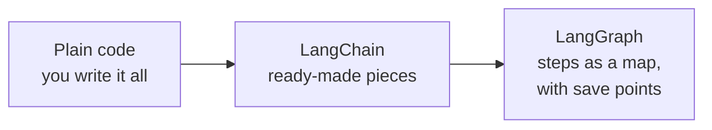
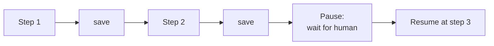
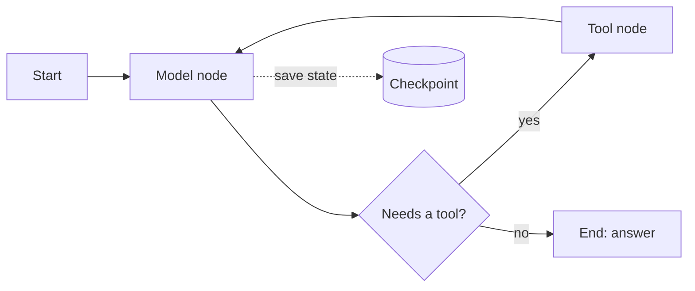
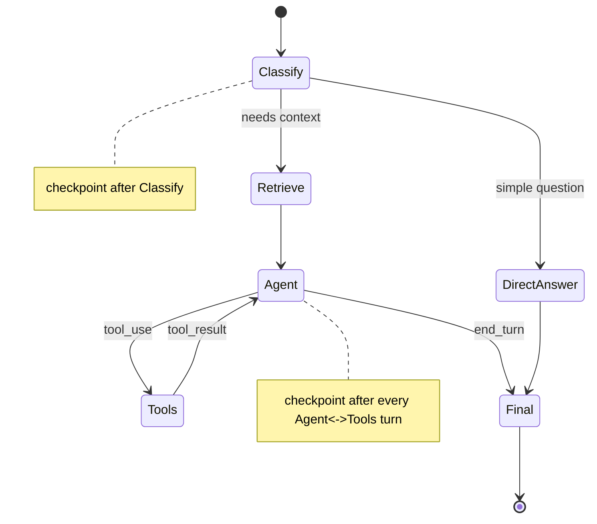
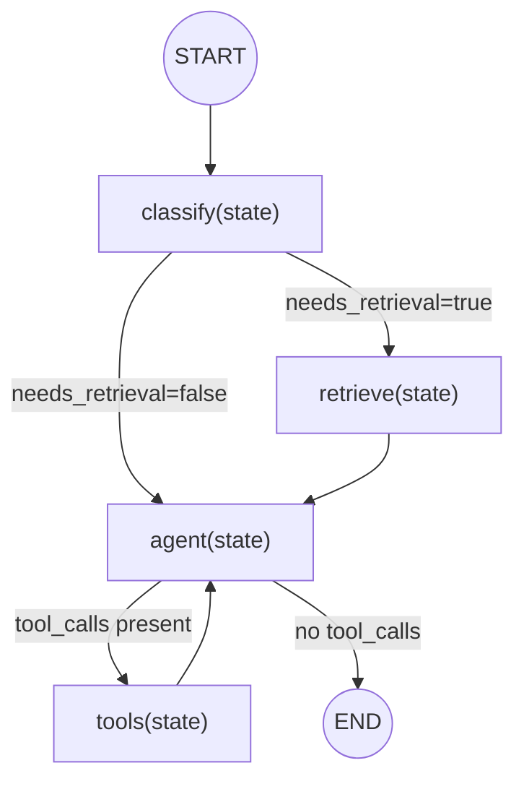
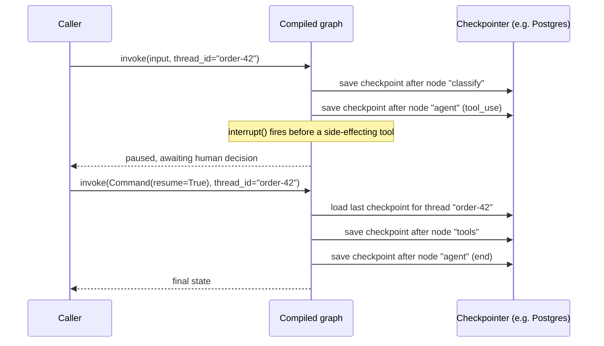
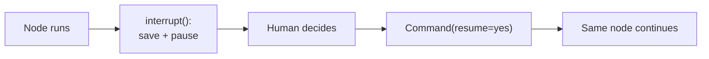
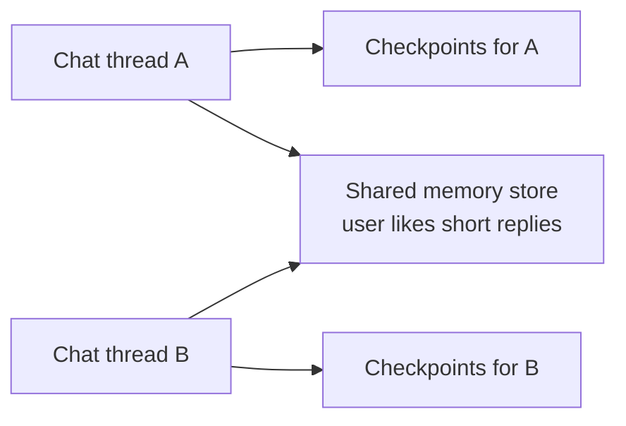
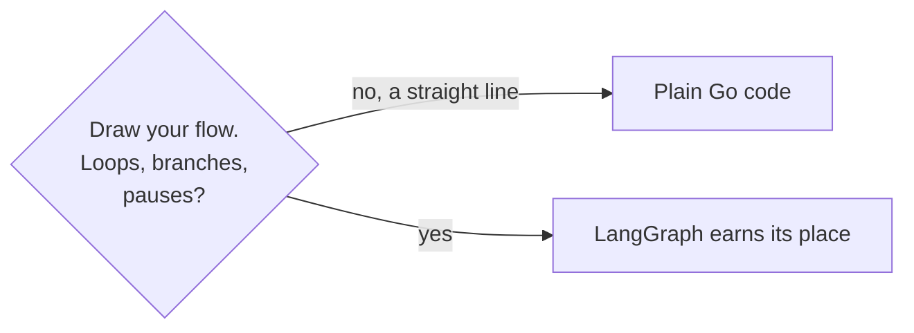

# LangChain and LangGraph

> [!summary] TL;DR
> **LangChain** is a Python (and JavaScript) library of reusable building blocks — chat model wrappers, prompt templates, document loaders, retrievers, tools — for assembling LLM applications without writing the same glue code every time.
>
> **LangGraph**, which LangChain 1.0 is now built on, is a lower-level graph runtime for stateful, branching, loopable control flow (chains, agents, multi-agent systems), with built-in checkpointing so a run can pause, resume, and be replayed. Neither is required to call an LLM; both exist to make specific, recurring pieces of that job easier.

> [!abstract] Core idea
> - LangChain's building blocks (chat models, prompts, tools, retrievers) solve "stop rewriting the same LLM-app glue code"; they are a toolbox, not a required architecture.
> - As of LangChain 1.0 (October 2025), the framework's own agent story is built on LangGraph underneath: `create_agent` plus composable **middleware**, not the pre-1.0 chain classes.
> - A **chain** (fixed sequence) is a special case of a **graph** (nodes and edges, can branch and loop) is a special case of **plain code** (you decide everything). Each layer trades flexibility for structure the layer below doesn't give you for free.
> - LangGraph's main contribution is **persistence**: checkpoints let a stateful, possibly long-running, possibly paused-for-human-approval run be saved, resumed, replayed, and even rewound (time travel) across process restarts.
> - This is a Python-ecosystem framework note by necessity — LangChain and LangGraph are not primarily Go libraries. Backend work in Go either calls provider APIs directly (see [[Calling LLM APIs from Go]], [[AI Agents and Agentic Workflows]]) or reaches for a Go-native option covered at the end.

## Start here: the basics 🟢

> [!info] How to read this note (pick your level)
> - 🟢 **New to this?** Read "From zero" below, then sections 1, 2 and the cheat sheet (10). Stop there, that is a full first pass.
> - 🟡 **Know the basics?** Add section 3 (how it works), 4 (worked example), 5 and 6.
> - 🔴 **Interview / SDE-3 prep?** Add 7, 8 and 9. Headings are tagged 🟢🟡🔴 so you always know where you are.

> [!note] Before this note
> - [[AI Agents and Agentic Workflows]]: an agent is a loop where the model picks the next tool, with brakes (max steps, budget) and human approval for risky steps.
> - [[Structured Outputs and Tool Calling]]: the model asks for a tool with a `tool_use` block, and your code runs it and returns a `tool_result`.

**From zero, in 60 seconds** 🟢

Most AI apps repeat the same glue code: build a prompt, call the model, read the reply, maybe call a tool. **LangChain** is a library of ready-made pieces for that glue.

**LangGraph** goes one step further. You draw your app as a map of steps (a graph), and it runs the map for you, saving progress after each step.



Saved progress means a long task can pause (say, waiting for a human), survive a crash, and pick up where it stopped.



But a framework is just a helper, not magic. For a simple one-call task, plain Go is shorter and easier to debug.

The rest of this note is just these 3 questions:
1. What do LangChain and LangGraph each give you?
2. How do graphs, save points and human pauses work?
3. When should you skip the framework entirely?


**The problem in one story.**
You build a small chatbot that answers support tickets.
At first it is one call to the model: send text, get text back.
Then it must look up past tickets, retry when unsure, and wait for a human to approve a refund.
Soon you have hundreds of lines of glue code, and a crash halfway loses everything.
LangChain gives you ready-made parts for that glue; LangGraph gives you a way to draw the steps as a graph and save progress.

**Words you need first**

| Word | Plain meaning | Tiny example |
| --- | --- | --- |
| LLM | A model that reads text and writes text back | Claude, GPT |
| Prompt template | A message with blanks you fill in per request | `"Classify: {ticket}"` |
| Tool | A function the model may ask your code to run | `search_tickets(query)` |
| Agent | A loop where the model picks the next step until done | Search, read, then answer |
| Node / edge | A step in a flow, and an arrow to the next step | `classify` → `reply` |
| State | The data passed between steps | `{ticket, category, draft}` |
| Checkpoint | A saved copy of the state after a step | Resume after a crash |
| Framework | A library that decides the overall shape of your code | LangGraph runs your nodes |
| Chain | Steps in a straight line, no branches or loops | prompt → model → parser |
| Graph | Steps with branches and loops | agent ↔ tools, until done |
| Thread (`thread_id`) | The name of one saved conversation or task run | `"order-42"` |
| Middleware | Add-on code that runs before or after each model or tool call | Hide phone numbers before the call |
| Boilerplate | Repeated setup code with little logic in it | The same 60 lines in every app |

**Picture it**



**Analogy.** LangChain is a box of Lego bricks; LangGraph is the instruction booklet with page numbers, so you can stop building and pick up at the same page tomorrow.
Where it breaks: Lego never calls an outside service that can fail or cost money; every model and tool call in the graph can.

**How the rest of this note builds up**

- First, why these frameworks exist (section 1) and the chain vs graph vs plain-code model (section 2).
- Then how LangChain 1.0 and LangGraph work: building blocks, `StateGraph`, checkpoints, `interrupt()` (section 3).
- Then a worked example comparing the framework with a direct Go call (section 4), plus variants and when to skip frameworks (sections 5-6).
- Finally the SDE-3 deep dive: production monitoring, durable execution, Go options and interview traps (sections 7-9).

> [!tip] Remember
> A chain is a straight line, a graph can branch and loop, and plain code can do both; pick the least structure that fits.

## 1. Why it exists 🟢

Say you are prototyping a support-ticket assistant that must: format a prompt with the ticket text, call a chat model, parse the model's JSON reply into a Go-like struct (in Python, a Pydantic model, a typed data class, or `dict`), retrieve similar past tickets from a vector store first, and occasionally call a tool.

Writing this by hand is maybe 60 lines of straightforward code — and every other LLM app on the team reinvents those same 60 lines with small variations: a different provider's SDK, a slightly different retry policy, a different way of gluing the retrieved context into the prompt.

LangChain packages the recurring pieces (a prompt template, a provider-agnostic chat-model wrapper (one interface that works the same for Claude, GPT and others), an output parser, a retriever interface) so you compose them instead of rewriting them. That is the entire pitch: not a new capability an LLM API doesn't have, but less repeated glue code for the capabilities it does have.

The harder problem — an assistant that needs to loop (check one past ticket, decide it's not similar enough, check another; or call a tool, look at the result, decide whether to call another tool) — needs more than a fixed sequence of steps.

That is what LangGraph adds: a graph runtime where a node's outgoing edge can depend on the current state, loops are a first-class shape (not something you bolt onto a chain), and the whole run's state can be checkpointed so it survives a crash or a multi-hour pause waiting for a human to approve a step.

### Real-life example 🟢

Think of an insurance-claim helper inside an app like Acko or PolicyBazaar. A user uploads car-damage photos and a short story.
The flow classifies the claim, fetches the user's policy, lets an agent check the rules with tools, and then must pause until a human adjuster approves anything above ₹50,000.
That pause can last two days. With LangGraph, each step's state is saved under the claim's `thread_id`, so the run waits safely and resumes from the exact step when the adjuster clicks "approve", even if the servers restarted in between.
A simple "summarise this claim note" feature, on the other hand, is one plain API call and needs no framework.

### Common beginner mistakes 🟢

- **Using LangGraph for a single model call** → you add a dependency and a learning curve for no gain → write the direct call; reach for the framework when a loop, branch or pause appears.
- **Copying old tutorials** (`LLMChain`, `AgentExecutor`) → these are replaced in LangChain 1.0 and may fail to import → use `create_agent` and LCEL, or install `langchain-classic` on purpose.
- **Putting a side effect before `interrupt()` in a node** → on resume the whole node runs again, so the email is sent twice → move side effects after the interrupt, or make them safe to repeat.
- **Wrapping `interrupt()` in a broad `try/except`** → it catches the pause signal and the graph never pauses → let that signal pass through.
- **Mixing up checkpoints and long-term memory** → checkpoints are per conversation, so user facts saved there are lost in the next chat → store lasting facts in a separate memory store.

## 2. Mental model 🟢

Three layers, each built on the one before it, each trading away flexibility for structure:

```text
Plain code     — you write every step and every branch yourself
    ↑ adds reusable building blocks (chat models, prompts, parsers, tools)
LangChain      — compose blocks into a chain: a fixed sequence, A → B → C
    ↑ adds branching, looping, and persisted state
LangGraph      — compose nodes into a graph: can branch, loop, pause and resume
```

A **chain** is a graph with no branches and no loops — a straight line of nodes.

A **graph** is the general case: any node can have a conditional edge to any other node, including back to itself or to one it already visited.

**Plain code** is always available underneath both: neither framework does anything an LLM's API couldn't do with a few more lines of your own control flow.

They trade some of that flexibility for less boilerplate and (for LangGraph) built-in persistence.

### LangChain vs LangGraph vs the rest 🟡

| Thing | What it is | Use it for |
| --- | --- | --- |
| LangChain | A library of ready-made pieces: model wrapper, prompts, parsers, retrievers, `create_agent` | Less glue code in Python or JS |
| LangGraph | A runtime that runs your steps as a graph and saves state after each step | Loops, branches, pauses for humans, crash recovery |
| LangSmith | A hosted dashboard for traces and evals of these runs | Seeing every step and scoring quality |
| Plain SDK call | Calling the provider API directly | One call, or a small loop you can test yourself; the Go default |

## 3. How it works 🟡

> 🟢 → 🟡 **You now know** that LangChain gives ready-made pieces, LangGraph runs steps as a graph with save points, and plain code is always an option. **Next we open the box**: what LangChain 1.0 looks like today, how a LangGraph graph is built from state, nodes and edges, how save points and threads work, how a human pause works, and how per-chat state differs from long-term memory. The main subsections start with a plain step-by-step walk.

### Whiteboard version

**In plain words:** Most framework talk boils down to this: sort the request, then either answer directly or go fetch documents first.

**Step by step:**
1. A ticket arrives. The `Classify` step decides: simple question, or needs context?
2. Simple: answer directly and finish.
3. Needs context: `Retrieve` fetches similar past tickets.
4. The `Agent` step loops with `Tools` until the model stops asking for tools.
5. After classify and after every agent-tool turn, the state is saved (a checkpoint).

Full detail:

The shape every "framework" conversation reduces to: a classify step routes to either a direct answer or a retrieval-then-agent path, with checkpoints marking where state is durably saved.



The full version below works through LangChain 1.0's current shape, then LangGraph's graph primitives and persistence model in more depth — this is where the real mechanism (state schema, reducers, checkpointers, interrupts) lives.

### LangChain 1.0: where the framework sits today

**In plain words:** Today LangChain is mainly one helper, create_agent, that builds a tool-using agent for you, plus add-ons around it.

**Step by step:**
1. Pick a model with `init_chat_model("...")`: one name string, any supported provider.
2. List your tools, such as a `search_tickets` function.
3. Add middleware for shared needs, such as "hide personal data" or "ask a human before refunds".
4. Call `create_agent(model, tools, middleware)`. You get back a ready LangGraph graph.
5. Run it with the user's message; the tool loop, saving and middleware all run for you.

Full detail:

> [!example] Python note
> This section and its code are Python, as the current LangChain/LangGraph ecosystem is primarily a Python (and JavaScript) framework. No Go equivalent is implied; see section 8 for the Go-native options.

LangChain 1.0 shipped in October 2025. Its agent story is now centred on three pieces, documented as the current way to build an agent in the framework:

- **`create_agent`**: the standard entry point for building an agent in LangChain 1.0, replacing the pre-1.0 `langgraph.prebuilt.create_react_agent` helper. It returns a compiled LangGraph graph — `create_agent` is a convenience constructor over LangGraph, not a separate runtime.
- **Middleware**: composable units that hook into an agent's lifecycle (before/after a model call, before/after a tool call) — this is documented as the defining feature of `create_agent` over its predecessor. LangChain ships prebuilt middleware for common needs: PII redaction (hiding personal data like phone numbers), conversation summarization, and human-in-the-loop approval gates, so you compose an agent's cross-cutting behaviour instead of subclassing or copy-pasting it.
- **`init_chat_model`** (in `langchain.chat_models`): a unified constructor that returns a chat-model object for any supported provider from a single model-name string, so switching providers is a config change, not a rewrite of your calling code.

```python
# Representative LangChain 1.0 shape (python, illustrative — not executed in
# this environment; see section 8 for the Go-native equivalent that is
# actually tested below).
from langchain.agents import create_agent
from langchain.chat_models import init_chat_model
from langchain.agents.middleware import SummarizationMiddleware, HumanInTheLoopMiddleware

model = init_chat_model("anthropic:claude-sonnet-5-5")

agent = create_agent(
    model=model,
    tools=[lookup_order, issue_refund],
    middleware=[
        SummarizationMiddleware(max_tokens=4000),
        HumanInTheLoopMiddleware(tools=["issue_refund"]),  # pause before side effects
    ],
)
```

A model response's content is exposed through **standard content blocks** — a provider-agnostic representation (text, tool calls, reasoning/"thinking" blocks, citations) so code written against one provider's content shape does not have to be rewritten for another; this mirrors the typed content blocks in Anthropic's own Messages API (see [[Structured Outputs and Tool Calling]]), generalized across providers.

### Reusable LangChain parts (the pre-agent building blocks)

**In plain words:** Lego bricks: a model wrapper, a prompt template, a reply parser, a document fetcher. Use any brick on its own.

Independent of whether you use `create_agent` at all, LangChain's library of composable pieces is what most teams reach for first:

| Block | What it wraps |
| --- | --- |
| Chat model | A provider-agnostic interface over a specific model's chat/completion API |
| Message | A typed `HumanMessage` / `AIMessage` / `SystemMessage` / `ToolMessage`, the same shape [[LLM Fundamentals]] calls "roles" |
| `@tool` | A decorator (a Python label placed above a function that wraps it) that turns a plain Python function into a schema-carrying tool definition, inferring the JSON Schema from type hints (declared argument types) and the docstring (the function's description text) |
| Document loader / splitter | Reads a source (PDF, webpage, database) and chunks it into pieces sized for retrieval (see [[Document Ingestion and Chunking]]) |
| Retriever | A uniform interface over "fetch relevant documents for this query," backed by any vector store or search backend (see [[Vector Databases and ANN Indexes]], [[Keyword, Semantic and Hybrid Search]]) |

These blocks are useful even outside `create_agent` — a team that only needs "swap which model provider I call" or "load and chunk these PDFs consistently" can use just the relevant block and skip the agent and graph layers entirely.

### Legacy APIs you will still see in old tutorials

**In plain words:** Old tutorials use older names. This table tells you what replaced each one.

Pre-1.0 LangChain centred on a different set of primitives that the current docs mark as superseded; recognizing them matters because a large fraction of existing tutorials, blog posts, and Stack Overflow answers still use them:

| Legacy name | Superseded by |
| --- | --- |
| `LLMChain` | LCEL (`prompt \| model \| parser`) or `create_agent` |
| `ConversationChain`, `ConversationBufferMemory` | LangGraph checkpointers + `thread_id` (persistence replaces these memory classes) |
| `RetrievalQA` | A retriever composed directly into an LCEL chain or a tool the agent calls |
| `initialize_agent` / `AgentExecutor` | `create_agent` |

Legacy chain classes that still exist move to a separate `langchain-classic` package as of 1.0 — code that imports them needs that package installed and its imports updated, rather than assuming they remain in the main `langchain` package.

**LCEL** (LangChain Expression Language), the `prompt | model | parser` pipe syntax for composing a fixed sequence of steps, predates `create_agent` and remains useful on its own for exactly the fixed-sequence case: it is a chain, in the sense of section 2's three-layer model, not an agent.

### LangGraph: StateGraph, nodes, edges

**In plain words:** A graph is a flowchart in code: boxes (nodes) do work, arrows (edges) say what runs next, and a shared notebook (state) is passed along.

**Step by step:**
1. Define the state: `{messages: [...], docs: [...], needs_retrieval: bool}`.
2. Write each node as a function that reads the state and returns only what changed, like `{"needs_retrieval": true}`.
3. For `messages`, add a reducer (a rule for merging updates), `add_messages`, so new messages are appended instead of replacing the list.
4. Connect nodes with edges. A conditional edge looks at the state to choose: "tool calls present? go to `tools`, else go to `END`".
5. Compile the graph from `START` to `END` and run it.

Full detail:

A **`StateGraph`** is LangGraph's core abstraction: a typed state schema, a set of nodes (each a function that reads state and returns an update), and edges connecting them.



- **State schema**: a typed structure (a `TypedDict`, a dictionary with fixed typed keys, or Pydantic model in Python) describing everything that flows through the graph — messages so far, retrieved documents, a scratchpad field, whatever the specific graph needs.
- **Reducers**: a state field can declare how updates merge rather than overwrite — the canonical example is `add_messages`, the reducer used for a `messages` field, which appends a new message to the list instead of replacing the whole list on every node's return.

  Without a reducer, a node that returns `{"messages": [new_msg]}` would wipe out every prior message; with `add_messages`, it appends.
- **Nodes**: plain functions (or callables) that take the current state and return a partial update.
- **Edges**: a fixed edge always goes to the same next node; a **conditional edge** runs a routing function against the current state and picks the next node dynamically — this is what gives a graph branching and looping that a chain's fixed sequence cannot express.
- **`START` / `END`**: the graph's single entry point and its terminal marker; a graph compiles to something runnable only once every reachable node has a path to `END` (or the loop is intentionally bounded elsewhere, the same stop-condition concern from [[AI Agents and Agentic Workflows]]).

### Checkpointers, threads, and time travel

**In plain words:** Like auto-save in a video game: after every step the state is saved, so you can resume or rewind.

**Step by step:**
1. Run the graph with `thread_id = "order-42"` and a Postgres checkpointer.
2. After `classify` finishes, its state is saved under "order-42". After `agent`, saved again.
3. The server restarts. Nothing is lost; the rows are in Postgres.
4. Call the graph again with "order-42", and it loads the last save and carries on.
5. You can also load an older save to see what the state looked like before a bug ("time travel").

Full detail:

A **checkpointer** persists the graph's state after each step to a backing store — an in-memory store for local development and tests, or a durable one (SQLite, Postgres) for anything that must survive a process restart. Every run is identified by a **`thread_id`**, so the same checkpointer can hold many independent, resumable conversations or tasks.



Because every step's state is checkpointed under its `thread_id`, you can also fetch a thread's full checkpoint history and resume from any earlier point, not only the latest one.

This is the "**time travel**" capability. It is useful for debugging ("what did the state look like right before it went wrong?") and for exploring an alternate path from a known-good earlier state without re-running the whole graph from scratch.

### Human-in-the-loop: interrupt() and Command

**In plain words:** interrupt() pauses the graph and waits. A person answers, and Command(resume=...) carries on from that exact spot.

**Step by step:**
1. Inside the `refund` node, code builds the refund request, then calls `interrupt("approve ₹2,000 refund?")`.
2. The graph saves its state and returns "paused" to your app.
3. Hours later, a manager clicks approve. Your app calls the graph with the same `thread_id` and `Command(resume=True)`.
4. The `refund` node runs again **from its first line**; this time `interrupt()` returns `True` instead of pausing.
5. So anything above `interrupt()` runs twice; keep it free of side effects.

Full detail:

LangGraph's `interrupt()` call, placed inside a node, pauses that node's execution and persists the graph's state at that point; the graph then waits indefinitely until the caller resumes it.

Resuming means invoking the graph again with the same `thread_id` and a `Command(resume=<value>)`, where `<value>` becomes `interrupt()`'s return value inside the node — the node does not restart from where it left off mid-function, it restarts the **whole node** from its beginning, with `interrupt()` now returning the resume value instead of pausing again.

This matters in practice: any code in the node *before* the `interrupt()` call runs again on resume, so that code should be safe to re-run (idempotent: running it twice has the same effect as once), not something with its own side effect.

A node wrapped in a `try`/`except` that happens to catch the interrupt's underlying control-flow signal (a special internal exception LangGraph uses to stop the node) will swallow it and break the pause — `interrupt()` relies on propagating out of the node normally, so broad exception handling around it needs an explicit pass-through for it.

This is the same human-approval idea from [[AI Agents and Agentic Workflows]]'s stop-conditions section, implemented as a first-class graph primitive rather than a loop you hand-roll: the graph *is* the state machine that already knows how to pause, persist, and resume.



### Durable execution, streaming, subgraphs, multi-agent

**In plain words:** Extras that come free with save points: survive crashes, show progress live, and nest graphs inside graphs.

- **Durable execution**: because every step is checkpointed, a node's work is not lost if the process crashes or is redeployed mid-run — the run resumes from its last saved checkpoint rather than restarting from the beginning, which matters the same way it does for any long-running agent (see the durability discussion in [[AI Agents and Agentic Workflows]]).
- **Streaming modes**: a graph run can stream at different granularities — token-level streaming of the LLM's output as it generates, or event-level streaming of each node's updates as it completes — so a caller can show incremental progress instead of waiting for the whole graph to finish.
- **Subgraphs**: a compiled graph can be used as a node inside another graph, giving composition at the graph level the same way a function call composes at the code level.

  A subgraph that is not given its own checkpointer inherits the parent graph's checkpointer and persists its checkpoints under a namespaced key within it; verify this scoping behaviour against your installed version's docs before depending on it, since persistence internals are exactly the kind of detail frameworks revise between releases.
- **Supervisor / handoff multi-agent**: the multi-agent patterns from [[AI Agents and Agentic Workflows]] (one supervisor routing to specialists, or a specialist handing off directly to another) map onto LangGraph naturally.

  A supervisor is a node whose conditional edge picks which specialist subgraph runs next, and a handoff is a specialist's own conditional edge pointing at a sibling instead of back to the supervisor.

### Long-term memory store vs. checkpoints

**In plain words:** Checkpoint = where this one chat is right now. Memory store = facts about the user kept across all chats.

**Step by step:**
1. Chat A (`thread_id = A`): the user says "keep replies short". A node writes that fact to the memory store under the user's id.
2. Chat A's checkpoints keep chat A's messages and step position only.
3. Next week, chat B starts with a new `thread_id`. Its checkpoints start empty.
4. A node in chat B reads the memory store for this user and finds "keep replies short".
5. So the preference carries over, while each chat's progress stays separate.

Full detail:

These solve two different problems and are easy to conflate:

- **Checkpoints** are per-thread, per-run state: "where is this specific conversation/task right now, so it can pause and resume." They are tied to a `thread_id` and are usually not meant to be queried across threads.
- **A long-term memory store** is cross-thread, persistent knowledge: "what do we know about this user, independent of which conversation thread they're in right now".

  It is a separate store (often also provided by the framework, but conceptually just a database you read from and write to) that a node explicitly reads from and writes to.

  It is the same long-term memory concept from [[AI Agents and Agentic Workflows]], just with a framework-provided storage interface instead of a hand-rolled one.



### Tracing and evals with LangSmith

**In plain words:** LangSmith is the framework's own dashboard to see every step of a run and test it.

LangSmith is LangChain's companion observability (seeing what your system did, step by step) and evaluation product: it traces every node execution, model call, and tool call inside a graph run as a structured, inspectable trace (which node, how long, what tokens, what the state looked like), and separately supports running evaluation datasets against a chain or agent to score output quality over time.

It overlaps in purpose with (and should be thought of as a framework-specific alternative to, not a replacement for your overall observability stack) general LLM tracing conventions.

See [[Distributed Tracing with OpenTelemetry]] for the vendor-neutral version of "trace every model and tool call as a span," and [[LLM Evals in Production]] for evaluation methodology that applies whether or not you use a specific framework's eval tooling.

## 4. Worked example 🟡

The honest worked example here is the comparison itself: the same small task (classify a support ticket into one category, one fixed call, no loop, no state across calls) in the illustrative Python `create_agent` shape above, versus a direct Go call against the official Anthropic SDK with no framework at all.

Because this exact task has no branches, no loop, and nothing to persist, it is squarely in the "skip the framework" case from section 6, and the Go version is both shorter and fully tested.

```go
// Package direct shows the "skip the framework" side of the comparison: one
// Go struct wrapping the official Anthropic SDK directly, with no chain,
// graph, or agent abstraction, for a task that is genuinely just one call.
package direct

import (
	"context"
	"fmt"

	"github.com/anthropics/anthropic-sdk-go"
	"github.com/anthropics/anthropic-sdk-go/option"
)

// Classifier answers a single fixed question with no tools, no branching,
// and no state across calls: exactly the case a chain or graph adds nothing
// for.
type Classifier struct {
	api   anthropic.Client
	model anthropic.Model
}

func New(apiKey, baseURL string) Classifier {
	opts := []option.RequestOption{option.WithAPIKey(apiKey)}
	if baseURL != "" {
		opts = append(opts, option.WithBaseURL(baseURL))
	}
	return Classifier{
		api:   anthropic.NewClient(opts...),
		model: anthropic.ModelClaudeHaiku5_5,
	}
}

// Classify sends one ticket and returns one of a fixed set of category
// labels. A real version would validate the returned label against the
// allowed set before trusting it.
func (c Classifier) Classify(ctx context.Context, ticket string) (string, error) {
	resp, err := c.api.Messages.New(ctx, anthropic.MessageNewParams{
		Model:     c.model,
		MaxTokens: 16,
		System: []anthropic.TextBlockParam{
			{Text: "Classify the support ticket as exactly one word: billing, technical, or account. Reply with only that word."},
		},
		Messages: []anthropic.MessageParam{
			anthropic.NewUserMessage(anthropic.NewTextBlock(ticket)),
		},
	})
	if err != nil {
		return "", fmt.Errorf("classify: %w", err)
	}
	for _, block := range resp.Content {
		if block.Type == "text" {
			return block.Text, nil
		}
	}
	return "", fmt.Errorf("classify: no text content in response")
}
```

```go
package direct

import (
	"context"
	"net/http"
	"net/http/httptest"
	"testing"
)

func fakeMessagesAPI(t *testing.T, label string) *httptest.Server {
	t.Helper()
	return httptest.NewServer(http.HandlerFunc(func(w http.ResponseWriter, r *http.Request) {
		w.Header().Set("Content-Type", "application/json")
		w.Write([]byte(`{
			"id": "msg_1", "type": "message", "role": "assistant",
			"model": "claude-haiku-5-5",
			"stop_reason": "end_turn",
			"content": [{"type": "text", "text": "` + label + `"}],
			"usage": {"input_tokens": 30, "output_tokens": 1}
		}`))
	}))
}

func TestClassifyReturnsCategoryLabel(t *testing.T) {
	srv := fakeMessagesAPI(t, "billing")
	defer srv.Close()

	c := New("test-key", srv.URL)
	got, err := c.Classify(context.Background(), "I was charged twice for my subscription this month.")
	if err != nil {
		t.Fatalf("Classify: %v", err)
	}
	if got != "billing" {
		t.Fatalf("got %q, want %q", got, "billing")
	}
}

func TestClassifyPropagatesTransportError(t *testing.T) {
	srv := httptest.NewServer(http.HandlerFunc(func(w http.ResponseWriter, r *http.Request) {
		w.WriteHeader(http.StatusInternalServerError)
	}))
	defer srv.Close()

	c := New("test-key", srv.URL)
	if _, err := c.Classify(context.Background(), "ticket"); err == nil {
		t.Fatal("want an error on a 500 response, got nil")
	}
}
```

**Representative output (`go test -race -v ./...`, Go 1.24, 2026-11-07):**

```text
=== RUN   TestClassifyReturnsCategoryLabel
--- PASS: TestClassifyReturnsCategoryLabel (0.01s)
=== RUN   TestClassifyPropagatesTransportError
--- PASS: TestClassifyPropagatesTransportError (1.18s)
PASS
ok  	direct	2.72s
```

Twenty-some lines of Go, fully typed, fully tested, with no framework dependency — the right amount of code for a task with no branches, no loop, and no state to persist. The LangChain/LangGraph layers earn their cost once the task grows a loop, a branch, or a need to pause for days waiting on a human.

## 5. Variants and comparison 🟡

**In plain words:** Three levels to pick from: plain code, LangChain pieces, or a full LangGraph graph.

| Layer | How it works | Use when | Cost |
| --- | --- | --- | --- |
| Plain SDK/HTTP call (Go or Python) | You call the provider's API directly and handle everything yourself | One fixed call, or your own agent loop (see [[AI Agents and Agentic Workflows]]) is simple enough to hand-write | No framework dependency; you own retries, parsing, state |
| LangChain building blocks (no agent) | Compose chat model, prompt, parser, retriever, loader as needed | You want less glue code for a fixed pipeline, in Python | Python-only; a dependency to track across LangChain's release cadence |
| LCEL chain (`prompt \| model \| parser`) | A fixed pipe-composed sequence | The task is genuinely a straight line of steps | No branching or looping; same category as prompt chaining in [[AI Agents and Agentic Workflows]] |
| `create_agent` (LangChain 1.0) | A LangGraph agent with composable middleware | You want an agent with prebuilt cross-cutting behaviour (summarization, HITL, PII redaction) without hand-rolling it | Inherits LangGraph's graph/checkpoint machinery underneath |
| Raw `StateGraph` (LangGraph) | You define state, nodes, and edges directly | You need custom branching/looping shapes `create_agent` doesn't cover, or multi-agent graphs | More code than `create_agent`, full control over the graph shape |

## 6. Trade-offs and when not to use 🟡

- **A framework is a dependency, not a capability.** Everything LangChain/LangGraph does, an LLM's API already supports; the framework only reduces how much of the surrounding code you write yourself. For a single call or two, writing that code directly is often less total code than learning and wiring up the framework's abstractions.
- **Debugging through an abstraction layer costs something.** A bug in a hand-written loop is a bug in your own code; a bug in how `create_agent`'s middleware composes with your tool definitions means first understanding the framework's own control flow before you can find yours.

  Tracing (LangSmith, or your own OpenTelemetry spans) matters more, not less, once a framework sits between you and the raw API calls.
- **Version churn.** LangChain's legacy-to-1.0 migration (chains moving to `langchain-classic`, `create_react_agent` superseded by `create_agent`) is a real example of a framework's API moving out from under existing code; pin versions deliberately and read the migration guide before upgrading a production system.
- **Python/JS-only.** Neither framework is a first-class Go library. A Go backend either calls the provider API directly (see [[Calling LLM APIs from Go]]) or reaches for one of the Go-native options in section 8 — it does not get LangChain/LangGraph's specific abstractions.
- **When plain code wins outright:** a single fixed call, a short chain with no branches, or an agent loop simple enough that section 4's worked example generalizes to your case — you lose nothing by not adopting the framework, and you gain not having its release cadence on your dependency list.



## 7. In production 🔴

> 🟡 → 🔴 **You now know** how LangChain 1.0 is laid out, how a LangGraph graph is built and saved, and how pauses and memory work. **Next comes the senior view**: how these frameworks break in real systems (upgrades, swallowed interrupts, growing checkpoint tables), what to monitor, when to skip them entirely, and what Go teams use instead.

- **Real systems:** LangChain's own docs and case studies describe it used across customer-support copilots, document Q&A, and coding-assistant backends; LangGraph specifically targets agents that need to pause for human review (approval workflows), run for a long time (multi-hour research tasks), or coordinate several specialist agents (supervisor/handoff systems, see [[AI Agents and Agentic Workflows]]).
- **Failure modes → fixes:**
  - Upgrading LangChain breaks on an import from a moved legacy class → read the migration guide before bumping a major version, and install `langchain-classic` explicitly if you still depend on pre-1.0 chain classes rather than discovering it at import time.
  - A node wrapped in broad exception handling silently breaks `interrupt()` → make sure any `try`/`except` (or Go-side equivalent control flow, if porting the idea) explicitly re-raises or passes through the interrupt signal rather than swallowing it as a generic error.
  - Checkpoints never get pruned and the store grows unbounded → set a retention policy on old threads' checkpoints the same way you would on any other audit/history table; don't assume "it's just state" is small.
  - A subgraph's checkpoint scoping is assumed rather than verified → check the current docs for your installed LangGraph version before relying on subgraph-checkpointer inheritance behaviour, since this is internal persistence plumbing that has changed between releases.
- **What to monitor:** the same agent-level metrics as [[AI Agents and Agentic Workflows]] (cost and step count per task, success rate, trajectory checks).

  Plus framework-specific ones: checkpoint store size and growth rate, interrupt-to-resume latency for human-in-the-loop gates (a proxy for how long work sits waiting on a human), and LangSmith (or your own tracing) coverage — a node with no trace is a node you cannot debug when it misbehaves.

## 8. Deep dive 🔴

- **When to skip frameworks entirely.**

  The honest heuristic: if you can draw the whole control flow on a whiteboard as a straight line or a single branch, you very likely do not need LangGraph's graph machinery, and if you have one model call with no tools, you very likely do not need LangChain's building blocks either.

  Write the direct call (section 4's Go example is the pattern) and reach for the framework only once a second branch, a loop, or a need to pause-and-resume actually shows up.

  Teams that adopt the full framework for a single-call task tend to pay its learning and dependency cost for no corresponding benefit.
- **Go options, since this note's framework is Python-first.**

  A Go backend that wants more structure than a hand-rolled loop but doesn't want to shell out to Python has a few paths, roughly ordered by what current community comparisons (2026) describe, though none of these claims is vendor-documented and all should be verified against each project's own release notes before depending on them:
  - **Official provider SDKs directly** (the Anthropic Go SDK used throughout this folder) — no agent/graph abstraction at all, maximum control, the right default for most backend work per the "skip frameworks" heuristic above.
  - **`langchaingo`** — a community-maintained Go port of LangChain's concepts; broad provider coverage, but comparisons describe its release cadence as having slowed relative to the alternatives below (estimate, verify current activity before choosing it for a new project).
  - **Genkit Go** (Google) — built around typed flows and tools with a local developer UI for inspecting runs; comparisons describe active development, with plugin coverage for a given provider or vector store worth checking for Go specifically before committing, since plugin parity across Genkit's language bindings is not guaranteed.
  - **Eino** (ByteDance/CloudWeGo) — a graph-oriented, Go-native framework aimed at complex multi-step flows, closer in spirit to LangGraph than to LangChain's simpler chain abstractions; described as having a steeper initial learning curve that pays off mainly for genuinely complex graphs, not simple ones.
- **Standard content blocks as a provider-abstraction strategy.**

  LangChain's standard content blocks and the Anthropic SDK's own typed content blocks (text, tool_use, thinking) are solving the same underlying problem — giving calling code a stable shape to pattern-match on regardless of which specific field names a given provider's raw API happens to use.

  They do it at two different layers: the SDK does it for one provider's API, the framework does it across several providers' APIs.

  Understanding Anthropic's content blocks (see [[Structured Outputs and Tool Calling]]) is what makes the generalized, cross-provider version easy to recognize, not a separate concept to learn from scratch.

## 9. Interview questions 🔴

> [!question]- Chain vs. graph vs. plain code: how do you decide?
> Draw the control flow. A straight line of fixed steps is a chain (LCEL, or just sequential function calls). Anything with a branch that depends on runtime state, or a loop, is a graph (LangGraph's `StateGraph`, or a hand-rolled loop).
>
> A single call, or a loop simple enough to write and test directly, is plain code — and plain code is underneath both of the others, so it is always a valid choice, just one that asks you to write more of the surrounding glue yourself.

> [!question]- What does `create_agent` in LangChain 1.0 actually do differently from writing the tool-calling loop yourself?
> It returns a compiled LangGraph graph preconfigured for the ReAct-style tool loop, with composable middleware (summarization, human-in-the-loop, PII redaction, tool-call limits) you attach instead of writing by hand, and it inherits LangGraph's checkpointing for free.
>
> Writing the loop yourself (as in [[AI Agents and Agentic Workflows]]'s worked example) gives you the same core mechanism with full control and no framework dependency, at the cost of reimplementing anything `create_agent`'s middleware already covers.

> [!question]- What problem do checkpoints actually solve that an in-memory message list doesn't?
> Surviving anything that isn't "the process stays up the whole time": a crash, a redeploy, or a pause that waits on a human for minutes or days.
>
> An in-memory list is gone the moment the process restarts; a checkpoint written to Postgres (or any durable store) lets the exact same run resume on a different process, at a different time, from the last saved step.

> [!question]- Trap: "`interrupt()` pauses in the middle of the node, so code before it only runs once." Is that right?
> No. Resuming re-invokes the node from its beginning; code before the `interrupt()` call runs again, with `interrupt()` itself now returning the resume value instead of pausing. Any side effect in that code needs to be safe to repeat, or it needs to be moved after the interrupt, or guarded so it only runs once per logical step.

> [!question]- What's the difference between a LangGraph checkpoint and a long-term memory store?
> A checkpoint is per-thread, per-run state for pausing and resuming one specific conversation or task — tied to a `thread_id`.
>
> A long-term memory store holds knowledge meant to persist and be queried across threads (what do we know about this user, independent of which conversation they're in now).
>
> They solve different problems and are usually backed by different storage, even though both are "memory" in a loose sense.

> [!question]- Why might a Go backend not use LangChain or LangGraph at all, even for a fairly complex agent?
> Neither is a first-class Go library; adopting them from Go means either calling out to a Python service or using one of the community/vendor Go-native alternatives (langchaingo, Genkit Go, Eino), each with its own maturity trade-offs to verify independently.
>
> Many Go backends instead implement the agent loop directly against the official Anthropic Go SDK (see [[AI Agents and Agentic Workflows]]'s worked example), which needs no framework dependency at all for a loop that size.

## 10. Cheat sheet 🟢

- LangChain = reusable building blocks (chat models, prompts, parsers, tools, retrievers) to cut repeated glue code; not required to call an LLM.
- LangGraph = a graph runtime (nodes, edges, conditional edges) with built-in checkpointing; LangChain 1.0's `create_agent` is built on it.
- Chain (fixed sequence) ⊂ graph (branches, loops) ⊂ plain code (you decide everything) — each layer below trades structure for flexibility.
- `create_agent` + middleware is the current (1.0) way to build an agent; `AgentExecutor`/`initialize_agent`, `LLMChain`, and the legacy memory classes are superseded.
- A reducer (e.g. `add_messages`) controls how a node's state update merges rather than overwrites.
- Checkpoints (per-thread, resumable, support time travel) are different from a long-term memory store (cross-thread, persistent knowledge).
- `interrupt()` pauses and persists state for human review; resuming re-runs the whole node, so pre-interrupt code must be safe to repeat.
- Skip the framework for a single call or a loop simple enough to hand-write and test directly; adopt it once a real branch, loop, or pause-and-resume need shows up.
- From Go: call the provider SDK directly, or evaluate langchaingo / Genkit Go / Eino on their current activity, not on this note's snapshot of it.

## Self-check 🟢🟡

> [!question]- Easy: LangChain or LangGraph: which one saves progress after each step?
> LangGraph, through its checkpointer.

> [!question]- Easy: What is a node, and what is an edge?
> A node is a step that does work; an edge is the arrow that says which step runs next.

> [!question]- Easy: Do you need a framework to call an LLM?
> No. A direct SDK or HTTP call does everything; frameworks only cut glue code.

> [!question]- Medium: Why does the `messages` field need the `add_messages` reducer?
> Without it, each node's update would replace the whole list instead of appending to it.

> [!question]- Medium: A node sends an email, then calls `interrupt()`. What happens on resume?
> The node reruns from the top, so the email is sent again; move it after the interrupt or make it safe to repeat.

> [!question]- Medium: Checkpoint or memory store for "user prefers Hindi replies"?
> Memory store; checkpoints belong to one thread and do not carry over to new chats.

## Links 🟢

- **Before this:** [[AI Agents and Agentic Workflows]], [[Structured Outputs and Tool Calling]]
- **Next:** [[Model Context Protocol (MCP)]], [[LLM Observability]]
- **Compare with:** [[Calling LLM APIs from Go]] (the plain-code, no-framework path in Go)

### Watch on YouTube

- [LangChain vs LangGraph: A Tale of Two Frameworks](https://www.youtube.com/watch?v=qAF1NjEVHhY) · IBM Technology · 9 min · 699,973 views
- [LangChain vs LangGraph vs LangSmith](https://www.youtube.com/watch?v=vJOGC8QJZJQ) · codebasics · 10 min · 324,596 views
