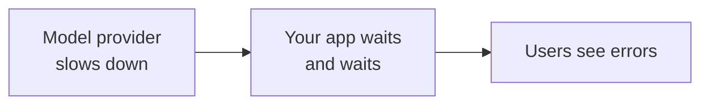
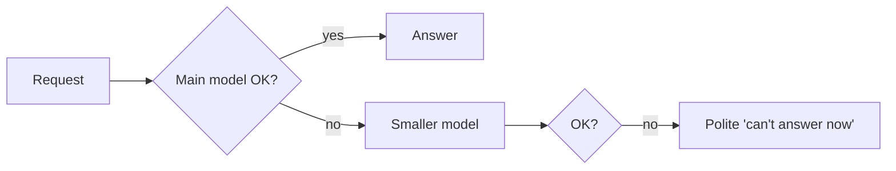
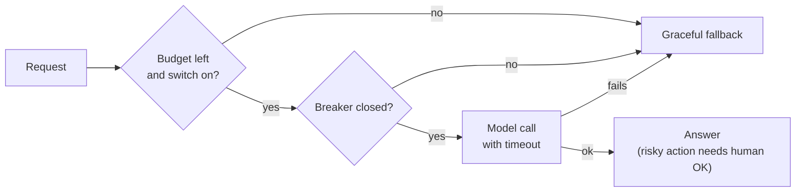
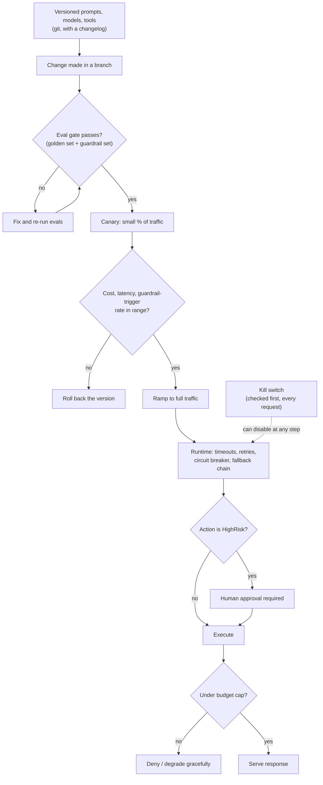
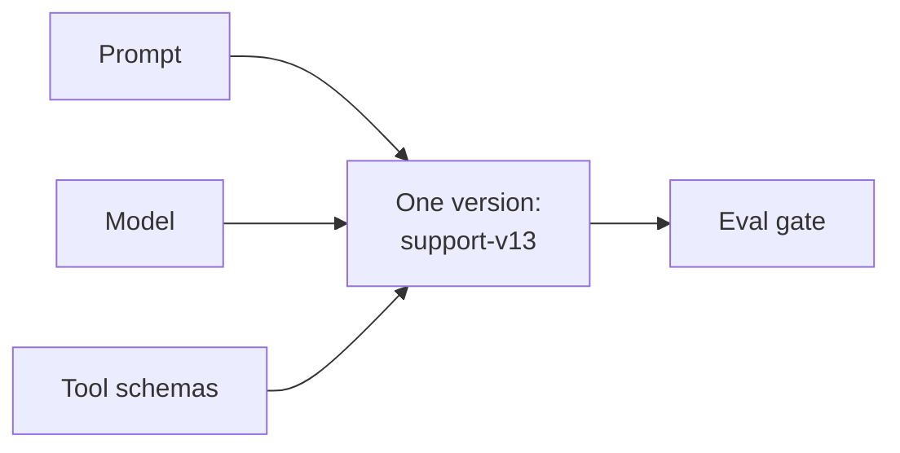
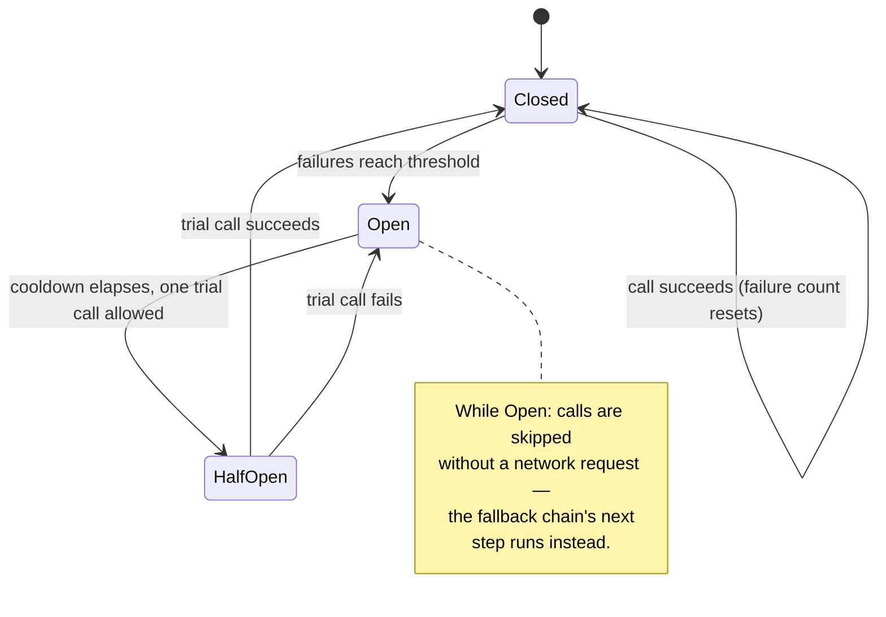
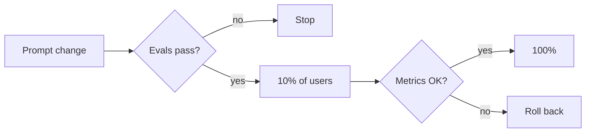
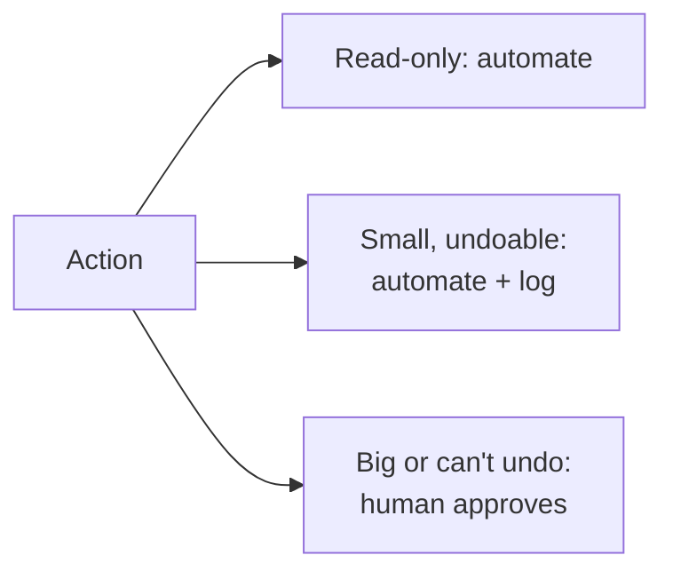
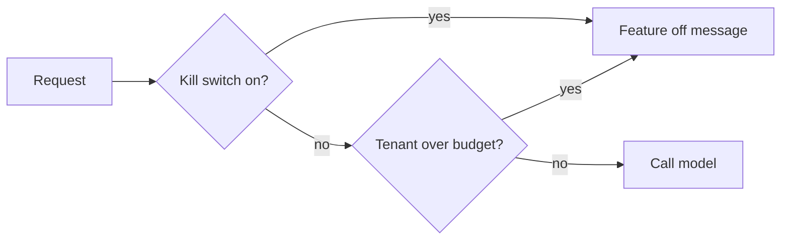

# Production AI Checklist

> [!summary] TL;DR
> Before an LLM-powered feature takes real traffic it needs the same resilience discipline as any other external-dependency-backed service (timeouts, retries, fallbacks, a kill switch) plus three things specific to LLMs: versioned prompts/models that are eval-gated before rollout, a human-approval gate on any high-risk action, and a hard spend cap.

> [!abstract] Core idea
> - Version prompts, models and tools together, the same discipline as versioning code and schema together, so any regression is bisectable.
> - Have a fallback for every failure: a second model, a cached answer, or a graceful "can't answer right now" — never a raw 500 to the user.
> - Gate every prompt/model change behind an eval pass and a canary before it reaches all traffic (see [[LLM Evals in Production]]).
> - Require a human in the loop for any action with real-world consequences (a refund, a delete, an email sent on someone's behalf).
> - Enforce budgets and keep a kill switch that works even when the deploy pipeline doesn't.

## Start here: the basics 🟢

> [!info] How to read this note (pick your level)
> - 🟢 **New to this?** Read "From zero" below, then sections 1, 2 and the cheat sheet (10). Stop there, that is a full first pass.
> - 🟡 **Know the basics?** Add section 3 (how it works), 4 (worked example), 5 and 6.
> - 🔴 **Interview / SDE-3 prep?** Add 7, 8 and 9. Headings are tagged 🟢🟡🔴 so you always know where you are.

> [!note] Before this note
> - [[LLM Fundamentals]]: model calls are slow, paid per token, and can be confidently wrong.
> - [[LLM Cost, Latency and Caching]]: cost grows with tokens, and caching, routing and spend caps keep it in check.
> - [[LLM Observability]]: every call is recorded as a span with tokens, cost and errors, so you can see what went wrong.

**From zero, in 60 seconds** 🟢

Shipping an AI feature is like adding any outside service to your app. It can be slow, go down, or cost too much.

It can also fail in a new way: it answers confidently and wrongly. So you need the usual safety gear plus a few AI-specific checks.



The usual gear: a time limit on every call, a few retries, and a **circuit breaker** (stop calling a broken service for a while). Plus a **fallback**: a backup answer path.



The AI extras: test every prompt change before it ships, roll it out to a few users first, cap spend per customer, and keep a big off switch.

The rest of this note is just these 3 questions:
1. What goes on the checklist?
2. How do fallbacks, breakers and rollouts fit together?
3. How much of it does your feature really need?


**The problem in one story.**
Your team ships a chatbot, and on day one the AI provider slows down.
Users see errors, a retry loop burns money, and a prompt change made yesterday quietly gives worse answers.
None of these are new problems; they are the same problems as any outside service.
This checklist lists the guards to put in place before real users arrive.

**Words you need first**

| Word | Plain meaning | Tiny example |
| --- | --- | --- |
| Timeout | Give up on a call after a set time | Stop waiting after 10 s |
| Retry with backoff | Try again, waiting longer each time | Wait 1 s, then 2 s, then 4 s |
| Circuit breaker | Stop calling a failing service for a while | After 3 failures, pause 30 s |
| Fallback | A backup plan when the main path fails | Use a smaller model or a cached answer |
| Canary | Send a new version to a small slice of traffic first | 10% of users get prompt v2 |
| Eval / golden set | A fixed test set that scores answers | 100 questions with known good answers |
| Kill switch | A flag that turns a feature off at once | `ai_enabled=false` |
| Blast radius | How much damage a wrong action can do | A refund is worse than a search |
| Feature flag | A setting read at run time that turns code paths on or off, no deploy needed | Flip `ai_enabled` in a dashboard |
| Half-open | The breaker's test state: allow one trial call to see if the service is back | 1 call after a 30 s pause |
| Rollback | Going back to the previous version | Prompt v2 → back to v1 |
| CI/CD | The automatic test-and-deploy pipeline | Merge → tests → deploy |
| Per-tenant budget | A spend limit for each customer company | ₹50,000 of model calls per month |

**Picture it**



**Analogy.** It is like a pre-flight checklist for a plane: each item is boring, but skipping one is how accidents happen.
Where it breaks: a plane's checklist is the same every flight, while model behaviour can change with a new model or prompt version, so the checks must re-run on every change.

**How the rest of this note builds up**

- First, a whiteboard story, why the checklist exists (section 1) and the mental model (section 2).
- Then each item: versioning, fallbacks, timeouts and breakers, eval gate plus canary, human review, budgets and kill switch (section 3).
- Then a tested Go worked example wiring a kill switch, circuit breaker, fallback chain and canary gate (section 4), and variants (sections 5-6).
- Finally the SDE-3 deep dive: production rollout, deterministic canaries and interview traps (sections 7-9).

> [!tip] Remember
> Treat the LLM like any flaky, metered outside service, then add eval gates, human approval and spend caps.

### Whiteboard version

**In plain words:** One bad day, handled well: the model slows, the breaker trips, a smaller model takes over, and spend stays capped.

A feature ships with a 10% canary on a new prompt version, a circuit breaker in front of the model API, a fallback to a smaller model, and a per-tenant budget cap.

One tenant's traffic spikes: the primary model starts timing out, the breaker opens, calls fall back to the smaller model automatically, the tenant's spend cap catches the volume before it becomes a bill, and the eval gate on the canary catches that the new prompt version regressed on a golden-set question before it reaches the other 90% of traffic.

None of this is unusual engineering — it's the standard resilience and rollout checklist for any backend dependency, applied to a dependency that happens to be an LLM.

## 1. Why it exists 🟢

An LLM call is an external, rate-limited, occasionally-flaky HTTP dependency with a cost that scales directly with traffic and a failure mode ("answered confidently but wrong") that a normal 5xx doesn't have.

Shipping it without the same checklist you'd apply to a payments API or a third-party shipping-rates API — but with the LLM-specific additions a model call needs — means the first real incident (a provider outage, a cost spike, a prompt that quietly started leaking PII through tool output) has no prepared response.

This note is the pre-launch checklist that ties together [[LLM Cost, Latency and Caching]], [[LLM Observability]], [[LLM Evals in Production]] and [[Guardrails and LLM Security]] into one gate a feature passes before it's "production."

### Real-life example 🟢

Think of the AI "write my product description" feature for sellers on a marketplace like Meesho or Flipkart.
On a sale day, the main model provider slows down. Each call has a 10-second limit, so sellers are not stuck; after 3 failures in a row the circuit breaker stops calling it, and a smaller model writes the descriptions instead.
One seller's script sends 50,000 requests; their monthly budget cap blocks the rest instead of creating a huge bill.
A new prompt version had passed the tests but goes to only 10% of sellers first, and its rollback is automatic if complaints rise.
If something goes badly wrong, an engineer flips one flag and the feature is off within seconds.

### Common beginner mistakes 🟢

- **Showing users a raw error when the model fails** → the whole feature looks broken → plan a fallback chain: smaller model, then a cached answer, then a polite "can't answer right now".
- **Retries without a circuit breaker** → during an outage every request still waits out the full timeout, several times → add a breaker so calls fail fast while the provider is down.
- **Shipping a prompt change to everyone at once** → one bad change hits all users → pass the eval gate, then a small canary, then ramp up.
- **A kill switch that needs a deploy** → it takes 20 minutes when you need seconds → make it a runtime flag read on every request, and test it.
- **Budget alerts instead of budget caps** → the alert arrives after the money is spent → block or degrade calls once a tenant hits its cap.

## 2. Mental model 🟢

Treat the LLM exactly like you'd treat any other unreliable, metered, third-party dependency: it needs a timeout, a retry policy, a circuit breaker, and a fallback, the same as a payments or shipping-rates API (see [[Calling External APIs]]).

Then add the parts that are new because the dependency's failure mode is different from a normal API's: it can fail by being confidently wrong, not just by erroring, so you additionally need eval gates on every version change and a human approval step for any high-risk action it's allowed to trigger.

### Timeout vs retry vs circuit breaker vs fallback 🟡

| Guard | Question it answers | Example |
| --- | --- | --- |
| Timeout | How long do I wait for one call? | Give up after 10 s |
| Retry | Should I try this same call again? | One more try after a `503`, with backoff |
| Circuit breaker | Should I even try, given recent failures? | 3 failures in a row → skip calls for 30 s |
| Fallback | What do I do instead when this path fails? | Use the smaller model, then a canned reply |

## 3. How it works 🟡

> 🟢 → 🟡 **You now know** that an AI feature needs the same safety gear as any outside service, plus tests for wrong answers, human checks and spend caps. **Next we open the box**: each checklist item in turn, versioning, fallbacks, timeouts and breakers, eval gate and canary, human review, and data, budgets and the kill switch. Each subsection starts with a plain step-by-step walk.

**In plain words:** The checklist is a gate. A feature must tick each box before, and during, its rollout.

The checklist, as a gate a feature must pass before/during rollout:



### Versioned prompts, models and tools

**In plain words:** Prompt, model and tools are one package. Change any one, and you re-test the package.

**Step by step:**
1. Keep the prompt, the model name and the tool schemas together in git, as version `support-v12`.
2. Put that version tag on every trace.
3. Want a newer model? That makes `support-v13`, even though the prompt text did not change.
4. Run the eval gate on v13 before anything else.
5. If quality drops later, the trace tags tell you exactly which version caused it.



Full detail:

A prompt, the model it targets, and the tool schemas offered to it are one versioned unit — changing any one without re-testing the others is how "we only changed the prompt" regressions happen.

Store them in git alongside the code that calls them (see [[Prompt Engineering]]), tag the version in every trace (see [[LLM Observability]]), and treat a model upgrade exactly like a prompt change: re-run the eval gate, don't assume a newer model is a strict improvement on your specific task.

### Fallbacks

**In plain words:** Always have a plan B, and a plan C, for when the main model fails.

**Step by step:**
1. Try the main model.
2. It fails or its breaker is open: try a smaller model, or another provider.
3. That fails too: return a cached or ready-written answer if one fits.
4. Nothing fits: say "I can't answer that right now, please try again".
5. Never show the user a raw `500` error.

Full detail:

Every call site needs a planned answer for "the primary path failed," not a bare error: a fallback model (cheaper or different provider), a cached or canned answer, or an explicit "I can't answer that right now" — in that preference order, never a raw 500 surfaced to the user.

[[LLM Cost, Latency and Caching]] covers the cost side of model cascades; this checklist item is the resilience side of the same mechanism.

### Timeouts, retries, circuit breakers

**In plain words:** Don't wait forever, retry a little, and stop calling a broken service so you fail fast.

**Step by step:**
1. Every call gets a deadline, say 10 seconds.
2. A `429` or `5xx` gets a couple of retries with growing, random waits.
3. The breaker counts failures. After 3 in a row it **opens**: calls are skipped at once and go to the fallback.
4. After a cooldown, it goes **half-open** and lets one trial call through.
5. Trial works: back to **closed** (normal). Trial fails: open again.

Full detail:

Standard external-dependency hygiene, applied here: a context deadline on every call, a bounded retry policy on transient errors (429/5xx — see [[Calling External APIs]]), and a circuit breaker that stops sending calls to a provider that's clearly down instead of queuing failures behind a timeout on every single request.

The breaker is what makes a fallback chain actually fast under an outage — without it, every request still pays the primary's full timeout before falling back.



### Eval gate plus canary

**In plain words:** Test the change first, then give it to a small slice of users, then everyone.

**Step by step:**
1. Run the golden set and the guardrail set on the new version. Fail → stop.
2. Pass → send 10% of traffic to it, chosen by hashing the user ID so each user always gets the same version.
3. Watch cost, latency and guardrail hits against the old version.
4. All fine → ramp to 100%. Any drift → roll back automatically.

Full detail:

No prompt, model or tool-schema change reaches 100% of traffic without first passing a golden-set and guardrail-set eval (see [[LLM Evals in Production]]) and then running as a canary on a small traffic percentage, watched for cost, latency and guardrail-trigger-rate drift (see [[LLM Observability]]) before a full ramp.

This is the same progressive-rollout (release to more users step by step) discipline as any other risky deploy, with LLM-specific signals (guardrail-trigger rate, eval score) added to the usual error-rate and latency signals.



### Human review for risky actions

**In plain words:** Sort actions by how much harm they can do. The risky ones need a person to say yes.

**Step by step:**
1. List every action the AI can trigger.
2. Read-only, like "look up order": run automatically.
3. Small and undoable, like "add a tag to a ticket": run automatically, log it, allow undo.
4. Big or permanent, like "refund ₹5,000" or "email the customer": wait for a human to approve.
5. Judge by the action, never by how sure the model sounds.

Full detail:

Classify every action an LLM or agent can take by its blast radius: read-only (safe to automate fully), low-risk and reversible (automate, but log and allow undo), or high-risk/irreversible (refunds, deletions, anything sent externally on someone's behalf).

The last category requires a human approval step before it executes, regardless of how confident the model's output looked.

[[Guardrails and LLM Security]] covers the broader threat model (prompt injection driving an agent toward a high-risk action in the first place); this checklist item is the backstop that assumes an injection or a bad decision will eventually get through.



### Data governance, budgets, kill switch

**In plain words:** Know what data goes to the model, cap spend per customer, and keep a switch to turn the feature off fast.

**Step by step:**
1. Every request first reads the kill-switch flag. Off → show "feature unavailable". No model call.
2. Then check this tenant's spend so far this month against its cap. Over → block or use a cheaper path.
3. Only then call the model.
4. When a customer asks to delete their data, also delete it from caches, logs and eval datasets that copied it.

Full detail:

Data governance here means knowing what data reaches the model (and, for RAG, what a retrieval filter could leak across tenants — see [[Vector Databases and ANN Indexes]]) and honoring deletion requests through to any cache, log or eval dataset that copied it.

Budgets means a hard per-tenant and per-feature spend cap enforced before the call, not an after-the-fact alert (see [[LLM Cost, Latency and Caching]]).

A kill switch is a flag checked before any call is made, independent of the normal deploy pipeline, so the feature can be turned off in seconds during an incident even if CI/CD itself is part of the problem.



## 4. Worked example 🟡

A kill switch, a circuit breaker, a fallback chain and a deterministic canary gate, wired together. It compiles and passes `go vet` and `go test -race` on Go 1.24.

```go
// Package checklist accompanies "Production AI Checklist".
package checklist

import (
	"context"
	"errors"
	"hash/fnv"
	"sync"
	"sync/atomic"
	"time"
)

// KillSwitch is a single atomic flag that disables an AI feature outright,
// checked before any call is made. It exists specifically for the moment
// evals, cost and guardrails all point the same direction at once ("turn
// this off right now") and a config-deploy round trip is too slow.
type KillSwitch struct {
	disabled atomic.Bool
}

func (k *KillSwitch) Disable()       { k.disabled.Store(true) }
func (k *KillSwitch) Enable()        { k.disabled.Store(false) }
func (k *KillSwitch) Disabled() bool { return k.disabled.Load() }

var ErrKilled = errors.New("ai feature disabled by kill switch")

// CircuitState is one of the three states a per-dependency circuit
// breaker moves through.
type CircuitState int

const (
	Closed   CircuitState = iota // calls flow normally
	Open                         // calls fail fast, no network call made
	HalfOpen                     // one trial call allowed, to test recovery
)

// CircuitBreaker trips to Open after consecutiveFailures reach a
// threshold, and after cooldown allows one HalfOpen trial call before
// deciding whether to close again or re-open. This is the "stop calling a
// provider that is clearly down" half of resilience; retries (below)
// are the "a single call had a transient blip" half — the checklist
// item is both together, not either alone.
type CircuitBreaker struct {
	mu            sync.Mutex
	state         CircuitState
	failures      int
	threshold     int
	cooldown      time.Duration
	openedAt      time.Time
	trialInFlight bool // guards HalfOpen so only one trial call runs at a time
}

func NewCircuitBreaker(threshold int, cooldown time.Duration) *CircuitBreaker {
	return &CircuitBreaker{threshold: threshold, cooldown: cooldown, state: Closed}
}

// Allow reports whether a call may proceed right now, and moves Open to
// HalfOpen once cooldown has passed. HalfOpen admits exactly one trial
// call: under concurrent callers, checking state alone (without
// trialInFlight) would let every goroutine that reads HalfOpen through at
// once, which is not "one trial call" and sends a burst of real traffic
// back at a provider that may still be down. trialInFlight makes the
// first caller in HalfOpen win the trial and every other concurrent
// caller fail fast until Record resolves it.
func (b *CircuitBreaker) Allow() bool {
	b.mu.Lock()
	defer b.mu.Unlock()
	switch b.state {
	case Closed:
		return true
	case HalfOpen:
		if b.trialInFlight {
			return false
		}
		b.trialInFlight = true
		return true
	case Open:
		if time.Since(b.openedAt) >= b.cooldown {
			b.state = HalfOpen
			b.trialInFlight = true
			return true
		}
		return false
	}
	return false
}

// Record reports the outcome of a call that Allow permitted.
func (b *CircuitBreaker) Record(err error) {
	b.mu.Lock()
	defer b.mu.Unlock()
	if err == nil {
		b.failures = 0
		b.state = Closed
		b.trialInFlight = false
		return
	}
	b.failures++
	if b.state == HalfOpen || b.failures >= b.threshold {
		b.state = Open
		b.openedAt = time.Now()
		b.trialInFlight = false
	}
}

func (b *CircuitBreaker) State() CircuitState {
	b.mu.Lock()
	defer b.mu.Unlock()
	return b.state
}

// Call is a function that performs one LLM call attempt.
type Call func(ctx context.Context) (string, error)

// FallbackChain tries a sequence of calls in order (primary model, a
// cheaper/alternate model, a cached or canned answer) and returns the
// first success, with the breaker protecting each step from being
// retried against a provider that is already down.
type FallbackChain struct {
	Steps    []Call
	Breakers []*CircuitBreaker // one per step, same length as Steps
}

var ErrAllStepsFailed = errors.New("all fallback steps failed")

// Run tries each step in order. A step whose breaker is Open is skipped
// without being called at all (fail fast); a step that returns an error
// records it on its breaker and the chain moves to the next step.
func (f *FallbackChain) Run(ctx context.Context) (string, int, error) {
	for i, step := range f.Steps {
		b := f.Breakers[i]
		if !b.Allow() {
			continue
		}
		out, err := step(ctx)
		b.Record(err)
		if err == nil {
			return out, i, nil
		}
	}
	return "", -1, ErrAllStepsFailed
}

// CanaryGate routes a fraction of traffic to a new prompt/model version,
// keyed deterministically by request ID so the same request always lands
// on the same side (needed for reproducible debugging and for comparing
// before/after metrics on the same population).
type CanaryGate struct {
	Percent int // 0-100: percent of traffic sent to the canary version
}

// Route returns true if requestID should see the canary version. It must
// be deterministic per ID, not randomized per call, so a retried request
// doesn't flip sides mid-investigation.
func (g CanaryGate) Route(requestID string) bool {
	h := fnv.New32a()
	_, _ = h.Write([]byte(requestID))
	bucket := int(h.Sum32() % 100)
	return bucket < g.Percent
}

// RiskLevel classifies an agent action for the human-review checklist
// item: anything above ReadOnly should not execute without an approval
// step (see the "Guardrails and LLM Security" note for the full threat
// model).
type RiskLevel int

const (
	ReadOnly RiskLevel = iota
	LowRisk            // reversible, low blast radius (e.g. draft an email)
	HighRisk           // irreversible or high blast radius (e.g. refund, delete)
)

// RequiresApproval reports whether an action needs a human in the loop
// before it executes.
func RequiresApproval(r RiskLevel) bool {
	return r == HighRisk
}

// RunGuarded is what actually wires the kill switch into the rest of the
// path: it is the one call site every request goes through, and it checks
// the switch before the fallback chain (and, transitively, every
// circuit-breaker-protected step within it) runs at all. This is the
// "checked first, every request" box in the flowchart above — a kill
// switch that isn't on the call path is just an unused flag.
func RunGuarded(ctx context.Context, kill *KillSwitch, chain *FallbackChain) (string, int, error) {
	if kill.Disabled() {
		return "", -1, ErrKilled
	}
	return chain.Run(ctx)
}
```

The resilience tests — a circuit breaker that actually fails fast, and a fallback chain proven against real HTTP fakes (`httptest`, representative output, no live provider):

```go
func TestCircuitBreakerOpensAfterThresholdAndRecovers(t *testing.T) {
	b := NewCircuitBreaker(3, 20*time.Millisecond)

	for i := 0; i < 3; i++ {
		if !b.Allow() {
			t.Fatalf("expected Allow() true before threshold, failure %d", i)
		}
		b.Record(errors.New("boom"))
	}
	if b.State() != Open {
		t.Fatalf("got state %v, want Open after 3 failures", b.State())
	}
	if b.Allow() {
		t.Fatalf("expected Allow() false immediately after opening")
	}

	time.Sleep(25 * time.Millisecond)
	if !b.Allow() {
		t.Fatalf("expected Allow() true after cooldown (HalfOpen trial)")
	}
	b.Record(nil) // trial call succeeds
	if b.State() != Closed {
		t.Fatalf("got state %v, want Closed after a successful trial", b.State())
	}
}

// TestCircuitBreakerHalfOpenAllowsOnlyOneConcurrentTrial proves the claim
// in Allow's doc comment: once the breaker reaches HalfOpen, only the
// first of many concurrent callers gets to run the trial call, and every
// other concurrent caller fails fast rather than also hitting the
// still-recovering provider.
func TestCircuitBreakerHalfOpenAllowsOnlyOneConcurrentTrial(t *testing.T) {
	b := NewCircuitBreaker(1, 10*time.Millisecond)
	b.Record(errors.New("boom")) // one failure trips threshold=1 → Open
	time.Sleep(15 * time.Millisecond)

	var wg sync.WaitGroup
	var mu sync.Mutex
	allowed := 0
	for i := 0; i < 20; i++ {
		wg.Add(1)
		go func() {
			defer wg.Done()
			if b.Allow() {
				mu.Lock()
				allowed++
				mu.Unlock()
			}
		}()
	}
	wg.Wait()
	if allowed != 1 {
		t.Fatalf("got %d concurrent calls allowed through HalfOpen, want exactly 1", allowed)
	}
}

func TestFallbackChainFallsThroughToSecondStep(t *testing.T) {
	down := httptest.NewServer(http.HandlerFunc(func(w http.ResponseWriter, r *http.Request) {
		w.WriteHeader(http.StatusServiceUnavailable)
	}))
	defer down.Close()
	up := httptest.NewServer(http.HandlerFunc(func(w http.ResponseWriter, r *http.Request) {
		fmt.Fprint(w, "fallback answer")
	}))
	defer up.Close()

	chain := &FallbackChain{
		Steps: []Call{callViaHTTP(down.URL), callViaHTTP(up.URL)},
		Breakers: []*CircuitBreaker{
			NewCircuitBreaker(1, time.Second),
			NewCircuitBreaker(1, time.Second),
		},
	}

	out, step, err := chain.Run(context.Background())
	if err != nil {
		t.Fatalf("Run() error: %v", err)
	}
	if step != 1 || out != "fallback answer" {
		t.Fatalf("got step=%d out=%q, want step=1 out=fallback answer", step, out)
	}
}

func TestFallbackChainSkipsOpenBreakerWithoutCalling(t *testing.T) {
	called := false
	neverCalled := Call(func(ctx context.Context) (string, error) {
		called = true
		return "", errors.New("should not run")
	})
	canned := Call(func(ctx context.Context) (string, error) {
		return "canned safe answer", nil
	})

	openBreaker := NewCircuitBreaker(1, time.Hour)
	openBreaker.Record(errors.New("already failed once, now Open"))

	chain := &FallbackChain{
		Steps:    []Call{neverCalled, canned},
		Breakers: []*CircuitBreaker{openBreaker, NewCircuitBreaker(1, time.Hour)},
	}
	out, step, err := chain.Run(context.Background())
	if err != nil {
		t.Fatalf("Run() error: %v", err)
	}
	if called {
		t.Fatalf("step 0's Call ran despite its breaker being Open (fail-fast skip broke)")
	}
	if step != 1 || out != "canned safe answer" {
		t.Fatalf("got step=%d out=%q, want step=1 out=canned safe answer", step, out)
	}
}
```

And the canary gate, checked both for determinism (same request always lands the same side) and for roughly matching its configured percentage:

```go
func TestCanaryGateIsDeterministicPerRequestID(t *testing.T) {
	gate := CanaryGate{Percent: 50}
	first := gate.Route("request-abc-123")
	for i := 0; i < 10; i++ {
		if gate.Route("request-abc-123") != first {
			t.Fatalf("Route() is not deterministic for the same request ID")
		}
	}
}

func TestCanaryGateRoughlyMatchesPercent(t *testing.T) {
	gate := CanaryGate{Percent: 20}
	hits := 0
	const n = 10000
	for i := 0; i < n; i++ {
		if gate.Route(fmt.Sprintf("req-%d", i)) {
			hits++
		}
	}
	pct := float64(hits) / n * 100
	if pct < 17 || pct > 23 { // allow slack around the ideal 20%
		t.Fatalf("got %.1f%% routed to canary, want roughly 20%%", pct)
	}
}
```

And `RunGuarded`, proving the kill switch actually sits in front of the fallback chain rather than being an unused flag:

```go
func TestRunGuardedReturnsErrKilledWithoutCallingChain(t *testing.T) {
	called := false
	chain := &FallbackChain{
		Steps:    []Call{func(ctx context.Context) (string, error) { called = true; return "ok", nil }},
		Breakers: []*CircuitBreaker{NewCircuitBreaker(1, time.Second)},
	}
	kill := &KillSwitch{}
	kill.Disable()

	_, _, err := RunGuarded(context.Background(), kill, chain)
	if !errors.Is(err, ErrKilled) {
		t.Fatalf("got err=%v, want ErrKilled", err)
	}
	if called {
		t.Fatalf("chain step ran despite the kill switch being disabled")
	}
}

func TestRunGuardedCallsChainWhenEnabled(t *testing.T) {
	chain := &FallbackChain{
		Steps:    []Call{func(ctx context.Context) (string, error) { return "ok", nil }},
		Breakers: []*CircuitBreaker{NewCircuitBreaker(1, time.Second)},
	}
	kill := &KillSwitch{} // Enable() is the zero value: not disabled

	out, step, err := RunGuarded(context.Background(), kill, chain)
	if err != nil || out != "ok" || step != 0 {
		t.Fatalf("got out=%q step=%d err=%v, want out=ok step=0 err=nil", out, step, err)
	}
}
```

**Measured (this test run, Go 1.24, 2026-11-07):** the breaker opens after exactly 3 consecutive failures, refuses calls immediately while `Open`, and transitions to `HalfOpen` only after its 20ms cooldown elapses, closing again on a successful trial call.

Under 20 concurrent callers hitting a `HalfOpen` breaker at once, exactly 1 gets through and the other 19 fail fast, confirming `Allow` admits only one trial call at a time rather than letting every concurrent caller through while the state merely reads `HalfOpen`.

The fallback chain, run against two real `httptest.Server` instances (one returning 503, one returning 200), falls through to the working second step and never calls a step whose breaker reports `Open`.

The canary gate is exactly deterministic per request ID across 10 repeated calls, and over 10,000 distinct IDs routes 17-23% to a 20%-configured canary (measured: within that band; exact value varies by hash distribution).

`RunGuarded` returns `ErrKilled` without calling the chain at all when the switch is disabled, and passes through to the chain's own result otherwise. All tests pass under `go test -race`.

## 5. Variants and comparison 🟡

**In plain words:** Each checklist item, what it protects you from, and what goes wrong if you skip it.

| Checklist item | What it protects against | Cost of skipping it |
| --- | --- | --- |
| Versioned prompts/models/tools | Unbisectable regressions (you cannot narrow down which change caused them) after a change | Can't tell which change caused a quality drop |
| Fallback chain | A single provider/model outage taking down the feature | Full outage instead of degraded service |
| Circuit breaker | Every request paying a full timeout against a dead provider | Slow failure instead of fast failure; cascading latency |
| Eval gate + canary | A regression reaching all traffic at once | Full-traffic incident instead of a contained one |
| Human review (high-risk actions) | An injected or hallucinated instruction executing irreversibly | Real-world harm (wrong refund, wrong delete, wrong email sent) |
| Data governance | Sensitive data outliving a deletion request, or crossing tenants | Compliance violation, cross-tenant leak |
| Budget caps | Unbounded spend from a traffic spike or a cost-attack | Surprise bill, possible denial-of-wallet |
| Kill switch | An incident needing a full deploy cycle to mitigate | Minutes-to-hours instead of seconds to stop the bleeding |

## 6. Trade-offs and when not to use 🟡

- The full checklist is overhead for a prototype or an internal tool with no real users; apply it in proportion to blast radius, not uniformly to every LLM call in the codebase.
- A canary + eval gate on every prompt tweak slows iteration speed; teams that need to move fast in an exploration phase often relax this until the feature nears general availability, then tighten it.
- Human review on every action, applied too broadly, defeats the point of automating the workflow at all — scope it to genuinely high-risk actions (see `RiskLevel` above), not everything the model touches.
- A kill switch and circuit breakers add a small amount of state and complexity that a single-user script doesn't need.

## 7. In production 🔴

> 🟡 → 🔴 **You now know** every checklist item and how they fit into one gate. **Next comes the senior view**: how this maps to standard SRE practice, what fails in real incidents, why breaker and fallback are separate jobs, why canary splits must be stable per user, and why a kill switch needs fire drills.

- **Real systems:** this checklist mirrors standard SRE (site reliability engineering: the discipline of keeping services up) practice (circuit breakers, canaries, kill switches) adapted with LLM-specific gates; most mature AI platforms (internal or vendor) now bake eval-gated rollout and per-tenant budgets in as defaults rather than opt-in extras.
- **Failure modes → fixes:**
  - A provider outage degrades the whole feature because there's no fallback → add at least a cached/canned-answer final step to every fallback chain, even a crude one.
  - A bad prompt version reaches 100% of traffic because there was no canary step → always ramp through a canary percentage with an automatic rollback trigger on eval/guardrail regression.
  - A kill switch exists in config but requires a full deploy to flip → make it a runtime flag (feature flag service, or a cheap key-value read) checked on every request, independent of the deploy pipeline.
  - An agent executes an irreversible action from an injected instruction → classify the action's `RiskLevel` before execution and gate `HighRisk` on human approval regardless of how the instruction arrived.
- **What to monitor:** which checklist items are actually wired up per feature (a short audit, not just "we have a checklist somewhere"); kill-switch drill frequency (does anyone actually test that it works); canary rollback rate; time-to-mitigate on the last incident that needed one of these controls.

## 8. Deep dive 🔴

- **Why versioning prompts/models/tools together matters more than it looks.**

  A prompt that was tuned against one model's behavior (tone, instruction-following strength, tool-calling reliability) can regress silently on a different model even with identical text, because the underlying behavior it was tuned against changed. Treating a model swap as "just a config change" without re-running the eval gate is how a seemingly safe upgrade ships a regression.
- **Why the circuit breaker and the fallback chain are separate concerns.** A breaker decides *whether to even try* a given step (fail fast once a provider is clearly down); the fallback chain decides *what to try next* once a step is skipped or fails.

  Conflating them — e.g., retrying a fallback's own fallback inside the breaker's logic — makes the failure path much harder to reason about under an actual incident; keep the breaker per-step and let the chain's ordering express the preference.
- **The canary's traffic split must be deterministic per identity, not per call.**

  A random split means the same user or request can land on different versions across retries, which breaks both reproducibility (you can't re-run a bug report deterministically) and clean A/B measurement (you're measuring a different population each time rather than a stable one).

  Hashing a stable identifier (request ID, user ID, or tenant ID, depending on what you're testing) fixes both.
- **A kill switch is only as good as its last fire drill.** A flag nobody has tripped since it was written is a flag of unknown reliability — the same discipline as testing a database failover, applied to an AI feature's off switch.

## 9. Interview questions 🔴

> [!question]- Why does an LLM feature need a circuit breaker in addition to retries?
> Retries handle a single transient blip (one 503 that would likely succeed on the next attempt); a circuit breaker handles sustained failure by stopping calls to a clearly-down provider altogether, so every request fails fast instead of each one still paying a full timeout before an eventual retry gives up too.
>
> Without the breaker, an outage degrades into a latency disaster even though every individual call is "handled" by retry logic.

> [!question]- Trap: "we eval-gated the new prompt and it passed, so it's safe to ship to all traffic." What's missing?
> A canary step. An eval gate checks the prompt against a fixed golden/guardrail set, which can't cover every real-traffic pattern; a canary on a small percentage of live traffic, watched for cost/latency/guardrail-trigger drift, catches regressions the eval set didn't anticipate before they reach everyone.

> [!question]- How do you decide which agent actions require human approval?
> Classify by blast radius and reversibility, not by how confident the model's output looks: read-only or easily-undoable actions can run unattended, while anything irreversible or high-impact (a refund, a delete, an externally-visible message) requires a human approval step regardless of model confidence, because confidence is not evidence of correctness.

> [!question]- A kill switch exists for your AI feature. During an incident, it takes 20 minutes to take effect because it's a config value read on deploy. What's wrong with this design, and what would you change?
> A kill switch that requires a deploy isn't actually fast-acting; it should be a runtime-checked flag (a feature-flag service, or even a cheap shared key-value read on every request) so flipping it takes effect within seconds, independent of CI/CD — which may itself be unavailable or slow during the exact incident the switch exists for.

> [!question]- Why version prompts, models and tool schemas as one unit instead of three independent things?
> Because they were tested together: a prompt tuned against one model's tool-calling behavior and a specific tool schema can regress if any one of the three changes alone, even if the change looks unrelated to the other two. Versioning them as one unit makes a regression bisectable — you know exactly which combination was live when something broke.

> [!question]- Your per-tenant budget check is implemented as a nightly alert on yesterday's spend. What's the practical gap?
> It's a postmortem, not a control — by the time the alert fires, the overspend already happened. A hard per-tenant cap enforced synchronously before each call (reject or degrade once the cap is hit) bounds the actual damage; an after-the-fact alert only tells you how much damage occurred.

## 10. Cheat sheet 🟢

- Version prompts, models and tool schemas together; re-run evals on any one change.
- Every call site has a fallback: alternate model → cached/canned answer → explicit "can't answer" — never a raw error.
- Circuit breaker (fail fast on a dead provider) is a different job from retries (handle a transient blip); use both.
- No version change reaches 100% of traffic without an eval gate, then a canary, then a ramp.
- Classify agent actions by blast radius; require human approval for anything irreversible or high-impact.
- Honor data deletion through caches, logs and eval datasets, not just the primary store.
- Enforce budgets as a hard stop before the call, per tenant and per feature.
- Keep a kill switch that is a runtime flag, not a deploy — and drill it.

## Self-check 🟢🟡

> [!question]- Easy: What is a fallback?
> A backup path when the main one fails, like a smaller model or a polite "can't answer now".

> [!question]- Easy: What does a kill switch do?
> Turns the AI feature off within seconds, without a deploy.

> [!question]- Easy: Which actions need human approval?
> Big or permanent ones: refunds, deletions, messages sent on someone's behalf.

> [!question]- Medium: Retries vs circuit breaker?
> Retries handle a one-off blip; a breaker stops calling a provider that keeps failing, so requests fail fast.

> [!question]- Medium: The new prompt passed evals. Why still use a canary?
> Evals only cover saved cases; a canary tests real traffic on a few users before everyone.

> [!question]- Medium: Why hash the user ID for the canary instead of picking randomly per call?
> So each user always sees the same version, making bugs reproducible and comparisons clean.

## Links 🟢

- **Before this:** [[LLM Cost, Latency and Caching]], [[LLM Observability]], [[LLM Evals in Production]], [[Guardrails and LLM Security]]
- **Next:** nothing; this is the closing checklist for the folder
- **Compare with:** [[Production Readiness Review]] (the general-backend version of this gate)

### Watch on YouTube

- [Is Your AI Agent Production Ready? The Reliability Checklist.](https://www.youtube.com/watch?v=PiaCRgH5vAY) · Eldon Conceicao / AI Operations Journal · 21 min · 1,350 views
- [AI System Design for Production: The Checklist Most Engineers Skip](https://www.youtube.com/watch?v=3nYoe4mcJCw) · AI in Production · 21 min · 229 views

## Every note in this folder 🟢

[[LLM Fundamentals]] · [[Calling LLM APIs from Go]] · [[Prompt Engineering]] · [[Structured Outputs and Tool Calling]] · [[Embeddings]] · [[Vector Databases and ANN Indexes]] · [[Keyword, Semantic and Hybrid Search]] · [[Document Ingestion and Chunking]] · [[RAG Pipeline]] · [[Advanced RAG Patterns]] · [[RAG Evaluation]] · [[Case Study - Chat with PDFs and Websites]] · [[AI Agents and Agentic Workflows]] · [[LangChain and LangGraph]] · [[Model Context Protocol (MCP)]] · [[LLM Evals in Production]] · [[Guardrails and LLM Security]] · [[LLM Cost, Latency and Caching]] · [[LLM Observability]]
