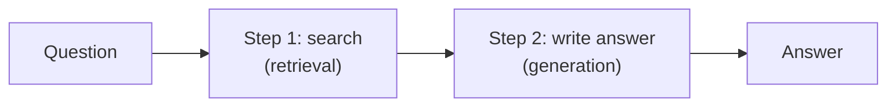
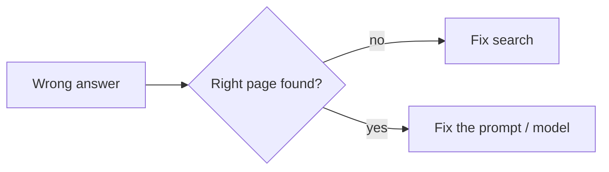
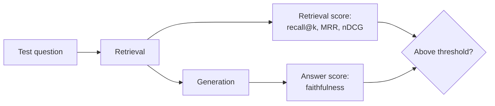
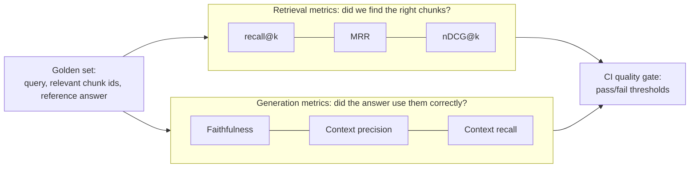
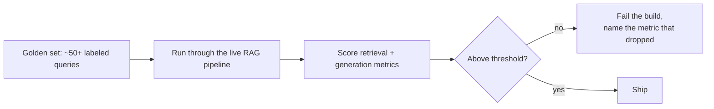
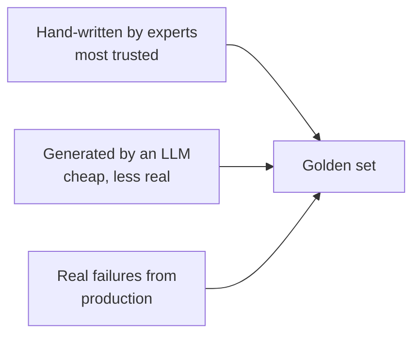
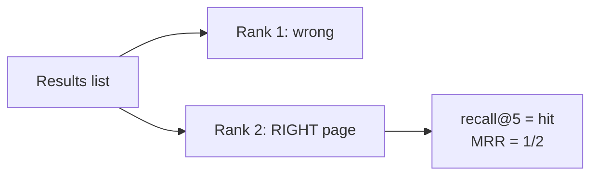
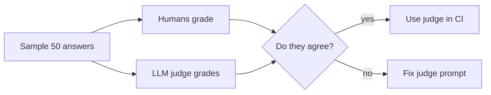

# RAG Evaluation

> [!summary] TL;DR
> A RAG pipeline has two places to be wrong — retrieval can return the wrong chunks, and generation can write a wrong or unfaithful answer even from the right ones — so evaluating "is the answer good?" alone can't tell you which stage to fix.
>
> RAG evaluation measures retrieval and generation separately, on a labeled golden set, with metrics that don't require a human to read every answer, so quality regressions are caught in CI before they reach production.

> [!abstract] Core idea
> - Retrieval metrics (recall@k, MRR, nDCG) need a golden set of queries with known-relevant chunk IDs, and measure whether the right chunks were found, and how high they were ranked.
> - Generation metrics (faithfulness/groundedness, context precision/recall) check the answer against the *retrieved context*, independent of whether that context was itself the ideal context — a faithful answer built from wrong context is still a retrieval failure, not a generation failure.
> - "Vibes" (reading a few answers and deciding they look fine) doesn't scale, doesn't catch regressions, and doesn't tell you which stage broke.
> - LLM-as-judge is the practical way to score faithfulness and relevance at scale, but the judge itself needs calibration against human labels before you trust its scores.
> - Wire a subset of these metrics into CI as a quality gate with a minimum threshold, so a change that silently degrades retrieval or generation fails the build instead of shipping unnoticed.

## Start here: the basics 🟢

> [!info] How to read this note (pick your level)
> - 🟢 **New to this?** Read "From zero" below, then sections 1, 2 and the cheat sheet (10). Stop there, that is a full first pass.
> - 🟡 **Know the basics?** Add section 3 (how it works), 4 (worked example), 5 and 6.
> - 🔴 **Interview / SDE-3 prep?** Add 7, 8 and 9. Headings are tagged 🟢🟡🔴 so you always know where you are.

> [!note] Before this note
> - [[RAG Pipeline]]: a RAG bot first fetches the top chunks for a question, then the model writes an answer from those chunks with sources.

**From zero, in 60 seconds** 🟢

A RAG bot works in two steps. First it searches your documents. Then the model writes an answer from what it found.

When an answer is wrong, you need to know which step failed.



So you test each step on its own. For that you need a **golden set**: a list of real questions with the right pages and right answers written down.

Search is scored by "did the right page show up near the top?" (**recall@k**). Writing is scored by "did the answer stick to what was found?" (**faithfulness**).



Often another LLM does the grading. That grader must itself be checked against human scores.

The rest of this note is just these 3 questions:
1. How do you build a golden set?
2. Which numbers score search, and which score the answer?
3. How do you run these checks in CI and production?


**The problem in one story.**
Your "chat with our docs" bot gives a wrong answer about the refund policy.
Did search fetch the wrong page, or did the model misread the right page?
Reading a few answers by eye cannot tell you, and cannot warn you when next week's change makes things worse.
RAG evaluation gives each stage its own score so you know what broke.

**Words you need first**

| Word | Plain meaning | Tiny example |
| --- | --- | --- |
| RAG | Search your documents, then let the model answer from what it found | Bot answers from the policy page |
| Chunk | A small piece of a document stored for search | One paragraph of the policy |
| Top-k | The k best search results | The top 5 chunks |
| Golden set | Test questions with known correct chunks | "Refund window?" → chunk 42 |
| Recall@k | Did a correct chunk appear in the top k? | Yes = 1, no = 0 |
| Faithfulness | Does the answer stick to the retrieved text? | No invented numbers |
| LLM-as-judge | Using a model to grade another model's answer | Judge scores 1-5 |
| CI gate | An automatic test that blocks a bad change | Build fails if recall drops |
| CI | The automatic build-and-test run on every code change | Runs on each pull request |
| Regression | Something that used to work and got worse after a change | Recall fell from 0.91 to 0.78 |
| MRR | Average of 1 ÷ the rank of the first right result | Right chunk at rank 2 → 0.5 |
| nDCG | A 0-to-1 score for how well all right results are ordered near the top | 1.0 = perfect order |
| Reference answer | The correct answer written down ahead of time | "Refunds within 14 days" |

**Picture it**



**Analogy.** It is an open-book exam with two graders: one checks if the student opened the right page, the other checks if the answer matches that page.
Where it breaks: a school grader is a person, while an LLM judge can be biased and must be checked against human labels.

**How the rest of this note builds up**

- First, why "looks fine to me" fails (section 1) and the two-stage exam model (section 2).
- Then the golden set, retrieval metrics, generation metrics and LLM-as-judge (section 3).
- Then a tested Go worked example computing recall@k, MRR and nDCG@k (section 4), and variants (sections 5-6).
- Finally the SDE-3 deep dive: monitoring, diagnosing which stage broke, CI thresholds and growing the golden set (sections 7-9).

> [!tip] Remember
> Score retrieval and generation separately, against a fixed golden set, and fail the build when either drops.

## 1. Why it exists 🟢

A support team ships a RAG assistant, and a manager asks: "is it good?" Without an eval suite, the only answer is someone reading a handful of transcripts and guessing. That approach has three concrete failures:

- It doesn't scale: nobody reads 500 production transcripts a week, so most bad answers go unnoticed until a customer complains.
- It can't localize the problem: a reviewer sees a wrong answer, but "retrieval found the wrong chunk" and "retrieval found the right chunk but the model ignored it" look identical from the outside — they need different fixes.
- It can't catch a regression: the team swaps the embedding model, or changes the chunk size, or tweaks the prompt, with no fast, repeatable way to check whether that change made things better or worse before it reaches production.

Concretely: after switching from a 500-token to a 1,000-token chunk size, answer quality on a sample of eyeballed transcripts "seems about the same." A golden-set eval run instead reports recall@5 dropped from 0.91 to 0.78 while faithfulness held steady at 0.94 — a retrieval regression invisible to spot-checking, caught in minutes by a metric built for exactly that stage.

### Real-life example 🟢

Think of the help bot in a banking app like HDFC or ICICI that answers "what is the charge for a failed NACH mandate?".
The team wants to switch to a cheaper embedding model. Before shipping, they run 80 saved questions with known right chunks.
Recall@5 drops from 0.90 to 0.72 on fee questions, though answers "look fine" in a quick demo.
The CI gate fails the build, so the switch never reaches customers who would have got wrong fee amounts.

### Common beginner mistakes 🟢

- **Judging by reading a few answers** → you miss most bad answers and cannot tell which stage broke → score retrieval and generation separately on a fixed golden set.
- **Using only one "answer correct?" score** → when it drops, you do not know whether search or writing failed → also track recall@k (search) and faithfulness (writing).
- **Trusting an LLM judge blindly** → judges can prefer long or confident answers → check the judge against 30-50 human-graded cases first.
- **Building the golden set only from LLM-made questions** → they reuse the chunk's own words, so they are too easy → add hand-written and real user questions.
- **Picking a round-number threshold** → scores wobble a little run to run, so the gate fails on noise and people start ignoring it → measure that wobble first and set the threshold above it.

## 2. Mental model 🟢

Treat a RAG pipeline like a two-stage exam: **retrieval** is "did the student open the right page of the textbook," and **generation** is "given that page, did the student answer correctly from it."

A student who opens the wrong page and still happens to write a correct answer from memory passed the exam but failed the lesson you were testing — and a student who opened the right page but copied it wrong failed for the opposite reason.

RAG evaluation tests each stage with a metric built for that stage, instead of only grading the final answer and shrugging about why it was wrong.

### RAG evaluation vs the things people confuse it with 🟡

| Thing | What it checks | Key difference |
| --- | --- | --- |
| RAG evaluation | Search quality and answer quality on a golden set | Splits the score by stage so you know what to fix |
| Unit tests | Exact output of plain code | Code is exact; RAG answers vary, so you score them instead of matching strings |
| [[LLM Evals in Production]] | Any LLM feature, offline and on live traffic | Broader; RAG evaluation adds retrieval-specific scores like recall@k |
| [[LLM Observability]] | What happened on each real call (traces, cost, latency) | Records calls; evaluation grades them |



## 3. How it works 🟡

> 🟢 → 🟡 **You now know** that a RAG bot has two steps, search and writing, and that you score each on a fixed golden set. **Next we open the box**: how to build the golden set, how each search score is counted, how answer scores work, and how to check an LLM judge before trusting it. Each subsection starts with a plain step-by-step walk.

### Whiteboard version

**In plain words:** Take a few labelled questions, run them through the bot, score the results, and block the release if scores drop.

**Step by step:**
1. Save 50 questions, each with the chunk IDs that should be found and the right answer.
2. On every change, run all 50 through the real pipeline.
3. Score search (recall@k, MRR, nDCG) and the answers (faithfulness).
4. Compare each score to its minimum, say recall@5 ≥ 0.85.
5. Below the minimum: fail the build and name which score dropped.

Full detail:

The smallest useful eval loop: a handful of labeled queries, run through the live pipeline, scored against the labels, gated in CI.



### The golden set

**In plain words:** An answer key for your bot: questions, the pages that should be found, and the right answer.

**Step by step:**
1. An expert writes 30 real-sounding questions and marks the right chunks, such as "Refund window for digital goods?" → chunk 42.
2. An LLM reads 40 other chunks and writes one question per chunk, cheaply.
3. Add 10 real user questions from production where users said "this didn't help".
4. Add a few questions with no answer in the docs, to check the bot says "I don't know".
5. Keep adding new hard cases as production finds them.

Full detail:

Every metric below needs a **golden set**: a list of `(query, relevant chunk IDs, reference answer)` rows. Three ways to build one, usually combined:

- **Hand-labeled.** A domain expert writes realistic questions and marks which chunks should answer them. Expensive per row, but the most trustworthy — this is what you calibrate an LLM judge against (see below).
- **Synthetically generated.** An LLM reads a chunk and generates a question it answers, giving you a `(question, chunk_id)` pair almost for free.

  It is useful for bulk recall@k coverage, but systematically easier than real user questions (it was generated *from* the answer, so it tends to use the chunk's own vocabulary) — don't rely on it alone for a representative difficulty distribution.
- **Production-sampled.** Real user queries, sampled and then labeled (by a human, or by promoting a query where a human gave explicit feedback). These are the hardest and most representative rows, and the ones most worth adding over time as the eval set's "adversarial" (deliberately hard, tricky) cases.

A golden set of 50–100 rows, covering the easy cases, the known-hard cases (ambiguous phrasing, multi-hop questions), and a few known-unanswerable questions (to check the pipeline says "I don't know" instead of guessing) is enough to start; grow it as production surfaces new failure patterns.



### Retrieval metrics

**In plain words:** These all ask one thing in different ways: did the right page show up, and how near the top?

**Step by step:**
1. Question 1: the right chunk is at rank 2 of 5. Recall@5 = hit (1). Reciprocal rank = 1/2.
2. Question 2: the right chunk is at rank 1. Recall@5 = 1. Reciprocal rank = 1.
3. Question 3: the right chunk is not in the top 5. Recall@5 = 0. Reciprocal rank = 0.
4. Average over the 3 questions: recall@5 = 2/3 ≈ 0.67, MRR = (0.5 + 1 + 0) / 3 = 0.5.
5. nDCG does the same idea but credits every right chunk in the list, with less credit the lower it sits.

Full detail:

- **Recall@k**: the fraction of queries where at least one relevant chunk appears somewhere in the top k retrieved results. It answers "did retrieval find the needle at all," independent of rank — check this first, since nothing downstream (reranking, prompting, generation) can fix a chunk that was never retrieved.
- **MRR (Mean Reciprocal Rank)**: the average of `1/rank` of the first relevant result per query (0 if none was found). Unlike recall@k, it rewards ranking the relevant chunk *first* over fifth — which matters, because a reranker or a context-assembly token budget can drop a correct-but-low-ranked chunk before it ever reaches the prompt.
- **nDCG@k (normalized Discounted Cumulative Gain)**: rewards relevant results near the top of the list via a logarithmic rank discount (each step down the list counts for a bit less, shrinking slowly), normalized against the best possible ordering so scores are comparable across queries with different numbers of relevant chunks. It generalizes MRR to "multiple relevant chunks, ranked well" rather than only "the first one found."

All three are computed from the same labeled rows — `(query, set of relevant chunk IDs, chunk IDs the pipeline actually retrieved, in order)` — so one eval run against the golden set produces all three with no extra instrumentation.



### Generation metrics

**In plain words:** These ask: did the answer stick to the pages it was given, and were those pages even useful?

**Step by step:**
1. The bot got 5 chunks and answered "Refunds within 14 days, plus a ₹50 fee."
2. Faithfulness: the chunks say "14 days" but nothing about a fee, so one claim is unsupported. Not faithful.
3. Context precision: 2 of the 5 chunks were actually about refunds, so 2/5 = 0.4.
4. Context recall: the reference answer needs 2 facts and both appear in the chunks, so 1.0.
5. Each score points at a different fix: the prompt, the search noise, or missing chunks.

Full detail:

These check the *answer* against the *context it was actually given*, which is why they're scored independently of whether retrieval picked the ideal context — a generation metric answers "given these chunks, was the answer good," not "were these the right chunks."

- **Faithfulness (groundedness)**: does every claim in the answer trace back to something stated in the retrieved context? An unfaithful answer invents or extrapolates beyond what the context actually says — the core hallucination check for a grounded system.
- **Context precision**: of the chunks retrieved, what fraction were actually relevant to answering the question? Low context precision means retrieval is returning noise alongside (or instead of) the useful chunk, diluting the prompt and, past a point, measurably degrading the model's ability to use the chunk that *is* relevant.
- **Context recall**: of the facts needed to fully answer the question (from the reference answer), what fraction appear somewhere in the retrieved context? This is recall@k's generation-side cousin: even if the "correct" chunk ID was retrieved, context recall catches cases where the reference answer needs facts spread across chunks that weren't all retrieved.
- **Answer correctness**: does the generated answer match the reference answer's meaning? The most intuitive metric, and also the easiest to get wrong, because it couples retrieval and generation quality together into one number that doesn't tell you which stage to fix if it drops — use it as a headline number, not a diagnostic one.

### LLM-as-judge, and why it needs calibration

**In plain words:** Using one AI to grade another is cheap and fast, but you must first check the grader agrees with humans.

**Step by step:**
1. Pick 50 real answers.
2. Humans mark each as faithful or not.
3. The LLM judge marks the same 50, returning JSON like `{"faithful": true}`.
4. Count how often they agree, say 46 of 50 = 92%.
5. If agreement is high, use the judge in CI; if not, fix the judge prompt and check again. Re-check whenever the judge model or prompt changes.

Full detail:

Faithfulness and context precision are both naturally posed as "read this context and this answer, and judge X" — exactly the kind of task an LLM grades well, at a fraction of the cost of a human reviewer reading every case.

A judge call typically asks for a verdict and a short justification via structured output (see [[Structured Outputs and Tool Calling]]), e.g. `{"faithful": true, "unsupported_claims": []}`.

But an LLM judge is itself a model that can be wrong, biased (some judges systematically favor longer or more confident-sounding answers), or simply miscalibrated against what your team actually means by "faithful."

The fix is the same one used for any model you depend on: **measure the judge against a small set of human-labeled cases first.**

Compute agreement (does the judge's verdict match the human's, case by case) before trusting the judge's verdict at scale; re-check periodically, and whenever the grading prompt or the judge model changes.



## 4. Worked example 🟡

### Whiteboard version

The shape of one retrieval metric: binary relevance, rank-aware, over a labeled row.

```go
func recallHitsTopK(relevant, retrieved []string, k int) bool {
    retrieved = retrieved[:min(k, len(retrieved))]
    for _, id := range retrieved {
        if slices.Contains(relevant, id) {
            return true
        }
    }
    return false
}
```

The full version below implements recall@k, MRR, nDCG@k over a batch of labeled queries, plus a `Judge` interface for LLM-as-judge-style faithfulness and context-precision scoring, and a `Gate` type for wiring thresholds into CI.

It compiles and passes `go vet` and `go test -race` on Go 1.24; the judge is an interface so the metrics are tested against a scripted fake, with no model call or API key needed.

```go
// Package rageval implements the retrieval and answer metrics a RAG
// evaluation suite is built from: recall@k, MRR, nDCG for retrieval quality,
// and a judge-backed check for answer faithfulness and context precision.
// The judge is an interface so these functions run against a scripted fake
// in tests; wire a real LLM call behind the same interface in production.
package rageval

import "math"

// EvalQuery is one labeled row of a golden evaluation set: a query, the
// chunk IDs a human (or a prior careful pass) marked relevant, and what the
// retriever actually returned, ranked best-first.
type EvalQuery struct {
	Query     string
	Relevant  []string
	Retrieved []string
}

// RecallAtK is the fraction of queries where at least one relevant chunk ID
// appears somewhere in the top k retrieved results. It answers "did
// retrieval find the right needle at all", independent of rank — the
// standard first metric to check because nothing downstream can fix a
// retrieval miss.
func RecallAtK(queries []EvalQuery, k int) float64 {
	if len(queries) == 0 {
		return 0
	}
	hits := 0
	for _, q := range queries {
		if containsAny(topK(q.Retrieved, k), q.Relevant) {
			hits++
		}
	}
	return float64(hits) / float64(len(queries))
}

// MRR is the Mean Reciprocal Rank: for each query, 1/rank of the first
// relevant result (0 if none appears), averaged across queries. Unlike
// recall@k it rewards ranking a relevant chunk first instead of fifth, which
// matters because context position affects how much weight an LLM gives it.
func MRR(queries []EvalQuery) float64 {
	if len(queries) == 0 {
		return 0
	}
	var sum float64
	for _, q := range queries {
		sum += reciprocalRank(q.Retrieved, q.Relevant)
	}
	return sum / float64(len(queries))
}

func reciprocalRank(retrieved, relevant []string) float64 {
	relSet := toSet(relevant)
	for i, id := range retrieved {
		if relSet[id] {
			return 1.0 / float64(i+1)
		}
	}
	return 0
}

// NDCGAtK is the normalized Discounted Cumulative Gain at k, using binary
// relevance (1 if the chunk ID is in Relevant, else 0). It rewards relevant
// results near the top more than a plain recall or precision count does,
// via a log2 rank discount, and normalizes by the best possible ordering so
// scores are comparable across queries with different numbers of relevant
// chunks.
func NDCGAtK(queries []EvalQuery, k int) float64 {
	if len(queries) == 0 {
		return 0
	}
	var sum float64
	for _, q := range queries {
		sum += ndcgOne(q, k)
	}
	return sum / float64(len(queries))
}

func ndcgOne(q EvalQuery, k int) float64 {
	relSet := toSet(q.Relevant)
	retrieved := topK(q.Retrieved, k)

	var dcg float64
	for i, id := range retrieved {
		if relSet[id] {
			dcg += 1.0 / math.Log2(float64(i+2)) // rank is 0-indexed here, so +2
		}
	}

	idealHits := len(q.Relevant)
	if idealHits > len(retrieved) {
		idealHits = len(retrieved)
	}
	var idcg float64
	for i := 0; i < idealHits; i++ {
		idcg += 1.0 / math.Log2(float64(i+2))
	}
	if idcg == 0 {
		return 0
	}
	return dcg / idcg
}

func topK(s []string, k int) []string {
	if k <= 0 || k >= len(s) {
		return s
	}
	return s[:k]
}

func toSet(s []string) map[string]bool {
	m := make(map[string]bool, len(s))
	for _, x := range s {
		m[x] = true
	}
	return m
}

func containsAny(haystack, needles []string) bool {
	set := toSet(haystack)
	for _, n := range needles {
		if set[n] {
			return true
		}
	}
	return false
}

// Judge scores one generated answer against the context it was built from.
// A real implementation sends a grading prompt to an LLM and parses a
// structured verdict; tests use a scripted fake so these functions are
// exercised without any network call or API key.
type Judge interface {
	// Faithful reports whether every claim in answer is supported by context
	// (no unsupported/hallucinated claims beyond what context states).
	Faithful(ctx []string, answer string) bool
	// ContextPrecision reports the fraction of the retrieved chunks that
	// were actually relevant to answering the question — the inverse of
	// "wasted" context that dilutes the prompt or crowds out a better chunk.
	ContextPrecision(question string, ctx []string) float64
}

// JudgedCase is one row to grade: the context the generator was given, and
// the answer it produced from that context.
type JudgedCase struct {
	Question string
	Context  []string
	Answer   string
}

// FaithfulnessRate runs Judge.Faithful over a batch of generated answers and
// returns the fraction judged faithful — the headline "does the model stick
// to its sources" number for a CI gate.
func FaithfulnessRate(j Judge, cases []JudgedCase) float64 {
	if len(cases) == 0 {
		return 0
	}
	var faithful int
	for _, c := range cases {
		if j.Faithful(c.Context, c.Answer) {
			faithful++
		}
	}
	return float64(faithful) / float64(len(cases))
}

// MeanContextPrecision averages Judge.ContextPrecision across a batch,
// summarizing how much of the retrieved context was actually useful.
func MeanContextPrecision(j Judge, cases []JudgedCase) float64 {
	if len(cases) == 0 {
		return 0
	}
	var sum float64
	for _, c := range cases {
		sum += j.ContextPrecision(c.Question, c.Context)
	}
	return sum / float64(len(cases))
}

// Gate is a CI quality gate: a named metric with a minimum passing value.
type Gate struct {
	Name string
	Got  float64
	Min  float64
}

// Pass reports whether this gate's measured value meets its minimum.
func (g Gate) Pass() bool { return g.Got >= g.Min }

// RunGates evaluates every gate and returns the ones that failed, so a CI
// job can fail the build with a specific reason instead of one pass/fail
// bit — "nDCG@5 dropped to 0.61, minimum 0.70" is actionable; "evals failed"
// is not.
func RunGates(gates []Gate) (failed []Gate) {
	for _, g := range gates {
		if !g.Pass() {
			failed = append(failed, g)
		}
	}
	return failed
}
```

Tests, including a scripted `fakeJudge` standing in for an LLM-as-judge call:

```go
package rageval

import (
	"math"
	"testing"
)

func almostEqual(a, b float64) bool { return math.Abs(a-b) < 1e-9 }

func TestRecallAtKCountsAnyRelevantHitInTopK(t *testing.T) {
	queries := []EvalQuery{
		{Query: "q1", Relevant: []string{"c2"}, Retrieved: []string{"c1", "c2", "c3"}}, // hit at rank 2
		{Query: "q2", Relevant: []string{"c9"}, Retrieved: []string{"c1", "c2", "c3"}}, // miss
	}
	got := RecallAtK(queries, 3)
	if !almostEqual(got, 0.5) {
		t.Fatalf("RecallAtK = %v, want 0.5 (1 hit of 2 queries)", got)
	}
}

func TestRecallAtKRespectsKCutoff(t *testing.T) {
	queries := []EvalQuery{
		{Query: "q1", Relevant: []string{"c3"}, Retrieved: []string{"c1", "c2", "c3"}},
	}
	if got := RecallAtK(queries, 2); got != 0 {
		t.Fatalf("RecallAtK(k=2) = %v, want 0 (relevant chunk is at rank 3, outside top 2)", got)
	}
	if got := RecallAtK(queries, 3); got != 1 {
		t.Fatalf("RecallAtK(k=3) = %v, want 1", got)
	}
}

func TestMRRRewardsEarlierRank(t *testing.T) {
	queries := []EvalQuery{
		{Relevant: []string{"c1"}, Retrieved: []string{"c1", "c2"}}, // rank 1 -> RR = 1
		{Relevant: []string{"c2"}, Retrieved: []string{"c1", "c2"}}, // rank 2 -> RR = 0.5
	}
	got := MRR(queries)
	want := (1.0 + 0.5) / 2
	if !almostEqual(got, want) {
		t.Fatalf("MRR = %v, want %v", got, want)
	}
}

func TestMRRIsZeroWhenNoRelevantResultFound(t *testing.T) {
	queries := []EvalQuery{{Relevant: []string{"missing"}, Retrieved: []string{"c1", "c2"}}}
	if got := MRR(queries); got != 0 {
		t.Fatalf("MRR = %v, want 0", got)
	}
}

func TestNDCGAtKIsOneForAPerfectOrdering(t *testing.T) {
	// Two relevant chunks, both placed at the very top: ideal ordering.
	queries := []EvalQuery{
		{Relevant: []string{"c1", "c2"}, Retrieved: []string{"c1", "c2", "c3"}},
	}
	got := NDCGAtK(queries, 3)
	if !almostEqual(got, 1.0) {
		t.Fatalf("NDCGAtK = %v, want 1.0 for a perfect ordering", got)
	}
}

func TestNDCGAtKPenalizesRelevantResultsRankedLower(t *testing.T) {
	perfect := []EvalQuery{{Relevant: []string{"c1"}, Retrieved: []string{"c1", "c2", "c3"}}}
	worse := []EvalQuery{{Relevant: []string{"c1"}, Retrieved: []string{"c2", "c3", "c1"}}}
	if NDCGAtK(worse, 3) >= NDCGAtK(perfect, 3) {
		t.Fatalf("expected nDCG to drop when the relevant chunk is ranked last instead of first")
	}
}

// fakeJudge is a scripted stand-in for an LLM-as-judge grading call: it
// looks up a fixed verdict by answer text instead of calling any model.
type fakeJudge struct {
	faithful map[string]bool
	ctxPrec  map[string]float64
}

func (f fakeJudge) Faithful(_ []string, answer string) bool { return f.faithful[answer] }
func (f fakeJudge) ContextPrecision(question string, _ []string) float64 {
	return f.ctxPrec[question]
}

func TestFaithfulnessRateAveragesJudgeVerdicts(t *testing.T) {
	judge := fakeJudge{faithful: map[string]bool{
		"grounded answer":     true,
		"hallucinated answer": false,
	}}
	cases := []JudgedCase{
		{Answer: "grounded answer"},
		{Answer: "hallucinated answer"},
	}
	got := FaithfulnessRate(judge, cases)
	if !almostEqual(got, 0.5) {
		t.Fatalf("FaithfulnessRate = %v, want 0.5", got)
	}
}

func TestMeanContextPrecisionAverages(t *testing.T) {
	judge := fakeJudge{ctxPrec: map[string]float64{"q1": 1.0, "q2": 0.5}}
	cases := []JudgedCase{{Question: "q1"}, {Question: "q2"}}
	got := MeanContextPrecision(judge, cases)
	if !almostEqual(got, 0.75) {
		t.Fatalf("MeanContextPrecision = %v, want 0.75", got)
	}
}

func TestRunGatesReturnsOnlyFailures(t *testing.T) {
	gates := []Gate{
		{Name: "recall@5", Got: 0.82, Min: 0.75},
		{Name: "nDCG@5", Got: 0.61, Min: 0.70},
		{Name: "faithfulness", Got: 0.90, Min: 0.90},
	}
	failed := RunGates(gates)
	if len(failed) != 1 || failed[0].Name != "nDCG@5" {
		t.Fatalf("got %+v, want exactly one failure: nDCG@5", failed)
	}
}
```

**Tested:** `go vet` and `go test -race` pass on Go 1.24 (scratch module, 2026-11-07).

```text
=== RUN   TestRecallAtKCountsAnyRelevantHitInTopK
--- PASS: TestRecallAtKCountsAnyRelevantHitInTopK (0.00s)
=== RUN   TestRecallAtKRespectsKCutoff
--- PASS: TestRecallAtKRespectsKCutoff (0.00s)
=== RUN   TestMRRRewardsEarlierRank
--- PASS: TestMRRRewardsEarlierRank (0.00s)
=== RUN   TestMRRIsZeroWhenNoRelevantResultFound
--- PASS: TestMRRIsZeroWhenNoRelevantResultFound (0.00s)
=== RUN   TestNDCGAtKIsOneForAPerfectOrdering
--- PASS: TestNDCGAtKIsOneForAPerfectOrdering (0.00s)
=== RUN   TestNDCGAtKPenalizesRelevantResultsRankedLower
--- PASS: TestNDCGAtKPenalizesRelevantResultsRankedLower (0.00s)
=== RUN   TestFaithfulnessRateAveragesJudgeVerdicts
--- PASS: TestFaithfulnessRateAveragesJudgeVerdicts (0.00s)
=== RUN   TestMeanContextPrecisionAverages
--- PASS: TestMeanContextPrecisionAverages (0.00s)
=== RUN   TestRunGatesReturnsOnlyFailures
--- PASS: TestRunGatesReturnsOnlyFailures (0.00s)
PASS
ok  	rageval	1.96s
```

## 5. Variants and comparison 🟡

**In plain words:** A menu of scores. Each one catches a different kind of failure.

| Metric | What it measures | Needs | Catches |
| --- | --- | --- | --- |
| Recall@k | Is any relevant chunk in the top k | Golden set with relevant chunk IDs | Total retrieval misses |
| MRR | How high the first relevant chunk ranks | Golden set | A relevant chunk buried too low to survive reranking/context budget |
| nDCG@k | Quality of the whole ranked list, multiple relevant chunks | Golden set | Same as MRR, generalized to several relevant chunks per query |
| Faithfulness / groundedness | Does the answer only claim what context supports | LLM judge or human review | Hallucination even from correct retrieval |
| Context precision | Fraction of retrieved chunks actually relevant | LLM judge, or the golden set's relevant-chunk labels | Noisy retrieval diluting the prompt |
| Context recall | Fraction of needed facts present somewhere in retrieved context | Reference answer + judge | A multi-fact answer missing a fact split across chunks |
| Answer correctness | Does the answer match the reference answer's meaning | Reference answer + judge | Overall quality, but doesn't localize the failing stage |
| Human review | Whatever a reviewer is asked to check | A reviewer's time | Anything automated metrics miss; the source of truth to calibrate judges against |

## 6. Trade-offs and when not to use 🟡

- Every automated metric here needs a maintained golden set; building and keeping one current (adding new production-sampled failure cases, re-labeling when the corpus changes) is ongoing work, not a one-time setup cost.
- An uncalibrated LLM judge is a plausible-sounding number, not a trustworthy one — always validate judge agreement against human labels before wiring a judge-based metric into a CI gate that can block a release.
- Synthetic (LLM-generated) golden-set rows systematically underrepresent how awkwardly real users phrase questions; a suite built only from synthetic data will overstate recall relative to production.
- These metrics evaluate the pipeline's behavior on the golden set, not on every possible query; a high recall@k on 80 labeled queries is evidence of general health, not a guarantee about the 81st.
- For a very small, low-stakes internal tool, a lightweight eval (a dozen hand-written queries, checked by a person on each significant change) may be proportionate; the full apparatus here earns its cost once a RAG system has real users and changes shipping regularly.

## 7. In production 🔴

> 🟡 → 🔴 **You now know** how to build a golden set, compute the search and answer scores, and check an LLM judge. **Next comes the senior view**: which tools teams use, how eval suites go stale, how to set CI thresholds from real noise, and how to read the scores to find which stage broke.

- **Real systems:** eval frameworks like RAGAS (an open-source Python library for scoring RAG systems) popularized the faithfulness / context-precision / context-recall / answer-correctness metric set specifically for RAG; most LLM observability platforms (see [[LLM Observability]]) now ship built-in support for running these against sampled production traffic, not only a static golden set.
- **Failure modes → fixes:**
  - Golden set goes stale as the corpus changes (a labeled "relevant" chunk gets edited or deleted) → re-validate golden-set chunk IDs against the live index on a schedule, and flag labels pointing at chunks that no longer exist.
  - LLM judge drifts after a model or grading-prompt change → re-run the human-agreement calibration check whenever either changes, not only once at setup.
  - A CI gate's threshold was picked arbitrarily and blocks releases on noise → set thresholds from the actual variance of repeated runs on an unchanged pipeline, not a round number; a metric that naturally varies ±0.03 run to run needs a gate with headroom above that noise floor.
  - Evaluating only on a fixed golden set misses emerging real-world failure patterns → periodically sample and label production queries (especially ones with negative user feedback) and fold them into the golden set.
- **What to monitor:** recall@k / MRR / nDCG@k trend over time per pipeline version (tag eval runs with the model, chunking, and prompt version that produced them).

  Also watch faithfulness and context-precision trend from judge-scored production samples, not only the static golden set; judge-human agreement rate, re-checked on a schedule; the specific queries that regressed between two pipeline versions, not only the aggregate score.

## 8. Deep dive 🔴

- **Diagnosing retrieval vs. generation from the metrics alone.** High recall@k with low faithfulness means retrieval is working and generation is the problem (check the prompt's instruction to answer only from context, check for context the model is ignoring).

  Low recall@k regardless of faithfulness score means fix retrieval first — a faithfulness score computed against the wrong context tells you the model was honest about bad information, not that the system gave a good answer.
- **Why nDCG generalizes MRR.**

  MRR only rewards the position of the *first* relevant result and ignores every relevant result after it.

  nDCG's discounted-gain sum credits every relevant result in the list, discounted by its rank, which matters once your golden set has queries with several correct chunks (a question answerable from any of three overlapping paragraphs) where MRR would treat "found 1 of 3" and "found all 3" identically as long as the first one ranked the same.
- **Setting CI thresholds without picking numbers out of the air.**

  Run the eval suite several times against an *unchanged* pipeline first and look at the natural run-to-run variance (sampling order, any non-determinism in the judge or the model's temperature setting) — that variance is your noise floor (the normal wobble you see even when nothing changed).

  A gate threshold needs headroom above it, or the gate fails intermittently on noise rather than on a real regression, training the team to ignore it.
- **Promoting production failures into the golden set.** A production query where a user clicked "this didn't help," or where a human support agent had to step in, is exactly the kind of hard, representative case a synthetic or hand-written golden set tends to miss.

  Building a lightweight pipeline to sample, label, and fold these into the golden set is one of the highest-leverage ongoing investments in an eval suite, because it makes the suite's coverage track what actually goes wrong in production instead of what the team guessed might go wrong.

## 9. Interview questions 🔴

> [!question]- Recall@5 is high but users still complain about hallucinated answers. What's wrong?
> High recall@k means retrieval is finding the right chunks; the problem is on the generation side — check faithfulness/groundedness specifically.
>
> A model can ignore good context and answer from its own memory, or extrapolate beyond what the context actually says, and recall@k has no way to catch either, because it only measures whether the right chunk was retrieved, not whether it was used correctly.

> [!question]- Why do you need both recall@k and nDCG@k instead of just one?
> Recall@k only answers whether a relevant chunk is anywhere in the top k; nDCG@k additionally scores *how high* it ranked and credits multiple relevant results, not just the first one.
>
> A pipeline can have perfect recall@5 while burying the relevant chunk at rank 5 just inside the token budget — nDCG would catch that as a lower score where recall@5 would look identical to a pipeline that ranked it first.

> [!question]- Trap: "We used GPT/Claude to grade our own answers, so the eval scores are objective." Why is this wrong?
> An LLM judge is itself a model with its own biases and failure modes (it can favor longer or more confident-sounding answers, or be miscalibrated against what your team actually means by "faithful").
>
> The scores are only as trustworthy as the judge's measured agreement with human labels on a calibration set — skipping that calibration step means you're reporting a number without knowing what it actually tracks.

> [!question]- How would you set a CI gate's threshold for nDCG@5 without an arbitrary round number?
> Run the eval suite repeatedly against an unchanged pipeline to measure its natural run-to-run variance, then set the gate's minimum with headroom above that noise floor. A threshold set without this step either fails intermittently on normal variance (and gets ignored) or is set too loose to catch a real regression.

> [!question]- A teammate proposes judging answer quality with one combined "answer correctness" score. What's the downside?
> It couples retrieval and generation quality into a single number: when it drops, you don't know whether retrieval found the wrong chunks or generation mishandled the right ones, so you can't act on the regression without separately checking recall@k and faithfulness anyway. Keep it as a headline number alongside the stage-specific metrics, not a replacement for them.

> [!question]- Your golden set was built entirely by having an LLM generate questions from each chunk. What's the risk?
> Those questions tend to reuse the chunk's own vocabulary, since they were generated directly from its text, so they're systematically easier to retrieve for than real user questions, which are often differently worded or more ambiguous. Recall@k measured only on this set will overstate real-world retrieval quality; supplement it with hand-written and production-sampled queries.

> [!question]- Design the eval setup for a RAG system before its first production release. What would you build?
> A golden set of 50–100 queries (hand-written plus a few synthetic, covering easy cases, known-hard phrasings, and deliberately unanswerable questions), scored for recall@k/MRR/nDCG@k on retrieval and faithfulness/context precision on generation via an LLM judge calibrated against a small human-labeled subset.
>
> Wire it into CI as a gate with thresholds set from repeated-run variance — then a lightweight process to sample and label production queries over time and fold the hard ones back into the golden set.

## 10. Cheat sheet 🟢

- Retrieval metrics (recall@k, MRR, nDCG@k) need a golden set with labeled relevant chunk IDs; they measure whether the right chunks were found and ranked well.
- Generation metrics (faithfulness, context precision, context recall) score the answer against the *retrieved* context, isolating generation quality from retrieval quality.
- Recall@k first: nothing downstream fixes a chunk that was never retrieved.
- LLM-as-judge scales grading, but calibrate the judge against human labels before trusting it, and re-check after any model or prompt change.
- Build the golden set from hand-labeled, synthetic, and production-sampled rows — each covers a gap the others miss.
- Set CI gate thresholds from measured run-to-run variance, not a round number picked by feel.
- High recall@k with low faithfulness points at generation; low recall@k points at retrieval — diagnose with the right metric before changing code.
- An eval suite is maintained, ongoing work: keep feeding it real production failures, not just the queries you wrote on day one.

## Self-check 🟢🟡

> [!question]- Easy: What is a golden set?
> A fixed list of test questions with the right chunks and right answers written down.

> [!question]- Easy: What does recall@5 ask?
> Did at least one right chunk appear in the top 5 results?

> [!question]- Easy: What does faithfulness ask?
> Does every claim in the answer come from the retrieved chunks?

> [!question]- Medium: Recall@5 is 0.95 but users report made-up answers. Which stage is broken?
> Generation: search finds the right chunks, but the model is not sticking to them.

> [!question]- Medium: The right chunk is at rank 4 for one query. What is its reciprocal rank?
> 1/4 = 0.25.

> [!question]- Medium: Why check an LLM judge against human labels?
> A judge can be biased or wrong; its scores mean something only if it agrees with humans.

## Links 🟢

- **Before this:** [[RAG Pipeline]], [[Advanced RAG Patterns]]
- **Next:** [[LLM Evals in Production]]
- **Compare with:** [[Testing Strategy and the Test Pyramid]] (the same "golden set + CI gate" discipline applied to LLM behavior instead of deterministic code), [[Keyword, Semantic and Hybrid Search]] (precision@k/recall@k/MRR/nDCG apply there too)

### Watch on YouTube

- [Mastering LLM Chatbots And RAG Evaluation Crash Course](https://www.youtube.com/watch?v=NebOSOTp-zA) · Krish Naik · 66 min · 81,769 views
- [RAG Evaluation: Precision, Recall, Faithfulness, RAGAS Explained Clearly](https://www.youtube.com/watch?v=7_LTU0LA374) · Logical Lenses · 12 min · 41,377 views
