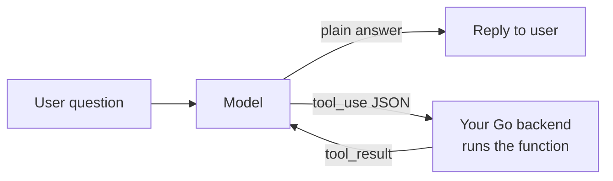
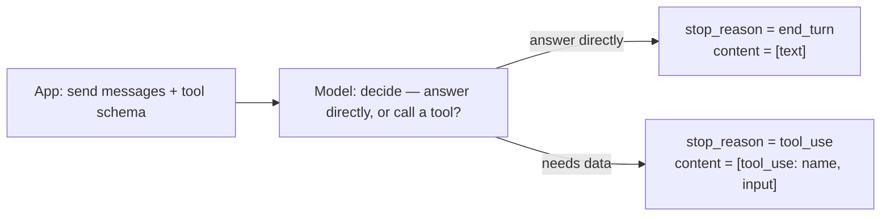
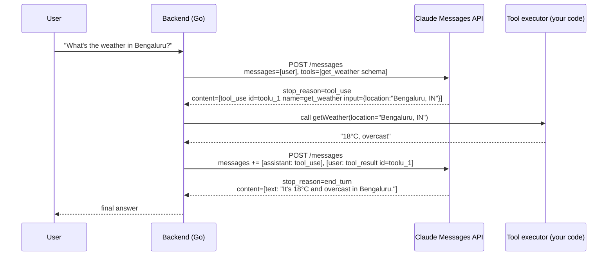
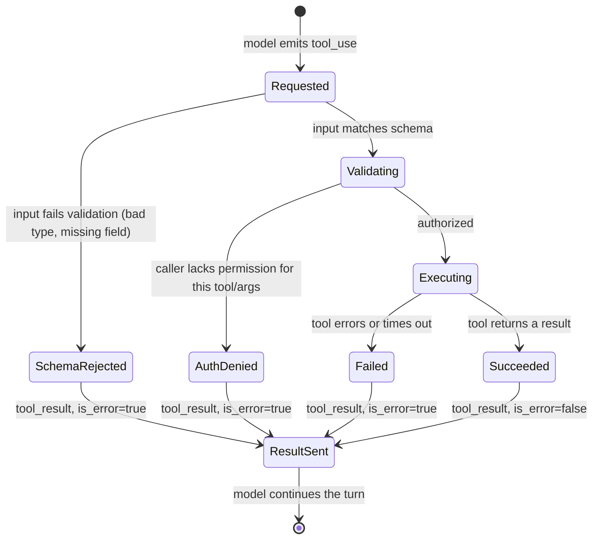

# Structured Outputs and Tool Calling

> [!summary] TL;DR
> A **structured output** is a model response constrained, at generation time, to match a JSON Schema you supplied.
>
> A **tool call** is a structured output your code recognizes as a request to run a function: the model emits `{"name": "get_weather", "input": {...}}` instead of prose, your backend executes `get_weather`, and you hand the result back for the model to use.
>
> Neither is "the model running code" — the model only ever produces structured text; your process does the executing.

> [!abstract] Core idea
> - Asking nicely in a prompt cannot guarantee valid JSON; constrained decoding (schema-restricted token sampling) can.
> - A tool is a JSON Schema plus a name and a description; the model picks zero, one, or several tools per turn and emits a `tool_use` block for each.
> - Your backend executes the call, wraps the result in a `tool_result`, and sends the whole turn back — the model never touches your systems directly.
> - Schema-valid does not mean safe or correct: validate semantics and authorization in your own code regardless of how the output was produced.

## Start here: the basics

**The problem in one story.**
Your app asks an AI model: "read this invoice and tell me the amount".
Your Go code expects clean data like `{"amount": 1204.5}`.
Sometimes the model replies "Sure! The amount is $1,204.50." and your parser crashes.
Structured outputs force the reply into the exact shape your code expects, and tool calling lets the model ask your code to do things (look up weather, fetch an order).

**Words you need first**

| Word | Plain meaning | Tiny example |
| --- | --- | --- |
| LLM | A model that writes text one small piece at a time | Claude, GPT |
| Token | One small piece of text the model emits | `"amount"` may be 1-2 tokens |
| JSON | A text format for structured data | `{"city": "Pune"}` |
| JSON Schema | A rulebook saying what a JSON object must look like | "`amount` is a number and is required" |
| Parse / unmarshal | Turn text into a Go struct | `json.Unmarshal(b, &inv)` |
| Tool (function) | A named action your backend can run for the model | `get_weather(location)` |
| Round trip | One request to the model and its reply | Each tool call adds one more |

**Picture it**



**Analogy.** A tax form with boxes: you cannot write a paragraph where a number goes, so the clerk can always read it. A tool call is a form that says "please run this errand for me".
Where it breaks: a form only checks the shape of the answer; a box can still hold a wrong number, and the model never runs the errand itself.

**How the rest of this note builds up**

- First, why prompting for JSON is not enough (section 1) and the "aggressive autocomplete" mental model (section 2).
- Then the request-response loop, the lifecycle of one tool call and tool design (section 3).
- Then a full Go worked example and a comparison of variants (sections 4-5).
- Finally the SDE-3 view: trade-offs, production failure modes, constrained decoding internals, streaming and parallel tool execution (sections 6-8).

> [!tip] Remember
> The model only writes structured text; a schema fixes its shape, and your code does the running and the checking.

## 1. Why it exists

Say you are building a backend endpoint that asks an LLM to extract an invoice's vendor, amount, and due date as JSON your downstream code will `json.Unmarshal`. The naive approach is a prompt: *"Respond with only JSON: `{"vendor": ..., "amount": ..., "due_date": ...}`."*

That works most of the time and fails in ways that are easy to miss in a demo and expensive in production:

- The model wraps the JSON in a sentence ("Here's the JSON you asked for: ...") or a Markdown code fence.
- A field is missing, or `amount` comes back as the string `"$1,204.50"` instead of a number.
- Under load, a fraction of responses — commonly cited in vendor docs as under 1% for simple schemas but rising sharply for deeply nested ones — fail to parse at all.

For one invoice reviewed by a human, a markdown fence is a shrug.

For ten thousand invoices a day parsed by `encoding/json`, a 1% unparseable rate is ten thousand incidents a month, each needing a special-cased retry path, logged separately from the "LLM said something reasonable but wrong" failures you already have to handle.

Structured outputs and tool calling close most of that gap. The provider's inference server restricts what tokens are even legal at each step, so the output is guaranteed to parse as JSON and to match your schema's required fields and types — turning a parsing problem into a (much smaller) semantic-correctness problem.

## 2. Mental model

Picture a text editor with autocomplete so aggressive it refuses to let you type a character that would make the file invalid.

That is constrained decoding: the model's probability distribution over the next token is masked, at every step, down to only the tokens that keep the output a valid instance of your schema.

The model cannot emit `amount": "abc"` if `amount` is typed `number`, because `"` after the colon is not in the allowed token set.

**Structured outputs** apply this mask to any response: you want `{"vendor": "Acme", ...}` directly as the message content.

**Tool calling** is the same mechanism aimed at a different target: instead of constraining the final answer, you give the model a menu of named actions (each with its own schema), and the mask instead constrains "if you call `get_weather`, your `input` must have a string `location`."

The model's job changes from "answer the question" to "decide whether to answer directly or to request `get_weather(location="Bengaluru, IN")` first" — and your code is what actually calls the weather service.

## 3. How it works

### Whiteboard version

One request, one tool, no back-and-forth: you want the model to decide if a tool is needed, nothing more.



The full version below adds the part every real integration needs: executing the call and sending the result back so the model can finish its answer.

### The full request-response loop

A tool-using turn is always at least two round trips to the API, because the model cannot call the tool itself — your process is the only thing with network access, database credentials, or filesystem permissions:



Three rules fall out of this diagram directly:

1. The assistant's `tool_use` turn must be replayed back verbatim as an `assistant` message — you are reconstructing the conversation, not starting a new one.
2. Every `tool_use` block in a turn needs exactly one matching `tool_result` (keyed by `tool_use_id`) in the next `user` message. A model that asks for three tools in parallel expects three results back together.
3. A failed tool call is still a `tool_result` — with `is_error: true` and a short, model-readable error string — not an HTTP error you throw away. The model reads that error and can retry with different input or explain the failure to the user.

### The lifecycle of one tool call



`SchemaRejected` and `AuthDenied` matter as much as `Succeeded`: a schema that type-checks is not automatically a request your backend should honor. Validate ownership and permissions in your own code even when `Strict: true` already guarantees the shape (see [[OWASP API Security Top 10]] on excessive agency and broken object-level authorization).

### Designing a tool

A tool definition is four things, and all four affect whether the model calls it correctly:

- **Name**: a short, unambiguous verb-noun pair (`get_weather`, not `weather` or `doStuff`).
- **Description**: says *when* to use it, not just what it does — "Use this whenever the user asks about weather, temperature or conditions in a named place" steers selection far better than "Gets weather data."
- **Input schema**: a JSON Schema object. Keep it flat where you can; required fields should be the minimum the tool needs to run, and enums (`"unit": {"enum": ["celsius", "fahrenheit"]}`) remove a whole class of invalid values before your code ever sees them.
- **Strict mode**: `strict: true` asks the API to enforce the schema during generation rather than best-effort, so malformed input is rejected before it reaches you at all. Supported schemas are more limited in strict mode (fewer schema keywords, no additional properties) — read the current docs for your provider before relying on it for a complex schema.

| Rule | Bad | Good |
| --- | --- | --- |
| Name | `tool1`, `doStuff` | `get_weather`, `create_refund` |
| Description | `"Gets weather"` | `"Use this whenever the user asks about weather, temperature or conditions in a named place."` |
| Schema | one `free_text` string field | typed fields, `required`, `enum` for closed sets |
| Output | returns raw provider JSON | returns a short, model-readable summary string |
| Errors | throws, call vanishes | returns `tool_result` with `is_error: true` and a one-line reason |

## 4. Worked example

The code below defines one tool (`get_weather`), runs the two-request loop from the sequence diagram, and is tested against an `httptest` fake standing in for the Messages API — there is no API key in this environment, so the "live" output below is representative, not a captured response.

```go
// Package weather shows a minimal tool-calling loop against the Claude
// Messages API: define a tool schema, let the model request a call, execute
// it in Go, and send the result back for a final answer.
package weather

import (
	"context"
	"encoding/json"
	"fmt"

	"github.com/anthropics/anthropic-sdk-go"
	"github.com/anthropics/anthropic-sdk-go/option"
)

// weatherInput is the shape the model must produce for the get_weather tool.
type weatherInput struct {
	Location string `json:"location"`
	Unit     string `json:"unit"`
}

// getWeather is the "real" tool implementation. A production version would
// call an internal weather service; this one is a fixed lookup so the note's
// test has no network dependency.
func getWeather(in weatherInput) (string, error) {
	if in.Location == "" {
		return "", fmt.Errorf("location is required")
	}
	unit := in.Unit
	if unit == "" {
		unit = "celsius"
	}
	return fmt.Sprintf("18 degrees %s and overcast in %s", unit, in.Location), nil
}

// weatherTool is the tool definition sent on every request. Strict:true asks
// the API to reject input that does not match the schema before the model
// even sees a malformed call.
var weatherTool = anthropic.ToolUnionParam{
	OfTool: &anthropic.ToolParam{
		Name:        "get_weather",
		Description: anthropic.String("Get the current weather for a city. Use this whenever the user asks about weather, temperature or conditions in a named place."),
		InputSchema: anthropic.ToolInputSchemaParam{
			Properties: map[string]any{
				"location": map[string]any{
					"type":        "string",
					"description": "City and optional country, e.g. 'Bengaluru, IN'",
				},
				"unit": map[string]any{
					"type": "string",
					"enum": []string{"celsius", "fahrenheit"},
				},
			},
			Required: []string{"location"},
		},
		Strict: anthropic.Bool(true),
	},
}

// Client wraps the SDK client with the one model and tool this package uses.
type Client struct {
	api   anthropic.Client
	model anthropic.Model
}

// New builds a Client. baseURL lets tests point at an httptest server instead
// of the real API.
func New(apiKey, baseURL string) Client {
	opts := []option.RequestOption{option.WithAPIKey(apiKey)}
	if baseURL != "" {
		opts = append(opts, option.WithBaseURL(baseURL))
	}
	return Client{
		api:   anthropic.NewClient(opts...),
		model: anthropic.ModelClaudeSonnet5_5,
	}
}

// Ask runs one full tool-calling turn: send the question, execute any tool
// call the model asks for, send the result back, and return the model's
// final text answer. It makes at most two requests because this package
// only wires up a single tool; a general agent loop would repeat the
// tool_use branch until the model stops asking for tools (see the
// AI Agents and Agentic Workflows note for that loop and its stop conditions).
func (c Client) Ask(ctx context.Context, question string) (string, error) {
	messages := []anthropic.MessageParam{
		anthropic.NewUserMessage(anthropic.NewTextBlock(question)),
	}

	resp, err := c.api.Messages.New(ctx, anthropic.MessageNewParams{
		Model:     c.model,
		MaxTokens: 1024,
		Messages:  messages,
		Tools:     []anthropic.ToolUnionParam{weatherTool},
	})
	if err != nil {
		return "", fmt.Errorf("first call: %w", err)
	}

	if resp.StopReason != anthropic.StopReasonToolUse {
		return textOf(resp), nil
	}

	// Replay the assistant's own turn, then answer every tool_use block in
	// it with a matching tool_result before asking again. The API requires
	// one tool_result per tool_use in the same user turn.
	assistantBlocks := make([]anthropic.ContentBlockParamUnion, 0, len(resp.Content))
	resultBlocks := make([]anthropic.ContentBlockParamUnion, 0, len(resp.Content))
	for _, block := range resp.Content {
		if block.Type != "tool_use" {
			continue
		}
		assistantBlocks = append(assistantBlocks, anthropic.NewToolUseBlock(block.ID, json.RawMessage(block.Input), block.Name))

		var in weatherInput
		isError := false
		text, err := func() (string, error) {
			if block.Name != "get_weather" {
				return "", fmt.Errorf("unknown tool %q", block.Name)
			}
			if err := json.Unmarshal(block.Input, &in); err != nil {
				return "", fmt.Errorf("bad tool input: %w", err)
			}
			return getWeather(in)
		}()
		if err != nil {
			text = err.Error()
			isError = true
		}
		resultBlocks = append(resultBlocks, anthropic.NewToolResultBlock(block.ID, text, isError))
	}

	messages = append(messages,
		anthropic.NewAssistantMessage(assistantBlocks...),
		anthropic.NewUserMessage(resultBlocks...),
	)

	final, err := c.api.Messages.New(ctx, anthropic.MessageNewParams{
		Model:     c.model,
		MaxTokens: 1024,
		Messages:  messages,
		Tools:     []anthropic.ToolUnionParam{weatherTool},
	})
	if err != nil {
		return "", fmt.Errorf("second call: %w", err)
	}
	return textOf(final), nil
}

func textOf(m *anthropic.Message) string {
	for _, block := range m.Content {
		if block.Type == "text" {
			return block.Text
		}
	}
	return ""
}
```

The test plays back two fixed, representative responses (a `tool_use` turn, then a text turn) through an `httptest.Server`, so it needs no API key and no network access:

```go
package weather

import (
	"context"
	"encoding/json"
	"net/http"
	"net/http/httptest"
	"testing"
)

// fakeAnthropic is a tiny httptest double for the Messages API.
func fakeAnthropic(t *testing.T) *httptest.Server {
	t.Helper()
	call := 0
	return httptest.NewServer(http.HandlerFunc(func(w http.ResponseWriter, r *http.Request) {
		call++
		w.Header().Set("Content-Type", "application/json")
		switch call {
		case 1:
			w.Write([]byte(`{
				"id": "msg_1", "type": "message", "role": "assistant",
				"model": "claude-sonnet-5-5",
				"stop_reason": "tool_use",
				"content": [
					{"type": "tool_use", "id": "toolu_1", "name": "get_weather",
					 "input": {"location": "Bengaluru, IN", "unit": "celsius"}}
				],
				"usage": {"input_tokens": 10, "output_tokens": 5}
			}`))
		case 2:
			w.Write([]byte(`{
				"id": "msg_2", "type": "message", "role": "assistant",
				"model": "claude-sonnet-5-5",
				"stop_reason": "end_turn",
				"content": [
					{"type": "text", "text": "It's 18 degrees celsius and overcast in Bengaluru, IN."}
				],
				"usage": {"input_tokens": 20, "output_tokens": 12}
			}`))
		default:
			t.Fatalf("unexpected third call to fake API")
		}
	}))
}

func TestAskRunsToolCallThenReturnsFinalAnswer(t *testing.T) {
	srv := fakeAnthropic(t)
	defer srv.Close()

	c := New("test-key", srv.URL)
	got, err := c.Ask(context.Background(), "What's the weather in Bengaluru?")
	if err != nil {
		t.Fatalf("Ask: %v", err)
	}
	want := "It's 18 degrees celsius and overcast in Bengaluru, IN."
	if got != want {
		t.Fatalf("got %q, want %q", got, want)
	}
}

func TestGetWeatherRejectsEmptyLocation(t *testing.T) {
	if _, err := getWeather(weatherInput{}); err == nil {
		t.Fatal("want error for empty location, got nil")
	}
}

func TestWeatherToolSchemaRequiresLocation(t *testing.T) {
	schema := weatherTool.OfTool.InputSchema
	b, err := json.Marshal(schema)
	if err != nil {
		t.Fatalf("marshal schema: %v", err)
	}
	var decoded struct {
		Required []string `json:"required"`
	}
	if err := json.Unmarshal(b, &decoded); err != nil {
		t.Fatalf("unmarshal schema: %v", err)
	}
	if len(decoded.Required) != 1 || decoded.Required[0] != "location" {
		t.Fatalf("required = %v, want [location]", decoded.Required)
	}
}
```

**Representative output (`go test -race -v ./...`, Go 1.24, 2026-11-07):**

```text
=== RUN   TestAskRunsToolCallThenReturnsFinalAnswer
--- PASS: TestAskRunsToolCallThenReturnsFinalAnswer (0.00s)
=== RUN   TestGetWeatherRejectsEmptyLocation
--- PASS: TestGetWeatherRejectsEmptyLocation (0.00s)
=== RUN   TestWeatherToolSchemaRequiresLocation
--- PASS: TestWeatherToolSchemaRequiresLocation (0.00s)
PASS
ok  	weather	1.56s
```

## 5. Variants and comparison

| Approach | How it works | Use when | Cost |
| --- | --- | --- | --- |
| Prompted JSON (no constraint) | Ask for JSON in plain instructions | Never, for anything a machine parses | Unbounded parse-failure rate; no schema guarantee |
| JSON mode | API guarantees syntactically valid JSON, no schema enforced | A quick extraction where you'll validate loosely yourself | Fields can still be missing, wrong type, or extra |
| Structured outputs (schema-constrained) | Decoding is masked to match your JSON Schema exactly | A single well-defined object is the whole answer (extraction, classification, form-filling) | Schema language is a constrained subset (check current docs); still validate semantics |
| Tool calling (single tool) | Model emits a schema-constrained request for a named function | The model must choose *whether* to call out, not just *what* to return | Two round trips minimum; you own execution, errors, and auth |
| Tool calling (multiple tools, parallel) | Model can emit several `tool_use` blocks in one turn | Independent actions in one step (e.g., check weather *and* check calendar) | Must execute (and often parallelize) all calls before replying; one `tool_result` per `tool_use` |
| Full agent loop | Repeated tool-calling turns until the model stops asking | Open-ended, multi-step tasks | See [[AI Agents and Agentic Workflows]] for stop conditions, memory, and cost control |

## 6. Trade-offs and when not to use

- **Schema-valid is not correct.** Constrained decoding guarantees shape, not truth: a `get_weather` call with `location: "Atlantis"` is perfectly valid JSON for a place that doesn't exist. Validate business meaning and authorization yourself.
- **Strict mode narrows the schema language.** Deeply nested `oneOf`/`anyOf`, recursive schemas, or very large enums may not be supported in strict mode; check the current docs and fall back to best-effort mode plus your own validation if your schema needs them.
- **Latency doubles (at least) for any tool call.** Every tool-use turn is a second full round trip to the model; a chain of three dependent tool calls is three sequential inferences, not one.
  For latency-critical paths, consider whether a deterministic function call in your own code can replace the tool entirely.
- **Not a sandbox.** Tool calling does not run anything — your code does.
  A tool that shells out or hits a payment API carries the same blast radius as any other code path that an untrusted caller (here, the model, steered by untrusted user and retrieved content) can trigger. Treat tool input as adversarial input, same as any other API request (see [[OWASP API Security Top 10]]).
- **Simpler alternative:** for a fixed, small set of fields with no real decision to make, plain prompted output you validate with a Go struct and `json.Unmarshal` plus manual checks is sometimes less code than wiring up strict schemas and tool loops — reach for structured outputs when the parse-failure rate actually hurts.

## 7. In production

- **Real systems:** Anthropic's Messages API (`tool_use`/`tool_result` blocks, `strict`), OpenAI's function calling and Structured Outputs (`response_format: json_schema`, `strict`), Google's Gemini function calling.
  Agent frameworks (LangGraph, the Go agent SDKs) build their tool loops on exactly this primitive — see [[LangChain and LangGraph]] and [[Model Context Protocol (MCP)]] for the transport that standardizes tool discovery across servers.
- **Failure modes → fixes:**
  - Model calls a tool with a plausible-looking but wrong ID (hallucinated `order_id`) → re-validate every ID against your own database before acting, never trust it because it parsed.
  - Two tool calls in one turn have a hidden ordering dependency → make the dependency explicit in the tool descriptions, or merge them into one tool if order always matters.
  - A tool call never returns (hung dependency) → put a timeout around every tool execution and return a `tool_result` with `is_error: true` on timeout so the model can tell the user instead of the whole request hanging.
  - Tool result contains attacker-controlled text (a fetched webpage, a user's own file) that includes instructions aimed at the model → treat tool_result content as data, not instructions; this is the same prompt-injection surface as retrieved RAG context.
- **What to monitor:**
  - Tool call rate and which tools fire most.
  - Tool error rate by tool name.
  - End-to-end latency split into "before first tool call" vs "after tool_result" (link [[Distributed Tracing with OpenTelemetry]] — trace each tool execution as its own span).
  - Schema-validation rejection rate (a rising rate often means your description or schema is ambiguous, not that the model got worse).

## 8. Deep dive

- **How constrained decoding actually works.** Your JSON Schema is compiled into a grammar (conceptually a finite-state or pushdown automaton over JSON syntax plus your field constraints).
  1. At each decoding step, the inference server computes the model's normal next-token logits.
  2. It masks out (sets to `-inf`) every token that would leave the grammar's valid-continuation set.
  3. It samples from what remains.

  This is why it is a strict superset guarantee: the model still "decides" what to say within the grammar, but it is structurally incapable of leaving it.
  The performance cost is a grammar-state lookup per token, not a second model call — current implementations report it as a low single-digit percentage overhead, but treat any specific number as vendor-documented, not a cross-provider constant.
- **Streaming tool calls.** Tool `input` can arrive incrementally as partial JSON deltas during a streamed response (`input_json_delta` events in Anthropic's streaming format).
  Accumulate the raw string and only attempt `json.Unmarshal` once the block closes — partial JSON is, by definition, invalid JSON, and parsing it early just produces confusing errors.
- **Parallel tool execution in Go.** When a turn contains several independent `tool_use` blocks, execute them concurrently and collect results with `errgroup`, preserving each result's `tool_use_id` so you can still build the correct `tool_result` set even if calls finish out of order:

```go
g, ctx := errgroup.WithContext(ctx)
results := make([]anthropic.ContentBlockParamUnion, len(toolCalls))
for i, call := range toolCalls {
	i, call := i, call // Go 1.22+ already scopes loop vars per iteration; kept explicit for clarity
	g.Go(func() error {
		text, isErr := execute(ctx, call)
		results[i] = anthropic.NewToolResultBlock(call.ID, text, isErr)
		return nil // tool errors become tool_result content, not Go errors
	})
}
_ = g.Wait()
```

- **Forced and disabled tool choice.** `tool_choice: {type: "tool", name: "..."}` forces a specific tool on the very next turn (useful for the first turn of a classification pipeline where you always want the same function called); `tool_choice: {type: "none"}` or simply omitting `tools` disables calling entirely, even if tools are defined elsewhere in a conversation history you are replaying.
- **Interleaved thinking with tool use.** Reasoning-capable models can emit a `thinking` block between tool calls in the same turn, reasoning about one tool's result before deciding on the next action — treat this as the model's visible scratch space, not a user-facing explanation, and strip it before displaying a transcript.

## 9. Interview questions

> [!question]- What's the difference between a structured output and a tool call?
> Both use the same schema-constrained decoding mechanism. A structured output constrains the entire final answer to match a schema; a tool call constrains one content block that represents a request for your code to run a named function, with the final answer coming in a later turn after you return a result.

> [!question]- Can prompting alone guarantee valid JSON?
> No. A prompt is an instruction the model is trained to follow well, not a hard constraint on what tokens it is allowed to emit. Only API-level schema constraints (structured outputs or tool input schemas) make invalid output structurally impossible.

> [!question]- Trap: the model called a tool with input that matches the schema exactly. Is it safe to execute?
> No. Schema validity only guarantees shape and type, not that the values are true, current, or something the caller is authorized to act on. Re-validate IDs against your own data and enforce authorization in your application code on every tool call, the same as you would for any other API request.

> [!question]- The model asked for two tools in one turn. How many requests do you make, and how do you reply?
> You execute both (independently where possible, in parallel) and send both results back as `tool_result` blocks inside a single following user message — one `tool_result` per `tool_use`, matched by `tool_use_id`. You do not reply to each one in a separate round trip.

> [!question]- A tool call fails (timeout, invalid input, downstream 500). What do you send back?
> A `tool_result` with `is_error: true` and a short, model-readable description of what went wrong — never an exception that crashes the request, and never silence. The model reads the error and can retry with different input, try another tool, or tell the user it couldn't complete the action.

> [!question]- Why does strict mode support a smaller schema language than JSON Schema in general?
> Because the grammar that constrains decoding has to be compiled ahead of time from the schema; features like unbounded recursion or very open-ended `anyOf` combinations are hard or impossible to compile into a decodable grammar efficiently. Check your provider's current strict-mode docs before assuming a complex schema is supported.

> [!question]- How is tool calling different from giving the model a sandbox to execute code in?
> Tool calling never executes anything — it only produces a structured request. Your backend process is what runs code, and it decides what is safe to run, with what permissions, and against which systems. A code-execution sandbox is a different, additional capability some platforms offer, with its own isolation and resource limits.

## 10. Cheat sheet

- Prompting cannot force valid JSON; schema-constrained decoding (structured outputs, tool input schemas) can.
- A tool = name + description ("when to use it") + strict input schema + predictable, model-readable output.
- The model only ever emits `tool_use`; your code executes it and returns `tool_result` — two round trips minimum.
- One `tool_result` per `tool_use`, matched by ID, inside one following `user` message, even for several parallel calls.
- A failed tool call is a `tool_result` with `is_error: true`, not a thrown exception or a dropped response.
- Schema-valid ≠ correct or authorized — validate business meaning and permissions in your own code every time.
- Strict mode guarantees shape at generation time, at the cost of a narrower supported schema language.
- Treat tool_result content from the outside world (fetched pages, user files) as untrusted data, same as RAG context.

## Links

- **Before this:** [[LLM Fundamentals]], [[Prompt Engineering]], [[Calling LLM APIs from Go]]
- **Next:** [[AI Agents and Agentic Workflows]], [[Model Context Protocol (MCP)]]
- **Compare with:** [[Guardrails and LLM Security]] (validating and constraining tool use against abuse), [[OWASP API Security Top 10]] (excessive agency, broken object-level authorization apply to every tool call)

### Watch on YouTube

- [What is Tool Calling? Connecting LLMs to Your Data](https://www.youtube.com/watch?v=h8gMhXYAv1k) · IBM Technology · 4 min · 66,153 views
- [LLM Function Calling Explained / Tool Integration & Structured Outputs / AI/ML Class 10](https://www.youtube.com/watch?v=9DThnOIue4I) · Fusionpact · 3 min · 86 views
