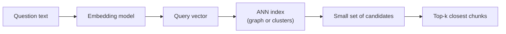
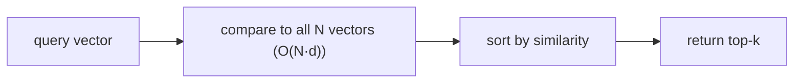
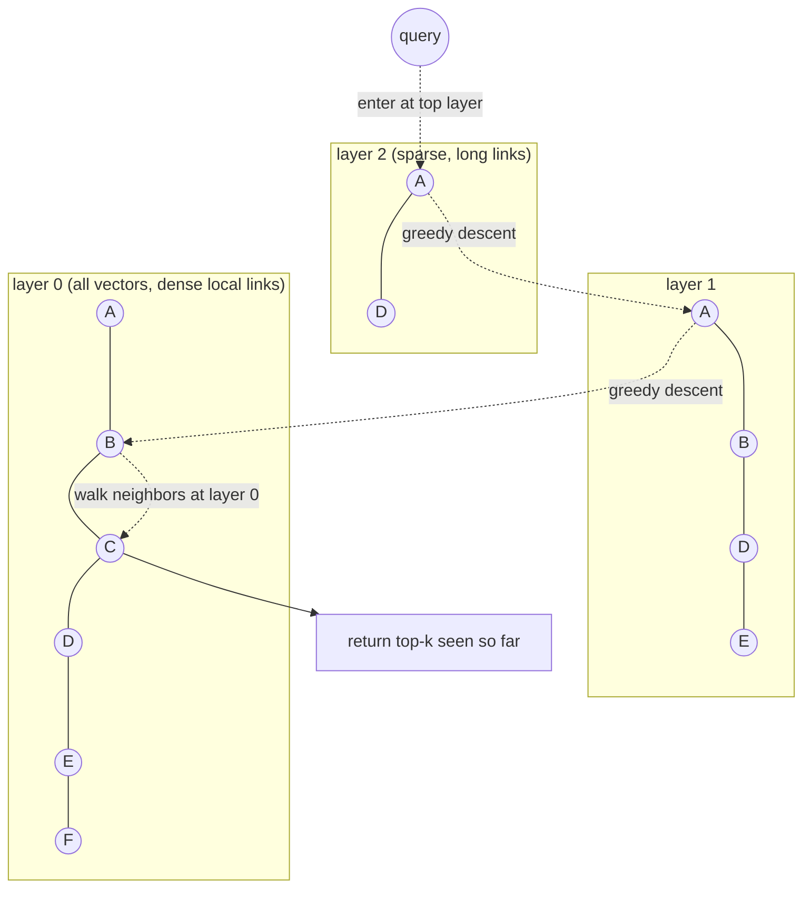
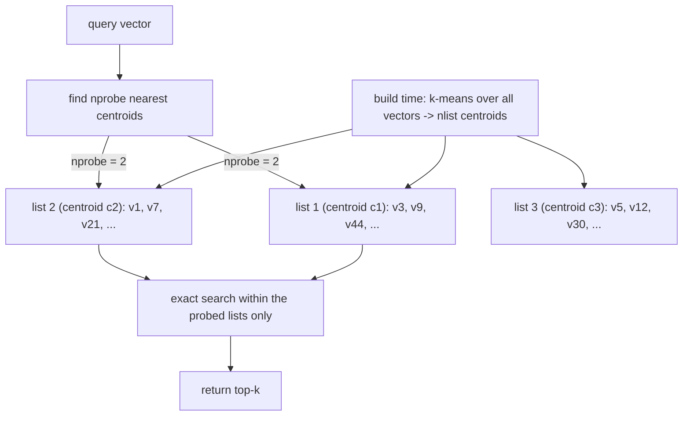
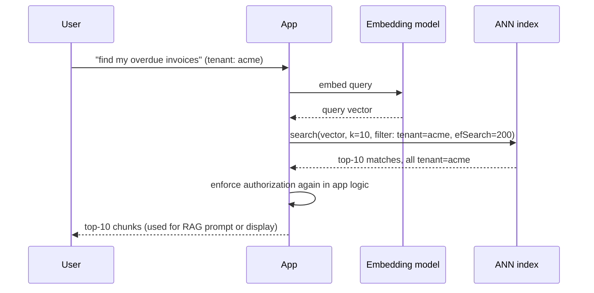

# Vector Databases and ANN Indexes

> [!summary] TL;DR
> A vector database stores embeddings (see [[Embeddings]]) alongside metadata and answers "find the k vectors closest to this one" queries fast, at the cost of occasionally missing the true nearest neighbor.
>
> That trade — approximate nearest neighbor (ANN) search — is the whole point of the category.

> [!abstract] Core idea
> - Comparing a query to every stored vector (exact k-NN) costs `O(N·d)`; an ANN index trades a small, tunable amount of accuracy for a large drop in that cost.
> - HNSW and IVF are the two index families you will meet in interviews and in production: a navigable graph, or a set of clusters you only partly scan.
> - Recall@k (fraction of the true top-k an index actually returns) is the number you tune against — not a vague "accuracy".
> - Metadata filtering (tenant, permissions, date) has to compose correctly with the ANN index, or it silently returns fewer than k results.
> - Most teams do not need a dedicated vector database: pgvector on the Postgres you already run covers single-digit-million-row RAG workloads.

## Start here: the basics

**The problem in one story.**
You have a million help articles and a user types "my payment failed twice".
None of the articles contains those exact words, but some mean the same thing.
An AI model turns every article and the question into lists of numbers, where similar meaning means nearby numbers.
Now you need to find the closest lists fast, without comparing against all million every time.
That is the job of a vector database and its ANN index.

**Words you need first**

| Word | Plain meaning | Tiny example |
| --- | --- | --- |
| Vector | A fixed-length list of numbers | `[0.12, -0.80, 0.33]` |
| Embedding | A vector a model produced so that similar meaning sits close together | "refund" and "money back" land near each other |
| Dimension (`d`) | How many numbers are in each vector | 768 or 1,536 |
| Distance / similarity | A score for how close two vectors are | Cosine similarity, dot product |
| k-NN | "Find the k nearest neighbors" of a query | Top 10 closest chunks |
| Index | An extra structure that makes lookups faster | A book's index vs reading every page |
| Recall@k | Share of the true top-k that the search actually returned | Found 9 of the real top 10 = 0.9 |
| Metadata filter | A normal condition applied with the search | `tenant_id = 42` |

**Picture it**



**Analogy.** Finding a book in a library: you do not read every book, you walk to the right shelf section and look nearby.
Where it breaks: a library has exact labels, while an ANN index only guesses the right area, so it can occasionally miss the truly closest item.

**How the rest of this note builds up**

- First, why brute-force search stops scaling (section 1) and the two tricks, graphs and clusters (section 2).
- Then how exact search, HNSW, IVF, quantization and filtering work (section 3).
- Then a Go worked example measuring recall vs work, and a comparison of vector stores (sections 4-5).
- Finally the SDE-3 deep dive: RAM sizing, tuning `efSearch`/`nprobe`, sharding, re-indexing and backups (sections 6-8).

> [!tip] Remember
> A vector database finds "close enough" neighbors fast; recall@k tells you how close enough really is.

## 1. Why it exists

Say you have 5 million support-ticket chunks, each embedded as a 1,536-dimension vector (a common OpenAI-style embedding size), and a user asks a question.

To find the 10 most similar chunks by brute force, you compute 5,000,000 dot products of length 1,536 — about 7.7 billion floating-point multiply-adds per query.
At even 10 queries per second that is 77 billion multiply-adds/sec just for retrieval, before the LLM call.

Exact search does not scale past roughly a million vectors at interactive latency on one machine.

An **approximate nearest neighbor (ANN)** index restructures the data (a graph, or clusters) so a query only compares against a small fraction of the vectors, in exchange for occasionally missing the true closest match. In practice, a well-tuned ANN index recovers 95–99% of the exact top-k while touching 1–10% of the data.

## 2. Mental model

Exact k-NN is "check every row." An ANN index is "check only the rows likely to matter," using one of two tricks:

- **Graph (HNSW):** build a graph where close vectors are linked; start somewhere and greedily walk toward the query, the way you'd navigate a social network by asking "who here is closer to what I'm looking for?"
- **Clustering (IVF):** group vectors into clusters ahead of time (an inverted file, hence the name); at query time, only scan the few clusters whose center is closest to the query, the way a library only searches the shelves for the right subject instead of every book.

Both turn `O(N)` work into roughly `O(log N)` (HNSW) or `O(N/nlist · nprobe)` (IVF) work, at the cost of sometimes skipping the true answer.

## 3. How it works

### Exact search, for comparison



### HNSW (Hierarchical Navigable Small World)

HNSW builds several layers of a graph. The top layer has few nodes and long links (for big jumps); the bottom layer has all nodes and short links (for fine-grained search).



Search enters at the top layer, greedily moves to whichever neighbor is closer to the query, drops a layer when no neighbor improves, and repeats until layer 0, where it keeps a candidate list of size `efSearch` and returns the best `k`.

Three parameters control HNSW:

- **`M`** — max neighbors per node per layer (typically 16–64). Higher `M` means better recall and more memory.
- **`efConstruction`** — candidate list size while *building* the graph (typically 100–200). Higher means a better-connected, slower-to-build graph.
- **`efSearch`** — candidate list size while *querying* (typically 50–500, tunable per query). Higher means better recall and higher latency, with no rebuild needed.

HNSW is memory-heavy: it stores the full vectors plus `M` links per node per layer, so budget roughly `N × (d × 4 bytes + M × 8 bytes × layers)`.

### IVF (Inverted File Index)



Build time runs k-means (or a cheaper approximation) to get `nlist` cluster centers, then assigns every vector to its nearest centroid's list. A query finds the `nprobe` closest centroids and does exact search only inside those lists.

- **`nlist`** — number of clusters (rule of thumb: `≈ √N` to `4√N`). More clusters means finer partitioning and a cheaper centroid scan, but each list has fewer candidates, risking lower recall for a given `nprobe`.
- **`nprobe`** — how many lists a query scans (1 up to `nlist`). `nprobe = nlist` degrades to exact search over all vectors; `nprobe = 1` is fastest and least accurate.

IVF is lighter on memory than HNSW (no per-vector link list, just `N` bucket assignments plus `nlist` centroids) but needs a representative sample to build the centroids well, and rebuilding is more disruptive than HNSW's incremental inserts.

### Quantization: shrinking the vectors themselves

Both index families can store a **compressed** copy of each vector to cut memory further:

- **Scalar quantization**: each `float32` becomes an `int8`, a 4× memory cut for a small recall hit.
- **Product quantization (PQ)**: split each vector into sub-vectors, cluster each sub-vector space separately, and store only the cluster id per sub-vector — often an 8–32× cut, at a larger recall cost that must be measured per dataset.
- **Binary quantization**: one bit per dimension (sign of the value) with Hamming-distance search; roughly 32× smaller, usable as a cheap first pass before rescoring with full vectors.
- **DiskANN** (Microsoft, 2019) takes this further: it keeps a compressed graph and vectors on SSD instead of RAM, making billion-scale ANN affordable without a huge memory footprint, at higher per-query latency than an all-in-RAM index.

### Metadata filtering: three strategies, one trap

A real query is rarely "nearest k vectors" alone — it is "nearest k vectors where `tenant_id = X`". There are three ways to combine the filter with the ANN index, and they are not interchangeable:

| Strategy | How | Trap |
|---|---|---|
| Pre-filtering | Compute the allowed id set first, then search only those | Falls back to exact search if the allowed set is a small fraction of the index |
| Post-filtering | Run ANN search for top-k, then drop results that fail the filter | **Can return fewer than k results**, or zero, if the filter is selective and the true matches were outside the scanned candidates |
| In-graph / in-list filtering | The index itself skips non-matching candidates while walking the graph or scanning a list, continuing until it has k matches | Needs index support (HNSW with filtered search, or IVF with filtered list scans); not every engine offers it |

> [!warning] Selectivity trap
> Post-filtering a 1%-selective tenant filter against `efSearch = 100` candidates expects about one matching candidate — that is not enough to fill a top-10 request. Either raise `efSearch`/`nprobe` well above `k`, or use an index that filters during the graph/list walk, not after it.

### Sequence: a filtered, tenant-scoped query end to end



Metadata filtering is a performance and relevance feature, not a security boundary by itself — enforce authorization in application logic too, in case the filter is misconfigured or bypassed upstream.

### Record design and hybrid (sparse + dense) support

A stored record is more than the raw vector. A typical shape:

```json
{
  "id": "chunk_123",
  "values": [0.12, -0.44, 0.88],
  "sparse_values": {"indices": [581, 3920], "values": [0.71, 0.22]},
  "metadata": {
    "tenant_id": "acme",
    "document_id": "doc7",
    "source": "invoice_pdf",
    "version": 3,
    "created_at": "2026-10-06"
  }
}
```

`version` matters for the re-index procedure below: a query can filter to the current version only, so a half-finished re-embed never surfaces stale and new chunks mixed together.

The optional `sparse_values` field is how a vector database stores a learned-sparse vector (see [[Keyword, Semantic and Hybrid Search]]) alongside the dense one, so a single query can combine both signals server-side instead of running two separate systems.

- Qdrant, Weaviate and OpenSearch support this "hybrid" mode natively, Milvus supports it to varying degrees depending on version (verify against current docs before relying on it).
- pgvector has no single built-in hybrid operator, so a Postgres-based hybrid setup runs BM25 (via `tsvector`) and `pgvector` as two queries fused in the application.

## 4. Worked example

### Whiteboard version

The shape of an inverted-file index: cluster once, scan only the closest clusters.

```go
package wb

type Vector []float32

// Lloyd's-algorithm clustering and cosine similarity are the two primitives;
// see the full version below for the real implementation and its tests.
type IVF struct {
    centroids []Vector
    lists     [][]int // vector indices per cluster
}

func (ix *IVF) Search(q Vector, k, nprobe int) []int {
    centroidIDs := nearestCentroids(ix.centroids, q, nprobe)
    var candidates []int
    for _, c := range centroidIDs {
        candidates = append(candidates, ix.lists[c]...)
    }
    return topK(candidates, q, k) // exact comparison, but only within candidates
}
```

The full version below builds the clusters with k-means, measures recall against exact search, and enforces a tenant filter — the three things interviews and production both care about.

A Go implementation that compiles and passes `go vet` and `go test -race` on Go 1.24. It holds a flat (exact) index as ground truth and an IVF index to measure against it — this is how you validate any ANN index before trusting it in production.

```go
// Package vecdb is a minimal, in-memory illustration of exact vs. approximate
// (IVF-style) nearest-neighbour search, written for a study note. It is not
// production code: no persistence, no concurrency control, no metadata index.
package vecdb

import (
	"fmt"
	"math"
	"math/rand"
	"sort"
)

// Vector is a dense embedding.
type Vector []float32

// Record is one stored item: an id, its vector, and a tenant for the
// multi-tenant filtering example.
type Record struct {
	ID     string
	Vec    Vector
	Tenant string
}

// Result is one search hit.
type Result struct {
	ID    string
	Score float32 // cosine similarity, higher is better
}

func dot(a, b Vector) float32 {
	var s float32
	for i := range a {
		s += a[i] * b[i]
	}
	return s
}

func norm(a Vector) float32 {
	return float32(math.Sqrt(float64(dot(a, a))))
}

// cosine assumes neither vector is all-zero.
func cosine(a, b Vector) float32 {
	return dot(a, b) / (norm(a) * norm(b))
}

// Flat is exact k-NN: compare the query against every stored vector.
// Cost per query is O(N*d). This is the ground truth the IVF index is
// measured against.
type Flat struct {
	records []Record
}

func NewFlat() *Flat { return &Flat{} }

func (f *Flat) Add(r Record) { f.records = append(f.records, r) }

// Search returns the top-k records by cosine similarity, optionally
// restricted to one tenant (metadata pre-filtering).
func (f *Flat) Search(q Vector, k int, tenant string) []Result {
	out := make([]Result, 0, len(f.records))
	for _, r := range f.records {
		if tenant != "" && r.Tenant != tenant {
			continue
		}
		out = append(out, Result{ID: r.ID, Score: cosine(q, r.Vec)})
	}
	sort.Slice(out, func(i, j int) bool { return out[i].Score > out[j].Score })
	if len(out) > k {
		out = out[:k]
	}
	return out
}

// IVF is an inverted-file index: vectors are assigned to the nearest of
// nlist centroids (found by k-means), and a query only scans the nprobe
// closest lists instead of the whole collection. It trades a small, tunable
// amount of recall for a large drop in comparisons per query.
type IVF struct {
	centroids []Vector
	lists     [][]int // lists[c] = indices into records that belong to cluster c
	records   []Record
}

// BuildIVF partitions records into nlist clusters with a fixed-iteration
// k-means (Lloyd's algorithm), seeded for reproducible tests.
func BuildIVF(records []Record, nlist, iters int, seed int64) *IVF {
	rng := rand.New(rand.NewSource(seed))
	idx := &IVF{records: records}

	// init: pick nlist distinct random records as starting centroids.
	perm := rng.Perm(len(records))
	idx.centroids = make([]Vector, nlist)
	for c := 0; c < nlist; c++ {
		src := records[perm[c%len(perm)]].Vec
		v := make(Vector, len(src))
		copy(v, src)
		idx.centroids[c] = v
	}

	assign := make([]int, len(records))
	for it := 0; it < iters; it++ {
		// assign step
		for i, r := range records {
			best, bestScore := 0, float32(-2)
			for c, cen := range idx.centroids {
				if s := cosine(r.Vec, cen); s > bestScore {
					best, bestScore = c, s
				}
			}
			assign[i] = best
		}
		// update step: recompute each centroid as the mean of its members
		sums := make([]Vector, nlist)
		counts := make([]int, nlist)
		dim := len(records[0].Vec)
		for c := range sums {
			sums[c] = make(Vector, dim)
		}
		for i, r := range records {
			c := assign[i]
			counts[c]++
			for d := 0; d < dim; d++ {
				sums[c][d] += r.Vec[d]
			}
		}
		for c := range idx.centroids {
			if counts[c] == 0 {
				continue // keep the old centroid; an empty cluster stays empty
			}
			for d := 0; d < dim; d++ {
				sums[c][d] /= float32(counts[c])
			}
			idx.centroids[c] = sums[c]
		}
	}

	idx.lists = make([][]int, nlist)
	for i := range records {
		idx.lists[assign[i]] = append(idx.lists[assign[i]], i)
	}
	return idx
}

// Search scans only the nprobe centroids closest to the query.
func (idx *IVF) Search(q Vector, k, nprobe int, tenant string) []Result {
	type centroidHit struct {
		c     int
		score float32
	}
	hits := make([]centroidHit, len(idx.centroids))
	for c, cen := range idx.centroids {
		hits[c] = centroidHit{c, cosine(q, cen)}
	}
	sort.Slice(hits, func(i, j int) bool { return hits[i].score > hits[j].score })
	if nprobe > len(hits) {
		nprobe = len(hits)
	}

	out := make([]Result, 0, k*nprobe)
	for _, h := range hits[:nprobe] {
		for _, i := range idx.lists[h.c] {
			r := idx.records[i]
			if tenant != "" && r.Tenant != tenant {
				continue
			}
			out = append(out, Result{ID: r.ID, Score: cosine(q, r.Vec)})
		}
	}
	sort.Slice(out, func(i, j int) bool { return out[i].Score > out[j].Score })
	if len(out) > k {
		out = out[:k]
	}
	return out
}

// RecallAtK is the fraction of the exact top-k that the approximate result
// also found, averaged by the caller over many queries.
func RecallAtK(exact, approx []Result) float64 {
	if len(exact) == 0 {
		return 1
	}
	want := make(map[string]bool, len(exact))
	for _, r := range exact {
		want[r.ID] = true
	}
	hit := 0
	for _, r := range approx {
		if want[r.ID] {
			hit++
		}
	}
	return float64(hit) / float64(len(exact))
}

// randomRecords generates n random unit-ish vectors of the given dimension,
// seeded for reproducible tests.
func randomRecords(n, dim int, seed int64) []Record {
	rng := rand.New(rand.NewSource(seed))
	out := make([]Record, n)
	for i := 0; i < n; i++ {
		v := make(Vector, dim)
		for d := 0; d < dim; d++ {
			v[d] = rng.Float32()*2 - 1
		}
		out[i] = Record{ID: fmt.Sprintf("v%d", i), Vec: v, Tenant: "acme"}
	}
	return out
}
```

The test that measures the recall/cost trade-off directly — the thing this whole note is about:

```go
func TestIVFRecallImprovesWithNprobe(t *testing.T) {
	const n, dim, nlist, k = 2000, 32, 20, 10
	records := randomRecords(n, dim, 42)
	flat := NewFlat()
	for _, r := range records {
		flat.Add(r)
	}
	ivf := BuildIVF(records, nlist, 8, 42)

	queries := randomRecords(50, dim, 99)

	prevRecall := -1.0
	for _, nprobe := range []int{1, 2, 4, 8, nlist} {
		var totalRecall float64
		scanned := 0
		for _, qr := range queries {
			exact := flat.Search(qr.Vec, k, "")
			approx := ivf.Search(qr.Vec, k, nprobe, "")
			totalRecall += RecallAtK(exact, approx)
		}
		// count comparisons scanned for the last query as a proxy for cost
		hitLists := nprobe
		for _, l := range ivf.lists {
			_ = l
		}
		scanned = hitLists * (n / nlist)
		avgRecall := totalRecall / float64(len(queries))
		t.Logf("nprobe=%2d  avg recall@%d=%.3f  ~records scanned=%d (of %d)",
			nprobe, k, avgRecall, scanned, n)
		if avgRecall < prevRecall-1e-9 {
			t.Fatalf("recall must not drop as nprobe grows: nprobe=%d gave %.3f after %.3f",
				nprobe, avgRecall, prevRecall)
		}
		prevRecall = avgRecall
	}
	if prevRecall < 0.99 {
		t.Fatalf("recall at nprobe=nlist should be ~1.0, got %.3f", prevRecall)
	}
}
```

**Measured** (Go 1.24, 2026-11-07; 2,000 random 32-dimension vectors, 20 clusters, k=10, averaged over 50 queries):

| `nprobe` | records scanned (of 2,000) | avg recall@10 |
| -------- | --------------------------- | -------------- |
| 1        | 100                          | 0.254          |
| 2        | 200                          | 0.390          |
| 4        | 400                          | 0.568          |
| 8        | 800                          | 0.806          |
| 20 (all) | 2,000                        | 1.000          |

This is the whole trade-off in one table.

- Scanning 40% of the data (`nprobe=8`) recovers roughly 80% of the true top-10.
- Scanning everything trivially recovers 100% (at `nprobe = nlist`, every record is scanned exactly once, so it must match exact search — a useful invariant to assert in a test, not just a tuning target).

Two further tests in the same package assert that invariant directly and confirm that a tenant filter never leaks another tenant's records through either index — all three tests pass under `go test -race` on Go 1.24.

## 5. Variants and comparison

| Option | How it works | Use when | Cost |
| --- | --- | --- | --- |
| Flat / exact | Compare against every vector | Small collections (≲100k), or as a recall baseline | `O(N·d)` per query, no extra memory |
| HNSW | Multi-layer navigable graph, greedy descent | General default for low-latency semantic search | High memory (vectors + graph links); `O(log N)`-ish query, incremental inserts |
| IVF | k-means clusters, scan nearest `nprobe` lists | Large datasets where you can tune recall/speed; lighter memory than HNSW | Needs representative training data for centroids; harder to update incrementally |
| IVF + PQ | IVF plus compressed (quantized) vectors in each list | Billion-scale collections where RAM is the bottleneck | Extra recall loss from quantization; must be measured, not assumed |
| DiskANN | Compressed graph + vectors on SSD | Billion-scale, cost-sensitive, latency budget allows disk I/O | Higher per-query latency than all-RAM HNSW |

### Where to run it

| Option | Good fit | Watch out for |
| --- | --- | --- |
| pgvector (on Postgres 17) | Already on Postgres, modest scale (low millions of rows) | HNSW build time and index size at scale; `halfvec` (half-precision) halves storage — check it is enough precision for your recall target before relying on it |
| OpenSearch / Elasticsearch k-NN | Already running one for logs/full-text, want hybrid in one engine | Operational weight of running a search cluster just for vectors |
| Qdrant, Weaviate, Milvus | Dedicated vector workloads, need filtering, multi-tenancy and scaling features out of the box | Another stateful service to operate, back up and monitor |
| Pinecone | Fully managed, want to skip ops entirely | Cost per query/storage at scale; vendor lock-in; verify current pricing before committing |
| Chroma | Local prototyping and small apps | Not built for production multi-tenant scale |
| FAISS | Embedding this logic inside your own service | **It is a library, not a database** — no server, no persistence, no CRUD, no metadata filtering; you build all of that yourself |

> [!warning] Interview trap
> FAISS shows up in lists of "vector databases." It is an in-process ANN **library** (indexes, search algorithms) with no server, no durability and no built-in metadata filtering.
>
> If an interviewer asks you to design a multi-tenant semantic search service, bolting FAISS directly onto an API is not an answer by itself — you still need storage, CRUD, filtering and operational tooling around it.

## 6. Trade-offs and when not to use

- ANN indexes trade a small amount of recall for a large amount of speed — there is no setting that gives you both exact results and sublinear cost.
- HNSW is memory-expensive; at tens of millions of high-dimension vectors it can be the single largest line item in your infra budget. Quantization or IVF+PQ exist specifically to fight this.
- IVF needs a build-time sample that represents your real data distribution; clusters trained on a skewed sample give uneven, low-recall lists.
- If your corpus is under about 100k vectors, flat (exact) search is often fast enough and removes an entire class of recall bugs — don't reach for ANN before you need it.
- A vector index alone cannot do exact-match lookups (an invoice number, a user ID) well; combine it with lexical search (see [[Keyword, Semantic and Hybrid Search]]) for those.

## 7. In production

- **Real systems:**
	- pgvector ships HNSW and IVFFlat index types inside Postgres 17; teams already running Postgres often start here before adopting a dedicated vector database.
	- Pinecone, Qdrant, Weaviate and Milvus are purpose-built vector databases offering namespaces, filtering, replication and managed scaling.
	- OpenSearch and Elasticsearch added native k-NN search, letting teams combine it with their existing full-text and log-search infrastructure.
- **Failure modes → fixes:**
	- Post-filter returns fewer than k results for a selective tenant → raise `efSearch`/`nprobe`, or switch to an index with in-graph/in-list filtering.
	- Recall silently degrades after a bulk import → re-measure recall@k against a flat baseline after every large data change, not just at launch.
	- Stale data after a document update → a correct re-index procedure: (1) mark old chunks inactive or delete by `document_id`, (2) parse and chunk the new version, (3) embed the new chunks, (4) upsert with version metadata, (5) verify the old version no longer appears in retrieval.
	  Visibility is eventually consistent during this window in most managed stores — do not assume synchronous consistency.
	- Cross-tenant leakage → every record carries tenant/workspace metadata, every query includes a tenant filter, and tests assert cross-tenant records never appear (not just that authorization headers are checked).
- **What to monitor:**
	- Recall@k against a periodic flat-search sample (ground truth drifts as data grows).
	- p50/p99 query latency, separately per `efSearch`/`nprobe` tier if you serve more than one.
	- Index memory footprint and build/rebuild time.
	- Empty-result and below-k-result rates (a proxy for the post-filter trap above).

## 8. Deep dive

- **RAM sizing.** A back-of-envelope budget for an all-in-memory HNSW index: `N × (d × 4 bytes + M × 8 bytes × average layers) ` plus the engine's own overhead (often 1.3–2×).
  For 10 million 768-dimension vectors at `M=16`: raw vectors alone are `10,000,000 × 768 × 4 bytes ≈ 28.6 GiB` — this is why quantization and IVF+PQ exist at this scale (estimate; actual overhead varies by engine and must be measured against your own data).
- **Why more vnodes-like parameters help, and where they stop.** HNSW's `efSearch` and IVF's `nprobe` both trade latency for recall, but neither moves it to 1.0 for free.
  - HNSW's graph can still miss a far-flung true neighbor regardless of `efSearch` if the graph wasn't built with enough connectivity (`M`, `efConstruction`) in the first place.
  - IVF's `nprobe = nlist` only *fully* recovers exact search if no vector was ever assigned to the wrong cluster — which is guaranteed here because cluster assignment is deterministic.
  - But a vector near a cluster boundary found by one centroid may genuinely be closer to a neighboring cluster that `nprobe` didn't reach at lower settings.
- **Choosing `nlist`/`nprobe` for IVF.** Rule of thumb: `nlist ≈ √N` to `4√N`, then tune `nprobe` by measuring recall@k on a held-out query sample — target recall first, then see what latency that costs, not the other way around.
- **Sharding and replication.** Beyond single-machine capacity, vector indexes shard the same way other data stores do: partition by a hash of the id (even distribution, no range locality) or by tenant (noisy-neighbor isolation, uneven shard sizes).
  Each shard still answers an ANN query independently; the service fans a query out to all shards and merges the top-k results (scatter-gather), so tail latency is bounded by the slowest shard.
- **Backups.** A vector index is derived data (it can be rebuilt from the source documents plus the embedding model), but rebuilding at scale is slow and costs API or GPU time — back up the index snapshots themselves, not just the source documents, for any index past a few hundred thousand vectors.

## 9. Interview questions

> [!question]- Exact vs. approximate nearest neighbor: what is the actual trade-off?
> Exact search is `O(N·d)` per query and always correct. ANN indexes (HNSW, IVF) restructure the data so a query touches a small fraction of it, in exchange for sometimes missing the true nearest neighbor. The trade is tuned and measured with recall@k against an exact-search baseline, not assumed.

> [!question]- Compare HNSW and IVF. When would you pick each?
> HNSW is a multi-layer graph with greedy search, very good recall/latency, but memory-heavy and the hardest to size in advance.
>
> IVF clusters the data and scans only the nearest `nprobe` lists; lighter on memory, needs representative training data, and rebuilds are more disruptive.
>
> Pick HNSW as the latency-sensitive default; pick IVF (often with PQ) when memory is the binding constraint at very large scale.

> [!question]- A post-filtered query for a selective tenant sometimes returns only 3 results when the caller asked for 10. Why, and how do you fix it?
> Post-filtering runs ANN search first and drops non-matching results afterward.
>
> If the filter is selective (say 1% of the index) and the candidate pool (`efSearch`/`nprobe`) is smaller than that math requires, too few survivors remain.
>
> Fix it by raising the candidate pool well above `k / selectivity`, or by using an index that filters during the graph/list walk instead of after it.

> [!question]- Is FAISS a vector database?
> No — it is an in-process ANN library: indexes and search algorithms, with no server, persistence, CRUD or metadata filtering. Using it means you build storage, durability and filtering yourself.

> [!question]- Design a multi-tenant semantic search system over 50 million chunks. What do you say first?
> 1. Start with the record shape (vector + tenant/document/version metadata).
> 2. Then the index choice (HNSW if memory budget allows at this scale, else IVF+PQ or a managed store with built-in sharding).
> 3. Then how filtering composes with the index (in-graph/in-list filtering to avoid the post-filter trap).
> 4. Then operational concerns: re-index procedure on document updates, recall@k monitoring, and tests that assert cross-tenant isolation, not just that a filter parameter was passed.

> [!question]- Does adding more vnodes-style tuning (higher `efSearch`, higher `nprobe`) always get you to 100% recall?
> Not for free, and not always at all. IVF reaches exact-search recall only at `nprobe = nlist` (scanning everything).
>
> HNSW's ceiling depends on how well-connected the graph was at build time (`M`, `efConstruction`); a poorly built graph can keep missing the same far neighbor no matter how high `efSearch` goes at query time.

> [!question]- When would you *not* reach for a vector database at all?
> Below roughly 100k vectors, exact (flat) search is often fast enough on a single machine and sidesteps an entire class of recall bugs. Add an ANN index only once you've measured that exact search doesn't meet your latency budget.

## 10. Cheat sheet

- Exact k-NN: `O(N·d)` per query. ANN trades some recall for much less work.
- HNSW: layered graph, greedy descent; tune `M`, `efConstruction` (build), `efSearch` (query, no rebuild).
- IVF: k-means clusters; tune `nlist` (≈`√N`–`4√N`) and `nprobe`; `nprobe = nlist` ⟺ exact search.
- Quantization (scalar/PQ/binary) and DiskANN trade more recall for far less memory, at billion-vector scale.
- Metadata filtering: prefer in-graph/in-list filtering; post-filtering can silently return fewer than k results on selective filters.
- Measure recall@k against exact search after every index change — never assume a setting is "good enough."
- FAISS is a library, not a database. pgvector is often the right first stop if you're already on Postgres.
- Metadata filters add relevance and performance; authorization still belongs in application logic too.

## Links

- **Before this:** [[Embeddings]], [[Index Types and Index Design]]
- **Next:** [[Keyword, Semantic and Hybrid Search]], [[RAG Pipeline]]
- **Compare with:** [[Search Engines and Inverted Indexes]] (lexical indexing internals), [[Partitioning and Sharding]] (sharding an ANN index at scale)

### Watch on YouTube

- [Vector Databases Explained for System Design Interviews](https://www.youtube.com/watch?v=Fq73E8DQprc) · Hello Interview · 24 min · 74,374 views
- [Vector Databases simply explained! (Embeddings & Indexes)](https://www.youtube.com/watch?v=dN0lsF2cvm4) · AssemblyAI · 4 min · 699,855 views
