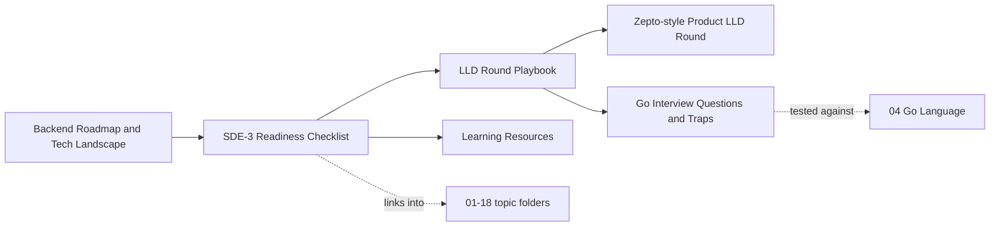

# 19 Interview & Career MOC

> [!summary] What this folder covers
> The backend tech landscape as one map, an honest checklist of what's interview-ready in this vault, curated learning resources, the classic Go interview gotchas with runnable proof, and how to run an LLD interview round end to end.

## Before and after

- **Before this:** [[11 System Design MOC]] · [[17 LLD MOC]]
- **After this:** nothing — this is where you check readiness and go sit the interview

## Learning path

Progress: **6 / 6** notes written. Back to [[Home]].

1. [[Backend Roadmap and Tech Landscape]] · basic — the whole stack (languages, protocols, data stores, messaging, infra, observability) as one map, linking into every numbered folder in learning order.
2. [[SDE-3 Readiness Checklist]] · intermediate — a checklist across every rebuilt folder, honest about which folders in this vault are still unwritten.
3. [[Learning Resources]] · basic (`type: reference`) — curated official docs and references by area, including the links salvaged from the old vault.
4. [[Go Interview Questions and Traps]] · intermediate — 9 classic Go gotchas (nil interface vs nil pointer, loop-variable capture, slice aliasing, map iteration order and concurrent map access, defer timing, goroutine leaks, channel nil/closed semantics, interface satisfaction), each with a runnable, race-tested Go program.
5. [[LLD Round Playbook]] · basic — round formats, timeboxing for 45/60/90-minute rounds, what evaluators actually score, and how to recover when stuck.

### Company Rounds

6. [[Company Rounds/Zepto-style Product LLD Round|Zepto-style Product LLD Round]] · intermediate — one real round pattern, built from public information, with a prep plan linking to matching [[17 LLD MOC|17 LLD]] practice problems.

## Concept map

## Interview focus

- "Walk me through the backend stack end to end" → [[Backend Roadmap and Tech Landscape]].
- "What would you still want to learn before an SDE-3 loop?" → [[SDE-3 Readiness Checklist]].
- "Is a nil interface ever == nil?" → [[Go Interview Questions and Traps]] Trap 1.
- "What changed about for-loop variables in Go 1.22?" → [[Go Interview Questions and Traps]] Trap 2.
- "Why does my map panic with 'concurrent map writes'?" → [[Go Interview Questions and Traps]] Trap 9.
- "How would you run a 60-minute LLD round?" → [[LLD Round Playbook]].
- "What's the biggest red flag in an LLD candidate?" → [[LLD Round Playbook]].
- "How do product-style LLD rounds (e.g. Zepto) differ from classic LLD?" → [[Company Rounds/Zepto-style Product LLD Round|Zepto-style Product LLD Round]].

## Sources worth reading

- The Go specification and the Go 1.22 release notes (for the loop-variable semantics change).
- Official docs linked from [[Learning Resources]] for every area of this vault.
