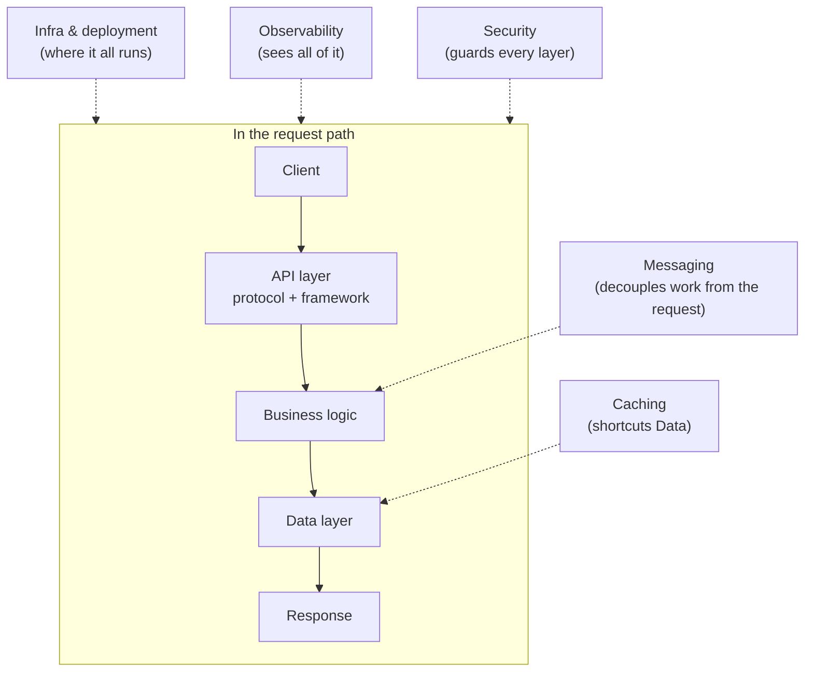
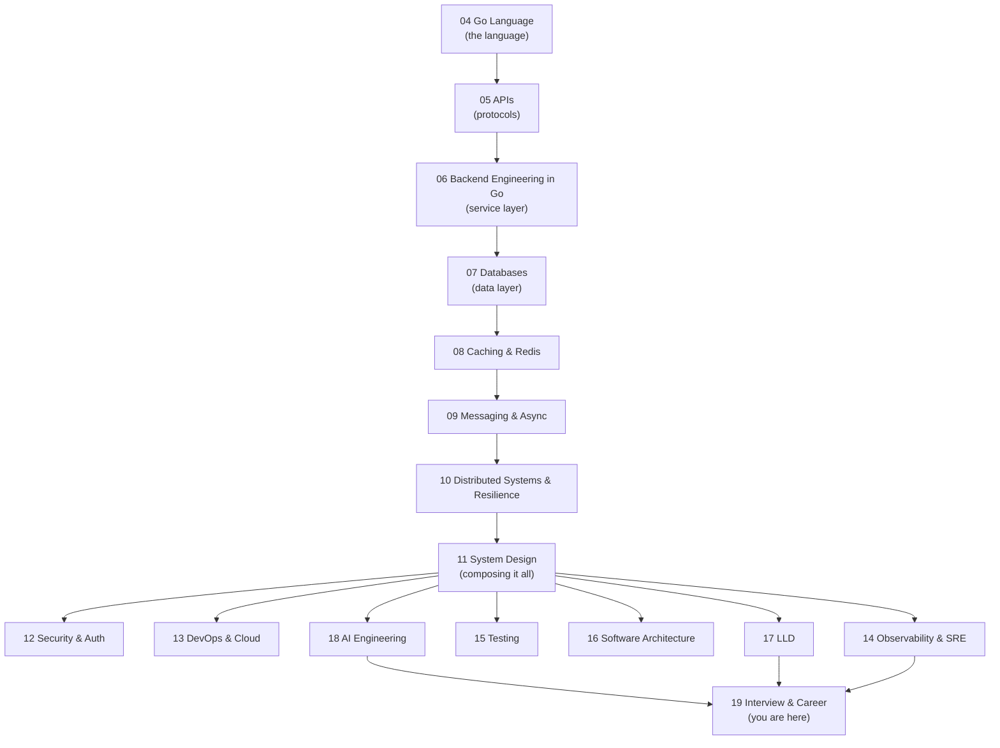

# Backend Roadmap and Tech Landscape

> [!summary] TL;DR
> A backend engineer's job splits into about ten tech layers — language, protocols, data stores, messaging, infra, and observability, among others. This note maps each layer to the concrete tools an SDE-3 is expected to know and to the numbered folder in this vault that teaches it, so you always know what to learn next and where.

> [!abstract] Core idea
> - Backend work is layered: a request moves through a language/framework, an API protocol, business logic, a data store, and a response — with caching, messaging, security, deployment and observability cutting across all of it.
> - Depth expected varies by layer: some layers (your language, your primary data store) need SDE-3 depth; others (cloud IaC, frontend rendering) only need enough to not be confused in a conversation.
> - This vault's 19 numbered folders are one path through the layers, roughly in learning order.
> - This note is a map, not a tutorial: every layer links to the folder that actually teaches it.

## 1. Why it exists

A new backend engineer who only knows "Go + Postgres" can ship a CRUD service but will stall in an SDE-3 interview the moment the conversation turns to "how would this handle 10x traffic" or "what happens when the queue backs up." The gap is not depth in Go — it is not knowing which *other* layers exist at all: caching, messaging, distributed consensus, observability, deployment strategy.

Conversely, a candidate who has only read about these layers in the abstract (without ever writing the Go code for a worker pool, or running an `EXPLAIN` on a slow query) also stalls, one level later: they can name the layer but not reason about it under a follow-up question.

This note exists to give both the map (what layers exist, in what order to learn them) and the honest depth bar (deeply known vs. only recognised), concretely in terms of this vault's folders.

## 2. Mental model

Picture a backend system as a stack of layers a request passes through, plus several layers that surround the stack rather than sitting inside the request path:

- **In the request path:** client → API layer (protocol + framework) → business logic → data layer → response.
- **Around the request path:** caching (shortcuts the data layer), messaging (decouples work from the request), infrastructure (where everything runs), and observability (how you see all of it).

An SDE-3 candidate is expected to reason about every layer in both directions: what it does when it works, and what breaks when it doesn't.

## 3. How it works

The ten layers, each mapped to the Go-specific tools an SDE-3 is expected to recognise, and to the vault folder that teaches it:

| # | Layer | What an SDE-3 knows deeply | Tools (Go-specific where relevant) | Vault folder |
|---|-------|------------------------------|-------------------------------------|---------------|
| 1 | Programming language | Deeply: memory model, concurrency, interfaces, GC, testing | Go 1.24: goroutines, channels, generics | [[04 Go Language MOC]] |
| 2 | Frameworks / API protocol | Deeply: request lifecycle, middleware, versioning | `net/http`, chi, Gin; REST, gRPC, GraphQL, WebSocket | [[05 APIs MOC]] |
| 3 | Business logic / service layer | Deeply: layering, error handling, idempotency | handler → service → repository; `testify`, `testcontainers-go` | [[06 Backend Engineering in Go MOC]] |
| 4 | Data stores (relational + non-relational) | Deeply: indexing, transactions, replication, sharding | `pgx`, `sqlc`; PostgreSQL 17; MongoDB | [[07 Databases MOC]] |
| 5 | Caching | Deeply: invalidation, cache-aside, stampedes | Redis: cache, pub/sub, streams, locks | [[08 Caching & Redis MOC]] |
| 6 | Messaging / async work | Deeply: delivery guarantees, ordering, DLQs | Kafka, RabbitMQ, SQS; Go worker pools | [[09 Messaging & Async MOC]] |
| 7 | Distributed systems & resilience | Deeply: consensus, consistency, retries, circuit breakers | quorum reads/writes, sagas, outbox | [[10 Distributed Systems & Resilience MOC]] |
| 8 | Version control & CI/CD, containers | Recognise and operate: not a design topic | GitHub Actions, Docker, Kubernetes, ArgoCD | [[13 DevOps & Cloud MOC]] |
| 9 | Observability | Deeply: the three signals, SLOs, incident response | OpenTelemetry, Prometheus, Grafana | [[14 Observability & SRE MOC]] |
| 10 | Testing | Deeply: the test pyramid, fakes vs. mocks, race detection | `go test`, table-driven tests, `-race` | [[15 Testing MOC]] |

Layers the old infographic left out entirely, each still worth a "recognise" level of depth for an SDE-3: security and auth ([[12 Security & Auth MOC]]), software architecture patterns ([[16 Software Architecture MOC]]), object-oriented and low-level design ([[17 LLD MOC]]), and AI engineering / LLM-backed features ([[18 AI Engineering MOC]]), which is now common enough in backend roles to show up in interviews.

## 4. Worked example

Trace one request end to end through the layers, naming the folder that owns each step: a client calls `POST /v1/orders` on an order service.

1. **API layer** ([[05 APIs MOC]]): the request is routed by `net/http`'s `ServeMux` (Go 1.22+ method/wildcard patterns), validated, and versioned as `/v1/`.
2. **Business logic** ([[06 Backend Engineering in Go MOC]]): a handler calls an `OrderService.Create` method; a repository interface abstracts the data store.
3. **Caching** ([[08 Caching & Redis MOC]]): the service checks Redis for the user's cart before hitting Postgres.
4. **Data layer** ([[07 Databases MOC]]): the order is inserted inside a transaction, with an outbox row written in the same transaction for reliable event publishing.
5. **Messaging** ([[09 Messaging & Async MOC]]): a background relay reads the outbox and publishes an `order.created` event to Kafka.
6. **Distributed systems** ([[10 Distributed Systems & Resilience MOC]]): the payment service that consumes the event applies the charge idempotently, keyed by the order ID, so a redelivered event cannot double-charge.
7. **Observability** ([[14 Observability & SRE MOC]]): every step emits a trace span tagged with the order ID, so a slow or failed order can be followed across all three services.
8. **Deployment** ([[13 DevOps & Cloud MOC]]): the order service ships via a canary rollout, watched against the same trace and error-rate signals from step 7.

No single folder "is" this feature; the feature is the whole table acting together.

## 5. Variants and comparison

| Learning path | Order | Best for | Cost |
|---|---|---|---|
| **Full path** (this note's table, top to bottom) | 1 → 10, then 11–18 | A first full pass before any interview prep | Weeks, but no gaps |
| **Interview sprint** | [[SDE-3 Readiness Checklist]] only, folder by folder on weak areas | Someone already working as a backend engineer, prepping in under a month | Fast, but assumes real production experience to fall back on |
| **Go builder path** | 04 → 06 → 17 (LLD), returning to data/messaging/distributed as needed | Someone learning Go itself alongside backend concepts | Slower on system design, faster on "can you code it" |

## 6. Trade-offs and when not to use

- Following the table strictly, top to bottom, is slow if you already have production experience in some layers — skip to the [[SDE-3 Readiness Checklist]] and only backfill the folders it flags as weak.
- The table gives recognisable tool names (Kafka, Kubernetes), not a vendor recommendation: this vault teaches the concept each tool represents (a log-based broker, a container orchestrator), not that specific vendor's API surface.
- Treating this note as a syllabus to memorize, rather than a map to navigate, defeats its purpose — the depth lives in the linked folders, never here.

## 7. In production

- **Real systems:** almost every production backend at scale touches most of these layers; a payments service, a feed service and a chat service differ mainly in which layer (data consistency, fan-out, ordering) is their hardest problem.
- **Failure modes → fixes:** the most common SDE-3 interview failure is treating one layer (usually the data layer) as the whole system and never mentioning caching, messaging or observability at all — a senior answer always touches at least three layers.
- **What to monitor:** none directly — this is a navigation note. Each folder's own notes cover what to monitor for that layer (e.g. [[14 Observability & SRE MOC]] for SLOs and alerting).

## 8. Deep dive

The original "Backend Burger" framing (client request → routing → business logic → database, as stacked burger layers) is a request-flow diagram, not a tech-landscape map — it describes one request moving through one service, not the set of skills a backend engineer needs. This note deliberately separates the two ideas: section 3's flowchart is the request-flow view (useful, but it's already taught per-layer in [[06 Backend Engineering in Go MOC]]); the table is the landscape view, which is what a roadmap note should be.

A second trap in the old framing was listing languages, frameworks and data stores as flat, interchangeable options (Java/Python/Go, Flask/Express/Next.js, PostgreSQL/MongoDB/Cassandra) without saying which one this vault — or the reader's job — actually uses. An SDE-3 roadmap needs to pick: this vault picks Go as the primary language and PostgreSQL 17 as the primary relational store, and every "Tools" column above names the Go-specific choice first.

The "learning order" in the diagram below is a dependency order, not a difficulty order: you can learn caching before distributed systems, but you cannot reason about cache invalidation correctness without first understanding what a transaction is (layer 4), which is why data stores sit ahead of caching in the table even though caching is simpler to operate.

## 9. Interview questions

> [!question]- Name three layers a feed-ranking service touches besides "the database."
> Caching (ranked results per user, short TTL), messaging (fan-out of new posts to followers' feeds, often async), and observability (latency and staleness SLOs on the ranking pipeline). A senior answer names the layer and what specifically it does for this feature, not just its name.

> [!question]- Why does this roadmap put the data layer before caching, when caching is operationally simpler?
> Because reasoning correctly about a cache (what invalidates it, what staleness it's allowed to show) requires first understanding the transaction and consistency guarantees of the data layer it is shortcutting. Learning cache patterns before transactions leads to cache-consistency bugs that look mysterious without that foundation.
>
> **Trap:** a candidate who claims "I'd just add Redis in front of everything" without being able to say what gets invalidated and when is demonstrating exactly this gap.

> [!question]- Your service calls a payment provider, a database, and publishes a Kafka event. Which layer causes the interview's typical hardest follow-up, and why?
> The distributed-systems layer, because it is the one where a step can fail *after* a previous step has already committed (payment succeeded, but the DB write or event publish fails). The senior answer explains compensating actions or the outbox pattern, not retries alone.

> [!question]- What's missing from the original "burger" framing that this note adds back?
> Caching, messaging, distributed systems, observability, security, and architecture patterns were absent entirely — the original only described the straight-through request path (route → middleware → controller → service → DB), which is one layer of this note's ten.

> [!question]- When is it fine to only "recognise" a layer rather than know it deeply?
> When the layer is outside your team's ownership boundary and you are not expected to operate it — e.g. a backend engineer usually only needs to recognise Kubernetes concepts (pod, deployment, rollout) well enough to reason about *why* a deploy failed, not to author Helm charts, unless platform engineering is the role.

## 10. Cheat sheet

- Ten layers: language, API protocol, business logic, data stores, caching, messaging, distributed systems, deployment/infra, observability, testing — plus security, architecture, LLD and AI engineering around the edges.
- This vault's primary stack: Go 1.24, PostgreSQL 17, Redis, Kafka/RabbitMQ.
- Folder order roughly follows dependency order, not difficulty: language → APIs → service layer → data → caching → messaging → distributed systems → everything that composes them (11), then the specialisms (12–18).
- A senior answer to "design X" always names at least three of these layers, not just the data layer.
- Use [[SDE-3 Readiness Checklist]] to turn this map into a tracked, per-folder checklist.

## Links

- **Before this:** none — this is an entry point.
- **Next:** [[SDE-3 Readiness Checklist]]
- **Compare with:** [[Learning Resources]]
