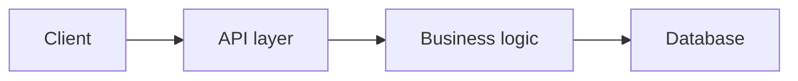
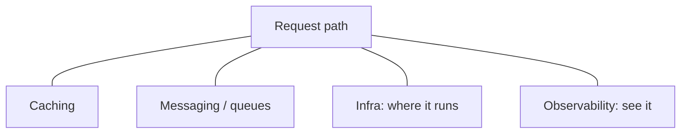
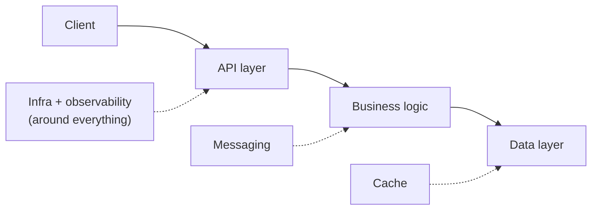
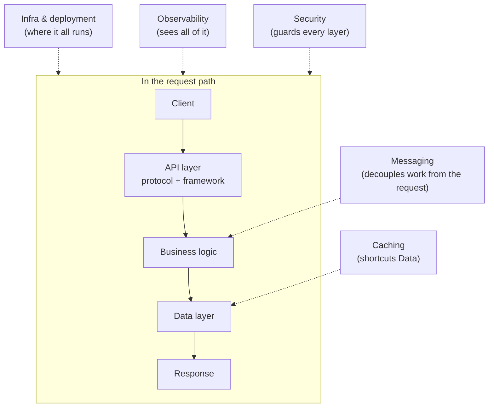
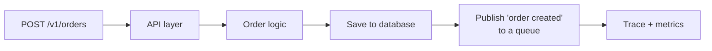
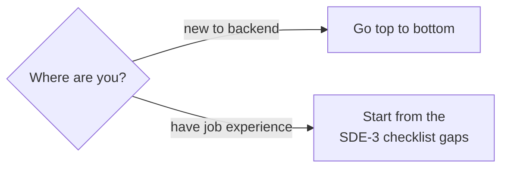
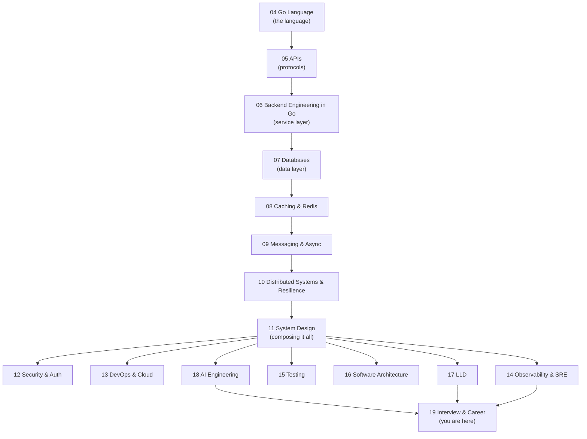

# Backend Roadmap and Tech Landscape

> [!summary] TL;DR
> A backend engineer's job splits into about ten tech layers — language, protocols, data stores, messaging, infra, and observability, among others.
>
> This note maps each layer to the concrete tools an SDE-3 is expected to know and to the numbered folder in this vault that teaches it, so you always know what to learn next and where.

> [!abstract] Core idea
> - Backend work is layered: a request moves through a language/framework, an API protocol, business logic, a data store, and a response — with caching, messaging, security, deployment and observability cutting across all of it.
> - Depth expected varies by layer: some layers (your language, your primary data store) need SDE-3 depth; others (cloud IaC, frontend rendering) only need enough to not be confused in a conversation.
> - This vault's 19 numbered folders are one path through the layers, roughly in learning order.
> - This note is a map, not a tutorial: every layer links to the folder that actually teaches it.

## Start here: the basics 🟢

> [!info] How to read this note (pick your level)
> - 🟢 **New to this?** Read "From zero" below, then sections 1, 2 and the cheat sheet (10). Stop there, that is a full first pass.
> - 🟡 **Know the basics?** Add section 3 (how it works), 4 (worked example), 5 and 6.
> - 🔴 **Interview / SDE-3 prep?** Add 7, 8 and 9. Headings are tagged 🟢🟡🔴 so you always know where you are.

> [!note] Before this note
> - Nothing. This note starts from zero. It is the entry map for the whole vault.

**From zero, in 60 seconds** 🟢

Backend work covers many topics. Without a map, it is easy to learn them in a random order and miss whole areas.

This note is that map. Think of a backend system as **layers**. A request passes through some of them, and others sit around it.

The request path: the client calls your API, your code runs the business rules, and the data is read or saved in a database.

Around that path: **caching** (keep copies to answer faster), messaging (hand slow work to a queue), infrastructure (where it all runs), and observability (how you see what is happening).

Each layer maps to one folder in this vault, so you always know what to read next.

The rest of this note is just these 3 questions:
1. What are the layers, and what does each one do?
2. In what order should you learn them?
3. What does a senior engineer need to know about each?

**The problem in one story.**
You can build a small Go service that saves data to Postgres.
In an interview someone asks, "What happens at 10x traffic, or when the queue backs up?"
You freeze, not because you lack Go skill, but because you never knew caching, queues or monitoring were separate things to learn.
This note is the map of those things and where this vault teaches each one.

**Words you need first**

| Word | Plain meaning | Tiny example |
| --- | --- | --- |
| Backend | The server-side code users never see directly | The service that stores your orders |
| API | The agreed way clients talk to a server | `POST /orders` over HTTP |
| Data store | Where data is kept long term | PostgreSQL, Redis, S3 |
| Cache | A fast copy of data to avoid slow lookups | Redis holding a product page |
| Message queue | A buffer where work waits to be processed later | Kafka topic of "order placed" events |
| Infrastructure | The machines and platforms code runs on | Docker, Kubernetes, AWS |
| Observability | Seeing what a running system is doing | Logs, metrics, traces |
| Layer | One area of skill in the stack | "Messaging" is one layer |
| Idempotent | Doing it twice has the same effect as once | Charging order 42 only once, even if the event arrives twice |
| Outbox | A table where events are saved with the data, then sent by a helper | `order.created` row written with the order |
| DLQ (dead-letter queue) | A side queue for messages that keep failing | A broken event parked for a human to look at |
| SLO | A target for how well a service must behave | "99.9% of requests under 300 ms" |
| Trace span | One timed step of a request, linked to the other steps | "save order: 12 ms" |
| Canary rollout | Release a new version to a small share of traffic first | 5% of users get v2 |

**Picture it**

**Analogy.** A city map: roads (the request path) plus water, power and police that serve every street (caching, messaging, infra, observability).
Where it breaks: a city map is fixed; the tech in each layer changes every few years, while the layers themselves stay.

**How the rest of this note builds up**

- First, why knowing only "Go + Postgres" stalls you (section 1) and the request-path picture (section 2).
- Then each layer with its tools and its vault folder, plus a worked trace of one request (sections 3-4).
- Then variants, trade-offs and how this looks on a real team (sections 5-7).
- Finally the SDE-3 deep dive on learning order and depth: what to know deeply vs. only recognise (section 8).

> [!tip] Remember
> Learn the layers first, the tools second; know your language and main data store deeply, recognise the rest.

## 1. Why it exists 🟢

A new backend engineer who only knows "Go + Postgres" can ship a **CRUD** service (create, read, update, delete with little logic) but will stall in an SDE-3 interview the moment the conversation turns to "how would this handle 10x traffic" or "what happens when the queue backs up."

The gap is not depth in Go — it is not knowing which *other* layers exist at all: caching, messaging, distributed **consensus** (several servers agreeing on one answer even if some fail), observability, deployment strategy.

Conversely, a candidate who has only read about these layers in the abstract (without ever writing the Go code for a **worker pool**, a fixed set of goroutines sharing a queue of jobs, or running an `EXPLAIN`, the command that shows how the database will run a query, on a slow query) also stalls, one level later: they can name the layer but not reason about it under a follow-up question.

This note exists to give both the map (what layers exist, in what order to learn them) and the honest depth bar (deeply known vs. only recognised), concretely in terms of this vault's folders.

## 2. Mental model 🟢

Picture a backend system as a stack of layers a request passes through, plus several layers that surround the stack rather than sitting inside the request path:

- **In the request path:** client → API layer (protocol + framework) → business logic → data layer → response.
- **Around the request path:** caching (shortcuts the data layer), messaging (decouples work from the request), infrastructure (where everything runs), and observability (how you see all of it).

An SDE-3 candidate is expected to reason about every layer in both directions: what it does when it works, and what breaks when it doesn't.

### Real-life example 🟢

Think about placing a food order on Swiggy. Your tap hits the **API layer**. The **business logic** checks the restaurant is open and the cart is valid.
The order is saved in a **database**; the menu you saw came from a **cache** so it loaded fast.
A **message queue** tells the restaurant and the delivery system "new order", so your screen doesn't wait for them.
All of it runs on **infrastructure** (servers, containers), and **observability** lets engineers see if orders suddenly slow down. One tap, about six layers.

## Common beginner mistakes 🟢

- **Learning tools before layers** → you know "Kafka" as a word but not what problem a queue solves → learn what each layer does, then one tool for it.
- **Treating the database as the whole system in interviews** → answers sound junior → name at least three layers: data, plus caching, messaging or observability.
- **Learning caching before transactions** → cache bugs look like magic → learn the data layer first, then caching.
- **Trying to know every layer deeply** → you burn out → go deep on your language and main data store; recognise the rest.
- **Memorising this table** → it is a map, not the lesson → follow the links into each folder.

## 3. How it works 🟡

> 🟢 → 🟡 **You now know** that a backend is a request path plus layers around it. **Next we open the map**: all ten layers, what depth each needs, which tools stand for it, and which folder teaches it.

**In plain words:** Each layer below links to the folder that teaches it.

**Step by step (how to use the table):**
1. Pick the layer you feel weakest in, say "Messaging".
2. Read its "knows deeply" column: delivery guarantees, ordering, DLQs.
3. Check you can explain each one in two sentences.
4. If not, open the linked folder ([[09 Messaging & Async MOC]]) and start there.

The ten layers, each mapped to the Go-specific tools an SDE-3 is expected to recognise, and to the vault folder that teaches it:

| # | Layer | What an SDE-3 knows deeply | Tools (Go-specific where relevant) | Vault folder |
|---|-------|------------------------------|-------------------------------------|---------------|
| 1 | Programming language | Deeply: memory model, concurrency, interfaces, GC, testing | Go 1.24: goroutines, channels, generics | [[04 Go Language MOC]] |
| 2 | Frameworks / API protocol | Deeply: request lifecycle, middleware, versioning | `net/http`, chi, Gin; REST, gRPC, GraphQL, WebSocket | [[05 APIs MOC]] |
| 3 | Business logic / service layer | Deeply: layering, error handling, idempotency | handler → service → repository; `testify`, `testcontainers-go` | [[06 Backend Engineering in Go MOC]] |
| 4 | Data stores (relational + non-relational) | Deeply: indexing, transactions, replication, sharding | `pgx`, `sqlc`; PostgreSQL 17; MongoDB | [[07 Databases MOC]] |
| 5 | Caching | Deeply: invalidation, cache-aside, stampedes | Redis: cache, pub/sub, streams, locks | [[08 Caching & Redis MOC]] |
| 6 | Messaging / async work | Deeply: delivery guarantees, ordering, DLQs | Kafka, RabbitMQ, SQS; Go worker pools | [[09 Messaging & Async MOC]] |
| 7 | Distributed systems & resilience | Deeply: consensus, consistency, retries, circuit breakers | quorum reads/writes, sagas, outbox | [[10 Distributed Systems & Resilience MOC]] |
| 8 | Version control & CI/CD, containers | Recognise and operate: not a design topic | GitHub Actions, Docker, Kubernetes, ArgoCD | [[13 DevOps & Cloud MOC]] |
| 9 | Observability | Deeply: the three signals, SLOs, incident response | OpenTelemetry, Prometheus, Grafana | [[14 Observability & SRE MOC]] |
| 10 | Testing | Deeply: the test pyramid, fakes vs. mocks, race detection | `go test`, table-driven tests, `-race` | [[15 Testing MOC]] |

Layers the old infographic left out entirely, each still worth a "recognise" level of depth for an SDE-3:

- security and auth ([[12 Security & Auth MOC]]);
- software architecture patterns ([[16 Software Architecture MOC]]);
- object-oriented and low-level design ([[17 LLD MOC]]);
- AI engineering / LLM-backed features ([[18 AI Engineering MOC]]), which is now common enough in backend roles to show up in interviews.

## 4. Worked example 🟡

**In plain words:** Follow one real request, step by step, and see which folder owns each step.

Trace one request end to end through the layers, naming the folder that owns each step: a client calls `POST /v1/orders` on an order service.

1. **API layer** ([[05 APIs MOC]]): the request is routed by `net/http`'s `ServeMux` (Go 1.22+ method/wildcard patterns), validated, and versioned as `/v1/`.
2. **Business logic** ([[06 Backend Engineering in Go MOC]]): a handler calls an `OrderService.Create` method; a repository interface abstracts the data store.
3. **Caching** ([[08 Caching & Redis MOC]]): the service checks Redis for the user's cart before hitting Postgres.
4. **Data layer** ([[07 Databases MOC]]): the order is inserted inside a transaction, with an outbox row written in the same transaction for reliable event publishing.
5. **Messaging** ([[09 Messaging & Async MOC]]): a background relay reads the outbox and publishes an `order.created` event to Kafka.
6. **Distributed systems** ([[10 Distributed Systems & Resilience MOC]]): the payment service that consumes the event applies the charge idempotently, keyed by the order ID, so a redelivered event cannot double-charge.
7. **Observability** ([[14 Observability & SRE MOC]]): every step emits a trace span tagged with the order ID, so a slow or failed order can be followed across all three services.
8. **Deployment** ([[13 DevOps & Cloud MOC]]): the order service ships via a canary rollout, watched against the same trace and error-rate signals from step 7.

No single folder "is" this feature; the feature is the whole table acting together.

## 5. Variants and comparison 🟡

**In plain words:** Different learning orders, depending on what you already know.

| Learning path | Order | Best for | Cost |
|---|---|---|---|
| **Full path** (this note's table, top to bottom) | 1 → 10, then 11–18 | A first full pass before any interview prep | Weeks, but no gaps |
| **Interview sprint** | [[SDE-3 Readiness Checklist]] only, folder by folder on weak areas | Someone already working as a backend engineer, prepping in under a month | Fast, but assumes real production experience to fall back on |
| **Go builder path** | 04 → 06 → 17 (LLD), returning to data/messaging/distributed as needed | Someone learning Go itself alongside backend concepts | Slower on system design, faster on "can you code it" |

### Know deeply vs only recognise 🟡

| Depth | What it means | Layers (for a Go backend SDE-3) | Interview test |
| --- | --- | --- | --- |
| Know deeply | You can design with it and answer two follow-ups | Go, APIs, service layer, data stores, caching, messaging, distributed systems, observability, testing | "What breaks when…?" |
| Recognise | You know what it is and why a team uses it | CI/CD, Kubernetes internals, cloud IaC, frontend rendering | "Why did this deploy fail?" at a high level |

## 6. Trade-offs and when not to use 🟡

- Following the table strictly, top to bottom, is slow if you already have production experience in some layers — skip to the [[SDE-3 Readiness Checklist]] and only backfill the folders it flags as weak.
- The table gives recognisable tool names (Kafka, Kubernetes), not a vendor recommendation: this vault teaches the concept each tool represents (a log-based broker, a container orchestrator), not that specific vendor's API surface.
- Treating this note as a syllabus to memorize, rather than a map to navigate, defeats its purpose — the depth lives in the linked folders, never here.

## 7. In production 🔴

> 🟡 → 🔴 **You now know** the ten layers, a learning order and how deep each must go. **Next is the senior view**: what real teams find hardest per layer, the classic interview failure, and why the learning order follows dependencies, not difficulty.

- **Real systems:** almost every production backend at scale touches most of these layers; a payments service, a feed service and a chat service differ mainly in which layer (data consistency, fan-out, ordering) is their hardest problem.
- **Failure modes → fixes:** the most common SDE-3 interview failure is treating one layer (usually the data layer) as the whole system and never mentioning caching, messaging or observability at all — a senior answer always touches at least three layers.
- **What to monitor:** none directly — this is a navigation note. Each folder's own notes cover what to monitor for that layer (e.g. [[14 Observability & SRE MOC]] for SLOs and alerting).

## 8. Deep dive 🔴

The original "Backend Burger" framing (client request → routing → business logic → database, as stacked burger layers) is a request-flow diagram, not a tech-landscape map — it describes one request moving through one service, not the set of skills a backend engineer needs.

This note deliberately separates the two ideas: section 3's flowchart is the request-flow view (useful, but it's already taught per-layer in [[06 Backend Engineering in Go MOC]]); the table is the landscape view, which is what a roadmap note should be.

A second trap in the old framing was listing languages, frameworks and data stores as flat, interchangeable options (Java/Python/Go, Flask/Express/Next.js, PostgreSQL/MongoDB/Cassandra) without saying which one this vault — or the reader's job — actually uses.

An SDE-3 roadmap needs to pick: this vault picks Go as the primary language and PostgreSQL 17 as the primary relational store, and every "Tools" column above names the Go-specific choice first.

The "learning order" in the diagram below is a dependency order, not a difficulty order.

You can learn caching before distributed systems, but you cannot reason about cache invalidation correctness without first understanding what a transaction is (layer 4).

That is why data stores sit ahead of caching in the table even though caching is simpler to operate.

## 9. Interview questions 🔴

> [!question]- Name three layers a feed-ranking service touches besides "the database."
> Caching (ranked results per user, short TTL), messaging (fan-out of new posts to followers' feeds, often async), and observability (latency and staleness SLOs on the ranking pipeline). A senior answer names the layer and what specifically it does for this feature, not just its name.

> [!question]- Why does this roadmap put the data layer before caching, when caching is operationally simpler?
> Because reasoning correctly about a cache (what invalidates it, what staleness it's allowed to show) requires first understanding the transaction and consistency guarantees of the data layer it is shortcutting. Learning cache patterns before transactions leads to cache-consistency bugs that look mysterious without that foundation.
>
> **Trap:** a candidate who claims "I'd just add Redis in front of everything" without being able to say what gets invalidated and when is demonstrating exactly this gap.

> [!question]- Your service calls a payment provider, a database, and publishes a Kafka event. Which layer causes the interview's typical hardest follow-up, and why?
> The distributed-systems layer, because it is the one where a step can fail *after* a previous step has already committed (payment succeeded, but the DB write or event publish fails). The senior answer explains compensating actions or the outbox pattern, not retries alone.

> [!question]- What's missing from the original "burger" framing that this note adds back?
> Caching, messaging, distributed systems, observability, security, and architecture patterns were absent entirely — the original only described the straight-through request path (route → middleware → controller → service → DB), which is one layer of this note's ten.

> [!question]- When is it fine to only "recognise" a layer rather than know it deeply?
> When the layer is outside your team's ownership boundary and you are not expected to operate it — e.g. a backend engineer usually only needs to recognise Kubernetes concepts (pod, deployment, rollout) well enough to reason about *why* a deploy failed, not to author Helm charts, unless platform engineering is the role.

## 10. Cheat sheet 🟢

- Ten layers: language, API protocol, business logic, data stores, caching, messaging, distributed systems, deployment/infra, observability, testing — plus security, architecture, LLD and AI engineering around the edges.
- This vault's primary stack: Go 1.24, PostgreSQL 17, Redis, Kafka/RabbitMQ.
- Folder order roughly follows dependency order, not difficulty: language → APIs → service layer → data → caching → messaging → distributed systems → everything that composes them (11), then the specialisms (12–18).
- A senior answer to "design X" always names at least three of these layers, not just the data layer.
- Use [[SDE-3 Readiness Checklist]] to turn this map into a tracked, per-folder checklist.

## Self-check 🟢🟡

> [!question]- (easy) Name the four layers on the request path.
> API layer, business logic, data layer, response (from the client's call).

> [!question]- (easy) Name four layers that sit around the request path.
> Caching, messaging, infrastructure and observability (security guards all of them).

> [!question]- (easy) Which two layers must an SDE-3 know most deeply?
> Their programming language and their primary data store.

> [!question]- (medium) Why learn databases before caching?
> You can't judge what a cache may safely show until you understand transactions and consistency in the data layer.

> [!question]- (medium) In the `POST /v1/orders` trace, why is the outbox row written in the same transaction as the order?
> So the order and its "order created" event are saved together; the event can't be lost or sent for an order that never saved.

> [!question]- (medium) What makes an interview answer sound senior here?
> It names at least three layers and says what each specifically does for the feature.

## Links 🟢

- **Before this:** none — this is an entry point.
- **Next:** [[SDE-3 Readiness Checklist]]
- **Compare with:** [[Learning Resources]]

### Watch on YouTube

- [Backend SDE Roadmap 2026-27 / Techs, Skills, Tools for Industry / Learn in Order for Interviews](https://www.youtube.com/watch?v=Kx-4Sc57NM0) · Dev. Shivansh Vasu · 43 min · 8,331 views
- [The Complete Backend Developer Roadmap](https://www.youtube.com/watch?v=OeEHJgzqS1k) · Programming with Mosh · 8 min · 991,104 views
