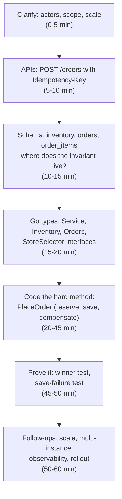
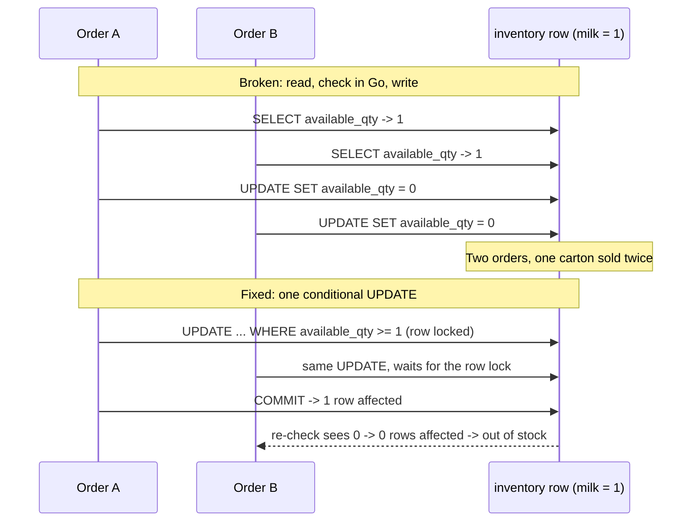
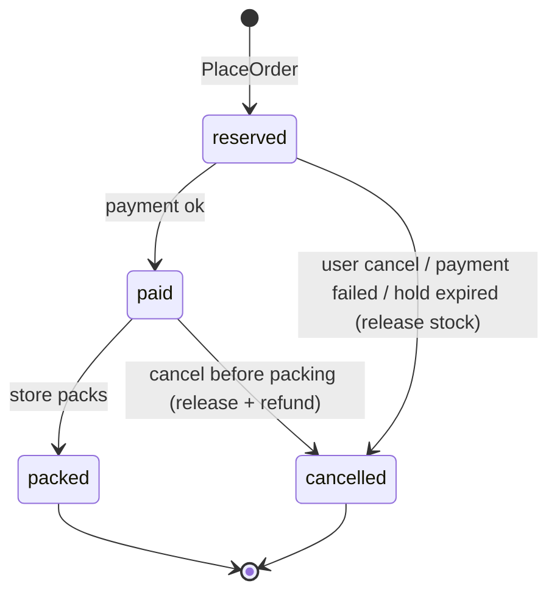

# Zepto-style Product LLD Round

> [!summary] TL;DR
> A "product LLD" round asks you to design one slice of a real product (inventory, cart, order assignment, delivery) as APIs, tables, Go types and one working core method, then defend it against races, retries and failures. It is the format quick-commerce and other product companies tend to use, and this note is a prep plan for it.

> [!abstract] Core idea
> - The question looks like a product feature, not a puzzle: "a user orders milk and bread from the nearest dark store".
> - API and schema come early, because the interviewer wants to see where the invariant (no overselling) lives.
> - You code one hard method (usually reserve-and-place-order) and prove it with a winner test.
> - The SDE-3 bar adds multi-instance correctness, failure paths (compensation, idempotent retries), observability and rollout.
> - Classic mistake: designing Parking Lot-style class trees and never saying how two concurrent orders for the last unit are handled.

> [!warning] What this note is based on
> The round shape below comes from candidate-shared, public interview write-ups and from the owner's own prep notes. It is **anecdotal**: companies change their loops, and nothing here is an official description of any company's process. Read "Zepto-style" as "quick-commerce product LLD", and confirm the format with your recruiter.

## 1. Why it exists

Classic LLD questions (Parking Lot, Vending Machine) test object modelling. A product company's backend work is different: most bugs are not "wrong class hierarchy" but "two requests sold the same last unit" or "the retry created a second order". A product LLD round tests those skills directly in 45–60 minutes.

A concrete scenario: a dark store has 1 carton of milk left and, at 8:00 pm, 3 users tap "Place order" within the same 200 ms. A design that reads `available_qty`, checks it in Go, and then writes `available_qty - 1` can sell 3 cartons it does not have. The interviewer is waiting to see if you notice this before they ask.

## 2. Mental model

Think of the round as **a design review of one pull request** for a real service:

- the PR description = requirements and API,
- the migration = schema,
- the diff = Go types plus one core method,
- the review comments = "what if two run at once? what if the DB call fails? what if the client retries?".

Analogy: a building inspector does not care how pretty the floor plan is; they check the load-bearing walls. In this round the load-bearing walls are the invariants (stock never negative, one rider per order, one order per retry).

## 3. How it works

### Round formats

| Format | What you produce | How it is scored | Prep note |
| --- | --- | --- | --- |
| Design discussion (whiteboard/doc) | APIs, schema, classes, sequence of the core flow | Clarity of model, invariants, trade-offs | [[LLD Interview Method]] |
| Machine coding (60–120 min, often run locally) | A running program, sometimes with tests | It runs, the code is clean, extensible, edge cases handled | [[Testing LLD Code]] |
| Hybrid (most common for product LLD) | API + schema on the board, then one core method in an editor | Both of the above, in less time | This note |

### Flow of a hybrid round



### Why API and schema come first in product rounds

In a puzzle LLD the state lives in memory, so classes come first. In a product LLD the state lives in a database shared by many service instances, so:

1. The API fixes the contract: what a retry looks like (`Idempotency-Key` header), what errors the client sees (409 when out of stock).
2. The schema decides where the invariant is enforced: a `CHECK (available_qty >= 0)` and a conditional `UPDATE` hold across all instances; a Go mutex holds only inside one process.
3. Only then do the Go types follow, as thin wrappers around those guarantees.

The general 10-step order is in [[LLD Interview Method]]; this round just pulls steps 5–6 (APIs, storage) earlier.

### Typical problems and where to practise them

| Problem as asked | What it probes | Practise with |
| --- | --- | --- |
| Inventory and order assignment for dark stores | Atomic reserve, store selection, partial stock | [[Inventory Order Assignment (Dark Store)]] |
| Cart checkout with coupons | Pricing rules, coupon limits, payment failure | [[Cart Checkout with Coupons]] |
| Delivery partner assignment | Strategy for nearest rider, double assignment, state | [[Delivery Partner Assignment]] |
| Food or grocery ordering end to end | Order state machine, restaurant/store, rider | [[Food Ordering System]] |
| Library or bookstore | Borrow/return, holds, schema | [[Library Management]] |
| Notification system | Channels, retries, preferences | [[Notification Service]] |
| Rate limiter | Algorithm plus code | [[Practice/Rate Limiter]] |
| Booking with overlaps | Overlap check, locks, state | [[Meeting Room Scheduler]], [[Movie Ticket Booking]] |
| Wallet or refunds | Ledger, idempotency, double spend | [[Digital Wallet and Ledger]] |

Each practice note has its own Excalidraw drawing; redraw it from memory as a warm-up instead of drawing new diagrams here.

## 4. Worked example

**Question:** "A user orders milk, bread and chips. Pick a dark store that has all items, reserve stock, create the order. Assume many app servers."

### Opening script (first 60 seconds)

```text
Let me confirm scope: one user places an order of several items, we choose one
dark store that can fill the whole order, reserve stock, and create the order.
Payment and rider assignment happen after this step, so I will treat them as
follow-ups. Many app instances run, so the no-oversell rule has to hold in the
database, not in memory. I'll do APIs, then tables, then Go types, then code
PlaceOrder and test the last-unit race. Does that match what you want?
```

### API

```text
POST /v1/orders                 Idempotency-Key: <uuid>
  body: { "items": [{ "product_id": "milk", "qty": 1 }, ...] }
  201 { "order_id": "...", "store_id": "...", "status": "reserved" }
  409 { "error": "out_of_stock" }          no store can fill every item
GET  /v1/orders/{id}
POST /v1/orders/{id}/cancel     releases the reservation if not yet packed
```

### Schema (PostgreSQL 17)

```sql
CREATE TABLE inventory (
    store_id      bigint  NOT NULL,
    product_id    bigint  NOT NULL,
    available_qty integer NOT NULL CHECK (available_qty >= 0),
    reserved_qty  integer NOT NULL DEFAULT 0 CHECK (reserved_qty >= 0),
    updated_at    timestamptz NOT NULL DEFAULT now(),
    PRIMARY KEY (store_id, product_id)
);

CREATE TABLE orders (
    id              bigint GENERATED ALWAYS AS IDENTITY PRIMARY KEY,
    user_id         bigint NOT NULL,
    store_id        bigint NOT NULL,
    status          text   NOT NULL CHECK (status IN ('reserved','paid','packed','cancelled')),
    idempotency_key uuid   NOT NULL,
    created_at      timestamptz NOT NULL DEFAULT now(),
    UNIQUE (user_id, idempotency_key)
);

CREATE TABLE order_items (
    order_id   bigint  NOT NULL REFERENCES orders(id),
    product_id bigint  NOT NULL,
    qty        integer NOT NULL CHECK (qty > 0),
    price_paise bigint NOT NULL,
    PRIMARY KEY (order_id, product_id)
);
```

The reservation for one item is a conditional update. If it affects 0 rows, the stock was not there:

```sql
UPDATE inventory
SET    available_qty = available_qty - $3,
       reserved_qty  = reserved_qty  + $3,
       updated_at    = now()
WHERE  store_id = $1 AND product_id = $2 AND available_qty >= $3;
```

Run one such statement per item inside one transaction, and roll back if any returns 0 rows. Two concurrent transactions on the same row serialise on the row lock: the second one re-evaluates `available_qty >= $3` after the first commits (PostgreSQL 17, READ COMMITTED), so it sees the new value and affects 0 rows. To avoid deadlocks between two multi-item orders, update items in a fixed order (sort by `product_id`). The full lock discussion is in [[Locking - Optimistic vs Pessimistic]].

### The race you must name



### Go: the core method, tested

The old version of this code reserved stock, then saved the order, and returned on a save error without releasing the stock, so every DB hiccup leaked inventory. It also used a raw `"reserved"` string. The version below fixes both, adds an idempotency key and falls back to the next store when the nearest one loses the race. The in-memory `MemInventory` stands in for the SQL above: its single mutex plays the role of the row lock.

```go
package order

import (
	"context"
	"errors"
	"fmt"
	"sync"
)

type Status string

const (
	StatusReserved  Status = "reserved"
	StatusCancelled Status = "cancelled"
)

var (
	ErrOutOfStock   = errors.New("out of stock")
	ErrNoStore      = errors.New("no store can fill the order")
	ErrInvalidItems = errors.New("order needs at least one item with qty > 0")
)

type Item struct {
	ProductID string
	Qty       int
}

type Order struct {
	ID      string
	UserID  string
	StoreID string
	Items   []Item
	Status  Status
	IdemKey string
}

// Inventory reserves stock atomically per store. In PostgreSQL this is the
// conditional UPDATE ... WHERE available_qty >= $qty inside one transaction.
type Inventory interface {
	CandidateStores(ctx context.Context, items []Item) ([]string, error)
	Reserve(ctx context.Context, storeID string, items []Item) error
	Release(ctx context.Context, storeID string, items []Item) error
}

type Orders interface {
	Save(ctx context.Context, o Order) error
	ByIdemKey(ctx context.Context, key string) (Order, bool, error)
}

type Service struct {
	inv    Inventory
	orders Orders
	nextID func() string
}

func NewService(inv Inventory, orders Orders, nextID func() string) *Service {
	return &Service{inv: inv, orders: orders, nextID: nextID}
}

// PlaceOrder is idempotent per idemKey and never leaks a reservation:
// if Save fails, the reserved stock is released before returning.
func (s *Service) PlaceOrder(ctx context.Context, idemKey, userID string, items []Item) (Order, error) {
	if len(items) == 0 {
		return Order{}, ErrInvalidItems
	}
	for _, it := range items {
		if it.Qty <= 0 {
			return Order{}, ErrInvalidItems
		}
	}
	if o, ok, err := s.orders.ByIdemKey(ctx, idemKey); err != nil {
		return Order{}, err
	} else if ok {
		return o, nil
	}
	stores, err := s.inv.CandidateStores(ctx, items)
	if err != nil {
		return Order{}, err
	}
	for _, storeID := range stores {
		err := s.inv.Reserve(ctx, storeID, items)
		if errors.Is(err, ErrOutOfStock) {
			continue // another order took the stock; try the next store
		}
		if err != nil {
			return Order{}, err
		}
		o := Order{ID: s.nextID(), UserID: userID, StoreID: storeID,
			Items: items, Status: StatusReserved, IdemKey: idemKey}
		if err := s.orders.Save(ctx, o); err != nil {
			// Compensate. context.WithoutCancel (Go 1.21) keeps the release
			// running even if the request context was cancelled.
			if rerr := s.inv.Release(context.WithoutCancel(ctx), storeID, items); rerr != nil {
				return Order{}, errors.Join(fmt.Errorf("save order: %w", err), fmt.Errorf("release stock: %w", rerr))
			}
			return Order{}, fmt.Errorf("save order: %w", err)
		}
		return o, nil
	}
	return Order{}, ErrNoStore
}

// MemInventory is an in-memory Inventory guarded by one mutex, so the
// check and the decrement happen in one critical section.
type MemInventory struct {
	mu    sync.Mutex
	stock map[string]map[string]int // store -> product -> available
	order []string                  // candidate order (nearest first)
}

func NewMemInventory(order []string, stock map[string]map[string]int) *MemInventory {
	return &MemInventory{stock: stock, order: order}
}

func (m *MemInventory) CandidateStores(_ context.Context, _ []Item) ([]string, error) {
	return m.order, nil
}

func (m *MemInventory) Reserve(_ context.Context, storeID string, items []Item) error {
	m.mu.Lock()
	defer m.mu.Unlock()
	s := m.stock[storeID]
	for _, it := range items {
		if s[it.ProductID] < it.Qty {
			return ErrOutOfStock
		}
	}
	for _, it := range items {
		s[it.ProductID] -= it.Qty
	}
	return nil
}

func (m *MemInventory) Release(_ context.Context, storeID string, items []Item) error {
	m.mu.Lock()
	defer m.mu.Unlock()
	for _, it := range items {
		m.stock[storeID][it.ProductID] += it.Qty
	}
	return nil
}

func (m *MemInventory) Available(storeID, productID string) int {
	m.mu.Lock()
	defer m.mu.Unlock()
	return m.stock[storeID][productID]
}
```

The test proves the four claims an interviewer will poke at: exactly one winner for the last unit, fallback to the next store without leaking a partial reservation, release on save failure, and a retry returning the same order.

```go
package order

import (
	"context"
	"errors"
	"fmt"
	"sync"
	"sync/atomic"
	"testing"
)

type memOrders struct {
	mu      sync.Mutex
	byKey   map[string]Order
	failErr error
}

func newMemOrders() *memOrders { return &memOrders{byKey: map[string]Order{}} }

func (m *memOrders) Save(_ context.Context, o Order) error {
	m.mu.Lock()
	defer m.mu.Unlock()
	if m.failErr != nil {
		return m.failErr
	}
	m.byKey[o.IdemKey] = o
	return nil
}

func (m *memOrders) ByIdemKey(_ context.Context, k string) (Order, bool, error) {
	m.mu.Lock()
	defer m.mu.Unlock()
	o, ok := m.byKey[k]
	return o, ok, nil
}

func ids() func() string {
	var n atomic.Int64
	return func() string { return fmt.Sprintf("o%d", n.Add(1)) }
}

func TestLastUnitHasExactlyOneWinner(t *testing.T) {
	inv := NewMemInventory([]string{"s1"}, map[string]map[string]int{"s1": {"milk": 1}})
	svc := NewService(inv, newMemOrders(), ids())
	var wins atomic.Int64
	var wg sync.WaitGroup
	for i := range 50 {
		wg.Add(1)
		go func() {
			defer wg.Done()
			_, err := svc.PlaceOrder(context.Background(), fmt.Sprintf("k%d", i), "u", []Item{{"milk", 1}})
			if err == nil {
				wins.Add(1)
			} else if !errors.Is(err, ErrNoStore) {
				t.Errorf("unexpected error: %v", err)
			}
		}()
	}
	wg.Wait()
	if wins.Load() != 1 {
		t.Fatalf("winners = %d, want 1", wins.Load())
	}
	if got := inv.Available("s1", "milk"); got != 0 {
		t.Fatalf("available = %d, want 0", got)
	}
}

func TestFallsBackToNextStore(t *testing.T) {
	inv := NewMemInventory([]string{"near", "far"}, map[string]map[string]int{
		"near": {"milk": 1, "bread": 0},
		"far":  {"milk": 5, "bread": 5},
	})
	svc := NewService(inv, newMemOrders(), ids())
	o, err := svc.PlaceOrder(context.Background(), "k1", "u", []Item{{"milk", 1}, {"bread", 1}})
	if err != nil {
		t.Fatal(err)
	}
	if o.StoreID != "far" || o.Status != StatusReserved {
		t.Fatalf("got store %q status %q", o.StoreID, o.Status)
	}
	if inv.Available("near", "milk") != 1 {
		t.Fatal("partial reservation leaked at the near store")
	}
}

func TestSaveFailureReleasesStock(t *testing.T) {
	inv := NewMemInventory([]string{"s1"}, map[string]map[string]int{"s1": {"milk": 3}})
	orders := newMemOrders()
	orders.failErr = errors.New("db down")
	svc := NewService(inv, orders, ids())
	_, err := svc.PlaceOrder(context.Background(), "k1", "u", []Item{{"milk", 2}})
	if err == nil {
		t.Fatal("want error")
	}
	if got := inv.Available("s1", "milk"); got != 3 {
		t.Fatalf("available = %d, want 3 (reservation leaked)", got)
	}
}

func TestRetryWithSameKeyReturnsSameOrder(t *testing.T) {
	inv := NewMemInventory([]string{"s1"}, map[string]map[string]int{"s1": {"milk": 3}})
	svc := NewService(inv, newMemOrders(), ids())
	a, err := svc.PlaceOrder(context.Background(), "k1", "u", []Item{{"milk", 1}})
	if err != nil {
		t.Fatal(err)
	}
	b, err := svc.PlaceOrder(context.Background(), "k1", "u", []Item{{"milk", 1}})
	if err != nil {
		t.Fatal(err)
	}
	if a.ID != b.ID || inv.Available("s1", "milk") != 2 {
		t.Fatalf("retry created a second order: %s vs %s, stock %d", a.ID, b.ID, inv.Available("s1", "milk"))
	}
}

func TestRejectsBadItems(t *testing.T) {
	svc := NewService(NewMemInventory(nil, nil), newMemOrders(), ids())
	for _, items := range [][]Item{nil, {{"milk", 0}}} {
		if _, err := svc.PlaceOrder(context.Background(), "k", "u", items); !errors.Is(err, ErrInvalidItems) {
			t.Fatalf("items %v: err = %v", items, err)
		}
	}
}
```

Measured: `go vet ./...` is clean and `go test -race -count=1 ./...` passes on Go 1.24 (the test uses `for i := range 50`, which needs Go 1.22 or later; 5 tests, 50 concurrent orders in the winner test).

One honest gap to say out loud: `ByIdemKey` followed by `Save` is check-then-act, so two concurrent requests with the same key could both pass the check. In PostgreSQL the `UNIQUE (user_id, idempotency_key)` constraint closes that gap: the second insert fails, and the handler then reads and returns the first order. See [[Idempotency and Idempotency Keys]].

## 5. Variants and comparison

| Approach to "no oversell" | How it works | Use when | Cost |
| --- | --- | --- | --- |
| Go `sync.Mutex` around check + decrement | One critical section in one process | Single-instance demo, machine-coding round | Breaks with 2+ instances |
| Conditional `UPDATE ... WHERE available_qty >= n` | Row lock + re-check in the DB | Default answer for product rounds | Hot rows serialise; one row per (store, product) |
| `SELECT ... FOR UPDATE` then update | Explicit pessimistic lock | Multi-step logic needs the read value | Longer lock hold, deadlock risk without ordering |
| Optimistic `version` column | Update only if version unchanged, retry | Low contention | Retries storm on hot items |
| Redis `DECRBY` + Lua check | Atomic in Redis, DB updated async | Flash sales, extreme QPS | Two sources of truth; needs reconciliation |
| Reservation rows with TTL | Insert a hold that expires if unpaid | Payment happens later | Sweeper job; must be idempotent |

## 6. Trade-offs and when not to use

- **Do not lead with patterns.** Strategy for store selection is worth one sentence; a Factory for one implementation is noise. See [[Design Patterns Overview and Chooser]].
- **Do not over-scale.** Sharding inventory by store is a good follow-up answer, not an opening move in a 60-minute round.
- **Mutex-only answers are fine in machine coding**, but say in one line that production needs the DB guarantee.
- **Saga talk can eat the clock.** Mention compensation for payment failure, show it in code once (the `Release` call), and move on. The full pattern is in [[Saga Pattern]].
- **When this prep is the wrong prep:** if the recruiter says "machine coding, 90 minutes, runnable", spend more time on [[Testing LLD Code]] and typing speed than on schema.

## 7. In production

What an SDE-3 adds after the core method works. Bring one or two of these up yourself; that is the level signal.

- **Multi-instance correctness:** invariants in the DB (CHECK, conditional UPDATE, unique keys), not in process memory.
- **Failure paths:** payment succeeds but the reserve failed → refund; reserve succeeded but payment failed → release; release itself failed → a sweeper releases reservations older than N minutes. Use [[Transactional Outbox and CDC]] so "order created" events are not lost.
- **Idempotent retries:** client retries with the same key; the payment webhook may arrive twice ([[Receiving Webhooks Idempotently]]).
- **Double assignment:** one rider, two orders; fix with a conditional `UPDATE riders SET status='busy' WHERE id=$1 AND status='idle'`. Practised in [[Delivery Partner Assignment]].
- **Hot items:** one row per (store, milk) at peak becomes a lock hotspot; options are batching, per-store queues, or splitting stock into buckets. See [[Hot Keys and Hot Partitions]].
- **Observability:** count `reserve_conflicts_total` by store, `reservation_leaks` found by the sweeper, p99 of `PlaceOrder`; trace one order across order, inventory and payment ([[Observability Fundamentals]]).
- **Rollout:** new selection strategy behind a flag, compared in shadow mode first ([[Feature Flags]]).

## 8. Deep dive

### Partial stock

If no single store has all items, options are: reject (simplest, say it first), split the order across stores (two riders, two deliveries; a product decision), or substitute. Ask which one the interviewer wants; never silently pick split.

### Stale inventory cache

Showing "in stock" from a cache is fine; reserving from it is not. The reserve always hits the source of truth, and a 409 at checkout is the accepted cost. Say how the cache is refreshed (on write, or a short TTL) and link [[Cache Invalidation, TTL and Consistency]].

### Cancellation after reservation

Cancel is a state transition (`reserved → cancelled`) plus a release, and both must happen once. Model it as a conditional update on `orders.status` and release only if that update affected one row. The lifecycle is in [[State Machines in Go]].



### Post-round self-review checklist

Write this down within an hour of the round:

1. Did I state the invariant before writing code?
2. Did I say where it is enforced (DB vs memory) and why?
3. Did my core method compile and handle the error path (compensation)?
4. Did I mention idempotency without being asked?
5. Which follow-up did I fumble, and which vault note covers it?
6. How many minutes did I spend before the first line of code? (Target: about 20 in a 60-minute hybrid, matching the [[LLD Round Playbook]] time boxes.)

## 9. Interview questions

> [!question]- Two users order the last unit at the same time. What happens in your design?
> Each reserve is `UPDATE ... WHERE available_qty >= qty`. The row lock serialises them; the second re-checks after the first commits, affects 0 rows, and gets out-of-stock (or falls back to the next store). The `CHECK (available_qty >= 0)` is a second safety net.

> [!question]- Trap: "Just put a mutex around reserve, done?"
> Only for one process. With 10 app instances, each has its own mutex and they still race on the same DB row. Keep the mutex for the in-memory version, but the real guarantee is the conditional UPDATE or a row lock.

> [!question]- Your Save fails after Reserve succeeded. Now what?
> Release the reservation before returning, using a context that ignores the request's cancellation (`context.WithoutCancel`, Go 1.21). If release also fails, return both errors and rely on a sweeper that frees reservations older than N minutes. Better still, do reserve and insert in one DB transaction so there is nothing to compensate.

> [!question]- The client times out and retries. How do you avoid two orders?
> The client sends an `Idempotency-Key`; the server stores it with a unique constraint on `(user_id, idempotency_key)`. A retry finds the existing order and returns it with the same status code.

> [!question]- How would you pick a store?
> A `StoreSelector` strategy: nearest store with full stock first, then by ETA or load. Keep it an interface because the business will change the rule; that is the one pattern worth naming here.

> [!question]- Milk is a hot row at 8 pm. What breaks and what do you do?
> All orders for that store and product queue on one row lock, so p99 rises. Options: keep transactions short, batch reservations per store, split the stock into N bucket rows and reserve from any bucket, or move the hot counter to Redis with reconciliation.

> [!question]- What would you change for an SDE-3 level answer?
> Name the invariants first, put them in the DB, show the failure path in code, add idempotency, and close with what you would monitor (conflicts, leaks found by the sweeper, latency) and how you would roll out a new selection rule safely.

## 10. Cheat sheet

- Opening: scope → API → schema → Go types → one hard method → test → follow-ups.
- Invariant lives in the DB: `CHECK (available_qty >= 0)` + conditional `UPDATE`, 0 rows = out of stock.
- Multi-item reserve: one transaction, items in a fixed order to avoid deadlock.
- Reserve then save → on failure, release with `context.WithoutCancel`; sweeper as backstop.
- Idempotency key + unique constraint stops duplicate orders on retry.
- Typed `Status` constants, never raw strings.
- Prove it: N goroutines, one winner, `go test -race`.
- SDE-3 extras: multi-instance, failure paths, observability, rollout.

## Links

- **Before this:** [[LLD Round Playbook]], [[LLD Interview Method]], [[Concurrency for LLD]]
- **Next:** [[Inventory Order Assignment (Dark Store)]], [[Delivery Partner Assignment]], [[Cart Checkout with Coupons]]
- **Compare with:** [[Movie Ticket Booking]] (same reserve-then-pay shape with seats), [[System Design Interview Framework]] (the HLD round)
