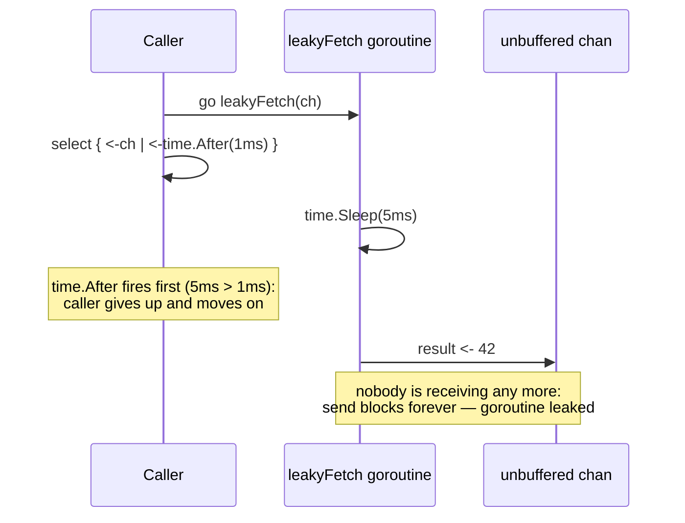

# Go Interview Questions and Traps

> [!summary] TL;DR
> Nine classic Go gotchas an interviewer expects you to have been bitten by at least once: a nil pointer hiding inside a non-nil interface, loop variables before and after Go 1.22, slices that secretly alias each other, map iteration order, defer argument timing, goroutine leaks, channel nil/closed semantics, interface satisfaction by method sets, and unguarded concurrent map access. Each has a runnable snippet, tested and `go vet`-clean, that reproduces the trap and its fix.

> [!abstract] Core idea
> - Every trap here compiles and runs correctly; the "bug" is a semantic surprise, not a build error, which is exactly why it reaches production before it's caught.
> - Most of these traps have a one-line fix once you know the rule: compare the rule, not just the symptom.
> - Go 1.22 (2024) fixed the loop-variable trap by default; the rest are still live in Go 1.24.
> - Deep technical coverage of each underlying mechanism (interfaces, slices, goroutines, channels) lives in [[04 Go Language MOC]] once written — this note is the interview-facing trap list, not the tutorial.

## 1. Why it exists

Go's design favours few, orthogonal features, which also means a handful of corners get hit by almost everyone exactly once — usually in a code review or a production incident, not in a tutorial. Interviewers lean on these traps because they distinguish "has used Go" from "has been burned by Go," which correlates with production experience far better than syntax questions do. This note is the concentrated version of that experience: nine traps, each demonstrated with code you can run.

## 2. Mental model

Every trap on this list follows the same shape: Go gives you a feature with a precise, documented rule (interfaces are a `(type, value)` pair; a range loop variable is a variable; a slice header has a length and a capacity; a map has no ordering guarantee; `defer` evaluates its arguments immediately; an unbuffered channel send blocks until received; a nil channel blocks forever; a method set depends on the receiver type; a plain map has no built-in concurrency safety). The trap is always mistaking the rule for the simpler, more intuitive thing it resembles but isn't.

## 3. How it works

```mermaid
flowchart TD
    T1["nil interface vs nil pointer"] --> R1["interface = (type, value) pair;\n(*T)(nil) wrapped in an interface is non-nil"]
    T2["loop variable capture"] --> R2["range var is ONE variable per loop\n(pre-1.22) vs ONE PER ITERATION (1.22+)"]
    T3["slice aliasing / append"] --> R3["sub-slices share a backing array\nuntil append outgrows capacity"]
    T4["map iteration order"] --> R4["runtime randomizes the start bucket\non every range"]
    T5["defer argument timing"] --> R5["args evaluated at the defer\nstatement, not at call time"]
    T6["goroutine leaks"] --> R6["unbuffered send blocks forever\nif nobody ever receives"]
    T7["channel nil/closed semantics"] --> R7["closed: drains then (zero, false);\nnil: blocks forever on both ops"]
    T8["interface satisfaction"] --> R8["pointer-receiver methods are only\nin *T's method set, not T's"]
    T9["concurrent map access"] --> R9["plain maps have no built-in lock;\nconcurrent write crashes the process"]
```



## 4. Worked example

All nine snippets below come from one scratch module (`go 1.24`), `go vet`-clean, and passing under `go test -race`:

```text
$ go vet ./...
$ go test -race ./...
ok      gotraps 1.2s
```

### Trap 1 — nil interface vs. nil pointer

An interface value is a `(type, value)` pair. A `*MyError` that is `nil` is still a non-nil interface once it's assigned to an `error`, because the pair is `(*MyError, nil)`, not `(nil, nil)`.

```go
type MyError struct{ msg string }

func (e *MyError) Error() string { return e.msg }

// doWork returns a *MyError that is always nil here, but the return type
// of the function is the concrete pointer type assigned to an `error`
// result.
func doWork(fail bool) error {
	var err *MyError // nil *MyError
	if fail {
		err = &MyError{msg: "boom"}
	}
	return err // BUG: always returns a non-nil error interface
}
```

```go
func TestNilInterfaceVsNilPointer(t *testing.T) {
	err := doWork(false)
	if err == nil {
		t.Fatal("expected the classic trap: err should be non-nil here")
	}
	if mp, ok := err.(*MyError); !ok || mp != nil {
		t.Fatalf("expected a typed nil *MyError inside the interface, got %#v", err)
	}
}
```

**Fix:** only ever `return nil` directly for the `error` interface; never return a concrete pointer variable that might itself be nil.

```go
func fixedDoWork(fail bool) error {
	if fail {
		return &MyError{msg: "boom"}
	}
	return nil // untyped nil: interface is truly nil
}
```

### Trap 2 — loop variable capture, pre- and post-Go 1.22

Before Go 1.22, a `for i := range ...` loop declared **one** `i` shared by every iteration; a closure created inside the loop captured that single variable, so all closures saw its final value once the loop ended. Go 1.22 (verified in the release notes) changed the default: the loop variable is now a **new variable per iteration**, so closures see the value from their own iteration — this module's `go.mod` says `go 1.24`, so this is the behaviour below.

```go
func TestLoopVariableGo122(t *testing.T) {
	var funcs []func() int
	for i := 0; i < 3; i++ {
		funcs = append(funcs, func() int { return i })
	}
	got := []int{funcs[0](), funcs[1](), funcs[2]()}
	want := []int{0, 1, 2}
	for i := range want {
		if got[i] != want[i] {
			t.Fatalf("Go 1.22+ per-iteration variables: got %v, want %v", got, want)
		}
	}
}
```

**The gotcha that remains even on Go 1.24:** `v` in `for _, v := range items` is still a *copy* of the element, per-iteration variable or not. Taking `&v` gives a pointer to that iteration's copy, which is safe since 1.22, but mutating through it never touches the original slice element — use `&items[i]` when you need to mutate in place.

```go
func TestLoopPointerAliasing(t *testing.T) {
	items := []int{10, 20, 30}
	var ptrs []*int
	for _, v := range items {
		ptrs = append(ptrs, &v) // one new v per iteration since Go 1.22: safe
	}
	for i, p := range ptrs {
		if *p != items[i] {
			t.Fatalf("ptr %d: got %d, want %d", i, *p, items[i])
		}
	}
}
```

### Trap 3 — slice aliasing and `append` reallocation

A sub-slice (`base[1:3]`) shares `base`'s backing array. Writes through either slice are visible on both — until an `append` grows past the shared capacity, at which point Go silently allocates a new array and the two slices detach without any error.

```go
func TestSliceAliasing(t *testing.T) {
	base := []int{1, 2, 3, 4, 5}
	sub := base[1:3] // shares base's backing array
	sub[0] = 99
	if base[1] != 99 {
		t.Fatalf("expected aliasing to mutate base[1], got %d", base[1])
	}
}

func TestAppendReallocation(t *testing.T) {
	base := make([]int, 3, 3) // len=3, cap=3: no spare capacity
	copy(base, []int{1, 2, 3})

	a := base[:2]       // len=2, cap=3: one slot of spare capacity
	b := append(a, 100) // fits in the spare capacity: reuses base's array

	if base[2] != 100 {
		t.Fatalf("expected append to reuse base's backing array, base[2]=%d", base[2])
	}

	c := append(b, 200) // cap is now exhausted (len=3, cap=3): must reallocate
	if len(c) != 4 || cap(b) != 3 {
		t.Fatalf("unexpected lengths: len(c)=%d cap(b)=%d", len(c), cap(b))
	}
	c[0] = -1
	if base[0] == -1 {
		t.Fatal("expected c to be detached from base after reallocation")
	}
}
```

**Fix:** when a function must not let its caller's slice be mutated through aliasing, copy it explicitly (`copy(dst, src)`); when two slices must stay independent after appends, pre-allocate separate backing arrays or use `slices.Clone` (Go 1.21+).

### Trap 4 — map iteration order

Go's map `range` deliberately randomizes its starting bucket on every call, specifically so that code cannot come to depend on a stable order — a decision the runtime enforces, not just "unspecified in the spec."

```go
func TestMapIterationOrderVaries(t *testing.T) {
	m := map[int]struct{}{}
	for i := 0; i < 20; i++ {
		m[i] = struct{}{}
	}

	first := iterationOrder(m)
	sawDifferentOrder := false
	for attempt := 0; attempt < 50; attempt++ {
		if o := iterationOrder(m); !equalOrder(first, o) {
			sawDifferentOrder = true
			break
		}
	}
	if !sawDifferentOrder {
		t.Fatal("expected at least one of 50 range passes to differ in order (randomized map iteration)")
	}
}
```

**Fix:** sort the keys explicitly (`slices.Sort`) whenever output order matters, e.g. for deterministic logs, JSON output, or tests.

### Trap 5 — defer argument evaluation time

`defer f(x)` evaluates `x` **immediately**, at the `defer` statement; only the call to `f` is delayed until the surrounding function returns. A later change to `x` is invisible to the deferred call.

```go
func TestDeferArgsEvaluatedAtDeferTime(t *testing.T) {
	var got int
	record := func(n int) { got = n }

	func() {
		n := 1
		defer record(n) // n (==1) is captured now
		n = 2           // this later change is NOT seen by the deferred call
	}()

	if got != 1 {
		t.Fatalf("expected defer to capture the argument at defer time (1), got %d", got)
	}
}
```

**Fix:** wrap the call in a closure so the variable is read when the closure actually runs, not when `defer` is evaluated.

```go
func TestDeferClosureSeesLatestValue(t *testing.T) {
	var got int
	func() {
		n := 1
		defer func() { got = n }() // reads n when the closure RUNS
		n = 2
	}()
	if got != 2 {
		t.Fatalf("expected the closure to see the latest value (2), got %d", got)
	}
}
```

### Trap 6 — goroutine leaks

Sending on an unbuffered channel blocks until something receives. If the caller gives up (a timeout, an early return) and never receives, the sender goroutine is stuck on that send forever — a leak that `runtime.NumGoroutine()` (or `go.uber.org/goleak` in real test suites) can detect but the program never will on its own.

```go
func leakyFetch(result chan<- int) {
	time.Sleep(5 * time.Millisecond)
	result <- 42 // blocks forever if nobody is listening
}

func TestGoroutineLeak(t *testing.T) {
	before := runtime.NumGoroutine()
	ch := make(chan int) // unbuffered: send blocks until someone receives
	go leakyFetch(ch)

	select {
	case <-ch:
		t.Fatal("expected the timeout branch, got a result")
	case <-time.After(1 * time.Millisecond):
		// caller gives up; leakyFetch's goroutine is still blocked on `result <- 42`
	}

	time.Sleep(10 * time.Millisecond)
	after := runtime.NumGoroutine()
	if after <= before {
		t.Fatalf("expected a leaked goroutine still running, before=%d after=%d", before, after)
	}
}
```



**Fix:** give the result channel a buffer of (at least) 1, so the goroutine can always finish and exit even if nobody ever reads the result.

```go
func fixedFetch(result chan<- int) {
	time.Sleep(5 * time.Millisecond)
	result <- 42 // buffered: does not block
}
```

### Trap 7 — channel nil and closed semantics

Three distinct behaviours, each a separate trap if confused:

- **Receive from a closed channel:** drains any buffered values first, then returns `(zero value, false)` forever — it never blocks and never panics.
- **Send on a closed channel:** panics, every time.
- **Any operation on a nil channel:** blocks forever (send, receive, or as a `select` case — it is simply never the ready case). This is the more common production surprise: a forgotten channel initialization.

```go
func TestReceiveFromClosedChannel(t *testing.T) {
	ch := make(chan int, 1)
	ch <- 7
	close(ch)

	v, ok := <-ch
	if v != 7 || !ok {
		t.Fatalf("expected the buffered value first: v=%d ok=%v", v, ok)
	}
	v, ok = <-ch
	if v != 0 || ok {
		t.Fatalf("expected zero value and ok=false after drain+close, got v=%d ok=%v", v, ok)
	}
}

func TestSendOnClosedChannelPanics(t *testing.T) {
	defer func() {
		if recover() == nil {
			t.Fatal("expected a panic from sending on a closed channel")
		}
	}()
	ch := make(chan int)
	close(ch)
	ch <- 1 // panics: send on closed channel
}

func TestNilChannelBlocksForever(t *testing.T) {
	var nilCh chan int // nil, never initialized
	done := make(chan struct{}, 1)

	select {
	case <-nilCh:
		t.Fatal("a nil channel must never be ready to receive")
	case <-done:
		t.Fatal("done should not have a value queued")
	default:
		// Neither case can ever fire: the nil channel blocks forever and
		// done is empty, so default is the only reachable path.
	}
}
```

**Why this matters:** disabling a `select` case at runtime (e.g. "stop watching this channel after it's done") is done by setting the channel variable to `nil`, relying exactly on the fact that a nil channel is never the ready case.

### Trap 8 — interface satisfaction and method sets

A method defined with a pointer receiver (`func (l *Logger) Read() string`) is only in the method set of `*Logger`, never of `Logger`. A `Logger` value does **not** satisfy an interface requiring `Read()`, even though `*Logger` does — this is a compile-time trap, not a runtime one, but it surprises anyone who expects "it has the method" to be enough regardless of receiver type.

```go
type Reader interface{ Read() string }

type Logger struct{ prefix string }

func (l *Logger) Read() string { return l.prefix + ":read" }

func acceptReader(r Reader) string { return r.Read() }

func TestPointerReceiverMethodSet(t *testing.T) {
	l := &Logger{prefix: "svc"}
	var r Reader = l // compiles: *Logger implements Reader
	if got := acceptReader(r); got != "svc:read" {
		t.Fatalf("got %q", got)
	}

	// var l2 Logger
	// var _ Reader = l2 // does NOT compile: Logger (value) has no Read method
}
```

**Related, not a trap once you know it:** embedding promotes the inner type's methods into the outer type's method set, and an unambiguous promoted method satisfies an interface through the outer type directly.

```go
type numericer interface{ Num() int }

type base struct{}

func (base) Num() int { return 1 }

type wrapper struct {
	base
	tag string
}

func TestEmbeddingPromotesMethodsNotOverridesSilently(t *testing.T) {
	w := wrapper{base: base{}, tag: "x"}
	var n numericer = w
	if n.Num() != 1 {
		t.Fatalf("expected the promoted base.Num()==1, got %d", n.Num())
	}
}
```

### Trap 9 — concurrent map reads and writes

A plain Go map has no built-in concurrency safety: one goroutine writing while another reads or writes the same map crashes the whole process with `fatal error: concurrent map writes` (or `...map read and map write`) — a runtime safeguard that `recover()` cannot catch, because it is a fatal throw, not a panic.

```go
// Illustrative only — deliberately not wired into a test. The runtime's
// concurrent-map guard aborts the whole process with a fatal error that
// recover() cannot catch, so running this would crash the test binary
// itself rather than failing a single test.
func unsafeConcurrentMapWrites() {
	m := map[int]int{}
	go func() { m[1] = 1 }()
	go func() { m[2] = 2 }()
}
```

**Fix:** guard the map with a `sync.Mutex`/`sync.RWMutex` around every access, or use `sync.Map` for write-heavy concurrent access patterns (it does per-key synchronization instead of one lock for the whole map).

```go
func TestMutexGuardedMapIsRaceFree(t *testing.T) {
	var mu sync.Mutex
	m := map[int]int{}
	var wg sync.WaitGroup
	for i := 0; i < 10; i++ {
		wg.Add(1)
		go func(i int) {
			defer wg.Done()
			mu.Lock()
			m[i] = i
			mu.Unlock()
		}(i)
	}
	wg.Wait()
	if len(m) != 10 {
		t.Fatalf("expected 10 entries, got %d", len(m))
	}
}
```

**Why this is distinct from trap 4:** map iteration order (trap 4) is about a single goroutine getting a randomized but safe read; this trap is about two goroutines touching the map at the same time at all, which the runtime refuses to allow silently — it crashes loudly instead of corrupting data quietly, which is actually the kinder failure mode of the two.

## 5. Variants and comparison

| Trap | Symptom in production | One-line fix |
|---|---|---|
| Nil interface vs. nil pointer | `if err != nil` is true for a "no error" case | Only ever `return nil` literally for an interface result |
| Loop variable capture (pre-1.22) | Code targeting `go <1.22` sees every closure read the loop's final value | Shadow with `v := v` inside the loop body, or set `go 1.22+` |
| Slice aliasing / append reallocation | A "copy" silently shares memory with the original, until it doesn't | `slices.Clone` or explicit `copy` when independence matters |
| Map iteration order | A test or log output is flaky across runs | Sort keys before iterating when order matters |
| Defer argument evaluation | A deferred log/metric shows a stale value | Wrap in a closure to read the value at call time |
| Goroutine leaks | Goroutine count climbs under load; eventual OOM | Buffer the channel, or select on `ctx.Done()` |
| Channel nil/closed semantics | A "stop" signal panics instead of draining, or blocks forever | Close to signal "drain then stop"; nil to disable a `select` case |
| Interface satisfaction by method set | "but it has that method!" compile error | Pass `*T`, not `T`, when methods use pointer receivers |
| Concurrent map reads/writes | Process crashes with `fatal error: concurrent map writes` | Guard with a `sync.Mutex`/`sync.RWMutex`, or use `sync.Map` |

## 6. Trade-offs and when not to use

- None of these are reasons to avoid the feature — closures, slices, maps, defer, goroutines, channels and interfaces are core to idiomatic Go. The trade-off is entirely about which rule you need to hold in your head, not whether to use the feature.
- The Go 1.22 loop-variable fix removed one entire trap by default; it is not a reason to stop checking `go.mod`'s `go` directive before reviewing old code that might predate it.

## 7. In production

- **Real systems:** the nil-interface trap is the single most common cause of "an error-handling branch that never fires" bug reports in Go code review; the goroutine-leak trap is the most common cause of a slow, days-long memory/goroutine-count climb that only a profile catches.
- **Failure modes → fixes:** see the table in section 5 — each trap's fix is one line once correctly diagnosed; the expensive part is noticing the symptom is one of these nine shapes at all.
- **What to monitor:** `runtime.NumGoroutine()` (or a `/debug/pprof/goroutine` count) trending upward under steady load is the standard signal for trap 6; `go vet`'s `copylocks` and a CI run under `-race` catch classes of concurrency bugs adjacent to these traps before they reach production.

## 8. Deep dive

The nil-interface trap (trap 1) and the method-set trap (trap 8) are two faces of the same underlying fact: an interface value is a `(type, value)` pair, not a bare pointer. Trap 1 happens because `(*MyError, nil)` is a non-nil pair; trap 8 happens because the compiler decides, at compile time, whether a concrete type's method set — which depends on whether a method uses a pointer or value receiver — is enough to satisfy an interface. Both traps disappear once you stop picturing an interface variable as "basically a pointer" and start picturing it as the two-word pair it actually is.

The loop-variable trap (trap 2) and the goroutine-leak trap (trap 6) are also related: both involve a closure or goroutine capturing scope that outlives the intent of the code that created it. Go 1.22 fixed one instance of this (the loop variable) at the language level; the other (an unbounded goroutine holding a channel send) has no language-level fix — it requires the caller to design for cancellation, typically with a buffered channel or a `ctx.Done()` case in a `select`, which is exactly the pattern [[09 Messaging & Async MOC]]'s worker-pool notes cover in depth.

A subtlety worth stating precisely for an interview: Go 1.22's fix is per `go.mod`'s `go` directive, not per Go toolchain version alone — a module that still declares `go 1.21` or lower keeps the pre-1.22 shared-variable semantics even when compiled with a newer `go` tool, because the language version is pinned by the module, not just by the compiler installed on the machine.

## 9. Interview questions

> [!question]- Why does `if err != nil` sometimes return true even though the function "returned no error"?
> Because the function returned a concrete nil pointer type (e.g. `*MyError(nil)`) through an `error`-typed result. The interface value becomes `(*MyError, nil)`, which is non-nil as an interface even though the underlying pointer is nil. The fix: only ever `return nil` literally for an interface-typed result.

> [!question]- Trap: "I upgraded to Go 1.22+, so closures over loop variables are always safe now, right?"
> Only for the per-iteration *variable* identity — closures created in different iterations now see different variables. The remaining gotcha: `v` in `for _, v := range items` is still a copy of the element on every iteration, 1.22 or not, so mutating `*(&v)` never mutates the original slice; you still need `&items[i]` to mutate in place.

> [!question]- You see `base[1:3]` passed to a function that appends to it. When can that append corrupt data the caller still reads from `base`?
> Whenever the sub-slice still has spare capacity from `base`'s backing array — append reuses that array instead of allocating, so writes land inside `base`'s memory. It stops being a risk only once an append grows past the shared capacity and a new array is allocated.

> [!question]- A flaky test fails about 1 run in 20 with a map printed in a different order. What's going on, and what's the fix?
> Go's map `range` deliberately randomizes the starting bucket on every call — there is no ordering guarantee, by design. Fix: sort keys explicitly before any output that must be deterministic (tests, logs, JSON).

> [!question]- A metric logged inside a `defer` always shows the function's *initial* state, never its final one. Why?
> `defer f(x)` evaluates `x` at the point of the `defer` statement, not when `f` actually runs at function exit. Wrap the call in a closure (`defer func() { f(x) }()`) so `x` is read when the closure executes, at the deferred call's actual time.

> [!question]- Your service's goroutine count climbs steadily under load and never comes back down. What's the first thing you check?
> Whether any goroutine sends on an unbuffered (or finite-buffer) channel whose receiver can give up — a timeout path, a cancelled request, a closed consumer — without the sender also selecting on a cancellation signal. The fix is either a buffer sized for "fire and forget," or a `select` with `ctx.Done()` alongside the send.

> [!question]- What's the difference between closing a channel and sending `nil` on a channel variable?
> Closing a channel is a signal to every receiver that no more values are coming; receives after a close drain any buffered values then return `(zero, false)` immediately. Setting a channel *variable* to `nil` disables it as a `select` case (it blocks forever, so it's never chosen) — a completely different mechanism, often used together: close to signal "done," nil the local variable afterward so a `select` loop stops selecting that case at all.

> [!question]- Trap: a type has a method with a pointer receiver, and a reviewer says "but the value type clearly has that method, I can see it in the struct's method list." Why does `var _ Interface = MyValue{}` still fail to compile?
> A pointer-receiver method is only in the method set of the pointer type (`*T`), never of the value type (`T`) — Go's spec draws this line precisely so that a value which can't safely be mutated through that method isn't silently treated as if it could. Passing `&MyValue{}` instead of `MyValue{}` is the fix.

> [!question]- Two goroutines write to the same plain `map[string]int` with no synchronization. What happens, and why can't you `recover()` from it?
> The Go runtime detects the concurrent write and crashes the whole process with `fatal error: concurrent map writes`. This is a fatal throw, not a panic, specifically so that silent map corruption can never be mistaken for a "successful" write — `recover()` only catches panics, so the process always goes down. Fix: guard every access with a `sync.Mutex`/`sync.RWMutex`, or switch to `sync.Map` for write-heavy concurrent use.

## 10. Cheat sheet

- Interface = `(type, value)` pair: a nil concrete pointer boxed in an interface is a non-nil interface.
- Go 1.22+: loop variables are per-iteration; `v` in `range` is still a copy either way.
- Sub-slices alias their parent's backing array until an `append` outgrows the shared capacity.
- Map `range` order is randomized on purpose, every call.
- `defer f(x)`: `x` is evaluated at the `defer` line, not at call time; wrap in a closure to delay the read.
- Goroutine leaks come from a blocked send (or receive) with no cancellation path; buffer or `select` on `ctx.Done()`.
- Closed channel: drains then `(zero, false)` forever, never panics on receive; sends on it always panic. Nil channel: blocks forever on every operation, which is how a `select` case gets "disabled."
- Pointer-receiver methods live only in `*T`'s method set, not `T`'s — pass `*T` to satisfy the interface.
- Plain maps are not safe for concurrent access: a concurrent write crashes the process with a fatal error, unrecoverable by `recover()`; guard with a mutex or use `sync.Map`.

## Links

- **Before this:** [[SDE-3 Readiness Checklist]]
- **Next:** none — this is the last note in the learning order for 19.
- **Compare with:** [[Backend Roadmap and Tech Landscape]]
