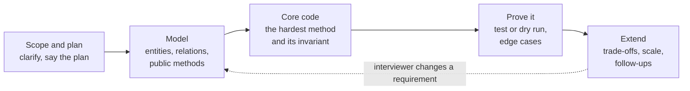
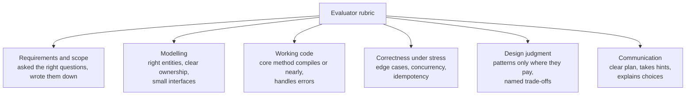
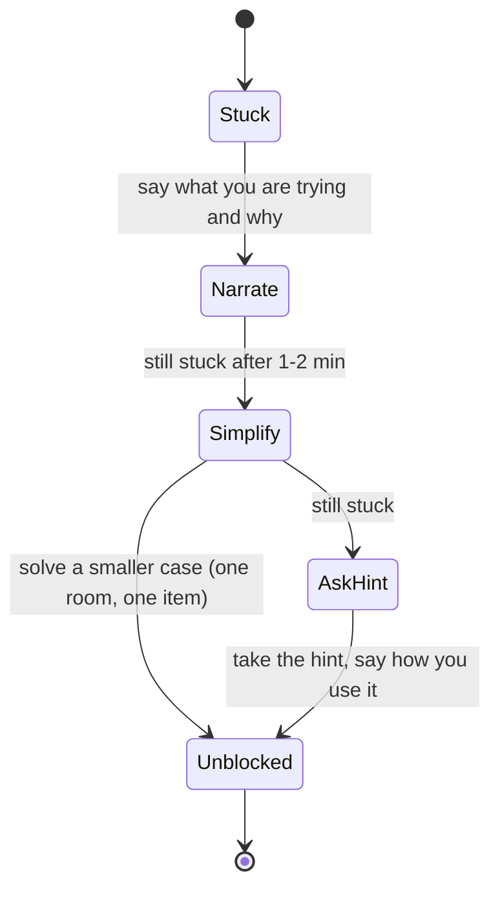

# LLD Round Playbook

> [!summary] TL;DR
> How to run a low-level design (LLD) interview round on the day: which format you are in, how to split 45, 60 or 90 minutes, how to talk while you design, what the evaluator writes down, and how to recover when you get stuck. The solving steps themselves live in [[LLD Interview Method]]; this note is about the round around them.

> [!abstract] Core idea
> - First identify the format: design discussion, machine coding, or a hybrid. It decides how much code you write.
> - Time-box every phase and say the plan out loud in the first minute, so the interviewer can redirect you early.
> - Evaluators score scope, model, working core code, edge cases, trade-offs and communication, not the number of patterns.
> - Silence and rewriting from scratch are the two most expensive mistakes; narrate, and change one thing at a time.
> - Classic mistake: spending 30 minutes drawing classes and never coding the one method that holds the hard invariant.

## 1. Why it exists

Most candidates who fail an LLD round knew the content. They lose on execution: 25 minutes of clarifying questions, a beautiful class diagram, and no working method when the hour ends. Or they code from minute 2 and build the wrong thing.

A concrete scenario: in a 60-minute round for "design a parking lot", candidate A spends 0–10 on scope, 10–25 on entities and methods, 25–50 on `Park` and `Exit` with a concurrency test, and 50–60 on extensions. Candidate B spends 0–35 on a full UML diagram with 14 classes and starts typing at minute 36. Both know the same patterns; A gets a hire signal because the evaluator saw working code, an invariant and trade-offs. This note exists so you are always candidate A.

## 2. Mental model

An LLD round is a **paired work session with a senior colleague who is also writing a report**. They want to see how you would work on their team: clarify, propose, build the important part, test it, and explain your choices.

Analogy: a cooking exam. The examiner does not want every dish in the cookbook. They want one dish, cooked on time, tasted before serving, with you explaining why you added salt. The menu (requirements) is short on purpose; the clock is the real test.

## 3. How it works

### Step 1: identify the round format

| Format | Signals in the invite | Typical length | Code expected | What to optimise |
| --- | --- | --- | --- | --- |
| Design discussion | "LLD", "object-oriented design", whiteboard or doc | 45–60 min | Signatures plus 1 core method, sometimes pseudocode | Model, invariants, trade-offs |
| Machine coding | "machine coding", "bring your laptop", "runnable" | 90–120 min | A running program, often with a demo or tests | Working code, structure, speed |
| Hybrid / product LLD | "LLD + API + DB", product-company backend loops | 60 min | API + schema, then one method in an editor | Where the invariant lives, failure paths |

If the invite is unclear, ask the recruiter one question: "Is the LLD round a discussion or do I need runnable code?" Product-company hybrids are covered in [[Zepto-style Product LLD Round]].

### Step 2: run the clock



Time boxes (estimates from practice, not an official rule; adjust if the interviewer steers):

| Phase | 45 min | 60 min | 90 min machine coding |
| --- | --- | --- | --- |
| Scope and plan | 0–5 | 0–5 | 0–10 |
| Model (entities, relations, methods; API + schema in a product round) | 5–15 | 5–20 | 10–25 |
| Core code | 15–35 | 20–45 | 25–70 |
| Prove it (test, dry run, edge cases) | 35–40 | 45–52 | 70–80 |
| Extend and questions | 40–45 | 52–60 | 80–90 |

Rule of thumb: in a 45 or 60-minute round you should be typing real code by about one third of the way in. In a 90-minute machine-coding round, get something that runs end to end by minute 50, then improve it.

### Step 3: present while you work

- **Say the plan** in the first minute (script below) and ask "does that match what you want?".
- **Write requirements as a short list** on the board or at the top of the file, marked in-scope and out-of-scope. It becomes your contract.
- **Narrate decisions, not keystrokes:** "I keep `Spot` state inside `Level` so one mutex covers find-and-assign" is useful; "now I type a for loop" is not.
- **Name the invariant before the code:** "a spot is held by at most one ticket".
- **Check in at phase boundaries:** "I have the model; shall I code `Park` now?" Interviewers often know which method they want to see.

### Step 4: know what the evaluator writes down



These six areas are the owner's interviewer checklist rewritten as a rubric: can you clarify scope, model entities, write working code, separate model, service and repository, handle edge cases, use patterns only where useful, and discuss concurrency and idempotency. Most companies use some variant of these areas; the exact names and weights differ and are not public.

## 4. Worked example

A 60-minute discussion round, "design a meeting room booking system", traced minute by minute.

**Minute 0–1, opening script:**

```text
I'll take a few minutes to pin down scope, then list entities and the public
methods, then code the booking method, because that is where the overlap rule
lives. I'll test it with two concurrent bookings, and leave the last ten
minutes for edge cases and extensions. Does that work for you?
```

**Minute 1–5, scope.** Questions asked: single office or many? recurring meetings? can a booking be edited? what is the time granularity? Written down: in scope = rooms, book, cancel, list free rooms for a slot; out of scope = recurring, notifications (mention as extension).

**Minute 5–20, model.** Entities `Room`, `Booking`, `Scheduler`; invariant "no two bookings of one room overlap, where overlap means `a.start < b.end && b.start < a.end`". Methods `Book(roomID, userID, start, end)`, `Cancel(bookingID, userID)`, `FreeRooms(start, end)`.

**Minute 20–45, core code.** `Book` checks overlap and inserts under one lock per room; returns a typed `ErrConflict`. Full solution in [[Meeting Room Scheduler]].

**Minute 45–52, prove it.** Two goroutines book the same room and slot; exactly one succeeds under `go test -race`. Dry-run back-to-back meetings (10:00–11:00 and 11:00–12:00 must both succeed with a half-open interval).

**Minute 52–60, extend.** Interviewer asks "what if two app servers run this?". Answer: move the invariant to PostgreSQL with an exclusion constraint, `EXCLUDE USING gist (room_id WITH =, tstzrange(starts_at, ends_at) WITH &&)` (needs the `btree_gist` extension for the `=` on `room_id`); mention recurring meetings expand into instances.

What the evaluator likely wrote: clear scope, correct invariant, working `Book`, tested race, good DB answer. That is a hire signal for the LLD part.

## 5. Variants and comparison

| Situation | What changes | Do | Avoid |
| --- | --- | --- | --- |
| Pure OOD (Parking Lot, Elevator) | No DB, state in memory | Classes and one method with a mutex | Inventing a REST API nobody asked for |
| Product LLD (inventory, cart, delivery) | API + schema earlier | Put the invariant in the DB | Process-local locks as the final answer |
| Machine coding, 90–120 min | Must run, sometimes graded offline | Get an end-to-end slice running first, then add features | Perfect folder structure before anything runs |
| Concurrency-heavy (rate limiter, LRU, pub-sub) | Code is the whole round | Small API, clear locking, a race test | Over-designing interfaces |
| Senior (SDE-3) bar | Same question, deeper follow-ups | Bring failure paths, multi-instance, observability yourself | Waiting to be asked |

## 6. Trade-offs and when not to use

- **The time boxes are a default, not a law.** If the interviewer says "skip requirements, start coding", do it. Following your plan over their hint is a red flag.
- **Asking too many questions** costs as much as asking none. Four to six targeted questions is enough; state assumptions for the rest.
- **Full UML is rarely worth it.** A class list with key fields and arrows is enough; draw a sequence diagram only for the core flow ([[UML for LLD]]).
- **Patterns are a cost.** Each interface you add is something to explain. Name a pattern only when the requirement changes along that axis ([[Design Patterns Overview and Chooser]]).
- **This playbook is not for HLD rounds.** A system-design round has a different shape; use [[System Design Interview Framework]].

## 7. In production

Here "production" means the real interview loop.

**Red flags evaluators note:**

- Coding before agreeing on scope, or never coding at all.
- Raw strings for states, exported fields that bypass invariants, one god struct.
- "I would use a mutex" with no mention of what happens across instances (in product rounds).
- Patterns listed without a reason ("I'll use Factory, Singleton and Observer").
- Ignoring a hint, or arguing with a requirement change.
- Not testing or dry-running the core method.
- Long silences.

**Failure modes and fixes:**

| Failure in the round | Fix on the spot |
| --- | --- |
| Clock is at 60% and no code | Say so: "I'll code the core method now and describe the rest." |
| Stuck on a bug | Dry-run one small input out loud; the interviewer often spots it with you |
| Requirement changes mid-way | Restate it, show which class or method changes, change only that |
| Design feels wrong | Name the problem and the smaller fix; do not restart from scratch |
| You do not know a term they use | Ask; guessing wrong costs more |

**Daily practice routine** (the owner's method; times are targets):

1. 10 minutes on requirements and entities.
2. 10 minutes on methods/APIs and storage.
3. 25–40 minutes coding the core logic, with one test.
4. 10 minutes on edge cases.
5. 5 minutes explaining it out loud, recorded if possible.

Work through problems in the order of [[17 LLD MOC]], and revise with [[LLD Problem Cheat Sheet]].

## 8. Deep dive

### Recovering when stuck



- **Narrate first.** Interviewers cannot help with what they cannot hear, and they often score how you handle being stuck.
- **Shrink the problem.** One room instead of many, one item instead of a cart, a single goroutine before concurrency.
- **Leave a stub.** A helper that returns `errors.New("not implemented")` is fine if you say what it would do; move on to the method that matters.
- **Asking for a hint is not a failure.** Taking it well is a positive signal; refusing hints and burning ten minutes is a negative one.

### Calibrating for SDE-3

At SDE-1/2 a correct model and working method usually pass. At SDE-3 the same question is used to look for: invariants named before code, the failure path coded (not just mentioned), multi-instance correctness, testability (fake clock, interfaces at the consumer side), and a short, prioritised list of extensions with their cost. Language matters less than judgment; Go idioms help only when they make the design simpler ([[OOP in Go - Structs, Interfaces, Embedding]]).

### Go-specific presentation tips

- Keep one package for a 45-minute round; split files (`model.go`, `service.go`, `service_test.go`) only if the editor makes it easy. The layout is in [[LLD Interview Method]].
- Use typed constants for states and sentinel or typed errors for failures.
- A `go test -race` winner test is the fastest way to prove a concurrency claim ([[Testing LLD Code]], [[Concurrency for LLD]]).

## 9. Interview questions

> [!question]- The interviewer says "design X" and goes quiet. What do you do in the first two minutes?
> Say the plan (scope → model → core method → test → extensions), ask 4–6 scoping questions, write the answers down as in-scope and out-of-scope, and ask "does that match?". Silence at the start reads as no structure.

> [!question]- How do you decide which method to code?
> The one that holds the hard invariant or the race: `Park`, `Book`, `Reserve`, `Allow`. Ask the interviewer if unsure; they usually have one in mind.

> [!question]- Trap: "Should I draw the full class diagram before coding?"
> No. Draw the entities, key fields and relations in a few minutes; a full UML diagram eats the time you need for working code. Draw a sequence diagram only for the core flow.

> [!question]- You realise at minute 40 your model is wrong. Restart?
> Almost never. Name the flaw, show the smallest change that fixes it (move a field, split a method), and continue. A clean recovery scores better than a half-finished rewrite.

> [!question]- How much should you talk about patterns?
> One sentence per pattern, tied to a requirement that varies ("pricing rules change per city, so pricing is a Strategy"). Listing patterns without reasons is a red flag.

> [!question]- What separates a hire from a strong hire in LLD?
> Both have a working core method. A strong hire also names invariants first, tests the race, codes the failure path, and offers prioritised extensions with costs, without being prompted.

## 10. Cheat sheet

- Identify the format: discussion, machine coding or hybrid.
- First minute: say the plan and ask "does that match?".
- Typing real code by about one third of the time.
- Code the hardest method; name its invariant first.
- Prove it: dry run or a `-race` winner test.
- Stuck: narrate → shrink the problem → ask for a hint.
- Never restart; fix the smallest thing.
- SDE-3: failure paths, multi-instance, extensions with costs.

## Links

- **Before this:** [[LLD Interview Method]], [[17 LLD MOC]]
- **Next:** [[Zepto-style Product LLD Round]], [[LLD Problem Cheat Sheet]], [[Learning Resources]]
- **Compare with:** [[System Design Interview Framework]] (the HLD round), [[Go Interview Questions and Traps]] (language round)
