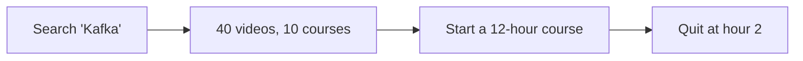
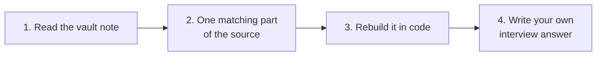
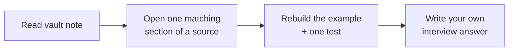

# Learning Resources

> [!summary] TL;DR
> A curated list of the outside material behind this vault, grouped by area, with official documentation first, then books, then courses and videos.
>
> Each entry says what it is good for and which vault note it backs up, so you read the note first and the source only for the part you need.

> [!abstract] Core idea
> - Official docs are the source of truth; blogs and videos are for intuition.
> - Read the vault note, then the one section of the source it points to, then code the example yourself.
> - Courses taught in Java still work for LLD, but translate them to Go and add what they skip (concurrency, DB invariants, idempotency).
> - Links were collected from older notes and were not re-checked on the date above; if one is dead, search the title on the same site.

## Start here: the basics 🟢

> [!info] How to read this note (pick your level)
> - 🟢 **New to this?** Read "From zero" below, then "How to use a resource" and the Go language list. Stop there, that is a full first pass.
> - 🟡 **Know the basics?** Add the lists for APIs, databases, cloud, AI engineering and LLD.
> - 🔴 **Interview / SDE-3 prep?** Add the backend course syllabus map at the end. Headings are tagged 🟢🟡🔴 so you always know where you are.

> [!note] Before this note
> - Nothing. This note starts from zero. It is a reading list, so you only need to know which topic you are studying right now.

**From zero, in 60 seconds** 🟢

There is too much to learn from. Search for any topic and you get dozens of videos, courses and books.

Starting a long course from hour one is the usual trap. You get tired and learn little.

This note works the other way. Read the vault note first. Then open only the one part of a course or book that matches it. Then write a little code yourself.

Below, every resource is listed by topic, with what to use it for and which note it backs up.

The rest of this note is just these 3 questions:
1. How do you use a resource without wasting hours?
2. Which sources are best for each topic?
3. How do older courses map to the notes in this vault?

**The problem in one story.**
You want to learn Kafka, so you search and get 40 videos, 10 courses and 3 books.
You start a 12-hour course and stop after hour two, tired and no wiser.
This page picks a small set of trusted sources per topic and tells you which part to read.
You read the vault note first, then only the slice of the source you need.

**Words you need first**

| Word | Plain meaning | Tiny example |
| --- | --- | --- |
| Official docs | Documentation written by the people who build the tool | go.dev/doc |
| Spec | The exact formal rules of a language or protocol | The Go language specification |
| Vault note | One note in this Obsidian vault | [[LLD Round Playbook]] |
| Scratch module | A throwaway Go project for trying code | `go mod init scratch` |
| LLD | Low-level design: classes, methods and their rules | Designing a parking lot |
| MOC | "Map of content", an index note for a folder | [[19 Interview & Career MOC]] |
| HLD | High-level design: services, databases and how they connect | Designing all of WhatsApp's backend |
| Goroutine | A lightweight Go thread | `go send(msg)` |
| Data race | Two goroutines touch the same memory at once, one writing | Two requests updating one map |
| gRPC | A fast way for services to call each other over the network | `payments.Charge(...)` from another service |
| Protocol Buffers | The compact message format gRPC uses, defined in a `.proto` file | `message Invoice { int64 id = 1; }` |
| Cache eviction / TTL | Which old cache entries get thrown out / how long an entry lives | LRU drops the least recently used; TTL 60 s |
| OpenTelemetry | A standard toolkit for traces and metrics | One trace across 3 services |
| Vector DB | A database that finds items by "closeness of meaning" | Search notes similar to a question |

**Picture it**

**Analogy.** A good librarian: instead of handing you the whole shelf, they open the right book at the right chapter.
Where it breaks: a librarian checks the book is still there, but these links were not re-checked, so some may be dead.

**How the rest of this note builds up**

- First, the four-step way to use any resource.
- Then sources by area: Go, APIs and gRPC, databases and caching, containers and cloud, AI engineering.
- Finally the deeper material: LLD and design courses and the advanced backend + AI syllabus.

> [!tip] Remember
> Note first, one section of the source second, your own code third.

## How to use a resource 🟢

1. Read the vault note for the topic until the end of its worked example.
2. Open only the matching section of the source below, not the whole course.
3. Rebuild the example in a scratch module and add one test.
4. Write one interview answer in your own words in the note's question callouts.

### Real-life example 🟢

Say next week's interview asks you to design seat booking for an app like BookMyShow, and you are unsure how to stop two people grabbing the same seat.
Step 1: read the vault note on locking until the end of its worked example.
Step 2: open only the PostgreSQL docs section on row locks (`SELECT ... FOR UPDATE`), not the whole manual.
Step 3: write a 30-line Go program where two goroutines try to book seat D7, and a test that proves only one wins.
Step 4: write your three-sentence interview answer in the note. That is one evening, not a 12-hour course.

## Common beginner mistakes 🟢

- **Starting a long course from video 1** → you tire out before reaching the part you need → read the vault note, then jump to the one matching section.
- **Trusting a random blog over the official docs** → blogs go out of date or are simply wrong → check the official docs for anything you will say in an interview.
- **Watching without coding** → it feels like learning but doesn't stick → rebuild the example in a scratch module and add one test.
- **Copying Java course code straight into Go** → you get class-like code Go reviewers dislike → use the "Translating a Java course to Go" list below.
- **Giving up when a link is dead** → these links were not re-checked → search the title on the same site.

### Official docs vs books vs videos 🟡

| Source type | Best for | Watch out for | Example |
| --- | --- | --- | --- |
| Official docs | Exact, current facts you can quote | Dry; not a tutorial | The Go Memory Model |
| Books | Deep, connected understanding | Can lag behind new versions | *Designing Data-Intensive Applications* |
| Videos and courses | Intuition and a first walk-through | Long, may skip edge cases, may be outdated | Rob Pike's concurrency talk |

## Go language 🟢

🟢 **Plain version:** If you are new to Go, open just two links from this table: A Tour of Go (short browser lessons) and How to Write Go Code (how to set up a project). Come back to the rest later, one at a time, when a vault note points you here. Words like "memory model" and "race detector" are about goroutines (lightweight threads) safely sharing data; you can skip them until you study concurrency.

**Official (start here):**

| Resource | Use it for | Backs up |
| --- | --- | --- |
| [Go documentation hub](https://go.dev/doc/) | Index of every official guide | [[04 Go Language MOC]] |
| [A Tour of Go](https://go.dev/tour/) | First pass over syntax, interfaces, goroutines | [[04 Go Language MOC]] |
| [How to Write Go Code](https://go.dev/doc/code) | Modules, packages, `go` tool setup | [[04 Go Language MOC]] |
| [Effective Go](https://go.dev/doc/effective_go) | Idioms; the [interfaces section](https://go.dev/doc/effective_go#interfaces) for small, implicit interfaces | [[OOP in Go - Structs, Interfaces, Embedding]] |
| [Go Code Review Comments: interfaces](https://go.dev/wiki/CodeReviewComments#interfaces) | Why interfaces belong on the consumer side | [[SOLID in Go]] |
| [The Go Memory Model](https://go.dev/ref/mem) | Happens-before, what a data race is | [[Concurrency for LLD]] |
| [Data Race Detector](https://go.dev/doc/articles/race_detector) | How `-race` works and its limits | [[Testing in Go]] |
| [Tutorial: add a test](https://go.dev/doc/tutorial/add-a-test) | The `testing` package basics | [[Testing in Go]] |
| [Table-driven tests (Go wiki)](https://go.dev/wiki/TableDrivenTests) | The standard test layout | [[Testing LLD Code]] |
| [Working with errors in Go 1.13](https://go.dev/blog/go1.13-errors) | `%w`, `errors.Is`, `errors.As` | [[04 Go Language MOC]] |
| [Go Concurrency Patterns: Context](https://go.dev/blog/context) | Why and how `context` carries cancellation | [[Context Package]] |
| [Go Concurrency Patterns: Pipelines and cancellation](https://go.dev/blog/pipelines) | Fan-out, fan-in, stopping goroutines | [[Goroutines and Channels]] |
| [package context](https://pkg.go.dev/context) | API reference | [[Context Package]] |
| [package sync](https://pkg.go.dev/sync) | Mutex, RWMutex, Once, WaitGroup reference | [[Concurrency for LLD]] |
| [Go 1.22 release notes](https://go.dev/doc/go1.22) | Per-iteration loop variables, method and wildcard routing in `net/http` | [[HTTP Server Fundamentals (net-http)]] |
| [Accessing relational databases](https://go.dev/doc/database/) | `database/sql`, transactions, prepared statements | [[06 Backend Engineering in Go MOC]] |
| [Tutorial: REST API with Go and Gin](https://go.dev/doc/tutorial/web-service-gin) | A first JSON API end to end | [[REST and HTTP API Design]] |

**Talks and videos:**

| Resource | Use it for | Backs up |
| --- | --- | --- |
| [Rob Pike, Go Concurrency Patterns (Google I/O 2012)](https://www.youtube.com/watch?v=f6kdp27TYZs) | Generators, fan-in, timeouts with `select` | [[Goroutines and Channels]] |
| [Sameer Ajmani, Advanced Go Concurrency Patterns (Google I/O 2013)](https://www.youtube.com/watch?v=QDDwwePbDtw) | The for-select loop, owning state in one goroutine | [[Goroutines and Channels]] |
| [Go benchmarking and pprof (video; title not re-checked)](https://www.youtube.com/watch?v=TbdtTm6FCQU) | Writing benchmarks and reading profiles | [[Benchmarks, Profiling and Tracing]] |

**Books:** *The Go Programming Language* (Donovan and Kernighan) for a complete, careful pass over the language; *Concurrency in Go* (Katherine Cox-Buday) for patterns beyond the talks above.

### Course coverage checklist: Go Bootcamp

**In plain words:** A tick list of what the Go course covers, mapped to the vault note for each topic.

The owner followed the Udemy course *Go Bootcamp: With gRPC and Protocol Buffers (HTTP/S, HTTP2)*. Its public curriculum lists these topics. Use them as a checklist that the vault covers each one; ticks are not tracked here.

- Setup: Go toolchain, playground, editor, Git → [[04 Go Language MOC]]
- Basics: variables, functions, arrays, slices, maps, `defer`, `panic`, `recover` → [[04 Go Language MOC]]
- Intermediate: closures, recursion, pointers, strings and runes, `fmt` verbs, structs, interfaces, embedding, generics, `text/template` and `html/template`, `regexp`, `time`, random numbers, files and directories, URL parsing, base64, hashing → [[04 Go Language MOC]]
- Advanced: goroutines, channels, `context`, timers and tickers, worker pools, `WaitGroup`, mutexes, atomics, testing, benchmarking, pprof, OS processes, `reflect` → [[Goroutines and Channels]], [[Testing in Go]], [[Benchmarks, Profiling and Tracing]]
- REST API in Go: planning, folder structure, middleware, SQL and NoSQL → [[06 Backend Engineering in Go MOC]]
- HTTPS, HTTP/2, TLS → [[TLS, HTTPS and HTTP2 in Go Servers]]
- Protocol Buffers: syntax, types, serialization, services, versioning, `protoc` → [[gRPC]]
- gRPC: server and client, TLS, streaming, deadlines, metadata, reflection, `grpcurl`, gateway, combined REST and gRPC → [[gRPC Services in Go]], [[gRPC Streaming in Go]], [[Serving REST and gRPC Together]]
- Load tools `wrk`, `h2load`, `ghz` → [[Load Testing]]

## APIs, gRPC and Protocol Buffers 🟡

> 🟢 → 🟡 **You now know** the four-step way to use a source and where to start for Go. **Next** come the lists for specific backend areas: APIs, databases, cloud, AI and LLD. Open them only when you are studying that area.

**In plain words:** Each table row is one source, what it is good for, and which note it backs up.

| Resource | Use it for | Backs up |
| --- | --- | --- |
| [gRPC Go docs](https://grpc.io/docs/languages/go/) | Entry point for gRPC in Go | [[gRPC Services in Go]] |
| [gRPC Go quick start](https://grpc.io/docs/languages/go/quickstart/) | Install `protoc` plugins, run hello world | [[gRPC Services in Go]] |
| [gRPC Go basics tutorial](https://grpc.io/docs/languages/go/basics/) | All four RPC kinds, including streaming | [[gRPC Streaming in Go]] |
| [Protocol Buffers Go tutorial](https://protobuf.dev/getting-started/gotutorial/) | Messages, generated code, field numbers | [[gRPC]] |
| [Google codelab: getting started with gRPC Go](https://codelabs.developers.google.com/grpc/getting-started-grpc-go) | A guided build of a gRPC service | [[gRPC Services in Go]] |
| [Tech School: the complete gRPC course (article series)](https://dev.to/techschoolguru/the-complete-grpc-course-protobuf-go-java-2af6) | Longer project-style course | [[gRPC Services in Go]] |
| [Tech School: gRPC intro video (title not re-checked)](https://www.youtube.com/watch?v=VtX9w8uKvEk) | Why gRPC and HTTP/2, in one video | [[gRPC]] |

## Databases and caching 🟡

| Resource | Use it for | Backs up |
| --- | --- | --- |
| [PostgreSQL 17 documentation](https://www.postgresql.org/docs/17/) | The SQL dialect used everywhere in this vault | [[07 Databases MOC]] |
| [Redis docs: key eviction](https://redis.io/docs/latest/reference/eviction/) | `maxmemory` policies, approximate LRU (drop least recently used) and LFU (drop least frequently used) | [[Cache Eviction Policies - LRU, LFU, TTL]] |
| [AWS: caching best practices](https://aws.amazon.com/caching/best-practices/) | Cache-aside (app checks cache, then DB), write-through (write cache and DB together), TTL choices | [[Caching Patterns]] |
| [AWS whitepaper: database caching strategies using Redis, caching patterns](https://docs.aws.amazon.com/whitepapers/latest/database-caching-strategies-using-redis/caching-patterns.html) | The same patterns with Redis specifics | [[Caching Patterns]] |

**Book:** *Designing Data-Intensive Applications* (Martin Kleppmann) for replication, partitioning, transactions and stream processing; read it alongside [[07 Databases MOC]] and [[10 Distributed Systems & Resilience MOC]].

## Containers, cloud and observability 🟡

| Resource | Use it for | Backs up |
| --- | --- | --- |
| [Docker guide: Go](https://docs.docker.com/guides/golang/) | Multi-stage Dockerfile for a Go service | [[Docker 04 - Writing a Production Dockerfile for Go]] |
| [OpenTelemetry Go docs](https://opentelemetry.io/docs/languages/go/) | SDK setup, traces and metrics | [[Distributed Tracing with OpenTelemetry]] |
| [OpenTelemetry Go instrumentation libraries](https://opentelemetry.io/docs/languages/go/libraries/) | Ready-made instrumentation for `net/http`, gRPC, SQL | [[Distributed Tracing with OpenTelemetry]] |

## AI engineering 🟡

| Resource | Use it for | Backs up |
| --- | --- | --- |
| [Pinecone Python SDK: upsert and query vectors](https://sdk.pinecone.io/python/how-to/vectors/upsert-and-query.html) | The shape of a vector-DB write and search | [[RAG Pipeline]] |
| [Pinecone TypeScript SDK: metadata filtering](https://sdk.pinecone.io/typescript/documents/data-operations_metadata-filtering.html) | Filtering search results by metadata | [[Advanced RAG Patterns]] |

## LLD and design 🟡

| Resource | Use it for | Backs up |
| --- | --- | --- |
| [CodeWithAryan: low level design page](https://codewitharyan.com/system-design/low-level-design) | Index of the LLD course and model problems (Java) | [[17 LLD MOC]] |
| [CodeWithAryan: what is low level system design](https://codewitharyan.com/tech-blogs/what-is-low-level-system-design) | What LLD is and how it differs from HLD | [[LLD Interview Method]] |
| [CodeWithAryan: how to approach LLD problems](https://codewitharyan.com/tech-blogs/how-to-approach-lld-problems) | A step order for solving a problem | [[LLD Interview Method]] |
| [CodeWithAryan: structural design patterns](https://codewitharyan.com/tech-blogs/structural-design-patterns) | Adapter, Decorator, Proxy, Facade, Composite in Java | [[Design Patterns Overview and Chooser]] |
| [CodeWithAryan: design a logging system](https://codewitharyan.com/tech-blogs/design-logging-system) | A pattern-combination model problem | [[Logging Library]] |
| [Refactoring Guru: design patterns](https://refactoring.guru/design-patterns) | Intent, structure and pitfalls of each GoF ("Gang of Four", the classic 1994 design patterns book) pattern, with a Go example per pattern | [[Design Patterns Overview and Chooser]] |
| [Mermaid: class diagrams](https://mermaid.js.org/syntax/classDiagram.html) | Syntax for the class diagrams in 17 | [[UML for LLD]] |
| [Mermaid: sequence diagrams](https://mermaid.js.org/syntax/sequenceDiagram.html) | Syntax for request flows | [[UML for LLD]] |
| [Mermaid: state diagrams](https://mermaid.js.org/syntax/stateDiagram.html) | Syntax for lifecycles | [[State Machines in Go]] |

**Books:** *Design Patterns* (Gamma, Helm, Johnson, Vlissides) as the reference for intent; *Head First Design Patterns* (Freeman and Robson) for a gentler first read; *The Pragmatic Programmer* (Hunt and Thomas) for DRY and orthogonality.

### CodeWithAryan course map

**In plain words:** The course uses Java, but the ideas are the same. Each module points to the matching note here.

The course is taught in Java. Each module maps to one vault note:

- What is LLD, HLD vs LLD, requirements, use cases, entities, relationships, core methods → [[LLD Interview Method]]
- UML (class, sequence, activity) → [[UML for LLD]]
- SOLID → [[SOLID in Go]]
- DRY, KISS, YAGNI → [[Design Principles - DRY, KISS, YAGNI, Coupling and Cohesion]]
- Factory → [[Factory and Abstract Factory]]; Strategy → [[Strategy and Template Method]]; Observer → [[Observer and Event Bus]]; Singleton → [[Singleton and sync.Once]]
- Structural patterns → [[Adapter]], [[Decorator and Middleware]], [[Proxy]], [[Facade (vs Mediator)]], [[Composite]]
- Logging system model problem → [[Logging Library]]

**Translating a Java course to Go:**

- A class becomes a struct with methods; an enum becomes a named type with typed constants.
- Inheritance becomes composition (embedding or a field), and abstract classes become an interface plus a helper.
- `synchronized` becomes a `sync.Mutex`, or, across instances, an atomic database update.
- A static singleton becomes a value built in `main` and injected, or `sync.Once` when it truly must be global.
- Define interfaces where they are used, not next to the implementation. The full table is in [[OOP in Go - Structs, Interfaces, Embedding]].

**What Java LLD courses usually skip, so study it here:** concurrency and race tests ([[Concurrency for LLD]]), invariants enforced in the database ([[Locking - Optimistic vs Pessimistic]]), and idempotent retries ([[Idempotency and Idempotency Keys]]).

## Backend course syllabus (Advanced Backend + AI) 🔴

> 🟡 → 🔴 **You now know** the best source per topic. **Last comes the big picture**: how an older end-to-end backend course maps onto this vault's folders, useful for planning a long study run.

The owner's earlier study plan followed a two-part backend course. Its syllabus, mapped to the vault:

| Level | Course topics | Vault area |
| --- | --- | --- |
| 0. Basic backend | HTTP, APIs, databases revision | [[02 Networking & Web MOC]], [[05 APIs MOC]] |
| 1. Docker | Images, containers, Compose | [[13 DevOps & Cloud MOC]] |
| 2. Redis | API caching, rate-limiting project, message queue | [[08 Caching & Redis MOC]], [[Rate Limiting - Algorithms and Distributed Design]], [[Redis as a Queue - Lists, Streams and Pub-Sub]] |
| 3. System design | Scaling, Nginx, microservices, replication, sharding | [[11 System Design MOC]], [[Nginx]], [[Monolith vs Microservices]], [[Replication]], [[Partitioning and Sharding]] |
| 4. AI | LLM fundamentals, LangChain, LangGraph, agents, prompt engineering, RAG, embeddings, vector DBs, semantic search, document processing, chat with PDFs and websites | [[18 AI Engineering MOC]] |
| 5. Cloud | AWS deployment, CI/CD, ECR and ECS, production best practices | [[AWS 05 - ECS, Fargate and ECR]], [[CI-CD Pipelines (GitHub Actions for Go)]], [[Deploying a Go API on AWS (Reference Architecture)]] |

## Self-check 🟢🟡

> [!question]- (easy) What are the four steps for using any resource?
> Read the vault note, open one matching section of the source, rebuild the example with a test, write your own interview answer.

> [!question]- (easy) Which source wins if a blog and the official docs disagree?
> The official docs.

> [!question]- (easy) Where should a total Go beginner start?
> A Tour of Go, then How to Write Go Code.

> [!question]- (medium) A Java LLD course uses `synchronized`. What is the Go version?
> A `sync.Mutex` inside one process, or an atomic database update across instances.

> [!question]- (medium) Name three things Java LLD courses usually skip that you should study here.
> Concurrency and race tests, invariants enforced in the database, and idempotent retries.

> [!question]- (medium) Which book backs up replication, partitioning and transactions?
> *Designing Data-Intensive Applications* by Martin Kleppmann.

## Links 🟢

- **Before this:** [[19 Interview & Career MOC]], [[Backend Roadmap and Tech Landscape]]
- **Next:** [[SDE-3 Readiness Checklist]], [[LLD Round Playbook]]
- **Compare with:** each area's MOC, which lists the vault notes in learning order
