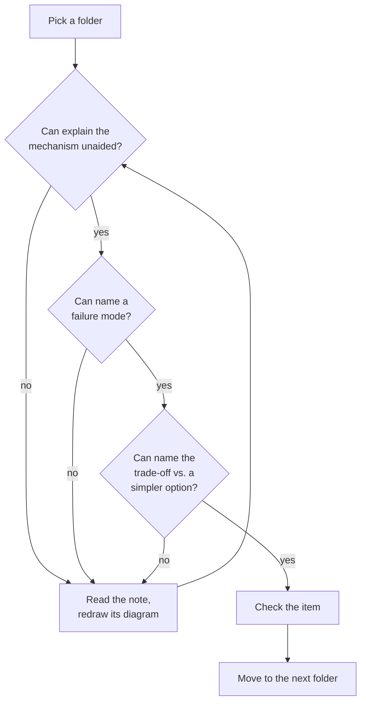
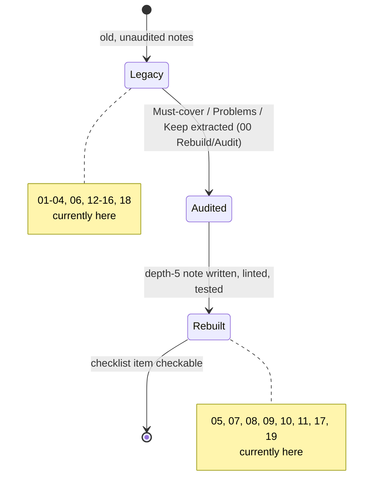

# SDE-3 Readiness Checklist

> [!summary] TL;DR
> A single checklist, one "I can…" item per vault folder, that tells you whether you are ready for an SDE-3 backend loop. Each item links to the note that teaches it, so a weak answer always has a next action, not just a label.

> [!abstract] Core idea
> - "SDE-3 ready" means you can go past the definition of a topic to its failure modes, trade-offs, and what you'd monitor in production — not just name it.
> - The checklist below is organised by folder, in the same order as [[Backend Roadmap and Tech Landscape]], so weak areas map directly to what to study next.
> - An item is checked only when you can give a concrete production example, a failure mode, and a trade-off for it, out loud, without the note open.
> - This vault does not yet cover every folder; the honest gap list at the end says exactly which ones.

## 1. Why it exists

The old source material for this checklist ("2026 SDE3 Gap Checklist", "SDE3 Backend Roadmap", "START HERE - Advanced Backend SDE3 Path") each had a completion checklist, but the three disagreed on what "done" meant and attached a generic, copy-pasted set of interview Q&A to every topic regardless of what the topic actually was. A checklist only works if two things are true: each item is specific enough that passing it proves something, and the whole list is honest about what is and isn't covered yet.

This note replaces all three with one checklist, tied to this vault's actual folders and actual write-progress, so "I'm SDE-3 ready" is a claim you can check folder by folder instead of a feeling.

## 2. Mental model

Think of readiness as a row per folder, with four columns: can you **explain** the core mechanism without the note open, can you **draw** the diagram from memory, can you **name a failure mode**, and can you **name the trade-off** against a simpler alternative. A folder only counts as "I can" when all four are true, not just the first one — "I can define a circuit breaker" is not the same claim as "I can tell you when one is the wrong fix."

## 3. How it works

This is the same four-question loop the Writer Brief's quality bar applies to every note in this vault ([[Consistent Hashing]] is the model): read it, redraw it, explain an example aloud, say a failure mode, say a trade-off.

Each folder itself moves through three states as the vault is rebuilt, and an item in this checklist can only be checked once its folder reaches "rebuilt":

## 4. Worked example

A worked pass through one folder, using [[Consistent Hashing]] as the concrete topic:

1. **Explain unaided:** "keys and servers hash onto the same ring; a key belongs to the first server clockwise; adding a server only moves the arc behind it."
2. **Redraw:** the ring diagram with 4 servers and 3 keys, without looking.
3. **Failure mode:** "without virtual nodes, one server can own a disproportionate arc and get overloaded; and consistent hashing does not fix a single hot *key* — one very popular key still lands on one server."
4. **Trade-off:** "vs. `hash % N`: consistent hashing moves ~1/N of keys instead of ~(N−1)/N on a resize, at the cost of an `O(log P)` ring lookup instead of `O(1)` modulo."

Only once all four are fluent does [[07 Databases MOC]]'s consistent-hashing item get checked below.

## 5. Variants and comparison

| Checklist style | What it checks | Weakness it fixes |
|---|---|---|
| Old "completion checklist" (START HERE) | 11 generic "I can design X" statements across the whole vault | Too coarse — one checkbox covered 10+ distinct topics |
| Old "must know deeply" list (2026 Gap Checklist) | A flat bullet list per subject area, no links | No link from a weak area back to a note to fix it |
| **This checklist** | One row per rebuilt folder, linked to its MOC/notes, four-question bar per item | Granular, linked, and honest about what's not written yet |

## 6. Trade-offs and when not to use

- This checklist assumes you've already read the linked notes at least once; it is a self-test, not a syllabus — use [[Backend Roadmap and Tech Landscape]] for first-pass learning order.
- Checking every box here does not replace mock interviews: it proves topic fluency, not interview performance under time pressure and follow-ups (see [[LLD Round Playbook]] for the performance side).
- A folder marked pending below has no note to self-test against yet; treat those as "not yet checkable," not "known to be hard."

## 7. In production

- **Real systems:** every "I can" item below is phrased as something you'd actually say in a design review, not a trivia answer — that's deliberate, since the loop this checklist prepares for is testing the same thing a design review tests.
- **Failure modes → fixes:** the single most common way candidates fail this bar is stopping at "explain unaided" and skipping straight to the next topic — always force yourself through all four questions per item.
- **What to monitor:** track your own pass/fail per item over time (a simple table or the vault's progress properties); re-check items you haven't touched in a month, since fluency decays.

## 8. Deep dive

### Readiness checklist by folder

Each item checks against the four-question bar in section 2. Folders already rebuilt in this vault get real links; folders not yet rebuilt are listed honestly in the gap section below instead of being linked to notes that don't exist.

**[[04 Go Language MOC]]** (pending — see gaps)
- [ ] I can explain goroutines, channels, and the Go memory model, including at least one trap (see [[Go Interview Questions and Traps]]).

**[[05 APIs MOC]]**
- [ ] I can design and critique a REST, GraphQL, gRPC or WebSocket API: versioning, pagination, idempotency keys, and backward compatibility.

**[[06 Backend Engineering in Go MOC]]** (pending — see gaps)
- [ ] I can lay out a Go service in handler → service → repository layers and justify the boundary.

**[[07 Databases MOC]]**
- [ ] I can choose and justify an index, explain an isolation level, and reason about replication lag — see [[Consistent Hashing]] for the quality bar this was checked against.

**[[08 Caching & Redis MOC]]**
- [ ] I can design a cache-aside layer with Redis, including invalidation and a plan for a thundering-herd on cache miss.

**[[09 Messaging & Async MOC]]**
- [ ] I can pick between at-least-once and exactly-once-effective delivery, and design a dead-letter queue and idempotent consumer.

**[[10 Distributed Systems & Resilience MOC]]**
- [ ] I can explain CAP trade-offs, quorum reads/writes, and design a retry policy with backoff, jitter and a circuit breaker.

**[[11 System Design MOC]]**
- [ ] I can run a full design (requirements → scale estimate → API → data model → deep dive → failure modes → observability → trade-offs) end to end on an unfamiliar prompt in 35–40 minutes.

**[[12 Security & Auth MOC]]** (pending — see gaps)
- [ ] I can explain authn vs. authz, JWT vs. session trade-offs, and name two OWASP API risks relevant to my last project.

**[[13 DevOps & Cloud MOC]]** (pending — see gaps)
- [ ] I can explain blue-green vs. canary rollout and what each needs from observability to be safe.

**[[14 Observability & SRE MOC]]** (pending — see gaps)
- [ ] I can define an SLO, connect it to an alert, and describe one real incident's timeline (detect → mitigate → root-cause → follow-up).

**[[15 Testing MOC]]** (pending — see gaps)
- [ ] I can justify fakes vs. mocks for a given test, and explain what `-race` catches that a normal test run does not.

**[[16 Software Architecture MOC]]** (pending — see gaps)
- [ ] I can compare layered, hexagonal and event-driven architecture and say which production pressure pushes a system from one to another.

**[[17 LLD MOC]]**
- [ ] I can design a class model for a practice problem (rate limiter, parking lot, etc.) live, in under 25 minutes, and defend one pattern choice.

**[[18 AI Engineering MOC]]** (pending — see gaps)
- [ ] I can describe a production RAG pipeline's failure modes (stale index, retrieval miss, hallucinated citation) and one guardrail for each.

**[[19 Interview & Career MOC]]**
- [ ] I can run a mock interview end to end using [[LLD Round Playbook]] and self-score against [[Company Rounds/Zepto-style Product LLD Round]]'s pattern.

### Honest gaps in this vault, today

As of this note's `updated` date, these folders have not been rebuilt yet, so their checklist items above have no linked note to self-test against: **01 CS Fundamentals, 02 Networking & Web, 03 Frontend, 04 Go Language, 06 Backend Engineering in Go, 12 Security & Auth, 13 DevOps & Cloud, 14 Observability & SRE, 15 Testing, 16 Software Architecture, 18 AI Engineering.** Treat those rows as placeholders until each folder's notes exist — checking them off before then would be checking off a note that doesn't exist.

### Final-week revision list

In the last week before a loop, revise in this order, spending more time on anything still unchecked above:

1. Re-draw every diagram in [[07 Databases MOC]], [[09 Messaging & Async MOC]] and [[10 Distributed Systems & Resilience MOC]] from memory — these three carry the most system-design weight.
2. Run two full system design prompts end to end from [[11 System Design MOC]], timed.
3. Run two LLD problems end to end using [[LLD Round Playbook]], timed.
4. Re-read [[Go Interview Questions and Traps]] once, out loud, the morning of a Go-heavy loop.
5. Write down three STAR-format ownership stories (a production incident you drove, a design you pushed back on, a rollout you owned) with one metric each — these answer the "what separates senior from mid-level" question that no code question tests directly.

### Mock-interview plan

Across a typical SDE-3 loop you should rehearse four round types at least twice each: a system design round ([[11 System Design MOC]] prompts), an LLD round ([[LLD Round Playbook]]), a coding round (data structures, not covered in 19 — see [[01 CS Fundamentals MOC]] once written), and a behavioural round (the STAR stories above). Time-box every rehearsal to the real interview's length so the first time-pressure surprise doesn't happen in the actual loop.

## 9. Interview questions

> [!question]- What's the difference between "I know consistent hashing" and "I'm SDE-3 ready on consistent hashing"?
> Knowing it means you can define it. Being ready means you can also say what breaks (a hot key still breaks it; without virtual nodes, load is uneven), and what it costs relative to `hash % N` (an `O(log P)` lookup for much smaller data movement on resize).

> [!question]- Why does this checklist list pending folders instead of just omitting them?
> Because silently omitting them would imply the vault — and the checklist — covers more than it does. A candidate using this checklist needs to know which gaps are "not yet written" versus "written, but I haven't mastered it," since the fix is different (write/read the note vs. drill it).

> [!question]- Trap: a candidate says "I've checked every box on this list." What's the first follow-up?
> Pick one checked item at random and ask for the failure mode and trade-off, not the definition — the four-question bar in section 2 exists precisely because the definition is the part people over-claim on.

> [!question]- How is this checklist different from a LeetCode-style coding checklist?
> It never asks "have you solved this problem," it asks "can you reason about this mechanism under a changed scenario." SDE-3 loops weight system design, LLD and ownership far more heavily than raw algorithm speed, which is why this checklist has no algorithm-practice row.

> [!question]- Your interviewer asks you to design something touching a pending folder (e.g. an SLO for your design). What do you do?
> Answer with what you do know from adjacent, written folders (e.g. retries and circuit breakers from [[10 Distributed Systems & Resilience MOC]]) and say plainly what you'd want to define as a next step — a senior answer names the gap and a plan, rather than inventing confident-sounding detail.

## 10. Cheat sheet

- Four questions per item: explain unaided, redraw, name a failure mode, name a trade-off.
- Checklist order mirrors [[Backend Roadmap and Tech Landscape]]'s folder order.
- Written and checkable today: 05, 07, 08, 09, 10, 11, 17, 19.
- Pending, not yet checkable: 01, 02, 03, 04, 06, 12, 13, 14, 15, 16, 18.
- Final week: redraw diagrams, run two timed system-design and two timed LLD prompts, write three STAR stories.
- This checklist tests topic fluency; [[LLD Round Playbook]] tests interview performance — use both.

## Links

- **Before this:** [[Backend Roadmap and Tech Landscape]]
- **Next:** [[Go Interview Questions and Traps]]
- **Compare with:** [[LLD Round Playbook]]
